# Relatório automático — `0x0748e296e5a350ec36c8487a1cea406e1b57d4b2`

Gerado em 2026-10-13 18:09 UTC a partir da API pública da Hyperliquid (`POST /info`). Valores em USD. Este arquivo é regenerado por `python -m hlre.report`; a interpretação da estratégia fica em `ANALISE.md`.

## 1. Visão geral

| métrica | valor |
|---|---|
| Valor da conta (perp + spot) | $5.00M |
| PnL all-time (portfolio, inclui spot/airdrops) | +$12.40M |
| PnL all-time só de perps | +$7.29M |
| Volume all-time | $972.98M |
| Primeira atividade | 2024-06-05 |
| Fills disponíveis na API | 32,695 (desde 2026-06-02) |
| Ordens (fills agrupados por oid) | 312 |
| Funding líquido (recebido > 0) | -$887.3K |
| Taxas pagas (período dos fills) | -$101.5K |
| Liquidações (ledger) | 0 |
| Fills de liquidação/ADL | 0 |
| Papel da conta | user |
| API wallets (agentes) | 0 |

**Posições abertas agora:**

| ativo | tamanho | nocional | entrada | alav. | PnL não realizado | liq. |
|---|---|---|---|---|---|---|
| INJ | -50000.0 | $407.0K | 7.20353 | 5x cross | -$46.9K | 40.3925296154 |
| SUI | -431250.0 | $451.8K | 1.02908 | 10x cross | -$8.0K | 4.9651064957 |
| XRP | -300000.0 | $410.2K | 1.499976 | 20x cross | +$39.7K | 7.1361199312 |
| AAVE | 5000.0 | $799.0K | 171.1263 | 10x cross | -$56.7K | — |
| ZRO | 500000.0 | $1.01M | 1.93018 | 5x cross | +$40.5K | — |
| ADA | -5000000.0 | $1.18M | 0.203571 | 10x cross | -$157.6K | 0.5729663103 |
| JUP | 3000000.0 | $981.0K | 0.328198 | 10x cross | -$3.5K | — |
| XLM | -3000500.0 | $573.2K | 0.195578 | 5x cross | +$13.6K | 0.7284909201 |
| PUMP | 200000000.0 | $998.4K | 0.005489 | 10x cross | -$99.5K | — |
| MON | -15000000.0 | $364.4K | 0.025442 | 5x cross | +$17.2K | 0.1318020987 |
| AERO | 529045.0 | $475.6K | 0.84015 | 3x cross | +$31.1K | — |

## 2. Curva de PnL

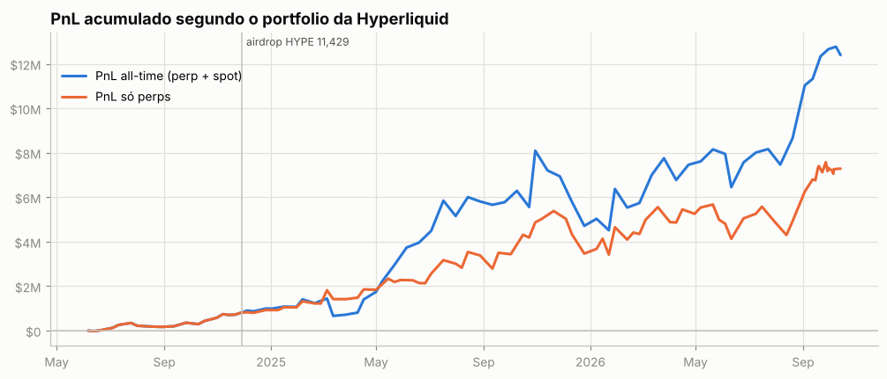

## 3. De onde veio o PnL

*Preço (aprox.)* usa a posição média diária de cada ativo, reconstruída a partir do histórico de funding (que traz o tamanho da posição a cada hora/dia desde o início da conta), vezes o movimento open→close do dia. Subestima o PnL de day trade, mas cobre o período sem fills. *Preço exato* marca cada fill no fechamento diário e só existe para o período coberto pelos fills.

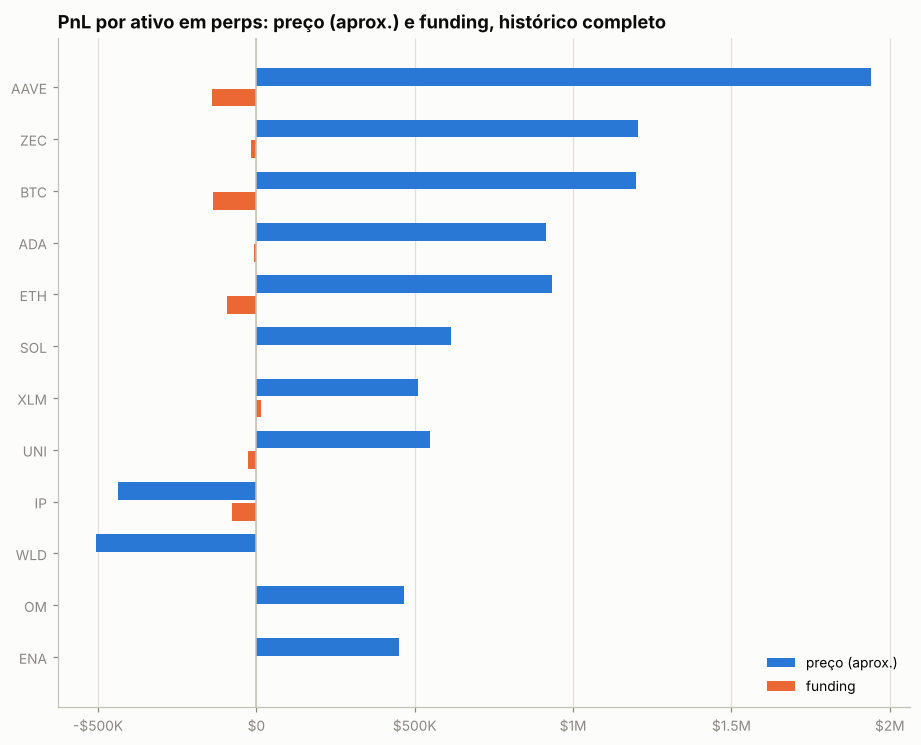

| ativo | preço (aprox.) | funding | total | preço exato (período dos fills) | taxas (período dos fills) |
|---|---|---|---|---|---|
| AAVE | +$1.94M | -$140.4K | +$1.80M | +$1.81M | -$1.0K |
| ZEC | +$1.21M | -$16.8K | +$1.19M | +$1.12M | -$1.7K |
| BTC | +$1.20M | -$135.5K | +$1.06M | +$608.0K | -$5.7K |
| ADA | +$914.8K | -$7.8K | +$907.0K | -$258.7K | -$164 |
| ETH | +$933.5K | -$91.9K | +$841.7K | -$76.5K | -$1.6K |
| SOL | +$614.1K | -$728 | +$613.4K | +$206.8K | -$3.2K |
| XLM | +$511.3K | +$14.1K | +$525.4K | -$14.7K | -$74 |
| UNI | +$548.0K | -$27.2K | +$520.8K | +$101.5K | -$535 |
| IP | -$437.4K | -$76.6K | -$514.0K | — | — |
| WLD | -$505.1K | -$1.7K | -$506.7K | +$4.4K | -$39 |
| OM | +$465.2K | +$196 | +$465.4K | — | — |
| ENA | +$448.9K | -$2.8K | +$446.1K | +$8.1K | -$302 |
| kBONK | -$422.3K | -$10.0K | -$432.3K | — | — |
| JUP | +$449.7K | -$21.5K | +$428.2K | +$252.0K | -$941 |
| PENDLE | +$447.6K | -$39.4K | +$408.1K | — | — |
| outros (77) | +$525.6K | -$329.4K | +$196.1K | -$243.8K | -$9.3K |

**Decomposição no período dos fills** (preço exato): quanto veio de *carregar* a posição (e, dentro disso, do viés médio vs. do *timing* de aumentar/reduzir), quanto de trades intradiários, funding e taxas.

| componente | AAVE | ZEC | BTC |
|---|---|---|---|
| carregar posição (carry) | +$1.81M | +$1.18M | +$737.2K |
|   ↳ viés (posição média × movimento) | +$1.58M | +$611.3K | +$257.7K |
|   ↳ timing (variação do tamanho) | +$235.0K | +$571.3K | +$479.5K |
| trades intradiários | +$3.5K | -$63.2K | -$129.3K |
| funding | -$71.0K | -$30.4K | -$30.1K |
| taxas | -$1.0K | -$1.7K | -$5.7K |
| posição média | 16,133.99 | 818.18 | 13.33 |
| movimento do preço no período | 97.62 | 747.12 | 19,331.00 |

## 4. Posições ao longo do tempo

Área clara: posição média diária (funding). Linha: posição exata (fills). Azul = long, vermelho = short.

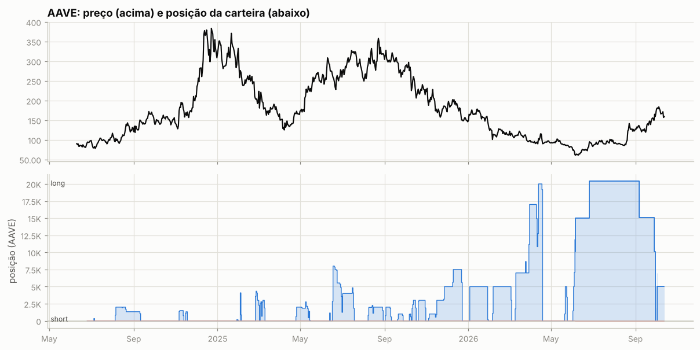

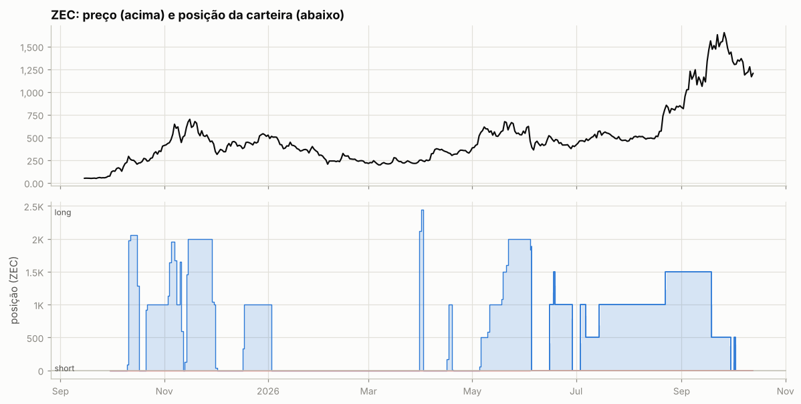

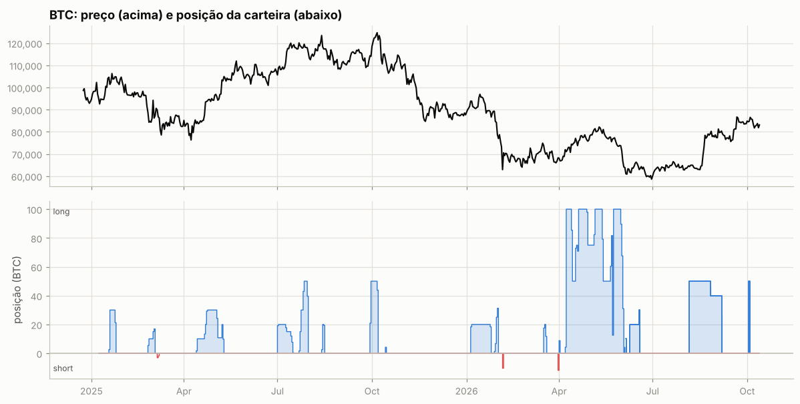

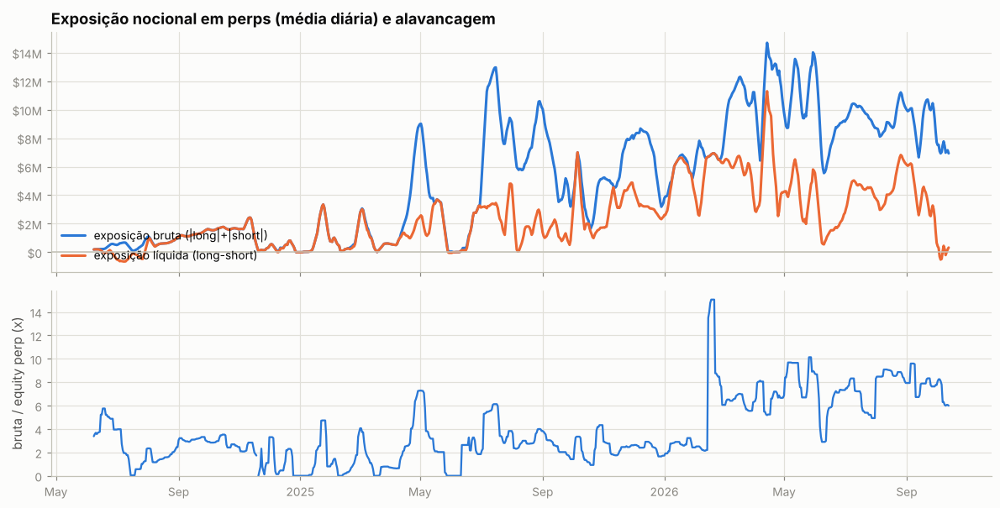

Tabela mensal de exposição e alavancagem

| mês | exposição bruta | exposição líquida | equity perp | alavancagem (mediana) |
|---|---|---|---|---|
| 2024-06 | $383.6K | -$56.4K | $88.8K | 4.0x |
| 2024-07 | $541.4K | -$196.8K | $433.7K | 1.3x |
| 2024-08 | $716.1K | $704.5K | $408.1K | 1.6x |
| 2024-09 | $1.31M | $1.31M | $427.6K | 3.1x |
| 2024-10 | $1.64M | $1.64M | $600.2K | 2.7x |
| 2024-11 | $1.02M | $1.01M | $406.3K | 2.1x |
| 2024-12 | $310.9K | $294.2K | $371.8K | 0.0x |
| 2025-01 | $1.19M | $1.19M | $629.9K | 0.8x |
| 2025-02 | $757.1K | $728.2K | $667.2K | 0.7x |
| 2025-03 | $943.7K | $900.8K | $834.2K | 0.8x |
| 2025-04 | $3.99M | $1.36M | $1.04M | 2.6x |
| 2025-05 | $3.14M | $1.90M | $1.21M | 2.1x |
| 2025-06 | $1.41M | $1.37M | $591.7K | 1.9x |
| 2025-07 | $10.35M | $3.17M | $2.35M | 4.8x |
| 2025-08 | $7.69M | $1.40M | $2.49M | 2.8x |
| 2025-09 | $5.13M | $1.48M | $2.47M | 2.1x |
| 2025-10 | $4.24M | $2.60M | $1.77M | 2.7x |
| 2025-11 | $6.35M | $3.91M | $2.73M | 2.5x |
| 2025-12 | $6.53M | $2.92M | $2.77M | 2.4x |
| 2026-01 | $5.96M | $5.41M | $2.29M | 2.8x |
| 2026-02 | $6.96M | $5.83M | $1.63M | 6.8x |
| 2026-03 | $11.25M | $5.69M | $1.77M | 6.4x |
| 2026-04 | $11.23M | $6.08M | $1.75M | 6.9x |
| 2026-05 | $11.63M | $4.43M | $1.32M | 8.9x |
| 2026-06 | $8.00M | $1.71M | $1.43M | 6.8x |
| 2026-07 | $9.72M | $4.46M | $1.51M | 7.0x |
| 2026-08 | $9.45M | $4.89M | $1.11M | 8.5x |
| 2026-09 | $9.10M | $3.47M | $1.12M | 8.0x |
| 2026-10 | $7.24M | $208.0K | $1.12M | 6.1x |

## 5. Execução

**Tipos de ordem** (últimas 975 ordens que a API guarda, 2026-01-09 → 2026-10-12):

| orderType | tif | reduceOnly | isTrigger | ordens |
|---|---|---|---|---|
| Limit | Alo | False | False | 396 |
| Limit | Gtc | False | False | 188 |
| Limit | Gtc | True | False | 192 |
| Market | FrontendMarket | False | False | 107 |
| Market | FrontendMarket | True | False | 70 |
| Market | LiquidationMarket | True | False | 2 |
| Take Profit Limit | Gtc | True | True | 1 |

`FrontendMarket` = ordem a mercado enviada pela interface web; `Gtc` = limite que fica no livro; gatilhos (`isTrigger`) seriam stop/take-profit.

**Perfil por ativo (top 10 por volume):**

| ativo | volume | ordens | % taker (nocional) | tamanho mediano |
|---|---|---|---|---|
| BTC | $20.89M | 11 | 91% | 10 |
| HYPE | $18.79M | 21 | 63% | 1e+04 |
| SOL | $10.51M | 10 | 91% | 1e+04 |
| ZEC | $7.21M | 15 | 76% | 500 |
| LIT | $6.10M | 13 | 43% | 1.996e+05 |
| JUP | $5.24M | 17 | 47% | 1e+06 |
| ETH | $4.96M | 2 | 100% | 1,000 |
| AAVE | $4.35M | 9 | 71% | 5,000 |
| LDO | $3.64M | 21 | 55% | 2.152e+05 |
| NEAR | $3.50M | 4 | 13% | 3.43e+05 |

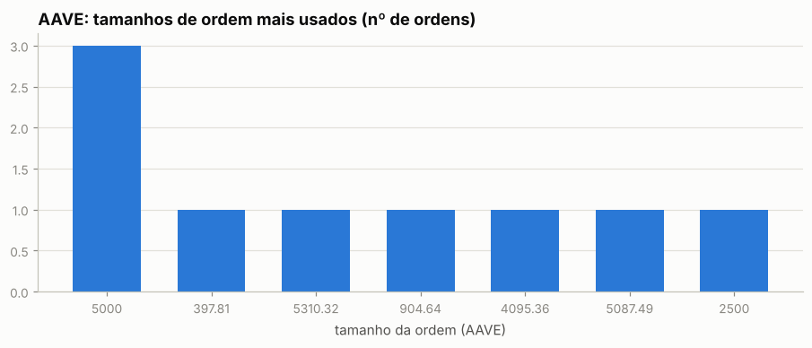

Os 5 tamanhos mais comuns respondem por 78% das ordens de AAVE — lotes redondos e repetidos são assinatura de execução manual.

Sessões (ordens separadas por < 30 min): 98; mediana de 1 ordens e 0.0 min por sessão; dias com atividade: 52 de 131.

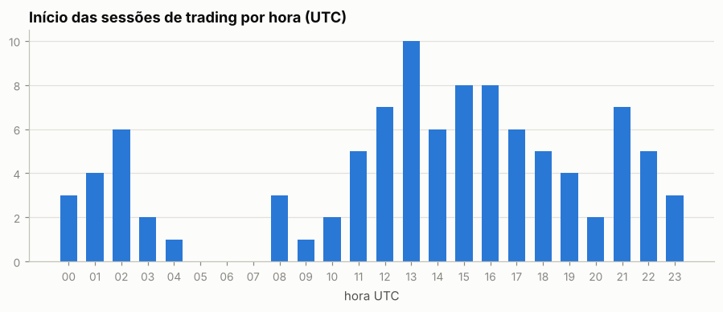

Por dia da semana: seg 19%, ter 15%, qua 17%, qui 16%, sex 20%, sáb 7%, dom 4%

## 6. Comportamento de entrada e saída

### AAVE

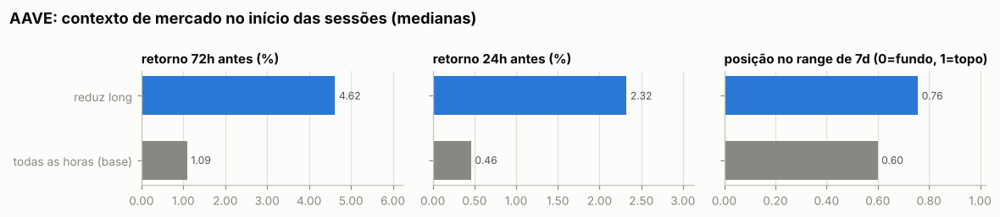

Por ordem (medianas):

| ação | ordens | retorno 24h antes | 72h antes | 7d antes | posição no range 7d | 24h depois | 7d depois |
|---|---|---|---|---|---|---|---|
| aumenta long | 3 | +5.28% | +8.10% | +9.70% | 0.79 | +14.50% | +6.78% |
| reduz long | 6 | +4.77% | +6.36% | +14.21% | 0.79 | -2.94% | +7.06% |
| todas as horas (base) |  | +0.46% | +1.09% | +3.16% | 0.60 | +0.48% | +4.44% |

Por sessão (ordens a menos de 30 min uma da outra contam como uma decisão; p = teste de Mann-Whitney contra todas as horas do período):

| sessão | sessões | retorno 24h antes | 72h antes | 7d antes | range 7d | no topo (>0,7) | no fundo (<0,3) |
|---|---|---|---|---|---|---|---|
| reduz long | 3 | +2.32% (p=0.401) | +4.62% (p=0.383) | +11.13% (p=0.181) | 0.76 (p=0.246) | 100% | 0% |
| todas as horas (base) |  |  |  |  |  | 38% | 28% |

- Aumentos de posição feitos com a posição no prejuízo (preço pior que o preço médio): **0%** das ordens (0% do tamanho); distância mediana do preço médio: -29.65%.
- Reduções/fechamentos com lucro: **100%** de 6; ganho médio $278.2K vs. perda média —; realizado +$1.67M.

- Episódios (de zerado a zerado, ou até inverter): 2; fechados com lucro: 100%; duração mediana 116.1 dias; o melhor episódio sozinho = 100% da soma dos episódios lucrativos.

Maiores episódios por PnL realizado

| início | fim | dias | lado | tam_max | nocional_max | ordens | entrada | saída | realizado |
|---|---|---|---|---|---|---|---|---|---|
| 2026-06-05 | 2026-09-29 | 116.1 | long | 20,398 | $2.73M | 8 | 72.84 | 154.30 | +$1.65M |
| 2026-10-02 | 2026-10-02 | 0.0 | long | 7,500 | $1.34M | 1 | — | 178.42 | +$18.2K |

### ZEC

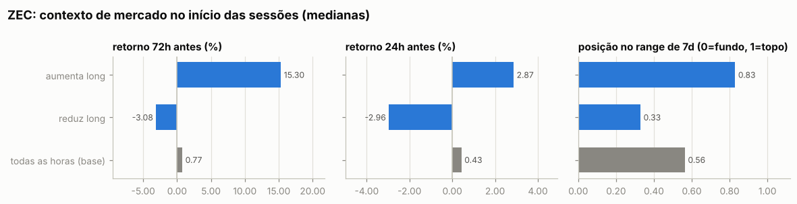

Por ordem (medianas):

| ação | ordens | retorno 24h antes | 72h antes | 7d antes | posição no range 7d | 24h depois | 7d depois |
|---|---|---|---|---|---|---|---|
| aumenta long | 6 | +2.87% | +15.30% | +14.93% | 0.83 | +1.52% | -6.22% |
| reduz long | 9 | -3.88% | -3.46% | -5.98% | 0.12 | +3.59% | -3.00% |
| todas as horas (base) |  | +0.43% | +0.77% | +5.95% | 0.56 | +0.43% | +5.95% |

Por sessão (ordens a menos de 30 min uma da outra contam como uma decisão; p = teste de Mann-Whitney contra todas as horas do período):

| sessão | sessões | retorno 24h antes | 72h antes | 7d antes | range 7d | no topo (>0,7) | no fundo (<0,3) |
|---|---|---|---|---|---|---|---|
| aumenta long | 6 | +2.87% (p=0.461) | +15.30% (p=0.059) | +14.93% (p=0.156) | 0.83 (p=0.240) | 67% | 17% |
| reduz long | 8 | -2.96% (p=0.246) | -3.08% (p=0.243) | +2.91% (p=0.863) | 0.33 (p=0.257) | 38% | 50% |
| todas as horas (base) |  |  |  |  |  | 41% | 23% |

- Aumentos de posição feitos com a posição no prejuízo (preço pior que o preço médio): **33%** das ordens (33% do tamanho); distância mediana do preço médio: -14.80%.
- Reduções/fechamentos com lucro: **33%** de 9; ganho médio $423.8K vs. perda média -$64.3K; realizado +$885.6K.

- Episódios (de zerado a zerado, ou até inverter): 4; fechados com lucro: 25%; duração mediana 7.1 dias; o melhor episódio sozinho = 100% da soma dos episódios lucrativos.

Maiores episódios por PnL realizado

| início | fim | dias | lado | tam_max | nocional_max | ordens | entrada | saída | realizado |
|---|---|---|---|---|---|---|---|---|---|
| 2026-07-03 | 2026-09-29 | 88.2 | long | 1,500 | $2.21M | 7 | 563.75 | 1,196 | +$1.26M |
| 2026-06-04 | 2026-06-04 | 0.0 | long | 2,000 | $966.9K | 2 | — | 481.92 | -$188.7K |
| 2026-06-15 | 2026-06-28 | 13.2 | long | 1,500 | $723.0K | 4 | 515.21 | 414.52 | -$151.0K |
| 2026-10-01 | 2026-10-02 | 1.0 | long | 500.00 | $685.0K | 2 | 1,370 | 1,292 | -$39.2K |

### BTC

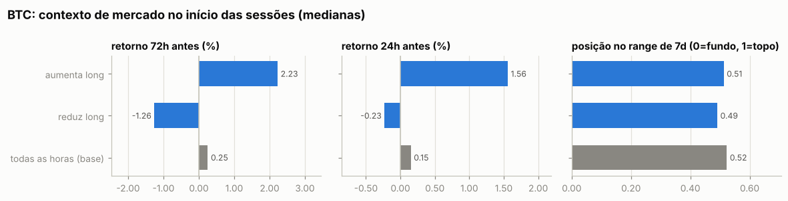

Por ordem (medianas):

| ação | ordens | retorno 24h antes | 72h antes | 7d antes | posição no range 7d | 24h depois | 7d depois |
|---|---|---|---|---|---|---|---|
| aumenta long | 6 | +1.56% | +2.23% | -4.86% | 0.51 | -2.03% | -1.32% |
| reduz long | 5 | -0.23% | -1.26% | +0.97% | 0.49 | -0.46% | -1.98% |
| todas as horas (base) |  | +0.15% | +0.25% | +0.57% | 0.52 | +0.17% | +0.73% |

Por sessão (ordens a menos de 30 min uma da outra contam como uma decisão; p = teste de Mann-Whitney contra todas as horas do período):

| sessão | sessões | retorno 24h antes | 72h antes | 7d antes | range 7d | no topo (>0,7) | no fundo (<0,3) |
|---|---|---|---|---|---|---|---|
| aumenta long | 6 | +1.56% (p=0.411) | +2.23% (p=0.193) | -4.86% (p=0.197) | 0.51 (p=0.965) | 33% | 17% |
| reduz long | 5 | -0.23% (p=0.316) | -1.26% (p=0.163) | +0.97% (p=0.780) | 0.49 (p=0.666) | 20% | 20% |
| todas as horas (base) |  |  |  |  |  | 38% | 32% |

- Aumentos de posição feitos com a posição no prejuízo (preço pior que o preço médio): **0%** das ordens (0% do tamanho); distância mediana do preço médio: -1.64%.
- Reduções/fechamentos com lucro: **40%** de 5; ganho médio $368.9K vs. perda média -$43.3K; realizado +$608.0K.

- Episódios (de zerado a zerado, ou até inverter): 4; fechados com lucro: 25%; duração mediana 5.7 dias; o melhor episódio sozinho = 100% da soma dos episódios lucrativos.

Maiores episódios por PnL realizado

| início | fim | dias | lado | tam_max | nocional_max | ordens | entrada | saída | realizado |
|---|---|---|---|---|---|---|---|---|---|
| 2026-08-05 | 2026-09-06 | 32.0 | long | 50.00 | $3.92M | 3 | 64,671 | 79,428 | +$737.8K |
| 2026-10-02 | 2026-10-03 | 1.4 | long | 50.00 | $4.34M | 2 | 86,823 | 84,717 | -$105.3K |
| 2026-06-04 | 2026-06-05 | 0.9 | long | 10.00 | $641.1K | 2 | 64,108 | 62,506 | -$16.0K |
| 2026-06-08 | 2026-06-18 | 10.0 | long | 30.00 | $1.96M | 4 | 64,148 | 63,863 | -$8.5K |

### Todos os episódios relevantes (todas as moedas)

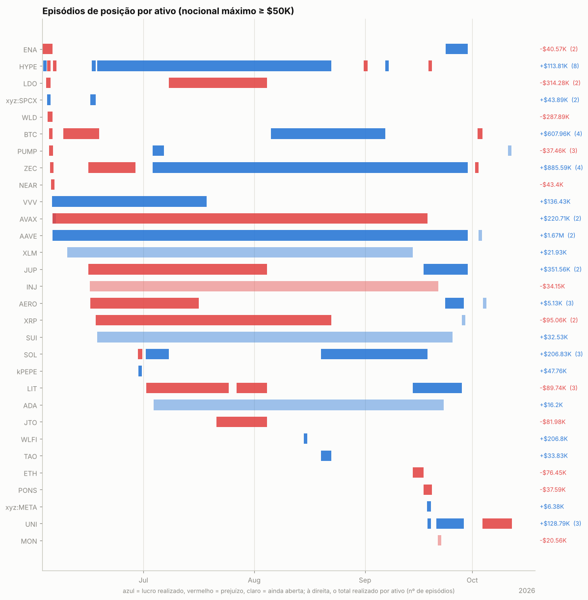

Episódios com nocional máximo ≥ $50K: 60; fechados com lucro: 47%. Abaixo, os 25 maiores por PnL realizado, em ordem de data. *7d/30d antes* e *vs. máx. 30d*: o que o preço tinha feito até a primeira ordem; *funding a.a.*: taxa anualizada nas 24h anteriores (positiva = longs pagam shorts); *entrada média vs. 1ª ordem*: positivo = foi aumentando a posição com o preço indo contra; *contra (máx.)*: quanto o preço andou contra a primeira ordem durante o episódio; *capturado*: movimento entre o preço médio de entrada e o de saída.

| ativo | lado | início | dias | nocional máx. | 7d antes | 30d antes | vs. máx. 30d | funding a.a. na entrada | entrada média vs. 1ª ordem | contra (máx.) | pior PnL aberto | capturado | realizado | funding |
|---|---|---|---|---|---|---|---|---|---|---|---|---|---|---|
| ENA | long | 2026-06-02 | 3 | $659.9K | -18% | -17% | -39% | +11% | -0% | +13% | -$83.4K | -8% | -$50.3K | -$519 |
| LDO | long | 2026-06-03 | 1 | $1.66M | -10% | -16% | -30% | +11% | — | +9% | -$56.3K | — | -$144.2K | -$561 |
| WLD | short | 2026-06-04 | 1 | $553.4K | +59% | +129% | +0% | +27% | — | +5% | -$19.3K | — | -$287.9K | +$287 |
| ZEC | long | 2026-06-04 | 0 | $966.9K | -6% | +6% | -24% | +4% | — | +4% | -$0 | — | -$188.7K | -$52 |
| VVV | long | 2026-06-05 | 43 | $1.71M | -1% | +45% | -26% | +8% | +10% | +36% | -$172.8K | +7% | +$136.4K | +$7.1K |
| AVAX | long | 2026-06-05 | 0 | $700.0K | -20% | -27% | -32% | +7% | — | -1% | -$7.9K | — | +$277.5K | -$69 |
| AVAX | short | 2026-06-05 | 105 | $680.6K | -20% | -27% | -32% | +7% | -1% | +16% | -$67.0K | -6% | -$56.8K | +$990 |
| AAVE | long | 2026-06-05 | 116 | $2.73M | -23% | -33% | -39% | +8% | -16% | +7% | -$65.3K | +112% | +$1.65M | -$68.0K |
| ZEC | long | 2026-06-15 | 13 | $723.0K | +24% | +7% | -22% | +6% | +3% | +29% | -$130.6K | -20% | -$151.0K | -$1.8K |
| JUP | long | 2026-06-15 | 50 | $1.40M | +19% | -5% | -14% | +6% | -8% | +5% | -$60.4K | -6% | -$55.3K | -$7.1K |
| HYPE | short | 2026-06-16 | 0 | $1.47M | +25% | +77% | -2% | +24% | — | +2% | -$2.9K | — | +$123.6K | -$734 |
| XRP | short | 2026-06-17 | 66 | $453.3K | +8% | -14% | -14% | -2% | +0% | +31% | -$111.5K | -27% | -$95.1K | +$3.0K |
| kPEPE | long | 2026-06-29 | 0 | $237.1K | -18% | -31% | -32% | -24% | — | +1% | $0 | — | +$47.8K | -$104 |
| LIT | long | 2026-07-01 | 23 | $1.20M | +16% | +41% | -10% | +7% | -12% | -3% | -$87.1K | -4% | -$66.7K | -$5.9K |
| ZEC | long | 2026-07-03 | 88 | $2.21M | +15% | -26% | -27% | +13% | -22% | +4% | -$41.9K | +112% | +$1.26M | -$27.4K |
| LDO | long | 2026-07-08 | 27 | $1.86M | +30% | +15% | -1% | +18% | -10% | +11% | -$188.4K | -17% | -$170.1K | -$12.9K |
| JTO | long | 2026-07-21 | 14 | $838.7K | -6% | -15% | -30% | +11% | -3% | +20% | -$84.6K | -10% | -$82.0K | -$2.0K |
| BTC | long | 2026-08-05 | 32 | $3.92M | +1% | +1% | -4% | +2% | -0% | +3% | -$103.3K | +23% | +$737.8K | -$26.2K |
| WLFI | long | 2026-08-14 | 0 | $487.8K | +7% | -4% | -15% | +11% | — | +1% | +$6.3K | — | +$206.8K | +$129 |
| SOL | long | 2026-08-19 | 30 | $2.14M | +8% | +5% | +0% | +5% | -18% | -0% | -$20.0K | +7% | +$210.5K | -$6.8K |
| ETH | long | 2026-09-14 | 3 | $2.52M | +1% | +34% | -4% | +10% | -0% | +5% | -$130.7K | -3% | -$76.5K | -$1.4K |
| JUP | long | 2026-09-17 | 12 | $2.02M | -3% | +34% | -19% | +3% | -13% | +1% | -$8.1K | +26% | +$406.9K | -$8.9K |
| UNI | short | 2026-09-18 | 0 | $873.1K | +44% | +164% | +0% | +19% | — | -0% | -$5.2K | — | +$168.5K | -$406 |
| BTC | long | 2026-10-02 | 1 | $4.34M | +2% | +12% | -1% | +9% | -0% | +3% | -$129.5K | -2% | -$105.3K | -$1.3K |
| UNI | long | 2026-10-03 | 8 | $449.6K | -6% | +45% | -16% | +11% | -0% | +21% | -$96.0K | -15% | -$66.0K | -$1.0K |

## 7. Funding

Funding líquido total: **-$887.3K** (recebido $406.3K, pago -$1.29M). Na Hyperliquid o funding é pago de hora em hora; quando positivo, longs pagam shorts.

| ativo | lado | funding | rendimento anualizado s/ nocional |
|---|---|---|---|
| AAVE | long | -$140.4K | -11.3% |
| ZEC | long | -$16.8K | -4.2% |
| BTC | short | +$188 | 3.6% |
| BTC | long | -$135.7K | -7.0% |
| (outros) | short | -$50.0K | -1.6% |
| (outros) | long | -$544.7K | -10.2% |

## 8. Fluxos, eventos e carteiras relacionadas

| tipo | eventos | USD (+ entra / − sai) |
|---|---|---|
| send | 38 | -$9.85M |
| withdraw | 12 | -$5.87M |
| cStakingTransfer | 8 | — (sem valor em USD) |
| accountClassTransfer | 65 | — (sem valor em USD) |
| subAccountTransfer | 1 | — (sem valor em USD) |
| spotGenesis | 5 | — (sem valor em USD) |
| activateDexAbstraction | 1 | — (sem valor em USD) |
| spotTransfer | 33 | +$2.07M |
| deposit | 28 | +$6.50M |

**Gestão de margem.** Dias com depósito: 23; em 57% deles o PnL dos 3 dias anteriores era negativo (mediana -$11.1K). Dias com saque: 35; em 63% deles o PnL dos 3 dias anteriores era positivo (mediana +$65.8K). Base: 45% de todos os dias vêm depois de 3 dias negativos. Correlação entre o fluxo do dia e a variação da exposição bruta: 0.08 (positiva = deposita para abrir posição e saca ao reduzir).

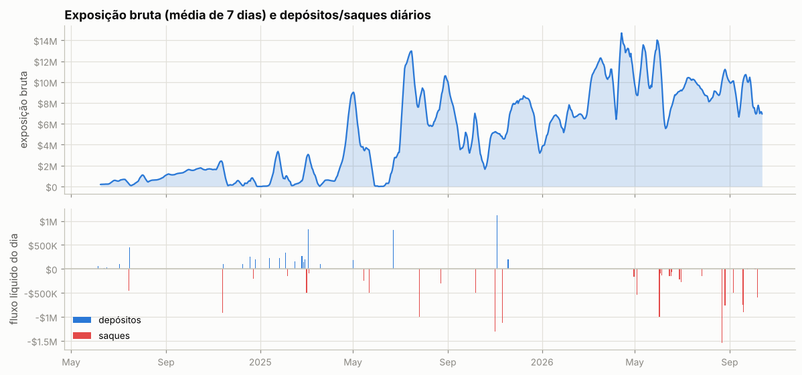

Ponte HyperCore↔HyperEVM (endereços de sistema `0x2000…`/`0x2222…`): 18 transferências, entrada $3.46M, saída $5.91M — uso de DeFi na HyperEVM.

**Carteiras relacionadas** (conta vinculada de staking para desconto de taxa + maiores contrapartes de transferências; o saldo de staking e o PnL ajudam a ver se posições aqui são hedge de algo mantido lá):

| carteira | relação | transferências | volume transferido | valor da conta hoje | PnL all-time | HYPE em staking | maiores saldos spot |
|---|---|---|---|---|---|---|---|
| `0x1f0e3fc170f83be0e080c171ded8c57c80d96aef` | transfers | 15 | $2.17M | $0 | -$4.6K | 0 | — |
| `0xe8371d0a58b6e12d36ed5325950d229e909aa328` | transfers | 2 | $1.54M | $0 | -$4.4K | 0 | USDC 0 |
| `0x81c6280de484c0bcad41d3bd474d44e832d2ddd6` | transfers | 4 | $1.49M | $0 | +$4.8K | 0 | — |
| `0xc8e06ebfbfaf1b1720dfae86a0fc979e5649823e` | transfers | 2 | $769.0K | $0 | -$829 | 0 | — |
| `0xa822a9ceb6d6cb5b565bd10098abcfa9cf18d748` | transfers | 4 | $405.1K | $16,221.12M | -$6,234.56M | 0 | UBONK 88,765,611,412,586, UPUMP 990,689,682,835, UDZ 9,998,579,464 |
| `0xfa2dbdbee70ff0b29171670573a1fff1a02d1ca2` | transfers | 1 | $249.5K | $2 | -$483 | 0 | USDC 1, USOL 0, HYPE 0 |

## 9. Dá para copiar? (espelhar a posição com atraso)

PnL de quem replicasse exatamente a posição da carteira, mas com N horas de atraso (marcação horária, sem custos). Se o PnL se mantém com atraso, a vantagem está em horizontes longos e é copiável; se desaba, depende de timing fino.

| atraso | AAVE | ZEC | BTC |
|---|---|---|---|
| 0h | +$1.67M | +$1.08M | +$609.3K |
| 1h | +$1.65M | +$1.08M | +$599.8K |
| 4h | +$1.68M | +$1.08M | +$644.2K |
| 12h | +$1.61M | +$1.17M | +$732.8K |
| 24h | +$1.53M | +$1.21M | +$815.4K |
| 72h | +$1.78M | +$1.27M | +$695.4K |
| 168h | +$1.92M | +$1.37M | +$490.2K |

## 10. Teste de replicação por regras (AAVE)

Regra testada: *short-bias com filtro de tendência e fade* — short de até 1.7e+04 AAVE (o percentil 90 do tamanho real), cheio abaixo da média móvel e reduzido acima; dentro do regime, mais short perto do topo do range e menos perto do fundo. Parâmetros escolhidos no treino (2024-06-08 → 2025-08-10) e avaliados no teste (2025-08-11 → 2026-10-12).

|  | parâmetros | PnL treino | PnL teste | correlação c/ posição real (teste) |
|---|---|---|---|---|
| melhor regra no treino | MA100, range 7d, fração em alta 0.0, fade 0.9 | +$894.5K | +$1.59M | 0.21 |
| carteira real (aprox.) | — | +$590.9K | +$1.20M | 1.00 |

Clone comportamental (regressão linear da posição real em médias móveis, ranges e retornos): R² treino 0.30, R² teste -0.61, correlação no teste 0.03.

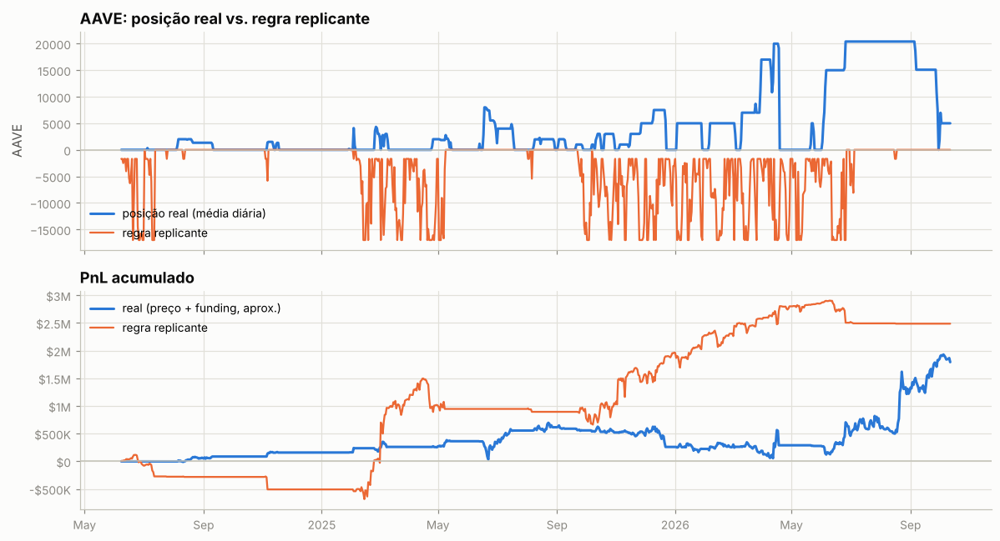

---

Metodologia e código: ver `README.md` na raiz do repositório.
