# Relatório automático — `0x07fd993f0fa3a185f7207adccd29f7a87404689d`

Gerado em 2026-10-16 16:36 UTC a partir da API pública da Hyperliquid (`POST /info`). Valores em USD. Este arquivo é regenerado por `python -m hlre.report`; a interpretação da estratégia fica em `ANALISE.md`.

## 1. Visão geral

| métrica | valor |
|---|---|
| Valor da conta (perp + spot) | $9.11M |
| PnL all-time (portfolio, inclui spot/airdrops) | +$275.4K |
| PnL all-time só de perps | +$275.4K |
| Volume all-time | $1,022.92M |
| Primeira atividade | 2025-01-29 |
| Fills disponíveis na API | 24,011 (desde 2026-10-13) |
| Ordens (fills agrupados por oid) | 3,465 |
| Funding líquido (recebido > 0) | -$2.38M |
| Taxas pagas (período dos fills) | -$926 |
| Liquidações (ledger) | 0 |
| Fills de liquidação/ADL | 0 |
| Papel da conta | vault |
| API wallets (agentes) | 0 |

**Posições abertas agora:**

| ativo | tamanho | nocional | entrada | alav. | PnL não realizado | liq. |
|---|---|---|---|---|---|---|
| BTC | 17.24764 | $1.41M | 77083.8 | 40x cross | +$78.5K | — |
| ETH | 1079.017 | $2.64M | 2433.96 | 25x cross | +$10.2K | — |
| ATOM | -422116.11 | $737.8K | 1.8225 | 5x cross | +$31.6K | 15.5204285476 |
| SOL | 4567.8 | $477.1K | 104.4831 | 20x cross | -$197 | — |
| AVAX | -54810.69 | $555.5K | 10.4179 | 10x cross | +$15.6K | 121.2526300772 |
| BNB | 1696.634 | $1.23M | 715.3 | 10x cross | +$16.8K | — |
| APE | -1187982.4 | $180.6K | 0.15274 | 5x cross | +$864 | 5.0457359229 |
| OP | -4452621.7 | $620.7K | 0.13846 | 5x cross | -$4.2K | 1.4450686102 |
| DOGE | 2851281.0 | $230.9K | 0.088783 | 10x cross | -$22.3K | — |
| SUI | -336997.7 | $346.5K | 1.02221 | 10x cross | -$2.1K | 19.1011203674 |
| kPEPE | 79647896.0 | $319.0K | 0.004252 | 10x cross | -$19.7K | — |
| CRV | -627602.2 | $218.6K | 0.36 | 10x cross | +$7.4K | 10.0526676876 |
| LDO | 2941693.5 | $1.19M | 0.42921 | 5x cross | -$73.4K | — |
| XRP | -118447.0 | $155.6K | 1.448752 | 20x cross | +$16.0K | 53.987662426 |
| APT | -320210.84 | $273.7K | 0.814 | 10x cross | -$13.1K | 19.8750454932 |
| AAVE | 12280.14 | $1.94M | 152.8785 | 10x cross | +$59.9K | — |
| WLD | -779794.2 | $401.5K | 0.42063 | 10x cross | -$73.5K | 8.3252996955 |
| UNI | 44065.4 | $321.6K | 8.34601 | 10x cross | -$46.2K | — |
| SEI | -5272015.0 | $342.5K | 0.066234 | 5x cross | +$6.7K | 1.1677024518 |
| ZRO | -350639.1 | $741.6K | 1.2079 | 5x cross | -$318.1K | 18.6952286115 |
| DOT | -116306.8 | $137.6K | 1.15871 | 10x cross | -$2.8K | 52.2868441733 |
| BLUR | -9773594.0 | $103.3K | 0.014321 | 3x cross | +$36.7K | 0.5714087853 |
| TIA | -1429520.3 | $976.5K | 0.50689 | 5x cross | -$251.9K | 4.7499326267 |
| MINA | -6209878.0 | $460.2K | 0.068748 | 3x cross | -$33.3K | 0.9568068755 |
| PENDLE | 571532.0 | $1.21M | 2.315294 | 5x cross | -$112.4K | — |
| NEAR | -55117.0 | $281.4K | 5.10535 | 10x cross | +$24 | 115.6060137894 |
| MEME | -207423612.0 | $105.8K | 0.000562 | 3x cross | +$10.8K | 0.0269363063 |
| FIL | -537166.8 | $626.4K | 1.09889 | 5x cross | -$36.2K | 11.988999151 |
| kBONK | -35881433.0 | $109.8K | 0.003534 | 10x cross | +$17.0K | 0.1727992851 |
| JTO | -323839.0 | $153.5K | 0.371378 | 5x cross | -$33.3K | 18.4263599509 |
| XAI | -4748174.1 | $40.5K | 0.01121 | 3x cross | +$12.7K | 1.1629711123 |
| ONDO | -356994.0 | $163.4K | 0.48996 | 10x cross | +$11.5K | 17.1039618265 |
| ALT | -46895287.0 | $384.8K | 0.007687 | 3x cross | -$24.3K | 0.1250927973 |
| ZETA | -4560240.6 | $198.5K | 0.04628 | 3x cross | +$12.5K | 1.2455367335 |
| DYM | -3780909.4 | $70.1K | 0.01949 | 3x cross | +$3.6K | 1.4683175897 |
| W | -44946626.8 | $653.1K | 0.01464 | 5x cross | +$5.2K | 0.1438755995 |
| STRK | -9451467.5 | $701.0K | 0.04208 | 5x cross | -$303.3K | 0.6892753672 |
| ETHFI | -466827.5 | $324.0K | 0.70886 | 5x cross | +$6.9K | 13.1475459534 |
| SAGA | -111319.8 | $2.2K | 0.02806 | 3x cross | +$892 | 49.2605257083 |
| IO | -2167081.4 | $345.8K | 0.16402 | 3x cross | +$9.7K | 2.6889611738 |
| POL | 13379428.0 | $1.27M | 0.105317 | 5x cross | -$136.6K | — |
| GRASS | -698728.1 | $457.9K | 0.45771 | 3x cross | -$138.1K | 8.5002825913 |
| PURR | 8645378.0 | $860.4K | 0.138687 | 3x cross | -$338.6K | — |
| XLM | 4197195.0 | $762.5K | 0.203239 | 5x cross | -$90.5K | — |
| IOTA | -3978921.0 | $191.7K | 0.050849 | 3x cross | +$10.6K | 1.4257986883 |
| ALGO | 4293283.0 | $503.1K | 0.117814 | 5x cross | -$2.7K | — |
| HYPE | 11784.21 | $933.0K | 82.4164 | 10x cross | -$38.2K | — |
| FARTCOIN | 1008135.9 | $156.5K | 0.17141 | 10x cross | -$16.3K | — |
| MORPHO | -83230.1 | $197.9K | 2.55585 | 5x cross | +$14.8K | 72.2283112096 |
| TRUMP | -233257.1 | $426.7K | 2.05551 | 10x cross | +$52.8K | 27.9399255132 |
| MELANIA | -3055626.5 | $261.3K | 0.09952 | 3x cross | +$42.8K | 1.8793841373 |
| ANIME | -12603945.0 | $38.0K | 0.003274 | 3x cross | +$3.3K | 0.4379137486 |
| BERA | -1987215.5 | $390.0K | 0.22983 | 5x cross | +$66.7K | 3.1217948799 |
| LAYER | -49632.0 | $3.4K | 0.107397 | 3x cross | +$1.9K | 110.5100166893 |
| PAXG | 228.326 | $951.1K | 4471.766 | 5x cross | -$69.9K | — |
| RESOLV | -4.0 | $0 | 0.034927 | 3x cross | +$0 | 1370359.9944891427 |
| WLFI | -9467645.0 | $539.9K | 0.057245 | 5x cross | +$2.1K | 0.6710783279 |
| STBL | -12043802.0 | $294.3K | 0.029233 | 3x cross | +$57.8K | 0.4795603755 |
| AERO | -247102.0 | $216.6K | 0.553179 | 3x cross | -$79.9K | 23.0596238525 |
| XMR | 5344.348 | $2.97M | 535.984 | 5x cross | +$102.5K | — |

## 2. Curva de PnL

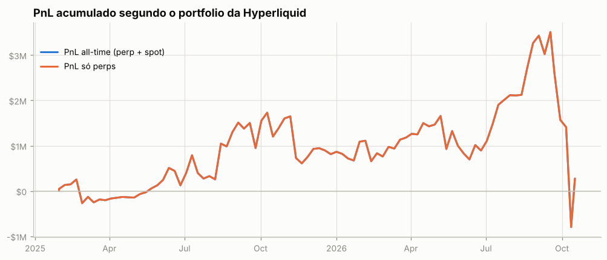

**Atenção: execuções que não aparecem nos fills.** A posição muda sem fill visível em 63 pontos (~$127.7K de nocional; maiores: W $127.7K). O mais comum são fatias de TWAP: ficam fora de `userFills` e o endpoint de TWAP só guarda as 2.000 mais recentes. O *preço exato* e as tabelas por episódio dessas moedas não são exatos.

## 3. De onde veio o PnL

*Preço (aprox.)* usa a posição média diária de cada ativo, reconstruída a partir do histórico de funding (que traz o tamanho da posição a cada hora/dia desde o início da conta), vezes o movimento open→close do dia. Subestima o PnL de day trade, mas cobre o período sem fills. *Preço exato* marca cada fill no fechamento diário e só existe para o período coberto pelos fills.

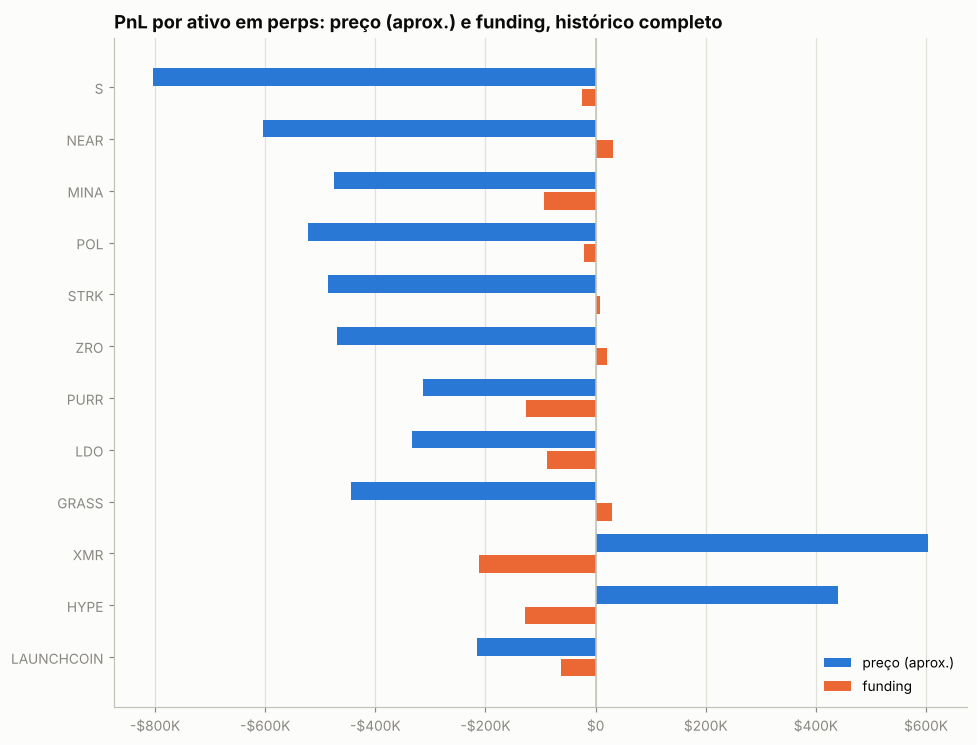

| ativo | preço (aprox.) | funding | total | preço exato (período dos fills) | taxas (período dos fills) |
|---|---|---|---|---|---|
| S | -$803.9K | -$24.4K | -$828.3K | — | — |
| NEAR | -$604.4K | +$31.5K | -$572.9K | -$1.2K | -$17 |
| MINA | -$475.9K | -$92.9K | -$568.8K | +$893 | -$12 |
| POL | -$522.8K | -$20.9K | -$543.7K | -$85.4K | -$17 |
| STRK | -$485.8K | +$8.4K | -$477.3K | — | — |
| ZRO | -$470.1K | +$21.4K | -$448.7K | — | — |
| PURR | -$313.3K | -$126.5K | -$439.8K | -$103.6K | -$11 |
| LDO | -$334.2K | -$88.3K | -$422.5K | -$77.0K | -$34 |
| GRASS | -$444.0K | +$30.0K | -$414.0K | — | — |
| XMR | +$603.4K | -$212.6K | +$390.7K | +$41.4K | -$38 |
| HYPE | +$440.1K | -$128.0K | +$312.2K | -$25.4K | -$14 |
| LAUNCHCOIN | -$215.7K | -$62.6K | -$278.2K | — | — |
| BTC | -$161.0K | -$102.2K | -$263.2K | +$284 | -$6 |
| RESOLV | -$180.7K | -$76.4K | -$257.1K | — | — |
| SEI | -$231.3K | -$2.1K | -$233.4K | -$1.3K | -$18 |
| outros (56) | +$1.65M | -$1.53M | +$116.0K | +$96.0K | -$760 |

**Decomposição no período dos fills** (preço exato): quanto veio de *carregar* a posição (e, dentro disso, do viés médio vs. do *timing* de aumentar/reduzir), quanto de trades intradiários, funding e taxas.

| componente | NEAR | MINA |
|---|---|---|
| carregar posição (carry) | -$2.2K | -$50 |
|   ↳ viés (posição média × movimento) | -$3.6K | -$50 |
|   ↳ timing (variação do tamanho) | +$1.4K | +$0 |
| trades intradiários | +$1.0K | +$943 |
| funding | +$215 | -$1.3K |
| taxas | -$17 | -$12 |
| posição média | -55,373.40 | -6,224,320.00 |
| movimento do preço no período | 0.06 | 0.00 |

## 4. Posições ao longo do tempo

Área clara: posição média diária (funding). Linha: posição exata (fills). Azul = long, vermelho = short.

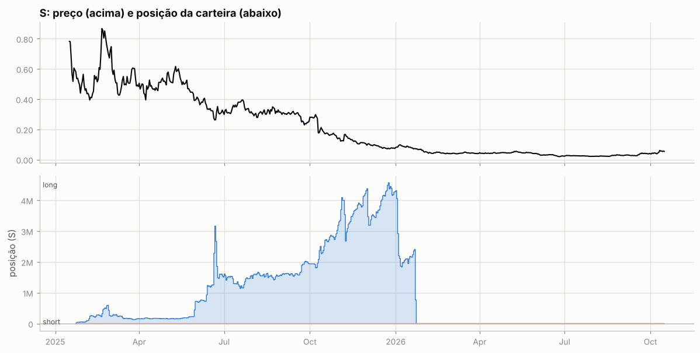

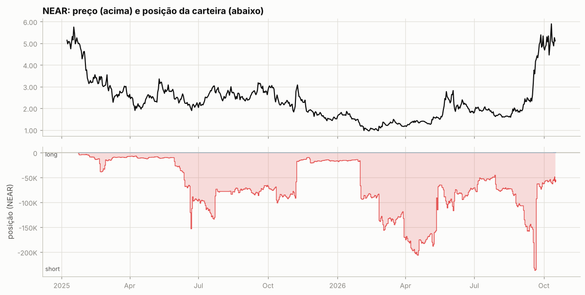

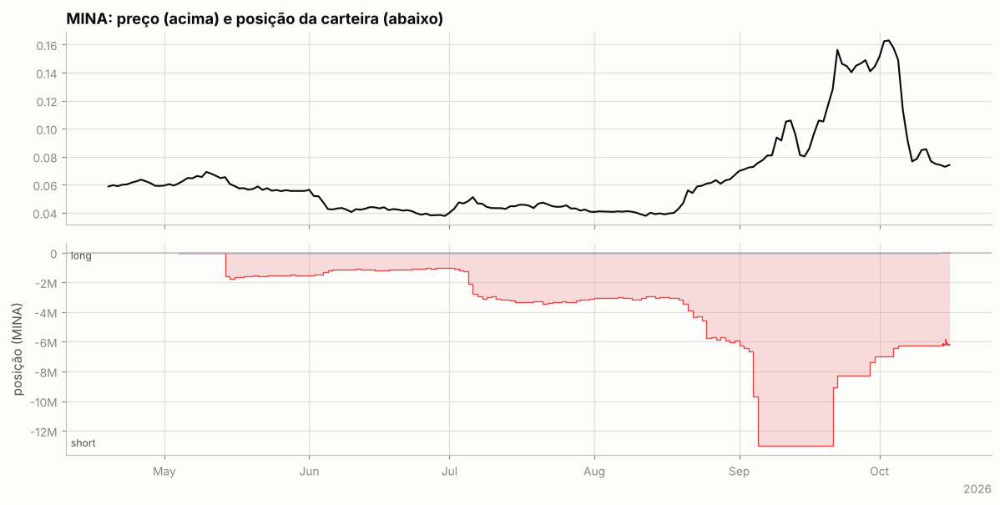

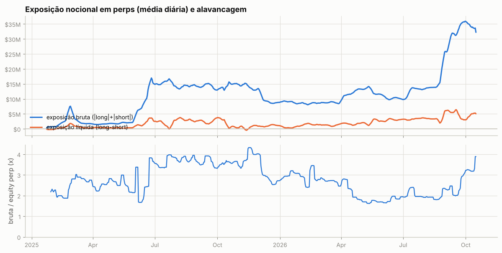

Tabela mensal de exposição e alavancagem

| mês | exposição bruta | exposição líquida | equity perp | alavancagem (mediana) |
|---|---|---|---|---|
| 2025-01 | $689.5K | -$199.7K | $314.9K | 2.3x |
| 2025-02 | $3.38M | $745.9K | $1.55M | 2.0x |
| 2025-03 | $2.10M | $500.4K | $760.3K | 2.7x |
| 2025-04 | $1.65M | $383.8K | $650.0K | 2.6x |
| 2025-05 | $2.18M | $385.6K | $931.5K | 2.5x |
| 2025-06 | $11.04M | $2.21M | $3.89M | 2.5x |
| 2025-07 | $15.28M | $1.83M | $4.19M | 3.7x |
| 2025-08 | $14.20M | $3.01M | $3.78M | 3.7x |
| 2025-09 | $14.09M | $2.64M | $3.92M | 3.5x |
| 2025-10 | $14.50M | $1.42M | $4.04M | 3.6x |
| 2025-11 | $13.93M | $596.8K | $3.60M | 4.0x |
| 2025-12 | $9.06M | $1.07M | $3.26M | 2.7x |
| 2026-01 | $8.89M | $603.5K | $2.95M | 3.0x |
| 2026-02 | $8.53M | $1.51M | $3.03M | 2.8x |
| 2026-03 | $8.88M | $1.29M | $3.30M | 2.7x |
| 2026-04 | $12.23M | $1.70M | $5.87M | 2.0x |
| 2026-05 | $12.41M | $2.37M | $7.36M | 1.7x |
| 2026-06 | $10.12M | $3.05M | $5.49M | 1.9x |
| 2026-07 | $12.84M | $3.34M | $6.22M | 2.0x |
| 2026-08 | $16.85M | $3.62M | $8.30M | 1.9x |
| 2026-09 | $32.63M | $4.73M | $13.49M | 2.3x |
| 2026-10 | $33.33M | $4.86M | $10.08M | 3.2x |

## 5. Execução

**Tipos de ordem** (últimas 1,304 ordens que a API guarda, 2026-10-14 → 2026-10-16):

| orderType | tif | reduceOnly | isTrigger | ordens |
|---|---|---|---|---|
| Limit | Alo | False | False | 1304 |

`FrontendMarket` = ordem a mercado enviada pela interface web; `Gtc` = limite que fica no livro; gatilhos (`isTrigger`) seriam stop/take-profit.

**Perfil por ativo (top 10 por volume):**

| ativo | volume | ordens | % taker (nocional) | tamanho mediano |
|---|---|---|---|---|
| STBL | $1.39M | 446 | 0% | 9.593e+04 |
| W | $1.01M | 282 | 0% | 2.403e+05 |
| OP | $973.0K | 262 | 0% | 2.584e+04 |
| FIL | $649.5K | 202 | 0% | 2,818 |
| BERA | $647.6K | 127 | 0% | 2.18e+04 |
| XMR | $474.9K | 16 | 0% | 54.29 |
| TIA | $460.3K | 114 | 0% | 7,312 |
| LDO | $420.5K | 39 | 0% | 2.708e+04 |
| PENDLE | $408.4K | 39 | 0% | 5,022 |
| AAVE | $395.6K | 23 | 0% | 110 |

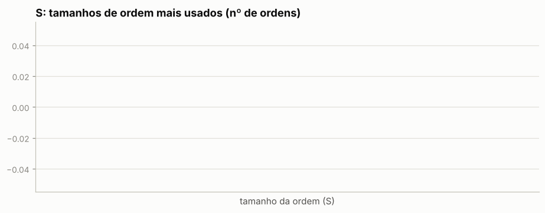

Os 5 tamanhos mais comuns respondem por — das ordens de S — lotes redondos e repetidos são assinatura de execução manual.

Sessões (ordens separadas por < 30 min): 4; mediana de 410 ordens e 749.0 min por sessão; dias com atividade: 4 de 3.

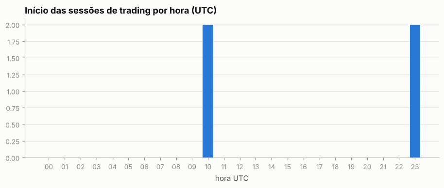

Por dia da semana: seg 0%, ter 50%, qua 50%, qui 0%, sex 0%, sáb 0%, dom 0%

## 6. Comportamento de entrada e saída

### NEAR

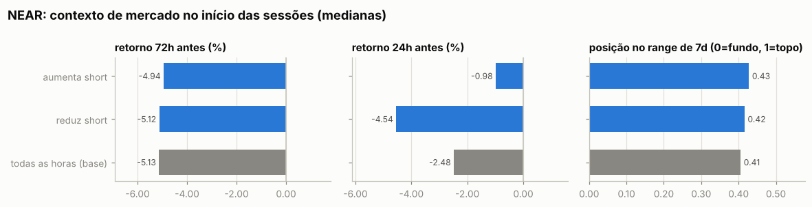

Por ordem (medianas):

| ação | ordens | retorno 24h antes | 72h antes | 7d antes | posição no range 7d | 24h depois | 7d depois |
|---|---|---|---|---|---|---|---|
| aumenta short | 41 | -2.65% | -6.94% | -1.93% | 0.38 | +0.31% | — |
| reduz short | 43 | -3.09% | -6.42% | -2.59% | 0.39 | -0.57% | — |
| todas as horas (base) |  | -2.48% | -5.13% | -1.07% | 0.41 | -1.05% | — |

Por sessão (ordens a menos de 30 min uma da outra contam como uma decisão; p = teste de Mann-Whitney contra todas as horas do período):

| sessão | sessões | retorno 24h antes | 72h antes | 7d antes | range 7d | no topo (>0,7) | no fundo (<0,3) |
|---|---|---|---|---|---|---|---|
| aumenta short | 17 | -0.98% (p=0.544) | -4.94% (p=0.874) | -0.56% (p=0.438) | 0.43 (p=0.766) | 0% | 24% |
| reduz short | 24 | -4.54% (p=0.796) | -5.12% (p=0.910) | -1.55% (p=0.790) | 0.42 (p=0.923) | 0% | 38% |
| todas as horas (base) |  |  |  |  |  | 0% | 26% |

- Aumentos de posição feitos com a posição no prejuízo (preço pior que o preço médio): **56%** das ordens (56% do tamanho); distância mediana do preço médio: +0.91%.
- Reduções/fechamentos com lucro: **79%** de 43; ganho médio $137 vs. perda média -$62; realizado +$4.1K.

- Episódios (de zerado a zerado, ou até inverter): 1; fechados com lucro: —; duração mediana nan dias; o melhor episódio sozinho = — da soma dos episódios lucrativos.

Maiores episódios por PnL realizado

| início | fim | dias | lado | tam_max | nocional_max | ordens | entrada | saída | realizado |
|---|---|---|---|---|---|---|---|---|---|
| 2026-10-13 | 2026-10-16 | 3.2 | short | 58,194 | $316.5K | 84 | 5.04 | 4.94 | +$4.1K |

### MINA

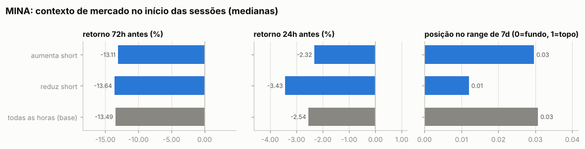

Por ordem (medianas):

| ação | ordens | retorno 24h antes | 72h antes | 7d antes | posição no range 7d | 24h depois | 7d depois |
|---|---|---|---|---|---|---|---|
| aumenta short | 35 | -3.37% | -12.03% | -23.02% | 0.00 | +1.88% | — |
| reduz short | 37 | -3.37% | -12.03% | -23.05% | 0.00 | +1.54% | — |
| todas as horas (base) |  | -2.54% | -13.49% | -20.35% | 0.03 | +1.50% | — |

Por sessão (ordens a menos de 30 min uma da outra contam como uma decisão; p = teste de Mann-Whitney contra todas as horas do período):

| sessão | sessões | retorno 24h antes | 72h antes | 7d antes | range 7d | no topo (>0,7) | no fundo (<0,3) |
|---|---|---|---|---|---|---|---|
| aumenta short | 6 | -2.32% (p=0.578) | -13.11% (p=0.753) | -17.61% (p=0.200) | 0.03 (p=0.923) | 0% | 100% |
| reduz short | 6 | -3.43% (p=0.267) | -13.64% (p=0.735) | -22.18% (p=0.246) | 0.01 (p=0.424) | 0% | 100% |
| todas as horas (base) |  |  |  |  |  | 0% | 100% |

- Aumentos de posição feitos com a posição no prejuízo (preço pior que o preço médio): **63%** das ordens (63% do tamanho); distância mediana do preço médio: +0.54%.
- Reduções/fechamentos com lucro: **0%** de 37; ganho médio — vs. perda média -$95; realizado -$3.5K.

- Episódios (de zerado a zerado, ou até inverter): 1; fechados com lucro: —; duração mediana nan dias; o melhor episódio sozinho = — da soma dos episódios lucrativos.

Maiores episódios por PnL realizado

| início | fim | dias | lado | tam_max | nocional_max | ordens | entrada | saída | realizado |
|---|---|---|---|---|---|---|---|---|---|
| 2026-10-14 | 2026-10-15 | 1.1 | short | 6,253,204 | $458.3K | 72 | 0.07238 | 0.07158 | -$3.5K |

### Todos os episódios relevantes (todas as moedas)

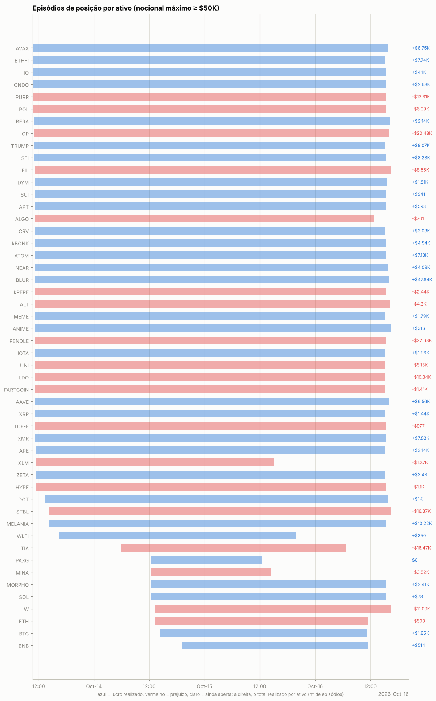

Episódios com nocional máximo ≥ $50K: 50; fechados com lucro: —. Abaixo, os 25 maiores por PnL realizado, em ordem de data. *7d/30d antes* e *vs. máx. 30d*: o que o preço tinha feito até a primeira ordem; *funding a.a.*: taxa anualizada nas 24h anteriores (positiva = longs pagam shorts); *entrada média vs. 1ª ordem*: positivo = foi aumentando a posição com o preço indo contra; *contra (máx.)*: quanto o preço andou contra a primeira ordem durante o episódio; *capturado*: movimento entre o preço médio de entrada e o de saída.

| ativo | lado | início | dias | nocional máx. | 7d antes | 30d antes | vs. máx. 30d | funding a.a. na entrada | entrada média vs. 1ª ordem | contra (máx.) | pior PnL aberto | capturado | realizado | funding |
|---|---|---|---|---|---|---|---|---|---|---|---|---|---|---|
| AVAX | short | 2026-10-13 | 3 | $586.3K | -9% | +41% | -13% | +2% | -2% | +2% | -$11.9K | +1% | +$8.8K | +$69 |
| ETHFI | short | 2026-10-13 | 3 | $336.4K | -3% | +5% | -12% | +10% | -7% | +1% | -$6.3K | +1% | +$7.7K | +$307 |
| IO | short | 2026-10-13 | 3 | $405.4K | -1% | +28% | -12% | -4% | -1% | +2% | -$8.4K | +1% | +$4.1K | +$123 |
| PURR | long | 2026-10-13 | 3 | $920.7K | -28% | -1% | -40% | +11% | +5% | +9% | -$80.1K | +3% | -$13.6K | -$1.3K |
| POL | long | 2026-10-13 | 3 | $1.32M | -5% | +10% | -16% | +11% | +6% | +11% | -$152.0K | -1% | -$6.1K | -$1.4K |
| OP | short | 2026-10-13 | 3 | $809.6K | +2% | +45% | -9% | +11% | +6% | +17% | -$103.7K | +1% | -$20.5K | +$702 |
| TRUMP | short | 2026-10-13 | 3 | $473.8K | -7% | -4% | -17% | +6% | -0% | +3% | -$13.5K | +2% | +$9.1K | +$392 |
| SEI | short | 2026-10-13 | 3 | $368.7K | -15% | +42% | -25% | +9% | +1% | +5% | -$16.8K | +1% | +$8.2K | +$302 |
| FIL | short | 2026-10-13 | 3 | $679.1K | -2% | +42% | -8% | +11% | -1% | +5% | -$29.8K | +1% | -$8.6K | +$659 |
| kBONK | short | 2026-10-13 | 3 | $125.1K | -15% | +17% | -21% | +10% | -3% | +2% | -$2.6K | +1% | +$4.5K | +$107 |
| ATOM | short | 2026-10-13 | 3 | $874.3K | +3% | +17% | -10% | -0% | -1% | +3% | -$25.8K | +1% | +$7.1K | -$742 |
| NEAR | short | 2026-10-13 | 3 | $316.5K | -3% | +123% | -14% | +3% | -0% | +7% | -$22.2K | +2% | +$4.1K | +$232 |
| BLUR | short | 2026-10-13 | 3 | $159.3K | -43% | -32% | -47% | -534% | -2% | +5% | -$7.9K | +2% | +$47.8K | -$12.1K |
| ALT | short | 2026-10-13 | 3 | $426.2K | -0% | +24% | -8% | -2% | +2% | +7% | -$26.7K | +2% | -$4.3K | -$379 |
| PENDLE | long | 2026-10-13 | 3 | $1.24M | -16% | -2% | -25% | +11% | -0% | +7% | -$83.9K | +2% | -$22.7K | -$1.3K |
| UNI | long | 2026-10-13 | 3 | $330.1K | -17% | +18% | -32% | +10% | +1% | +6% | -$18.7K | +2% | -$5.2K | -$338 |
| LDO | long | 2026-10-13 | 3 | $1.22M | -12% | +12% | -17% | +6% | +2% | +7% | -$89.8K | +2% | -$10.3K | -$1.3K |
| AAVE | long | 2026-10-13 | 3 | $1.98M | -13% | +27% | -15% | +9% | +2% | +6% | -$116.7K | +2% | +$6.6K | -$1.7K |
| XMR | long | 2026-10-13 | 3 | $3.00M | -4% | -1% | -13% | +15% | -1% | +1% | -$30.7K | +2% | +$7.8K | -$1.6K |
| ZETA | short | 2026-10-13 | 3 | $218.2K | -10% | +24% | -31% | +11% | -2% | +2% | -$3.7K | +1% | +$3.4K | +$227 |
| STBL | short | 2026-10-13 | 3 | $670.5K | -12% | -15% | -22% | +12% | +34% | +13% | -$35.5K | +2% | -$16.4K | +$284 |
| MELANIA | short | 2026-10-13 | 3 | $287.9K | -15% | -15% | -24% | +11% | -4% | +2% | -$4.7K | +1% | +$10.2K | -$57 |
| TIA | short | 2026-10-14 | 2 | $935.8K | +30% | +62% | -8% | +11% | -0% | +21% | -$167.7K | +2% | -$16.5K | +$651 |
| MINA | short | 2026-10-14 | 1 | $458.3K | -27% | -9% | -57% | -28% | -0% | +4% | -$16.3K | +1% | -$3.5K | -$1.1K |
| W | short | 2026-10-14 | 2 | $762.2K | +13% | +58% | -51% | -72% | -3% | +1% | -$5.6K | +1% | -$11.1K | -$2.3K |

## 7. Funding

Funding líquido total: **-$2.38M** (recebido $902.2K, pago -$3.28M). Na Hyperliquid o funding é pago de hora em hora; quando positivo, longs pagam shorts.

| ativo | lado | funding | rendimento anualizado s/ nocional |
|---|---|---|---|
| S | long | -$24.4K | -7.8% |
| NEAR | short | +$31.5K | 12.7% |
| MINA | short | -$92.9K | -59.5% |
| (outros) | short | -$1.00M | -12.4% |
| (outros) | long | -$1.29M | -11.3% |

## 8. Fluxos, eventos e carteiras relacionadas

| tipo | eventos | USD (+ entra / − sai) |
|---|---|---|
| vaultDeposit | 10378 | -$63.31M |
| vaultCreate | 1 | — (sem valor em USD) |
| internalTransfer | 1 | +$1.6K |
| vaultWithdraw | 7580 | +$54.73M |

**Carteiras relacionadas** (conta vinculada de staking para desconto de taxa + maiores contrapartes de transferências; o saldo de staking e o PnL ajudam a ver se posições aqui são hedge de algo mantido lá):

| carteira | relação | transferências | volume transferido | valor da conta hoje | PnL all-time | HYPE em staking | maiores saldos spot |
|---|---|---|---|---|---|---|---|
| `0x36715f6408819492c27c1a1538156af9a2bfe963` | transfers | 1 | $1.6K | $6.20M | +$71.89M | 0 | NASDAQ 50,096, HOPE 50,000, LATINA 27,571 |

## 9. Dá para copiar?

### Teste de copiabilidade

Antes de simular, o relatório confere se um copiador conseguiria seguir a carteira. O tempo em posição casa cada redução com o aumento mais recente (LIFO), então um market maker que compra e revende em minutos aparece com minutos, mesmo carregando estoque antigo.

| critério | valor | não copiável se |
|---|---|---|
| execuções de perps e HIP-3 (2026-10-13 → 2026-10-16) | 3,465 | < 20 |
| volume fechado que ficou aberto menos de 30 min | 28% | ≥ 50% |
| tempo mediano em posição (ponderado pelo volume) | 1.6 h |  |
| execuções por dia ativo; parte maker do nocional | 866; 100% | ≥ 300 e ≥ 80% (bot de market making) |

**Não copiável:** padrão de bot de market making (866 execuções por dia ativo, 100% maker): o lucro é spread e rebate, que uma ordem a mercado com atraso paga em vez de ganhar. A simulação de cópia com atraso não é feita.

### Espelhar a posição com atraso longo (moedas principais)

PnL de quem replicasse exatamente a posição da carteira, mas com N horas de atraso (marcação horária, sem custos). Se o PnL se mantém com atraso, a vantagem está em horizontes longos e é copiável; se desaba, depende de timing fino.

| atraso | NEAR | MINA |
|---|---|---|
| 0h | -$307 | -$4.3K |
| 1h | +$4.5K | -$5.8K |
| 4h | -$3.0K | -$1.1K |
| 12h | +$421 | +$69 |
| 24h | +$802 | -$5.6K |
| 72h | +$13.0K | $0 |
| 168h | $0 | $0 |

## 10. Teste de replicação por regras (S)

Regra testada: *short-bias com filtro de tendência e fade* — short de até 3.027e+06 S (o percentil 90 do tamanho real), cheio abaixo da média móvel e reduzido acima; dentro do regime, mais short perto do topo do range e menos perto do fundo. Parâmetros escolhidos no treino (2025-01-23 → 2025-12-04) e avaliados no teste (2025-12-05 → 2026-10-15).

|  | parâmetros | PnL treino | PnL teste | correlação c/ posição real (teste) |
|---|---|---|---|---|
| melhor regra no treino | MA50, range 7d, fração em alta 1.0, fade 0.0 | +$1.54M | +$143.5K | 0.00 |
| carteira real (aprox.) | — | -$738.4K | -$89.7K | 1.00 |

Clone comportamental (regressão linear da posição real em médias móveis, ranges e retornos): R² treino 0.96, R² teste -5.31, correlação no teste 0.30.

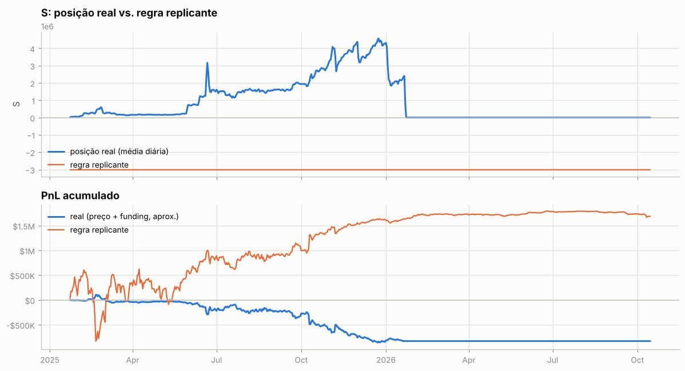

---

Metodologia e código: ver `README.md` na raiz do repositório.
