# Relatório automático — `0x0812f31ccf62c48e6da3da3fbf98663779e1f45d`

Gerado em 2026-10-14 12:58 UTC a partir da API pública da Hyperliquid (`POST /info`). Valores em USD. Este arquivo é regenerado por `python -m hlre.report`; a interpretação da estratégia fica em `ANALISE.md`.

## 1. Visão geral

| métrica | valor |
|---|---|
| Valor da conta (perp + spot) | $67.3K |
| PnL all-time (portfolio, inclui spot/airdrops) | +$52.4K |
| PnL all-time só de perps | +$52.4K |
| Volume all-time | $9.25M |
| Primeira atividade | 2026-08-05 |
| Fills disponíveis na API | 4,095 (desde 2026-08-20) |
| Ordens (fills agrupados por oid) | 1,439 |
| Funding líquido (recebido > 0) | +$1.3K |
| Taxas pagas (período dos fills) | -$3.8K |
| Liquidações (ledger) | 0 |
| Fills de liquidação/ADL | 0 |
| Papel da conta | user |
| API wallets (agentes) | 2 |

**Posições abertas agora:**

| ativo | tamanho | nocional | entrada | alav. | PnL não realizado | liq. |
|---|---|---|---|---|---|---|
| PONS | 10000.0 | $3.3K | 0.342686 | 3x cross | -$155 | — |

## 2. Curva de PnL

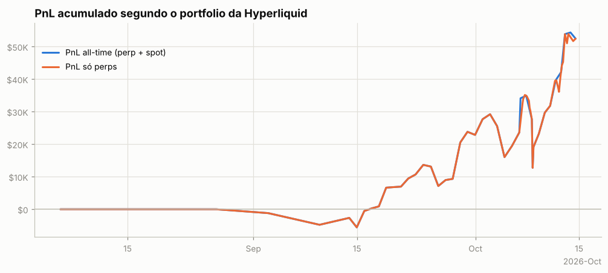

## 3. De onde veio o PnL

*Preço (aprox.)* usa a posição média diária de cada ativo, reconstruída a partir do histórico de funding (que traz o tamanho da posição a cada hora/dia desde o início da conta), vezes o movimento open→close do dia. Subestima o PnL de day trade, mas cobre o período sem fills. *Preço exato* marca cada fill no fechamento diário e só existe para o período coberto pelos fills.

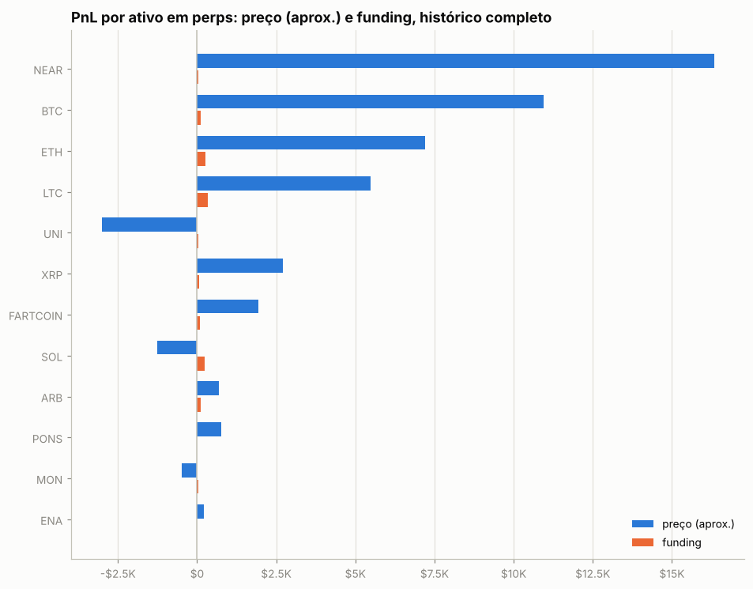

| ativo | preço (aprox.) | funding | total | preço exato (período dos fills) | taxas (período dos fills) |
|---|---|---|---|---|---|
| NEAR | +$16.3K | +$41 | +$16.4K | +$11.9K | -$402 |
| BTC | +$10.9K | +$107 | +$11.1K | +$20.6K | -$1.3K |
| ETH | +$7.2K | +$271 | +$7.5K | +$11.4K | -$1.1K |
| LTC | +$5.5K | +$337 | +$5.8K | +$6.5K | -$338 |
| UNI | -$3.0K | +$48 | -$3.0K | -$2.8K | -$41 |
| XRP | +$2.7K | +$62 | +$2.8K | +$2.1K | -$98 |
| FARTCOIN | +$1.9K | +$79 | +$2.0K | +$3.4K | -$94 |
| SOL | -$1.3K | +$250 | -$1.0K | +$69 | -$269 |
| ARB | +$693 | +$103 | +$797 | +$2.6K | -$39 |
| PONS | +$770 | -$21 | +$748 | +$439 | -$7 |
| MON | -$497 | +$51 | -$446 | -$1.1K | -$30 |
| ENA | +$212 | -$1 | +$211 | +$48 | -$14 |
| ZEC | +$128 | +$14 | +$142 | -$79 | -$24 |
| HYPE | +$76 | +$2 | +$79 | -$187 | -$13 |
| CASHCAT | -$30 | +$0 | -$30 | +$110 | -$1 |
| outros (0) | $0 | $0 | $0 | $0 | $0 |

**Decomposição no período dos fills** (preço exato): quanto veio de *carregar* a posição (e, dentro disso, do viés médio vs. do *timing* de aumentar/reduzir), quanto de trades intradiários, funding e taxas.

| componente | BTC | NEAR | ETH |
|---|---|---|---|
| carregar posição (carry) | +$16.6K | +$26.0K | +$11.8K |
|   ↳ viés (posição média × movimento) | -$86 | -$213 | -$1.2K |
|   ↳ timing (variação do tamanho) | +$16.7K | +$26.2K | +$13.0K |
| trades intradiários | +$3.9K | -$14.1K | -$407 |
| funding | +$107 | +$41 | +$271 |
| taxas | -$1.3K | -$402 | -$1.1K |
| posição média | -0.01 | -2,078.12 | -7.55 |
| movimento do preço no período | 9,877.00 | 0.10 | 153.40 |

## 4. Posições ao longo do tempo

Área clara: posição média diária (funding). Linha: posição exata (fills). Azul = long, vermelho = short.

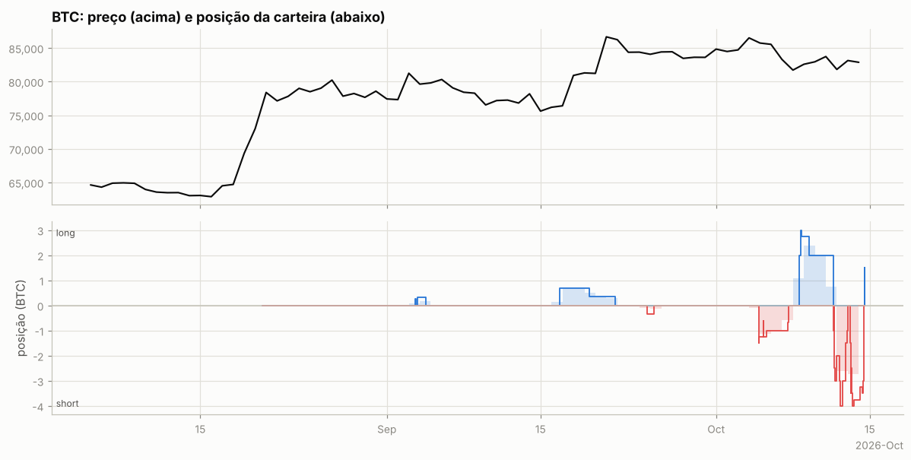

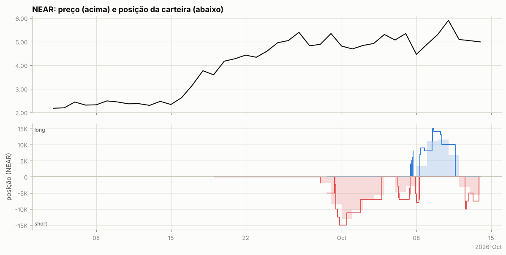

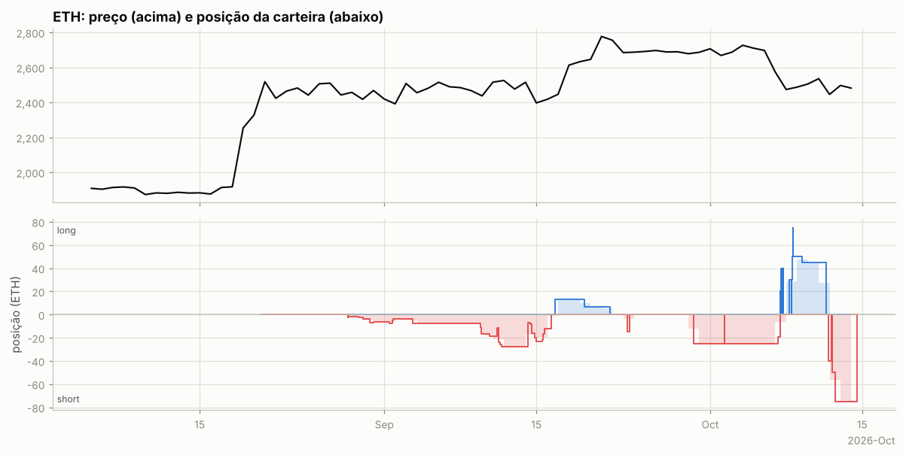

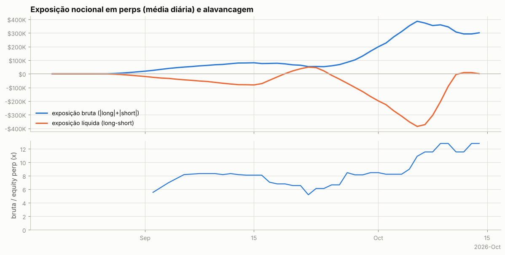

Tabela mensal de exposição e alavancagem

| mês | exposição bruta | exposição líquida | equity perp | alavancagem (mediana) |
|---|---|---|---|---|
| 2026-08 | $8.6K | -$8.6K | $0 | — |
| 2026-09 | $86.0K | -$60.5K | $11.3K | 8.1x |
| 2026-10 | $337.1K | -$186.1K | $28.1K | 12.2x |

## 5. Execução

**Tipos de ordem** (últimas 961 ordens que a API guarda, 2026-09-01 → 2026-10-14):

| orderType | tif | reduceOnly | isTrigger | ordens |
|---|---|---|---|---|
| Limit | Gtc | False | False | 67 |
| Limit | Gtc | True | False | 217 |
| Limit | Ioc | False | False | 4 |
| Limit | Ioc | True | False | 10 |
| Market | FrontendMarket | False | False | 172 |
| Market | FrontendMarket | True | False | 78 |
| Stop Limit | Gtc | False | True | 1 |
| Stop Limit | Gtc | True | True | 1 |
| Stop Market | Gtc | True | True | 17 |
| Take Profit Market | Gtc | True | False | 1 |

`FrontendMarket` = ordem a mercado enviada pela interface web; `Gtc` = limite que fica no livro; gatilhos (`isTrigger`) seriam stop/take-profit.

**Perfil por ativo (top 10 por volume):**

| ativo | volume | ordens | % taker (nocional) | tamanho mediano |
|---|---|---|---|---|
| BTC | $3.26M | 389 | 90% | 0.00015 |
| ETH | $2.72M | 440 | 91% | 0.005 |
| NEAR | $1.01M | 58 | 84% | 2,500 |
| LTC | $784.6K | 32 | 93% | 250 |
| SOL | $605.7K | 358 | 98% | 0.12 |
| XRP | $237.5K | 37 | 87% | 2,500 |
| FARTCOIN | $208.9K | 21 | 100% | 5e+04 |
| ARB | $112.3K | 26 | 66% | 2.266e+04 |
| UNI | $97.3K | 35 | 91% | 200 |
| MON | $69.2K | 9 | 93% | 1.45e+05 |

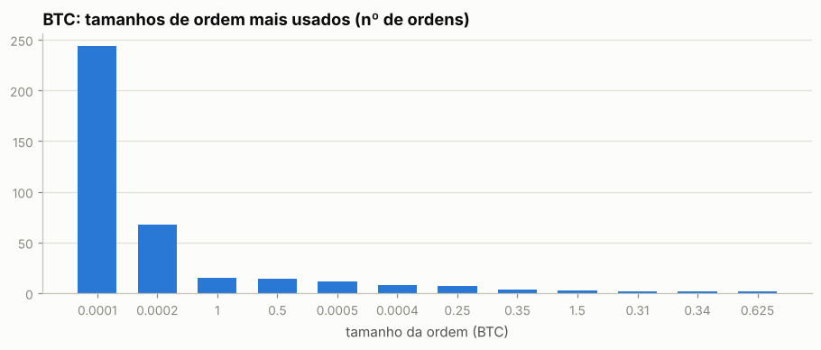

Os 5 tamanhos mais comuns respondem por 91% das ordens de BTC — lotes redondos e repetidos são assinatura de execução manual.

Sessões (ordens separadas por < 30 min): 193; mediana de 1 ordens e 0.0 min por sessão; dias com atividade: 46 de 54.

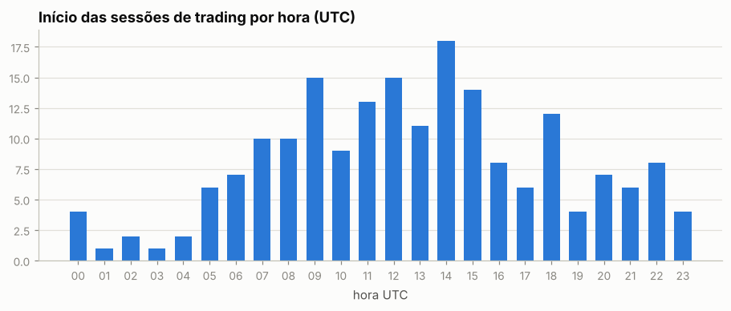

Por dia da semana: seg 17%, ter 13%, qua 19%, qui 18%, sex 14%, sáb 5%, dom 14%

## 6. Comportamento de entrada e saída

### BTC

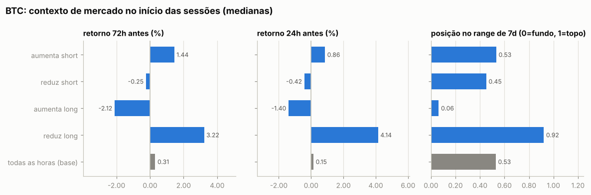

Por ordem (medianas):

| ação | ordens | retorno 24h antes | 72h antes | 7d antes | posição no range 7d | 24h depois | 7d depois |
|---|---|---|---|---|---|---|---|
| aumenta short | 102 | +3.96% | +16.94% | +22.30% | 0.88 | -0.12% | +0.85% |
| reduz short | 101 | +4.28% | +16.94% | +22.32% | 0.88 | -0.10% | +0.85% |
| aumenta long | 92 | +5.08% | +19.16% | +22.54% | 0.88 | +0.16% | +0.92% |
| reduz long | 94 | +5.08% | +19.09% | +22.48% | 0.89 | +0.08% | +0.92% |
| todas as horas (base) |  | +0.15% | +0.31% | +1.03% | 0.53 | +0.11% | +0.48% |

Por sessão (ordens a menos de 30 min uma da outra contam como uma decisão; p = teste de Mann-Whitney contra todas as horas do período):

| sessão | sessões | retorno 24h antes | 72h antes | 7d antes | range 7d | no topo (>0,7) | no fundo (<0,3) |
|---|---|---|---|---|---|---|---|
| aumenta short | 15 | +0.86% (p=0.085) | +1.44% (p=0.063) | -1.77% (p=0.049) | 0.53 (p=0.351) | 33% | 0% |
| reduz short | 15 | -0.42% (p=0.129) | -0.25% (p=0.187) | -1.73% (p=0.008) | 0.45 (p=0.304) | 33% | 33% |
| aumenta long | 5 | -1.40% (p=0.612) | -2.12% (p=0.116) | -1.70% (p=0.042) | 0.06 (p=0.105) | 20% | 60% |
| reduz long | 6 | +4.14% (p=0.086) | +3.22% (p=0.548) | +1.23% (p=0.620) | 0.92 (p=0.124) | 67% | 33% |
| todas as horas (base) |  |  |  |  |  | 34% | 25% |

- Aumentos de posição feitos com a posição no prejuízo (preço pior que o preço médio): **56%** das ordens (61% do tamanho); distância mediana do preço médio: +0.02%.
- Reduções/fechamentos com lucro: **37%** de 195; ganho médio $310 vs. perda média -$14; realizado +$20.6K.

- Episódios (de zerado a zerado, ou até inverter): 176; fechados com lucro: 34%; duração mediana 0.0 dias; o melhor episódio sozinho = 32% da soma dos episódios lucrativos.

Maiores episódios por PnL realizado

| início | fim | dias | lado | tam_max | nocional_max | ordens | entrada | saída | realizado |
|---|---|---|---|---|---|---|---|---|---|
| 2026-10-11 | 2026-10-13 | 1.3 | short | 4.00 | $336.3K | 12 | 83,847 | 82,478 | +$6.8K |
| 2026-09-16 | 2026-09-21 | 5.1 | long | 0.7 | $56.9K | 6 | 75,611 | 83,516 | +$5.8K |
| 2026-10-08 | 2026-10-11 | 3.1 | long | 3.00 | $245.0K | 6 | 81,856 | 83,529 | +$5.0K |
| 2026-10-04 | 2026-10-07 | 2.7 | short | 1.50 | $129.4K | 10 | 85,967 | 84,767 | +$2.5K |
| 2026-10-13 | 2026-10-14 | 1.3 | short | 4.00 | $333.5K | 12 | 83,663 | 83,506 | +$824 |
| 2026-09-03 | 2026-09-03 | 0.1 | long | 0.25 | $20.1K | 2 | 78,648 | 80,515 | +$467 |
| 2026-09-03 | 2026-09-04 | 0.8 | long | 0.31 | $25.2K | 2 | 81,209 | 79,836 | -$426 |
| 2026-10-11 | 2026-10-11 | 0.0 | short | 1.00 | $84.1K | 3 | 83,748 | 84,079 | -$332 |
| 2026-10-14 | 2026-10-14 | 0.0 | long | 1.50 | $124.6K | 2 | 83,049 | 82,890 | -$238 |
| 2026-09-24 | 2026-09-25 | 0.7 | short | 0.35 | $29.6K | 2 | 84,474 | 84,407 | +$23 |

### NEAR

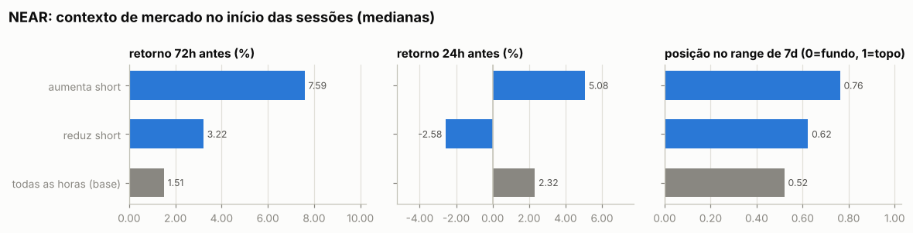

Por ordem (medianas):

| ação | ordens | retorno 24h antes | 72h antes | 7d antes | posição no range 7d | 24h depois | 7d depois |
|---|---|---|---|---|---|---|---|
| aumenta short | 20 | +5.08% | +8.15% | +11.37% | 0.78 | -4.12% | -1.97% |
| reduz short | 15 | -2.58% | +1.73% | -1.97% | 0.50 | -1.82% | -0.42% |
| aumenta long | 12 | -2.09% | +3.31% | -2.59% | 0.48 | -0.21% | -1.06% |
| reduz long | 11 | -1.12% | +3.14% | -4.52% | 0.49 | -0.14% | +0.16% |
| todas as horas (base) |  | +2.32% | +1.51% | +2.28% | 0.52 | +1.39% | +1.55% |

Por sessão (ordens a menos de 30 min uma da outra contam como uma decisão; p = teste de Mann-Whitney contra todas as horas do período):

| sessão | sessões | retorno 24h antes | 72h antes | 7d antes | range 7d | no topo (>0,7) | no fundo (<0,3) |
|---|---|---|---|---|---|---|---|
| aumenta short | 15 | +5.08% (p=0.160) | +7.59% (p=0.017) | +11.37% (p=0.032) | 0.76 (p=0.002) | 53% | 0% |
| reduz short | 11 | -2.58% (p=0.458) | +3.22% (p=0.280) | -1.25% (p=0.589) | 0.62 (p=0.570) | 27% | 9% |
| todas as horas (base) |  |  |  |  |  | 32% | 21% |

- Aumentos de posição feitos com a posição no prejuízo (preço pior que o preço médio): **62%** das ordens (61% do tamanho); distância mediana do preço médio: +0.98%.
- Reduções/fechamentos com lucro: **62%** de 26; ganho médio $1.0K vs. perda média -$482; realizado +$11.9K.

- Episódios (de zerado a zerado, ou até inverter): 11; fechados com lucro: 45%; duração mediana 0.3 dias; o melhor episódio sozinho = 35% da soma dos episódios lucrativos.

Maiores episódios por PnL realizado

| início | fim | dias | lado | tam_max | nocional_max | ordens | entrada | saída | realizado |
|---|---|---|---|---|---|---|---|---|---|
| 2026-10-12 | 2026-10-13 | 1.3 | short | 10,000 | $55.8K | 7 | 5.54 | 5.12 | +$5.3K |
| 2026-10-08 | 2026-10-11 | 3.4 | long | 15,000 | $73.8K | 13 | 5.22 | 5.51 | +$4.5K |
| 2026-09-30 | 2026-10-04 | 4.4 | short | 15,000 | $80.6K | 11 | 5.22 | 4.93 | +$4.2K |
| 2026-10-07 | 2026-10-08 | 0.3 | short | 8,000 | $44.2K | 4 | 5.34 | 5.53 | -$1.5K |
| 2026-10-08 | 2026-10-08 | 0.0 | short | 7,000 | $38.8K | 2 | 5.40 | 5.55 | -$1.0K |
| 2026-10-06 | 2026-10-07 | 1.2 | short | 7,000 | $36.9K | 9 | 5.18 | 5.09 | +$855 |
| 2026-10-07 | 2026-10-07 | 0.0 | long | 6,000 | $30.4K | 2 | 5.07 | 5.03 | -$203 |
| 2026-10-07 | 2026-10-07 | 0.0 | long | 7,990 | $40.9K | 4 | 5.09 | 5.08 | -$103 |
| 2026-10-07 | 2026-10-07 | 0.0 | long | 5,000 | $25.4K | 2 | 5.08 | 5.06 | -$92 |
| 2026-10-07 | 2026-10-07 | 0.0 | long | 4,000 | $20.1K | 2 | 5.03 | 5.01 | -$84 |

### ETH

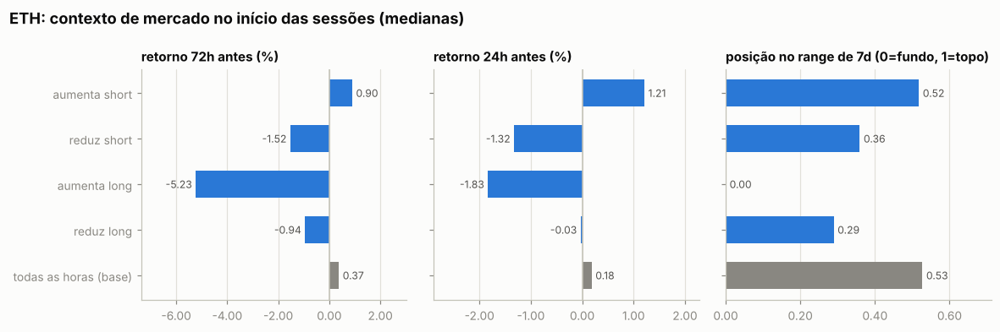

Por ordem (medianas):

| ação | ordens | retorno 24h antes | 72h antes | 7d antes | posição no range 7d | 24h depois | 7d depois |
|---|---|---|---|---|---|---|---|
| aumenta short | 126 | +2.46% | +21.67% | +25.03% | 0.87 | +0.16% | +0.85% |
| reduz short | 113 | +2.67% | +22.66% | +27.70% | 0.87 | +0.32% | +1.38% |
| aumenta long | 104 | +2.87% | +23.50% | +28.07% | 0.89 | +0.37% | +0.85% |
| reduz long | 97 | +3.26% | +24.69% | +28.21% | 0.91 | +0.59% | +0.85% |
| todas as horas (base) |  | +0.18% | +0.37% | +0.91% | 0.53 | +0.14% | +0.44% |

Por sessão (ordens a menos de 30 min uma da outra contam como uma decisão; p = teste de Mann-Whitney contra todas as horas do período):

| sessão | sessões | retorno 24h antes | 72h antes | 7d antes | range 7d | no topo (>0,7) | no fundo (<0,3) |
|---|---|---|---|---|---|---|---|
| aumenta short | 23 | +1.21% (p=0.060) | +0.90% (p=0.689) | +1.45% (p=0.650) | 0.52 (p=0.865) | 17% | 4% |
| reduz short | 14 | -1.32% (p=0.011) | -1.52% (p=0.057) | -1.96% (p=0.036) | 0.36 (p=0.012) | 14% | 43% |
| aumenta long | 6 | -1.83% (p=0.002) | -5.23% (p=0.000) | -5.71% (p=0.001) | 0.00 (p=<1e-4) | 0% | 100% |
| reduz long | 7 | -0.03% (p=0.701) | -0.94% (p=0.598) | -5.87% (p=0.040) | 0.29 (p=0.252) | 29% | 57% |
| todas as horas (base) |  |  |  |  |  | 36% | 22% |

- Aumentos de posição feitos com a posição no prejuízo (preço pior que o preço médio): **44%** das ordens (37% do tamanho); distância mediana do preço médio: -0.02%.
- Reduções/fechamentos com lucro: **45%** de 210; ganho médio $177 vs. perda média -$45; realizado +$11.4K.

- Episódios (de zerado a zerado, ou até inverter): 180; fechados com lucro: 39%; duração mediana 0.0 dias; o melhor episódio sozinho = 28% da soma dos episódios lucrativos.

Maiores episódios por PnL realizado

| início | fim | dias | lado | tam_max | nocional_max | ordens | entrada | saída | realizado |
|---|---|---|---|---|---|---|---|---|---|
| 2026-10-02 | 2026-10-07 | 5.1 | short | 25.00 | $68.9K | 8 | 2,763 | 2,590 | +$4.3K |
| 2026-09-16 | 2026-09-21 | 5.1 | long | 13.30 | $35.1K | 4 | 2,378 | 2,701 | +$4.3K |
| 2026-10-12 | 2026-10-14 | 2.3 | short | 75.00 | $189.4K | 5 | 2,550 | 2,512 | +$2.9K |
| 2026-08-28 | 2026-09-16 | 18.7 | short | 27.83 | $70.7K | 50 | 2,492 | 2,454 | +$2.2K |
| 2026-10-11 | 2026-10-12 | 0.3 | short | 40.00 | $102.8K | 3 | 2,529 | 2,569 | -$1.6K |
| 2026-09-23 | 2026-09-23 | 0.2 | short | 15.00 | $41.1K | 4 | 2,739 | 2,658 | +$1.2K |
| 2026-10-08 | 2026-10-08 | 0.2 | long | 30.00 | $77.1K | 2 | 2,570 | 2,538 | -$938 |
| 2026-09-29 | 2026-10-02 | 2.8 | short | 25.00 | $69.0K | 3 | 2,737 | 2,762 | -$604 |
| 2026-10-07 | 2026-10-07 | 0.1 | long | 15.00 | $38.7K | 2 | 2,581 | 2,565 | -$245 |
| 2026-10-07 | 2026-10-07 | 0.0 | long | 20.00 | $51.7K | 3 | 2,586 | 2,574 | -$240 |

### Todos os episódios relevantes (todas as moedas)

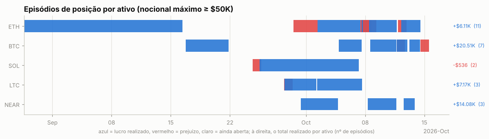

Episódios com nocional máximo ≥ $50K: 26; fechados com lucro: 62%. Abaixo, os 25 maiores por PnL realizado, em ordem de data. *7d/30d antes* e *vs. máx. 30d*: o que o preço tinha feito até a primeira ordem; *funding a.a.*: taxa anualizada nas 24h anteriores (positiva = longs pagam shorts); *entrada média vs. 1ª ordem*: positivo = foi aumentando a posição com o preço indo contra; *contra (máx.)*: quanto o preço andou contra a primeira ordem durante o episódio; *capturado*: movimento entre o preço médio de entrada e o de saída.

| ativo | lado | início | dias | nocional máx. | 7d antes | 30d antes | vs. máx. 30d | funding a.a. na entrada | entrada média vs. 1ª ordem | contra (máx.) | pior PnL aberto | capturado | realizado | funding |
|---|---|---|---|---|---|---|---|---|---|---|---|---|---|---|
| ETH | short | 2026-08-28 | 19 | $70.7K | +5% | +33% | -1% | +10% | -1% | +5% | -$3.9K | +2% | +$2.2K | +$111 |
| BTC | long | 2026-09-16 | 5 | $56.9K | -4% | +18% | -7% | +10% | +0% | +0% | -$0 | +10% | +$5.8K | -$66 |
| SOL | short | 2026-09-24 | 1 | $59.2K | +15% | +18% | -3% | +10% | -0% | +3% | -$840 | -3% | -$1.5K | +$41 |
| SOL | short | 2026-09-25 | 12 | $131.4K | +12% | +22% | -0% | +10% | -1% | +3% | -$2.0K | +1% | +$1.0K | +$230 |
| LTC | short | 2026-09-28 | 0 | $53.8K | +20% | +43% | -5% | +12% | +0% | +2% | -$150 | -2% | -$1.2K | +$38 |
| LTC | short | 2026-09-28 | 4 | $87.3K | +20% | +43% | -5% | +11% | -2% | -1% | +$0 | +2% | +$2.6K | +$161 |
| ETH | short | 2026-09-29 | 3 | $69.0K | -1% | +10% | -3% | +11% | +0% | +1% | -$163 | -1% | -$604 | +$91 |
| NEAR | short | 2026-09-30 | 4 | $80.6K | +15% | +174% | -9% | +11% | +2% | +8% | -$4.1K | +5% | +$4.2K | +$69 |
| LTC | short | 2026-10-02 | 5 | $176.9K | -3% | +40% | -7% | +11% | -1% | +2% | -$6.0K | +3% | +$5.8K | +$256 |
| ETH | short | 2026-10-02 | 5 | $68.9K | +3% | +13% | -2% | +11% | -0% | -0% | $0 | +6% | +$4.3K | +$105 |
| BTC | short | 2026-10-04 | 3 | $129.4K | +2% | +8% | -2% | +10% | +0% | +1% | -$903 | +1% | +$2.5K | +$70 |
| ETH | long | 2026-10-07 | 0 | $51.7K | -3% | +5% | -7% | +10% | -0% | +0% | $0 | -0% | -$240 | +$3 |
| ETH | long | 2026-10-07 | 0 | $102.6K | -6% | +3% | -8% | +10% | +0% | +0% | +$0 | -0% | -$108 | +$3 |
| ETH | long | 2026-10-07 | 0 | $101.9K | -5% | +3% | -8% | +10% | -0% | -0% | +$0 | -0% | -$134 | +$4 |
| ETH | long | 2026-10-08 | 0 | $77.1K | -6% | +4% | -8% | +9% | -0% | +2% | -$591 | -1% | -$938 | -$13 |
| NEAR | long | 2026-10-08 | 3 | $73.8K | +1% | +142% | -1% | +14% | +6% | +20% | -$9.4K | +5% | +$4.5K | -$49 |
| ETH | long | 2026-10-08 | 3 | $189.9K | -6% | +3% | -8% | +9% | +0% | +5% | -$5.7K | +0% | +$237 | -$25 |
| BTC | long | 2026-10-08 | 3 | $245.0K | -2% | +5% | -6% | +10% | +0% | +2% | -$3.4K | +2% | +$5.0K | +$17 |
| BTC | short | 2026-10-11 | 0 | $84.1K | -2% | +8% | -4% | -4% | +0% | +0% | -$0 | -0% | -$332 | +$76 |
| BTC | short | 2026-10-11 | 1 | $336.3K | -2% | +8% | -4% | -4% | -0% | +0% | -$1.2K | +2% | +$6.8K | +$124 |
| ETH | short | 2026-10-11 | 0 | $102.8K | -6% | +0% | -9% | -2% | -0% | +1% | -$709 | -2% | -$1.6K | +$17 |
| ETH | short | 2026-10-12 | 2 | $189.4K | -5% | +2% | -8% | +2% | -0% | +0% | -$352 | +2% | +$2.9K | +$69 |
| NEAR | short | 2026-10-12 | 1 | $55.8K | +12% | +138% | -5% | +16% | -2% | +0% | -$114 | +8% | +$5.3K | +$8 |
| BTC | short | 2026-10-13 | 1 | $333.5K | -3% | +8% | -4% | +7% | +0% | +0% | -$448 | +0% | +$824 | +$76 |
| BTC | long | 2026-10-14 | 0 | $124.6K | -0% | +7% | -4% | +9% | -0% | +0% | $0 | -0% | -$238 | +$35 |

## 7. Funding

Funding líquido total: **+$1.3K** (recebido $1.7K, pago -$328). Na Hyperliquid o funding é pago de hora em hora; quando positivo, longs pagam shorts.

| ativo | lado | funding | rendimento anualizado s/ nocional |
|---|---|---|---|
| BTC | short | +$216 | 8.8% |
| BTC | long | -$109 | -5.0% |
| NEAR | short | +$96 | 10.8% |
| NEAR | long | -$54 | -11.0% |
| ETH | short | +$350 | 8.5% |
| ETH | long | -$78 | -5.5% |
| (outros) | short | +$946 | 10.4% |
| (outros) | long | -$23 | -41.0% |

## 8. Fluxos, eventos e carteiras relacionadas

| tipo | eventos | USD (+ entra / − sai) |
|---|---|---|
| send | 12 | +$14.9K |

**Gestão de margem.** Dias com depósito: 5; em 60% deles o PnL dos 3 dias anteriores era negativo (mediana -$1.4K). Dias com saque: 3; em 100% deles o PnL dos 3 dias anteriores era positivo (mediana +$5.2K). Base: 30% de todos os dias vêm depois de 3 dias negativos. Correlação entre o fluxo do dia e a variação da exposição bruta: 0.13 (positiva = deposita para abrir posição e saca ao reduzir).

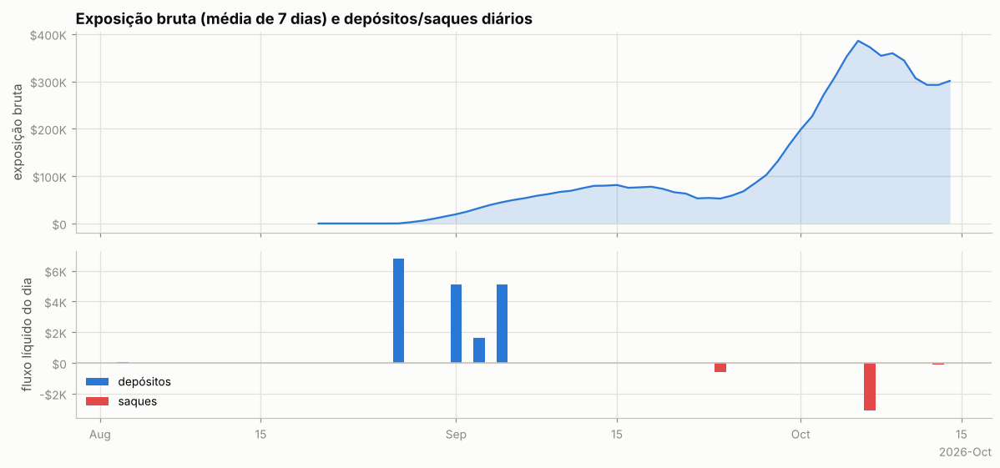

Ponte HyperCore↔HyperEVM (endereços de sistema `0x2000…`/`0x2222…`): 4 transferências, entrada $0, saída $3.8K — uso de DeFi na HyperEVM.

**Carteiras relacionadas** (conta vinculada de staking para desconto de taxa + maiores contrapartes de transferências; o saldo de staking e o PnL ajudam a ver se posições aqui são hedge de algo mantido lá):

| carteira | relação | transferências | volume transferido | valor da conta hoje | PnL all-time | HYPE em staking | maiores saldos spot |
|---|---|---|---|---|---|---|---|
| `0x6b9e773128f453f5c2c60935ee2de2cbc5390a24` | hot wallet de serviço (recebe USDC da HyperEVM e repassa a centenas de usuários: exchange/ponte) | 8 | $18.7K | $7.8K | +$0 | 0 | USDC 7,687 |

## 9. Dá para copiar? (espelhar a posição com atraso)

PnL de quem replicasse exatamente a posição da carteira, mas com N horas de atraso (marcação horária, sem custos). Se o PnL se mantém com atraso, a vantagem está em horizontes longos e é copiável; se desaba, depende de timing fino.

| atraso | BTC | NEAR | ETH |
|---|---|---|---|
| 0h | +$21.9K | +$14.6K | +$14.9K |
| 1h | +$19.2K | +$18.9K | +$15.1K |
| 4h | +$20.6K | +$19.2K | +$16.5K |
| 12h | +$15.5K | +$23.2K | +$12.4K |
| 24h | +$10.4K | +$4.2K | +$8.2K |
| 72h | +$2.7K | -$12.8K | +$4.5K |
| 168h | -$461 | -$1.4K | -$1.4K |

## 10. Teste de replicação por regras (BTC)

Regra testada: *short-bias com filtro de tendência e fade* — short de até 1.05 BTC (o percentil 90 do tamanho real), cheio abaixo da média móvel e reduzido acima; dentro do regime, mais short perto do topo do range e menos perto do fundo. Parâmetros escolhidos no treino (2026-08-20 → 2026-09-16) e avaliados no teste (2026-09-17 → 2026-10-13).

|  | parâmetros | PnL treino | PnL teste | correlação c/ posição real (teste) |
|---|---|---|---|---|
| melhor regra no treino | MA50, range 7d, fração em alta 0.0, fade 0.0 | $0 | $0 | nan |
| carteira real (aprox.) | — | +$138 | +$10.4K | 1.00 |

Clone comportamental (regressão linear da posição real em médias móveis, ranges e retornos): R² treino 0.50, R² teste -0.20, correlação no teste -0.21.

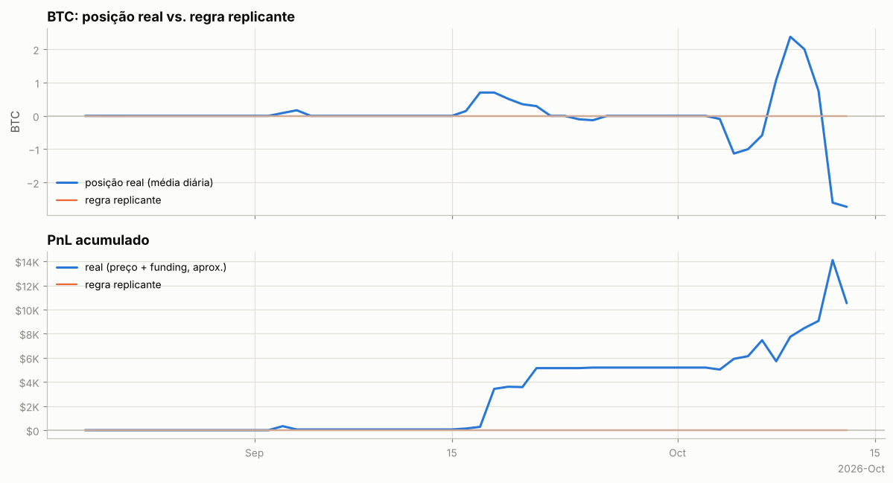

---

Metodologia e código: ver `README.md` na raiz do repositório.
