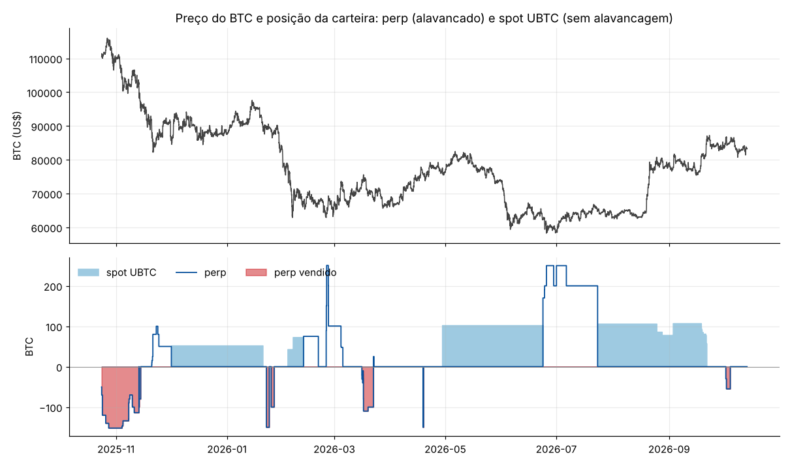

# Engenharia reversa: carteira `0x16bf…e637`

`0x16bf84af3f85f8c8a97597bf2be549dfe0dee637` · [CoinGlass](https://www.coinglass.com/hyperliquid/0x16bf84af3f85f8c8a97597bf2be549dfe0dee637) · dados até 13/out/2026

Fonte: API pública da Hyperliquid. A API entrega **o histórico completo** desta carteira: 21.019 fills desde o primeiro trade (24/out/2025 → 4/out/2026), 170 registros de funding, 7 eventos de ledger e as últimas 845 ordens. O PnL diário de perps reconstruído a partir dos fills soma US$ 5,74M, igual ao `portfolio` da Hyperliquid, então os números por episódio são exatos. Tabelas e gráficos completos: [`relatorio_auto.md`](relatorio_auto.md). Os números deste texto que não estão lá são recalculados por [`analise_extra.py`](analise_extra.py), que também gera o gráfico perp + spot.

---

## Resumo

- **Quem opera:** uma pessoa, **manualmente, pela interface web**, usando quase sempre a ordem **Scale** (escada de limites) da Hyperliquid. 703 das 845 ordens guardadas vêm de 26 escadas de 10 a 50 limites iguais, enviadas no mesmo milissegundo. Não há API wallet, foram só 1.376 requisições em US$ 365M de volume, e há um erro de digitação típico de humano: uma escada de compra de BTC de **US$ 8.000** a US$ 70.000 (24/nov/2025).
- **De onde veio o dinheiro:** um único aporte. Em 24/out/2025 chegaram **27,17 BTC pela ponte Unit** (UBTC). Em 9 minutos foram vendidos por US$ 3,0M a ~US$ 110,4k. Na mesma hora a carteira abriu um **short de BTC** que chegou a 152 BTC (US$ 17M, ~5,8x). Ou seja, quem tinha BTC vendeu no topo e ficou vendido. **Nunca houve saque.**
- **O que faz:** é um **swing trader de BTC nos dois lados, contra o movimento curto**. Vende força no topo do range de 7 dias e compra quedas no fundo. Monta a posição com escadas de limites e **sai de uma vez com ordens agressivas de 50 a 250 BTC** (US$ 5–13M em segundos). São 22 episódios em 12 meses e 50 dias com atividade. A duração mediana é de 1,3 dia, e os maiores ganhos ficaram entre 9 e 30 dias.
- **Um detalhe que o CoinGlass não mostra:** os **longs de prazo mais longo vão para o spot (UBTC)**, sem alavancagem, sem funding e sem risco de liquidação. Os shorts e os longs táticos ficam no perp. A carteira troca uma perna pela outra no mesmo minuto (12/fev, 23/jun e 23/jul/2026).
- **Oportunidades fora do BTC:** **prata (HIP-3 `xyz:SILVER`)** comprada duas vezes depois do crash de fim de jan/2026 (−29% em 7 dias, −35% da máxima de 30 dias), 100 mil onças (~US$ 8M) de cada vez, com **+US$ 1,54M** em 4 dias somados. E um erro caro: **short em ZEC parabólico** (+160% sobre a mínima de 30 dias), aumentado numa escada enquanto o preço subia, **−US$ 577k**. Depois disso nunca mais operou altcoins.
- **Quanto ganhou:** de US$ 3,0M para **US$ 9,09M** em 12 meses, **+US$ 6,09M (+203%)**. Perps somam +US$ 5,74M (BTC +US$ 4,94M, prata +US$ 1,54M, ZEC −US$ 0,58M, funding −US$ 57k, taxas −US$ 109k). O spot de BTC soma +US$ 0,35M, com um prejuízo de −US$ 1,48M (abr→jun/2026) e um ganho de +US$ 2,17M (jul→set/2026).
- **Risco:** alavancagem de **1 a 3x** sobre o patrimônio total, com pico de 5,8x no primeiro trade. Praticamente **sem stop** (só 3 ordens de gatilho em um ano, duas canceladas). No perp, corta rápido o que dá errado. No spot, segura: o maior prejuízo do ano veio daí.
- **Dá para replicar com regras?** **Não.** A regra mecânica equivalente ("comprar BTC depois de −7% em 7 dias, no fundo do range; vender depois de +3% em 3 dias, no topo") não tem vantagem significativa de 2020 a 2025 e **perde** no período desta carteira. A vantagem está na escolha de poucos pontos, no tamanho grande nesses pontos e na saída rápida.
- **Dá para copiar?** Em parte. A frequência é baixa (22 episódios por ano), e no BTC espelhar com 24h de atraso manteria ~80% do resultado. Na prata, o atraso destrói o resultado. As saídas são rápidas e grandes, então o copiador sai depois.
- **Agora:** zerado desde 4/out/2026, com **US$ 9,09M em USDC no spot**. A última operação foi um short de 55 BTC a US$ 86,5–87,2k (2–4/out/2026, +US$ 85k).

---

## 1. Quem é essa carteira

**Opera manualmente, pela interface web.**

- **Ordem Scale.** 703 das 845 ordens que a API guarda (out/2025 → out/2026) pertencem a 26 lotes de **10 a 50 limites com o mesmo tamanho e o preço igualmente espaçado**, enviados no mesmo milissegundo. É exatamente o que a ordem *Scale* da interface da Hyperliquid produz. Exemplos: 47 compras de 1 BTC de US$ 96.000 a US$ 100.000 (4/nov/2025), 40 vendas de 2 BTC de US$ 105.000 a US$ 109.500 (9/nov/2025), 50 vendas de 100 ZEC de US$ 510 a US$ 570 (13/nov/2025), 30 vendas de 1.000 onças de prata de US$ 87 a US$ 92 (3/fev/2026), 30 vendas de 5 BTC de US$ 86.500 a US$ 88.500 (30/set/2026).
- **Erro de digitação.** Em 24/nov/2025 há uma escada de compra de 4 BTC de **US$ 8.000** a US$ 70.000, ao lado de outra de US$ 70.000 a US$ 80.000. Faltou um zero.
- **Sem bot.** Não há API wallet (`extraAgents` vazio) e o `userRateLimit` mostra **1.376 requisições** em US$ 365M de volume.
- **Quase sem gatilhos.** Só 3 ordens de gatilho em um ano: um stop de BTC a US$ 68.100 num long de 25 BTC (22/mar/2026, executado, −US$ 13k) e um stop de prata criado e cancelado no mesmo dia.
- **Lotes redondos.** BTC em 1, 2, 5, 10, 20, 50, 100, 150, 200 ou 250. Prata em 1.000, 50.000 ou 100.000.
- **Ritmo.** São 108 sessões em 50 dos 345 dias. Os inícios se concentram às 0h UTC e entre 13h e 19h UTC, e 17% das sessões caem no fim de semana. O horário não aponta com segurança para um fuso.

**Dois modos de execução.** Para **entrar**, usa a escada de limites, que fica no livro e é preenchida aos poucos quando o preço vem até ela (aumentos passivos: 150 ordens, mediana de US$ 211k). Para **sair**, e para entradas com convicção em pontos de virada, usa uma **ordem agressiva única** de 50–250 BTC que atravessa o livro: 19 ordens acima de US$ 5M, 81% taker, mediana de 212 fills e **slippage mediano de só 4,4 bps**. As ordens agressivas respondem por 68% do nocional. A taxa média foi de 3,1 bps no perp, 2,4 bps no spot e 0,44 bp na prata (HIP-3).

**O dinheiro.** O ledger tem só 7 eventos:

| data | evento |
|---|---|
| 24/out/2025 02:19 | chegam **27,17 UBTC** de `0x574b…96fa`, a distribuidora da ponte Unit (BTC nativo → HyperCore). O relatório automático mostra ali um "PnL de US$ 2,3 bi". É a carteira da ponte, não de uma pessoa |
| 24/out/2025 02:19–02:28 | vende os 27,17 UBTC no spot por US$ 3,0M (média US$ 110.439) |
| 24/out/2025 02:38 | passa US$ 3,0M para o perp. Às 02:47 abre o short de BTC |
| dez/2025 → fev/2026 | 5 transferências **entre o próprio perp e o próprio spot** (US$ 2–5M cada), sempre no minuto em que compra ou vende BTC spot |

Nenhum depósito por outra ponte, nenhum saque. *(O relatório automático contava essas transferências internas como US$ 19,5M de entrada. Corrigido em `hlre/analyze.py`: transferência para a própria carteira não é fluxo.)*

## 2. Linha do tempo

| fase | período | o que fez | resultado |
|---|---|---|---|
| 1 | 24/out → 14/nov/2025 | Vende os BTC e abre short de 152 BTC a US$ 110–114k. Realiza nas quedas com escadas de compra (US$ 96–103k), recompõe nos repiques com escadas de venda (US$ 105–107k). Zera em US$ 95–96k | BTC **+US$ 1,87M** |
| 1b | 11 → 19/nov/2025 | Shorts em ZEC no meio da alta parabólica. Uma escada de venda de US$ 510 a US$ 610 é preenchida inteira (8.000 ZEC) e ele cobre a US$ 622–652 | ZEC **−US$ 0,58M** |
| 2 | 20/nov/2025 → 20/jan/2026 | Escadas de compra de US$ 87,5k até US$ 74k. Compra até 120 BTC no perp e vende a US$ 86–86,5k. Depois passa para **52 BTC no spot** (1/dez, US$ 86,4k) e vende em 20/jan a US$ 90,1k | +US$ 0,18M perp, +US$ 0,21M spot |
| 3 | 22/jan → 26/jan/2026 | Dois shorts rápidos de 100–150 BTC a US$ 88–89k. Um é cortado com prejuízo, o outro empata | −US$ 0,15M |
| 4 | 2/fev → 5/mar/2026 | Melhor fase. Compra **prata** depois do crash (2 vezes). Compra BTC spot a US$ 78,8k e US$ 65,4k (prejuízo de −US$ 0,46M) e troca o spot por **75 BTC perp** em 12/fev. Em 24/fev compra **250 BTC** (US$ 16M, 2,6x) a US$ 63–64k, 30% abaixo da máxima de 30 dias, e realiza a US$ 68–73k | **+US$ 2,78M** nos perps em fev |
| 5 | 16/mar → 22/mar/2026 | Escadas de venda de 10 BTC de US$ 74k a US$ 75,8k (110 BTC), depois de +8% em 7 dias. Cobre a US$ 68,6k | **+US$ 0,73M** |
| 6 | 17/abr → 22/jun/2026 | Shorts de BTC e S&P 500 cortados em minutos. Em 29/abr compra **102,5 BTC spot** a US$ 77,2k e **segura a queda até US$ 62k** | **−US$ 1,48M** no spot (a pior perda) |
| 7 | 23/jun → 23/jul/2026 | No mesmo minuto vende o spot a US$ 62,3k e compra **170 BTC perp**, depois aumenta até 250 com escadas a US$ 59–62k. Fecha 200 BTC a US$ 64,7k em 23/jul e, **no mesmo minuto, recompra 106 BTC no spot** | +US$ 0,61M perp (−US$ 91k de funding) |
| 8 | 23/jul → 21/set/2026 | Segura o spot. Vende em escadas de 2 BTC de US$ 80,5k a US$ 83,2k e o resto (57 BTC) a US$ 85,8k | **+US$ 2,17M** spot |
| 9 | 2 → 4/out/2026 | Short de 55 BTC numa escada de US$ 86,5k a US$ 87,2k. Cobre a US$ 85,3k. Zerado desde então | +US$ 0,08M |

## 3. O playbook

### 3.1 BTC nos dois lados, contra o movimento curto

O relatório automático (seção 6) mostra o padrão com significância estatística. Os números abaixo são medianas por sessão de decisão, comparadas com todas as horas do período:

| decisão | sessões | retorno 72h antes | posição no range de 7 dias | no fundo do range (<0,3) |
|---|---|---|---|---|
| aumenta short | 21 | **+2,5%** (p=0,004) | **0,74** (p=0,004) | 19% |
| reduz short | 17 | −1,9% (p=0,015) | 0,19 (p=0,001) | 71% |
| aumenta long | 13 | **−5,1%** (p<0,0001) | **0,08** (p<0,0001) | **92%** |
| base (todas as horas) | | −0,1% | 0,46 | 35% |

- **Vende repiques e compra quedas.** O short é aberto ou aumentado depois de alta e perto do topo do range. O long, depois de queda forte e no fundo. As realizações de short acontecem no fundo do range (71% das sessões).
- **Não é viés fixo.** Em BTC são 8 episódios de short e 6 de long. O primeiro short (out/2025) pegou a virada de ciclo, mas desde nov/2025 o lado muda conforme o range.
- **Escada para entrar, bloco para sair.** A escada é colocada **contra** o movimento: compras abaixo do preço, vendas acima. Por isso 56% dos aumentos de BTC acontecem com a posição no prejuízo, mas perto do preço médio (+0,24%). A saída é uma ordem agressiva só. **94% das 89 reduções de BTC fecharam com lucro.**
- **Os grandes acertos foram nos extremos.** Long de 250 BTC em 24/fev/2026, 30% abaixo da máxima de 30 dias (+US$ 1,63M em 9 dias). Short de 152 BTC a US$ 110–114k em out/2025 (+US$ 1,53M). Short de 110 BTC depois de +8% em 7 dias em mar/2026 (+US$ 0,72M). Long de 250 BTC a US$ 59–62k em jun/2026 (+US$ 0,61M). Os 3 melhores episódios da carteira (o long de BTC de fev/2026, o short de out/2025 e a primeira compra de prata) somam 59% do lucro bruto realizado.
- **O funding não entra na decisão.** Na entrada, o funding estava perto do normal (mediana ~+2% a.a. nos episódios de BTC) e não há relação com o lado escolhido.

### 3.2 Spot para segurar, perp para alavancar e para vender

| período | spot UBTC | preço médio compra → venda | resultado |
|---|---|---|---|
| 1/dez/2025 → 20/jan/2026 | 52,3 BTC | 86.366 → 90.133 | +US$ 0,21M |
| 3/fev → 12/fev/2026 | 43 + 30 BTC | 78.795 / 65.362 → 67.382 | −US$ 0,46M |
| 29/abr → 23/jun/2026 | 102,5 BTC | 77.200 → 62.300 | **−US$ 1,48M** |
| 23/jul → 21/set/2026 | 106,3 BTC (+29 em set) | 64.800 / 77.500 → 80.500–85.800 | **+US$ 2,17M** |

Por que separar assim:

- **Funding.** No perp, os longs de BTC pagaram **US$ 110k de funding**, só no mês de jun→jul/2026 foram US$ 91k. No spot não há funding. Quando a ideia é segurar semanas, o long vai para o spot.
- **Sem liquidação.** O long de 77,2k aguentou −20% sem margem nenhuma. No perp, com 2–3x, a mesma queda exigiria margem extra ou terminaria em liquidação.
- **Troca no mesmo minuto.** Em 12/fev, 23/jun e 23/jul/2026 ele vende um lado e compra o outro em até 2 minutos, com tamanho parecido (73 → 75 BTC, 102 → 170 BTC, 200 → 106 BTC). A exposição se mantém e muda só o veículo: perp quando quer alavancagem ou quer realizar rápido, spot quando quer esperar.
- **O custo.** Por não ter stop nem chamada de margem, o spot é onde ele **deixa um erro correr**: −19% no long de abril (−US$ 1,48M), a pior perda do ano.

### 3.3 Oportunidades em outros ativos

- **Prata (`xyz:SILVER`, HIP-3).** Em 2/fev/2026 a prata vinha de −29% em 7 dias e estava 35% abaixo da máxima de 30 dias. Ele comprou **101.945 onças (US$ 8,3M, 1,7x)** em 1 minuto a US$ 77,5 e vendeu em 32 horas, com escadas de 1.000 onças até US$ 89, por **+US$ 829k**. Em 20/fev repetiu: 100 mil onças a US$ 79,2, vendidas a US$ 86,3 em 2,7 dias, **+US$ 713k**. Não perdeu em nenhum dos dois. O funding pago foi alto (−40% a.a. sobre o nocional), mas o trade durou pouco.
- **S&P 500 (`xyz:SP500`).** Um short de US$ 7M em 17/abr/2026, fechado em 29 minutos com −US$ 13k, junto com um short de BTC fechado em 6 minutos (−US$ 31k). É um teste de ideia "risk-off" que ele abandona assim que não funciona.
- **ZEC, o erro.** Em nov/2025 o ZEC estava +160% a +390% sobre a mínima de 30 dias. Os três primeiros shorts foram pequenos: dois deram lucro e o resultado somado foi de +US$ 69k. No quarto, ele pôs escadas de venda de 100 ZEC de US$ 510 a US$ 610. O preço subiu e **todas as ordens foram executadas**: a posição foi de 0 a 8.000 ZEC (US$ 5M) com o preço indo contra 25%. Ele cobriu tudo em 13 minutos a US$ 622–652 (**−US$ 574k**). Cinco dias depois tentou de novo com 4.000 ZEC e cortou em 2 horas (−US$ 72k). Foi a única vez que a escada contra o movimento funcionou como "preço médio" num ativo em tendência forte. Nunca mais operou altcoins.

### 3.4 Gestão de risco

- **Alavancagem baixa para o tamanho.** Sobre o patrimônio total, o pico de cada episódio ficou entre 1x e 3x: 2,6x no long de 250 BTC de fev/2026 e 2,5x no de jun/2026. A exceção é o primeiro short, com 5,8x (152 BTC sobre US$ 3,0M).
- **Stop mental no perp, nenhum no spot.** Os perdedores do perp foram cortados rápido: −US$ 147k em 1,6 dia (jan/2026), −US$ 31k em 6 minutos, −US$ 72k em 2 horas. O stop automático só aparece uma vez. No spot ele segurou −19%.
- **Pouco tempo alavancado.** Tem posição no perp em só 109 de 354 dias e opera em 50 dias no ano. Maio e agosto/2026 ficaram sem nada no perp. Somando o spot, tem alguma exposição em 282 dias.
- **Drawdown.** Nos perps, −US$ 811k (22/mar → 30/jun/2026). Na conta inteira, o patrimônio foi de US$ 7,96M no fim de mar para US$ 6,11M no fim de jun/2026 (−23%), por causa do spot.

## 4. De onde veio o dinheiro

| livro | resultado | observação |
|---|---|---|
| BTC perp, preço | +US$ 4,94M | 14 episódios, 79% com lucro |
| BTC perp, funding | −US$ 23k | shorts receberam US$ 87k, longs pagaram US$ 110k |
| BTC spot (UBTC) | +US$ 0,35M | −US$ 1,48M e +US$ 2,17M nos dois maiores |
| Prata (HIP-3) | +US$ 1,54M (−US$ 35k funding) | 2 episódios, 4 dias no total |
| ZEC | −US$ 0,58M | 5 episódios em nov/2025 |
| S&P 500 (HIP-3) | −US$ 13k | 1 episódio de 29 minutos |
| Taxas | −US$ 0,11M | |
| **Total** | **+US$ 6,09M** | US$ 3,0M → US$ 9,09M |

Por trimestre: +US$ 1,52M (4T25), +US$ 3,69M (1T26), −US$ 0,81M (2T26 só perps; −US$ 1,85M com o spot), +US$ 1,26M nos perps no 3T26 e mais US$ 2,1M no spot.

## 5. Dá para copiar?

Espelhar a posição de perp com atraso (seção 9 do relatório automático, sem custos):

| atraso | BTC | prata |
|---|---|---|
| 0h | +US$ 4,95M | +US$ 1,78M |
| 4h | +US$ 5,45M | +US$ 1,71M |
| 24h | +US$ 4,08M | +US$ 0,91M |
| 72h | +US$ 3,87M | −US$ 0,41M |

- **BTC:** a vantagem sobrevive a atrasos de horas a dias, porque os episódios bons duram de 5 a 30 dias e as entradas são escadas que levam horas para encher. O copiador ainda pega boa parte do movimento.
- **Prata e saídas em geral:** a saída é um bloco de US$ 5–13M em segundos. O copiador sai depois, a um preço pior, e no trade de 1–3 dias da prata isso come o lucro.
- **Ponto cego:** o spot UBTC não aparece como "posição" no CoinGlass. Quem copia só o perp perde os dois maiores trades de spot e, em jun e jul/2026, veria um "long novo" que na verdade era só a troca de spot por perp.
- **Sinal útil:** escadas abertas aparecem em `frontendOpenOrders`. Uma escada nova grande, de 20 a 50 ordens, mostra antes da execução onde ele quer comprar ou vender.

## 6. Dá para replicar com regras?

Testei em BTC (fechamentos diários desde 2020) a regra mais próxima do comportamento médio dele, com no máximo um evento a cada 7 dias:

| regra | período | eventos | retorno médio em 7d (IC 95%) | acerto | base do mesmo lado |
|---|---|---|---|---|---|
| **long:** −7% em 7d e no fundo do range de 7d (<0,15) | 2020 → out/2025 | 44 | +2,5% (−0,2 a +5,4) | 68% | +1,3%, 55% |
| | out/2025 → hoje | 5 | **−5,5%** (−10,4 a −0,6) | 40% | −0,4%, 47% |
| **short:** +3% em 3d e no topo do range de 7d (>0,85) | 2020 → out/2025 | 116 | −0,9% (−2,7 a +0,9) | 50% | −1,3%, 45% |
| | out/2025 → hoje | 12 | +0,2% (−3,1 a +3,1) | 58% | +0,4%, 53% |

- **A regra não reproduz o resultado.** "Comprar a queda" teve uma leve vantagem até 2025, que não é significativa em 7 dias, e **perdeu** no período desta carteira: as quedas de nov/2025 e fev/2026 continuaram. "Vender o repique" não tem vantagem em nenhum período.
- **O clone de tendência + fade** do relatório automático (seção 10) ganhou US$ 5,6M no treino, mas só US$ 0,14M no teste, com correlação de −0,50 com a posição real. O clone por regressão tem R² de −6,5 fora da amostra.
- **O que ele faz que a regra não faz:** escolhe **poucos** extremos (22 episódios num ano), põe o tamanho grande só neles (100–250 BTC, contra 5–55 nos testes), sai em dias e não segura o perp quando o trade não anda. A vantagem é discricionária: leitura de contexto (BTC −30% da máxima, prata depois de um crash histórico, topo de out/2025) mais disciplina de saída. Isso não vira regra simples.

## 7. Conclusão

É um trader discricionário, com capital próprio vindo de BTC, que trata o BTC como um ativo que **oscila entre extremos de curto prazo**. Vende força com escadas, compra pânico com escadas, realiza com blocos grandes e passa só 109 dias do ano com perp aberto. Usa o spot como "posição de espera" sem funding e sem liquidação, e o perp para alavancar e para vender. Fez +203% em 12 meses com alavancagem moderada. Os pontos fracos são o mesmo mecanismo da força: escada contra o movimento num ativo em tendência (ZEC) e falta de stop no spot (abr–jun/2026). Para acompanhar, observe as escadas novas em `frontendOpenOrders` e o saldo de UBTC, não só a posição de perp.

*Nada aqui é recomendação de investimento.*
