# Relatório automático — `0x16bf84af3f85f8c8a97597bf2be549dfe0dee637`

Gerado em 2026-10-13 17:33 UTC a partir da API pública da Hyperliquid (`POST /info`). Valores em USD. Este arquivo é regenerado por `python -m hlre.report`; a interpretação da estratégia fica em `ANALISE.md`.

## 1. Visão geral

| métrica | valor |
|---|---|
| Valor da conta (perp + spot) | $9.09M |
| PnL all-time (portfolio, inclui spot/airdrops) | +$6.09M |
| PnL all-time só de perps | +$5.74M |
| Volume all-time | $407.83M |
| Primeira atividade | 2025-10-29 |
| Fills disponíveis na API | 21,019 (desde 2025-10-24) |
| Ordens (fills agrupados por oid) | 378 |
| Funding líquido (recebido > 0) | -$56.9K |
| Taxas pagas (período dos fills) | -$108.7K |
| Liquidações (ledger) | 0 |
| Fills de liquidação/ADL | 0 |
| Papel da conta | user |
| API wallets (agentes) | 0 |

## 2. Curva de PnL

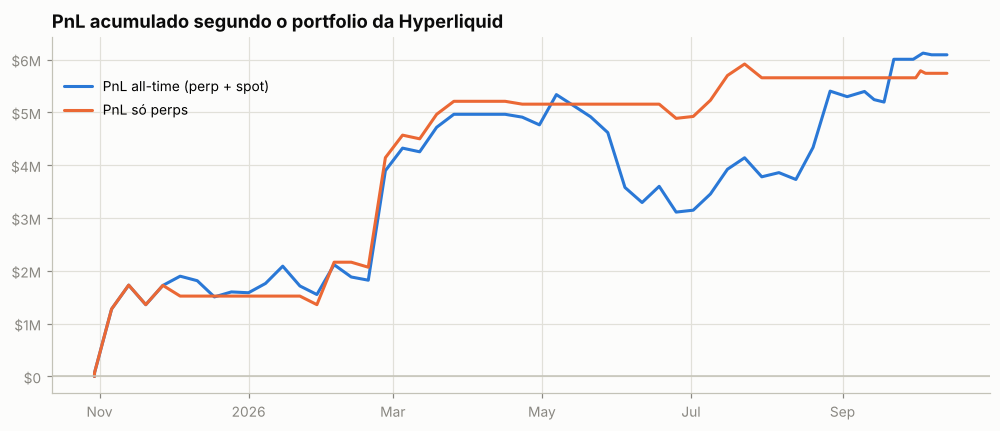

Os fills cobrem todo o histórico: o PnL diário exato de perps (preço + funding − taxas) soma +$5.74M, contra +$5.74M do portfolio. Maior drawdown: **-$810.8K** (pico em 2026-03-22, fundo em 2026-06-30); dias positivos: 50%.

PnL de perps por trimestre

| trimestre | preço | funding | taxas | total |
|---|---|---|---|---|
| 2025Q4 | +$1.47M | +$75.9K | -$28.3K | +$1.52M |
| 2026Q1 | +$3.77M | -$42.6K | -$37.3K | +$3.69M |
| 2026Q2 | -$786.0K | -$7.9K | -$16.9K | -$810.8K |
| 2026Q3 | +$1.35M | -$84.9K | -$9.8K | +$1.26M |
| 2026Q4 | +$84.7K | +$2.7K | -$2.4K | +$84.9K |

## 3. De onde veio o PnL

*Preço (aprox.)* usa a posição média diária de cada ativo, reconstruída a partir do histórico de funding (que traz o tamanho da posição a cada hora/dia desde o início da conta), vezes o movimento open→close do dia. Subestima o PnL de day trade, mas cobre o período sem fills. *Preço exato* marca cada fill no fechamento diário e só existe para o período coberto pelos fills.

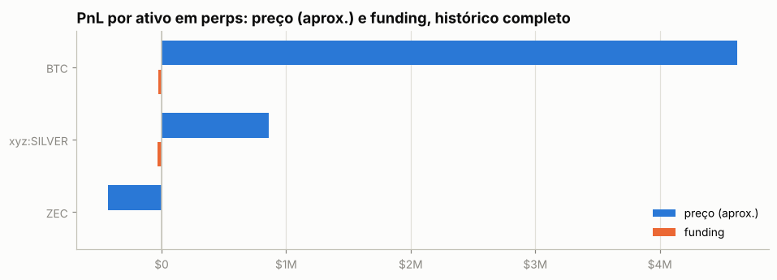

| ativo | preço (aprox.) | funding | total | preço exato (período dos fills) | taxas (período dos fills) |
|---|---|---|---|---|---|
| BTC | +$4.62M | -$22.9K | +$4.60M | +$4.94M | -$88.4K |
| xyz:SILVER | +$862.2K | -$34.7K | +$827.6K | +$1.54M | -$1.3K |
| ZEC | -$428.9K | +$605 | -$428.3K | -$576.5K | -$4.3K |
| outros (0) | $0 | $0 | $0 | $0 | $0 |

**Decomposição no período dos fills** (preço exato): quanto veio de *carregar* a posição (e, dentro disso, do viés médio vs. do *timing* de aumentar/reduzir), quanto de trades intradiários, funding e taxas.

| componente | BTC | xyz:SILVER | ZEC |
|---|---|---|---|
| carregar posição (carry) | +$5.38M | +$424.7K | -$735.1K |
|   ↳ viés (posição média × movimento) | -$373.4K | -$29.7K | -$29.6K |
|   ↳ timing (variação do tamanho) | +$5.75M | +$454.4K | -$705.5K |
| trades intradiários | -$440.1K | +$1.12M | +$158.6K |
| funding | -$25.6K | -$34.7K | +$588 |
| taxas | -$88.4K | -$1.3K | -$4.3K |
| posição média | 13.41 | 1,259.84 | -31.55 |
| movimento do preço no período | -27,840.00 | -23.59 | 938.90 |

## 4. Posições ao longo do tempo

Área clara: posição média diária (funding). Linha: posição exata (fills). Azul = long, vermelho = short.

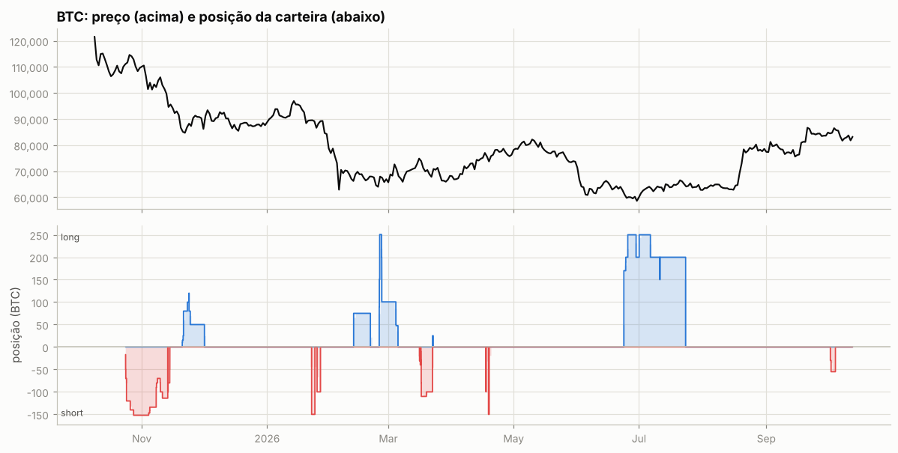

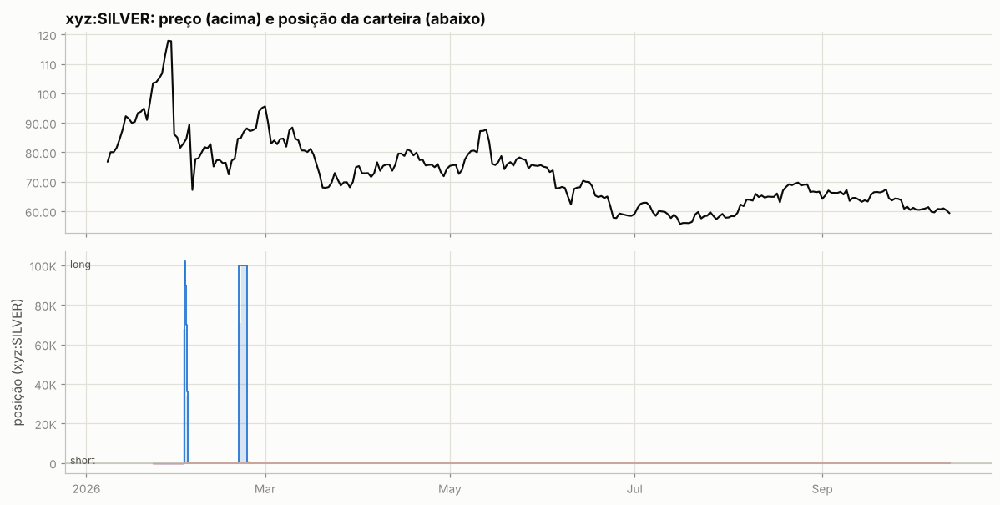

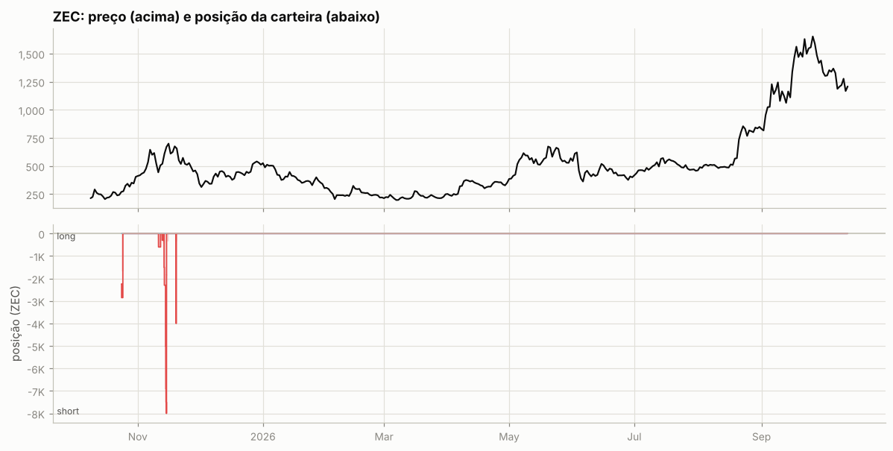

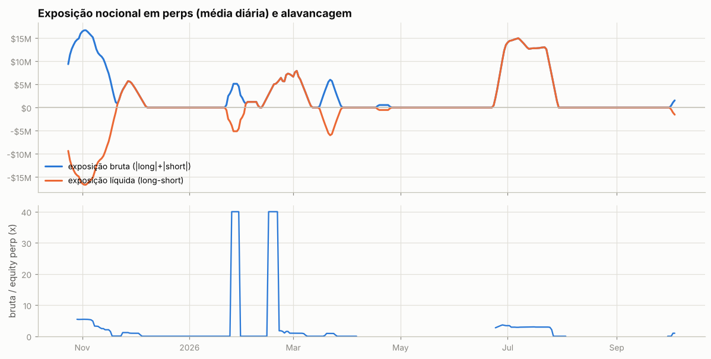

Tabela mensal de exposição e alavancagem

| mês | exposição bruta | exposição líquida | equity perp | alavancagem (mediana) |
|---|---|---|---|---|
| 2025-10 | $15.11M | -$15.11M | $3.07M | 5.4x |
| 2025-11 | $7.57M | -$3.98M | $4.32M | 1.6x |
| 2025-12 | $69.5K | $69.5K | $304.8K | 0.0x |
| 2026-01 | $1.16M | -$1.16M | $587.4K | 0.0x |
| 2026-02 | $4.04M | $4.04M | $3.17M | 1.0x |
| 2026-03 | $2.29M | -$414.3K | $7.50M | 0.0x |
| 2026-04 | $124.9K | -$124.9K | $0 | — |
| 2026-05 | $0 | $0 | $0 | — |
| 2026-06 | $3.26M | $3.26M | $954.6K | 3.4x |
| 2026-07 | $9.91M | $9.91M | $4.20M | 2.9x |
| 2026-08 | $0 | $0 | $0 | — |
| 2026-09 | $0 | $0 | $147.3K | 0.0x |
| 2026-10 | $2.70M | -$2.70M | $1.87M | 1.9x |

## 5. Execução

**Tipos de ordem** (últimas 845 ordens que a API guarda, 2025-10-24 → 2026-10-04):

| orderType | tif | reduceOnly | isTrigger | ordens |
|---|---|---|---|---|
| Limit | Gtc | False | False | 526 |
| Limit | Gtc | True | False | 300 |
| Market | FrontendMarket | False | False | 6 |
| Market | FrontendMarket | True | False | 10 |
| Stop Market | Gtc | True | True | 1 |

`FrontendMarket` = ordem a mercado enviada pela interface web; `Gtc` = limite que fica no livro; gatilhos (`isTrigger`) seriam stop/take-profit.

**Perfil por ativo (top 10 por volume):**

| ativo | volume | ordens | % taker (nocional) | tamanho mediano |
|---|---|---|---|---|
| BTC | $286.35M | 192 | 72% | 5 |
| xyz:SILVER | $33.21M | 28 | 48% | 1,472 |
| ZEC | $16.89M | 96 | 53% | 100 |
| xyz:SP500 | $14.17M | 2 | 69% | 1,000 |

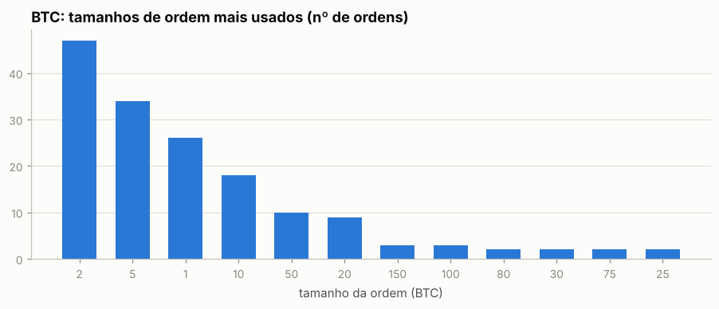

Os 5 tamanhos mais comuns respondem por 70% das ordens de BTC — lotes redondos e repetidos são assinatura de execução manual.

Sessões (ordens separadas por < 30 min): 88; mediana de 2 ordens e 0.2 min por sessão; dias com atividade: 50 de 345.

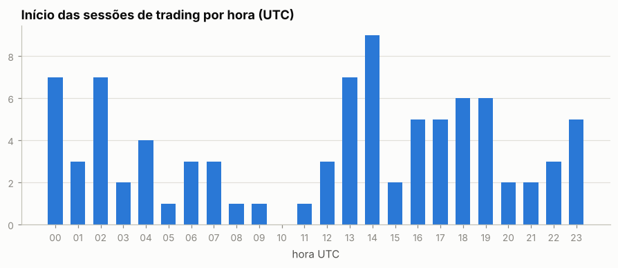

Por dia da semana: seg 17%, ter 20%, qua 12%, qui 15%, sex 18%, sáb 7%, dom 10%

## 6. Comportamento de entrada e saída

### BTC

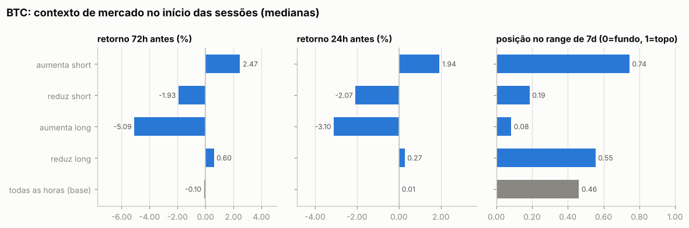

Por ordem (medianas):

| ação | ordens | retorno 24h antes | 72h antes | 7d antes | posição no range 7d | 24h depois | 7d depois |
|---|---|---|---|---|---|---|---|
| aumenta short | 62 | +2.30% | +3.27% | +1.50% | 0.87 | -0.56% | -5.79% |
| reduz short | 57 | +0.67% | +0.44% | -5.71% | 0.28 | -0.90% | -6.44% |
| aumenta long | 41 | -3.61% | -4.55% | -7.30% | 0.04 | -1.10% | +4.92% |
| reduz long | 32 | +6.59% | +2.57% | +3.77% | 0.97 | -2.36% | -0.80% |
| todas as horas (base) |  | +0.01% | -0.10% | -0.11% | 0.46 | +0.01% | -0.23% |

Por sessão (ordens a menos de 30 min uma da outra contam como uma decisão; p = teste de Mann-Whitney contra todas as horas do período):

| sessão | sessões | retorno 24h antes | 72h antes | 7d antes | range 7d | no topo (>0,7) | no fundo (<0,3) |
|---|---|---|---|---|---|---|---|
| aumenta short | 21 | +1.94% (p=0.005) | +2.47% (p=0.004) | +2.17% (p=0.023) | 0.74 (p=0.004) | 62% | 19% |
| reduz short | 17 | -2.07% (p=0.048) | -1.93% (p=0.015) | -5.07% (p=0.005) | 0.19 (p=0.001) | 6% | 71% |
| aumenta long | 13 | -3.10% (p=0.001) | -5.09% (p=<1e-4) | -7.30% (p=<1e-4) | 0.08 (p=<1e-4) | 0% | 92% |
| reduz long | 14 | +0.27% (p=0.441) | +0.60% (p=0.275) | +1.95% (p=0.361) | 0.55 (p=0.210) | 43% | 21% |
| todas as horas (base) |  |  |  |  |  | 31% | 35% |

- Aumentos de posição feitos com a posição no prejuízo (preço pior que o preço médio): **56%** das ordens (43% do tamanho); distância mediana do preço médio: +0.24%.
- Reduções/fechamentos com lucro: **94%** de 89; ganho médio $62.6K vs. perda média -$64.0K; realizado +$4.94M.

- Episódios (de zerado a zerado, ou até inverter): 14; fechados com lucro: 79%; duração mediana 2.0 dias; o melhor episódio sozinho = 32% da soma dos episódios lucrativos.

Maiores episódios por PnL realizado

| início | fim | dias | lado | tam_max | nocional_max | ordens | entrada | saída | realizado |
|---|---|---|---|---|---|---|---|---|---|
| 2026-02-24 | 2026-03-05 | 9.1 | long | 250.53 | $17.14M | 24 | 63,666 | 70,160 | +$1.63M |
| 2025-10-24 | 2025-11-13 | 20.5 | short | 152.05 | $17.33M | 72 | 110,031 | 102,246 | +$1.53M |
| 2026-03-16 | 2026-03-22 | 5.7 | short | 110.00 | $8.34M | 14 | 75,165 | 68,656 | +$716.0K |
| 2026-06-23 | 2026-07-23 | 30.0 | long | 250.00 | $15.39M | 22 | 61,663 | 63,395 | +$606.7K |
| 2025-11-13 | 2025-11-14 | 0.9 | short | 100.00 | $9.93M | 5 | 100,070 | 96,588 | +$348.1K |
| 2025-11-20 | 2025-12-01 | 10.8 | long | 120.00 | $10.39M | 23 | 84,819 | 86,292 | +$176.8K |
| 2026-01-22 | 2026-01-24 | 1.6 | short | 150.00 | $13.45M | 3 | 88,727 | 89,709 | -$147.2K |
| 2026-10-02 | 2026-10-04 | 2.4 | short | 55.00 | $4.80M | 12 | 86,845 | 85,305 | +$84.7K |
| 2026-04-17 | 2026-04-17 | 0.0 | short | 100.00 | $7.65M | 3 | 76,204 | 76,519 | -$31.5K |
| 2026-02-12 | 2026-02-20 | 8.2 | long | 75.00 | $5.08M | 2 | 67,432 | 67,784 | +$26.4K |

### xyz:SILVER

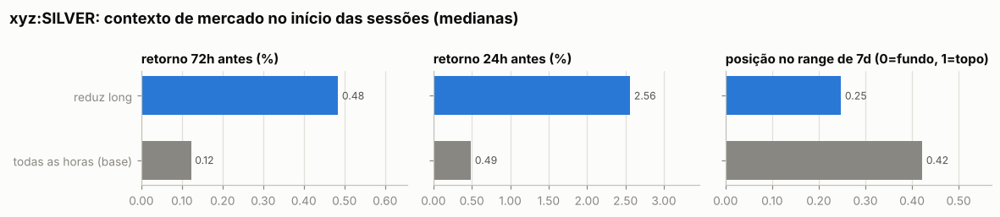

Por ordem (medianas):

| ação | ordens | retorno 24h antes | 72h antes | 7d antes | posição no range 7d | 24h depois | 7d depois |
|---|---|---|---|---|---|---|---|
| aumenta long | 5 | -9.61% | -29.84% | -28.72% | 0.00 | +8.08% | +5.07% |
| reduz long | 23 | +4.28% | +0.48% | -22.53% | 0.25 | +4.69% | -4.91% |
| todas as horas (base) |  | +0.49% | +0.12% | -5.80% | 0.42 | +0.74% | +5.96% |

Por sessão (ordens a menos de 30 min uma da outra contam como uma decisão; p = teste de Mann-Whitney contra todas as horas do período):

| sessão | sessões | retorno 24h antes | 72h antes | 7d antes | range 7d | no topo (>0,7) | no fundo (<0,3) |
|---|---|---|---|---|---|---|---|
| reduz long | 7 | +2.56% (p=0.136) | +0.48% (p=0.942) | -22.53% (p=0.333) | 0.25 (p=0.785) | 29% | 71% |
| todas as horas (base) |  |  |  |  |  | 22% | 45% |

- Aumentos de posição feitos com a posição no prejuízo (preço pior que o preço médio): **0%** das ordens (0% do tamanho); distância mediana do preço médio: -0.32%.
- Reduções/fechamentos com lucro: **100%** de 23; ganho médio $67.1K vs. perda média —; realizado +$1.54M.

- Episódios (de zerado a zerado, ou até inverter): 2; fechados com lucro: 100%; duração mediana 2.0 dias; o melhor episódio sozinho = 54% da soma dos episódios lucrativos.

Maiores episódios por PnL realizado

| início | fim | dias | lado | tam_max | nocional_max | ordens | entrada | saída | realizado |
|---|---|---|---|---|---|---|---|---|---|
| 2026-02-02 | 2026-02-03 | 1.3 | long | 101,945 | $8.33M | 23 | 77.62 | 85.75 | +$829.2K |
| 2026-02-20 | 2026-02-23 | 2.7 | long | 100,000 | $8.63M | 5 | 79.22 | 86.36 | +$713.3K |

### ZEC

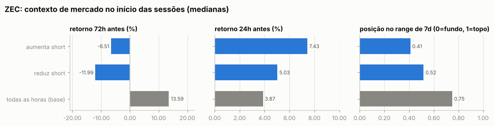

Por ordem (medianas):

| ação | ordens | retorno 24h antes | 72h antes | 7d antes | posição no range 7d | 24h depois | 7d depois |
|---|---|---|---|---|---|---|---|
| aumenta short | 88 | +7.80% | +10.46% | -12.79% | 0.41 | +17.68% | +16.57% |
| reduz short | 8 | +6.18% | -11.58% | +1.51% | 0.58 | +9.93% | +10.84% |
| todas as horas (base) |  | +3.87% | +13.59% | +28.15% | 0.75 | +3.78% | +20.79% |

Por sessão (ordens a menos de 30 min uma da outra contam como uma decisão; p = teste de Mann-Whitney contra todas as horas do período):

| sessão | sessões | retorno 24h antes | 72h antes | 7d antes | range 7d | no topo (>0,7) | no fundo (<0,3) |
|---|---|---|---|---|---|---|---|
| aumenta short | 11 | +7.43% (p=0.908) | -6.51% (p=0.019) | -3.60% (p=0.001) | 0.41 (p=0.000) | 0% | 18% |
| reduz short | 5 | +5.03% (p=0.874) | -11.99% (p=0.052) | +8.77% (p=0.036) | 0.52 (p=0.022) | 20% | 40% |
| todas as horas (base) |  |  |  |  |  | 58% | 9% |

- Aumentos de posição feitos com a posição no prejuízo (preço pior que o preço médio): **88%** das ordens (88% do tamanho); distância mediana do preço médio: +4.20%.
- Reduções/fechamentos com lucro: **25%** de 8; ganho médio $36.3K vs. perda média -$108.2K; realizado -$576.5K.

- Episódios (de zerado a zerado, ou até inverter): 5; fechados com lucro: 40%; duração mediana 0.7 dias; o melhor episódio sozinho = 79% da soma dos episódios lucrativos.

Maiores episódios por PnL realizado

| início | fim | dias | lado | tam_max | nocional_max | ordens | entrada | saída | realizado |
|---|---|---|---|---|---|---|---|---|---|
| 2025-11-13 | 2025-11-15 | 1.2 | short | 8,000 | $4.98M | 83 | 558.56 | 630.31 | -$574.0K |
| 2025-11-19 | 2025-11-19 | 0.1 | short | 4,000 | $2.52M | 2 | 611.85 | 629.77 | -$71.7K |
| 2025-11-11 | 2025-11-12 | 1.0 | short | 600.00 | $345.8K | 4 | 574.01 | 478.65 | +$57.2K |
| 2025-11-12 | 2025-11-13 | 0.7 | short | 300.00 | $160.4K | 4 | 534.76 | 483.46 | +$15.4K |
| 2025-10-24 | 2025-10-24 | 0.6 | short | 2,852 | $738.0K | 3 | 257.42 | 258.65 | -$3.5K |

### Todos os episódios relevantes (todas as moedas)

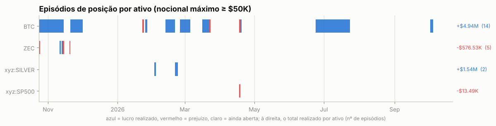

Episódios com nocional máximo ≥ $50K: 22; fechados com lucro: 68%. Abaixo, os 25 maiores por PnL realizado, em ordem de data. *7d/30d antes* e *vs. máx. 30d*: o que o preço tinha feito até a primeira ordem; *funding a.a.*: taxa anualizada nas 24h anteriores (positiva = longs pagam shorts); *entrada média vs. 1ª ordem*: positivo = foi aumentando a posição com o preço indo contra; *contra (máx.)*: quanto o preço andou contra a primeira ordem durante o episódio; *capturado*: movimento entre o preço médio de entrada e o de saída.

| ativo | lado | início | dias | nocional máx. | 7d antes | 30d antes | vs. máx. 30d | funding a.a. na entrada | entrada média vs. 1ª ordem | contra (máx.) | pior PnL aberto | capturado | realizado | funding |
|---|---|---|---|---|---|---|---|---|---|---|---|---|---|---|
| BTC | short | 2025-10-24 | 21 | $17.33M | +2% | -2% | -12% | +11% | -1% | +5% | -$716.6K | +7% | +$1.53M | +$85.3K |
| ZEC | short | 2025-10-24 | 1 | $738.0K | +22% | +376% | -12% | +7% | +0% | +4% | -$31.3K | -0% | -$3.5K | +$17 |
| ZEC | short | 2025-11-11 | 1 | $345.8K | +21% | +90% | -27% | +23% | +0% | -1% | +$0 | +17% | +$57.2K | +$330 |
| ZEC | short | 2025-11-12 | 1 | $160.4K | +7% | +104% | -26% | +20% | -0% | -3% | -$0 | +10% | +$15.4K | +$792 |
| BTC | short | 2025-11-13 | 1 | $9.93M | -0% | -10% | -13% | +11% | -0% | -0% | -$0 | +3% | +$348.1K | +$4.3K |
| ZEC | short | 2025-11-13 | 1 | $4.98M | -6% | +110% | -30% | +17% | +7% | +25% | -$396.6K | -13% | -$574.0K | +$836 |
| ZEC | short | 2025-11-19 | 0 | $2.52M | +37% | +140% | -13% | -59% | +0% | +3% | -$70.6K | -3% | -$71.7K | -$390 |
| BTC | long | 2025-11-20 | 11 | $10.39M | -11% | -21% | -23% | +11% | +3% | +6% | -$137.5K | +2% | +$176.8K | -$10.0K |
| BTC | short | 2026-01-22 | 2 | $13.45M | -8% | +2% | -9% | -2% | +0% | +2% | -$277.3K | -1% | -$147.2K | -$1.2K |
| BTC | short | 2026-01-25 | 2 | $8.86M | -7% | -0% | -9% | -2% | +0% | +0% | -$24.8K | +0% | +$2.1K | +$2.6K |
| xyz:SILVER | long | 2026-02-02 | 1 | $8.33M | -29% | +6% | -35% | +11% | -1% | +1% | -$153.1K | +10% | +$829.2K | -$25.1K |
| BTC | long | 2026-02-12 | 8 | $5.08M | -7% | -26% | -31% | -1% | -0% | +3% | -$153.6K | +1% | +$26.4K | -$7.9K |
| xyz:SILVER | long | 2026-02-20 | 3 | $8.63M | +1% | -17% | -34% | +2% | -0% | +2% | -$152.5K | +9% | +$713.3K | -$9.5K |
| BTC | long | 2026-02-24 | 9 | $17.14M | -7% | -29% | -30% | +8% | -1% | +0% | -$49.4K | +10% | +$1.63M | -$912 |
| BTC | short | 2026-03-16 | 1 | $2.98M | +9% | +5% | -2% | +0% | +0% | +0% | -$1.1K | +0% | +$13.4K | +$837 |
| BTC | short | 2026-03-16 | 6 | $8.34M | +8% | +6% | -0% | +3% | +1% | +2% | -$46.2K | +9% | +$716.0K | +$691 |
| BTC | long | 2026-03-22 | 0 | $1.72M | -5% | +1% | -10% | -8% | -0% | +1% | -$11.2K | -1% | -$13.2K | -$1.4K |
| xyz:SP500 | short | 2026-04-17 | 0 | $7.09M | +4% | — | +0% | -5% | +0% | +1% | -$43.2K | -0% | -$13.5K | $0 |
| BTC | short | 2026-04-17 | 0 | $7.65M | +6% | +5% | +0% | +1% | -0% | +2% | -$148.9K | -0% | -$31.5K | -$1.2K |
| BTC | short | 2026-04-18 | 0 | $11.35M | +4% | +9% | -3% | -8% | +0% | +0% | -$21.3K | +0% | +$3.0K | -$1.9K |
| BTC | long | 2026-06-23 | 30 | $15.39M | -5% | -18% | -20% | +6% | +1% | +7% | -$818.9K | +3% | +$606.7K | -$91.0K |
| BTC | short | 2026-10-02 | 2 | $4.80M | +1% | +10% | -2% | +9% | +0% | +0% | -$0 | +2% | +$84.7K | +$2.7K |

## 7. Funding

Funding líquido total: **-$56.9K** (recebido $99.6K, pago -$156.5K). Na Hyperliquid o funding é pago de hora em hora; quando positivo, longs pagam shorts.

| ativo | lado | funding | rendimento anualizado s/ nocional |
|---|---|---|---|
| BTC | short | +$86.9K | 8.3% |
| BTC | long | -$109.8K | -7.0% |
| xyz:SILVER | long | -$34.7K | -39.8% |
| ZEC | short | +$605 | 5.5% |

## 8. Fluxos, eventos e carteiras relacionadas

| tipo | eventos | USD (+ entra / − sai) |
|---|---|---|
| accountClassTransfer | 1 | — (sem valor em USD) |
| send | 5 | — (sem valor em USD) |
| spotTransfer | 1 | +$3.00M |

**Gestão de margem.** Dias com depósito: 0; em — deles o PnL dos 3 dias anteriores era negativo (mediana —). Dias com saque: 0; em — deles o PnL dos 3 dias anteriores era positivo (mediana —). Base: 23% de todos os dias vêm depois de 3 dias negativos. Correlação entre o fluxo do dia e a variação da exposição bruta: nan (positiva = deposita para abrir posição e saca ao reduzir).

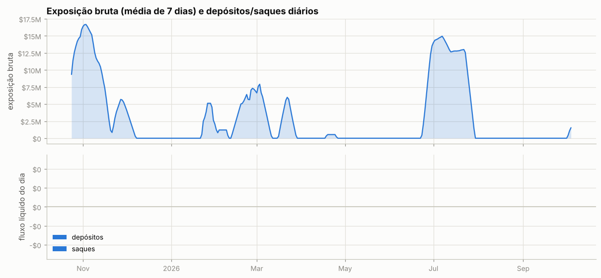

**Carteiras relacionadas** (conta vinculada de staking para desconto de taxa + maiores contrapartes de transferências; o saldo de staking e o PnL ajudam a ver se posições aqui são hedge de algo mantido lá):

| carteira | relação | transferências | volume transferido | valor da conta hoje | PnL all-time | HYPE em staking | maiores saldos spot |
|---|---|---|---|---|---|---|---|
| `0x574bafce69d9411f662a433896e74e4f153096fa` | transfers | 1 | $3.00M | $3.9K | +$2,331.54M | 0 | UBTC 20,993,454, USDC 3,666 |

## 9. Dá para copiar? (espelhar a posição com atraso)

PnL de quem replicasse exatamente a posição da carteira, mas com N horas de atraso (marcação horária, sem custos). Se o PnL se mantém com atraso, a vantagem está em horizontes longos e é copiável; se desaba, depende de timing fino.

| atraso | BTC | xyz:SILVER | ZEC |
|---|---|---|---|
| 0h | +$4.95M | +$1.78M | -$811.0K |
| 1h | +$5.00M | +$1.66M | -$675.9K |
| 4h | +$5.45M | +$1.71M | -$996.5K |
| 12h | +$4.51M | +$1.37M | -$199.3K |
| 24h | +$4.08M | +$909.9K | -$202.9K |
| 72h | +$3.87M | -$406.8K | +$429.1K |
| 168h | +$5.39M | +$691.7K | +$808.0K |

## 10. Teste de replicação por regras (BTC)

Regra testada: *short-bias com filtro de tendência e fade* — short de até 151.9 BTC (o percentil 90 do tamanho real), cheio abaixo da média móvel e reduzido acima; dentro do regime, mais short perto do topo do range e menos perto do fundo. Parâmetros escolhidos no treino (2025-10-24 → 2026-04-18) e avaliados no teste (2026-04-19 → 2026-10-12).

|  | parâmetros | PnL treino | PnL teste | correlação c/ posição real (teste) |
|---|---|---|---|---|
| melhor regra no treino | MA100, range 7d, fração em alta 0.0, fade 0.0 | +$5.62M | +$143.9K | -0.50 |
| carteira real (aprox.) | — | +$3.99M | +$574.8K | 1.00 |

Clone comportamental (regressão linear da posição real em médias móveis, ranges e retornos): R² treino 0.62, R² teste -6.51, correlação no teste 0.50.

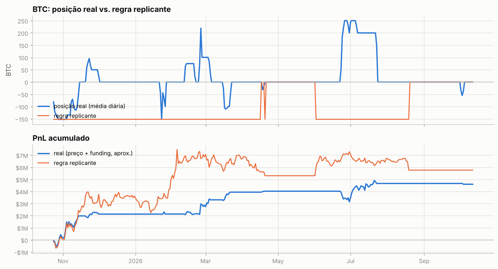

---

Metodologia e código: ver `README.md` na raiz do repositório.
