# Relatório automático — `0x2312171890250347dbf1b082bdf7950504909e92`

Gerado em 2026-10-16 11:11 UTC a partir da API pública da Hyperliquid (`POST /info`). Valores em USD. Este arquivo é regenerado por `python -m hlre.report`; a interpretação da estratégia fica em `ANALISE.md`.

## 1. Visão geral

| métrica | valor |
|---|---|
| Valor da conta (perp + spot) | $689.6K |
| PnL all-time (portfolio, inclui spot/airdrops) | +$1.99M |
| PnL all-time só de perps | +$974.5K |
| Volume all-time | $195.34M |
| Primeira atividade | 2023-08-16 |
| Fills disponíveis na API | 38,817 (desde 2025-02-27) |
| Ordens (fills agrupados por oid) | 5,365 |
| Funding líquido (recebido > 0) | -$68.1K |
| Taxas pagas (período dos fills) | -$40.7K |
| Liquidações (ledger) | 0 |
| Fills de liquidação/ADL | 62 |
| Papel da conta | user |
| API wallets (agentes) | 2 |

**Posições abertas agora:**

| ativo | tamanho | nocional | entrada | alav. | PnL não realizado | liq. |
|---|---|---|---|---|---|---|
| OP | 673580.9 | $94.3K | 0.12722 | 5x cross | +$8.6K | — |
| UNI | -13068.5 | $97.2K | 8.80188 | 10x cross | +$17.8K | 52.5604038226 |

## 2. Curva de PnL

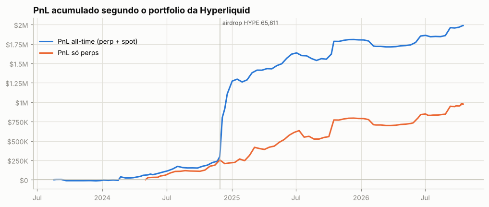

**Atenção: execuções que não aparecem nos fills.** A posição muda sem fill visível em 18 pontos (~$831.3K de nocional; maiores: AAVE $168.6K, LINK $122.7K, TRUMP $96.9K, ARB $73.9K, ENA $62.1K). O mais comum são fatias de TWAP: ficam fora de `userFills` e o endpoint de TWAP só guarda as 2.000 mais recentes. O *preço exato* e as tabelas por episódio dessas moedas não são exatos.

## 3. De onde veio o PnL

*Preço (aprox.)* usa a posição média diária de cada ativo, reconstruída a partir do histórico de funding (que traz o tamanho da posição a cada hora/dia desde o início da conta), vezes o movimento open→close do dia. Subestima o PnL de day trade, mas cobre o período sem fills. *Preço exato* marca cada fill no fechamento diário e só existe para o período coberto pelos fills.

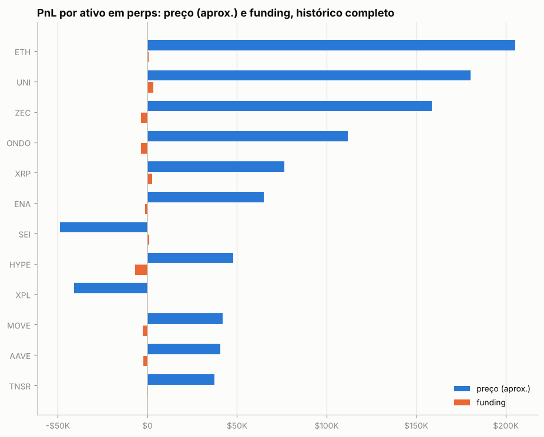

| ativo | preço (aprox.) | funding | total | preço exato (período dos fills) | taxas (período dos fills) |
|---|---|---|---|---|---|
| ETH | +$205.1K | +$828 | +$206.0K | +$201.8K | -$7.0K |
| UNI | +$180.5K | +$3.2K | +$183.7K | +$119.6K | -$783 |
| ZEC | +$158.6K | -$3.5K | +$155.2K | +$200.9K | -$774 |
| ONDO | +$111.9K | -$3.6K | +$108.3K | +$7.8K | -$437 |
| XRP | +$76.4K | +$2.5K | +$79.0K | +$117.6K | -$764 |
| ENA | +$64.9K | -$1.2K | +$63.6K | +$9.4K | -$1.0K |
| SEI | -$48.9K | +$915 | -$48.0K | -$44.2K | -$155 |
| HYPE | +$47.9K | -$6.7K | +$41.2K | +$51.6K | -$1.5K |
| XPL | -$40.9K | -$14 | -$40.9K | -$32.5K | -$288 |
| MOVE | +$41.9K | -$2.6K | +$39.3K | +$23.4K | -$168 |
| AAVE | +$40.5K | -$2.4K | +$38.2K | +$41.3K | -$899 |
| TNSR | +$37.3K | +$425 | +$37.7K | — | — |
| MKR | +$42.7K | -$5.1K | +$37.6K | +$14.0K | -$348 |
| FET | +$36.4K | +$514 | +$37.0K | +$27.9K | -$61 |
| NXPC | -$38.0K | +$1.2K | -$36.8K | -$48.2K | -$61 |
| outros (139) | +$533.6K | -$52.6K | +$481.0K | -$3.7K | -$26.3K |

**Decomposição no período dos fills** (preço exato): quanto veio de *carregar* a posição (e, dentro disso, do viés médio vs. do *timing* de aumentar/reduzir), quanto de trades intradiários, funding e taxas.

| componente | ETH | ZEC | UNI |
|---|---|---|---|
| carregar posição (carry) | +$174.0K | +$155.4K | +$127.8K |
|   ↳ viés (posição média × movimento) | -$3.1K | +$46.6K | -$2.1K |
|   ↳ timing (variação do tamanho) | +$177.1K | +$108.8K | +$129.9K |
| trades intradiários | +$27.8K | +$45.5K | -$8.2K |
| funding | +$1.9K | -$3.5K | +$2.8K |
| taxas | -$7.0K | -$774 | -$783 |
| posição média | -13.67 | 42.20 | -3,223.75 |
| movimento do preço no período | 227.70 | 1,103.54 | 0.64 |

## 4. Posições ao longo do tempo

Área clara: posição média diária (funding). Linha: posição exata (fills). Azul = long, vermelho = short.

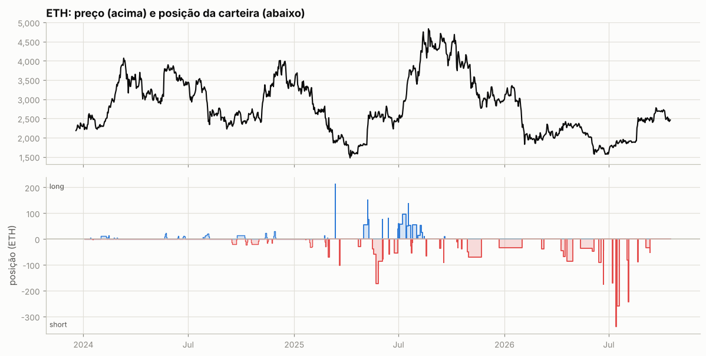

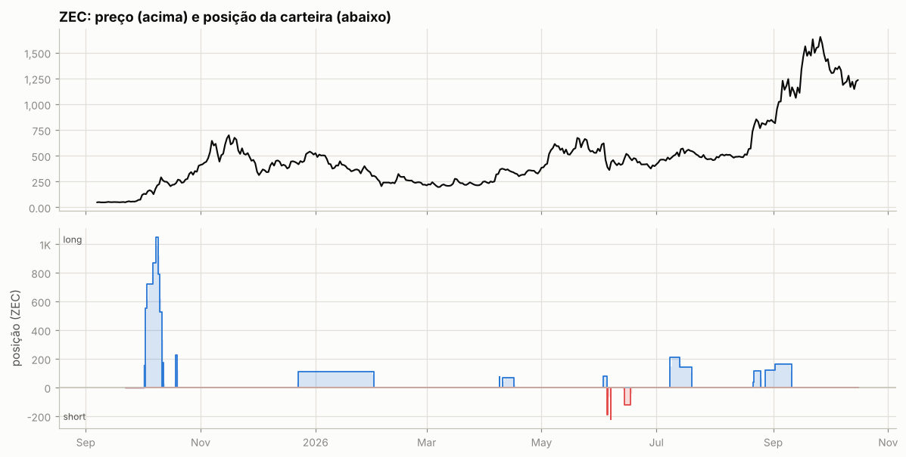

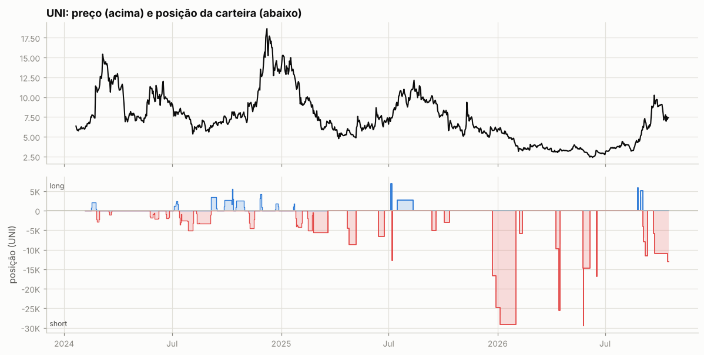

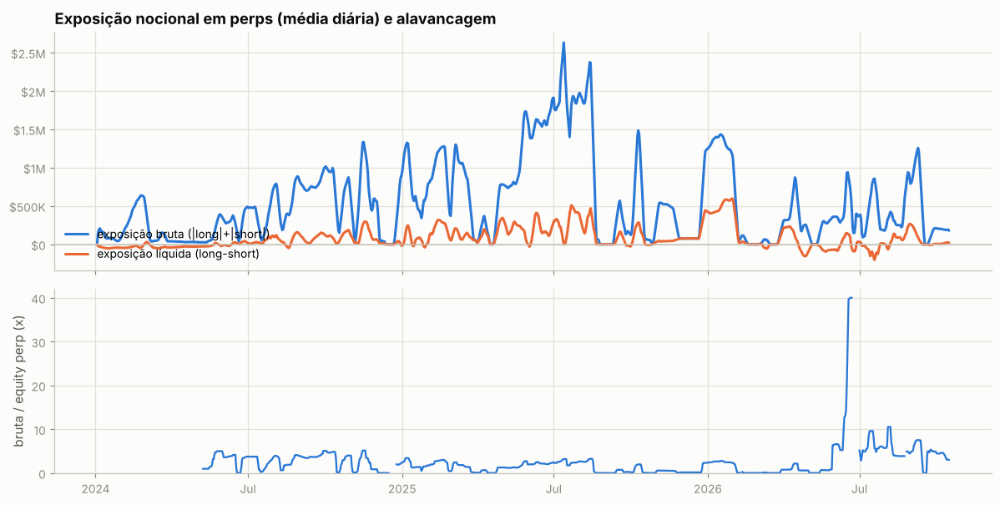

Tabela mensal de exposição e alavancagem

| mês | exposição bruta | exposição líquida | equity perp | alavancagem (mediana) |
|---|---|---|---|---|
| 2024-01 | $93.3K | -$44.6K | — | — |
| 2024-02 | $460.8K | -$25.3K | — | — |
| 2024-03 | $68.0K | -$36.2K | — | — |
| 2024-04 | $32.0K | -$31.5K | — | — |
| 2024-05 | $156.6K | -$14.7K | $37.1K | 3.3x |
| 2024-06 | $307.7K | $11.4K | $104.1K | 3.6x |
| 2024-07 | $394.3K | $50.9K | $159.1K | 2.8x |
| 2024-08 | $557.5K | $63.2K | $203.4K | 2.9x |
| 2024-09 | $803.2K | $82.3K | $204.5K | 3.7x |
| 2024-10 | $668.6K | $102.3K | $212.8K | 4.0x |
| 2024-11 | $673.4K | $127.2K | $286.6K | 2.5x |
| 2024-12 | $247.5K | $2.3K | $204.0K | 0.2x |
| 2025-01 | $748.5K | $78.1K | $421.8K | 1.7x |
| 2025-02 | $948.2K | $200.5K | $459.4K | 2.5x |
| 2025-03 | $713.5K | $103.6K | $583.7K | 1.4x |
| 2025-04 | $339.7K | $154.2K | $591.8K | 0.5x |
| 2025-05 | $1.08M | $164.7K | $652.8K | 1.4x |
| 2025-06 | $1.64M | $226.2K | $748.8K | 2.2x |
| 2025-07 | $1.94M | $301.2K | $788.8K | 2.6x |
| 2025-08 | $966.3K | $138.2K | $730.1K | 0.2x |
| 2025-09 | $198.7K | $33.3K | $719.7K | 0.2x |
| 2025-10 | $487.9K | $89.7K | $859.7K | 0.2x |
| 2025-11 | $374.0K | $52.4K | $891.6K | 0.5x |
| 2025-12 | $422.0K | $185.6K | $529.3K | 0.1x |
| 2026-01 | $1.30M | $511.2K | $520.9K | 2.5x |
| 2026-02 | $31.5K | $11.0K | $325.8K | 0.0x |
| 2026-03 | $72.1K | $29.1K | $416.6K | 0.0x |
| 2026-04 | $386.1K | $35.6K | $420.2K | 0.8x |
| 2026-05 | $201.0K | -$47.6K | $372.5K | 0.6x |
| 2026-06 | $448.7K | $21.6K | $24.4K | 8.0x |
| 2026-07 | $384.6K | -$59.9K | $66.5K | 5.7x |
| 2026-08 | $490.7K | $115.6K | $64.8K | 4.3x |
| 2026-09 | $457.3K | $32.1K | $85.1K | 5.3x |
| 2026-10 | $188.4K | $14.0K | $50.5K | 4.4x |

## 5. Execução

**Tipos de ordem** (últimas 1,014 ordens que a API guarda, 2026-04-16 → 2026-10-16):

| orderType | tif | reduceOnly | isTrigger | ordens |
|---|---|---|---|---|
| Limit | Alo | False | False | 4 |
| Limit | Alo | True | False | 437 |
| Limit | Gtc | False | False | 7 |
| Limit | Gtc | True | False | 30 |
| Limit | Ioc | False | False | 103 |
| Limit | Ioc | True | False | 169 |
| Market | FrontendMarket | False | False | 161 |
| Market | FrontendMarket | True | False | 96 |
| Market | LiquidationMarket | True | False | 7 |

`FrontendMarket` = ordem a mercado enviada pela interface web; `Gtc` = limite que fica no livro; gatilhos (`isTrigger`) seriam stop/take-profit.

**Perfil por ativo (top 10 por volume):**

| ativo | volume | ordens | % taker (nocional) | tamanho mediano |
|---|---|---|---|---|
| BTC | $29.48M | 203 | 81% | 1 |
| ETH | $17.59M | 167 | 80% | 32.73 |
| SOL | $9.01M | 120 | 67% | 377.4 |
| HYPE | $4.55M | 138 | 59% | 812.7 |
| ENA | $3.23M | 182 | 55% | 2.948e+04 |
| WLD | $2.83M | 124 | 72% | 2.994e+04 |
| AAVE | $2.58M | 255 | 57% | 2.51 |
| ZEC | $2.01M | 58 | 70% | 82.27 |
| XRP | $1.99M | 47 | 82% | 1.714e+04 |
| UNI | $1.87M | 93 | 76% | 3,206 |

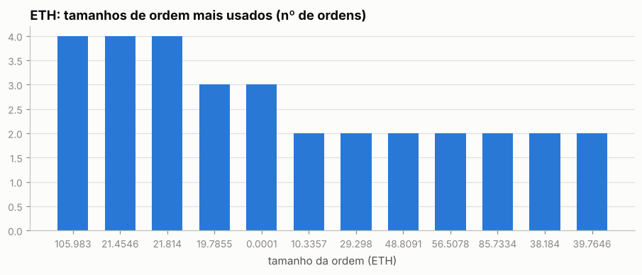

Os 5 tamanhos mais comuns respondem por 11% das ordens de ETH — lotes redondos e repetidos são assinatura de execução manual.

Sessões (ordens separadas por < 30 min): 726; mediana de 2 ordens e 0.3 min por sessão; dias com atividade: 290 de 596.

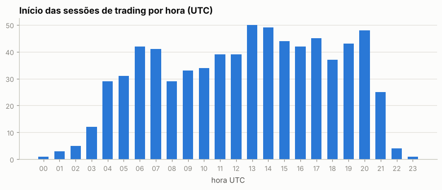

Por dia da semana: seg 15%, ter 14%, qua 16%, qui 18%, sex 18%, sáb 9%, dom 10%

## 6. Comportamento de entrada e saída

### ETH

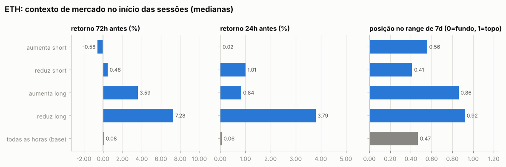

Por ordem (medianas):

| ação | ordens | retorno 24h antes | 72h antes | 7d antes | posição no range 7d | 24h depois | 7d depois |
|---|---|---|---|---|---|---|---|
| aumenta short | 74 | -0.03% | -0.80% | +3.22% | 0.56 | -0.12% | +1.60% |
| reduz short | 41 | +0.52% | -0.66% | +1.02% | 0.34 | +0.42% | +1.90% |
| aumenta long | 26 | +0.84% | +2.68% | +7.15% | 0.89 | +1.54% | +6.07% |
| reduz long | 25 | +2.17% | +3.63% | +18.33% | 0.91 | -0.11% | +5.44% |
| todas as horas (base) |  | +0.06% | +0.08% | +0.21% | 0.47 | +0.05% | +0.30% |

Por sessão (ordens a menos de 30 min uma da outra contam como uma decisão; p = teste de Mann-Whitney contra todas as horas do período):

| sessão | sessões | retorno 24h antes | 72h antes | 7d antes | range 7d | no topo (>0,7) | no fundo (<0,3) |
|---|---|---|---|---|---|---|---|
| aumenta short | 37 | +0.02% (p=0.742) | -0.58% (p=0.837) | +3.19% (p=0.008) | 0.56 (p=0.429) | 32% | 24% |
| reduz short | 28 | +1.01% (p=0.522) | +0.48% (p=0.895) | +2.02% (p=0.235) | 0.41 (p=0.892) | 29% | 32% |
| aumenta long | 11 | +0.84% (p=0.061) | +3.59% (p=0.016) | +4.53% (p=0.005) | 0.86 (p=0.003) | 73% | 0% |
| reduz long | 10 | +3.79% (p=0.022) | +7.28% (p=0.002) | +20.17% (p=0.001) | 0.92 (p=0.007) | 70% | 10% |
| todas as horas (base) |  |  |  |  |  | 31% | 33% |

- Aumentos de posição feitos com a posição no prejuízo (preço pior que o preço médio): **36%** das ordens (42% do tamanho); distância mediana do preço médio: -0.01%.
- Reduções/fechamentos com lucro: **53%** de 66; ganho médio $9.7K vs. perda média -$4.5K; realizado +$201.6K.

- Episódios (de zerado a zerado, ou até inverter): 40; fechados com lucro: 40%; duração mediana 2.1 dias; o melhor episódio sozinho = 27% da soma dos episódios lucrativos.

Maiores episódios por PnL realizado

| início | fim | dias | lado | tam_max | nocional_max | ordens | entrada | saída | realizado |
|---|---|---|---|---|---|---|---|---|---|
| 2025-10-28 | 2025-11-21 | 24.1 | short | 70.00 | $271.8K | 3 | 4,085 | 2,784 | +$91.1K |
| 2025-05-01 | 2025-05-10 | 8.4 | long | 152.06 | $340.3K | 6 | 1,973 | 2,305 | +$50.4K |
| 2025-07-02 | 2025-07-14 | 11.5 | long | 96.64 | $292.6K | 7 | 2,587 | 3,028 | +$42.6K |
| 2025-07-15 | 2025-07-22 | 6.8 | long | 138.08 | $470.8K | 10 | 3,280 | 3,569 | +$40.0K |
| 2026-07-13 | 2026-07-14 | 1.1 | short | 337.86 | $632.6K | 5 | 1,776 | 1,873 | -$32.8K |
| 2026-05-12 | 2026-06-05 | 24.2 | short | 48.24 | $91.3K | 3 | 2,177 | 1,604 | +$27.6K |
| 2025-08-03 | 2025-08-11 | 8.0 | long | 53.25 | $226.4K | 5 | 3,756 | 4,255 | +$26.6K |
| 2025-12-22 | 2026-01-31 | 40.2 | short | 32.73 | $100.0K | 4 | 3,054 | 2,418 | +$20.8K |
| 2025-02-28 | 2025-03-02 | 2.1 | short | 69.41 | $168.1K | 6 | 2,160 | 2,431 | -$18.8K |
| 2026-07-15 | 2026-07-19 | 4.2 | short | 258.46 | $499.8K | 7 | 1,934 | 1,868 | +$17.2K |

### ZEC

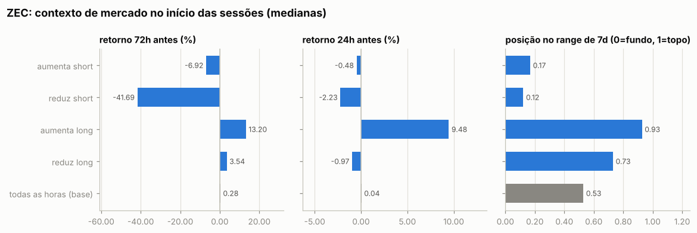

Por ordem (medianas):

| ação | ordens | retorno 24h antes | 72h antes | 7d antes | posição no range 7d | 24h depois | 7d depois |
|---|---|---|---|---|---|---|---|
| aumenta short | 6 | +7.89% | -24.84% | -18.63% | 0.17 | +9.76% | +14.44% |
| reduz short | 4 | -23.75% | -41.69% | -38.38% | 0.06 | +18.05% | +26.31% |
| aumenta long | 23 | +15.35% | +13.32% | +55.35% | 0.93 | -2.34% | +25.17% |
| reduz long | 25 | -0.97% | +3.54% | +35.19% | 0.73 | -0.33% | -15.25% |
| todas as horas (base) |  | +0.04% | +0.28% | +4.36% | 0.53 | +0.02% | +3.72% |

Por sessão (ordens a menos de 30 min uma da outra contam como uma decisão; p = teste de Mann-Whitney contra todas as horas do período):

| sessão | sessões | retorno 24h antes | 72h antes | 7d antes | range 7d | no topo (>0,7) | no fundo (<0,3) |
|---|---|---|---|---|---|---|---|
| aumenta short | 3 | -0.48% (p=0.898) | -6.92% (p=0.088) | -5.43% (p=0.405) | 0.17 (p=0.160) | 0% | 67% |
| reduz short | 3 | -2.23% (p=0.172) | -41.69% (p=0.219) | -35.74% (p=0.143) | 0.12 (p=0.226) | 33% | 67% |
| aumenta long | 14 | +9.48% (p=0.004) | +13.20% (p=0.009) | +49.25% (p=0.000) | 0.93 (p=0.000) | 79% | 7% |
| reduz long | 11 | -0.97% (p=0.570) | +3.54% (p=0.323) | +27.43% (p=0.047) | 0.73 (p=0.196) | 55% | 18% |
| todas as horas (base) |  |  |  |  |  | 38% | 30% |

- Aumentos de posição feitos com a posição no prejuízo (preço pior que o preço médio): **19%** das ordens (44% do tamanho); distância mediana do preço médio: -0.92%.
- Reduções/fechamentos com lucro: **52%** de 29; ganho médio $16.4K vs. perda média -$3.3K; realizado +$200.9K.

- Episódios (de zerado a zerado, ou até inverter): 13; fechados com lucro: 38%; duração mediana 3.4 dias; o melhor episódio sozinho = 43% da soma dos episódios lucrativos.

Maiores episódios por PnL realizado

| início | fim | dias | lado | tam_max | nocional_max | ordens | entrada | saída | realizado |
|---|---|---|---|---|---|---|---|---|---|
| 2025-10-02 | 2025-10-11 | 8.9 | long | 1,050 | $202.4K | 17 | 143.11 | 244.34 | +$106.3K |
| 2026-08-27 | 2026-09-10 | 13.8 | long | 164.55 | $191.8K | 5 | 820.65 | 1,167 | +$56.9K |
| 2026-06-04 | 2026-06-05 | 0.5 | short | 191.70 | $99.8K | 4 | 521.75 | 273.67 | +$47.6K |
| 2026-08-21 | 2026-08-25 | 4.0 | long | 117.87 | $98.0K | 4 | 643.34 | 831.67 | +$22.2K |
| 2025-12-22 | 2026-01-31 | 40.2 | long | 111.93 | $50.0K | 4 | 447.07 | 288.48 | -$17.8K |
| 2026-07-08 | 2026-07-19 | 11.5 | long | 210.06 | $109.7K | 3 | 476.38 | 541.82 | +$13.7K |
| 2026-06-13 | 2026-06-17 | 3.4 | short | 122.19 | $62.6K | 2 | 409.11 | 511.91 | -$12.6K |
| 2026-06-02 | 2026-06-04 | 2.1 | long | 79.94 | $50.0K | 2 | 625.56 | 521.85 | -$8.3K |
| 2025-10-11 | 2025-10-12 | 0.3 | long | 173.39 | $50.0K | 4 | 288.20 | 275.12 | -$2.3K |
| 2026-04-10 | 2026-04-16 | 6.0 | long | 67.07 | $25.0K | 4 | 372.53 | 343.75 | -$1.9K |

### UNI

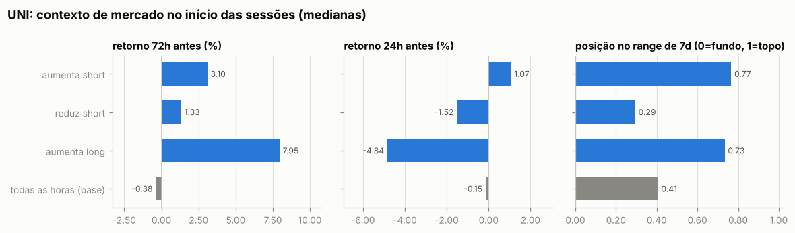

Por ordem (medianas):

| ação | ordens | retorno 24h antes | 72h antes | 7d antes | posição no range 7d | 24h depois | 7d depois |
|---|---|---|---|---|---|---|---|
| aumenta short | 43 | +2.40% | +0.27% | +1.77% | 0.69 | +0.11% | +3.46% |
| reduz short | 42 | -1.69% | -0.48% | -6.62% | 0.29 | +2.58% | -0.32% |
| aumenta long | 4 | -4.84% | +7.95% | +19.86% | 0.73 | +2.29% | +22.01% |
| reduz long | 4 | +1.43% | +4.42% | +21.81% | 0.78 | -1.18% | +17.63% |
| todas as horas (base) |  | -0.15% | -0.38% | -1.33% | 0.41 | -0.16% | -1.45% |

Por sessão (ordens a menos de 30 min uma da outra contam como uma decisão; p = teste de Mann-Whitney contra todas as horas do período):

| sessão | sessões | retorno 24h antes | 72h antes | 7d antes | range 7d | no topo (>0,7) | no fundo (<0,3) |
|---|---|---|---|---|---|---|---|
| aumenta short | 21 | +1.07% (p=0.354) | +3.10% (p=0.115) | +6.86% (p=0.005) | 0.77 (p=0.001) | 52% | 14% |
| reduz short | 16 | -1.52% (p=0.426) | +1.33% (p=0.956) | -5.16% (p=0.231) | 0.29 (p=0.750) | 25% | 56% |
| aumenta long | 4 | -4.84% (p=0.212) | +7.95% (p=0.017) | +19.86% (p=0.008) | 0.73 (p=0.038) | 75% | 0% |
| todas as horas (base) |  |  |  |  |  | 25% | 39% |

- Aumentos de posição feitos com a posição no prejuízo (preço pior que o preço médio): **39%** das ordens (61% do tamanho); distância mediana do preço médio: -0.02%.
- Reduções/fechamentos com lucro: **80%** de 46; ganho médio $3.5K vs. perda média -$1.9K; realizado +$113.8K.

- Episódios (de zerado a zerado, ou até inverter): 17; fechados com lucro: 81%; duração mediana 7.3 dias; o melhor episódio sozinho = 48% da soma dos episódios lucrativos.

Maiores episódios por PnL realizado

| início | fim | dias | lado | tam_max | nocional_max | ordens | entrada | saída | realizado |
|---|---|---|---|---|---|---|---|---|---|
| 2025-12-23 | 2026-01-31 | 39.4 | short | 29,130 | $170.9K | 13 | 6.01 | 3.83 | +$63.5K |
| 2026-05-24 | 2026-06-05 | 12.0 | short | 29,400 | $100.2K | 5 | 3.40 | 2.92 | +$14.2K |
| 2026-06-16 | 2026-06-17 | 1.0 | short | 16,780 | $62.4K | 2 | 2.98 | 3.72 | -$12.4K |
| 2025-03-21 | 2025-03-21 | 0.0 | short | 5,575 | $38.2K | 2 | — | 6.86 | +$11.7K |
| 2025-04-22 | 2025-05-07 | 15.1 | short | 8,736 | $51.3K | 6 | 5.72 | 4.80 | +$8.0K |
| 2025-07-15 | 2025-08-11 | 27.0 | long | 2,775 | $32.3K | 2 | 9.01 | 11.64 | +$7.3K |
| 2025-10-02 | 2025-10-11 | 8.8 | short | 3,024 | $25.0K | 5 | 8.26 | 6.00 | +$6.9K |
| 2026-08-30 | 2026-09-02 | 3.1 | long | 5,132 | $31.7K | 2 | 4.87 | 6.18 | +$6.7K |
| 2026-09-02 | 2026-09-10 | 8.3 | short | 11,612 | $80.6K | 6 | 6.46 | 6.00 | +$5.3K |
| 2026-04-09 | 2026-04-16 | 7.1 | short | 25,561 | $83.3K | 12 | 3.13 | 3.26 | -$3.4K |

### Todos os episódios relevantes (todas as moedas)

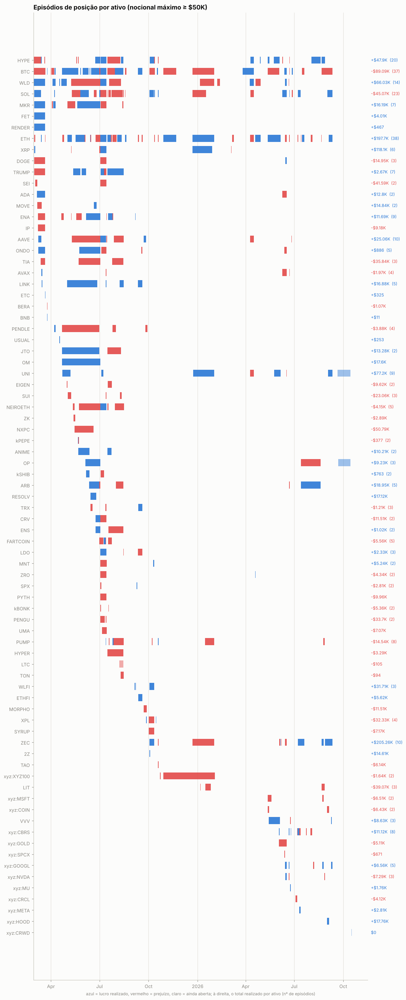

Episódios com nocional máximo ≥ $50K: 342; fechados com lucro: 45%. Abaixo, os 25 maiores por PnL realizado, em ordem de data. *7d/30d antes* e *vs. máx. 30d*: o que o preço tinha feito até a primeira ordem; *funding a.a.*: taxa anualizada nas 24h anteriores (positiva = longs pagam shorts); *entrada média vs. 1ª ordem*: positivo = foi aumentando a posição com o preço indo contra; *contra (máx.)*: quanto o preço andou contra a primeira ordem durante o episódio; *capturado*: movimento entre o preço médio de entrada e o de saída.

| ativo | lado | início | dias | nocional máx. | 7d antes | 30d antes | vs. máx. 30d | funding a.a. na entrada | entrada média vs. 1ª ordem | contra (máx.) | pior PnL aberto | capturado | realizado | funding |
|---|---|---|---|---|---|---|---|---|---|---|---|---|---|---|
| HYPE | long | 2025-02-27 | 14 | $165.5K | -18% | -14% | -28% | +49% | +10% | +39% | -$24.9K | -15% | -$42.9K | -$986 |
| XRP | long | 2025-02-28 | 2 | $409.6K | -23% | -33% | -34% | +10% | -0% | -0% | -$433 | +36% | +$107.7K | -$196 |
| BTC | long | 2025-04-21 | 31 | $580.5K | +3% | +3% | -2% | +3% | -6% | +2% | -$6.1K | +7% | +$62.4K | -$2.3K |
| ETH | long | 2025-05-01 | 8 | $340.3K | +5% | -4% | -4% | +11% | -7% | +4% | -$4.3K | +17% | +$50.4K | -$344 |
| NXPC | long | 2025-05-15 | 35 | $98.4K | — | — | +0% | — | +41% | +68% | -$40.0K | -42% | -$50.8K | +$1.3K |
| BTC | long | 2025-07-02 | 12 | $366.6K | +2% | +5% | -1% | +7% | -0% | +2% | -$5.1K | +12% | +$39.3K | -$1.6K |
| ETH | long | 2025-07-02 | 11 | $292.6K | +7% | +3% | -9% | -7% | +0% | +4% | -$6.5K | +17% | +$42.6K | -$1.0K |
| HYPE | long | 2025-07-03 | 11 | $235.9K | +6% | +11% | -12% | +11% | -3% | +8% | -$11.0K | +18% | +$35.2K | -$1.1K |
| SOL | short | 2025-07-03 | 11 | $375.8K | +8% | -3% | -7% | -6% | -4% | +8% | -$40.0K | -11% | -$39.1K | +$757 |
| ETH | long | 2025-07-15 | 7 | $470.8K | +18% | +20% | -1% | +33% | -7% | +3% | -$4.0K | +9% | +$40.0K | -$1.1K |
| SOL | short | 2025-07-17 | 5 | $328.6K | +12% | +18% | -0% | +52% | +1% | +16% | -$33.5K | -12% | -$36.0K | +$1.1K |
| SOL | short | 2025-07-23 | 21 | $328.7K | +9% | +42% | -9% | +56% | -3% | +8% | -$31.1K | -8% | -$30.2K | +$1.4K |
| ZEC | long | 2025-10-02 | 9 | $202.4K | +166% | +272% | +0% | +333% | +0% | +13% | -$14.4K | +71% | +$106.3K | -$2.1K |
| SOL | short | 2025-10-02 | 8 | $223.1K | +10% | +9% | -11% | +5% | +1% | +5% | -$4.8K | +35% | +$78.6K | +$333 |
| BTC | long | 2025-10-08 | 3 | $540.2K | +7% | +10% | -3% | +14% | -1% | +9% | -$53.3K | -8% | -$44.3K | -$554 |
| XPL | long | 2025-10-09 | 2 | $100.1K | -20% | +16% | -55% | +18% | -0% | +43% | -$40.6K | -41% | -$41.4K | +$259 |
| ETH | short | 2025-10-28 | 24 | $271.8K | +8% | +4% | -12% | +11% | -2% | -1% | +$0 | +32% | +$91.1K | +$1.2K |
| BTC | long | 2025-10-28 | 24 | $225.8K | +7% | +5% | -8% | +11% | +1% | +28% | -$63.3K | -25% | -$57.7K | -$1.4K |
| BTC | long | 2025-12-22 | 40 | $719.3K | +2% | +7% | -4% | +9% | +0% | +14% | -$95.8K | -14% | -$99.7K | -$6.2K |
| UNI | short | 2025-12-23 | 39 | $170.9K | +20% | -2% | -5% | +11% | +0% | +8% | -$7.6K | +36% | +$63.5K | +$1.2K |
| ZEC | short | 2026-06-04 | 0 | $99.8K | -5% | +17% | -23% | +5% | -0% | -1% | -$0 | +48% | +$47.6K | -$32 |
| WLD | long | 2026-06-13 | 3 | $204.9K | +22% | +86% | -19% | -4% | -0% | +2% | -$2.8K | +37% | +$54.9K | -$481 |
| ETH | short | 2026-07-13 | 1 | $632.6K | +1% | +6% | -3% | +11% | +0% | +6% | -$32.3K | -5% | -$32.8K | +$253 |
| LIT | short | 2026-08-21 | 6 | $123.2K | +27% | +23% | -5% | +57% | +0% | +40% | -$28.8K | -31% | -$30.9K | +$454 |
| ZEC | long | 2026-08-27 | 14 | $191.8K | +43% | +74% | -6% | +18% | -0% | +4% | -$4.2K | +42% | +$56.9K | -$702 |

## 7. Funding

Funding líquido total: **-$68.1K** (recebido $101.1K, pago -$169.2K). Na Hyperliquid o funding é pago de hora em hora; quando positivo, longs pagam shorts.

| ativo | lado | funding | rendimento anualizado s/ nocional |
|---|---|---|---|
| ETH | short | +$6.2K | 8.0% |
| ETH | long | -$5.4K | -20.4% |
| ZEC | short | +$96 | 14.8% |
| ZEC | long | -$3.6K | -19.1% |
| UNI | short | +$4.7K | 11.4% |
| UNI | long | -$1.4K | -22.5% |
| (outros) | short | +$33.5K | 6.3% |
| (outros) | long | -$102.2K | -12.5% |

## 8. Fluxos, eventos e carteiras relacionadas

| tipo | eventos | USD (+ entra / − sai) |
|---|---|---|
| withdraw | 12 | -$2.07M |
| vaultDeposit | 3 | -$10.1K |
| accountClassTransfer | 22 | — (sem valor em USD) |
| activateDexAbstraction | 1 | — (sem valor em USD) |
| subAccountTransfer | 10 | — (sem valor em USD) |
| send | 1 | — (sem valor em USD) |
| spotGenesis | 50 | — (sem valor em USD) |
| internalTransfer | 5 | +$53 |
| vaultWithdraw | 1 | +$12.1K |
| spotTransfer | 5 | +$79.0K |
| deposit | 14 | +$683.9K |

**Gestão de margem.** Dias com depósito: 12; em 8% deles o PnL dos 3 dias anteriores era negativo (mediana $0). Dias com saque: 10; em 70% deles o PnL dos 3 dias anteriores era positivo (mediana +$500). Base: 32% de todos os dias vêm depois de 3 dias negativos. Correlação entre o fluxo do dia e a variação da exposição bruta: 0.01 (positiva = deposita para abrir posição e saca ao reduzir).

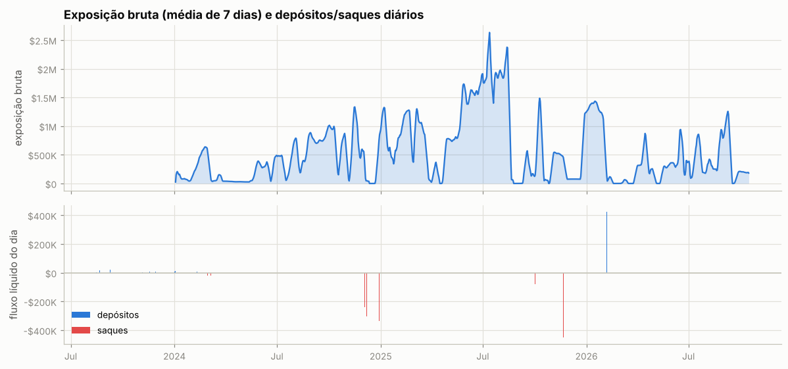

Ponte HyperCore↔HyperEVM (endereços de sistema `0x2000…`/`0x2222…`): 3 transferências, entrada $79.0K, saída $45 — uso de DeFi na HyperEVM.

**Carteiras relacionadas** (conta vinculada de staking para desconto de taxa + maiores contrapartes de transferências; o saldo de staking e o PnL ajudam a ver se posições aqui são hedge de algo mantido lá):

| carteira | relação | transferências | volume transferido | valor da conta hoje | PnL all-time | HYPE em staking | maiores saldos spot |
|---|---|---|---|---|---|---|---|
| `0x36715f6408819492c27c1a1538156af9a2bfe963` | transfers | 1 | $40 | $6.20M | +$71.89M | 0 | NASDAQ 50,096, HOPE 50,000, LATINA 27,571 |
| `0xb03d904c5c34a6d49682ba7fe3106e0a8304fc76` | transfers | 1 | $16 | $1 | -$5.5K | 0 | — |
| `0x995e92d4bb508276f839f1f191df0fbddb8582ba` | transfers | 4 | $13 | $4.6K | +$46.1K | 0 | — |

**Liquidações e ADL (auto-deleveraging) nos fills:**

| quando (UTC) | ativo | tipo | lado | preço | tamanho | posição antes | PnL realizado |
|---|---|---|---|---|---|---|---|
| 2025-10-10 21:19:18 | AVAX | Auto-Deleveraging | B | 14.155 | 1635.16 | -1635.16 | +$26.8K |
| 2025-10-10 21:19:52 | SOL | Auto-Deleveraging | B | 148.46 | 985.61 | -985.61 | +$78.6K |
| 2026-05-11 15:21:53 | xyz:COIN | Close Short | B | 210.0 | 9.725 | -49.915 | -$94 |
| 2026-05-11 15:21:53 | xyz:COIN | Close Short | B | 210.01 | 5.8 | -40.19 | -$56 |
| 2026-05-11 15:21:53 | xyz:COIN | Close Short | B | 210.03 | 9.585 | -34.39 | -$93 |
| 2026-05-11 15:21:53 | xyz:COIN | Close Short | B | 210.04 | 0.96 | -24.805 | -$9 |
| 2026-05-11 15:21:53 | xyz:COIN | Close Short | B | 210.05 | 2.0 | -23.845 | -$19 |
| 2026-05-11 15:21:53 | xyz:COIN | Close Short | B | 210.05 | 21.845 | -21.845 | -$213 |
| 2026-05-14 15:59:23 | xyz:COIN | Close Short | B | 215.29 | 0.232 | -122.398 | -$2 |
| 2026-05-14 15:59:23 | xyz:COIN | Close Short | B | 215.29 | 6.049 | -122.166 | -$61 |
| 2026-05-14 15:59:23 | xyz:COIN | Close Short | B | 215.31 | 5.168 | -116.117 | -$52 |
| 2026-05-14 15:59:23 | xyz:COIN | Close Short | B | 215.33 | 14.443 | -110.949 | -$146 |
| 2026-05-14 15:59:23 | xyz:COIN | Close Short | B | 215.35 | 4.217 | -96.506 | -$43 |
| 2026-05-14 15:59:23 | xyz:COIN | Close Short | B | 215.36 | 92.289 | -92.289 | -$937 |
| 2026-05-19 11:36:43 | xyz:MSFT | Close Short | B | 428.85 | 7.973 | -169.673 | -$137 |
| 2026-05-19 11:36:43 | xyz:MSFT | Close Short | B | 428.91 | 4.401 | -161.7 | -$76 |
| 2026-05-19 11:36:43 | xyz:MSFT | Close Short | B | 428.93 | 57.583 | -157.299 | -$991 |
| 2026-05-19 11:36:43 | xyz:MSFT | Close Short | B | 428.93 | 8.928 | -99.716 | -$154 |
| 2026-05-19 11:36:43 | xyz:MSFT | Close Short | B | 428.93 | 4.464 | -90.788 | -$77 |
| 2026-05-19 11:36:43 | xyz:MSFT | Close Short | B | 429.0 | 0.05 | -86.324 | -$1 |
| 2026-05-19 11:36:43 | xyz:MSFT | Close Short | B | 429.0 | 5.0 | -86.274 | -$86 |
| 2026-05-19 11:36:43 | xyz:MSFT | Close Short | B | 429.0 | 2.031 | -81.274 | -$35 |
| 2026-05-19 11:36:43 | xyz:MSFT | Close Short | B | 429.0 | 12.792 | -79.243 | -$221 |
| 2026-05-19 11:36:43 | xyz:MSFT | Close Short | B | 429.0 | 66.451 | -66.451 | -$1.1K |
| 2026-07-01 13:58:33 | xyz:COIN | Close Short | B | 153.41 | 7.633 | -171.127 | -$56 |
| 2026-07-01 13:58:33 | xyz:COIN | Close Short | B | 153.41 | 0.638 | -163.494 | -$5 |
| 2026-07-01 13:58:33 | xyz:COIN | Close Short | B | 153.44 | 6.724 | -162.856 | -$49 |
| 2026-07-01 13:58:33 | xyz:COIN | Close Short | B | 153.46 | 7.437 | -156.132 | -$55 |
| 2026-07-01 13:58:33 | xyz:COIN | Close Short | B | 153.49 | 6.773 | -148.695 | -$50 |
| 2026-07-01 13:58:33 | xyz:COIN | Close Short | B | 153.5 | 141.922 | -141.922 | -$1.1K |
| 2026-07-06 13:31:57 | xyz:CRCL | Close Long | A | 63.35 | 33.803 | 1198.896 | -$114 |
| 2026-07-06 13:31:57 | xyz:CRCL | Close Long | A | 63.34 | 77.85 | 1165.093 | -$264 |
| 2026-07-06 13:31:57 | xyz:CRCL | Close Long | A | 63.328 | 77.85 | 1087.243 | -$265 |
| 2026-07-06 13:31:57 | xyz:CRCL | Close Long | A | 63.315 | 77.85 | 1009.393 | -$266 |
| 2026-07-06 13:31:57 | xyz:CRCL | Close Long | A | 63.297 | 223.47 | 931.543 | -$768 |
| 2026-07-06 13:31:57 | xyz:CRCL | Close Long | A | 63.291 | 446.998 | 708.073 | -$1.5K |
| 2026-07-06 13:31:57 | xyz:CRCL | Close Long | A | 63.283 | 3.054 | 261.075 | -$11 |
| 2026-07-06 13:31:57 | xyz:CRCL | Close Long | A | 63.279 | 15.679 | 258.021 | -$54 |
| 2026-07-06 13:31:57 | xyz:CRCL | Close Long | A | 63.275 | 3.053 | 242.342 | -$11 |
| 2026-07-06 13:31:57 | xyz:CRCL | Close Long | A | 63.269 | 3.053 | 239.289 | -$11 |
| 2026-07-06 13:31:57 | xyz:CRCL | Close Long | A | 63.268 | 77.85 | 236.236 | -$270 |
| 2026-07-06 13:31:57 | xyz:CRCL | Close Long | A | 63.262 | 3.053 | 158.386 | -$11 |
| 2026-07-06 13:31:57 | xyz:CRCL | Close Long | A | 63.256 | 27.491 | 155.333 | -$96 |
| 2026-07-06 13:31:57 | xyz:CRCL | Close Long | A | 63.255 | 3.053 | 127.842 | -$11 |
| 2026-07-06 13:31:57 | xyz:CRCL | Close Long | A | 63.255 | 77.85 | 124.789 | -$271 |
| 2026-07-06 13:31:57 | xyz:CRCL | Close Long | A | 63.248 | 1.43 | 46.939 | -$5 |
| 2026-07-06 13:31:57 | xyz:CRCL | Close Long | A | 63.248 | 3.053 | 45.509 | -$11 |
| 2026-07-06 13:31:57 | xyz:CRCL | Close Long | A | 63.241 | 3.053 | 42.456 | -$11 |
| 2026-07-06 13:31:57 | xyz:CRCL | Close Long | A | 63.24 | 39.403 | 39.403 | -$138 |
| 2026-07-06 13:33:57 | xyz:CBRS | Close Long | A | 196.97 | 8.72 | 480.19 | -$99 |
| 2026-07-06 13:33:57 | xyz:CBRS | Close Long | A | 196.96 | 0.53 | 471.47 | -$6 |
| 2026-07-06 13:33:57 | xyz:CBRS | Close Long | A | 196.87 | 16.82 | 470.94 | -$193 |
| 2026-07-06 13:33:57 | xyz:CBRS | Close Long | A | 196.84 | 114.4 | 454.12 | -$1.3K |
| 2026-07-06 13:33:57 | xyz:CBRS | Close Long | A | 196.82 | 52.92 | 339.72 | -$610 |
| 2026-07-06 13:33:57 | xyz:CBRS | Close Long | A | 196.81 | 16.82 | 286.8 | -$194 |
| 2026-07-06 13:33:57 | xyz:CBRS | Close Long | A | 196.8 | 2.18 | 269.98 | -$25 |
| 2026-07-06 13:33:57 | xyz:CBRS | Close Long | A | 196.8 | 267.8 | 267.8 | -$3.1K |
| 2026-07-24 13:51:31 | xyz:CBRS | Close Long | A | 199.37 | 192.19 | 236.57 | -$2.3K |
| 2026-07-24 13:51:31 | xyz:CBRS | Close Long | A | 199.36 | 0.25 | 44.38 | -$3 |
| 2026-07-24 13:51:31 | xyz:CBRS | Close Long | A | 199.36 | 4.5 | 44.13 | -$54 |
| 2026-07-24 13:51:31 | xyz:CBRS | Close Long | A | 199.35 | 7.69 | 39.63 | -$93 |
| 2026-07-24 13:51:31 | xyz:CBRS | Close Long | A | 199.33 | 31.94 | 31.94 | -$387 |

## 9. Dá para copiar?

### Teste de copiabilidade

Antes de simular, o relatório confere se um copiador conseguiria seguir a carteira. O tempo em posição casa cada redução com o aumento mais recente (LIFO), então um market maker que compra e revende em minutos aparece com minutos, mesmo carregando estoque antigo.

| critério | valor | não copiável se |
|---|---|---|
| execuções de perps e HIP-3 (2025-02-27 → 2026-10-16) | 5,347 | < 20 |
| volume fechado que ficou aberto menos de 30 min | 10% | ≥ 50% |
| tempo mediano em posição (ponderado pelo volume) | 2.1 dias |  |
| execuções por dia ativo; parte maker do nocional | 18; 27% | ≥ 300 e ≥ 80% (bot de market making) |

**Copiável:** nenhum critério bloqueia. A simulação abaixo mede quanto do resultado sobra com atraso.

### Copiar cada execução com 30 min, 1h, 2h e 4h de atraso

O copiador começa zerado em 2025-02-27 e repete cada fill de perps e HIP-3 da carteira no mesmo tamanho, com o atraso indicado, a mercado e pagando taxa *taker* de 0.045%. Posições já abertas antes não são copiadas: em cada moeda, a cópia começa quando a carteira zera ou inverte a posição. O preço da cópia é a abertura do candle que começa mais perto de *fill + atraso*: candles de 15m da Hyperliquid nos últimos ~52 dias, de 1h da Hyperliquid ou da Binance antes disso. O atraso real varia meio candle para cada lado, e o candle do próprio fill (muitas vezes o pavio que ele mesmo fez) nunca é usado. Carteira e cópia são marcadas no mesmo preço final (último fechamento diário). O funding fica de fora porque, com horas de atraso, é quase igual para as duas.

Entram na comparação 96% do volume de perps dos fills, em operações de 2025-02-27 a 2026-10-16 (posições herdadas: 1%; sem preço intradiário: 2% — HYPE 1%). Fonte do preço com 30 min de atraso: Binance 1h 72%, HL 1h 24%, HL 15m 4%.

A posição muda sem fill visível (TWAP que a API não guarda) em pontos que somam 1% do volume. Esses saltos entram como 20 execuções sintéticas, nos dias em que o histórico de funding mostra a mudança de tamanho, ao preço de mercado e iguais para carteira e cópia. Assim as duas posições ficam certas sem inventar custo de atraso.

| atraso | atraso médio real | carteira | cópia | fica com | efeito do preço | efeito da taxa | custo (bp do volume, IC 95%) | maior drawdown |
|---|---|---|---|---|---|---|---|---|
| 30 min | 29 min | +$726.6K | +$606.9K | 84% | -$110.4K | -$9.2K | 11.0 (-0.6 a 22.5) | -$126.3K |
| 1h | 60 min | +$726.6K | +$623.0K | 86% | -$94.3K | -$9.3K | 9.5 (-2.9 a 21.9) | -$123.5K |
| 2h | 120 min | +$726.6K | +$584.7K | 80% | -$132.6K | -$9.3K | 13.0 (-1.2 a 27.1) | -$118.0K |
| 4h | 240 min | +$726.6K | +$626.2K | 86% | -$91.1K | -$9.3K | 9.2 (-5.7 a 24.1) | -$127.4K |

Maior drawdown da carteira nas mesmas operações: -$128.6K. *Efeito do preço* e *efeito da taxa*: quanto o preço da cópia e a taxa *taker* mudam o resultado em relação à carteira (negativo = a cópia perde). O custo é carteira − cópia sobre o volume copiado; o IC vem da variação de um dia para outro. Os valores somam só as operações copiadas, não o PnL total da carteira.

Com 30 min de atraso a cópia fica com **84%** do resultado; com 4h, **86%**. Em nenhum atraso o custo é estatisticamente diferente de zero (o IC de 95% cruza o zero): com esta amostra, a diferença entre os atrasos pode ser ruído.

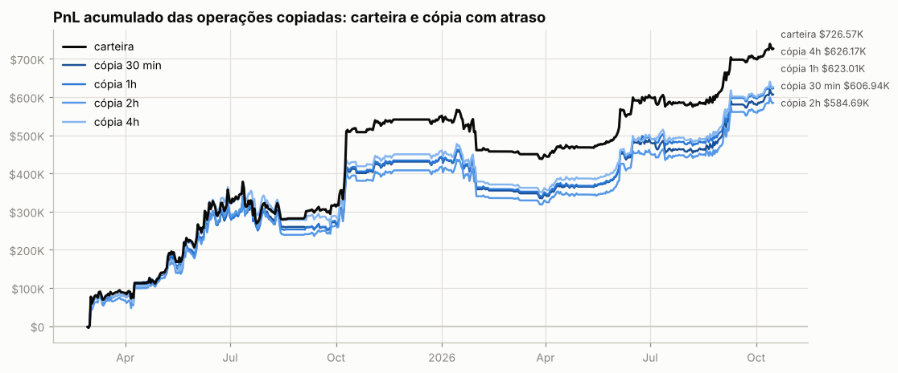

**Por ativo** (12 maiores pelo resultado da carteira):

| ativo | volume | carteira | 30 min | 1h | 2h | 4h | fica com (30 min) |
|---|---|---|---|---|---|---|---|
| ZEC | $2.01M | +$200.1K | +$186.6K | +$188.1K | +$178.3K | +$173.7K | 93% |
| ETH | $17.59M | +$194.7K | +$184.3K | +$192.8K | +$204.1K | +$192.1K | 95% |
| UNI | $1.83M | +$119.3K | +$119.4K | +$115.8K | +$119.9K | +$116.0K | 100% |
| XRP | $1.99M | +$116.8K | +$113.4K | +$117.1K | +$101.3K | +$116.5K | 97% |
| BTC | $29.48M | -$101.0K | -$109.6K | -$117.3K | -$118.9K | -$100.6K | — |
| HYPE | $3.13M | +$97.9K | +$97.6K | +$95.1K | +$93.9K | +$101.7K | 100% |
| WLD | $2.83M | +$74.7K | +$74.9K | +$76.5K | +$71.4K | +$59.5K | 100% |
| AAVE | $2.77M | +$59.7K | +$61.5K | +$68.7K | +$58.9K | +$58.9K | 103% |
| NXPC | $244.0K | -$48.2K | -$50.7K | -$51.0K | -$42.3K | -$41.9K | — |
| LINK | $1.18M | +$45.4K | +$47.0K | +$48.0K | +$47.0K | +$47.6K | 104% |
| SOL | $8.45M | -$44.7K | -$86.2K | -$76.8K | -$62.6K | -$68.5K | — |
| SEI | $655.9K | -$44.3K | -$41.0K | -$42.8K | -$41.2K | -$42.4K | — |

**Por tipo de execução da carteira.** Numa ordem limite a carteira compra abaixo e vende acima do preço corrente; a cópia a mercado perde essa vantagem. Numa ordem a mercado as duas pagam o *spread*:

| execução da carteira | fills | volume | carteira | 30 min | 1h | 2h | 4h |
|---|---|---|---|---|---|---|---|
| limite (maker) | 12,461 | $28.32M | -$1.48M | -$1.48M | -$1.47M | -$1.49M | -$1.49M |
| a mercado (taker) | 24,358 | $80.86M | +$2.20M | +$2.08M | +$2.09M | +$2.07M | +$2.11M |

### Espelhar a posição com atraso longo (moedas principais)

PnL de quem replicasse exatamente a posição da carteira, mas com N horas de atraso (marcação horária, sem custos). Se o PnL se mantém com atraso, a vantagem está em horizontes longos e é copiável; se desaba, depende de timing fino.

| atraso | ETH | ZEC | UNI |
|---|---|---|---|
| 0h | +$192.1K | +$195.8K | +$121.7K |
| 1h | +$208.8K | +$184.0K | +$124.9K |
| 4h | +$197.0K | +$178.8K | +$118.5K |
| 12h | +$177.3K | +$108.5K | +$118.1K |
| 24h | +$161.3K | +$153.5K | +$124.5K |
| 72h | +$237.4K | +$96.3K | +$108.0K |
| 168h | +$245.2K | +$52.2K | +$89.9K |

## 10. Teste de replicação por regras (ETH)

Regra testada: *short-bias com filtro de tendência e fade* — short de até 52.68 ETH (o percentil 90 do tamanho real), cheio abaixo da média móvel e reduzido acima; dentro do regime, mais short perto do topo do range e menos perto do fundo. Parâmetros escolhidos no treino (2024-01-03 → 2025-05-25) e avaliados no teste (2025-05-26 → 2026-10-15).

|  | parâmetros | PnL treino | PnL teste | correlação c/ posição real (teste) |
|---|---|---|---|---|
| melhor regra no treino | MA50, range 7d, fração em alta 0.0, fade 0.9 | +$38.8K | +$33.3K | 0.01 |
| carteira real (aprox.) | — | +$31.8K | +$174.4K | 1.00 |

Clone comportamental (regressão linear da posição real em médias móveis, ranges e retornos): R² treino 0.13, R² teste -0.08, correlação no teste 0.19.

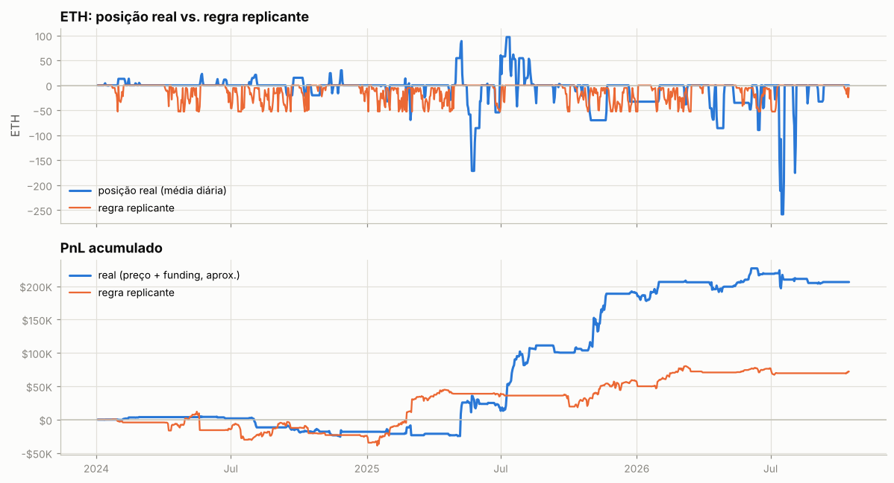

---

Metodologia e código: ver `README.md` na raiz do repositório.
