# Relatório automático — `0x63d417a577b50c96f4f09148d4e4d70950db0522`

Gerado em 2026-10-16 09:50 UTC a partir da API pública da Hyperliquid (`POST /info`). Valores em USD. Este arquivo é regenerado por `python -m hlre.report`; a interpretação da estratégia fica em `ANALISE.md`.

## 1. Visão geral

| métrica | valor |
|---|---|
| Valor da conta (perp + spot) | $3.05M |
| PnL all-time (portfolio, inclui spot/airdrops) | +$3.29M |
| PnL all-time só de perps | +$3.10M |
| Volume all-time | $365.07M |
| Primeira atividade | 2023-08-23 |
| Fills disponíveis na API | 26,407 (desde 2026-07-08) |
| Ordens (fills agrupados por oid) | 2,563 |
| Funding líquido (recebido > 0) | -$196.9K |
| Taxas pagas (período dos fills) | -$12.0K |
| Liquidações (ledger) | 6 |
| Fills de liquidação/ADL | 427 |
| Papel da conta | user |
| API wallets (agentes) | 0 |

**Posições abertas agora:**

| ativo | tamanho | nocional | entrada | alav. | PnL não realizado | liq. |
|---|---|---|---|---|---|---|
| ETH | 191.2409 | $469.0K | 2324.0 | 9x cross | +$24.6K | — |
| AVAX | 8901.54 | $91.4K | 11.2264 | 10x cross | -$8.5K | — |
| DOGE | 191376.0 | $15.7K | 0.098281 | 10x cross | -$3.1K | — |
| INJ | 8907.6 | $81.8K | 7.7959 | 5x cross | +$12.3K | — |
| SUI | -98026.9 | $102.3K | 0.765 | 10x cross | -$27.3K | 20.9429423998 |
| XRP | 600532.0 | $805.0K | 1.445959 | 20x cross | -$63.3K | — |
| APT | -11084.43 | $9.7K | 0.622 | 3x cross | -$2.8K | 176.8580635171 |
| WLD | 337076.3 | $176.3K | 0.49019 | 8x cross | +$11.1K | — |
| NEAR | 55012.5 | $288.0K | 5.1708 | 10x cross | +$3.5K | — |
| IMX | -100597.2 | $16.9K | 0.14301 | 5x cross | -$2.5K | 18.6775430076 |
| XAI | -1386321.6 | $12.1K | 0.02164 | 3x cross | +$17.9K | 1.2751520847 |
| ONDO | -127014.0 | $59.7K | 0.30641 | 10x cross | -$20.8K | 15.8284606362 |
| ENA | 203871.0 | $41.7K | 0.218 | 5x cross | -$2.8K | — |
| REZ | 55745534.0 | $205.6K | 0.003748 | 3x cross | -$3.3K | — |
| HYPE | 5216.47 | $425.4K | 85.2 | 3x cross | -$19.1K | — |
| LAYER | -416658.0 | $29.0K | 0.12 | 3x cross | +$21.0K | 4.2831817252 |
| NIL | 693767.0 | $57.7K | 0.096358 | 3x cross | -$9.1K | — |
| XPL | 463769.0 | $39.6K | 0.11979 | 2x isolated | -$16.0K | 0.0639148264 |
| 0G | -247729.0 | $62.4K | 0.262382 | 3x cross | +$2.6K | 7.3387240589 |
| 2Z | -335952.0 | $11.2K | 0.11022 | 3x cross | +$25.8K | 5.2592160139 |
| MON | 1977046.0 | $46.3K | 0.028391 | 1x isolated | -$9.8K | 0.0000658548 |
| MEGA | 2318381.0 | $108.7K | 0.052743 | 1x isolated | -$13.6K | 0.0007242037 |
| XMR | 72.016 | $40.6K | 515.985 | 5x cross | +$3.4K | — |
| CHIP | 6788389.0 | $340.9K | 0.046447 | 3x cross | +$25.5K | — |
| PONS | 26610.0 | $9.0K | 0.458236 | 3x cross | -$3.2K | — |

## 2. Curva de PnL

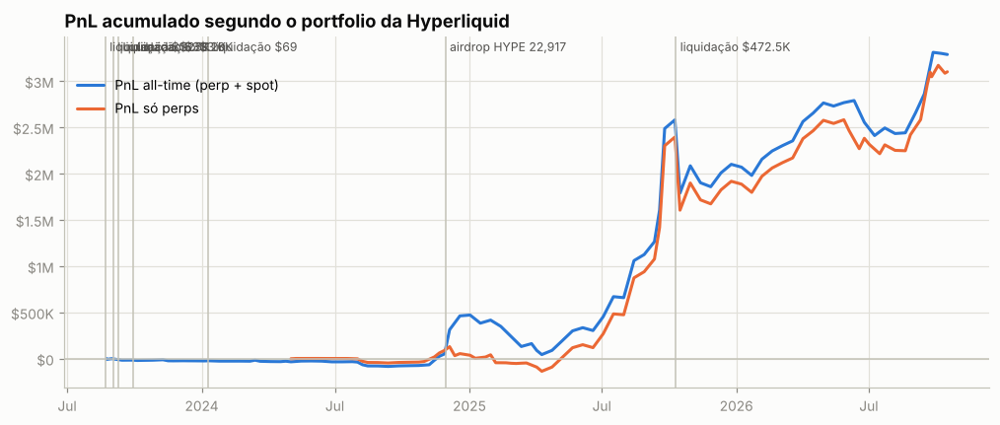

**Atenção: execuções que não aparecem nos fills.** A posição muda sem fill visível em 3 pontos (~$64.4K de nocional; maiores: para:TREAD $64.4K). O mais comum são fatias de TWAP: ficam fora de `userFills` e o endpoint de TWAP só guarda as 2.000 mais recentes. O *preço exato* e as tabelas por episódio dessas moedas não são exatos.

## 3. De onde veio o PnL

*Preço (aprox.)* usa a posição média diária de cada ativo, reconstruída a partir do histórico de funding (que traz o tamanho da posição a cada hora/dia desde o início da conta), vezes o movimento open→close do dia. Subestima o PnL de day trade, mas cobre o período sem fills. *Preço exato* marca cada fill no fechamento diário e só existe para o período coberto pelos fills.

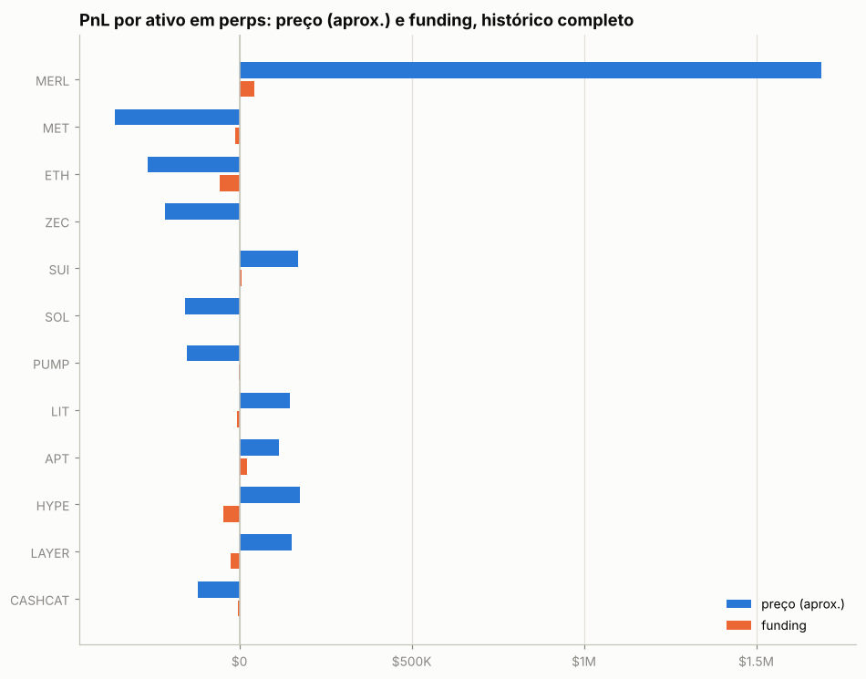

| ativo | preço (aprox.) | funding | total | preço exato (período dos fills) | taxas (período dos fills) |
|---|---|---|---|---|---|
| MERL | +$1.69M | +$43.5K | +$1.73M | +$1.9K | -$27 |
| MET | -$362.1K | -$11.0K | -$373.1K | — | — |
| ETH | -$266.5K | -$56.1K | -$322.6K | +$78.2K | -$2.5K |
| ZEC | -$216.1K | +$2.0K | -$214.1K | +$1.2K | -$245 |
| SUI | +$170.7K | +$6.0K | +$176.7K | -$31.0K | -$68 |
| SOL | -$158.1K | +$831 | -$157.3K | +$19.1K | -$251 |
| PUMP | -$153.6K | -$880 | -$154.5K | +$3.4K | -$55 |
| LIT | +$147.7K | -$6.4K | +$141.2K | +$258.7K | -$1.2K |
| APT | +$115.4K | +$22.0K | +$137.4K | -$14.2K | -$160 |
| HYPE | +$175.8K | -$46.9K | +$128.9K | +$97.6K | -$429 |
| LAYER | +$152.2K | -$25.6K | +$126.6K | — | — |
| CASHCAT | -$121.9K | -$4.6K | -$126.5K | +$49.8K | -$462 |
| kBONK | +$124.1K | -$1.8K | +$122.3K | — | — |
| ASTER | -$97.7K | -$22.3K | -$120.0K | — | — |
| GRASS | +$126.4K | -$11.1K | +$115.3K | +$180.7K | -$165 |
| outros (145) | +$183.0K | -$84.5K | +$98.5K | +$399.2K | -$6.4K |

**Decomposição no período dos fills** (preço exato): quanto veio de *carregar* a posição (e, dentro disso, do viés médio vs. do *timing* de aumentar/reduzir), quanto de trades intradiários, funding e taxas.

| componente | MERL | ETH |
|---|---|---|
| carregar posição (carry) | +$3.6K | +$51.8K |
|   ↳ viés (posição média × movimento) | +$226 | +$60.0K |
|   ↳ timing (variação do tamanho) | +$3.4K | -$8.2K |
| trades intradiários | -$1.7K | +$26.4K |
| funding | +$10 | -$5.1K |
| taxas | -$27 | -$2.5K |
| posição média | -77,438.16 | 88.93 |
| movimento do preço no período | -0.00 | 675.10 |

## 4. Posições ao longo do tempo

Área clara: posição média diária (funding). Linha: posição exata (fills). Azul = long, vermelho = short.

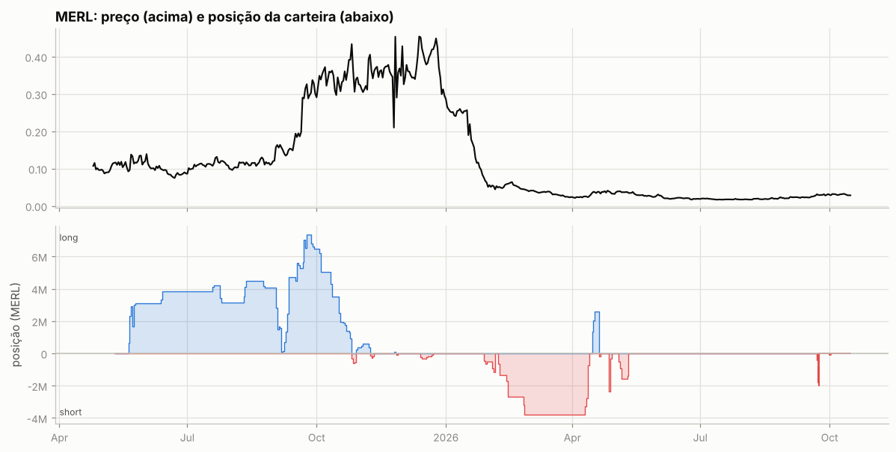

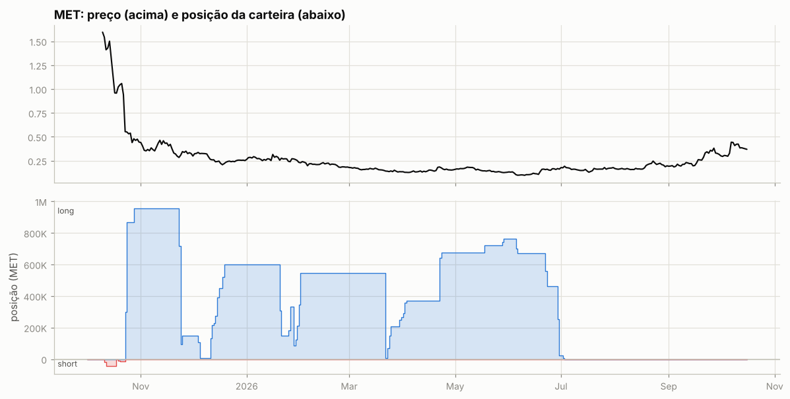

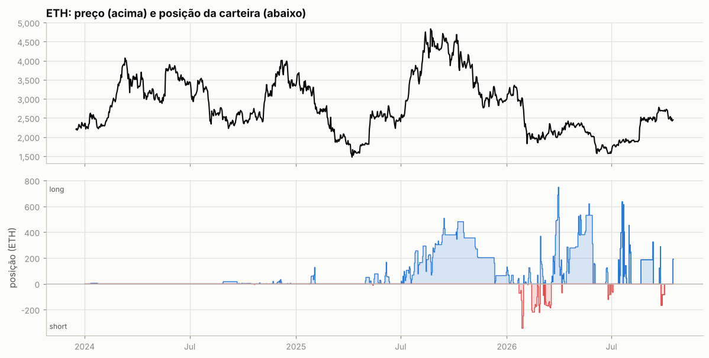

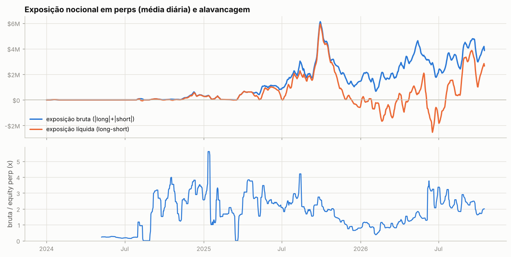

Tabela mensal de exposição e alavancagem

| mês | exposição bruta | exposição líquida | equity perp | alavancagem (mediana) |
|---|---|---|---|---|
| 2024-01 | $9.1K | $8.4K | — | — |
| 2024-02 | $91 | $91 | — | — |
| 2024-03 | $623 | $623 | — | — |
| 2024-04 | $772 | $772 | — | — |
| 2024-05 | $748 | $748 | $2.4K | 0.2x |
| 2024-06 | $605 | $605 | $3.0K | 0.2x |
| 2024-07 | $14.3K | $9.7K | $4.8K | 0.2x |
| 2024-08 | $31.5K | -$1.3K | $36.3K | 0.0x |
| 2024-09 | $49.1K | $38.1K | $17.1K | 2.7x |
| 2024-10 | $40.1K | $8.7K | $13.2K | 3.0x |
| 2024-11 | $174.4K | $140.3K | $61.9K | 2.5x |
| 2024-12 | $400.1K | $368.7K | $119.1K | 3.3x |
| 2025-01 | $205.0K | $194.9K | $77.5K | 2.6x |
| 2025-02 | $52.8K | $51.6K | $26.8K | 1.7x |
| 2025-03 | $183.6K | $177.8K | $111.5K | 1.6x |
| 2025-04 | $603.5K | $545.9K | $189.4K | 3.2x |
| 2025-05 | $855.5K | $516.9K | $340.2K | 2.6x |
| 2025-06 | $1.02M | $726.1K | $442.6K | 2.3x |
| 2025-07 | $1.64M | $1.04M | $680.5K | 2.3x |
| 2025-08 | $2.26M | $1.84M | $970.9K | 2.2x |
| 2025-09 | $3.55M | $3.35M | $1.52M | 2.2x |
| 2025-10 | $3.84M | $3.58M | $1.97M | 1.9x |
| 2025-11 | $2.10M | $776.5K | $1.72M | 1.3x |
| 2025-12 | $1.30M | -$260.0K | $1.74M | 0.8x |
| 2026-01 | $1.77M | -$118.6K | $1.79M | 1.1x |
| 2026-02 | $1.48M | -$869.5K | $1.92M | 0.7x |
| 2026-03 | $1.98M | -$465.7K | $2.07M | 0.9x |
| 2026-04 | $2.98M | $17.4K | $2.36M | 1.3x |
| 2026-05 | $3.82M | $931.1K | $2.49M | 1.5x |
| 2026-06 | $2.54M | -$1.30M | $915.7K | 3.2x |
| 2026-07 | $2.83M | $199.4K | $1.13M | 2.4x |
| 2026-08 | $3.38M | $1.44M | $1.43M | 2.4x |
| 2026-09 | $4.12M | $2.79M | $1.87M | 2.3x |
| 2026-10 | $3.72M | $2.36M | $2.04M | 1.9x |

## 5. Execução

**Tipos de ordem** (últimas 1,096 ordens que a API guarda, 2026-06-01 → 2026-10-13):

| orderType | tif | reduceOnly | isTrigger | ordens |
|---|---|---|---|---|
| Limit | Alo | False | False | 73 |
| Limit | Gtc | False | False | 776 |
| Limit | Gtc | True | False | 178 |
| Market | FrontendMarket | True | False | 2 |
| Market | LiquidationMarket | True | False | 14 |
| Stop Market | Gtc | True | False | 1 |
| Stop Market | Gtc | True | True | 3 |
| Take Profit Limit | Gtc | True | False | 1 |
| Take Profit Limit | Gtc | True | True | 3 |
| Take Profit Market | Gtc | True | False | 5 |
| Take Profit Market | Gtc | True | True | 11 |

`FrontendMarket` = ordem a mercado enviada pela interface web; `Gtc` = limite que fica no livro; gatilhos (`isTrigger`) seriam stop/take-profit.

**Perfil por ativo (top 10 por volume):**

| ativo | volume | ordens | % taker (nocional) | tamanho mediano |
|---|---|---|---|---|
| BTC | $17.00M | 97 | 34% | 0.4774 |
| ETH | $13.88M | 139 | 25% | 7.156 |
| LIT | $6.83M | 96 | 22% | 5,611 |
| XRP | $5.91M | 127 | 3% | 1.917e+04 |
| CASHCAT | $3.25M | 144 | 10% | 2.245e+05 |
| HYPE | $2.47M | 46 | 21% | 131.2 |
| NEAR | $1.92M | 80 | 4% | 1,942 |
| XMR | $1.68M | 23 | 13% | 166 |
| VIRTUAL | $1.45M | 77 | 4% | 1.166e+04 |
| ZEC | $1.31M | 47 | 26% | 4.33 |

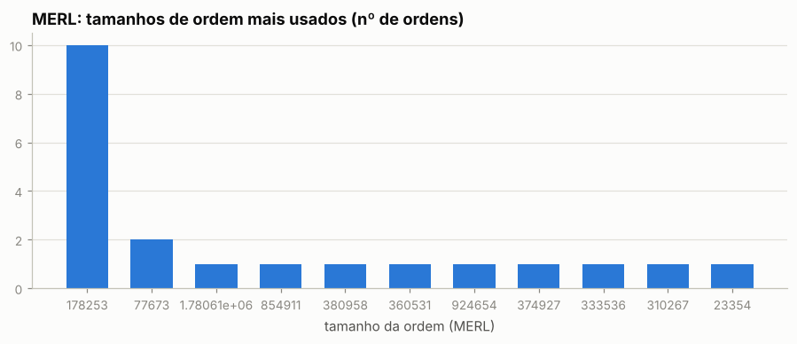

Os 5 tamanhos mais comuns respondem por 71% das ordens de MERL — lotes redondos e repetidos são assinatura de execução manual.

Sessões (ordens separadas por < 30 min): 468; mediana de 2 ordens e 0.1 min por sessão; dias com atividade: 91 de 98.

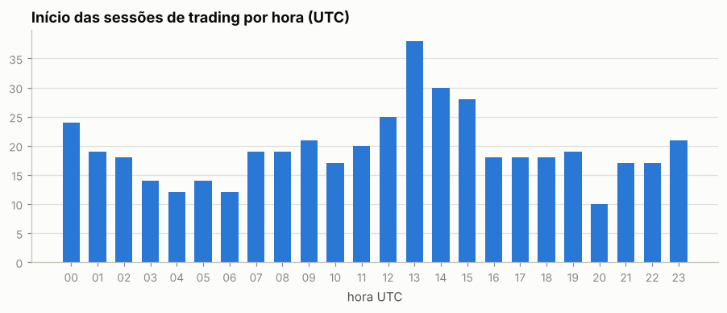

Por dia da semana: seg 13%, ter 18%, qua 19%, qui 15%, sex 16%, sáb 10%, dom 9%

## 6. Comportamento de entrada e saída

### MERL

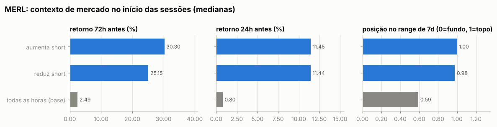

Por ordem (medianas):

| ação | ordens | retorno 24h antes | 72h antes | 7d antes | posição no range 7d | 24h depois | 7d depois |
|---|---|---|---|---|---|---|---|
| aumenta short | 12 | +10.98% | +30.30% | +44.20% | 0.99 | -9.55% | -9.43% |
| reduz short | 9 | +11.44% | +24.38% | +39.37% | 0.98 | -8.76% | -4.76% |
| todas as horas (base) |  | +0.80% | +2.49% | +16.61% | 0.59 | -0.49% | +2.99% |

Por sessão (ordens a menos de 30 min uma da outra contam como uma decisão; p = teste de Mann-Whitney contra todas as horas do período):

| sessão | sessões | retorno 24h antes | 72h antes | 7d antes | range 7d | no topo (>0,7) | no fundo (<0,3) |
|---|---|---|---|---|---|---|---|
| aumenta short | 3 | +11.45% (p=0.012) | +30.30% (p=0.007) | +39.26% (p=0.010) | 1.00 (p=0.006) | 100% | 0% |
| reduz short | 5 | +11.44% (p=0.001) | +25.15% (p=0.000) | +44.03% (p=0.000) | 0.98 (p=0.001) | 100% | 0% |
| todas as horas (base) |  |  |  |  |  | 25% | 15% |

- Aumentos de posição feitos com a posição no prejuízo (preço pior que o preço médio): **100%** das ordens (100% do tamanho); distância mediana do preço médio: +3.11%.
- Reduções/fechamentos com lucro: **78%** de 9; ganho médio $310 vs. perda média -$118; realizado +$1.9K.

- Episódios (de zerado a zerado, ou até inverter): 2; fechados com lucro: 100%; duração mediana 1.1 dias; o melhor episódio sozinho = 83% da soma dos episódios lucrativos.

Maiores episódios por PnL realizado

| início | fim | dias | lado | tam_max | nocional_max | ordens | entrada | saída | realizado |
|---|---|---|---|---|---|---|---|---|---|
| 2026-09-22 | 2026-09-23 | 0.9 | short | 1,966,738 | $66.4K | 19 | 0.03219 | 0.03174 | +$1.6K |
| 2026-09-30 | 2026-10-02 | 1.4 | short | 77,673 | $2.6K | 2 | 0.03388 | 0.02967 | +$327 |

### ETH

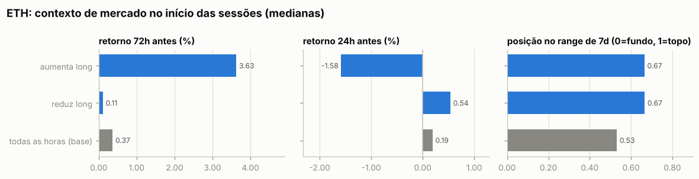

Por ordem (medianas):

| ação | ordens | retorno 24h antes | 72h antes | 7d antes | posição no range 7d | 24h depois | 7d depois |
|---|---|---|---|---|---|---|---|
| aumenta short | 33 | -1.74% | -2.37% | +8.46% | 0.66 | +0.93% | +1.09% |
| reduz short | 2 | -0.50% | +0.11% | +0.80% | 0.62 | -0.08% | -2.60% |
| aumenta long | 78 | -0.73% | +3.63% | +2.90% | 0.69 | -1.30% | +0.54% |
| reduz long | 26 | +0.54% | -0.01% | +1.83% | 0.67 | +0.11% | +0.73% |
| todas as horas (base) |  | +0.19% | +0.37% | +0.84% | 0.53 | +0.20% | +0.66% |

Por sessão (ordens a menos de 30 min uma da outra contam como uma decisão; p = teste de Mann-Whitney contra todas as horas do período):

| sessão | sessões | retorno 24h antes | 72h antes | 7d antes | range 7d | no topo (>0,7) | no fundo (<0,3) |
|---|---|---|---|---|---|---|---|
| aumenta long | 33 | -1.58% (p=0.015) | +3.63% (p=0.002) | +2.70% (p=0.001) | 0.67 (p=0.068) | 48% | 12% |
| reduz long | 15 | +0.54% (p=0.193) | +0.11% (p=0.275) | +0.98% (p=0.570) | 0.67 (p=0.053) | 47% | 7% |
| todas as horas (base) |  |  |  |  |  | 36% | 23% |

- Aumentos de posição feitos com a posição no prejuízo (preço pior que o preço médio): **97%** das ordens (88% do tamanho); distância mediana do preço médio: +1.08%.
- Reduções/fechamentos com lucro: **68%** de 28; ganho médio $4.8K vs. perda média -$4.1K; realizado +$53.8K.

- Episódios (de zerado a zerado, ou até inverter): 8; fechados com lucro: 57%; duração mediana 5.6 dias; o melhor episódio sozinho = 46% da soma dos episódios lucrativos.

Maiores episódios por PnL realizado

| início | fim | dias | lado | tam_max | nocional_max | ordens | entrada | saída | realizado |
|---|---|---|---|---|---|---|---|---|---|
| 2026-07-14 | 2026-07-21 | 6.7 | long | 632.90 | $1.20M | 45 | 1,879 | 1,925 | +$34.6K |
| 2026-08-21 | 2026-09-11 | 21.0 | long | 323.35 | $797.0K | 5 | 2,398 | 2,476 | +$25.2K |
| 2026-09-21 | 2026-09-24 | 3.0 | long | 287.80 | $773.3K | 7 | 2,702 | 2,644 | -$16.6K |
| 2026-07-13 | 2026-07-14 | 1.4 | long | 187.37 | $345.5K | 2 | 1,779 | 1,844 | +$12.2K |
| 2026-07-31 | 2026-08-04 | 4.0 | long | 450.32 | $842.6K | 13 | 1,870 | 1,861 | -$4.5K |
| 2026-07-21 | 2026-07-27 | 5.6 | long | 609.86 | $1.18M | 31 | 1,915 | 1,918 | +$3.0K |
| 2026-09-24 | 2026-09-30 | 6.0 | short | 166.30 | $446.3K | 35 | 2,673 | 2,673 | -$47 |
| 2026-10-15 | 2026-10-15 | 0.0 | long | 191.24 | $444.4K | 1 | 2,324 | — | $0 |

### Todos os episódios relevantes (todas as moedas)

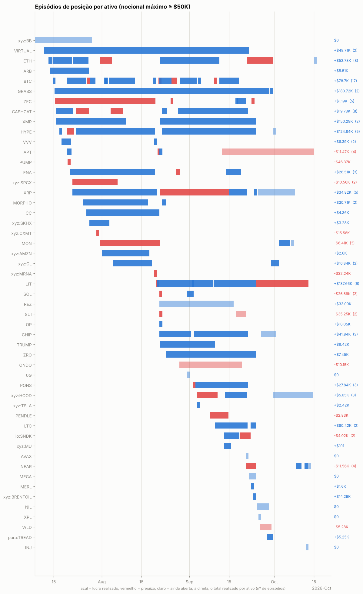

Episódios com nocional máximo ≥ $50K: 125; fechados com lucro: 70%. Abaixo, os 25 maiores por PnL realizado, em ordem de data. *7d/30d antes* e *vs. máx. 30d*: o que o preço tinha feito até a primeira ordem; *funding a.a.*: taxa anualizada nas 24h anteriores (positiva = longs pagam shorts); *entrada média vs. 1ª ordem*: positivo = foi aumentando a posição com o preço indo contra; *contra (máx.)*: quanto o preço andou contra a primeira ordem durante o episódio; *capturado*: movimento entre o preço médio de entrada e o de saída.

| ativo | lado | início | dias | nocional máx. | 7d antes | 30d antes | vs. máx. 30d | funding a.a. na entrada | entrada média vs. 1ª ordem | contra (máx.) | pior PnL aberto | capturado | realizado | funding |
|---|---|---|---|---|---|---|---|---|---|---|---|---|---|---|
| ETH | long | 2026-07-14 | 7 | $1.20M | +5% | +13% | +0% | +11% | +0% | +3% | -$25.9K | +2% | +$34.6K | -$1.6K |
| GRASS | long | 2026-07-15 | 76 | $351.0K | +13% | -16% | -33% | +11% | +2% | +26% | -$58.7K | +58% | +$176.7K | -$11.4K |
| XMR | long | 2026-07-15 | 25 | $408.3K | +3% | -8% | -12% | +35% | +0% | +2% | -$7.5K | +19% | +$62.4K | -$2.6K |
| CASHCAT | long | 2026-07-17 | 2 | $91.6K | — | — | -75% | +295% | -0% | +20% | -$13.6K | +37% | +$24.9K | -$625 |
| PUMP | short | 2026-07-19 | 0 | $129.5K | +32% | +41% | +0% | +11% | — | +3% | $0 | — | -$46.4K | +$32 |
| HYPE | long | 2026-07-22 | 28 | $394.1K | -14% | -14% | -20% | +3% | -0% | +13% | -$44.8K | +18% | +$60.8K | -$2.1K |
| CASHCAT | short | 2026-08-04 | 2 | $611.3K | +81% | — | -70% | +44% | +13% | +42% | -$44.1K | -10% | -$61.4K | -$66 |
| xyz:MRNA | short | 2026-08-19 | 0 | $98.9K | — | — | — | — | +0% | +48% | -$26.9K | -48% | -$32.2K | +$16 |
| LIT | short | 2026-08-20 | 0 | $340.3K | +22% | +27% | +0% | -2% | — | -0% | $0 | — | -$156.0K | -$716 |
| LIT | long | 2026-08-20 | 12 | $873.4K | +18% | +20% | -5% | +2% | -9% | +4% | -$5.6K | +20% | +$205.0K | -$3.2K |
| VIRTUAL | long | 2026-08-20 | 32 | $297.7K | +8% | -5% | -6% | +6% | -2% | +8% | -$25.5K | +10% | +$42.3K | -$2.2K |
| SOL | short | 2026-08-21 | 0 | $135.4K | +20% | +17% | -0% | +12% | — | +2% | -$0 | — | -$43.7K | +$19 |
| REZ | long | 2026-08-21 | 26 | $187.8K | +6% | +18% | -6% | +11% | -20% | +6% | -$21.5K | +15% | +$33.1K | -$149 |
| CHIP | long | 2026-08-21 | 11 | $105.8K | +46% | +10% | -3% | +56% | +2% | +12% | -$5.1K | +36% | +$28.1K | -$499 |
| XMR | long | 2026-08-21 | 34 | $343.9K | +5% | +18% | -4% | +83% | -8% | +2% | -$4.7K | +19% | +$87.9K | -$13.1K |
| ETH | long | 2026-08-21 | 21 | $797.0K | +28% | +25% | -2% | +11% | -1% | +1% | -$2.4K | +3% | +$25.2K | -$2.8K |
| CASHCAT | long | 2026-08-22 | 2 | $87.2K | +5% | +162% | -21% | +199% | -0% | -72% | +$12.3K | +98% | +$48.8K | -$12 |
| HYPE | long | 2026-08-22 | 33 | $381.7K | +41% | +35% | -3% | +40% | +2% | +3% | -$2.3K | +18% | +$58.2K | -$3.3K |
| LIT | long | 2026-09-01 | 7 | $366.8K | +10% | +75% | -7% | +11% | +1% | +5% | -$11.4K | +27% | +$93.5K | -$735 |
| PONS | long | 2026-09-03 | 5 | $109.6K | — | — | -5% | +31% | -28% | -0% | -$3.4K | +30% | +$33.0K | -$506 |
| LIT | long | 2026-09-09 | 15 | $885.8K | +43% | +123% | -3% | +14% | +3% | +20% | -$110.7K | +6% | +$52.5K | -$4.4K |
| LTC | long | 2026-09-09 | 12 | $267.8K | +7% | +19% | -10% | +11% | -0% | +4% | -$9.1K | +21% | +$45.6K | -$1.1K |
| BTC | long | 2026-09-11 | 7 | $909.5K | -5% | +20% | -6% | +9% | -0% | +1% | -$4.1K | +3% | +$53.6K | -$695 |
| XRP | long | 2026-09-14 | 6 | $673.8K | +5% | +46% | -12% | +10% | +5% | +14% | -$64.7K | +4% | +$29.5K | -$1.2K |
| LIT | long | 2026-09-24 | 19 | $471.4K | +7% | +54% | -3% | +11% | +13% | +37% | -$78.9K | -4% | -$59.6K | -$1.4K |

## 7. Funding

Funding líquido total: **-$196.9K** (recebido $375.4K, pago -$572.3K). Na Hyperliquid o funding é pago de hora em hora; quando positivo, longs pagam shorts.

| ativo | lado | funding | rendimento anualizado s/ nocional |
|---|---|---|---|
| MERL | short | -$26.6K | -97.6% |
| MERL | long | +$70.2K | 24.3% |
| MET | short | +$101 | 8.9% |
| MET | long | -$11.1K | -12.7% |
| ETH | short | +$2.4K | 5.7% |
| ETH | long | -$58.5K | -8.5% |
| (outros) | short | -$105.3K | -9.6% |
| (outros) | long | -$68.0K | -4.4% |

## 8. Fluxos, eventos e carteiras relacionadas

| tipo | eventos | USD (+ entra / − sai) |
|---|---|---|
| withdraw | 6 | -$335.1K |
| send | 8 | -$182.3K |
| internalTransfer | 12 | -$77.4K |
| vaultDeposit | 4 | -$69.8K |
| spotGenesis | 62 | — (sem valor em USD) |
| rewardsClaim | 1 | — (sem valor em USD) |
| liquidation | 6 | — (sem valor em USD) |
| accountClassTransfer | 12 | — (sem valor em USD) |
| vaultDistribution | 1 | — (sem valor em USD) |
| vaultWithdraw | 3 | +$54.3K |
| spotTransfer | 14 | +$173.4K |
| deposit | 13 | +$183.8K |

**Gestão de margem.** Dias com depósito: 9; em 44% deles o PnL dos 3 dias anteriores era negativo (mediana -$13). Dias com saque: 11; em 82% deles o PnL dos 3 dias anteriores era positivo (mediana +$26.5K). Base: 47% de todos os dias vêm depois de 3 dias negativos. Correlação entre o fluxo do dia e a variação da exposição bruta: -0.02 (positiva = deposita para abrir posição e saca ao reduzir).

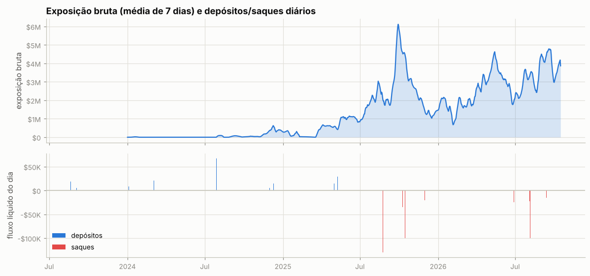

Ponte HyperCore↔HyperEVM (endereços de sistema `0x2000…`/`0x2222…`): 11 transferências, entrada $194.4K, saída $266.3K — uso de DeFi na HyperEVM.

**Carteiras relacionadas** (conta vinculada de staking para desconto de taxa + maiores contrapartes de transferências; o saldo de staking e o PnL ajudam a ver se posições aqui são hedge de algo mantido lá):

| carteira | relação | transferências | volume transferido | valor da conta hoje | PnL all-time | HYPE em staking | maiores saldos spot |
|---|---|---|---|---|---|---|---|
| `0x05ff69702a7d15a0788eb100ff8d839334a4671f` | transfers | 3 | $158.1K | $2 | +$3.1K | 0 | USDC 2, HYPE 0 |
| `0xe9fa7d35ab636f10a0e6817bdb84429669d5f774` | transfers | 2 | $20.1K | $29.5K | +$9.4K | 0 | USDC 29,477 |
| `0x24de6b77e8bc31c40aa452926daa6bbab7a71b0f` | transfers | 2 | $2.4K | $2,339.13M | -$3,155.96M | 0 | UMON 99,885,676,046, USDC 4,439 |
| `0x995e92d4bb508276f839f1f191df0fbddb8582ba` | transfers | 10 | $107 | $4.6K | +$46.1K | 0 | — |
| `0xbb5d8fc17421a9a71101032d4fc1ec0984fc85f8` | transfers | 1 | $47 | $0 | +$554.3K | 0 | USDC 0 |
| `0x6f582a74e2710a27ce3e715628056e2a66062618` | transfers | 1 | $23 | $1 | +$215.7K | 0 | USDC 1 |

**Liquidações e ADL (auto-deleveraging) nos fills:**

| quando (UTC) | ativo | tipo | lado | preço | tamanho | posição antes | PnL realizado |
|---|---|---|---|---|---|---|---|
| 2026-07-19 22:02:26 | PUMP | Close Short | B | 0.001946 | 361972.0 | -66511453.0 | -$251 |
| 2026-07-19 22:02:26 | PUMP | Close Short | B | 0.001946 | 256937.0 | -66149481.0 | -$178 |
| 2026-07-19 22:02:26 | PUMP | Close Short | B | 0.001946 | 257069.0 | -65892544.0 | -$178 |
| 2026-07-19 22:02:26 | PUMP | Close Short | B | 0.001946 | 170806.0 | -65635475.0 | -$119 |
| 2026-07-19 22:02:26 | PUMP | Close Short | B | 0.001946 | 5158226.0 | -65464669.0 | -$3.6K |
| 2026-07-19 22:02:26 | PUMP | Close Short | B | 0.001946 | 1486595.0 | -60306443.0 | -$1.0K |
| 2026-07-19 22:02:26 | PUMP | Close Short | B | 0.001947 | 127144.0 | -58819848.0 | -$88 |
| 2026-07-19 22:02:26 | PUMP | Close Short | B | 0.001947 | 137471.0 | -58692704.0 | -$96 |
| 2026-07-19 22:02:26 | PUMP | Close Short | B | 0.001947 | 72962.0 | -58555233.0 | -$51 |
| 2026-07-19 22:02:26 | PUMP | Close Short | B | 0.001947 | 78944.0 | -58482271.0 | -$55 |
| 2026-07-19 22:02:26 | PUMP | Close Short | B | 0.001947 | 256805.0 | -58403327.0 | -$178 |
| 2026-07-19 22:02:26 | PUMP | Close Short | B | 0.001947 | 2151470.0 | -58146522.0 | -$1.5K |
| 2026-07-19 22:02:26 | PUMP | Close Short | B | 0.001947 | 1400000.0 | -55995052.0 | -$973 |
| 2026-07-19 22:02:26 | PUMP | Close Short | B | 0.001947 | 1385889.0 | -54595052.0 | -$963 |
| 2026-07-19 22:02:29 | PUMP | Close Short | B | 0.001948 | 4507703.0 | -53209163.0 | -$3.1K |
| 2026-07-19 22:02:29 | PUMP | Close Short | B | 0.001948 | 137555.0 | -48701460.0 | -$96 |
| 2026-07-19 22:02:29 | PUMP | Close Short | B | 0.001948 | 5158226.0 | -48563905.0 | -$3.6K |
| 2026-07-19 22:02:29 | PUMP | Close Short | B | 0.001948 | 82584.0 | -43405679.0 | -$57 |
| 2026-07-19 22:02:29 | PUMP | Close Short | B | 0.001948 | 75499.0 | -43323095.0 | -$53 |
| 2026-07-19 22:02:29 | PUMP | Close Short | B | 0.001949 | 49261.0 | -43247596.0 | -$34 |
| 2026-07-19 22:02:29 | PUMP | Close Short | B | 0.001949 | 258064.0 | -43198335.0 | -$180 |
| 2026-07-19 22:02:29 | PUMP | Close Short | B | 0.001949 | 5158226.0 | -42940271.0 | -$3.6K |
| 2026-07-19 22:02:29 | PUMP | Close Short | B | 0.001949 | 138141.0 | -37782045.0 | -$96 |
| 2026-07-19 22:02:29 | PUMP | Close Short | B | 0.001949 | 1265028.0 | -37643904.0 | -$882 |
| 2026-07-19 22:02:29 | PUMP | Close Short | B | 0.001949 | 1309847.0 | -36378876.0 | -$913 |
| 2026-07-19 22:02:29 | PUMP | Close Short | B | 0.00195 | 971963.0 | -35069029.0 | -$678 |
| 2026-07-19 22:02:29 | PUMP | Close Short | B | 0.00195 | 6892.0 | -34097066.0 | -$5 |
| 2026-07-19 22:02:29 | PUMP | Close Short | B | 0.00195 | 22000.0 | -34090174.0 | -$15 |
| 2026-07-19 22:02:29 | PUMP | Close Short | B | 0.00195 | 100000.0 | -34068174.0 | -$70 |
| 2026-07-19 22:02:29 | PUMP | Close Short | B | 0.00195 | 275318.0 | -33968174.0 | -$192 |
| 2026-07-19 22:02:29 | PUMP | Close Short | B | 0.00195 | 500000.0 | -33692856.0 | -$349 |
| 2026-07-19 22:02:29 | PUMP | Close Short | B | 0.00195 | 520562.0 | -33192856.0 | -$363 |
| 2026-07-19 22:02:29 | PUMP | Close Short | B | 0.00195 | 25641.0 | -32672294.0 | -$18 |
| 2026-07-19 22:02:29 | PUMP | Close Short | B | 0.00195 | 100000.0 | -32646653.0 | -$70 |
| 2026-07-19 22:02:29 | PUMP | Close Short | B | 0.00195 | 258064.0 | -32546653.0 | -$180 |
| 2026-07-19 22:02:29 | PUMP | Close Short | B | 0.00195 | 2607018.0 | -32288589.0 | -$1.8K |
| 2026-07-19 22:02:29 | PUMP | Close Short | B | 0.00195 | 8227130.0 | -29681571.0 | -$5.7K |
| 2026-07-19 22:02:29 | PUMP | Close Short | B | 0.00195 | 291638.0 | -21454441.0 | -$204 |
| 2026-07-19 22:02:29 | PUMP | Close Short | B | 0.00195 | 52622.0 | -21162803.0 | -$37 |
| 2026-07-19 22:02:29 | PUMP | Close Short | B | 0.00195 | 512820.0 | -21110181.0 | -$358 |
| 2026-07-19 22:02:29 | PUMP | Close Short | B | 0.00195 | 71748.0 | -20597361.0 | -$50 |
| 2026-07-19 22:02:29 | PUMP | Close Short | B | 0.00195 | 82676.0 | -20525613.0 | -$58 |
| 2026-07-19 22:02:29 | PUMP | Close Short | B | 0.001951 | 50000.0 | -20442937.0 | -$35 |
| 2026-07-19 22:02:29 | PUMP | Close Short | B | 0.001951 | 1486595.0 | -20392937.0 | -$1.0K |
| 2026-07-19 22:02:29 | PUMP | Close Short | B | 0.001951 | 10309.0 | -18906342.0 | -$7 |
| 2026-07-19 22:02:29 | PUMP | Close Short | B | 0.001951 | 257997.0 | -18896033.0 | -$180 |
| 2026-07-19 22:02:29 | PUMP | Close Short | B | 0.001951 | 267165.0 | -18638036.0 | -$187 |
| 2026-07-19 22:02:29 | PUMP | Close Short | B | 0.001951 | 1052631.0 | -18370871.0 | -$736 |
| 2026-07-19 22:02:29 | PUMP | Close Short | B | 0.001951 | 5158226.0 | -17318240.0 | -$3.6K |
| 2026-07-19 22:02:29 | PUMP | Close Short | B | 0.001951 | 513217.0 | -12160014.0 | -$359 |
| 2026-07-19 22:02:29 | PUMP | Close Short | B | 0.001951 | 25650.0 | -11646797.0 | -$18 |
| 2026-07-19 22:02:29 | PUMP | Close Short | B | 0.001951 | 8064799.0 | -11621147.0 | -$5.6K |
| 2026-07-19 22:02:29 | PUMP | Close Short | B | 0.001952 | 520562.0 | -3556348.0 | -$364 |
| 2026-07-19 22:02:29 | PUMP | Close Short | B | 0.001952 | 257731.0 | -3035786.0 | -$180 |
| 2026-07-19 22:02:29 | PUMP | Close Short | B | 0.001952 | 2313519.0 | -2778055.0 | -$1.6K |
| 2026-07-19 22:02:29 | PUMP | Close Short | B | 0.001952 | 464536.0 | -464536.0 | -$325 |
| 2026-07-27 10:31:10 | CASHCAT | Close Long | A | 0.041052 | 7131.0 | 1856894.0 | -$66 |
| 2026-07-27 10:31:10 | CASHCAT | Close Long | A | 0.041037 | 1206.0 | 1849763.0 | -$11 |
| 2026-07-27 10:31:10 | CASHCAT | Close Long | A | 0.04103 | 365.0 | 1848557.0 | -$3 |
| 2026-07-27 10:31:10 | CASHCAT | Close Long | A | 0.041 | 1618157.0 | 1848192.0 | -$15.0K |
| 2026-07-27 10:31:10 | CASHCAT | Close Long | A | 0.041 | 25000.0 | 230035.0 | -$231 |
| 2026-07-27 10:31:10 | CASHCAT | Close Long | A | 0.041 | 6648.0 | 205035.0 | -$62 |
| 2026-07-27 10:31:10 | CASHCAT | Close Long | A | 0.041 | 1000.0 | 198387.0 | -$9 |
| 2026-07-27 10:31:10 | CASHCAT | Close Long | A | 0.041 | 2500.0 | 197387.0 | -$23 |
| 2026-07-27 10:31:10 | CASHCAT | Close Long | A | 0.041 | 23320.0 | 194887.0 | -$216 |
| 2026-07-27 10:31:10 | CASHCAT | Close Long | A | 0.040993 | 2601.0 | 171567.0 | -$24 |
| 2026-07-27 10:31:10 | CASHCAT | Close Long | A | 0.040987 | 8530.0 | 168966.0 | -$79 |
| 2026-07-27 10:31:10 | CASHCAT | Close Long | A | 0.04097 | 275.0 | 160436.0 | -$3 |
| 2026-07-27 10:31:10 | CASHCAT | Close Long | A | 0.040964 | 2441.0 | 160161.0 | -$23 |
| 2026-07-27 10:31:10 | CASHCAT | Close Long | A | 0.040959 | 354.0 | 157720.0 | -$3 |
| 2026-07-27 10:31:10 | CASHCAT | Close Long | A | 0.04095 | 3086.0 | 157366.0 | -$29 |
| 2026-07-27 10:31:10 | CASHCAT | Close Long | A | 0.040941 | 1282.0 | 154280.0 | -$12 |
| 2026-07-27 10:31:10 | CASHCAT | Close Long | A | 0.040941 | 1768.0 | 152998.0 | -$16 |
| 2026-07-27 10:31:10 | CASHCAT | Close Long | A | 0.040919 | 8531.0 | 151230.0 | -$80 |
| 2026-07-27 10:31:10 | CASHCAT | Close Long | A | 0.040918 | 4641.0 | 142699.0 | -$43 |
| 2026-07-27 10:31:10 | CASHCAT | Close Long | A | 0.040909 | 6797.0 | 138058.0 | -$64 |
| 2026-07-27 10:31:10 | CASHCAT | Close Long | A | 0.040909 | 1009.0 | 131261.0 | -$9 |
| 2026-07-27 10:31:10 | CASHCAT | Close Long | A | 0.040887 | 601.0 | 130252.0 | -$6 |
| 2026-07-27 10:31:10 | CASHCAT | Close Long | A | 0.040869 | 1570.0 | 129651.0 | -$15 |
| 2026-07-27 10:31:10 | CASHCAT | Close Long | A | 0.040852 | 1608.0 | 128081.0 | -$15 |
| 2026-07-27 10:31:10 | CASHCAT | Close Long | A | 0.04085 | 36719.0 | 126473.0 | -$345 |
| 2026-07-27 10:31:10 | CASHCAT | Close Long | A | 0.04084 | 264.0 | 89754.0 | -$2 |
| 2026-07-27 10:31:10 | CASHCAT | Close Long | A | 0.040839 | 1648.0 | 89490.0 | -$16 |
| 2026-07-27 10:31:10 | CASHCAT | Close Long | A | 0.040827 | 1689.0 | 87842.0 | -$16 |
| 2026-07-27 10:31:10 | CASHCAT | Close Long | A | 0.040818 | 9256.0 | 86153.0 | -$87 |
| 2026-07-27 10:31:10 | CASHCAT | Close Long | A | 0.04081 | 1689.0 | 76897.0 | -$16 |
| 2026-07-27 10:31:10 | CASHCAT | Close Long | A | 0.040803 | 1768.0 | 75208.0 | -$17 |
| 2026-07-27 10:31:10 | CASHCAT | Close Long | A | 0.0408 | 9910.0 | 73440.0 | -$94 |
| 2026-07-27 10:31:10 | CASHCAT | Close Long | A | 0.040795 | 1730.0 | 63530.0 | -$16 |
| 2026-07-27 10:31:10 | CASHCAT | Close Long | A | 0.040781 | 2452.0 | 61800.0 | -$23 |
| 2026-07-27 10:31:10 | CASHCAT | Close Long | A | 0.040779 | 24483.0 | 59348.0 | -$232 |
| 2026-07-27 10:31:10 | CASHCAT | Close Long | A | 0.040775 | 1735.0 | 34865.0 | -$16 |
| 2026-07-27 10:31:10 | CASHCAT | Close Long | A | 0.040773 | 1009.0 | 33130.0 | -$10 |
| 2026-07-27 10:31:10 | CASHCAT | Close Long | A | 0.040758 | 6895.0 | 32121.0 | -$66 |
| 2026-07-27 10:31:10 | CASHCAT | Close Long | A | 0.040757 | 491.0 | 25226.0 | -$5 |
| 2026-07-27 10:31:10 | CASHCAT | Close Long | A | 0.040756 | 1760.0 | 24735.0 | -$17 |
| 2026-07-27 10:31:10 | CASHCAT | Close Long | A | 0.040745 | 1730.0 | 22975.0 | -$16 |
| 2026-07-27 10:31:10 | CASHCAT | Close Long | A | 0.040733 | 1380.0 | 21245.0 | -$13 |
| 2026-07-27 10:31:10 | CASHCAT | Close Long | A | 0.040716 | 1380.0 | 19865.0 | -$13 |
| 2026-07-27 10:31:10 | CASHCAT | Close Long | A | 0.040704 | 1608.0 | 18485.0 | -$15 |
| 2026-07-27 10:31:10 | CASHCAT | Close Long | A | 0.0407 | 1229.0 | 16877.0 | -$12 |
| 2026-07-27 10:31:10 | CASHCAT | Close Long | A | 0.040693 | 1735.0 | 15648.0 | -$17 |
| 2026-07-27 10:31:10 | CASHCAT | Close Long | A | 0.040682 | 1347.0 | 13913.0 | -$13 |
| 2026-07-27 10:31:10 | CASHCAT | Close Long | A | 0.04068 | 500.0 | 12566.0 | -$5 |
| 2026-07-27 10:31:10 | CASHCAT | Close Long | A | 0.040666 | 1347.0 | 12066.0 | -$13 |
| 2026-07-27 10:31:10 | CASHCAT | Close Long | A | 0.040666 | 7799.0 | 10719.0 | -$75 |
| 2026-07-27 10:31:10 | CASHCAT | Close Long | A | 0.040664 | 1768.0 | 2920.0 | -$17 |
| 2026-07-27 10:31:10 | CASHCAT | Close Long | A | 0.040655 | 354.0 | 1152.0 | -$3 |
| 2026-07-27 10:31:10 | CASHCAT | Close Long | A | 0.040649 | 798.0 | 798.0 | -$8 |
| 2026-07-31 01:30:20 | xyz:CXMT | Close Short | B | 8.2427 | 860.7 | -13850.4 | -$919 |
| 2026-07-31 01:30:20 | xyz:CXMT | Close Short | B | 8.2436 | 1909.3 | -12989.7 | -$2.0K |
| 2026-07-31 01:30:23 | xyz:CXMT | Close Short | B | 8.2468 | 1464.3 | -11080.4 | -$1.6K |
| 2026-07-31 01:30:23 | xyz:CXMT | Close Short | B | 8.2491 | 6.1 | -9616.1 | -$7 |
| 2026-07-31 01:30:23 | xyz:CXMT | Close Short | B | 8.2511 | 1.5 | -9610.0 | -$2 |
| 2026-07-31 01:30:23 | xyz:CXMT | Close Short | B | 8.2513 | 6.2 | -9608.5 | -$7 |
| 2026-07-31 01:30:23 | xyz:CXMT | Close Short | B | 8.2515 | 6.2 | -9602.3 | -$7 |
| 2026-07-31 01:30:23 | xyz:CXMT | Close Short | B | 8.2517 | 6.2 | -9596.1 | -$7 |
| 2026-07-31 01:30:23 | xyz:CXMT | Close Short | B | 8.2519 | 4.4 | -9589.9 | -$5 |
| 2026-07-31 01:30:23 | xyz:CXMT | Close Short | B | 8.2521 | 2.4 | -9585.5 | -$3 |
| 2026-07-31 01:30:23 | xyz:CXMT | Close Short | B | 8.2785 | 383.9 | -9583.1 | -$424 |
| 2026-07-31 01:30:23 | xyz:CXMT | Close Short | B | 8.2807 | 12.0 | -9199.2 | -$13 |
| 2026-07-31 01:30:23 | xyz:CXMT | Close Short | B | 8.2836 | 24.1 | -9187.2 | -$27 |
| 2026-07-31 01:30:23 | xyz:CXMT | Close Short | B | 8.284 | 12.0 | -9163.1 | -$13 |
| 2026-07-31 01:30:23 | xyz:CXMT | Close Short | B | 8.2881 | 11.9 | -9151.1 | -$13 |
| 2026-07-31 01:30:23 | xyz:CXMT | Close Short | B | 8.2893 | 3.0 | -9139.2 | -$3 |
| 2026-07-31 01:30:23 | xyz:CXMT | Close Short | B | 8.2902 | 36.1 | -9136.2 | -$40 |
| 2026-07-31 01:30:23 | xyz:CXMT | Close Short | B | 8.2906 | 24.1 | -9100.1 | -$27 |
| 2026-07-31 01:30:23 | xyz:CXMT | Close Short | B | 8.2913 | 3.0 | -9076.0 | -$3 |
| 2026-07-31 01:30:23 | xyz:CXMT | Close Short | B | 8.2972 | 36.1 | -9073.0 | -$41 |
| 2026-07-31 01:30:23 | xyz:CXMT | Close Short | B | 8.3117 | 21.2 | -9036.9 | -$24 |
| 2026-07-31 01:30:23 | xyz:CXMT | Close Short | B | 8.3169 | 114.9 | -9015.7 | -$131 |
| 2026-07-31 01:30:23 | xyz:CXMT | Close Short | B | 8.3238 | 1071.9 | -8900.8 | -$1.2K |
| 2026-07-31 01:30:23 | xyz:CXMT | Close Short | B | 8.3239 | 2679.8 | -7828.9 | -$3.1K |
| 2026-07-31 01:30:23 | xyz:CXMT | Close Short | B | 8.326 | 50.0 | -5149.1 | -$58 |
| 2026-07-31 01:30:23 | xyz:CXMT | Close Short | B | 8.3267 | 28.6 | -5099.1 | -$33 |
| 2026-07-31 01:30:23 | xyz:CXMT | Close Short | B | 8.3268 | 5070.5 | -5070.5 | -$5.8K |
| 2026-08-19 17:24:44 | xyz:UNITREE | Close Long | A | 112.58 | 2.62 | 279.63 | -$17 |
| 2026-08-19 17:24:44 | xyz:UNITREE | Close Long | A | 112.56 | 0.65 | 277.01 | -$4 |
| 2026-08-19 17:24:44 | xyz:UNITREE | Close Long | A | 112.56 | 3.91 | 276.36 | -$26 |
| 2026-08-19 17:24:44 | xyz:UNITREE | Close Long | A | 112.55 | 1.09 | 272.45 | -$7 |
| 2026-08-19 17:24:44 | xyz:UNITREE | Close Long | A | 112.54 | 3.68 | 271.36 | -$25 |
| 2026-08-19 17:24:44 | xyz:UNITREE | Close Long | A | 112.52 | 3.7 | 267.68 | -$25 |
| 2026-08-19 17:24:44 | xyz:UNITREE | Close Long | A | 112.51 | 4.75 | 263.98 | -$32 |
| 2026-08-19 17:24:44 | xyz:UNITREE | Close Long | A | 112.5 | 44.44 | 259.23 | -$298 |
| 2026-08-19 17:24:44 | xyz:UNITREE | Close Long | A | 112.5 | 12.0 | 214.79 | -$80 |
| 2026-08-19 17:24:44 | xyz:UNITREE | Close Long | A | 112.49 | 4.66 | 202.79 | -$31 |
| 2026-08-19 17:24:44 | xyz:UNITREE | Close Long | A | 112.49 | 27.63 | 198.13 | -$185 |
| 2026-08-19 17:24:44 | xyz:UNITREE | Close Long | A | 112.49 | 111.12 | 170.5 | -$746 |
| 2026-08-19 17:24:44 | xyz:UNITREE | Close Long | A | 112.48 | 8.72 | 59.38 | -$59 |
| 2026-08-19 17:24:44 | xyz:UNITREE | Close Long | A | 112.47 | 32.06 | 50.66 | -$216 |
| 2026-08-19 17:24:44 | xyz:UNITREE | Close Long | A | 112.47 | 4.75 | 18.6 | -$32 |
| 2026-08-19 17:24:44 | xyz:UNITREE | Close Long | A | 112.46 | 13.85 | 13.85 | -$93 |
| 2026-08-19 20:26:08 | xyz:MRNA | Close Short | B | 184.06 | 124.95 | -536.8 | -$7.5K |
| 2026-08-19 20:26:08 | xyz:MRNA | Close Short | B | 184.11 | 10.93 | -411.85 | -$655 |
| 2026-08-19 20:26:08 | xyz:MRNA | Close Short | B | 184.15 | 27.15 | -400.92 | -$1.6K |
| 2026-08-19 20:26:08 | xyz:MRNA | Close Short | B | 184.17 | 10.92 | -373.77 | -$655 |
| 2026-08-19 20:26:08 | xyz:MRNA | Close Short | B | 184.18 | 27.14 | -362.85 | -$1.6K |
| 2026-08-19 20:26:08 | xyz:MRNA | Close Short | B | 184.25 | 10.9 | -335.71 | -$655 |
| 2026-08-19 20:26:08 | xyz:MRNA | Close Short | B | 184.28 | 6.12 | -324.81 | -$368 |
| 2026-08-19 20:26:08 | xyz:MRNA | Close Short | B | 184.29 | 3.51 | -318.69 | -$211 |
| 2026-08-19 20:26:08 | xyz:MRNA | Close Short | B | 184.33 | 10.9 | -315.18 | -$656 |
| 2026-08-19 20:26:08 | xyz:MRNA | Close Short | B | 184.35 | 44.1 | -304.28 | -$2.7K |
| 2026-08-19 20:26:08 | xyz:MRNA | Close Short | B | 184.36 | 244.99 | -260.18 | -$14.7K |
| 2026-08-19 20:26:08 | xyz:MRNA | Close Short | B | 184.36 | 15.19 | -15.19 | -$914 |
| 2026-08-20 07:19:12 | LIT | Close Short | B | 2.959 | 25.0 | -114967.0 | -$34 |
| 2026-08-20 07:19:12 | LIT | Close Short | B | 2.9592 | 145.0 | -114942.0 | -$197 |
| 2026-08-20 07:19:12 | LIT | Close Short | B | 2.9593 | 4.0 | -114797.0 | -$5 |
| 2026-08-20 07:19:12 | LIT | Close Short | B | 2.9594 | 73.0 | -114793.0 | -$99 |
| 2026-08-20 07:19:12 | LIT | Close Short | B | 2.9594 | 138.0 | -114720.0 | -$187 |
| 2026-08-20 07:19:12 | LIT | Close Short | B | 2.9597 | 53.0 | -114582.0 | -$72 |
| 2026-08-20 07:19:12 | LIT | Close Short | B | 2.9599 | 338.0 | -114529.0 | -$459 |
| 2026-08-20 07:19:12 | LIT | Close Short | B | 2.96 | 337.0 | -114191.0 | -$457 |
| 2026-08-20 07:19:12 | LIT | Close Short | B | 2.96 | 25.0 | -113854.0 | -$34 |
| 2026-08-20 07:19:12 | LIT | Close Short | B | 2.96 | 5.0 | -113829.0 | -$7 |
| 2026-08-20 07:19:12 | LIT | Close Short | B | 2.96 | 21850.0 | -113824.0 | -$29.6K |
| 2026-08-20 07:19:15 | LIT | Close Short | B | 2.9585 | 49.0 | -91974.0 | -$66 |
| 2026-08-20 07:19:15 | LIT | Close Short | B | 2.9592 | 17.0 | -91925.0 | -$23 |
| 2026-08-20 07:19:15 | LIT | Close Short | B | 2.9593 | 338.0 | -91908.0 | -$458 |
| 2026-08-20 07:19:15 | LIT | Close Short | B | 2.9598 | 1021.0 | -91570.0 | -$1.4K |
| 2026-08-20 07:19:15 | LIT | Close Short | B | 2.9599 | 904.0 | -90549.0 | -$1.2K |
| 2026-08-20 07:19:15 | LIT | Close Short | B | 2.9599 | 13722.0 | -89645.0 | -$18.6K |
| 2026-08-20 07:19:15 | LIT | Close Short | B | 2.96 | 75923.0 | -75923.0 | -$103.0K |
| 2026-08-22 05:05:41 | WLFI | Close Short | B | 0.073086 | 25832.0 | -565858.0 | -$345 |
| 2026-08-22 05:05:41 | WLFI | Close Short | B | 0.073086 | 200.0 | -540026.0 | -$3 |
| 2026-08-22 05:05:41 | WLFI | Close Short | B | 0.073086 | 9726.0 | -539826.0 | -$130 |
| 2026-08-22 05:05:41 | WLFI | Close Short | B | 0.073086 | 25832.0 | -530100.0 | -$345 |
| 2026-08-22 05:05:41 | WLFI | Close Short | B | 0.073105 | 4568.0 | -504268.0 | -$61 |
| 2026-08-22 05:05:41 | WLFI | Close Short | B | 0.07311 | 9726.0 | -499700.0 | -$130 |
| 2026-08-22 05:05:41 | WLFI | Close Short | B | 0.073164 | 4100.0 | -489974.0 | -$55 |
| 2026-08-22 05:05:41 | WLFI | Close Short | B | 0.073169 | 4100.0 | -485874.0 | -$55 |
| 2026-08-22 05:05:41 | WLFI | Close Short | B | 0.07317 | 3260.0 | -481774.0 | -$44 |
| 2026-08-22 05:05:41 | WLFI | Close Short | B | 0.073204 | 5464.0 | -478514.0 | -$74 |
| 2026-08-22 05:05:41 | WLFI | Close Short | B | 0.073205 | 34593.0 | -473050.0 | -$466 |
| 2026-08-22 05:05:41 | WLFI | Close Short | B | 0.07323 | 3000.0 | -438457.0 | -$41 |
| 2026-08-22 05:05:41 | WLFI | Close Short | B | 0.073231 | 5462.0 | -435457.0 | -$74 |
| 2026-08-22 05:05:41 | WLFI | Close Short | B | 0.073232 | 682.0 | -429995.0 | -$9 |
| 2026-08-22 05:05:41 | WLFI | Close Short | B | 0.073246 | 5461.0 | -429313.0 | -$74 |
| 2026-08-22 05:05:41 | WLFI | Close Short | B | 0.073246 | 3000.0 | -423852.0 | -$41 |
| 2026-08-22 05:05:41 | WLFI | Close Short | B | 0.073247 | 5461.0 | -420852.0 | -$74 |
| 2026-08-22 05:05:41 | WLFI | Close Short | B | 0.073261 | 11554.0 | -415391.0 | -$156 |
| 2026-08-22 05:05:41 | WLFI | Close Short | B | 0.073378 | 681.0 | -403837.0 | -$9 |
| 2026-08-22 05:05:41 | WLFI | Close Short | B | 0.073397 | 84878.0 | -403156.0 | -$1.2K |
| 2026-08-22 05:05:41 | WLFI | Close Short | B | 0.073442 | 3540.0 | -318278.0 | -$49 |
| 2026-08-22 05:05:41 | WLFI | Close Short | B | 0.073451 | 3540.0 | -314738.0 | -$49 |
| 2026-08-22 05:05:41 | WLFI | Close Short | B | 0.073452 | 1845.0 | -311198.0 | -$25 |
| 2026-08-22 05:05:41 | WLFI | Close Short | B | 0.073457 | 6287.0 | -309353.0 | -$86 |
| 2026-08-22 05:05:41 | WLFI | Close Short | B | 0.073482 | 18860.0 | -303066.0 | -$260 |
| 2026-08-22 05:05:41 | WLFI | Close Short | B | 0.073488 | 14161.0 | -284206.0 | -$195 |
| 2026-08-22 05:05:41 | WLFI | Close Short | B | 0.073516 | 25146.0 | -270045.0 | -$347 |
| 2026-08-22 05:05:41 | WLFI | Close Short | B | 0.073524 | 680.0 | -244899.0 | -$9 |
| 2026-08-22 05:05:41 | WLFI | Close Short | B | 0.073535 | 1066.0 | -244219.0 | -$15 |
| 2026-08-22 05:05:41 | WLFI | Close Short | B | 0.073561 | 28322.0 | -243153.0 | -$392 |
| 2026-08-22 05:05:41 | WLFI | Close Short | B | 0.073566 | 37719.0 | -214831.0 | -$522 |
| 2026-08-22 05:05:41 | WLFI | Close Short | B | 0.0736 | 1000.0 | -177112.0 | -$14 |
| 2026-08-22 05:05:41 | WLFI | Close Short | B | 0.07367 | 678.0 | -176112.0 | -$9 |
| 2026-08-22 05:05:41 | WLFI | Close Short | B | 0.0737 | 100585.0 | -175434.0 | -$1.4K |
| 2026-08-22 05:05:41 | WLFI | Close Short | B | 0.073703 | 373.0 | -74849.0 | -$5 |
| 2026-08-22 05:05:41 | WLFI | Close Short | B | 0.073707 | 56643.0 | -74476.0 | -$792 |
| 2026-08-22 05:05:41 | WLFI | Close Short | B | 0.073721 | 1084.0 | -17833.0 | -$15 |
| 2026-08-22 05:05:41 | WLFI | Close Short | B | 0.073734 | 14159.0 | -16749.0 | -$198 |
| 2026-08-22 05:05:41 | WLFI | Close Short | B | 0.073759 | 2590.0 | -2590.0 | -$36 |
| 2026-08-25 12:34:22 | CASHCAT | Close Long | A | 0.18064 | 10685.0 | 144919.0 | -$528 |
| 2026-08-25 12:34:22 | CASHCAT | Close Long | A | 0.18054 | 33599.0 | 134234.0 | -$1.7K |
| 2026-08-25 12:34:22 | CASHCAT | Close Long | A | 0.1805 | 849.0 | 100635.0 | -$42 |
| 2026-08-25 12:34:22 | CASHCAT | Close Long | A | 0.1804 | 2217.0 | 99786.0 | -$110 |
| 2026-08-25 12:34:22 | CASHCAT | Close Long | A | 0.18039 | 817.0 | 97569.0 | -$41 |
| 2026-08-25 12:34:22 | CASHCAT | Close Long | A | 0.1801 | 4008.0 | 96752.0 | -$200 |
| 2026-08-25 12:34:22 | CASHCAT | Close Long | A | 0.18 | 92744.0 | 92744.0 | -$4.6K |
| 2026-09-10 22:59:53 | xyz:HOOD | Close Long | A | 110.91 | 44.326 | 1812.48 | -$266 |
| 2026-09-10 22:59:53 | xyz:HOOD | Close Long | A | 110.89 | 19.186 | 1768.154 | -$115 |
| 2026-09-10 22:59:53 | xyz:HOOD | Close Long | A | 110.88 | 19.308 | 1748.968 | -$116 |
| 2026-09-10 22:59:53 | xyz:HOOD | Close Long | A | 110.87 | 29.713 | 1729.66 | -$179 |
| 2026-09-10 22:59:53 | xyz:HOOD | Close Long | A | 110.86 | 23.303 | 1699.947 | -$141 |
| 2026-09-10 22:59:53 | xyz:HOOD | Close Long | A | 110.86 | 0.199 | 1676.644 | -$1 |
| 2026-09-10 22:59:53 | xyz:HOOD | Close Long | A | 110.85 | 32.586 | 1676.445 | -$197 |
| 2026-09-10 22:59:53 | xyz:HOOD | Close Long | A | 110.84 | 0.4 | 1643.859 | -$2 |
| 2026-09-10 22:59:53 | xyz:HOOD | Close Long | A | 110.84 | 2.326 | 1643.459 | -$14 |
| 2026-09-10 22:59:53 | xyz:HOOD | Close Long | A | 110.84 | 21.874 | 1641.133 | -$133 |
| 2026-09-10 22:59:53 | xyz:HOOD | Close Long | A | 110.83 | 23.782 | 1619.259 | -$145 |
| 2026-09-10 22:59:53 | xyz:HOOD | Close Long | A | 110.83 | 9.023 | 1595.477 | -$55 |
| 2026-09-10 22:59:53 | xyz:HOOD | Close Long | A | 110.82 | 0.451 | 1586.454 | -$3 |
| 2026-09-10 22:59:53 | xyz:HOOD | Close Long | A | 110.82 | 23.566 | 1586.003 | -$144 |
| 2026-09-10 22:59:53 | xyz:HOOD | Close Long | A | 110.82 | 100.303 | 1562.437 | -$611 |
| 2026-09-10 22:59:53 | xyz:HOOD | Close Long | A | 110.82 | 12.15 | 1462.134 | -$74 |
| 2026-09-10 22:59:56 | xyz:HOOD | Close Long | A | 110.85 | 18.395 | 1449.984 | -$111 |
| 2026-09-10 22:59:56 | xyz:HOOD | Close Long | A | 110.84 | 23.094 | 1431.589 | -$140 |
| 2026-09-10 22:59:56 | xyz:HOOD | Close Long | A | 110.83 | 17.525 | 1408.495 | -$107 |
| 2026-09-10 22:59:56 | xyz:HOOD | Close Long | A | 110.83 | 8.842 | 1390.97 | -$54 |
| 2026-09-10 22:59:56 | xyz:HOOD | Close Long | A | 110.82 | 23.292 | 1382.128 | -$142 |
| 2026-09-10 22:59:56 | xyz:HOOD | Close Long | A | 110.82 | 100.303 | 1358.836 | -$611 |
| 2026-09-10 22:59:56 | xyz:HOOD | Close Long | A | 110.82 | 9.024 | 1258.533 | -$55 |
| 2026-09-10 22:59:56 | xyz:HOOD | Close Long | A | 110.81 | 23.75 | 1249.509 | -$145 |
| 2026-09-10 22:59:56 | xyz:HOOD | Close Long | A | 110.81 | 36.043 | 1225.759 | -$220 |
| 2026-09-10 22:59:56 | xyz:HOOD | Close Long | A | 110.81 | 9.024 | 1189.716 | -$55 |
| 2026-09-10 22:59:56 | xyz:HOOD | Close Long | A | 110.81 | 122.696 | 1180.692 | -$748 |
| 2026-09-10 22:59:56 | xyz:HOOD | Close Long | A | 110.81 | 0.902 | 1057.996 | -$6 |
| 2026-09-10 22:59:56 | xyz:HOOD | Close Long | A | 110.8 | 33.655 | 1057.094 | -$206 |
| 2026-09-10 22:59:56 | xyz:HOOD | Close Long | A | 110.8 | 23.598 | 1023.439 | -$144 |
| 2026-09-10 22:59:56 | xyz:HOOD | Close Long | A | 110.8 | 6.601 | 999.841 | -$40 |
| 2026-09-10 22:59:56 | xyz:HOOD | Close Long | A | 110.8 | 33.005 | 993.24 | -$202 |
| 2026-09-10 22:59:56 | xyz:HOOD | Close Long | A | 110.79 | 23.598 | 960.235 | -$144 |
| 2026-09-10 22:59:56 | xyz:HOOD | Close Long | A | 110.79 | 90.219 | 936.637 | -$552 |
| 2026-09-10 22:59:56 | xyz:HOOD | Close Long | A | 110.78 | 5.899 | 846.418 | -$36 |
| 2026-09-10 22:59:56 | xyz:HOOD | Close Long | A | 110.78 | 50.169 | 840.519 | -$308 |
| 2026-09-10 22:59:56 | xyz:HOOD | Close Long | A | 110.78 | 16.956 | 790.35 | -$104 |
| 2026-09-10 22:59:56 | xyz:HOOD | Close Long | A | 110.78 | 23.598 | 773.394 | -$145 |
| 2026-09-10 22:59:56 | xyz:HOOD | Close Long | A | 110.78 | 9.062 | 749.796 | -$56 |
| 2026-09-10 22:59:56 | xyz:HOOD | Close Long | A | 110.77 | 50.173 | 740.734 | -$308 |
| 2026-09-10 22:59:56 | xyz:HOOD | Close Long | A | 110.77 | 0.71 | 690.561 | -$4 |
| 2026-09-10 22:59:56 | xyz:HOOD | Close Long | A | 110.77 | 171.833 | 689.851 | -$1.1K |
| 2026-09-10 22:59:56 | xyz:HOOD | Close Long | A | 110.76 | 2.122 | 518.018 | -$13 |
| 2026-09-10 22:59:56 | xyz:HOOD | Close Long | A | 110.76 | 2.489 | 515.896 | -$15 |
| 2026-09-10 22:59:56 | xyz:HOOD | Close Long | A | 110.76 | 50.178 | 513.407 | -$309 |
| 2026-09-10 22:59:56 | xyz:HOOD | Close Long | A | 110.76 | 40.0 | 463.229 | -$246 |
| 2026-09-10 22:59:56 | xyz:HOOD | Close Long | A | 110.76 | 33.005 | 423.229 | -$203 |
| 2026-09-10 22:59:56 | xyz:HOOD | Close Long | A | 110.76 | 175.438 | 390.224 | -$1.1K |
| 2026-09-10 22:59:56 | xyz:HOOD | Close Long | A | 110.75 | 214.786 | 214.786 | -$1.3K |
| 2026-09-18 14:14:48 | io:SNDK | Close Short | B | 1705.2 | 0.0155 | -25.1565 | -$1 |
| 2026-09-18 14:14:48 | io:SNDK | Close Short | B | 1705.4 | 0.4242 | -25.141 | -$34 |
| 2026-09-18 14:14:48 | io:SNDK | Close Short | B | 1705.6 | 0.3156 | -24.7168 | -$26 |
| 2026-09-18 14:14:48 | io:SNDK | Close Short | B | 1705.6 | 0.2889 | -24.4012 | -$23 |
| 2026-09-18 14:14:48 | io:SNDK | Close Short | B | 1705.8 | 0.2996 | -24.1123 | -$24 |
| 2026-09-18 14:14:48 | io:SNDK | Close Short | B | 1705.9 | 0.3424 | -23.8127 | -$28 |
| 2026-09-18 14:14:48 | io:SNDK | Close Short | B | 1706.0 | 0.3544 | -23.4703 | -$29 |
| 2026-09-18 14:14:48 | io:SNDK | Close Short | B | 1706.1 | 0.012 | -23.1159 | -$1 |
| 2026-09-18 14:14:48 | io:SNDK | Close Short | B | 1706.2 | 0.012 | -23.1039 | -$1 |
| 2026-09-18 14:14:48 | io:SNDK | Close Short | B | 1706.3 | 0.012 | -23.0919 | -$1 |
| 2026-09-18 14:14:48 | io:SNDK | Close Short | B | 1706.3 | 0.3655 | -23.0799 | -$30 |
| 2026-09-18 14:14:48 | io:SNDK | Close Short | B | 1706.3 | 0.0346 | -22.7144 | -$3 |
| 2026-09-18 14:14:48 | io:SNDK | Close Short | B | 1706.4 | 0.4644 | -22.6798 | -$38 |
| 2026-09-18 14:14:48 | io:SNDK | Close Short | B | 1706.5 | 1.9136 | -22.2154 | -$157 |
| 2026-09-18 14:14:48 | io:SNDK | Close Short | B | 1706.6 | 1.9136 | -20.3018 | -$157 |
| 2026-09-18 14:14:48 | io:SNDK | Close Short | B | 1706.7 | 0.4626 | -18.3882 | -$38 |
| 2026-09-18 14:14:48 | io:SNDK | Close Short | B | 1706.9 | 0.4557 | -17.9256 | -$38 |
| 2026-09-18 14:14:48 | io:SNDK | Close Short | B | 1706.9 | 0.2805 | -17.4699 | -$23 |
| 2026-09-18 14:14:48 | io:SNDK | Close Short | B | 1706.9 | 17.1894 | -17.1894 | -$1.4K |
| 2026-09-27 15:37:36 | para:TREAD | Auto-Deleveraging | B | 1.11594 | 3827.0 | -3827.0 | +$756 |
| 2026-09-28 00:34:12 | para:TREAD | Close Short | B | 1.2589 | 36.0 | -27024.0 | -$6 |
| 2026-09-28 00:34:12 | para:TREAD | Close Short | B | 1.2606 | 50.0 | -26988.0 | -$9 |
| 2026-09-28 00:34:12 | para:TREAD | Close Short | B | 1.2615 | 990.0 | -26938.0 | -$176 |
| 2026-09-28 00:34:12 | para:TREAD | Close Short | B | 1.2623 | 50.0 | -25948.0 | -$9 |
| 2026-09-28 00:34:12 | para:TREAD | Close Short | B | 1.2628 | 51.0 | -25898.0 | -$9 |
| 2026-09-28 00:34:12 | para:TREAD | Close Short | B | 1.2629 | 395.0 | -25847.0 | -$71 |
| 2026-09-28 00:34:12 | para:TREAD | Close Short | B | 1.2632 | 40.0 | -25452.0 | -$7 |
| 2026-09-28 00:34:12 | para:TREAD | Close Short | B | 1.264 | 1186.0 | -25412.0 | -$214 |
| 2026-09-28 00:34:12 | para:TREAD | Close Short | B | 1.2659 | 51.0 | -24226.0 | -$9 |
| 2026-09-28 00:34:12 | para:TREAD | Close Short | B | 1.2669 | 65.0 | -24175.0 | -$12 |
| 2026-09-28 00:34:12 | para:TREAD | Close Short | B | 1.2676 | 51.0 | -24110.0 | -$9 |
| 2026-09-28 00:34:12 | para:TREAD | Close Short | B | 1.2689 | 788.0 | -24059.0 | -$146 |
| 2026-09-28 00:34:12 | para:TREAD | Close Short | B | 1.2693 | 51.0 | -23271.0 | -$9 |
| 2026-09-28 00:34:12 | para:TREAD | Close Short | B | 1.271 | 51.0 | -23220.0 | -$10 |
| 2026-09-28 00:34:12 | para:TREAD | Close Short | B | 1.2727 | 51.0 | -23169.0 | -$10 |
| 2026-09-28 00:34:12 | para:TREAD | Close Short | B | 1.2736 | 51.0 | -23118.0 | -$10 |
| 2026-09-28 00:34:12 | para:TREAD | Close Short | B | 1.2737 | 392.0 | -23067.0 | -$74 |
| 2026-09-28 00:34:12 | para:TREAD | Close Short | B | 1.2751 | 784.0 | -22675.0 | -$150 |
| 2026-09-28 00:34:12 | para:TREAD | Close Short | B | 1.2761 | 51.0 | -21891.0 | -$10 |
| 2026-09-28 00:34:12 | para:TREAD | Close Short | B | 1.2778 | 51.0 | -21840.0 | -$10 |
| 2026-09-28 00:34:12 | para:TREAD | Close Short | B | 1.2795 | 51.0 | -21789.0 | -$10 |
| 2026-09-28 00:34:12 | para:TREAD | Close Short | B | 1.28 | 1171.0 | -21738.0 | -$230 |
| 2026-09-28 00:34:12 | para:TREAD | Close Short | B | 1.28 | 1171.0 | -20567.0 | -$230 |
| 2026-09-28 00:34:12 | para:TREAD | Close Short | B | 1.2812 | 233.0 | -19396.0 | -$46 |
| 2026-09-28 00:34:12 | para:TREAD | Close Short | B | 1.2834 | 779.0 | -19163.0 | -$156 |
| 2026-09-28 00:34:12 | para:TREAD | Close Short | B | 1.2846 | 389.0 | -18384.0 | -$78 |
| 2026-09-28 00:34:12 | para:TREAD | Close Short | B | 1.2937 | 772.0 | -17995.0 | -$162 |
| 2026-09-28 00:34:12 | para:TREAD | Close Short | B | 1.2955 | 317.0 | -17223.0 | -$67 |
| 2026-09-28 00:34:12 | para:TREAD | Close Short | B | 1.2956 | 385.0 | -16906.0 | -$82 |
| 2026-09-28 00:34:12 | para:TREAD | Close Short | B | 1.2965 | 231.0 | -16521.0 | -$49 |
| 2026-09-28 00:34:12 | para:TREAD | Close Short | B | 1.2999 | 152.0 | -16290.0 | -$33 |
| 2026-09-28 00:34:12 | para:TREAD | Close Short | B | 1.302 | 1536.0 | -16138.0 | -$335 |
| 2026-09-28 00:34:12 | para:TREAD | Close Short | B | 1.304 | 1533.0 | -14602.0 | -$338 |
| 2026-09-28 00:34:12 | para:TREAD | Close Short | B | 1.3045 | 198.0 | -13069.0 | -$44 |
| 2026-09-28 00:34:12 | para:TREAD | Close Short | B | 1.308 | 365.0 | -12871.0 | -$82 |
| 2026-09-28 00:34:12 | para:TREAD | Close Short | B | 1.3116 | 205.0 | -12506.0 | -$47 |
| 2026-09-28 00:34:12 | para:TREAD | Close Short | B | 1.3127 | 313.0 | -12301.0 | -$72 |
| 2026-09-28 00:34:12 | para:TREAD | Close Short | B | 1.3169 | 205.0 | -11988.0 | -$48 |
| 2026-09-28 00:34:12 | para:TREAD | Close Short | B | 1.3201 | 226.0 | -11783.0 | -$53 |
| 2026-09-28 00:34:12 | para:TREAD | Close Short | B | 1.3206 | 538.0 | -11557.0 | -$127 |
| 2026-09-28 00:34:12 | para:TREAD | Close Short | B | 1.3221 | 1030.0 | -11019.0 | -$245 |
| 2026-09-28 00:34:12 | para:TREAD | Close Short | B | 1.3222 | 205.0 | -9989.0 | -$49 |
| 2026-09-28 00:34:12 | para:TREAD | Close Short | B | 1.3238 | 226.0 | -9784.0 | -$54 |
| 2026-09-28 00:34:12 | para:TREAD | Close Short | B | 1.324 | 1510.0 | -9558.0 | -$363 |
| 2026-09-28 00:34:12 | para:TREAD | Close Short | B | 1.3259 | 149.0 | -8048.0 | -$36 |
| 2026-09-28 00:34:12 | para:TREAD | Close Short | B | 1.3275 | 205.0 | -7899.0 | -$50 |
| 2026-09-28 00:34:12 | para:TREAD | Close Short | B | 1.33 | 1485.0 | -7694.0 | -$366 |
| 2026-09-28 00:34:21 | para:TREAD | Close Short | B | 1.2695 | 69.0 | -6209.0 | -$13 |
| 2026-09-28 00:34:21 | para:TREAD | Close Short | B | 1.2696 | 25.0 | -6140.0 | -$5 |
| 2026-09-28 00:34:24 | para:TREAD | Close Short | B | 1.2658 | 72.0 | -6115.0 | -$13 |
| 2026-09-28 00:34:24 | para:TREAD | Close Short | B | 1.2681 | 72.0 | -6043.0 | -$13 |
| 2026-09-28 00:34:24 | para:TREAD | Close Short | B | 1.2704 | 72.0 | -5971.0 | -$13 |
| 2026-09-28 00:34:27 | para:TREAD | Close Short | B | 1.2695 | 78.0 | -5899.0 | -$14 |
| 2026-09-28 00:34:27 | para:TREAD | Close Short | B | 1.2698 | 72.0 | -5821.0 | -$13 |
| 2026-09-28 00:34:27 | para:TREAD | Close Short | B | 1.2707 | 323.0 | -5749.0 | -$60 |
| 2026-09-28 00:34:30 | para:TREAD | Close Short | B | 1.2603 | 80.0 | -5426.0 | -$14 |
| 2026-09-28 00:34:30 | para:TREAD | Close Short | B | 1.2606 | 80.0 | -5346.0 | -$14 |
| 2026-09-28 00:34:30 | para:TREAD | Close Short | B | 1.2613 | 78.0 | -5266.0 | -$14 |
| 2026-09-28 00:34:30 | para:TREAD | Close Short | B | 1.2614 | 990.0 | -5188.0 | -$176 |
| 2026-09-28 00:34:30 | para:TREAD | Close Short | B | 1.2638 | 78.0 | -4198.0 | -$14 |
| 2026-09-28 00:34:30 | para:TREAD | Close Short | B | 1.264 | 1186.0 | -4120.0 | -$214 |
| 2026-09-28 00:34:30 | para:TREAD | Close Short | B | 1.2663 | 78.0 | -2934.0 | -$14 |
| 2026-09-28 00:34:30 | para:TREAD | Close Short | B | 1.2688 | 78.0 | -2856.0 | -$14 |
| 2026-09-28 00:34:30 | para:TREAD | Close Short | B | 1.2696 | 393.0 | -2778.0 | -$73 |
| 2026-09-28 00:34:33 | para:TREAD | Close Short | B | 1.2616 | 990.0 | -2385.0 | -$176 |
| 2026-09-28 00:34:42 | para:TREAD | Close Short | B | 1.267 | 11.0 | -1418.0 | -$2 |
| 2026-09-28 00:34:42 | para:TREAD | Close Short | B | 1.2739 | 482.0 | -1407.0 | -$90 |
| 2026-09-28 00:34:45 | para:TREAD | Close Short | B | 1.2727 | 392.0 | -925.0 | -$73 |
| 2026-09-28 00:34:48 | para:TREAD | Close Short | B | 1.2689 | 533.0 | -533.0 | -$97 |
| 2026-10-13 00:31:28 | LIT | Close Long | A | 3.3499 | 2683.0 | 70378.0 | -$3.1K |
| 2026-10-13 00:31:28 | LIT | Close Long | A | 3.3498 | 5975.0 | 67695.0 | -$6.9K |
| 2026-10-13 00:31:28 | LIT | Close Long | A | 3.3496 | 5417.0 | 61720.0 | -$6.2K |
| 2026-10-13 00:31:31 | LIT | Close Long | A | 3.3496 | 4684.0 | 56303.0 | -$5.4K |
| 2026-10-13 00:31:31 | LIT | Close Long | A | 3.3496 | 72.0 | 51619.0 | -$83 |
| 2026-10-13 00:31:31 | LIT | Close Long | A | 3.3496 | 14.0 | 51547.0 | -$16 |
| 2026-10-13 00:31:31 | LIT | Close Long | A | 3.3495 | 447.0 | 51533.0 | -$515 |
| 2026-10-13 00:31:31 | LIT | Close Long | A | 3.3495 | 4.0 | 51086.0 | -$5 |
| 2026-10-13 00:31:31 | LIT | Close Long | A | 3.3495 | 14.0 | 51082.0 | -$16 |
| 2026-10-13 00:31:31 | LIT | Close Long | A | 3.3494 | 14.0 | 51068.0 | -$16 |
| 2026-10-13 00:31:31 | LIT | Close Long | A | 3.3494 | 4.0 | 51054.0 | -$5 |
| 2026-10-13 00:31:31 | LIT | Close Long | A | 3.3493 | 230.0 | 51050.0 | -$265 |
| 2026-10-13 00:31:31 | LIT | Close Long | A | 3.3493 | 4.0 | 50820.0 | -$5 |
| 2026-10-13 00:31:31 | LIT | Close Long | A | 3.3492 | 4.0 | 50816.0 | -$5 |
| 2026-10-13 00:31:31 | LIT | Close Long | A | 3.3491 | 4.0 | 50812.0 | -$5 |
| 2026-10-13 00:31:31 | LIT | Close Long | A | 3.349 | 14.0 | 50808.0 | -$16 |
| 2026-10-13 00:31:31 | LIT | Close Long | A | 3.349 | 4.0 | 50794.0 | -$5 |
| 2026-10-13 00:31:31 | LIT | Close Long | A | 3.3489 | 4.0 | 50790.0 | -$5 |
| 2026-10-13 00:31:31 | LIT | Close Long | A | 3.3487 | 5.0 | 50786.0 | -$6 |
| 2026-10-13 00:31:31 | LIT | Close Long | A | 3.3487 | 4.0 | 50781.0 | -$5 |
| 2026-10-13 00:31:31 | LIT | Close Long | A | 3.3486 | 291.0 | 50777.0 | -$335 |
| 2026-10-13 00:31:31 | LIT | Close Long | A | 3.3484 | 9.0 | 50486.0 | -$10 |
| 2026-10-13 00:31:31 | LIT | Close Long | A | 3.3484 | 4.0 | 50477.0 | -$5 |
| 2026-10-13 00:31:31 | LIT | Close Long | A | 3.3483 | 8.0 | 50473.0 | -$9 |
| 2026-10-13 00:31:31 | LIT | Close Long | A | 3.3483 | 4.0 | 50465.0 | -$5 |
| 2026-10-13 00:31:31 | LIT | Close Long | A | 3.3479 | 432.0 | 50461.0 | -$498 |
| 2026-10-13 00:31:31 | LIT | Close Long | A | 3.3479 | 4.0 | 50029.0 | -$5 |
| 2026-10-13 00:31:31 | LIT | Close Long | A | 3.3479 | 291.0 | 50025.0 | -$335 |
| 2026-10-13 00:31:31 | LIT | Close Long | A | 3.3474 | 4.0 | 49734.0 | -$5 |
| 2026-10-13 00:31:31 | LIT | Close Long | A | 3.3474 | 7.0 | 49730.0 | -$8 |
| 2026-10-13 00:31:31 | LIT | Close Long | A | 3.3472 | 291.0 | 49723.0 | -$336 |
| 2026-10-13 00:31:31 | LIT | Close Long | A | 3.3469 | 1008.0 | 49432.0 | -$1.2K |
| 2026-10-13 00:31:31 | LIT | Close Long | A | 3.3469 | 672.0 | 48424.0 | -$775 |
| 2026-10-13 00:31:31 | LIT | Close Long | A | 3.3469 | 447.0 | 47752.0 | -$516 |
| 2026-10-13 00:31:31 | LIT | Close Long | A | 3.3469 | 16.0 | 47305.0 | -$18 |
| 2026-10-13 00:31:31 | LIT | Close Long | A | 3.3468 | 448.0 | 47289.0 | -$517 |
| 2026-10-13 00:31:31 | LIT | Close Long | A | 3.3468 | 5.0 | 46841.0 | -$6 |
| 2026-10-13 00:31:31 | LIT | Close Long | A | 3.3466 | 5.0 | 46836.0 | -$6 |
| 2026-10-13 00:31:31 | LIT | Close Long | A | 3.3466 | 4.0 | 46831.0 | -$5 |
| 2026-10-13 00:31:31 | LIT | Close Long | A | 3.3465 | 408.0 | 46827.0 | -$471 |
| 2026-10-13 00:31:31 | LIT | Close Long | A | 3.3465 | 5.0 | 46419.0 | -$6 |
| 2026-10-13 00:31:31 | LIT | Close Long | A | 3.3464 | 298.0 | 46414.0 | -$344 |
| 2026-10-13 00:31:31 | LIT | Close Long | A | 3.3464 | 4.0 | 46116.0 | -$5 |
| 2026-10-13 00:31:31 | LIT | Close Long | A | 3.3462 | 9.0 | 46112.0 | -$10 |
| 2026-10-13 00:31:31 | LIT | Close Long | A | 3.3462 | 4.0 | 46103.0 | -$5 |
| 2026-10-13 00:31:31 | LIT | Close Long | A | 3.346 | 360.0 | 46099.0 | -$416 |
| 2026-10-13 00:31:31 | LIT | Close Long | A | 3.346 | 5.0 | 45739.0 | -$6 |
| 2026-10-13 00:31:31 | LIT | Close Long | A | 3.3459 | 822.0 | 45734.0 | -$949 |
| 2026-10-13 00:31:31 | LIT | Close Long | A | 3.3459 | 5.0 | 44912.0 | -$6 |
| 2026-10-13 00:31:31 | LIT | Close Long | A | 3.3459 | 29.0 | 44907.0 | -$33 |
| 2026-10-13 00:31:31 | LIT | Close Long | A | 3.3457 | 2924.0 | 44878.0 | -$3.4K |
| 2026-10-13 00:31:31 | LIT | Close Long | A | 3.3457 | 370.0 | 41954.0 | -$427 |
| 2026-10-13 00:31:31 | LIT | Close Long | A | 3.3456 | 11.0 | 41584.0 | -$13 |
| 2026-10-13 00:31:31 | LIT | Close Long | A | 3.3456 | 4.0 | 41573.0 | -$5 |
| 2026-10-13 00:31:31 | LIT | Close Long | A | 3.3455 | 31.0 | 41569.0 | -$36 |
| 2026-10-13 00:31:31 | LIT | Close Long | A | 3.3455 | 4.0 | 41538.0 | -$5 |
| 2026-10-13 00:31:31 | LIT | Close Long | A | 3.3455 | 2989.0 | 41534.0 | -$3.5K |
| 2026-10-13 00:31:31 | LIT | Close Long | A | 3.3453 | 333.0 | 38545.0 | -$385 |
| 2026-10-13 00:31:31 | LIT | Close Long | A | 3.3453 | 5.0 | 38212.0 | -$6 |
| 2026-10-13 00:31:31 | LIT | Close Long | A | 3.3453 | 14118.0 | 38207.0 | -$16.3K |
| 2026-10-13 00:31:31 | LIT | Close Long | A | 3.3453 | 24089.0 | 24089.0 | -$27.8K |

## 9. Dá para copiar?

### Teste de copiabilidade

Antes de simular, o relatório confere se um copiador conseguiria seguir a carteira. O tempo em posição casa cada redução com o aumento mais recente (LIFO), então um market maker que compra e revende em minutos aparece com minutos, mesmo carregando estoque antigo.

| critério | valor | não copiável se |
|---|---|---|
| execuções de perps e HIP-3 (2026-07-08 → 2026-10-15) | 2,065 | < 20 |
| volume fechado que ficou aberto menos de 30 min | 5% | ≥ 50% |
| tempo mediano em posição (ponderado pelo volume) | 45.8 h |  |
| execuções por dia ativo; parte maker do nocional | 23; 77% | ≥ 300 e ≥ 80% (bot de market making) |

**Copiável:** nenhum critério bloqueia. A simulação abaixo mede quanto do resultado sobra com atraso.

### Copiar cada execução com 30 min, 1h, 2h e 4h de atraso

O copiador começa zerado em 2026-07-10 e repete cada fill de perps e HIP-3 da carteira no mesmo tamanho, com o atraso indicado, a mercado e pagando taxa *taker* de 0.045%. Posições já abertas antes não são copiadas: em cada moeda, a cópia começa quando a carteira zera ou inverte a posição. O preço da cópia é a abertura do candle que começa mais perto de *fill + atraso*: candles de 15m da Hyperliquid nos últimos ~52 dias, de 1h da Hyperliquid ou da Binance antes disso. O atraso real varia meio candle para cada lado, e o candle do próprio fill (muitas vezes o pavio que ele mesmo fez) nunca é usado. Carteira e cópia são marcadas no mesmo preço final (último fechamento diário). O funding fica de fora porque, com horas de atraso, é quase igual para as duas.

Entram na comparação 95% do volume de perps dos fills, em operações de 2026-07-10 a 2026-10-15 (posições herdadas: 5%; sem preço intradiário: 0%). Fonte do preço com 30 min de atraso: HL 15m 57%, HL 1h 43%.

| atraso | atraso médio real | carteira | cópia | fica com | efeito do preço | efeito da taxa | custo (bp do volume, IC 95%) | maior drawdown |
|---|---|---|---|---|---|---|---|---|
| 30 min | 30 min | +$1.02M | +$841.0K | 82% | -$161.3K | -$19.1K | 26.7 (-3.2 a 56.6) | -$279.0K |
| 1h | 60 min | +$1.02M | +$857.0K | 84% | -$145.4K | -$19.1K | 24.4 (-8.9 a 57.6) | -$275.3K |
| 2h | 120 min | +$1.02M | +$878.0K | 86% | -$124.3K | -$19.2K | 21.2 (-14.2 a 56.7) | -$274.3K |
| 4h | 240 min | +$1.02M | +$1.01M | 98% | +$3.5K | -$19.2K | 2.3 (-37.5 a 42.2) | -$261.9K |

Maior drawdown da carteira nas mesmas operações: -$270.7K. *Efeito do preço* e *efeito da taxa*: quanto o preço da cópia e a taxa *taker* mudam o resultado em relação à carteira (negativo = a cópia perde). O custo é carteira − cópia sobre o volume copiado; o IC vem da variação de um dia para outro. Os valores somam só as operações copiadas, não o PnL total da carteira.

Com 30 min de atraso a cópia fica com **82%** do resultado; com 4h, **98%**. Em nenhum atraso o custo é estatisticamente diferente de zero (o IC de 95% cruza o zero): com esta amostra, a diferença entre os atrasos pode ser ruído.

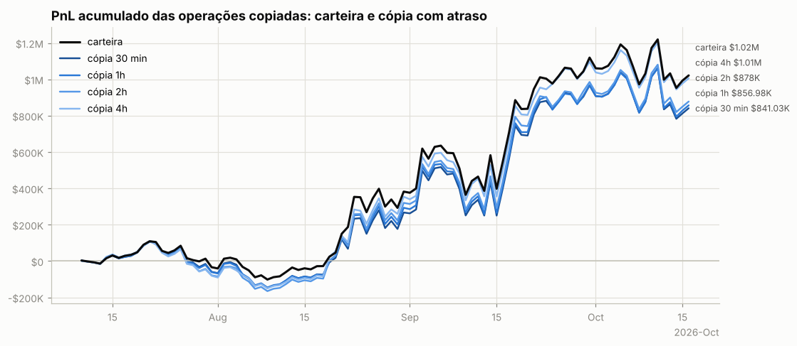

**Por ativo** (12 maiores pelo resultado da carteira):

| ativo | volume | carteira | 30 min | 1h | 2h | 4h | fica com (30 min) |
|---|---|---|---|---|---|---|---|
| LIT | $6.49M | +$290.2K | +$242.6K | +$241.7K | +$237.8K | +$300.7K | 84% |
| GRASS | $948.2K | +$180.5K | +$180.3K | +$189.5K | +$196.9K | +$171.9K | 100% |
| HYPE | $2.03M | +$96.7K | +$80.0K | +$72.3K | +$75.8K | +$83.0K | 83% |
| XMR | $1.03M | +$91.2K | +$94.5K | +$91.0K | +$89.6K | +$85.5K | 104% |
| ETH | $13.88M | +$75.7K | +$72.5K | +$68.3K | +$93.4K | +$103.8K | 96% |
| CHIP | $646.0K | +$66.8K | +$64.4K | +$66.6K | +$64.9K | +$57.9K | 96% |
| LTC | $949.3K | +$60.2K | +$65.7K | +$61.2K | +$63.4K | +$63.2K | 109% |
| BTC | $16.74M | +$58.9K | +$38.2K | +$50.0K | +$45.1K | +$60.8K | 65% |
| VIRTUAL | $1.45M | +$49.5K | +$49.5K | +$46.8K | +$46.0K | +$43.5K | 100% |
| CASHCAT | $3.25M | +$49.3K | -$33.6K | -$33.1K | -$62.5K | -$49.0K | -68% |
| SUI | $236.2K | -$38.6K | -$39.3K | -$38.0K | -$38.9K | -$39.7K | — |
| xyz:SPCX | $211.1K | -$33.5K | -$33.0K | -$32.6K | -$31.4K | -$29.9K | — |

**Por tipo de execução da carteira.** Numa ordem limite a carteira compra abaixo e vende acima do preço corrente; a cópia a mercado perde essa vantagem. Numa ordem a mercado as duas pagam o *spread*:

| execução da carteira | fills | volume | carteira | 30 min | 1h | 2h | 4h |
|---|---|---|---|---|---|---|---|
| limite (maker) | 19,731 | $52.76M | +$1.73M | +$1.55M | +$1.56M | +$1.57M | +$1.67M |
| a mercado (taker) | 2,700 | $14.78M | -$711.6K | -$705.9K | -$701.7K | -$693.9K | -$663.7K |

### Espelhar a posição com atraso longo (moedas principais)

PnL de quem replicasse exatamente a posição da carteira, mas com N horas de atraso (marcação horária, sem custos). Se o PnL se mantém com atraso, a vantagem está em horizontes longos e é copiável; se desaba, depende de timing fino.

| atraso | MERL | ETH |
|---|---|---|
| 0h | +$265 | +$75.4K |
| 1h | -$1.0K | +$103.5K |
| 4h | -$778 | +$106.2K |
| 12h | +$3.2K | +$70.6K |
| 24h | +$1.8K | +$59.6K |
| 72h | -$151 | +$37.0K |
| 168h | -$2.9K | +$17.6K |

## 10. Teste de replicação por regras (MERL)

Regra testada: *short-bias com filtro de tendência e fade* — short de até 3.776e+06 MERL (o percentil 90 do tamanho real), cheio abaixo da média móvel e reduzido acima; dentro do regime, mais short perto do topo do range e menos perto do fundo. Parâmetros escolhidos no treino (2024-01-01 → 2025-05-24) e avaliados no teste (2025-05-25 → 2026-10-15).

|  | parâmetros | PnL treino | PnL teste | correlação c/ posição real (teste) |
|---|---|---|---|---|
| melhor regra no treino | MA50, range 7d, fração em alta 1.0, fade 0.0 | +$1.98M | -$344.1K | nan |
| carteira real (aprox.) | — | +$57.3K | +$1.68M | 1.00 |

Clone comportamental (regressão linear da posição real em médias móveis, ranges e retornos): R² treino 0.13, R² teste -0.13, correlação no teste -0.30.

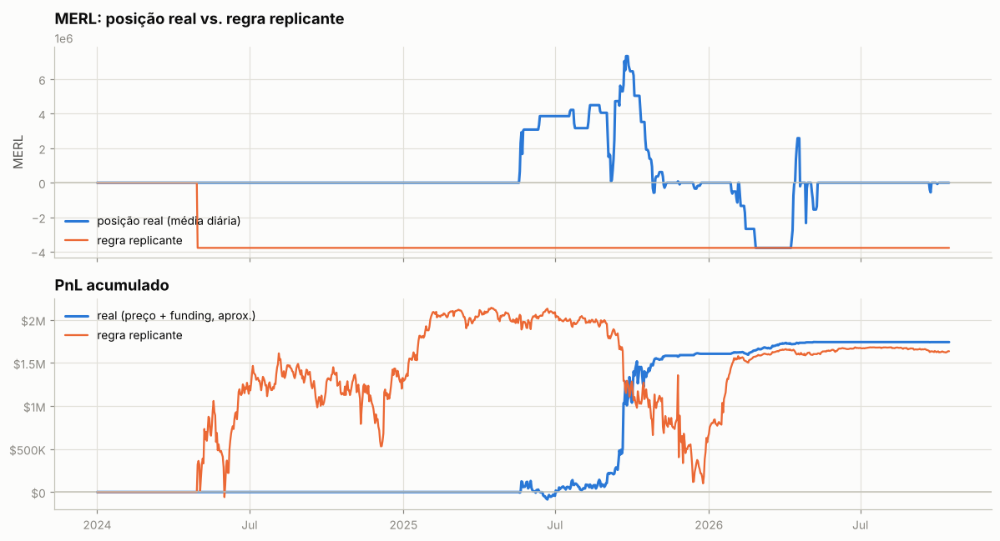

---

Metodologia e código: ver `README.md` na raiz do repositório.
