# Relatório automático — `0x69b05701f8175c276ecd0138387a197948e240bb`

Gerado em 2026-10-16 10:33 UTC a partir da API pública da Hyperliquid (`POST /info`). Valores em USD. Este arquivo é regenerado por `python -m hlre.report`; a interpretação da estratégia fica em `ANALISE.md`.

## 1. Visão geral

| métrica | valor |
|---|---|
| Valor da conta (perp + spot) | $731.7K |
| PnL all-time (portfolio, inclui spot/airdrops) | +$808.4K |
| PnL all-time só de perps | +$701.6K |
| Volume all-time | $138.57M |
| Primeira atividade | 2025-06-11 |
| Fills disponíveis na API | 14,690 (desde 2025-06-05) |
| Ordens (fills agrupados por oid) | 997 |
| Funding líquido (recebido > 0) | -$65.9K |
| Taxas pagas (período dos fills) | -$76.4K |
| Liquidações (ledger) | 0 |
| Fills de liquidação/ADL | 0 |
| Papel da conta | user |
| API wallets (agentes) | 0 |

**Posições abertas agora:**

| ativo | tamanho | nocional | entrada | alav. | PnL não realizado | liq. |
|---|---|---|---|---|---|---|
| BTC | 5.0 | $410.2K | 82240.0 | 20x cross | -$1.0K | — |
| PUMP | 33362989.0 | $148.5K | 0.004496 | 5x cross | -$1.5K | — |

## 2. Curva de PnL

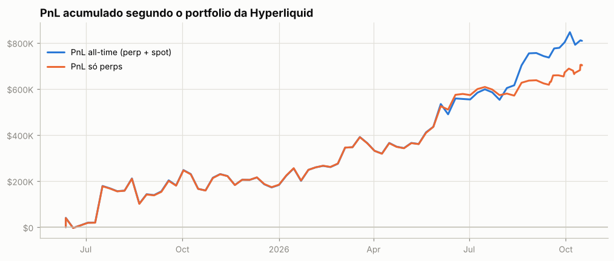

Os fills cobrem todo o histórico: o PnL diário exato de perps (preço + funding − taxas) soma +$702.1K, contra +$701.6K do portfolio. Maior drawdown: **-$124.7K** (pico em 2025-08-13, fundo em 2025-08-21); dias positivos: 51%.

PnL de perps por trimestre

| trimestre | preço | funding | taxas | total |
|---|---|---|---|---|
| 2025Q2 | +$11.4K | -$3.6K | -$1.1K | +$6.7K |
| 2025Q3 | +$240.9K | -$32.0K | -$7.8K | +$201.1K |
| 2025Q4 | -$7.9K | -$12.8K | -$3.4K | -$24.1K |
| 2026Q1 | +$159.4K | -$7.2K | -$2.7K | +$149.5K |
| 2026Q2 | +$253.6K | -$3.9K | -$3.5K | +$246.3K |
| 2026Q3 | +$106.5K | -$5.9K | -$2.6K | +$98.1K |
| 2026Q4 | +$25.8K | -$578 | -$644 | +$24.6K |

## 3. De onde veio o PnL

*Preço (aprox.)* usa a posição média diária de cada ativo, reconstruída a partir do histórico de funding (que traz o tamanho da posição a cada hora/dia desde o início da conta), vezes o movimento open→close do dia. Subestima o PnL de day trade, mas cobre o período sem fills. *Preço exato* marca cada fill no fechamento diário e só existe para o período coberto pelos fills.

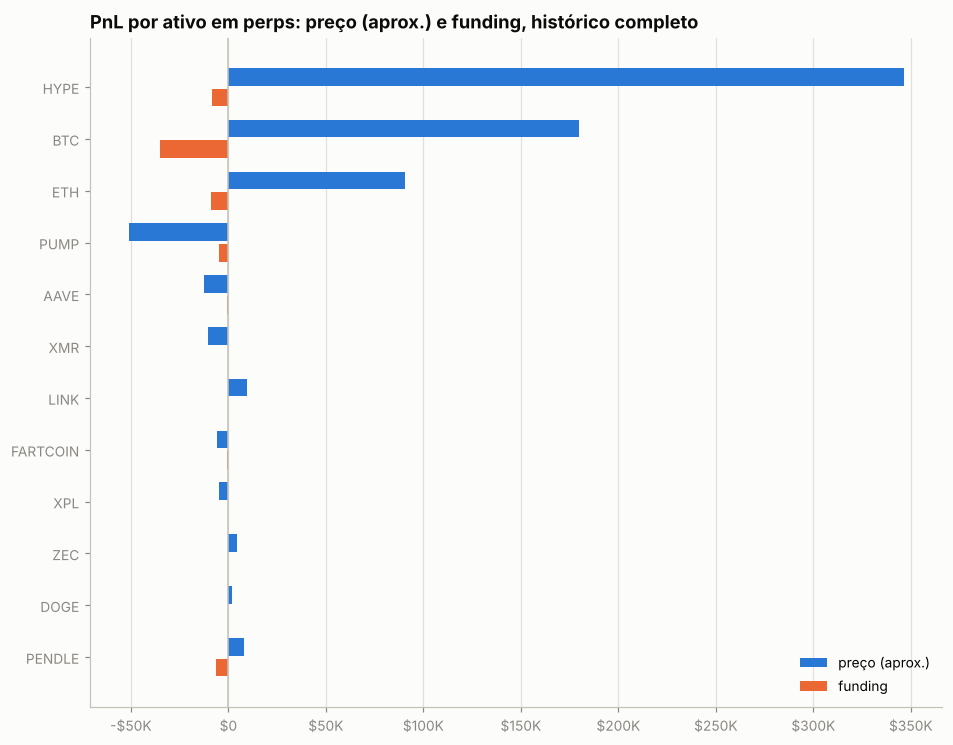

| ativo | preço (aprox.) | funding | total | preço exato (período dos fills) | taxas (período dos fills) |
|---|---|---|---|---|---|
| HYPE | +$346.3K | -$8.6K | +$337.7K | +$368.9K | -$1.5K |
| BTC | +$180.0K | -$34.9K | +$145.1K | +$316.3K | -$14.1K |
| ETH | +$90.4K | -$8.9K | +$81.5K | +$154.1K | -$4.5K |
| PUMP | -$51.1K | -$4.6K | -$55.7K | +$8.4K | -$624 |
| AAVE | -$12.7K | -$488 | -$13.2K | -$13.7K | -$55 |
| XMR | -$10.6K | -$361 | -$11.0K | -$13.2K | -$12 |
| LINK | +$9.7K | -$236 | +$9.5K | +$6.7K | -$103 |
| FARTCOIN | -$5.6K | -$703 | -$6.3K | -$17.1K | -$98 |
| XPL | -$5.0K | -$93 | -$5.1K | -$10.2K | -$21 |
| ZEC | +$4.6K | -$243 | +$4.3K | +$6.0K | -$212 |
| DOGE | +$2.0K | -$145 | +$1.9K | -$4.5K | -$81 |
| PENDLE | +$8.0K | -$6.6K | +$1.4K | -$11.9K | -$308 |
| LDO | -$24 | -$52 | -$76 | -$115 | -$17 |
| outros (0) | $0 | $0 | $0 | $0 | $0 |

**Decomposição no período dos fills** (preço exato): quanto veio de *carregar* a posição (e, dentro disso, do viés médio vs. do *timing* de aumentar/reduzir), quanto de trades intradiários, funding e taxas.

| componente | HYPE | BTC | ETH |
|---|---|---|---|
| carregar posição (carry) | +$310.6K | +$195.5K | +$127.6K |
|   ↳ viés (posição média × movimento) | +$72.7K | -$60.6K | -$2.7K |
|   ↳ timing (variação do tamanho) | +$237.8K | +$256.1K | +$130.3K |
| trades intradiários | +$58.3K | +$120.8K | +$26.5K |
| funding | -$8.6K | -$34.9K | -$8.9K |
| taxas | -$1.5K | -$14.1K | -$4.5K |
| posição média | 1,542.58 | 3.12 | 11.64 |
| movimento do preço no período | 47.15 | -19,430.00 | -227.80 |

## 4. Posições ao longo do tempo

Área clara: posição média diária (funding). Linha: posição exata (fills). Azul = long, vermelho = short.

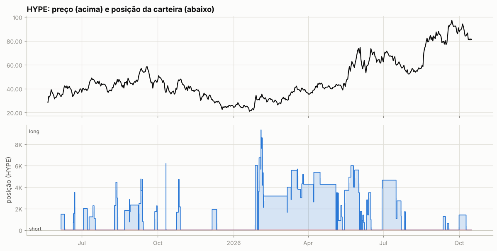

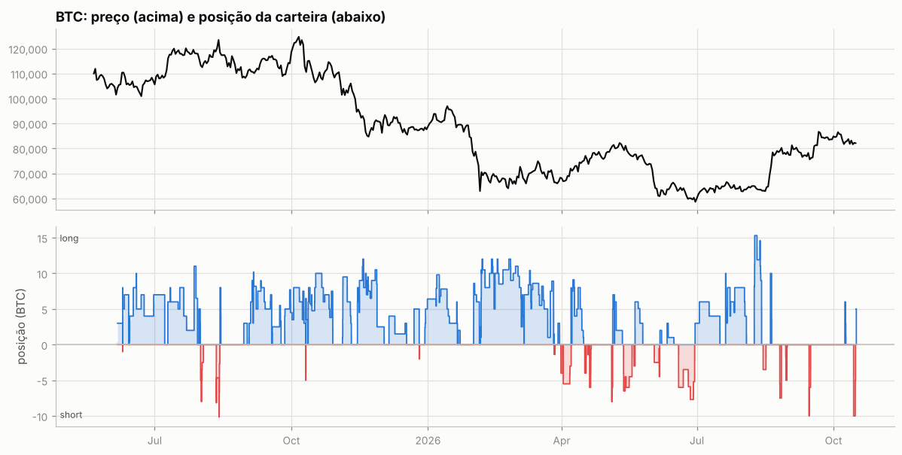

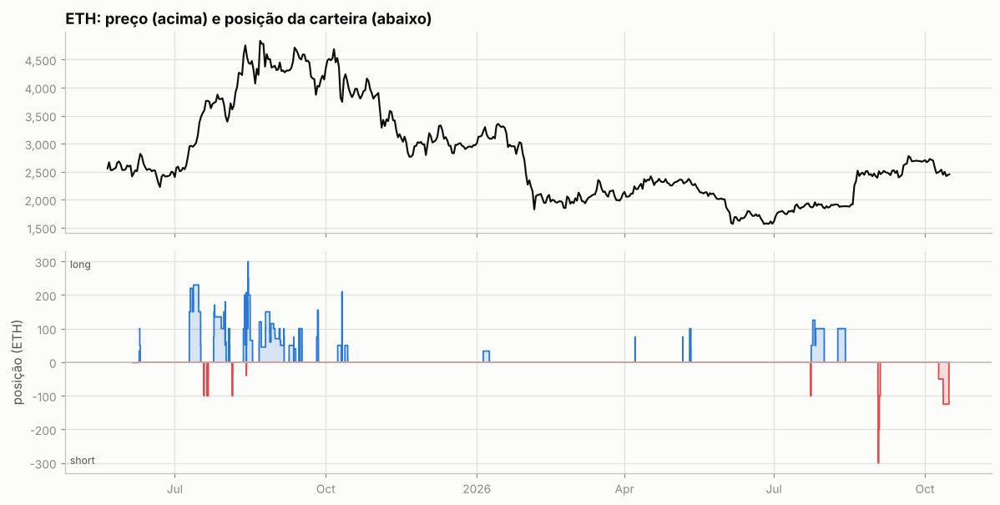

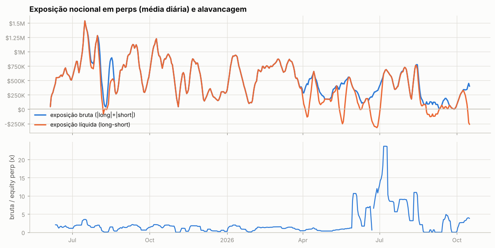

Tabela mensal de exposição e alavancagem

| mês | exposição bruta | exposição líquida | equity perp | alavancagem (mediana) |
|---|---|---|---|---|
| 2025-06 | $546.5K | $546.5K | $408.1K | 1.3x |
| 2025-07 | $1.04M | $1.02M | $525.1K | 1.9x |
| 2025-08 | $500.3K | $349.3K | $582.2K | 0.8x |
| 2025-09 | $767.6K | $767.6K | $547.9K | 1.4x |
| 2025-10 | $831.8K | $831.8K | $529.8K | 1.7x |
| 2025-11 | $559.4K | $559.4K | $507.2K | 1.5x |
| 2025-12 | $250.7K | $250.7K | $474.0K | 0.4x |
| 2026-01 | $520.0K | $520.0K | $500.2K | 0.9x |
| 2026-02 | $738.8K | $738.8K | $541.2K | 1.4x |
| 2026-03 | $628.8K | $617.2K | $631.7K | 1.1x |
| 2026-04 | $375.3K | $200.6K | $586.1K | 0.5x |
| 2026-05 | $410.2K | $235.9K | $457.7K | 0.9x |
| 2026-06 | $233.3K | -$47.3K | $31.1K | 6.6x |
| 2026-07 | $582.7K | $579.7K | $59.6K | 9.1x |
| 2026-08 | $287.9K | $203.1K | $61.7K | 3.0x |
| 2026-09 | $80.8K | $8.4K | $54.1K | 0.2x |
| 2026-10 | $359.3K | $60.1K | $94.6K | 3.2x |

## 5. Execução

**Tipos de ordem** (últimas 823 ordens que a API guarda, 2026-02-02 → 2026-10-16):

| orderType | tif | reduceOnly | isTrigger | ordens |
|---|---|---|---|---|
| Limit | Gtc | False | False | 386 |
| Limit | Gtc | True | False | 386 |
| Market | FrontendMarket | False | False | 34 |
| Market | FrontendMarket | True | False | 17 |

`FrontendMarket` = ordem a mercado enviada pela interface web; `Gtc` = limite que fica no livro; gatilhos (`isTrigger`) seriam stop/take-profit.

**Perfil por ativo (top 10 por volume):**

| ativo | volume | ordens | % taker (nocional) | tamanho mediano |
|---|---|---|---|---|
| BTC | $87.96M | 465 | 13% | 2 |
| ETH | $31.30M | 146 | 11% | 50 |
| HYPE | $9.73M | 153 | 12% | 1,160 |
| PUMP | $3.86M | 96 | 14% | 1.076e+07 |
| PENDLE | $1.71M | 42 | 21% | 1.281e+04 |
| ZEC | $1.03M | 26 | 27% | 47.87 |
| LINK | $496.5K | 12 | 39% | 1,129 |
| AAVE | $426.3K | 7 | 8% | 163.4 |
| FARTCOIN | $412.6K | 15 | 44% | 3.157e+04 |
| DOGE | $295.9K | 6 | 51% | 2.289e+05 |

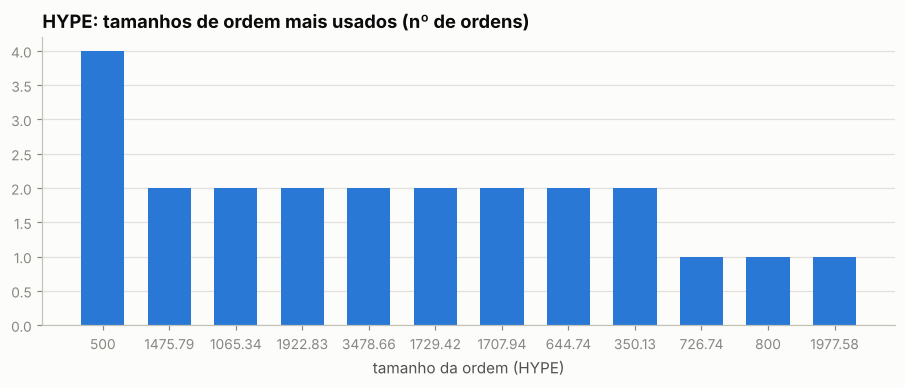

Os 5 tamanhos mais comuns respondem por 8% das ordens de HYPE — lotes redondos e repetidos são assinatura de execução manual.

Sessões (ordens separadas por < 30 min): 556; mediana de 1 ordens e 0.0 min por sessão; dias com atividade: 283 de 497.

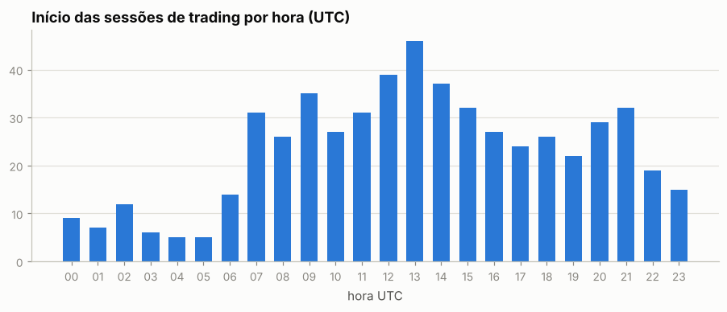

Por dia da semana: seg 17%, ter 16%, qua 16%, qui 17%, sex 17%, sáb 7%, dom 9%

## 6. Comportamento de entrada e saída

### HYPE

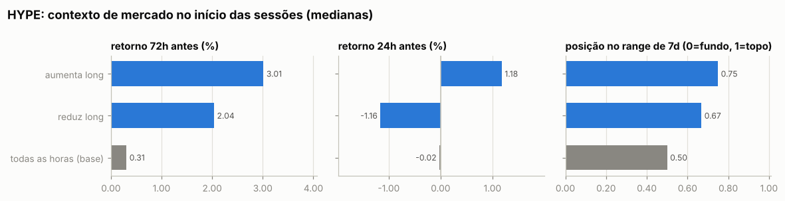

Por ordem (medianas):

| ação | ordens | retorno 24h antes | 72h antes | 7d antes | posição no range 7d | 24h depois | 7d depois |
|---|---|---|---|---|---|---|---|
| aumenta long | 70 | +1.18% | +2.49% | +3.81% | 0.74 | +0.04% | +5.74% |
| reduz long | 83 | -1.16% | +1.77% | +5.42% | 0.57 | -0.57% | -4.11% |
| todas as horas (base) |  | -0.02% | +0.31% | +0.14% | 0.50 | -0.02% | -0.28% |

Por sessão (ordens a menos de 30 min uma da outra contam como uma decisão; p = teste de Mann-Whitney contra todas as horas do período):

| sessão | sessões | retorno 24h antes | 72h antes | 7d antes | range 7d | no topo (>0,7) | no fundo (<0,3) |
|---|---|---|---|---|---|---|---|
| aumenta long | 52 | +1.18% (p=0.088) | +3.01% (p=0.103) | +5.75% (p=0.051) | 0.75 (p=0.017) | 54% | 25% |
| reduz long | 55 | -1.16% (p=0.214) | +2.04% (p=0.008) | +7.40% (p=0.004) | 0.67 (p=0.018) | 49% | 22% |
| todas as horas (base) |  |  |  |  |  | 33% | 32% |

- Aumentos de posição feitos com a posição no prejuízo (preço pior que o preço médio): **17%** das ordens (25% do tamanho); distância mediana do preço médio: -5.50%.
- Reduções/fechamentos com lucro: **72%** de 83; ganho médio $6.9K vs. perda média -$2.0K; realizado +$368.9K.

- Episódios (de zerado a zerado, ou até inverter): 24; fechados com lucro: 67%; duração mediana 4.5 dias; o melhor episódio sozinho = 34% da soma dos episódios lucrativos.

Maiores episódios por PnL realizado

| início | fim | dias | lado | tam_max | nocional_max | ordens | entrada | saída | realizado |
|---|---|---|---|---|---|---|---|---|---|
| 2026-05-15 | 2026-06-02 | 18.3 | long | 6,001 | $409.7K | 12 | 51.33 | 69.54 | +$138.4K |
| 2026-01-30 | 2026-05-04 | 93.7 | long | 9,325 | $352.9K | 29 | 34.09 | 36.70 | +$66.4K |
| 2026-06-10 | 2026-06-16 | 5.4 | long | 3,483 | $236.4K | 7 | 55.24 | 66.52 | +$55.1K |
| 2026-01-26 | 2026-01-29 | 3.0 | long | 6,029 | $205.7K | 5 | 24.88 | 32.24 | +$44.4K |
| 2025-10-23 | 2025-10-28 | 5.3 | long | 4,716 | $221.1K | 6 | 42.41 | 46.72 | +$20.3K |
| 2025-10-10 | 2025-10-11 | 0.4 | long | 6,203 | $214.3K | 6 | 32.27 | 35.07 | +$17.5K |
| 2025-09-08 | 2025-09-13 | 5.1 | long | 4,760 | $266.6K | 11 | 53.22 | 56.00 | +$16.2K |
| 2025-08-21 | 2025-09-07 | 16.5 | long | 2,856 | $139.3K | 9 | 45.23 | 47.57 | +$10.3K |
| 2025-06-05 | 2025-06-10 | 4.2 | long | 1,476 | $58.1K | 2 | 33.88 | 39.38 | +$8.1K |
| 2026-05-06 | 2026-05-12 | 5.7 | long | 3,447 | $150.9K | 6 | 43.50 | 41.91 | -$7.7K |

### BTC

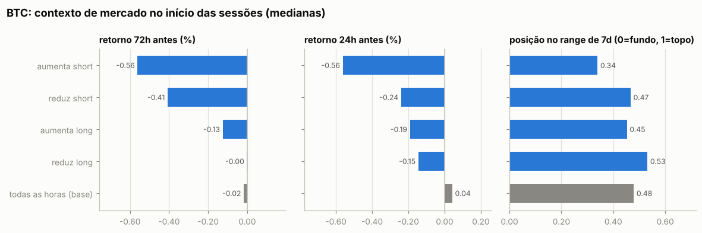

Por ordem (medianas):

| ação | ordens | retorno 24h antes | 72h antes | 7d antes | posição no range 7d | 24h depois | 7d depois |
|---|---|---|---|---|---|---|---|
| aumenta short | 54 | -0.63% | -0.36% | -0.93% | 0.36 | -0.94% | +1.16% |
| reduz short | 54 | -0.24% | -0.46% | -0.35% | 0.46 | -0.10% | +1.18% |
| aumenta long | 173 | -0.34% | -0.42% | -0.97% | 0.45 | +0.08% | +0.42% |
| reduz long | 182 | -0.22% | -0.06% | +0.25% | 0.49 | +0.11% | -0.62% |
| todas as horas (base) |  | +0.04% | -0.02% | +0.01% | 0.48 | +0.04% | -0.05% |

Por sessão (ordens a menos de 30 min uma da outra contam como uma decisão; p = teste de Mann-Whitney contra todas as horas do período):

| sessão | sessões | retorno 24h antes | 72h antes | 7d antes | range 7d | no topo (>0,7) | no fundo (<0,3) |
|---|---|---|---|---|---|---|---|
| aumenta short | 30 | -0.56% (p=0.050) | -0.56% (p=0.373) | -0.34% (p=0.937) | 0.34 (p=0.170) | 30% | 40% |
| reduz short | 36 | -0.24% (p=0.476) | -0.41% (p=0.494) | +0.13% (p=0.719) | 0.47 (p=0.385) | 28% | 42% |
| aumenta long | 104 | -0.19% (p=0.085) | -0.13% (p=0.144) | -0.25% (p=0.083) | 0.45 (p=0.343) | 32% | 40% |
| reduz long | 100 | -0.15% (p=0.874) | -0.00% (p=0.858) | -0.14% (p=0.662) | 0.53 (p=0.542) | 31% | 31% |
| todas as horas (base) |  |  |  |  |  | 31% | 34% |

- Aumentos de posição feitos com a posição no prejuízo (preço pior que o preço médio): **45%** das ordens (44% do tamanho); distância mediana do preço médio: -0.04%.
- Reduções/fechamentos com lucro: **58%** de 236; ganho médio $4.5K vs. perda média -$3.3K; realizado +$296.0K.

- Episódios (de zerado a zerado, ou até inverter): 57; fechados com lucro: 61%; duração mediana 2.6 dias; o melhor episódio sozinho = 13% da soma dos episódios lucrativos.

Maiores episódios por PnL realizado

| início | fim | dias | lado | tam_max | nocional_max | ordens | entrada | saída | realizado |
|---|---|---|---|---|---|---|---|---|---|
| 2026-02-05 | 2026-03-06 | 29.3 | long | 12.00 | $849.2K | 39 | 67,530 | 69,525 | +$69.8K |
| 2025-09-26 | 2025-10-10 | 14.1 | long | 8.00 | $993.0K | 14 | 116,484 | 119,995 | +$56.9K |
| 2026-08-19 | 2026-08-20 | 0.8 | long | 10.00 | $699.3K | 6 | 64,931 | 70,332 | +$54.0K |
| 2025-08-13 | 2025-08-14 | 0.6 | long | 8.00 | $985.2K | 2 | 123,155 | 117,447 | -$45.7K |
| 2025-07-09 | 2025-07-29 | 20.0 | long | 11.00 | $1.30M | 13 | 116,242 | 117,946 | +$34.1K |
| 2025-10-12 | 2025-10-28 | 16.6 | long | 10.00 | $1.09M | 22 | 110,694 | 112,405 | +$33.3K |
| 2025-12-29 | 2026-01-20 | 21.9 | long | 9.80 | $914.3K | 20 | 90,480 | 92,024 | +$24.2K |
| 2026-06-02 | 2026-06-05 | 3.6 | short | 4.50 | $275.6K | 6 | 64,411 | 61,060 | +$21.8K |
| 2025-06-09 | 2025-06-13 | 4.0 | long | 8.00 | $863.1K | 5 | 107,916 | 105,795 | -$21.5K |
| 2026-05-12 | 2026-05-18 | 5.7 | short | 6.50 | $522.3K | 7 | 80,276 | 77,618 | +$21.3K |

### ETH

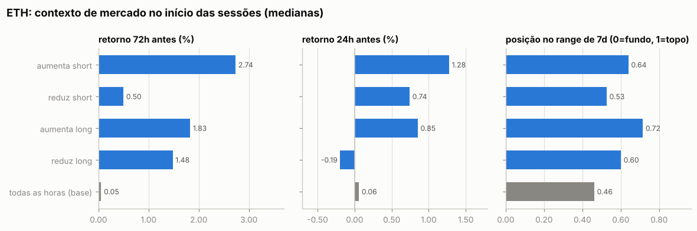

Por ordem (medianas):

| ação | ordens | retorno 24h antes | 72h antes | 7d antes | posição no range 7d | 24h depois | 7d depois |
|---|---|---|---|---|---|---|---|
| aumenta short | 13 | +1.28% | +2.41% | -2.53% | 0.42 | -1.01% | +5.29% |
| reduz short | 9 | +1.80% | +1.41% | +0.30% | 0.54 | +0.12% | +2.69% |
| aumenta long | 54 | +0.90% | +2.45% | +6.62% | 0.74 | +0.17% | -0.88% |
| reduz long | 68 | -0.30% | -0.26% | +3.15% | 0.54 | +0.14% | +0.03% |
| todas as horas (base) |  | +0.06% | +0.05% | +0.27% | 0.46 | +0.06% | +0.17% |

Por sessão (ordens a menos de 30 min uma da outra contam como uma decisão; p = teste de Mann-Whitney contra todas as horas do período):

| sessão | sessões | retorno 24h antes | 72h antes | 7d antes | range 7d | no topo (>0,7) | no fundo (<0,3) |
|---|---|---|---|---|---|---|---|
| aumenta short | 11 | +1.28% (p=0.241) | +2.74% (p=0.184) | -2.32% (p=0.916) | 0.64 (p=0.872) | 36% | 36% |
| reduz short | 8 | +0.74% (p=0.561) | +0.50% (p=0.622) | -1.41% (p=0.989) | 0.53 (p=0.863) | 38% | 38% |
| aumenta long | 37 | +0.85% (p=0.277) | +1.83% (p=0.007) | +7.09% (p=0.000) | 0.72 (p=0.005) | 51% | 14% |
| reduz long | 43 | -0.19% (p=0.387) | +1.48% (p=0.074) | +3.70% (p=0.000) | 0.60 (p=0.011) | 47% | 21% |
| todas as horas (base) |  |  |  |  |  | 30% | 33% |

- Aumentos de posição feitos com a posição no prejuízo (preço pior que o preço médio): **39%** das ordens (39% do tamanho); distância mediana do preço médio: -0.58%.
- Reduções/fechamentos com lucro: **49%** de 77; ganho médio $7.4K vs. perda média -$3.5K; realizado +$143.7K.

- Episódios (de zerado a zerado, ou até inverter): 28; fechados com lucro: 57%; duração mediana 1.2 dias; o melhor episódio sozinho = 42% da soma dos episódios lucrativos.

Maiores episódios por PnL realizado

| início | fim | dias | lado | tam_max | nocional_max | ordens | entrada | saída | realizado |
|---|---|---|---|---|---|---|---|---|---|
| 2025-07-09 | 2025-07-16 | 7.0 | long | 230.00 | $688.9K | 9 | 2,815 | 3,172 | +$107.0K |
| 2025-08-11 | 2025-08-13 | 1.8 | long | 207.47 | $978.0K | 12 | 4,453 | 4,600 | +$50.4K |
| 2025-08-13 | 2025-08-17 | 3.7 | long | 300.00 | $1.36M | 22 | 4,640 | 4,580 | -$32.7K |
| 2026-10-09 | 2026-10-15 | 6.2 | short | 125.00 | $320.6K | 4 | 2,538 | 2,365 | +$21.6K |
| 2025-08-21 | 2025-09-05 | 15.3 | long | 150.00 | $688.2K | 20 | 4,450 | 4,496 | +$16.5K |
| 2025-10-10 | 2025-10-10 | 0.0 | long | 210.00 | $749.1K | 4 | 3,643 | 3,581 | -$13.0K |
| 2025-08-13 | 2025-08-13 | 0.0 | short | 110.00 | $511.3K | 2 | 4,648 | 4,647 | +$10.5K |
| 2026-09-02 | 2026-09-03 | 1.4 | short | 300.00 | $723.3K | 7 | 2,397 | 2,431 | -$10.3K |
| 2025-10-08 | 2025-10-10 | 2.3 | long | 50.00 | $222.7K | 2 | 4,454 | 4,251 | -$10.2K |
| 2025-08-04 | 2025-08-05 | 0.4 | short | 100.00 | $373.3K | 4 | 3,721 | 3,629 | +$9.2K |

### Todos os episódios relevantes (todas as moedas)

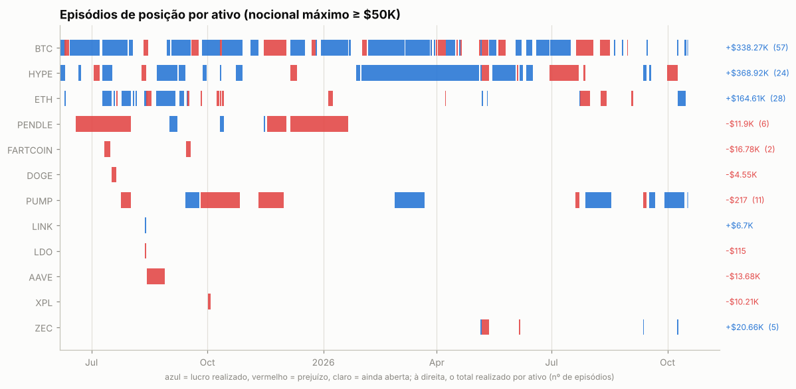

Episódios com nocional máximo ≥ $50K: 138; fechados com lucro: 57%. Abaixo, os 25 maiores por PnL realizado, em ordem de data. *7d/30d antes* e *vs. máx. 30d*: o que o preço tinha feito até a primeira ordem; *funding a.a.*: taxa anualizada nas 24h anteriores (positiva = longs pagam shorts); *entrada média vs. 1ª ordem*: positivo = foi aumentando a posição com o preço indo contra; *contra (máx.)*: quanto o preço andou contra a primeira ordem durante o episódio; *capturado*: movimento entre o preço médio de entrada e o de saída.

| ativo | lado | início | dias | nocional máx. | 7d antes | 30d antes | vs. máx. 30d | funding a.a. na entrada | entrada média vs. 1ª ordem | contra (máx.) | pior PnL aberto | capturado | realizado | funding |
|---|---|---|---|---|---|---|---|---|---|---|---|---|---|---|
| BTC | long | 2025-06-05 | 4 | $322.8K | -4% | +7% | -9% | +11% | -0% | +0% | -$280 | +7% | +$21.2K | -$649 |
| BTC | short | 2025-06-09 | 0 | $861.5K | +3% | +3% | -4% | +4% | +0% | +0% | -$108 | -0% | +$21.1K | -$501 |
| BTC | long | 2025-06-09 | 4 | $863.1K | +4% | +4% | -4% | +4% | -0% | +4% | -$31.2K | -2% | -$21.5K | -$1.2K |
| BTC | long | 2025-07-09 | 20 | $1.30M | +2% | +3% | +0% | +11% | -5% | +0% | -$1.7K | +1% | +$34.1K | -$8.3K |
| ETH | long | 2025-07-09 | 7 | $688.9K | +6% | +7% | -4% | +11% | -3% | +0% | -$9 | +13% | +$107.0K | -$2.7K |
| ETH | long | 2025-08-11 | 2 | $978.0K | +17% | +46% | -1% | +17% | -5% | +1% | -$2.3K | +3% | +$50.4K | -$1.7K |
| ETH | long | 2025-08-13 | 4 | $1.36M | +28% | +53% | -1% | +23% | +0% | +6% | -$46.1K | -1% | -$32.7K | -$1.9K |
| BTC | long | 2025-08-13 | 1 | $985.2K | +7% | +2% | +0% | +34% | -0% | +4% | -$17.7K | -5% | -$45.7K | -$61 |
| BTC | long | 2025-09-02 | 15 | $1.15M | +1% | -2% | -10% | +11% | -1% | +2% | -$19.3K | +1% | +$21.1K | -$3.2K |
| PUMP | long | 2025-09-25 | 31 | $377.1K | -35% | +89% | -40% | +11% | -2% | +38% | -$70.9K | -10% | -$56.1K | -$924 |
| BTC | long | 2025-09-26 | 14 | $993.0K | -6% | -2% | -7% | +8% | -7% | +0% | -$1.6K | +3% | +$56.9K | -$3.3K |
| BTC | long | 2025-10-12 | 17 | $1.09M | -11% | -3% | -11% | +9% | +1% | +7% | -$46.9K | +2% | +$33.3K | -$3.2K |
| HYPE | long | 2025-10-23 | 5 | $221.1K | -0% | -20% | -25% | +25% | -8% | +1% | -$555 | +10% | +$20.3K | -$169 |
| BTC | long | 2025-12-29 | 22 | $914.3K | -1% | -4% | -7% | +10% | -4% | +0% | -$5.3K | +2% | +$24.2K | -$3.0K |
| HYPE | long | 2026-01-26 | 3 | $205.7K | +0% | -6% | -15% | +17% | -0% | +0% | -$464 | +30% | +$44.4K | -$105 |
| HYPE | long | 2026-01-30 | 94 | $352.9K | +38% | +22% | -10% | +12% | -11% | +16% | -$20.9K | +8% | +$66.4K | -$2.6K |
| BTC | long | 2026-02-05 | 29 | $849.2K | -20% | -24% | -27% | +10% | +5% | +12% | -$49.4K | +3% | +$69.8K | -$807 |
| BTC | short | 2026-05-12 | 6 | $522.3K | -1% | +14% | -2% | +4% | -0% | +2% | -$9.6K | +3% | +$21.3K | +$63 |
| HYPE | long | 2026-05-15 | 18 | $409.7K | +7% | +5% | -3% | +10% | -12% | +11% | -$18.9K | +35% | +$138.4K | -$1.2K |
| BTC | short | 2026-06-02 | 4 | $275.6K | -9% | -11% | -15% | +11% | -8% | -0% | $0 | +5% | +$21.8K | +$109 |
| HYPE | long | 2026-06-10 | 5 | $236.4K | -29% | +27% | -29% | +12% | -4% | +0% | -$301 | +20% | +$55.1K | -$178 |
| PUMP | long | 2026-07-27 | 20 | $105.9K | +2% | +56% | -1% | +11% | -11% | +15% | -$12.2K | +23% | +$34.9K | -$470 |
| BTC | long | 2026-08-19 | 1 | $699.3K | +1% | +0% | -3% | +2% | +0% | -0% | -$0 | +8% | +$54.0K | -$141 |
| PUMP | long | 2026-09-16 | 5 | $120.8K | -23% | +22% | -34% | +4% | -0% | +0% | -$84 | +22% | +$22.2K | -$100 |
| ETH | short | 2026-10-09 | 6 | $320.6K | -9% | -0% | -10% | +4% | +1% | +3% | -$4.0K | +7% | +$21.6K | +$184 |

## 7. Funding

Funding líquido total: **-$65.9K** (recebido $6.4K, pago -$72.4K). Na Hyperliquid o funding é pago de hora em hora; quando positivo, longs pagam shorts.

| ativo | lado | funding | rendimento anualizado s/ nocional |
|---|---|---|---|
| HYPE | long | -$8.6K | -9.0% |
| BTC | short | +$1.7K | 4.3% |
| BTC | long | -$36.7K | -8.7% |
| ETH | short | +$1.0K | 14.7% |
| ETH | long | -$9.9K | -15.6% |
| (outros) | short | +$0 | 75.2% |
| (outros) | long | -$13.5K | -17.0% |

## 8. Fluxos, eventos e carteiras relacionadas

| tipo | eventos | USD (+ entra / − sai) |
|---|---|---|
| withdraw | 5 | -$310.0K |
| send | 10 | -$198.8K |
| spotTransfer | 1 | — (sem valor em USD) |
| accountClassTransfer | 2 | — (sem valor em USD) |
| deposit | 7 | +$432.1K |

**Gestão de margem.** Dias com depósito: 6; em 33% deles o PnL dos 3 dias anteriores era negativo (mediana +$1.3K). Dias com saque: 10; em 90% deles o PnL dos 3 dias anteriores era positivo (mediana +$6.9K). Base: 45% de todos os dias vêm depois de 3 dias negativos. Correlação entre o fluxo do dia e a variação da exposição bruta: 0.00 (positiva = deposita para abrir posição e saca ao reduzir).

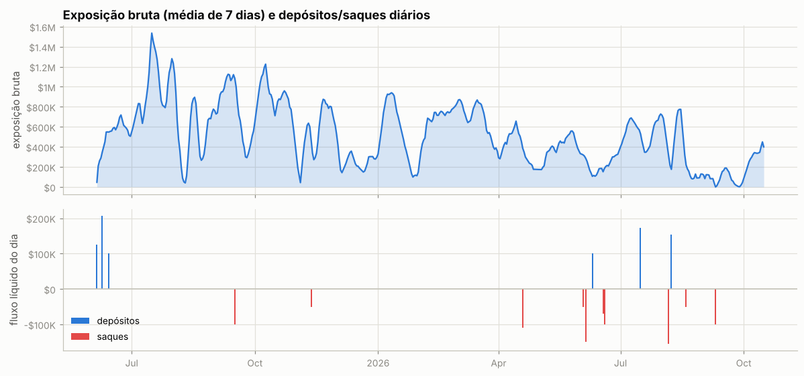

Ponte HyperCore↔HyperEVM (endereços de sistema `0x2000…`/`0x2222…`): 1 transferências, entrada $0, saída $100.0K — uso de DeFi na HyperEVM.

**Carteiras relacionadas** (conta vinculada de staking para desconto de taxa + maiores contrapartes de transferências; o saldo de staking e o PnL ajudam a ver se posições aqui são hedge de algo mantido lá):

| carteira | relação | transferências | volume transferido | valor da conta hoje | PnL all-time | HYPE em staking | maiores saldos spot |
|---|---|---|---|---|---|---|---|
| `0xb840d79f9c84dba710129f85acdfa2d775566361` | transfers | 9 | $951.2K | $45.8K | -$53.0K | 0 | USDC 45,750 |

## 9. Dá para copiar?

### Teste de copiabilidade

Antes de simular, o relatório confere se um copiador conseguiria seguir a carteira. O tempo em posição casa cada redução com o aumento mais recente (LIFO), então um market maker que compra e revende em minutos aparece com minutos, mesmo carregando estoque antigo.

| critério | valor | não copiável se |
|---|---|---|
| execuções de perps e HIP-3 (2025-06-05 → 2026-10-16) | 977 | < 20 |
| volume fechado que ficou aberto menos de 30 min | 5% | ≥ 50% |
| tempo mediano em posição (ponderado pelo volume) | 32.1 h |  |
| execuções por dia ativo; parte maker do nocional | 3; 87% | ≥ 300 e ≥ 80% (bot de market making) |

**Copiável:** nenhum critério bloqueia. A simulação abaixo mede quanto do resultado sobra com atraso.

### Copiar cada execução com 30 min, 1h, 2h e 4h de atraso

O copiador começa zerado em 2025-06-05 e repete cada fill de perps e HIP-3 da carteira no mesmo tamanho, com o atraso indicado, a mercado e pagando taxa *taker* de 0.045%. Posições já abertas antes não são copiadas: em cada moeda, a cópia começa quando a carteira zera ou inverte a posição. O preço da cópia é a abertura do candle que começa mais perto de *fill + atraso*: candles de 15m da Hyperliquid nos últimos ~52 dias, de 1h da Hyperliquid ou da Binance antes disso. O atraso real varia meio candle para cada lado, e o candle do próprio fill (muitas vezes o pavio que ele mesmo fez) nunca é usado. Carteira e cópia são marcadas no mesmo preço final (último fechamento diário). O funding fica de fora porque, com horas de atraso, é quase igual para as duas.

Entram na comparação 100% do volume de perps dos fills, em operações de 2025-06-05 a 2026-10-15 (posições herdadas: 0%; sem preço intradiário: 0%). Fonte do preço com 30 min de atraso: Binance 1h 69%, HL 1h 24%, HL 15m 7%.

| atraso | atraso médio real | carteira | cópia | fica com | efeito do preço | efeito da taxa | custo (bp do volume, IC 95%) | maior drawdown |
|---|---|---|---|---|---|---|---|---|
| 30 min | 32 min | +$770.2K | +$646.2K | 84% | -$83.8K | -$40.2K | 9.1 (1.4 a 16.7) | -$168.1K |
| 1h | 61 min | +$770.2K | +$637.2K | 83% | -$92.7K | -$40.2K | 9.7 (2.4 a 17.0) | -$157.9K |
| 2h | 121 min | +$770.2K | +$668.1K | 87% | -$61.9K | -$40.2K | 7.5 (-1.2 a 16.1) | -$152.3K |
| 4h | 241 min | +$770.2K | +$590.2K | 77% | -$139.8K | -$40.2K | 13.1 (1.1 a 25.1) | -$157.0K |

Maior drawdown da carteira nas mesmas operações: -$122.5K. *Efeito do preço* e *efeito da taxa*: quanto o preço da cópia e a taxa *taker* mudam o resultado em relação à carteira (negativo = a cópia perde). O custo é carteira − cópia sobre o volume copiado; o IC vem da variação de um dia para outro. Os valores somam só as operações copiadas, não o PnL total da carteira.

Com 30 min de atraso a cópia fica com **84%** do resultado; com 4h, **77%**. O custo do atraso é maior que zero com 95% de confiança com 30 min, 1h e 4h de atraso.

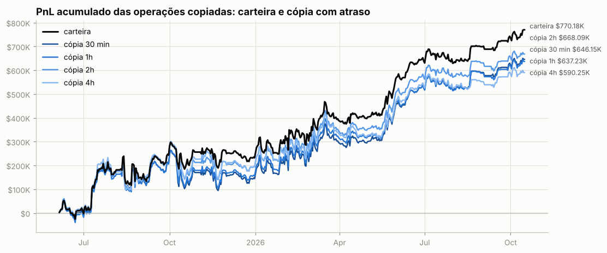

**Por ativo** (12 maiores pelo resultado da carteira):

| ativo | volume | carteira | 30 min | 1h | 2h | 4h | fica com (30 min) |
|---|---|---|---|---|---|---|---|
| HYPE | $9.73M | +$367.4K | +$335.0K | +$311.8K | +$308.9K | +$313.7K | 91% |
| BTC | $87.55M | +$303.1K | +$245.0K | +$247.2K | +$276.6K | +$177.3K | 81% |
| ETH | $31.30M | +$149.7K | +$125.0K | +$131.7K | +$119.1K | +$128.9K | 84% |
| FARTCOIN | $412.6K | -$17.2K | -$17.9K | -$14.5K | -$10.9K | -$7.4K | — |
| AAVE | $426.3K | -$13.7K | -$13.3K | -$12.0K | -$12.7K | -$15.6K | — |
| XMR | $86.8K | -$13.2K | -$12.0K | -$11.4K | -$10.7K | -$10.5K | — |
| PENDLE | $1.71M | -$12.2K | -$2.3K | +$2.3K | +$5.1K | +$6.1K | — |
| XPL | $139.8K | -$10.2K | -$9.5K | -$8.6K | -$11.2K | -$3.3K | — |
| PUMP | $3.71M | +$9.1K | -$15.0K | -$15.2K | -$8.0K | -$10.5K | -164% |
| LINK | $496.5K | +$6.6K | +$3.8K | +$2.4K | +$3.1K | +$178 | 58% |
| ZEC | $1.03M | +$5.8K | +$9.5K | +$5.8K | +$9.3K | +$11.4K | 165% |
| DOGE | $295.9K | -$4.6K | -$3.0K | -$1.1K | +$2.1K | +$2.7K | — |

**Por tipo de execução da carteira.** Numa ordem limite a carteira compra abaixo e vende acima do preço corrente; a cópia a mercado perde essa vantagem. Numa ordem a mercado as duas pagam o *spread*:

| execução da carteira | fills | volume | carteira | 30 min | 1h | 2h | 4h |
|---|---|---|---|---|---|---|---|
| limite (maker) | 11,072 | $120.04M | +$900.6K | +$755.1K | +$753.9K | +$741.1K | +$687.5K |
| a mercado (taker) | 2,272 | $17.00M | -$130.4K | -$109.0K | -$116.7K | -$73.0K | -$97.2K |

### Espelhar a posição com atraso longo (moedas principais)

PnL de quem replicasse exatamente a posição da carteira, mas com N horas de atraso (marcação horária, sem custos). Se o PnL se mantém com atraso, a vantagem está em horizontes longos e é copiável; se desaba, depende de timing fino.

| atraso | HYPE | BTC | ETH |
|---|---|---|---|
| 0h | +$335.4K | +$282.9K | +$135.8K |
| 1h | +$319.8K | +$290.9K | +$125.5K |
| 4h | +$319.5K | +$230.2K | +$124.6K |
| 12h | +$261.4K | +$212.4K | +$105.0K |
| 24h | +$280.4K | +$199.9K | +$51.8K |
| 72h | +$101.3K | -$49.1K | +$7.7K |
| 168h | -$33.4K | +$103.2K | +$111.8K |

## 10. Teste de replicação por regras (HYPE)

Regra testada: *short-bias com filtro de tendência e fade* — short de até 4,649 HYPE (o percentil 90 do tamanho real), cheio abaixo da média móvel e reduzido acima; dentro do regime, mais short perto do topo do range e menos perto do fundo. Parâmetros escolhidos no treino (2025-06-05 → 2026-02-08) e avaliados no teste (2026-02-09 → 2026-10-15).

|  | parâmetros | PnL treino | PnL teste | correlação c/ posição real (teste) |
|---|---|---|---|---|
| melhor regra no treino | MA100, range 30d, fração em alta 1.0, fade 0.9 | +$54.7K | -$116.3K | -0.27 |
| carteira real (aprox.) | — | +$132.6K | +$208.7K | 1.00 |

Clone comportamental (regressão linear da posição real em médias móveis, ranges e retornos): R² treino 0.38, R² teste -0.02, correlação no teste 0.29.

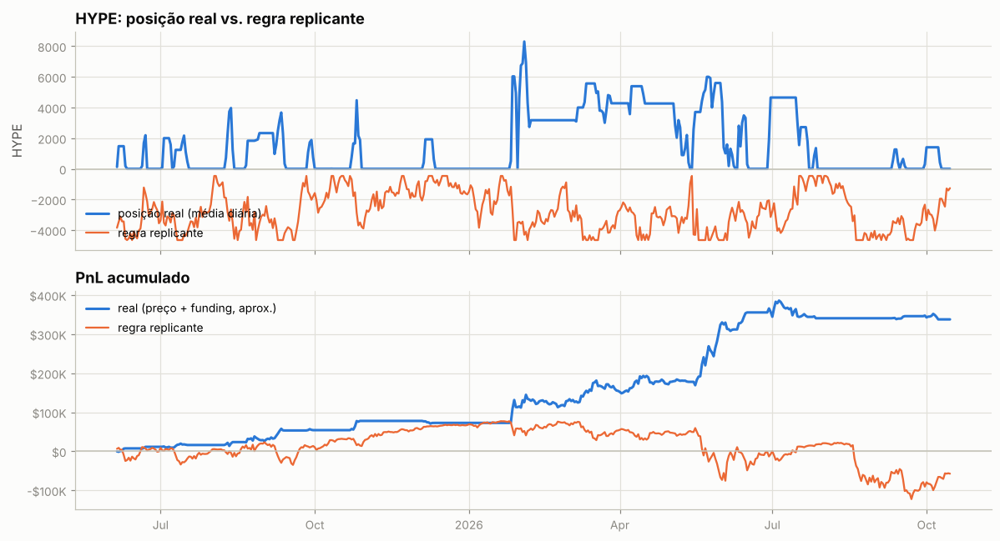

---

Metodologia e código: ver `README.md` na raiz do repositório.
