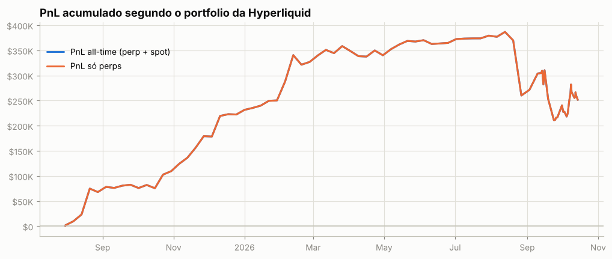
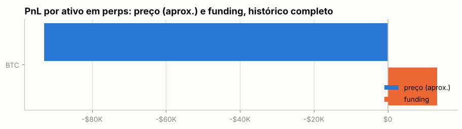
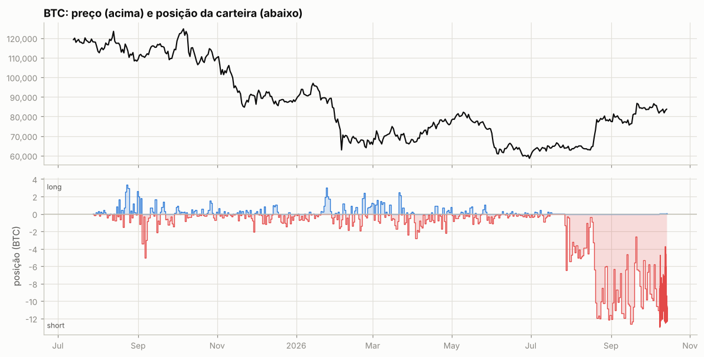
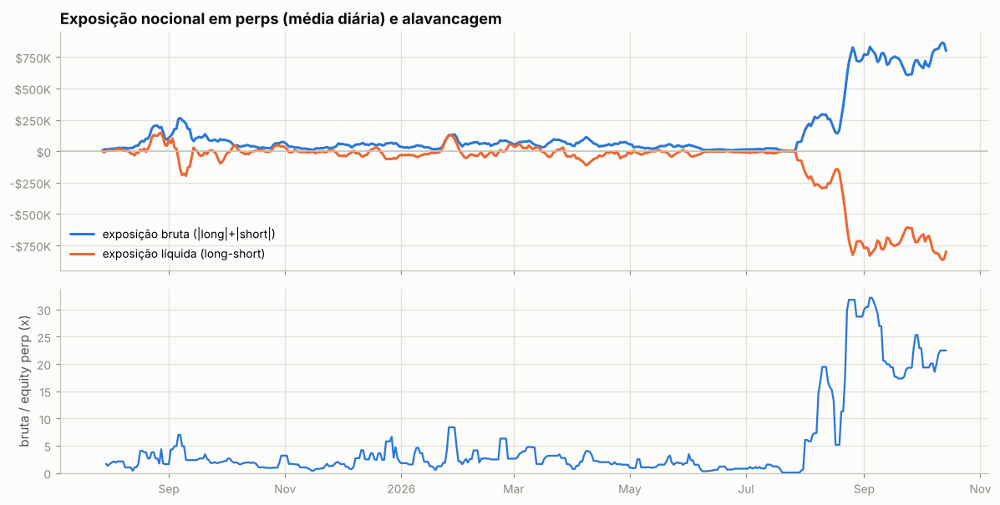
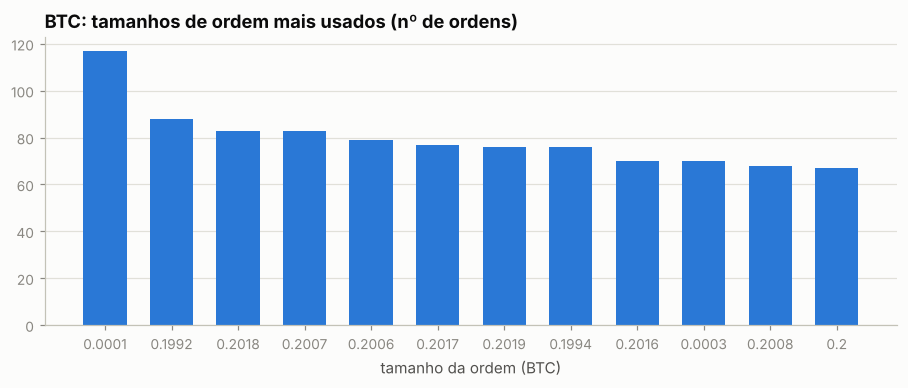
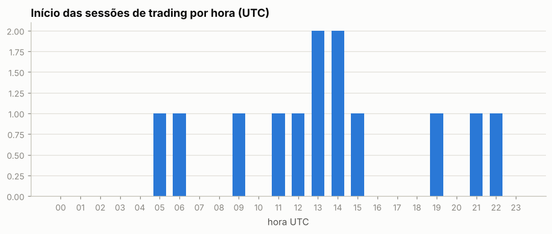
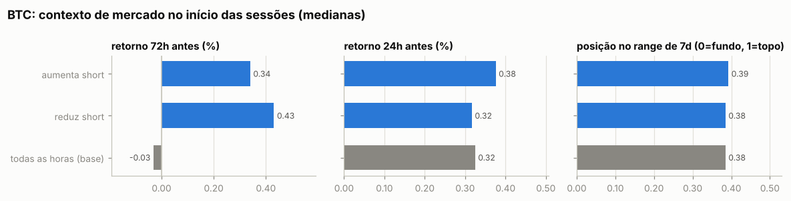
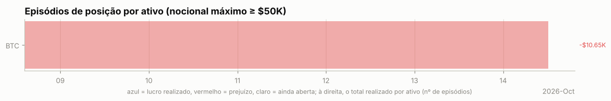
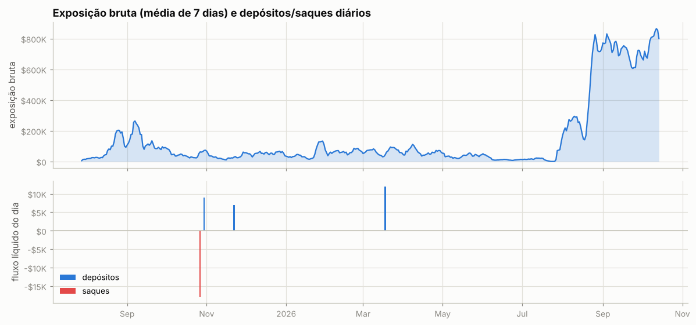
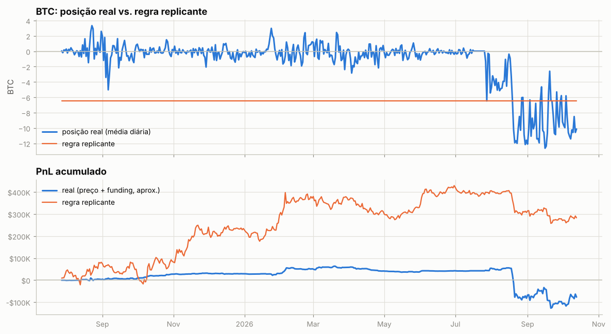

# Relatório automático — `0x78dce96236804d6958bf3c4598cf5efbc371629c`

Gerado em 2026-10-14 12:16 UTC a partir da API pública da Hyperliquid (`POST /info`). Valores em USD. Este arquivo é regenerado por `python -m hlre.report`; a interpretação da estratégia fica em `ANALISE.md`.

## 1. Visão geral

| métrica | valor |
|---|---|
| Valor da conta (perp + spot) | $28.0K |
| PnL all-time (portfolio, inclui spot/airdrops) | +$251.5K |
| PnL all-time só de perps | +$251.5K |
| Volume all-time | $4,756.70M |
| Primeira atividade | 2025-07-30 |
| Fills disponíveis na API | 11,923 (desde 2026-10-08) |
| Ordens (fills agrupados por oid) | 5,742 |
| Funding líquido (recebido > 0) | +$13.4K |
| Taxas pagas (período dos fills) | +$1.9K |
| Liquidações (ledger) | 0 |
| Fills de liquidação/ADL | 0 |
| Papel da conta | subAccount |
| API wallets (agentes) | 0 |

**Posições abertas agora:**

| ativo | tamanho | nocional | entrada | alav. | PnL não realizado | liq. |
|---|---|---|---|---|---|---|
| BTC | -11.96449 | $1.00M | 83516.2 | 37x cross | -$2.9K | 85038.2459821615 |

## 2. Curva de PnL

## 3. De onde veio o PnL

*Preço (aprox.)* usa a posição média diária de cada ativo, reconstruída a partir do histórico de funding (que traz o tamanho da posição a cada hora/dia desde o início da conta), vezes o movimento open→close do dia. Subestima o PnL de day trade, mas cobre o período sem fills. *Preço exato* marca cada fill no fechamento diário e só existe para o período coberto pelos fills.

| ativo | preço (aprox.) | funding | total | preço exato (período dos fills) | taxas (período dos fills) |
|---|---|---|---|---|---|
| BTC | -$93.0K | +$13.4K | -$79.6K | -$22.0K | +$1.9K |
| outros (0) | $0 | $0 | $0 | $0 | $0 |

**Decomposição no período dos fills** (preço exato): quanto veio de *carregar* a posição (e, dentro disso, do viés médio vs. do *timing* de aumentar/reduzir), quanto de trades intradiários, funding e taxas.

| componente | BTC |
|---|---|
| carregar posição (carry) | -$19.2K |
|   ↳ viés (posição média × movimento) | -$19.6K |
|   ↳ timing (variação do tamanho) | +$312 |
| trades intradiários | -$2.7K |
| funding | +$707 |
| taxas | +$1.9K |
| posição média | -9.54 |
| movimento do preço no período | 2,049.00 |

## 4. Posições ao longo do tempo

Área clara: posição média diária (funding). Linha: posição exata (fills). Azul = long, vermelho = short.

Tabela mensal de exposição e alavancagem

| mês | exposição bruta | exposição líquida | equity perp | alavancagem (mediana) |
|---|---|---|---|---|
| 2025-07 | $14.5K | $3.8K | $11.9K | 1.3x |
| 2025-08 | $90.4K | $43.4K | $30.3K | 2.4x |
| 2025-09 | $132.9K | -$51.6K | $38.5K | 2.4x |
| 2025-10 | $44.5K | $11.6K | $21.4K | 1.7x |
| 2025-11 | $31.8K | -$10.6K | $19.9K | 1.2x |
| 2025-12 | $49.9K | -$21.4K | $16.6K | 2.5x |
| 2026-01 | $53.4K | $9.1K | $14.6K | 2.1x |
| 2026-02 | $65.5K | -$7.8K | $19.5K | 2.6x |
| 2026-03 | $64.1K | $1.2K | $21.0K | 3.2x |
| 2026-04 | $64.9K | -$42.0K | $29.9K | 2.0x |
| 2026-05 | $36.3K | -$13.9K | $18.5K | 1.5x |
| 2026-06 | $14.8K | -$9.0K | $14.1K | 0.8x |
| 2026-07 | $38.2K | -$32.8K | $16.8K | 0.7x |
| 2026-08 | $449.1K | -$449.1K | $24.2K | 17.1x |
| 2026-09 | $704.9K | -$704.9K | $33.1K | 20.2x |
| 2026-10 | $793.0K | -$793.0K | $38.8K | 21.5x |

## 5. Execução

**Tipos de ordem** (últimas 1,989 ordens que a API guarda, 2026-10-14 → 2026-10-14):

| orderType | tif | reduceOnly | isTrigger | ordens |
|---|---|---|---|---|
| Limit | Alo | False | False | 1989 |

`FrontendMarket` = ordem a mercado enviada pela interface web; `Gtc` = limite que fica no livro; gatilhos (`isTrigger`) seriam stop/take-profit.

**Perfil por ativo (top 10 por volume):**

| ativo | volume | ordens | % taker (nocional) | tamanho mediano |
|---|---|---|---|---|
| BTC | $63.49M | 5742 | 0% | 0.1988 |

Os 5 tamanhos mais comuns respondem por 8% das ordens de BTC — lotes redondos e repetidos são assinatura de execução manual.

Sessões (ordens separadas por < 30 min): 13; mediana de 61 ordens e 294.0 min por sessão; dias com atividade: 7 de 5.

Por dia da semana: seg 0%, ter 8%, qua 8%, qui 8%, sex 8%, sáb 31%, dom 38%

## 6. Comportamento de entrada e saída

### BTC

Por ordem (medianas):

| ação | ordens | retorno 24h antes | 72h antes | 7d antes | posição no range 7d | 24h depois | 7d depois |
|---|---|---|---|---|---|---|---|
| aumenta short | 3352 | -0.31% | -0.57% | -3.30% | 0.34 | +0.39% | — |
| reduz short | 2390 | -0.21% | -0.30% | -3.15% | 0.36 | +0.39% | — |
| todas as horas (base) |  | +0.32% | -0.03% | -2.56% | 0.38 | +0.40% | — |

Por sessão (ordens a menos de 30 min uma da outra contam como uma decisão; p = teste de Mann-Whitney contra todas as horas do período):

| sessão | sessões | retorno 24h antes | 72h antes | 7d antes | range 7d | no topo (>0,7) | no fundo (<0,3) |
|---|---|---|---|---|---|---|---|
| aumenta short | 4 | +0.38% (p=0.521) | +0.34% (p=0.715) | -2.46% (p=0.569) | 0.39 (p=0.644) | 0% | 0% |
| reduz short | 7 | +0.32% (p=0.975) | +0.43% (p=0.939) | -2.26% (p=0.089) | 0.38 (p=0.743) | 14% | 29% |
| todas as horas (base) |  |  |  |  |  | 8% | 19% |

- Aumentos de posição feitos com a posição no prejuízo (preço pior que o preço médio): **49%** das ordens (54% do tamanho); distância mediana do preço médio: -0.02%.
- Reduções/fechamentos com lucro: **46%** de 2390; ganho médio $49 vs. perda média -$49; realizado -$10.7K.

- Episódios (de zerado a zerado, ou até inverter): 1; fechados com lucro: —; duração mediana nan dias; o melhor episódio sozinho = — da soma dos episódios lucrativos.

Maiores episódios por PnL realizado

| início | fim | dias | lado | tam_max | nocional_max | ordens | entrada | saída | realizado |
|---|---|---|---|---|---|---|---|---|---|
| 2026-10-08 | 2026-10-14 | 5.9 | short | 13.01 | $1.05M | 5742 | 82,738 | 82,731 | -$10.7K |

### Todos os episódios relevantes (todas as moedas)

Episódios com nocional máximo ≥ $50K: 1; fechados com lucro: —. Abaixo, os 25 maiores por PnL realizado, em ordem de data. *7d/30d antes* e *vs. máx. 30d*: o que o preço tinha feito até a primeira ordem; *funding a.a.*: taxa anualizada nas 24h anteriores (positiva = longs pagam shorts); *entrada média vs. 1ª ordem*: positivo = foi aumentando a posição com o preço indo contra; *contra (máx.)*: quanto o preço andou contra a primeira ordem durante o episódio; *capturado*: movimento entre o preço médio de entrada e o de saída.

| ativo | lado | início | dias | nocional máx. | 7d antes | 30d antes | vs. máx. 30d | funding a.a. na entrada | entrada média vs. 1ª ordem | contra (máx.) | pior PnL aberto | capturado | realizado | funding |
|---|---|---|---|---|---|---|---|---|---|---|---|---|---|---|
| BTC | short | 2026-10-08 | 6 | $1.05M | -2% | +5% | -6% | +10% | +0% | +2% | -$7.5K | +0% | -$10.7K | +$879 |

## 7. Funding

Funding líquido total: **+$13.4K** (recebido $15.3K, pago -$1.9K). Na Hyperliquid o funding é pago de hora em hora; quando positivo, longs pagam shorts.

| ativo | lado | funding | rendimento anualizado s/ nocional |
|---|---|---|---|
| BTC | short | +$14.2K | 8.9% |
| BTC | long | -$861 | -3.7% |

## 8. Fluxos, eventos e carteiras relacionadas

| tipo | eventos | USD (+ entra / − sai) |
|---|---|---|
| accountClassTransfer | 1 | — (sem valor em USD) |
| subAccountTransfer | 484 | — (sem valor em USD) |
| send | 5 | +$10.0K |
| spotTransfer | 1 | +$10.0K |

**Gestão de margem.** Dias com depósito: 3; em 67% deles o PnL dos 3 dias anteriores era negativo (mediana -$1.1K). Dias com saque: 1; em 100% deles o PnL dos 3 dias anteriores era positivo (mediana +$4.7K). Base: 47% de todos os dias vêm depois de 3 dias negativos. Correlação entre o fluxo do dia e a variação da exposição bruta: 0.03 (positiva = deposita para abrir posição e saca ao reduzir).

**Carteiras relacionadas** (conta vinculada de staking para desconto de taxa + maiores contrapartes de transferências; o saldo de staking e o PnL ajudam a ver se posições aqui são hedge de algo mantido lá):

| carteira | relação | transferências | volume transferido | valor da conta hoje | PnL all-time | HYPE em staking | maiores saldos spot |
|---|---|---|---|---|---|---|---|
| `0x7839e2f2c375dd2935193f2736167514efff9916` | transfers | 5 | $56.0K | $1.18M | +$6.35M | 10,764 | USDC 36,016, XMR1 0 |

## 9. Dá para copiar? (espelhar a posição com atraso)

PnL de quem replicasse exatamente a posição da carteira, mas com N horas de atraso (marcação horária, sem custos). Se o PnL se mantém com atraso, a vantagem está em horizontes longos e é copiável; se desaba, depende de timing fino.

| atraso | BTC |
|---|---|
| 0h | -$13.1K |
| 1h | -$29.3K |
| 4h | -$18.7K |
| 12h | -$20.7K |
| 24h | -$17.5K |
| 72h | -$2.6K |
| 168h | $0 |

## 10. Teste de replicação por regras (BTC)

Regra testada: *short-bias com filtro de tendência e fade* — short de até 6.454 BTC (o percentil 90 do tamanho real), cheio abaixo da média móvel e reduzido acima; dentro do regime, mais short perto do topo do range e menos perto do fundo. Parâmetros escolhidos no treino (2025-07-28 → 2026-03-06) e avaliados no teste (2026-03-07 → 2026-10-13).

|  | parâmetros | PnL treino | PnL teste | correlação c/ posição real (teste) |
|---|---|---|---|---|
| melhor regra no treino | MA50, range 7d, fração em alta 1.0, fade 0.0 | +$364.9K | -$81.9K | -0.00 |
| carteira real (aprox.) | — | +$58.8K | -$135.7K | 1.00 |

Clone comportamental (regressão linear da posição real em médias móveis, ranges e retornos): R² treino 0.08, R² teste -0.65, correlação no teste -0.40.

---

Metodologia e código: ver `README.md` na raiz do repositório.
