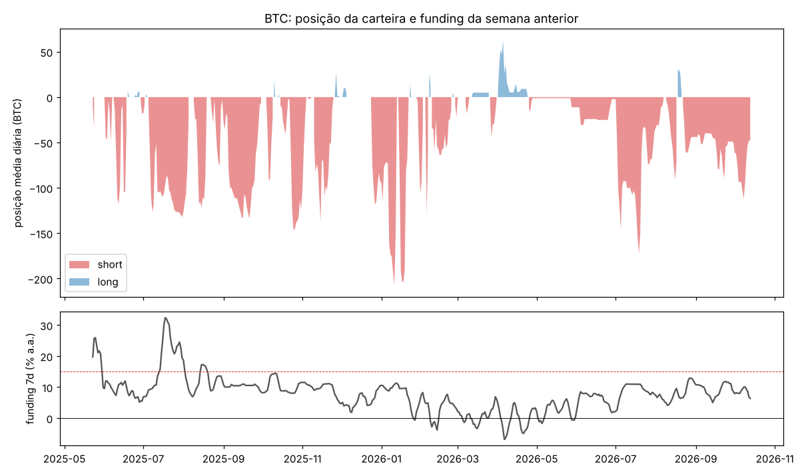

# Engenharia reversa: carteira `0x833b…db06`

`0x833b99b27dac651d02080f5e220e929df891db06` · [CoinGlass](https://www.coinglass.com/hyperliquid/0x833b99b27dac651d02080f5e220e929df891db06) · dados até 14/out/2026

Fonte: API pública da Hyperliquid. A conta existe desde 23/mai/2025, mas a API só entrega os fills a partir de **6/ago/2026** (19.382, sem TWAP e sem saltos de posição). Antes disso, a posição vem do histórico de funding, que traz o tamanho médio diário desde a abertura. Também estão completos o ledger (775 eventos) e as últimas ordens (1.728 registros, de 4/set/2026 em diante). O `portfolio` all-time só tem um ponto por semana, então o PnL mensal abaixo é aproximado (posição média diária × movimento do dia + funding). Ele soma ~US$ 7,6M contra US$ 7,78M do `portfolio` e erra mais nos meses com muito day trade (out/2025, jan/2026).

Os números deste texto que não estão no [`relatorio_auto.md`](relatorio_auto.md) são recalculados por [`analise_extra.py`](analise_extra.py), que também gera `img/btc_funding.png`.

---

## Resumo

- **O que faz:** é um **short de BTC dimensionado pelo funding**, mantido quase o tempo todo e operado à mão. Fica vendido em 74% dos dias, em geral com 25–130 BTC e no máximo 207 (US$ 2–20M). O tamanho segue o funding da semana anterior: **zerado quando o funding fica abaixo de zero e ~100 BTC vendidos quando passa de 15% a.a.** (correlação −0,51). Quando o funding sumiu (mar–mai/2026), a posição quase zerou. É a lógica de um **carry trade** (receber funding dos comprados). Em 2026 acrescentou o mesmo raciocínio em outros mercados: short de XMR com funding alto e long de S&P 500 (HIP-3) com funding negativo.
- **Quanto rendeu:** **+US$ 7,78M** em 17 meses, tudo em perps. BTC responde por ~US$ 5,65M (US$ 4,95M de preço e **US$ 0,70M de funding**), o S&P 500 da HIP-3 por US$ 1,48M e um short de XPL no lançamento por US$ 0,32M. O funding líquido da conta é **+US$ 0,86M**. O pior drawdown foi de US$ 0,93M (jul/2026).
- **O lucro de preço veio da queda do BTC, não do sinal.** O BTC caiu de US$ 115k para US$ 60k no período. O funding não prevê o retorno da semana seguinte (correlação +0,04). A regra "short de BTC proporcional ao funding" teria rendido +US$ 3,7M no período da carteira, mas **−US$ 4,3M em mai/2023 → mai/2025** (o funding recebido não cobre a alta).
- **Hedge ou aposta? Provavelmente hedge.** A API não mostra a outra ponta, mas tudo aponta para um **basis trade** (comprado em BTC fora da Hyperliquid, vendido no perp aqui): a conta fica com pouca margem (mediana de US$ 0,57M) para US$ 2–20M de short (8–21x, hoje 40x cross no BTC); **o lucro é sacado e o prejuízo é coberto quase todo dia** (correlação fluxo × PnL de −0,65 em 7 dias e −0,85 em 30 dias); e a execução é 98% *maker* em BTC, com custo de 0,73 bp. Se for hedge, o resultado econômico é o funding (US$ 0,86M) mais as operações de HIP-3 (~US$ 1,6M), e os US$ 4,95M de preço do BTC foram perdidos na outra ponta.
- **Como opera:** à mão, pela interface, com ordens *post-only* (`Alo`, 82% das ordens) de 1 ou 5 BTC, uma de cada vez, todo dia (65 de 68 dias). Quando o *post-only* é rejeitado, reenvia segundos depois um pouco mais longe. Tem 107 HYPE em staking, o mínimo da faixa de 10% de desconto de taxa.
- **Muito dinheiro entrando e saindo:** 306 depósitos (US$ 39,8M) e 328 saques (US$ 50,6M) pela ponte, quase todos em valores redondos de US$ 50–300k. Em 2026, a entrada passou a vir de uma hot wallet de exchange (US$ 13,9M) e a saída a ir para a HyperEVM (US$ 10,2M).
- **Agora:** short de 47,8 BTC (US$ 3,98M, entrada US$ 83,5k, liquidação US$ 92,9k) e short de 2.499 XMR (US$ 1,38M, −US$ 153k), sobre US$ 664k de conta.
- **Dá para copiar?** Não faz sentido copiar a posição: sem a outra ponta, copiar é apostar na queda do BTC. A cópia com atraso dá de −US$ 1,0M a +US$ 0,06M no período dos fills. O que dá para replicar é a ideia (carry de funding com hedge), e o retorno dela é o funding: ~10–12% a.a. sobre o nocional vendido, menos o custo do hedge.

---

## 1. Quem é essa carteira

**Uma pessoa operando à mão pela interface, focada em custo de execução.**

- **Ordens *post-only*:** das 891 ordens que a API guarda (4/set → 13/out/2026), 727 são `Alo` (só entram no livro como *maker*) e 164 são limites GTC. Não há `cloid` nem API wallet. Há uma única ordem de gatilho (um stop limite em XYZ100).
- **Uma ordem por vez, reenviada à mão.** 57 ordens foram rejeitadas por cruzar o livro (`badAloPxRejected`), e em 86% delas uma nova ordem do mesmo tamanho sai em até 10 segundos (mediana de 4,3 s), ~1 bp mais longe. É o comportamento de quem clica de novo, não de um bot (que recalcularia o preço antes de mandar). Três ordens de compra de BTC a US$ 63,6k estão esquecidas no livro desde 17/ago/2026, com o BTC a US$ 83k.
- **Lotes de 1 e 5 BTC:** os 5 tamanhos mais comuns são 93% das ordens de BTC. As ordens ficam no livro de segundos a minutos (mediana de 37 s até executar).
- **Custo mínimo:** 98% do nocional de BTC sai como *maker*. A taxa média do período dos fills foi de **0,73 bp** (US$ 8,9k sobre US$ 122M). Tem **107 HYPE em staking** (104,94 colocados em 5/out/2025), o mínimo da faixa de 10% de desconto (0,001 bp do supply = 100 HYPE).
- **Ritmo:** 259 sessões em 65 dos 68 dias com fills, a qualquer hora e em qualquer dia da semana, inclusive sábado e domingo.
- **Outros sinais:** sem código de indicação e sem subcontas. Recebeu 1,07M do token MAX num *genesis* (sem valor relevante). O endereço tem ~1.020 transações enviadas na Arbitrum (RPC pública), onde chegam os saques da ponte.

## 2. A estratégia: short de BTC pelo funding

A posição média de BTC em cada dia, agrupada pelo funding médio da semana anterior:

| funding 7d (a.a.) | dias | posição média | mediana |
|---|---|---|---|
| ≤ 0% | 44 | −0,3 BTC | +1,9 BTC |
| 0–5% | 98 | −7,9 | −1,2 |
| 5–10% | 201 | −42,9 | −29,4 |
| 10–15% | 132 | −71,9 | −71,0 |
| > 15% | 34 | −83,7 | **−106,5** |

O tamanho do short sobe com o funding de forma quase monotônica (correlação −0,51). Quando o prêmio do perp é pequeno, o funding de BTC na Hyperliquid fica em ~11% a.a. (a taxa de juros embutida na fórmula), então o "normal" desta carteira é ficar vendida. Em mar–mai/2026, com o funding perto de zero e às vezes negativo, ela ficou zerada ou levemente comprada.

**O mesmo critério em outros mercados.** XMR: vendido desde jan/2026, quase sempre com funding acima de 10% a.a. (o short recebeu US$ 93k de funding, mas perdeu US$ 267k de preço). S&P 500 da HIP-3 (`xyz:SP500`): comprado quando o funding é negativo (os comprados recebem) e zerado quando fica positivo (correlação −0,35). XPL: vendido no lançamento (27/set → 1/out/2025) com funding de 44,5% a.a., +US$ 0,32M. O petróleo (`xyz:CL`) é a exceção: posições direcionais, sem relação com o funding, −US$ 76k.

**O tamanho não reage ao preço.** A posição diária de BTC quase não se correlaciona com os retornos anteriores de 1, 7 ou 30 dias (|r| ≤ 0,13), nem com a posição no range de 7 dias. No período dos fills, as sessões de aumento do short acontecem em qualquer ponto do range (p = 0,33). Ou seja, não é *timing* de topo: é tamanho de acordo com o funding. A decomposição do período dos fills (`relatorio_auto.md`, seção 3) mostra isso: viés −US$ 0,90M, *timing* +US$ 0,85M e trades intradiários −US$ 0,06M, um resultado próximo de zero no BTC desde ago/2026.

## 3. De onde veio o dinheiro

| livro | resultado | como |
|---|---|---|
| **BTC: preço** | **+US$ 4,95M** | US$ 4,59M com a posição vendida; o BTC foi de US$ 107k (mai/2025) a US$ 60k (jun/2026) e voltou a US$ 83k |
| **BTC: funding** | **+US$ 0,70M** | 12,1% a.a. sobre o nocional vendido |
| `xyz:SP500` | +US$ 1,48M | longs de US$ 3,5–11,9M em abr, jul e ago/2026 (o maior: 1.535 contratos, +US$ 0,30M em 6–10/ago); +US$ 87k de funding recebido |
| XPL | +US$ 0,32M | short no lançamento, com funding de 44,5% a.a. |
| `xyz:XYZ100` (Nasdaq) | +US$ 0,29M | short em jun–jul/2026, junto do long de S&P 500 |
| `xyz:BRENTOIL` | +US$ 0,11M | short em jul/2026 |
| XMR | −US$ 0,17M | short desde jan/2026 (inclui −US$ 153k em aberto) |
| `xyz:MU`, `xyz:CL`, outros | −US$ 0,15M | |
| **total (`portfolio`)** | **+US$ 7,78M** | tudo em perps |

**Por mês (`portfolio`, US$ M):** 2025: +0,46 (jun), −0,43, +0,75, +0,10, +0,68, **+2,22 (nov)**, +0,05. 2026: +0,80 (jan), **+1,78 (fev)**, +0,07, +1,07, −0,06, +0,41, **−0,81 (jul)**, +1,23 (ago), −0,70 (set), +0,16 (out, até o dia 14).

Os meses bons do BTC são os de queda (nov/2025, jan–fev/2026). Os ruins são os de alta com o short cheio (jul/2025, jul/2026, set/2026). Em jul/2026 a carteira tinha a maior exposição bruta (US$ 16M, alavancagem mediana de 21x): long de US$ 7,8M em S&P 500 contra shorts de US$ 5,6M em BTC, US$ 1,7M em Nasdaq e US$ 0,7M em Brent. Perdeu US$ 0,81M no mês.

## 4. O sinal funciona sozinho?

**Regra:** short de BTC = 100 BTC × (funding 7d / 15%), limitado entre 0 e 100, com marcação diária e sem custos.

| período | preço | funding | total | correlação com a posição real |
|---|---|---|---|---|
| mai/2023 → mai/2025 | −US$ 6,52M | +US$ 2,22M | **−US$ 4,31M** | (a conta não existia) |
| mai/2025 → out/2026 | +US$ 3,04M | +US$ 0,70M | **+US$ 3,74M** | 0,56 |

A regra imita bem a carteira (correlação de 0,56), mas **sem hedge ela só ganha porque o BTC caiu**. Nos dois anos de alta antes da conta, o mesmo short teria perdido US$ 4,3M, porque o funding recebido não paga a alta. O funding também não serve como sinal de direção: o retorno do BTC na semana seguinte é parecido com funding baixo (+0,3%), médio (+1,2%) ou alto (+0,6%), com IC de 95% sempre cruzando o zero. A parte robusta é o funding (+US$ 2,2M e +US$ 0,7M nos dois períodos), e ela só fica com quem neutraliza o preço.

## 5. O dinheiro: margem mínima, ajustada todo dia

| | eventos | US$ |
|---|---|---|
| depósitos pela ponte | 306 | +39,81M |
| saques pela ponte | 328 | −50,62M |
| USDC recebido da hot wallet de exchange `0x6b9e…0a24` (2026) | 90 | +13,87M |
| USDC enviado para a HyperEVM (2026) | 44 | −10,18M |

- **Fluxo em 52% dos dias.** Os valores são redondos (89% dos saques e 69% dos depósitos são múltiplos de US$ 5k, mediana de ~US$ 100k).
- **O fluxo espelha o PnL.** A correlação entre o fluxo líquido e o PnL é −0,39 no mesmo dia, −0,65 em janelas de 7 dias e **−0,85 em 30 dias**: quando o short ganha (BTC cai), o lucro sai; quando perde (BTC sobe), entra dinheiro novo. Nov/2025, por exemplo: +US$ 1,8M de PnL aproximado e −US$ 3,5M de fluxo. Jul/2025 e jul/2026: perdas e +US$ 1,7M de depósitos líquidos em cada um.
- **A conta fica pequena de propósito.** O valor da conta tem mediana de US$ 574k e nunca passou de US$ 1,9M, contra shorts de até US$ 20M. A alavancagem mediana mensal vai de 3,5x a 21x, e hoje a posição de BTC está em 40x cross.

É exatamente o que faz quem tem um basis trade: a ponta comprada (spot, ETF ou outro futuro) fica fora daqui, e o caixa é rebalanceado entre as duas pontas conforme o preço anda. Um trader direcional com US$ 7,8M de lucro e convicção no short dificilmente manteria só US$ 0,6M de margem a 8–40x, sacando cada ganho no mesmo dia. **Não há prova da outra ponta** (a API não mostra CEXs nem outras chains), mas nada aqui contradiz o hedge, e o padrão de fluxos é difícil de explicar sem ele.

## 6. Agora

- **Short de 47,80 BTC** (US$ 3,98M) a US$ 83.477, 40x cross, +US$ 12k em aberto, liquidação a US$ 92,9k. O short chegou a 113 BTC no começo de out/2026 e foi reduzido para 48, com o funding em ~7% a.a.
- **Short de 2.499 XMR** (US$ 1,38M) a US$ 491,9, 5x cross, **−US$ 153k** em aberto, liquidação a US$ 722,9. Recebeu US$ 93k de funding desde a abertura.
- **US$ 664k de conta**, todo em USDC, mais 107 HYPE em staking.

## 7. Dá para replicar ou copiar?

**Copiar a posição, não.** No período dos fills, espelhar o BTC dá −US$ 148k sem atraso e −US$ 1,0M com 72h (`relatorio_auto.md`, seção 9). E, se a carteira estiver com hedge, copiar só a ponta vendida é outra estratégia: uma aposta na queda do BTC, que teria perdido US$ 4,3M nos dois anos anteriores.

**Replicar a ideia, sim, com hedge.** Comprar BTC à vista (ou em outro venue com funding menor) e vender o perp da Hyperliquid quando o funding da semana passa de ~5% a.a., aumentando até ~15%, rende o funding: +US$ 0,70M no período da carteira com o tamanho dela e ~10–12% a.a. sobre o nocional, antes do custo de carregar a outra ponta e de taxas. Para pagar menos, a carteira executa tudo como *maker* e tem o desconto mínimo de staking. O risco é operacional: margem curta na Hyperliquid (a conta precisa ser recarregada nas altas rápidas, e a 40x a liquidação fica 11% acima do preço) e o risco de contraparte da outra ponta.

## 8. Conclusão

É um **carry trader de funding**, com BTC como livro principal: fica vendido no perp quando o funding paga, aumenta o short quando o funding sobe e zera quando ele some. Executa à mão, com *post-only* e lotes de 1–5 BTC, e mantém na Hyperliquid só a margem necessária, sacando o lucro e repondo o prejuízo quase todo dia. Em 2026 aplicou o mesmo critério a XMR e ao S&P 500 da HIP-3, e fez algumas apostas direcionais menores (petróleo, Nasdaq, Micron).

O resultado de +US$ 7,78M na Hyperliquid é quase todo preço do BTC numa queda de 115k para 60k. Se, como os fluxos sugerem, a ponta comprada está em outro lugar, o ganho real é bem menor: o funding (+US$ 0,86M) mais o livro de HIP-3 (~+US$ 1,6M). **Não há vantagem direcional para copiar.** O que existe é um *carry* simples e conhecido, bem executado e com custo baixo.

*Nada aqui é recomendação de investimento.*
