# Relatório automático — `0x833b99b27dac651d02080f5e220e929df891db06`

Gerado em 2026-10-14 09:32 UTC a partir da API pública da Hyperliquid (`POST /info`). Valores em USD. Este arquivo é regenerado por `python -m hlre.report`; a interpretação da estratégia fica em `ANALISE.md`.

## 1. Visão geral

| métrica | valor |
|---|---|
| Valor da conta (perp + spot) | $663.6K |
| PnL all-time (portfolio, inclui spot/airdrops) | +$7.78M |
| PnL all-time só de perps | +$7.78M |
| Volume all-time | $1,332.69M |
| Primeira atividade | 2025-05-28 |
| Fills disponíveis na API | 19,382 (desde 2026-08-06) |
| Ordens (fills agrupados por oid) | 1,214 |
| Funding líquido (recebido > 0) | +$862.7K |
| Taxas pagas (período dos fills) | -$8.9K |
| Liquidações (ledger) | 0 |
| Fills de liquidação/ADL | 0 |
| Papel da conta | user |
| API wallets (agentes) | 0 |

**Posições abertas agora:**

| ativo | tamanho | nocional | entrada | alav. | PnL não realizado | liq. |
|---|---|---|---|---|---|---|
| BTC | -47.80329 | $3.98M | 83476.9 | 40x cross | +$11.9K | 92871.3732060319 |
| XMR | -2498.859 | $1.38M | 491.867 | 5x cross | -$153.2K | 722.9461730239 |

## 2. Curva de PnL

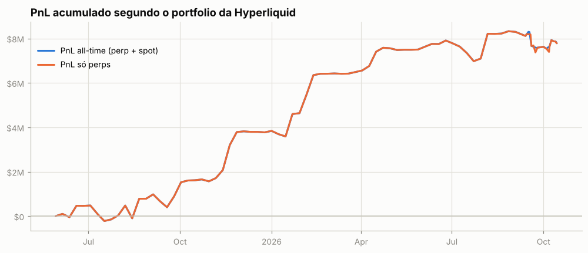

## 3. De onde veio o PnL

*Preço (aprox.)* usa a posição média diária de cada ativo, reconstruída a partir do histórico de funding (que traz o tamanho da posição a cada hora/dia desde o início da conta), vezes o movimento open→close do dia. Subestima o PnL de day trade, mas cobre o período sem fills. *Preço exato* marca cada fill no fechamento diário e só existe para o período coberto pelos fills.

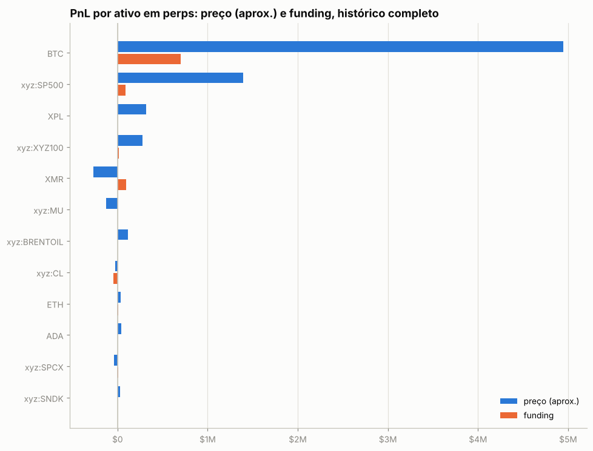

| ativo | preço (aprox.) | funding | total | preço exato (período dos fills) | taxas (período dos fills) |
|---|---|---|---|---|---|
| BTC | +$4.95M | +$700.9K | +$5.65M | -$99.1K | -$6.4K |
| xyz:SP500 | +$1.39M | +$88.9K | +$1.48M | -$6.0K | -$1.0K |
| XPL | +$316.8K | +$2.3K | +$319.1K | — | — |
| xyz:XYZ100 | +$274.8K | +$12.7K | +$287.5K | +$5.1K | -$70 |
| XMR | -$267.2K | +$93.1K | -$174.1K | -$291.3K | -$450 |
| xyz:MU | -$127.6K | +$1.6K | -$126.0K | — | — |
| xyz:BRENTOIL | +$115.3K | -$1.8K | +$113.5K | — | — |
| xyz:CL | -$27.3K | -$49.1K | -$76.4K | -$183.8K | -$715 |
| ETH | +$35.0K | +$6.6K | +$41.6K | — | — |
| ADA | +$40.5K | +$774 | +$41.3K | +$36.2K | -$102 |
| xyz:SPCX | -$38.5K | +$5.0K | -$33.6K | — | — |
| xyz:SNDK | +$26.2K | +$493 | +$26.7K | +$12.6K | -$32 |
| xyz:STRC | -$20.3K | -$859 | -$21.2K | — | — |
| APEX | +$13.1K | +$173 | +$13.3K | — | — |
| xyz:SKHX | +$11.1K | +$1.3K | +$12.4K | — | — |
| outros (5) | -$1.9K | +$544 | -$1.4K | +$150 | -$84 |

**Decomposição no período dos fills** (preço exato): quanto veio de *carregar* a posição (e, dentro disso, do viés médio vs. do *timing* de aumentar/reduzir), quanto de trades intradiários, funding e taxas.

| componente | BTC | xyz:SP500 |
|---|---|---|
| carregar posição (carry) | -$43.2K | +$28.7K |
|   ↳ viés (posição média × movimento) | -$895.9K | +$8.3K |
|   ↳ timing (variação do tamanho) | +$852.8K | +$20.5K |
| trades intradiários | -$55.9K | -$34.7K |
| funding | +$68.1K | +$96 |
| taxas | -$6.4K | -$1.0K |
| posição média | -48.78 | 75.86 |
| movimento do preço no período | 18,366.00 | 108.80 |

## 4. Posições ao longo do tempo

Área clara: posição média diária (funding). Linha: posição exata (fills). Azul = long, vermelho = short.

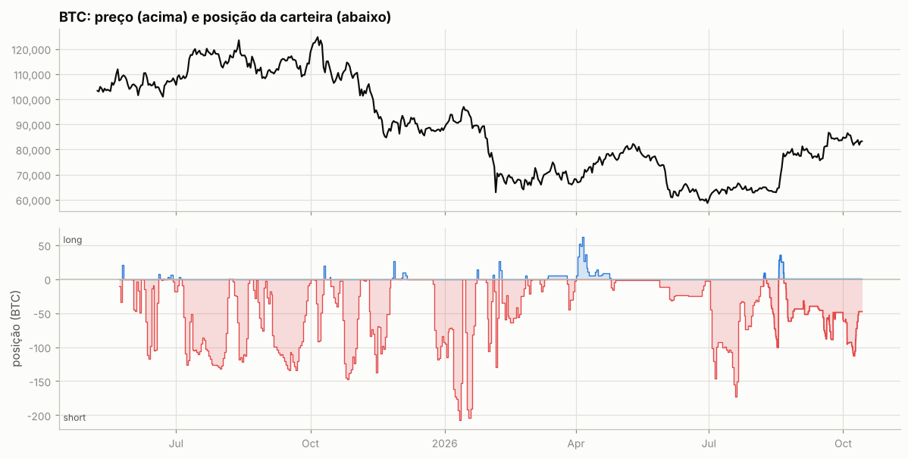

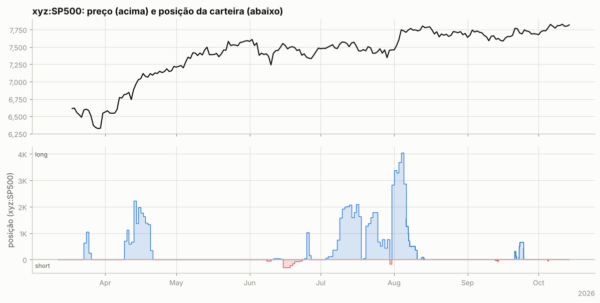

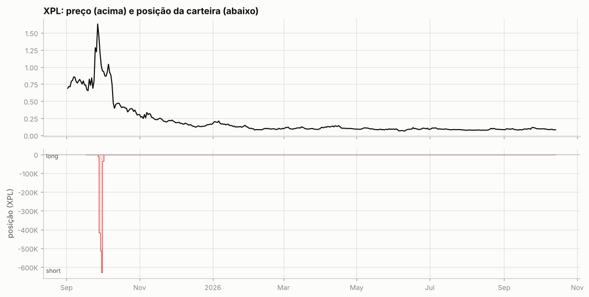

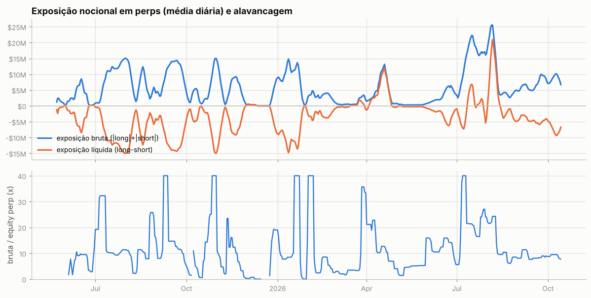

Tabela mensal de exposição e alavancagem

| mês | exposição bruta | exposição líquida | equity perp | alavancagem (mediana) |
|---|---|---|---|---|
| 2025-05 | $791.6K | -$278.3K | $0 | — |
| 2025-06 | $3.13M | -$2.96M | $331.1K | 8.2x |
| 2025-07 | $10.56M | -$10.53M | $955.9K | 10.6x |
| 2025-08 | $6.07M | -$6.06M | $619.5K | 10.4x |
| 2025-09 | $9.99M | -$9.99M | $809.2K | 11.8x |
| 2025-10 | $5.79M | -$5.62M | $350.9K | 10.4x |
| 2025-11 | $4.48M | -$4.29M | $694.2K | 6.1x |
| 2025-12 | $2.04M | -$1.87M | $207.5K | 3.6x |
| 2026-01 | $8.19M | -$8.11M | $835.8K | 8.5x |
| 2026-02 | $2.88M | -$2.53M | $566.9K | 5.4x |
| 2026-03 | $1.12M | $15.0K | $110.2K | 3.5x |
| 2026-04 | $5.03M | $4.09M | $507.2K | 10.3x |
| 2026-05 | $386.9K | -$353.8K | $78.4K | 5.1x |
| 2026-06 | $3.38M | -$2.70M | $291.4K | 11.5x |
| 2026-07 | $16.28M | -$583.2K | $811.0K | 21.4x |
| 2026-08 | $8.15M | $2.37M | $556.2K | 9.5x |
| 2026-09 | $7.02M | -$4.48M | $740.4K | 8.5x |
| 2026-10 | $8.04M | -$7.38M | $948.3K | 8.6x |

## 5. Execução

**Tipos de ordem** (últimas 893 ordens que a API guarda, 2026-09-04 → 2026-10-13):

| orderType | tif | reduceOnly | isTrigger | ordens |
|---|---|---|---|---|
| Limit | Alo | False | False | 727 |
| Limit | Gtc | False | False | 164 |
| Stop Limit | Gtc | False | True | 1 |

`FrontendMarket` = ordem a mercado enviada pela interface web; `Gtc` = limite que fica no livro; gatilhos (`isTrigger`) seriam stop/take-profit.

**Perfil por ativo (top 10 por volume):**

| ativo | volume | ordens | % taker (nocional) | tamanho mediano |
|---|---|---|---|---|
| BTC | $57.21M | 383 | 2% | 1 |
| xyz:SP500 | $30.80M | 119 | 23% | 40 |
| xyz:CL | $26.07M | 274 | 12% | 1,000 |
| XMR | $3.36M | 343 | 10% | 20 |
| xyz:SNDK | $1.34M | 12 | 9% | 100 |
| xyz:JPY | $1.18M | 14 | 85% | 183.5 |
| xyz:XYZ100 | $1.17M | 6 | 72% | 3.5 |
| ADA | $941.4K | 47 | 0% | 1e+05 |
| mkts:BVIV | $60.8K | 16 | 25% | 100 |

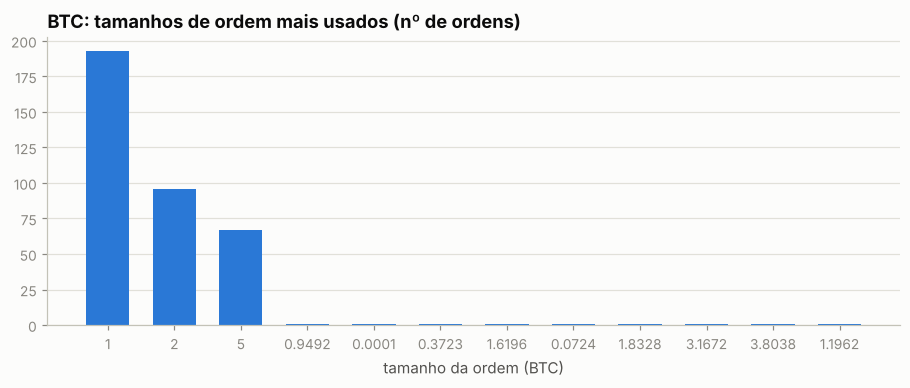

Os 5 tamanhos mais comuns respondem por 93% das ordens de BTC — lotes redondos e repetidos são assinatura de execução manual.

Sessões (ordens separadas por < 30 min): 259; mediana de 3 ordens e 4.0 min por sessão; dias com atividade: 65 de 68.

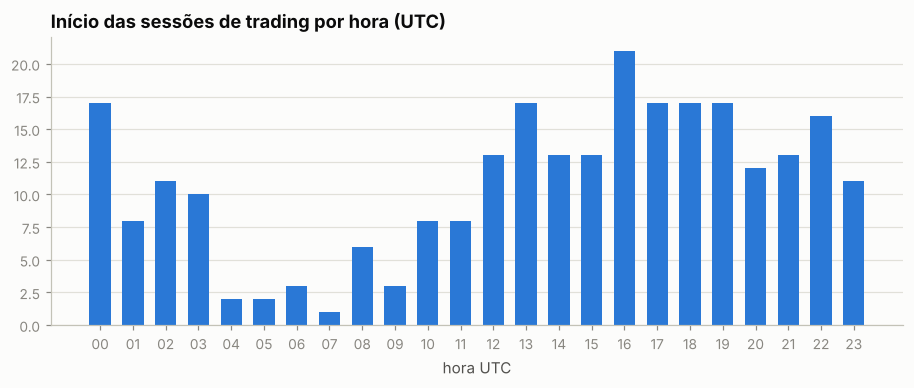

Por dia da semana: seg 15%, ter 14%, qua 12%, qui 13%, sex 18%, sáb 12%, dom 17%

## 6. Comportamento de entrada e saída

### BTC

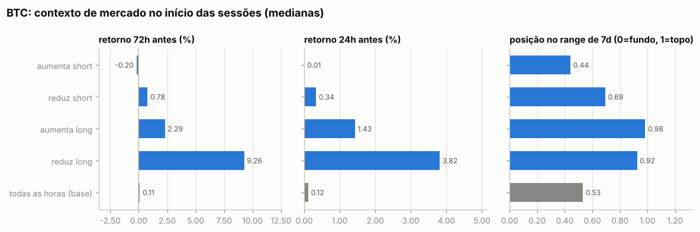

Por ordem (medianas):

| ação | ordens | retorno 24h antes | 72h antes | 7d antes | posição no range 7d | 24h depois | 7d depois |
|---|---|---|---|---|---|---|---|
| aumenta short | 183 | -0.03% | -0.51% | +0.05% | 0.40 | +0.19% | +1.65% |
| reduz short | 160 | +1.19% | +1.90% | +3.53% | 0.88 | +0.38% | +2.70% |
| aumenta long | 20 | +1.72% | +2.21% | +0.39% | 0.92 | +0.32% | +22.54% |
| reduz long | 16 | +7.39% | +16.16% | +17.26% | 0.94 | +4.57% | +7.24% |
| todas as horas (base) |  | +0.12% | +0.11% | +0.98% | 0.53 | +0.12% | +0.84% |

Por sessão (ordens a menos de 30 min uma da outra contam como uma decisão; p = teste de Mann-Whitney contra todas as horas do período):

| sessão | sessões | retorno 24h antes | 72h antes | 7d antes | range 7d | no topo (>0,7) | no fundo (<0,3) |
|---|---|---|---|---|---|---|---|
| aumenta short | 76 | +0.01% (p=0.760) | -0.20% (p=0.798) | +0.20% (p=0.589) | 0.44 (p=0.326) | 38% | 43% |
| reduz short | 33 | +0.34% (p=0.355) | +0.78% (p=0.628) | +1.89% (p=0.893) | 0.69 (p=0.037) | 48% | 12% |
| aumenta long | 6 | +1.43% (p=0.006) | +2.29% (p=0.045) | +1.40% (p=0.787) | 0.98 (p=0.001) | 100% | 0% |
| reduz long | 4 | +3.82% (p=0.090) | +9.26% (p=0.024) | +10.18% (p=0.105) | 0.92 (p=0.011) | 100% | 0% |
| todas as horas (base) |  |  |  |  |  | 37% | 30% |

- Aumentos de posição feitos com a posição no prejuízo (preço pior que o preço médio): **47%** das ordens (54% do tamanho); distância mediana do preço médio: -0.15%.
- Reduções/fechamentos com lucro: **24%** de 176; ganho médio $6.9K vs. perda média -$3.6K; realizado -$176.6K.

- Episódios (de zerado a zerado, ou até inverter): 5; fechados com lucro: 25%; duração mediana 2.3 dias; o melhor episódio sozinho = 100% da soma dos episódios lucrativos.

Maiores episódios por PnL realizado

| início | fim | dias | lado | tam_max | nocional_max | ordens | entrada | saída | realizado |
|---|---|---|---|---|---|---|---|---|---|
| 2026-08-17 | 2026-08-21 | 3.5 | long | 34.98 | $2.26M | 29 | 64,364 | 72,809 | +$290.0K |
| 2026-08-21 | 2026-10-11 | 51.2 | short | 112.98 | $9.42M | 247 | 81,223 | 82,327 | -$269.3K |
| 2026-08-08 | 2026-08-17 | 9.2 | short | 100.71 | $6.40M | 97 | 63,385 | 64,091 | -$71.8K |
| 2026-08-07 | 2026-08-07 | 0.0 | short | 10.39 | $678.7K | 3 | — | 65,268 | -$16.8K |
| 2026-08-07 | 2026-08-08 | 1.2 | long | 8.61 | $560.8K | 11 | 65,109 | 65,077 | -$840 |

### xyz:SP500

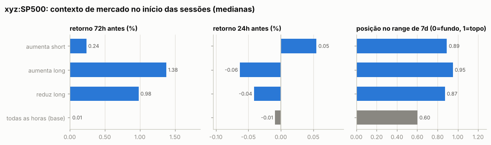

Por ordem (medianas):

| ação | ordens | retorno 24h antes | 72h antes | 7d antes | posição no range 7d | 24h depois | 7d depois |
|---|---|---|---|---|---|---|---|
| aumenta short | 8 | -0.05% | +0.24% | -0.83% | 0.55 | +0.17% | +0.39% |
| reduz short | 6 | -0.41% | +0.36% | -0.66% | 0.53 | +0.06% | +0.30% |
| aumenta long | 41 | -0.10% | +0.54% | +1.84% | 0.95 | -0.02% | -0.94% |
| reduz long | 60 | -0.26% | +0.98% | +3.17% | 0.77 | +0.58% | +0.22% |
| todas as horas (base) |  | -0.01% | +0.01% | +0.08% | 0.60 | -0.00% | +0.10% |

Por sessão (ordens a menos de 30 min uma da outra contam como uma decisão; p = teste de Mann-Whitney contra todas as horas do período):

| sessão | sessões | retorno 24h antes | 72h antes | 7d antes | range 7d | no topo (>0,7) | no fundo (<0,3) |
|---|---|---|---|---|---|---|---|
| aumenta short | 4 | +0.05% (p=0.740) | +0.24% (p=0.255) | +0.28% (p=0.611) | 0.89 (p=0.051) | 75% | 0% |
| aumenta long | 5 | -0.06% (p=0.694) | +1.38% (p=0.044) | +2.31% (p=0.047) | 0.95 (p=0.016) | 80% | 0% |
| reduz long | 10 | -0.04% (p=0.679) | +0.98% (p=0.001) | +3.17% (p=<1e-4) | 0.87 (p=0.001) | 90% | 0% |
| todas as horas (base) |  |  |  |  |  | 39% | 28% |

- Aumentos de posição feitos com a posição no prejuízo (preço pior que o preço médio): **56%** das ordens (59% do tamanho); distância mediana do preço médio: +0.01%.
- Reduções/fechamentos com lucro: **74%** de 66; ganho médio $5.3K vs. perda média -$3.3K; realizado +$202.8K.

- Episódios (de zerado a zerado, ou até inverter): 9; fechados com lucro: 78%; duração mediana 0.8 dias; o melhor episódio sozinho = 77% da soma dos episódios lucrativos.

Maiores episódios por PnL realizado

| início | fim | dias | lado | tam_max | nocional_max | ordens | entrada | saída | realizado |
|---|---|---|---|---|---|---|---|---|---|
| 2026-08-06 | 2026-08-10 | 4.6 | long | 1,535 | $11.85M | 34 | — | 7,727 | +$297.9K |
| 2026-08-10 | 2026-08-11 | 0.8 | short | 299.48 | $2.32M | 2 | 7,746 | 7,765 | +$64.0K |
| 2026-09-22 | 2026-09-24 | 1.9 | long | 650.00 | $5.04M | 35 | 7,765 | 7,679 | -$55.6K |
| 2026-09-20 | 2026-09-21 | 0.8 | long | 309.32 | $2.37M | 17 | 7,647 | 7,711 | +$19.8K |
| 2026-09-12 | 2026-09-13 | 1.1 | short | 78.14 | $595.7K | 8 | 7,645 | 7,611 | +$2.7K |
| 2026-08-11 | 2026-08-13 | 2.0 | long | 81.26 | $631.2K | 13 | 7,739 | 7,768 | +$2.4K |
| 2026-10-04 | 2026-10-05 | 0.3 | short | 50.00 | $386.6K | 5 | 7,732 | 7,716 | +$819 |
| 2026-08-13 | 2026-08-13 | 0.1 | short | 31.26 | $242.8K | 3 | 7,768 | 7,799 | +$364 |
| 2026-08-13 | 2026-08-13 | 0.0 | long | 40.00 | $311.9K | 6 | 7,798 | 7,797 | -$329 |

### Todos os episódios relevantes (todas as moedas)

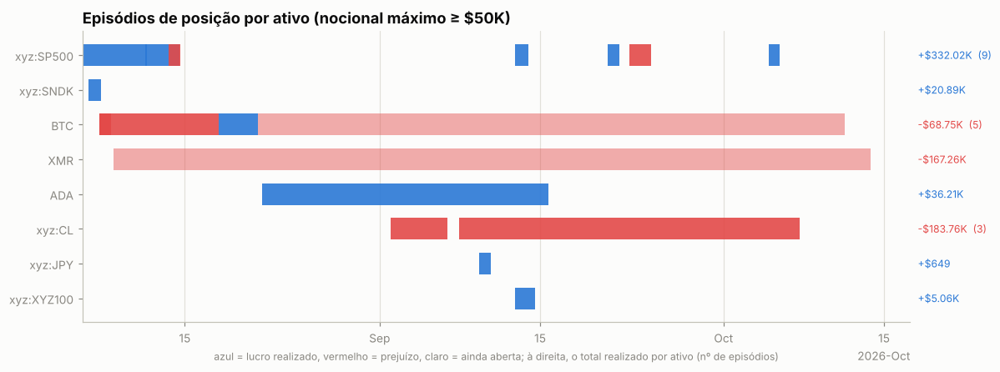

Episódios com nocional máximo ≥ $50K: 22; fechados com lucro: 60%. Abaixo, os 25 maiores por PnL realizado, em ordem de data. *7d/30d antes* e *vs. máx. 30d*: o que o preço tinha feito até a primeira ordem; *funding a.a.*: taxa anualizada nas 24h anteriores (positiva = longs pagam shorts); *entrada média vs. 1ª ordem*: positivo = foi aumentando a posição com o preço indo contra; *contra (máx.)*: quanto o preço andou contra a primeira ordem durante o episódio; *capturado*: movimento entre o preço médio de entrada e o de saída.

| ativo | lado | início | dias | nocional máx. | 7d antes | 30d antes | vs. máx. 30d | funding a.a. na entrada | entrada média vs. 1ª ordem | contra (máx.) | pior PnL aberto | capturado | realizado | funding |
|---|---|---|---|---|---|---|---|---|---|---|---|---|---|---|
| xyz:SP500 | long | 2026-08-06 | 5 | $11.85M | +5% | +3% | -1% | -1% | — | +0% | -$25.6K | — | +$297.9K | -$889 |
| xyz:SNDK | short | 2026-08-06 | 1 | $984.4K | +14% | -26% | -38% | +17% | +2% | +9% | -$79.0K | -3% | +$20.9K | +$427 |
| BTC | short | 2026-08-07 | 0 | $678.7K | +2% | +4% | -3% | +4% | — | -0% | -$117 | — | -$16.8K | +$12 |
| BTC | long | 2026-08-07 | 1 | $560.8K | +2% | +4% | -3% | +4% | +0% | +1% | -$2.6K | -0% | -$840 | +$30 |
| BTC | short | 2026-08-08 | 9 | $6.40M | +4% | +3% | -3% | +3% | -3% | +0% | -$62.4K | -1% | -$71.8K | +$6.1K |
| XMR | short | 2026-08-08 | 66 | $1.81M | +7% | +21% | +0% | -2% | +30% | +54% | -$302.6K | -5% | -$167.3K | +$74.4K |
| xyz:SP500 | short | 2026-08-10 | 1 | $2.32M | +2% | +2% | -0% | +1% | +0% | +0% | -$8 | -0% | +$64.0K | +$73 |
| xyz:SP500 | long | 2026-08-11 | 2 | $631.2K | +2% | +3% | -0% | +0% | +0% | +1% | -$224 | +0% | +$2.4K | +$0 |
| xyz:SP500 | short | 2026-08-13 | 0 | $242.8K | +1% | +3% | -0% | -1% | +0% | +0% | -$525 | -0% | +$364 | -$7 |
| xyz:SP500 | long | 2026-08-13 | 0 | $311.9K | +1% | +3% | +0% | -0% | +0% | +0% | -$435 | -0% | -$329 | -$7 |
| BTC | long | 2026-08-17 | 3 | $2.26M | +1% | -1% | -4% | +1% | -0% | +0% | -$6.1K | +13% | +$290.0K | -$73 |
| BTC | short | 2026-08-21 | 51 | $9.42M | +26% | +20% | +0% | +11% | +4% | +12% | -$492.6K | -1% | -$269.3K | +$61.4K |
| ADA | short | 2026-08-21 | 25 | $497.5K | +22% | +24% | +0% | +36% | +3% | +11% | -$37.4K | +7% | +$36.2K | +$774 |
| xyz:CL | long | 2026-09-01 | 5 | $7.16M | +12% | +12% | +0% | -10% | -0% | +2% | -$54.1K | -1% | -$77.8K | +$15.8K |
| xyz:CL | short | 2026-09-07 | 1 | $1.87M | +8% | +20% | -0% | -46% | +0% | +2% | -$24.8K | -1% | -$19.9K | -$10.0K |
| xyz:CL | short | 2026-09-09 | 29 | $1.41M | +3% | +19% | -0% | -221% | +4% | +8% | -$85.8K | +4% | -$86.0K | +$1.6K |
| xyz:JPY | long | 2026-09-09 | 0 | $591.6K | -3% | -4% | -4% | -12% | -0% | +0% | -$71 | +0% | +$649 | +$88 |
| xyz:XYZ100 | short | 2026-09-12 | 2 | $582.2K | -1% | -2% | -3% | +5% | -0% | -0% | -$0 | +1% | +$5.1K | +$42 |
| xyz:SP500 | short | 2026-09-12 | 1 | $595.7K | -1% | -2% | -2% | +4% | -0% | -0% | +$0 | +0% | +$2.7K | +$21 |
| xyz:SP500 | long | 2026-09-20 | 1 | $2.37M | +0% | -0% | -2% | +5% | -0% | -0% | +$104 | +1% | +$19.8K | +$12 |
| xyz:SP500 | long | 2026-09-22 | 2 | $5.04M | +2% | +1% | -0% | +3% | +0% | +1% | -$70.0K | -1% | -$55.6K | +$808 |
| xyz:SP500 | short | 2026-10-04 | 0 | $386.6K | +0% | +0% | -0% | +5% | -0% | +0% | -$161 | +0% | +$819 | +$13 |

## 7. Funding

Funding líquido total: **+$862.7K** (recebido $967.7K, pago -$105.0K). Na Hyperliquid o funding é pago de hora em hora; quando positivo, longs pagam shorts.

| ativo | lado | funding | rendimento anualizado s/ nocional |
|---|---|---|---|
| BTC | short | +$697.8K | 12.1% |
| BTC | long | +$3.1K | 1.9% |
| xyz:SP500 | short | +$1.9K | 5.0% |
| xyz:SP500 | long | +$87.1K | 5.9% |
| XPL | short | +$2.3K | 44.5% |
| (outros) | short | +$50.0K | 7.4% |
| (outros) | long | +$20.6K | 19.6% |

## 8. Fluxos, eventos e carteiras relacionadas

| tipo | eventos | USD (+ entra / − sai) |
|---|---|---|
| withdraw | 328 | -$50.62M |
| accountClassTransfer | 3 | — (sem valor em USD) |
| spotTransfer | 1 | — (sem valor em USD) |
| cStakingTransfer | 1 | — (sem valor em USD) |
| send | 136 | +$3.69M |
| deposit | 306 | +$39.81M |

**Gestão de margem.** Dias com depósito: 138; em 53% deles o PnL dos 3 dias anteriores era negativo (mediana -$983). Dias com saque: 125; em 68% deles o PnL dos 3 dias anteriores era positivo (mediana +$65.7K). Base: 43% de todos os dias vêm depois de 3 dias negativos. Correlação entre o fluxo do dia e a variação da exposição bruta: 0.40 (positiva = deposita para abrir posição e saca ao reduzir).

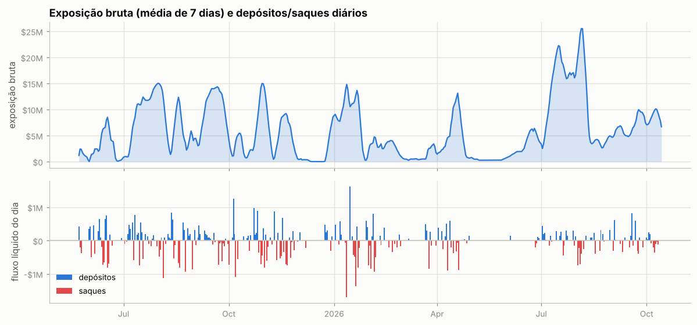

Ponte HyperCore↔HyperEVM (endereços de sistema `0x2000…`/`0x2222…`): 44 transferências, entrada $0, saída $10.18M — uso de DeFi na HyperEVM.

**Carteiras relacionadas** (conta vinculada de staking para desconto de taxa + maiores contrapartes de transferências; o saldo de staking e o PnL ajudam a ver se posições aqui são hedge de algo mantido lá):

| carteira | relação | transferências | volume transferido | valor da conta hoje | PnL all-time | HYPE em staking | maiores saldos spot |
|---|---|---|---|---|---|---|---|
| `0x6b9e773128f453f5c2c60935ee2de2cbc5390a24` | hot wallet de serviço (recebe USDC da HyperEVM e repassa a centenas de usuários: exchange/ponte) | 90 | $13.87M | $7.8K | +$0 | 0 | USDC 7,687 |

## 9. Dá para copiar? (espelhar a posição com atraso)

PnL de quem replicasse exatamente a posição da carteira, mas com N horas de atraso (marcação horária, sem custos). Se o PnL se mantém com atraso, a vantagem está em horizontes longos e é copiável; se desaba, depende de timing fino.

| atraso | BTC | xyz:SP500 |
|---|---|---|
| 0h | -$147.6K | -$21.5K |
| 1h | -$141.2K | -$18.6K |
| 4h | -$102.7K | -$25.9K |
| 12h | +$44.3K | +$4.7K |
| 24h | +$59.9K | +$64.1K |
| 72h | -$1.01M | -$21.3K |
| 168h | -$938.0K | +$19.1K |

## 10. Teste de replicação por regras (BTC)

Regra testada: *short-bias com filtro de tendência e fade* — short de até 114.7 BTC (o percentil 90 do tamanho real), cheio abaixo da média móvel e reduzido acima; dentro do regime, mais short perto do topo do range e menos perto do fundo. Parâmetros escolhidos no treino (2025-05-23 → 2026-02-01) e avaliados no teste (2026-02-02 → 2026-10-13).

|  | parâmetros | PnL treino | PnL teste | correlação c/ posição real (teste) |
|---|---|---|---|---|
| melhor regra no treino | MA50, range 7d, fração em alta 1.0, fade 0.0 | +$4.91M | -$429.0K | -0.00 |
| carteira real (aprox.) | — | +$4.54M | +$1.10M | 1.00 |

Clone comportamental (regressão linear da posição real em médias móveis, ranges e retornos): R² treino 0.27, R² teste -0.48, correlação no teste 0.37.

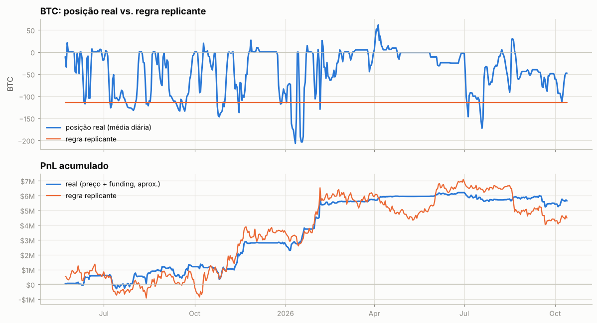

---

Metodologia e código: ver `README.md` na raiz do repositório.
