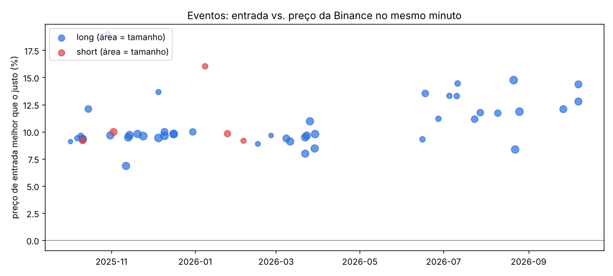
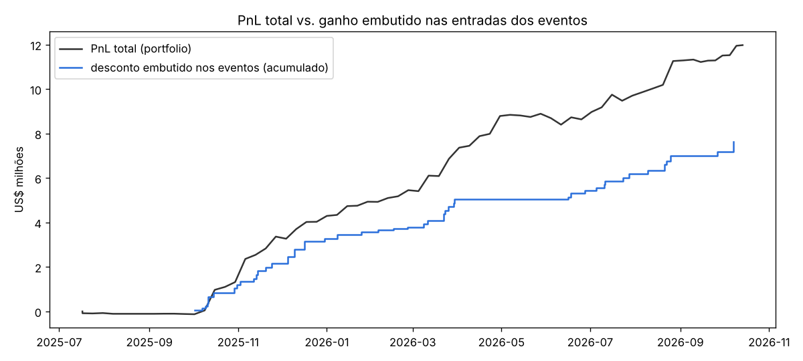

# Engenharia reversa: carteira `0x8bae…ab6d`

`0x8bae3527e5a33fa0cf184f37bc112d071463ab6d` · [CoinGlass](https://www.coinglass.com/hyperliquid/0x8bae3527e5a33fa0cf184f37bc112d071463ab6d) · dados até 13/out/2026

Fonte: API pública da Hyperliquid. A conta foi aberta em 11/jul/2025 e a API entrega **todos** os fills desde então (27.103), o funding completo, o ledger completo (17 eventos), as últimas 1.903 ordens e as 2.000 fatias de TWAP mais recentes. Há 47 saltos de posição sem fill visível (US$ 41M de nocional), quase todos **saídas por TWAP** antigas. Por isso o PnL por moeda abaixo é por fluxo de caixa, com os saltos marcados no preço médio de 4h do intervalo. Essa conta fecha em US$ 11,17M contra US$ 11,98M do `portfolio` (93%). Os números deste texto que não estão no [`relatorio_auto.md`](relatorio_auto.md) são recalculados por [`analise_extra.py`](analise_extra.py), que também gera `img/eventos.png` e `img/pnl_livros.png`. O script usa os klines de 1 minuto da Binance como preço justo.

---

## Resumo

- **O que faz:** quase todo o lucro vem de **50 eventos** em 30 altcoins pouco líquidas na Hyperliquid (GAS, NEO, CELO, IOTA, FTT, RSR, S, kNEIRO, BSV, AXS, ATOM, NOT…). Em cada evento, a carteira compra de uma vez de US$ 0,6M a 2,0M (mediana de US$ 1,39M) a um preço **~10% abaixo do preço justo**: desconto mediano de 9,8%, p10 de 9,1% e p90 de 13,7%. Em 2026 o desconto subiu para 11–15%. Depois revende perto do preço justo, em minutos ou dias, muitas vezes por TWAP. Em 90% dos casos é compra; nos outros, vende ~10% acima do justo.
- **O preço não existe fora da Hyperliquid.** Em **46 de 46** eventos com dados da Binance, o preço de entrada não aparece na Binance em nenhum minuto entre 5 min antes e 5 min depois. O "pavio" acontece **só no livro da Hyperliquid**, onde essas moedas negociam ~US$ 100 a cada 5 minutos. No evento de kNEIRO de 7/out/2026, a vela de 5 min abriu a 0,0863, foi a 0,07529 (−13%) e voltou, com US$ 2,9M de volume. A carteira levou US$ 1,4M disso.
- **A contraparte chega junto.** Em 2025, a carteira **coloca uma ordem limite** de compra ~10% abaixo do preço e **alguém vende a mercado nela em 0,1–0,5 s** (mediana de 0,30 s; 81% dos 32 casos maker abaixo de 1 s). A partir de jun/2026, a ordem de venda barata **já está no livro** e a carteira a compra a mercado. Isso aconteceu 50 vezes em 12 meses, sempre com um lote de tamanho redondo, em moedas sem fluxo e sem nenhum movimento em outras bolsas. **Não é sorte nem leitura de mercado: é um negócio combinado com a conta do outro lado.**
- **Quanto rendeu:** **+US$ 11,98M** em 15 meses, saindo de **US$ 0,5M depositados**. Só o desconto na entrada dos eventos vale **US$ 7,6M**. No PnL por livro, as moedas com eventos somam **+US$ 9,0M**, o livro de ações HIP-3 **+US$ 2,4M** e o resto das criptos **−US$ 0,2M**. Saíram US$ 3,55M pela ponte e US$ 4,73M para a HyperEVM, e a conta tem US$ 4,2M hoje (quase tudo em USDC).
- **Não está sozinha.** A carteira foi indicada pelo código `210321`, de **`0x9458…ec04`**. Esse código tem **um único indicado: esta carteira**. A `0x9458` fez **o mesmo jogo de fev a nov/2025**, com 42 eventos detectados em 14 moedas (um deles, em ETH, é falso positivo) (FTT, OGN, ZK, HPOS, BSV, REQ, CELO, STG…), desconto mediano de 10,4% e 86% de entradas maker. Ganhou **+US$ 11,1M** a partir de US$ 0,28M e sacou US$ 11,3M. O bastão passou de uma para a outra: a `0x9458` sacou US$ 500k em 10/jul/2025, esta carteira recebeu US$ 500k em 11/jul, e o último fill da `0x9458` (21/nov/2025, 05:06:38) veio **22 segundos** antes do primeiro saque desta (05:07:00). **Juntas: ~US$ 23M.**
- **Livro secundário, de verdade:** ações, petróleo e índices nos perps HIP-3 (`xyz:`, `cash:`, `para:`), quase sempre comprado. O destaque é **Intel** (+US$ 1,39M, comprado de US$ 45 a 99 entre mar e mai/2026), além de META, AMZN, petróleo WTI e Circle. Inclui ações asiáticas de memória (Samsung, SK Hynix, Hyundai, Kioxia).
- **Dá para copiar?** **Não.** O lucro está no preço de entrada, que só existe por uma fração de segundo e só para quem combinou com a contraparte. Quem segue a posição entra no preço normal, sem o desconto. E o mecanismo, até onde os dados mostram, é **transferência de valor de outra conta**, não estratégia de mercado.

---

## 1. Quem é essa carteira

**Uma pessoa, manualmente, pela interface.**

- São **1.602 requisições** para US$ 219M de volume, sem API wallet (`extraAgents` vazio). As ordens são limites GTC (818), `FrontendMarket` (152) e alguns stops. Não é bot.
- **Cada evento é uma única ordem limite** de tamanho redondo (US$ 1,7M de NEO, US$ 1,65M de GAS, 19,66M de kNEIRO) no preço exato do pavio.
- Horários: os eventos se concentram entre 3h e 8h UTC (meio-dia a 17h na Coreia ou no Japão) e às 16h UTC. O livro de ações segue o pregão americano e asiático. A carteira opera ações coreanas (Samsung, SK Hynix, Hyundai, o ETF EWY), o que sugere alguém na Ásia, possivelmente na Coreia. É só uma inferência.
- **Uma liquidação própria:** MEGA, em 3/dez/2025 (−US$ 79k). Outras pequenas liquidações em HIP-3: GOOGL −US$ 10k, AMD −US$ 6k, cobre −US$ 1k.

**O dinheiro.**

| data | movimento | valor |
|---|---|---|
| 11/jul/2025 | depósito (um dia depois de a `0x9458` sacar o mesmo valor) | US$ 0,50M |
| nov/2025 → mar/2026 | 5 saques pela ponte | US$ 3,55M |
| jun → out/2026 | 6 envios de USDC para a HyperEVM (para o mesmo endereço) | US$ 4,73M |
| hoje | conta (USDC 4,15M + posições) | US$ 4,20M |

Nunca mais depositou. A conta se financia com o próprio lucro e manda o excesso para fora em lotes de US$ 0,5–0,95M.

## 2. O evento, por dentro

**Três exemplos**

| | NEO, 24/nov/2025 | GAS, 11/out/2025 | kNEIRO, 7/out/2026 |
|---|---|---|---|
| preço justo (Binance) | 4,18 | 2,415 | 0,0865 |
| ordem da carteira | limite de compra 449.866 NEO a **3,7789** (−9,6%) às 04:13:41,684 | limite de compra 684.994 GAS a **2,1898** (−9,3%) às 04:03:19,508 | compra 19,66M kNEIRO a **0,07529** (−13%) às 07:33:36, contra uma venda que já estava no livro |
| execução | **106 ms depois**, toda de uma vez, como maker (US$ 1,70M) | **136 ms depois**, como maker (US$ 1,47M) | na hora, como taker (US$ 1,44M) |
| saída | 7 min depois: limite de venda a 4,2374 (+1,4% sobre o justo), executado **em 0,6 s** por um comprador de US$ 1,89M | 2,5 min depois: limite de venda a 2,46 (+1,9%), executado **em 0,4 s** (US$ 1,65M), virando short que cobriu 2 dias depois | 1 min depois: vendas a 0,0869 (+0,4%), executadas por compradores de US$ 0,88M e 0,71M |
| resultado | +US$ 205k em 9 min | +US$ 362k em 2 dias | +US$ 216k em 9 min |

**O padrão nos 50 eventos**

| | |
|---|---|
| eventos / moedas | 50 / 30 (GAS 5×, FTT, IOTA, CELO e NEO 3×) |
| lado | 45 compras, 5 vendas |
| tamanho | mediana de US$ 1,39M (US$ 0,56M a 1,70M na 1ª ordem) |
| desconto sobre o preço justo | mediana de **9,8%**: ~9,6% em 2025 (muito concentrado entre 9,2% e 10,0%) e 11–15% em 2026 |
| o preço de entrada existiu na Binance? | **não, em 46 de 46** (janela de ±5 min) |
| entrada maker | 32 (91% no 4T25 → 10% no 3T26). Latência entre a ordem e o fill: mediana de **0,30 s** |
| entrada taker | 18, comprando uma venda que já estava no livro no preço do pavio |
| desconto embutido na entrada | **US$ 7,6M** |
| duração | mediana de 35 h; 20% fechados em menos de 1 h |

**Por que isso não é "pegar pavio".** Um caçador de pavios deixa ordens paradas longe do preço e espera. Aqui a ordem aparece **centenas de milissegundos antes** de alguém vender nela, num livro que negocia US$ 100 a cada 5 minutos. E o vendedor sempre leva exatamente o tamanho da ordem. Fora da Hyperliquid, nada se move. Quem vende US$ 1,5M a −10% numa moeda que vale 10% mais em qualquer outra bolsa está entregando ~US$ 150k. Isso se repetiu 50 vezes nesta carteira e ~41 na irmã. Na saída, várias vezes, um comprador de US$ 1–2M aparece em menos de 1 segundo e paga acima do preço justo.

**Quem está do outro lado?** A API pública não diz. O explorer (`txDetails`) mostra a transação do taker, mas limita consultas a blocos arquivados, e a cota acabou durante a análise. Nos fills em que a carteira foi **maker**, o `hash` do fill é a transação de quem vendeu. O `analise_extra.py` imprime os últimos (AXS 17/jun/2026 `0x7392…493c`, GMT 27/jun `0x8849…5117`, POLYX 5/jul `0xf5c1…0373`…). Abrir esses hashes em `app.hyperliquid.xyz/explorer` mostra o endereço da contraparte. **Esse é o próximo passo para fechar a análise.**

As explicações compatíveis com os dados, da mais para a menos provável:

1. **Contas de terceiros controladas por quem opera esta carteira.** É o padrão clássico de dreno por chave de API (agent wallet) vazada: o agente não pode sacar, mas pode negociar, então quem tem a chave faz a conta da vítima vender barato e comprar caro contra a própria carteira, num livro sem liquidez. A latência de 0,1–0,5 s, o tamanho exato e a troca de quem chega primeiro (maker em 2025, taker em 2026) são o que se espera de um roteiro automático do outro lado.
2. **Contas do próprio operador** (lavagem, maquiagem de PnL, transferência entre pessoas). Nesse caso o lucro "líquido" do grupo seria zero. O saque de ~US$ 20M das duas carteiras mostra que, para elas, o dinheiro é real.
3. **Um bot ou cofre (vault) quebrado** do outro lado, vendendo a mercado sem limite de preço. Isso não explica por que a ordem desta carteira chega sempre antes e com o tamanho certo.

Em qualquer dos casos, **o ganho é transferência de valor de uma conta para outra, e não alfa de mercado.**

## 3. De onde veio o dinheiro

| livro | fills | saídas/entradas por TWAP (sem fill) | aberto | funding | **total** |
|---|---|---|---|---|---|
| criptos com eventos (30 moedas) | −14,46M | +23,41M | +0,07M | −0,01M | **+US$ 9,01M** |
| HIP-3: ações, índices, commodities | +0,95M | +1,17M | 0 | +0,27M | **+US$ 2,39M** |
| outras criptos (BTC, ETH, HYPE, TAO…) | −1,21M | +1,08M | −0,07M | −0,03M | **−US$ 0,23M** |
| **soma** | | | | | **+US$ 11,17M** (portfolio: +11,98M) |

- **As moedas com evento são quase todas positivas.** GAS +1,15M, FTT +0,65M, RSR +0,57M, NEO +0,56M, CELO +0,49M, BSV +0,44M, IOTA +0,40M, kNEIRO +0,40M, ARK +0,35M, S +0,34M…
- **Nas outras criptos ele é um trader comum.** O short de BTC de out–nov/2025 rendeu +US$ 0,50M. Fora ele, perdeu em ETH (−0,27M), TAO (−0,19M), XRP (−0,12M), HYPE (−0,08M), VIRTUAL e SOL.
- **Por mês:** −US$ 0,1M em jul–set/2025 (antes do primeiro evento, em 2/out/2025), depois +1,4M (out), +2,0M (nov), +0,9M (dez), +0,6M, +0,5M, +1,4M, +1,9M (abr/2026, o mês da Intel), +0,1M, −0,3M (jun), +1,1M, +1,6M, +0,2M e +0,5M (out, até o dia 13). O maior drawdown foi pequeno (−US$ 0,49M, até 10/jun/2026), porque o ganho dos eventos entra travado no preço de entrada.

## 4. O livro de ações (HIP-3)

É a parte que parece **trading discricionário legítimo**: 82 episódios, 70% comprados, acerto de 61%, +US$ 2,6M no lado comprado e −US$ 0,18M no vendido.

| ativo | resultado | como |
|---|---|---|
| Intel (`cash:INTC`, `xyz:INTC`) | **+US$ 1,39M** (long) | comprou a US$ 44,7 em mar/2026, aumentou em abr e vendeu a US$ 99 no início de mai (+US$ 1,02M num único episódio de 18 dias) |
| petróleo WTI (`xyz:CL`) e Brent | +US$ 0,39M | longs de 1–4 dias em mar/2026 (WTI de 92 a 113) |
| META, AMZN, NVDA, GOOGL | +US$ 0,52M | longs de semanas |
| Circle (`xyz:CRCL`) | +US$ 0,18M | long de 22 dias em fev/2026 (US$ 51 → 80) |
| Hyundai, SK Hynix, DRAM, CXMT | +US$ 0,20M | memória e Coreia |
| shorts de OpenAI, SanDisk, NVDA | −US$ 0,29M | as apostas vendidas perderam |

Ele usa as várias "dex" de HIP-3 (xyz 10.360 fills, cash 3.062, vntl, para). Opera com limites e escadas de ordens (40% dos fills como maker) e segura de 2 a 26 dias.

## 5. Agora

- **Par DOGE/BTC:** comprado em 9,76M DOGE (US$ 0,82M, −US$ 76k) e vendido em 10,75 BTC (US$ 0,89M, +US$ 8k). As duas pernas foram abertas no mesmo minuto (21/set/2026, 08:46–08:47).
- **Restos de eventos recentes:** BSV, TNSR e kNEIRO (~US$ 70k).
- **US$ 4,15M em USDC** no spot, parado como margem. É o caixa para o próximo evento: a carteira tipicamente mantém US$ 4M ou mais para colocar uma ordem de US$ 1,5–2M com folga.

## 6. Dá para replicar ou copiar?

**Não, e não deveria.**

- **Cópia:** o lucro está inteiro no preço de entrada, que existe por menos de um segundo, só no livro da Hyperliquid e só para quem tem a ordem posicionada antes da venda. Um copiador entraria no preço justo e ficaria só com o risco da moeda. Mesmo se reagisse em segundos, o pavio já teria sido consumido.
- **Regra:** "deixar compras paradas 10% abaixo em altcoins ilíquidas" não reproduz o resultado, porque o vendedor não vende para qualquer um: ele vende **para esta carteira**, logo depois que a ordem dela aparece.
- **Risco jurídico:** se a explicação (1) da seção 2 se confirmar, os ganhos vêm de contas de terceiros. Seguir esse padrão de propósito seria participar de fraude ou manipulação.

## 7. Conclusão

Não é uma estratégia de mercado no sentido usual. É uma **operação de transferência de valor em livros ilíquidos da Hyperliquid**. Uma conta do outro lado vende ~10% abaixo do preço justo (às vezes compra acima) exatamente quando esta carteira coloca a ordem, ou coloca a venda barata para esta carteira levar. São tamanhos de US$ 1–2M, em altcoins que quase não negociam e com preço intacto nas outras bolsas. O jogo começou na carteira indicadora `0x9458…ec04` (fev–nov/2025, +US$ 11,1M) e continuou nesta (out/2025 → hoje, +US$ 12,0M), com o dinheiro passando de uma para a outra no mesmo dia.

Por cima disso há um **trader discricionário competente em ações via HIP-3** (+US$ 2,4M, com destaque para a Intel) e **mediano em cripto direcional** (−US$ 0,2M, salvo pelo short de BTC). Sem os eventos, a carteira teria ganhado ~US$ 2–3M sobre US$ 0,5M: muito bom, mas outra história.

**Para fechar a análise:** abrir no explorer os hashes dos fills maker listados pelo `analise_extra.py` para identificar a(s) contraparte(s). Se forem poucas contas recorrentes e com histórico de usuário comum (e não de bot de mercado), a hipótese de dreno de contas fica confirmada.

*Nada aqui é recomendação de investimento.*
