# Relatório automático — `0x8bae3527e5a33fa0cf184f37bc112d071463ab6d`

Gerado em 2026-10-13 19:19 UTC a partir da API pública da Hyperliquid (`POST /info`). Valores em USD. Este arquivo é regenerado por `python -m hlre.report`; a interpretação da estratégia fica em `ANALISE.md`.

## 1. Visão geral

| métrica | valor |
|---|---|
| Valor da conta (perp + spot) | $4.20M |
| PnL all-time (portfolio, inclui spot/airdrops) | +$11.98M |
| PnL all-time só de perps | +$11.98M |
| Volume all-time | $369.19M |
| Primeira atividade | 2025-07-16 |
| Fills disponíveis na API | 27,103 (desde 2025-07-11) |
| Ordens (fills agrupados por oid) | 1,345 |
| Funding líquido (recebido > 0) | -$234.6K |
| Taxas pagas (período dos fills) | -$51.3K |
| Liquidações (ledger) | 0 |
| Fills de liquidação/ADL | 297 |
| Papel da conta | user |
| API wallets (agentes) | 0 |

**Posições abertas agora:**

| ativo | tamanho | nocional | entrada | alav. | PnL não realizado | liq. |
|---|---|---|---|---|---|---|
| BTC | -10.74691 | $892.7K | 83783.0 | 40x cross | +$7.7K | 436004.3738432492 |
| DOGE | 9756943.0 | $823.1K | 0.092131 | 10x cross | -$75.9K | — |
| BSV | 552.51 | $10.3K | 16.5199 | 3x cross | +$1.1K | — |
| TNSR | 862794.4 | $29.7K | 0.03649 | 3x cross | -$1.7K | — |
| kNEIRO | 365308.9 | $29.9K | 0.07529 | 3x cross | +$2.4K | — |

## 2. Curva de PnL

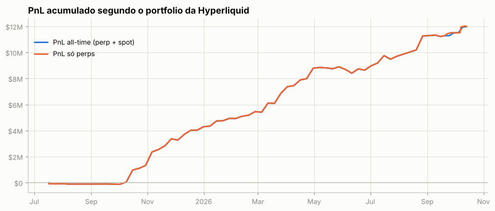

**Atenção: execuções que não aparecem nos fills.** A posição muda sem fill visível em 47 pontos (~$41.33M de nocional; maiores: xyz:SKHY $8.05M, YGG $4.36M, CELO $4.24M, GAS $3.08M, HMSTR $2.94M). O mais comum são fatias de TWAP: ficam fora de `userFills` e o endpoint de TWAP só guarda as 2.000 mais recentes. O *preço exato* e as tabelas por episódio dessas moedas não são exatos.

## 3. De onde veio o PnL

*Preço (aprox.)* usa a posição média diária de cada ativo, reconstruída a partir do histórico de funding (que traz o tamanho da posição a cada hora/dia desde o início da conta), vezes o movimento open→close do dia. Subestima o PnL de day trade, mas cobre o período sem fills. *Preço exato* marca cada fill no fechamento diário e só existe para o período coberto pelos fills.

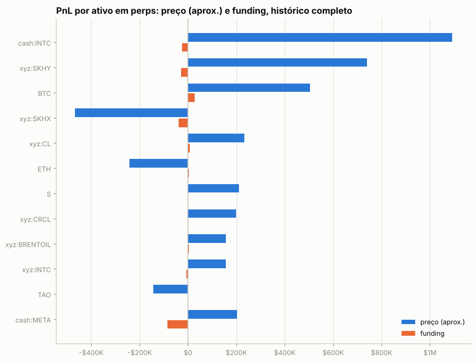

| ativo | preço (aprox.) | funding | total | preço exato (período dos fills) | taxas (período dos fills) |
|---|---|---|---|---|---|
| cash:INTC | +$1.09M | -$25.3K | +$1.07M | +$1.22M | -$855 |
| xyz:SKHY | +$740.4K | -$27.8K | +$712.7K | +$119.4K | -$91 |
| BTC | +$504.8K | +$27.9K | +$532.7K | +$536.7K | -$5.6K |
| xyz:SKHX | -$467.0K | -$37.9K | -$504.9K | +$97.7K | -$155 |
| xyz:CL | +$232.2K | +$7.8K | +$240.0K | +$317.5K | -$841 |
| ETH | -$242.5K | +$2.9K | -$239.6K | -$260.9K | -$2.9K |
| S | +$211.2K | -$764 | +$210.4K | +$337.2K | -$1.5K |
| xyz:CRCL | +$198.1K | -$1.5K | +$196.6K | +$183.8K | -$67 |
| xyz:BRENTOIL | +$157.1K | +$3.3K | +$160.4K | +$68.4K | -$830 |
| xyz:INTC | +$156.9K | -$6.1K | +$150.8K | +$180.9K | -$162 |
| TAO | -$142.7K | -$590 | -$143.3K | -$194.4K | -$361 |
| cash:META | +$202.3K | -$85.3K | +$117.1K | +$256.0K | -$115 |
| HYPE | -$98.3K | -$3.4K | -$101.7K | -$80.6K | -$2.4K |
| vntl:OPENAI | -$103.0K | +$6.4K | -$96.6K | -$120.3K | -$212 |
| MEGA | -$94.3K | -$2.2K | -$96.6K | +$263.1K | -$736 |
| outros (61) | -$210.6K | -$92.1K | -$302.8K | +$13.56M | -$32.2K |

**Decomposição no período dos fills** (preço exato): quanto veio de *carregar* a posição (e, dentro disso, do viés médio vs. do *timing* de aumentar/reduzir), quanto de trades intradiários, funding e taxas.

| componente | GAS | NEO | BTC |
|---|---|---|---|
| carregar posição (carry) | -$1.35M | -$7.6K | +$531.6K |
|   ↳ viés (posição média × movimento) | -$1.40M | -$1.4K | +$84.5K |
|   ↳ timing (variação do tamanho) | +$48.7K | -$6.3K | +$447.0K |
| trades intradiários | +$1.15M | +$571.0K | +$5.1K |
| funding | +$604 | +$326 | +$27.9K |
| taxas | -$2.0K | -$2.2K | -$5.6K |
| posição média | 1,274,468.17 | 707.32 | -2.85 |
| movimento do preço no período | -1.10 | -1.92 | -29,705.00 |

## 4. Posições ao longo do tempo

Área clara: posição média diária (funding). Linha: posição exata (fills). Azul = long, vermelho = short.

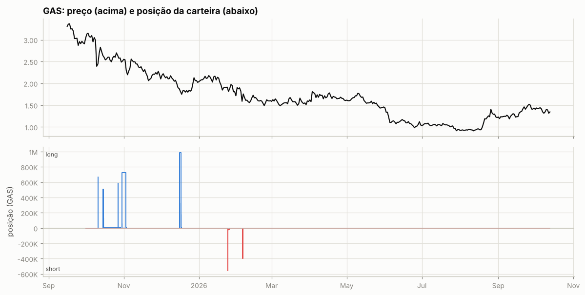

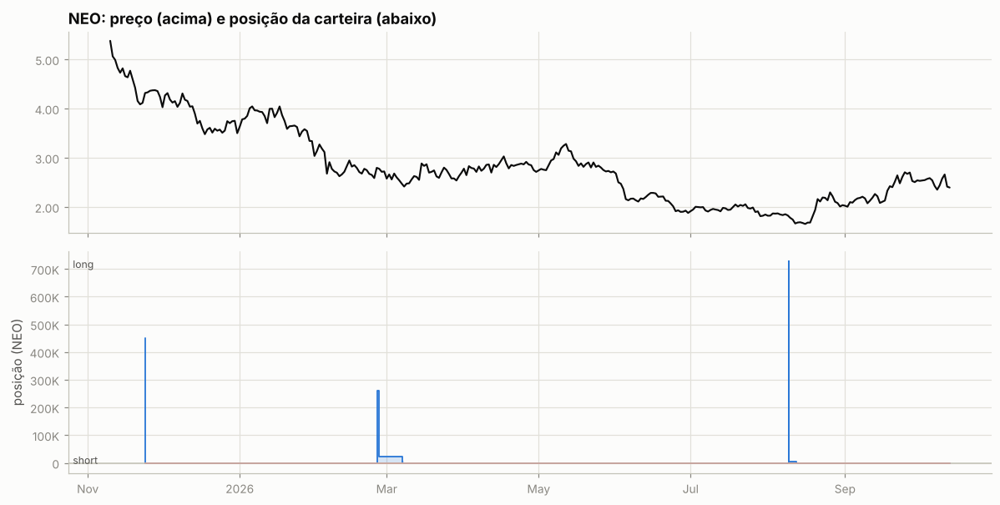

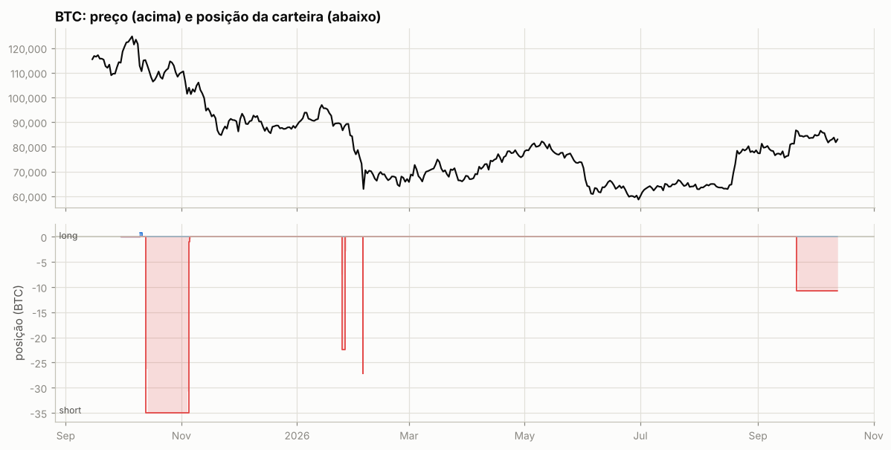

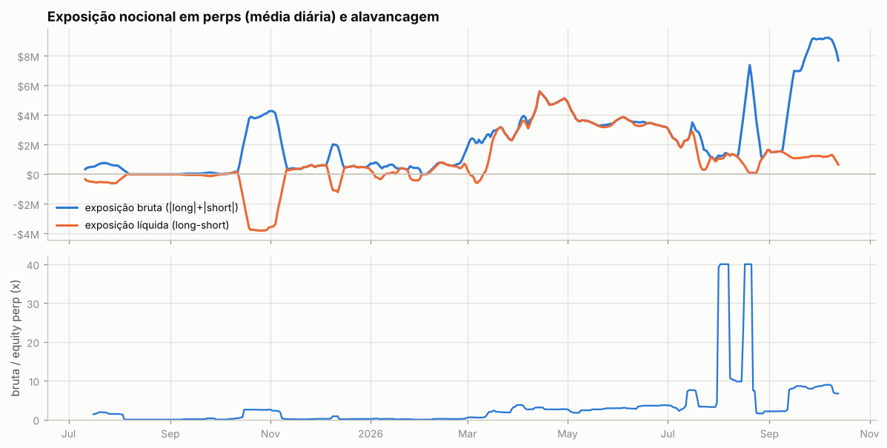

Tabela mensal de exposição e alavancagem

| mês | exposição bruta | exposição líquida | equity perp | alavancagem (mediana) |
|---|---|---|---|---|
| 2025-07 | $624.1K | -$516.0K | $415.1K | 1.5x |
| 2025-08 | $30 | $30 | $398.1K | 0.0x |
| 2025-09 | $49.1K | -$49.0K | $392.9K | 0.1x |
| 2025-10 | $2.48M | -$2.21M | $1.08M | 2.4x |
| 2025-11 | $949.8K | -$49.2K | $2.92M | 0.2x |
| 2025-12 | $861.4K | $117.9K | $3.08M | 0.2x |
| 2026-01 | $443.8K | -$57.5K | $3.43M | 0.1x |
| 2026-02 | $811.2K | $538.7K | $3.95M | 0.2x |
| 2026-03 | $2.67M | $1.66M | $1.99M | 1.9x |
| 2026-04 | $4.70M | $4.63M | $1.77M | 2.6x |
| 2026-05 | $3.53M | $3.50M | $1.45M | 2.6x |
| 2026-06 | $3.44M | $3.39M | $1.03M | 3.6x |
| 2026-07 | $2.01M | $1.52M | $491.2K | 3.3x |
| 2026-08 | $2.69M | $947.5K | $421.3K | 9.6x |
| 2026-09 | $6.10M | $1.26M | $897.3K | 8.0x |
| 2026-10 | $8.40M | $894.6K | $1.13M | 7.4x |

## 5. Execução

**Tipos de ordem** (últimas 990 ordens que a API guarda, 2025-07-11 → 2026-10-10):

| orderType | tif | reduceOnly | isTrigger | ordens |
|---|---|---|---|---|
| Limit | Gtc | False | False | 690 |
| Limit | Gtc | True | False | 120 |
| Market | FrontendMarket | False | False | 7 |
| Market | FrontendMarket | True | False | 145 |
| Market | LiquidationMarket | True | False | 8 |
| Stop Market | Gtc | False | True | 8 |

`FrontendMarket` = ordem a mercado enviada pela interface web; `Gtc` = limite que fica no livro; gatilhos (`isTrigger`) seriam stop/take-profit.

**Perfil por ativo (top 10 por volume):**

| ativo | volume | ordens | % taker (nocional) | tamanho mediano |
|---|---|---|---|---|
| BTC | $16.54M | 11 | 75% | 22.38 |
| GAS | $16.25M | 21 | 0% | 3.954e+05 |
| cash:INTC | $15.21M | 20 | 65% | 8,122 |
| xyz:BRENTOIL | $13.45M | 34 | 69% | 4,182 |
| xyz:CL | $12.21M | 28 | 77% | 3,159 |
| cash:USA500 | $12.03M | 10 | 99% | 100.4 |
| CELO | $8.78M | 16 | 0% | 2.78e+06 |
| cash:NVDA | $8.20M | 11 | 98% | 1,608 |
| xyz:META | $7.61M | 14 | 57% | 981.6 |
| NEO | $7.57M | 10 | 52% | 2.488e+05 |

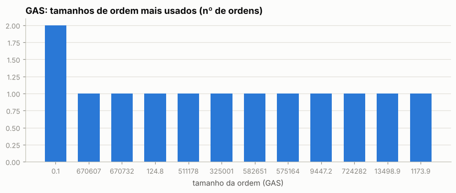

Os 5 tamanhos mais comuns respondem por 29% das ordens de GAS — lotes redondos e repetidos são assinatura de execução manual.

Sessões (ordens separadas por < 30 min): 286; mediana de 2 ordens e 0.3 min por sessão; dias com atividade: 172 de 455.

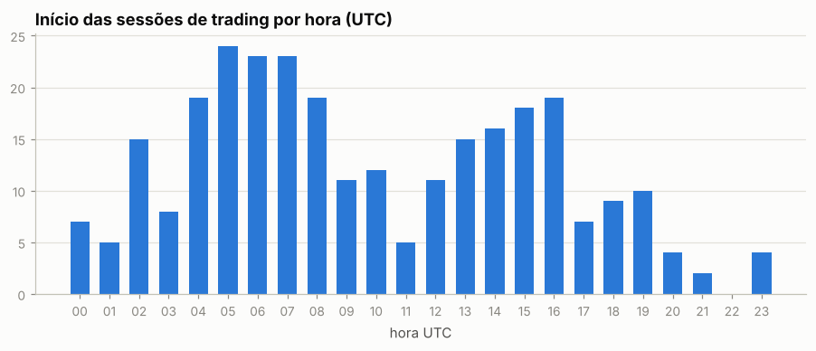

Por dia da semana: seg 14%, ter 13%, qua 15%, qui 17%, sex 16%, sáb 16%, dom 8%

## 6. Comportamento de entrada e saída

### GAS

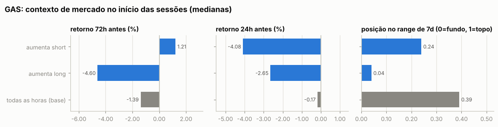

Por ordem (medianas):

| ação | ordens | retorno 24h antes | 72h antes | 7d antes | posição no range 7d | 24h depois | 7d depois |
|---|---|---|---|---|---|---|---|
| aumenta short | 2 | -2.02% | +1.69% | -6.30% | 0.41 | -7.36% | -9.53% |
| reduz short | 6 | -2.55% | -3.47% | -7.42% | 0.33 | -1.31% | -5.31% |
| aumenta long | 5 | -2.65% | -4.60% | -8.35% | 0.04 | -0.57% | -6.56% |
| reduz long | 7 | +0.49% | +0.16% | -9.38% | 0.44 | -3.30% | -4.47% |
| todas as horas (base) |  | -0.17% | -1.39% | -3.45% | 0.39 | -0.15% | -2.63% |

Por sessão (ordens a menos de 30 min uma da outra contam como uma decisão; p = teste de Mann-Whitney contra todas as horas do período):

| sessão | sessões | retorno 24h antes | 72h antes | 7d antes | range 7d | no topo (>0,7) | no fundo (<0,3) |
|---|---|---|---|---|---|---|---|
| aumenta short | 3 | -4.08% (p=0.091) | +1.21% (p=0.839) | -9.59% (p=0.129) | 0.24 (p=0.414) | 0% | 67% |
| aumenta long | 3 | -2.65% (p=0.050) | -4.60% (p=0.644) | -8.35% (p=0.391) | 0.04 (p=0.114) | 0% | 67% |
| todas as horas (base) |  |  |  |  |  | 18% | 40% |

- Aumentos de posição feitos com a posição no prejuízo (preço pior que o preço médio): **100%** das ordens (100% do tamanho); distância mediana do preço médio: +3.33%.
- Reduções/fechamentos com lucro: **92%** de 13; ganho médio $56.4K vs. perda média -$26; realizado +$677.0K.

- Episódios (de zerado a zerado, ou até inverter): 6; fechados com lucro: 100%; duração mediana 1.8 dias; o melhor episódio sozinho = 30% da soma dos episódios lucrativos.

Maiores episódios por PnL realizado

| início | fim | dias | lado | tam_max | nocional_max | ordens | entrada | saída | realizado |
|---|---|---|---|---|---|---|---|---|---|
| 2025-10-15 | 2025-11-03 | 19.3 | long | 724,676 | $1.67M | 8 | 2.39 | 2.78 | +$313.4K |
| 2025-10-11 | 2025-10-11 | 0.0 | long | 670,607 | $1.65M | 2 | 2.19 | 2.46 | +$181.2K |
| 2025-10-11 | 2025-10-13 | 2.0 | short | 670,607 | $1.65M | 2 | 2.46 | 2.67 | +$181.2K |
| 2026-01-24 | 2026-01-26 | 1.5 | short | 554,683 | $1.16M | 3 | 2.09 | 1.83 | +$143.1K |
| 2025-12-16 | 2025-12-17 | 1.4 | long | 986,088 | $1.66M | 3 | 1.68 | 1.92 | +$111.8K |
| 2026-02-05 | 2026-02-14 | 9.3 | short | 395,351 | $786.4K | 4 | 1.99 | 1.71 | +$108.7K |

### NEO

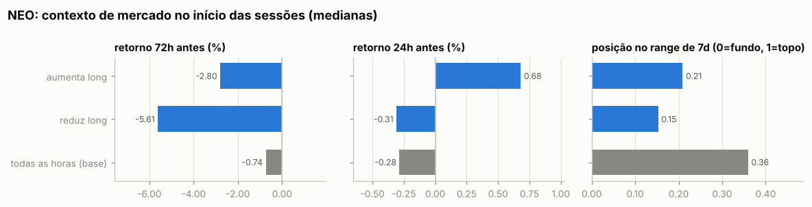

Por ordem (medianas):

| ação | ordens | retorno 24h antes | 72h antes | 7d antes | posição no range 7d | 24h depois | 7d depois |
|---|---|---|---|---|---|---|---|
| aumenta long | 3 | +0.68% | -2.80% | -6.28% | 0.21 | +3.60% | -4.05% |
| reduz long | 7 | -0.31% | -5.61% | -6.85% | 0.15 | +0.08% | -2.93% |
| todas as horas (base) |  | -0.28% | -0.74% | -1.56% | 0.36 | -0.31% | -1.77% |

- Aumentos de posição feitos com a posição no prejuízo (preço pior que o preço médio): **—** das ordens (— do tamanho); distância mediana do preço médio: +nan%.
- Reduções/fechamentos com lucro: **100%** de 7; ganho médio $80.5K vs. perda média —; realizado +$563.4K.

- Episódios (de zerado a zerado, ou até inverter): 3; fechados com lucro: 100%; duração mediana 2.7 dias; o melhor episódio sozinho = 37% da soma dos episódios lucrativos.

Maiores episódios por PnL realizado

| início | fim | dias | lado | tam_max | nocional_max | ordens | entrada | saída | realizado |
|---|---|---|---|---|---|---|---|---|---|
| 2025-11-24 | 2025-11-24 | 0.0 | long | 449,866 | $1.91M | 3 | 3.78 | 4.24 | +$205.7K |
| 2026-08-09 | 2026-08-12 | 2.7 | long | 727,126 | $1.37M | 3 | 1.63 | 1.89 | +$189.1K |
| 2026-02-25 | 2026-03-08 | 11.1 | long | 259,495 | $798.8K | 4 | 2.38 | 3.03 | +$168.6K |

### BTC

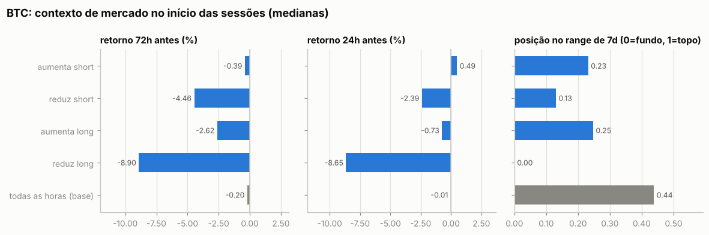

Por ordem (medianas):

| ação | ordens | retorno 24h antes | 72h antes | 7d antes | posição no range 7d | 24h depois | 7d depois |
|---|---|---|---|---|---|---|---|
| aumenta short | 3 | +0.49% | -0.39% | -6.30% | 0.23 | -0.83% | -8.90% |
| reduz short | 5 | -2.39% | -4.46% | -10.19% | 0.13 | +0.98% | -10.22% |
| aumenta long | 1 | -0.73% | -2.62% | +0.99% | 0.25 | -6.84% | -10.28% |
| reduz long | 1 | -8.65% | -8.90% | -8.83% | 0.00 | -1.02% | -3.57% |
| todas as horas (base) |  | -0.01% | -0.20% | -0.46% | 0.44 | +0.00% | -0.22% |

- Aumentos de posição feitos com a posição no prejuízo (preço pior que o preço médio): **—** das ordens (— do tamanho); distância mediana do preço médio: +nan%.
- Reduções/fechamentos com lucro: **67%** de 6; ganho médio $136.1K vs. perda média -$7.7K; realizado +$528.9K.

- Episódios (de zerado a zerado, ou até inverter): 5; fechados com lucro: 50%; duração mediana 2.2 dias; o melhor episódio sozinho = 92% da soma dos episódios lucrativos.

Maiores episódios por PnL realizado

| início | fim | dias | lado | tam_max | nocional_max | ordens | entrada | saída | realizado |
|---|---|---|---|---|---|---|---|---|---|
| 2025-10-13 | 2025-11-11 | 29.5 | short | 34.93 | $4.00M | 4 | 114,510 | 100,108 | +$503.1K |
| 2026-01-24 | 2026-01-26 | 1.5 | short | 22.38 | $2.00M | 2 | 89,359 | 87,516 | +$41.3K |
| 2026-02-04 | 2026-02-04 | 0.0 | short | 27.10 | $2.01M | 2 | 73,831 | 74,141 | -$8.4K |
| 2025-10-10 | 2025-10-13 | 3.0 | long | 34.93 | $4.00M | 3 | 121,178 | 114,451 | -$7.0K |
| 2026-09-21 | 2026-09-21 | 0.0 | short | 10.75 | $900.4K | 1 | 83,783 | — | $0 |

### Todos os episódios relevantes (todas as moedas)

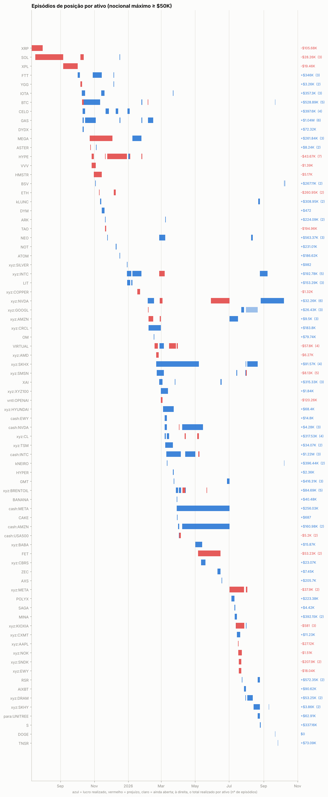

Episódios com nocional máximo ≥ $50K: 165; fechados com lucro: 68%. Abaixo, os 25 maiores por PnL realizado, em ordem de data. *7d/30d antes* e *vs. máx. 30d*: o que o preço tinha feito até a primeira ordem; *funding a.a.*: taxa anualizada nas 24h anteriores (positiva = longs pagam shorts); *entrada média vs. 1ª ordem*: positivo = foi aumentando a posição com o preço indo contra; *contra (máx.)*: quanto o preço andou contra a primeira ordem durante o episódio; *capturado*: movimento entre o preço médio de entrada e o de saída.

| ativo | lado | início | dias | nocional máx. | 7d antes | 30d antes | vs. máx. 30d | funding a.a. na entrada | entrada média vs. 1ª ordem | contra (máx.) | pior PnL aberto | capturado | realizado | funding |
|---|---|---|---|---|---|---|---|---|---|---|---|---|---|---|
| BTC | short | 2025-10-13 | 29 | $4.00M | -7% | -1% | -9% | +8% | +0% | +1% | -$52.4K | +13% | +$503.1K | +$23.0K |
| GAS | long | 2025-10-15 | 19 | $1.67M | -8% | -20% | -20% | +4% | +3% | +2% | -$2.7K | +16% | +$313.4K | +$635 |
| ARK | long | 2025-11-20 | 0 | $1.77M | -11% | -16% | -19% | +8% | -0% | -11% | +$3.7K | +15% | +$223.9K | -$0 |
| TAO | long | 2025-11-20 | 2 | $1.08M | -8% | -21% | -38% | +11% | -0% | +18% | -$200.6K | -18% | -$195.0K | -$590 |
| NEO | long | 2025-11-24 | 0 | $1.91M | -11% | -18% | -28% | -7% | -0% | -10% | -$0 | +12% | +$205.7K | $0 |
| ETH | short | 2025-12-06 | 3 | $3.25M | +1% | -11% | -16% | +2% | -0% | +11% | -$210.8K | -8% | -$248.7K | +$2.8K |
| NOT | long | 2025-12-09 | 0 | $1.92M | +7% | -19% | -19% | +10% | -0% | -8% | $0 | +14% | +$231.0K | $0 |
| ATOM | long | 2025-12-16 | 0 | $1.76M | -9% | -29% | -33% | -20% | -0% | -10% | -$0 | +12% | +$186.6K | $0 |
| MEGA | short | 2026-01-08 | 9 | $900.0K | +12% | -11% | -17% | +11% | -2% | -3% | +$0 | +21% | +$284.4K | +$236 |
| xyz:CRCL | long | 2026-02-06 | 22 | $482.2K | -28% | -43% | -43% | — | -1% | -0% | -$2.0K | +57% | +$183.8K | -$1.5K |
| xyz:CL | long | 2026-03-07 | 2 | $1.34M | +32% | +45% | +0% | — | -0% | +2% | -$20.6K | +22% | +$244.2K | -$3.0K |
| cash:INTC | long | 2026-03-10 | 26 | $1.72M | +0% | -11% | -12% | +5% | +1% | +10% | -$96.9K | +12% | +$203.6K | -$7.3K |
| XAI | long | 2026-03-25 | 0 | $1.68M | -1% | +8% | -28% | -99% | -0% | -12% | +$4.8K | +13% | +$192.5K | +$193 |
| cash:META | long | 2026-03-29 | 95 | $1.83M | -13% | -20% | -22% | +0% | -6% | +0% | -$72.1K | +12% | +$256.0K | -$85.3K |
| cash:INTC | long | 2026-04-13 | 19 | $2.52M | +23% | +35% | -2% | +0% | -21% | +0% | -$7.3K | +33% | +$1.02M | -$18.0K |
| AXS | long | 2026-06-17 | 0 | $1.43M | +10% | -11% | -18% | +10% | -0% | -16% | +$0 | +17% | +$205.7K | $0 |
| POLYX | long | 2026-07-05 | 5 | $1.09M | -0% | -9% | -13% | +4% | -0% | -11% | $0 | +26% | +$223.4K | +$61 |
| MINA | long | 2026-07-11 | 1 | $1.10M | -5% | +6% | -15% | +11% | -0% | -17% | +$5.1K | +22% | +$196.1K | -$213 |
| MINA | short | 2026-07-12 | 3 | $1.10M | -7% | +2% | -16% | +10% | +0% | +3% | -$1.9K | -3% | +$196.0K | +$27 |
| RSR | long | 2026-07-23 | 0 | $1.44M | +2% | +2% | -5% | +11% | -0% | -12% | $0 | +15% | +$190.4K | -$36 |
| NEO | long | 2026-08-09 | 3 | $1.37M | +1% | -6% | -11% | +9% | -0% | -6% | -$0 | +16% | +$189.1K | -$1 |
| RSR | long | 2026-08-21 | 4 | $2.04M | +16% | +7% | +0% | +11% | -0% | -12% | $0 | +23% | +$382.0K | -$252 |
| S | long | 2026-08-25 | 2 | $2.02M | +37% | +24% | -4% | +11% | -0% | -5% | $0 | +20% | +$337.2K | -$764 |
| kNEIRO | long | 2026-10-07 | 0 | $1.66M | -6% | -3% | -14% | +10% | -0% | -15% | +$6.9K | +15% | +$216.8K | -$9 |
| BSV | long | 2026-10-07 | 3 | $1.65M | -3% | +14% | -18% | +12% | -0% | -10% | +$4.0K | +19% | +$264.7K | -$1.4K |

## 7. Funding

Funding líquido total: **-$234.6K** (recebido $166.9K, pago -$401.5K). Na Hyperliquid o funding é pago de hora em hora; quando positivo, longs pagam shorts.

| ativo | lado | funding | rendimento anualizado s/ nocional |
|---|---|---|---|
| GAS | short | -$621 | -70.1% |
| GAS | long | +$1.2K | 26.4% |
| NEO | long | +$326 | 14.1% |
| BTC | short | +$27.9K | 9.3% |
| BTC | long | -$30 | -15.0% |
| (outros) | short | -$625 | -0.1% |
| (outros) | long | -$262.8K | -12.7% |

## 8. Fluxos, eventos e carteiras relacionadas

| tipo | eventos | USD (+ entra / − sai) |
|---|---|---|
| send | 10 | -$4.73M |
| withdraw | 6 | -$3.55M |
| deposit | 1 | +$500.0K |

**Gestão de margem.** Dias com depósito: 1; em 0% deles o PnL dos 3 dias anteriores era negativo (mediana —). Dias com saque: 12; em 42% deles o PnL dos 3 dias anteriores era positivo (mediana -$27.4K). Base: 48% de todos os dias vêm depois de 3 dias negativos. Correlação entre o fluxo do dia e a variação da exposição bruta: 0.13 (positiva = deposita para abrir posição e saca ao reduzir).

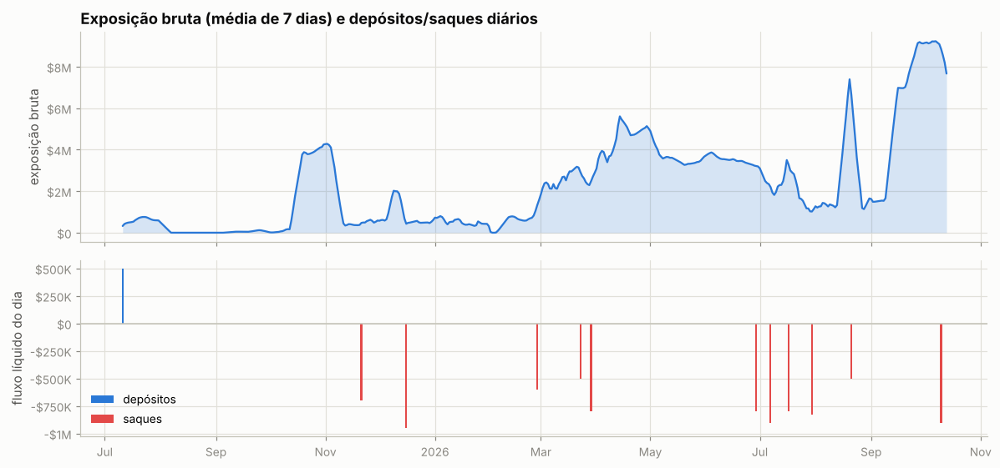

Ponte HyperCore↔HyperEVM (endereços de sistema `0x2000…`/`0x2222…`): 6 transferências, entrada $0, saída $4.73M — uso de DeFi na HyperEVM.

**Liquidações e ADL (auto-deleveraging) nos fills:**

| quando (UTC) | ativo | tipo | lado | preço | tamanho | posição antes | PnL realizado |
|---|---|---|---|---|---|---|---|
| 2025-12-03 10:53:21 | MEGA | Close Long | A | 0.29 | 15788.0 | 794521.0 | -$1.2K |
| 2025-12-03 10:53:21 | MEGA | Close Long | A | 0.29 | 1912.0 | 778733.0 | -$143 |
| 2025-12-03 10:53:21 | MEGA | Close Long | A | 0.29 | 689.0 | 776821.0 | -$52 |
| 2025-12-03 10:53:21 | MEGA | Close Long | A | 0.28973 | 62.0 | 776132.0 | -$5 |
| 2025-12-03 10:53:21 | MEGA | Close Long | A | 0.2897 | 740.0 | 776070.0 | -$56 |
| 2025-12-03 10:53:21 | MEGA | Close Long | A | 0.28968 | 1367.0 | 775330.0 | -$103 |
| 2025-12-03 10:53:21 | MEGA | Close Long | A | 0.28909 | 740.0 | 773963.0 | -$56 |
| 2025-12-03 10:53:21 | MEGA | Close Long | A | 0.289 | 200.0 | 773223.0 | -$15 |
| 2025-12-03 10:53:21 | MEGA | Close Long | A | 0.289 | 413.0 | 773023.0 | -$31 |
| 2025-12-03 10:53:21 | MEGA | Close Long | A | 0.28888 | 417.0 | 772610.0 | -$32 |
| 2025-12-03 10:53:21 | MEGA | Close Long | A | 0.28888 | 417.0 | 772193.0 | -$32 |
| 2025-12-03 10:53:21 | MEGA | Close Long | A | 0.28882 | 131.0 | 771776.0 | -$10 |
| 2025-12-03 10:53:21 | MEGA | Close Long | A | 0.28869 | 800.0 | 771645.0 | -$61 |
| 2025-12-03 10:53:21 | MEGA | Close Long | A | 0.28848 | 740.0 | 770845.0 | -$57 |
| 2025-12-03 10:53:21 | MEGA | Close Long | A | 0.28827 | 1776.0 | 770105.0 | -$136 |
| 2025-12-03 10:53:21 | MEGA | Close Long | A | 0.288 | 10079.0 | 768329.0 | -$776 |
| 2025-12-03 10:53:21 | MEGA | Close Long | A | 0.28788 | 740.0 | 758250.0 | -$57 |
| 2025-12-03 10:53:21 | MEGA | Close Long | A | 0.28755 | 228.0 | 757510.0 | -$18 |
| 2025-12-03 10:53:21 | MEGA | Close Long | A | 0.28727 | 740.0 | 757282.0 | -$58 |
| 2025-12-03 10:53:21 | MEGA | Close Long | A | 0.2872 | 800.0 | 756542.0 | -$62 |
| 2025-12-03 10:53:21 | MEGA | Close Long | A | 0.28713 | 97.0 | 755742.0 | -$8 |
| 2025-12-03 10:53:21 | MEGA | Close Long | A | 0.287 | 100.0 | 755645.0 | -$8 |
| 2025-12-03 10:53:21 | MEGA | Close Long | A | 0.28667 | 740.0 | 755545.0 | -$58 |
| 2025-12-03 10:53:21 | MEGA | Close Long | A | 0.28632 | 1912.0 | 754805.0 | -$150 |
| 2025-12-03 10:53:21 | MEGA | Close Long | A | 0.28606 | 740.0 | 752893.0 | -$58 |
| 2025-12-03 10:53:21 | MEGA | Close Long | A | 0.28591 | 1730.0 | 752153.0 | -$137 |
| 2025-12-03 10:53:21 | MEGA | Close Long | A | 0.28578 | 122.0 | 750423.0 | -$10 |
| 2025-12-03 10:53:21 | MEGA | Close Long | A | 0.28571 | 800.0 | 750301.0 | -$63 |
| 2025-12-03 10:53:21 | MEGA | Close Long | A | 0.28563 | 88.0 | 749501.0 | -$7 |
| 2025-12-03 10:53:21 | MEGA | Close Long | A | 0.28547 | 699.0 | 749413.0 | -$56 |
| 2025-12-03 10:53:21 | MEGA | Close Long | A | 0.28545 | 740.0 | 748714.0 | -$59 |
| 2025-12-03 10:53:21 | MEGA | Close Long | A | 0.28544 | 3552.0 | 747974.0 | -$283 |
| 2025-12-03 10:53:21 | MEGA | Close Long | A | 0.28485 | 740.0 | 744422.0 | -$59 |
| 2025-12-03 10:53:21 | MEGA | Close Long | A | 0.28424 | 740.0 | 743682.0 | -$60 |
| 2025-12-03 10:53:21 | MEGA | Close Long | A | 0.28422 | 800.0 | 742942.0 | -$65 |
| 2025-12-03 10:53:21 | MEGA | Close Long | A | 0.28421 | 99.0 | 742142.0 | -$8 |
| 2025-12-03 10:53:21 | MEGA | Close Long | A | 0.28364 | 740.0 | 742043.0 | -$60 |
| 2025-12-03 10:53:21 | MEGA | Close Long | A | 0.28351 | 209.0 | 741303.0 | -$17 |
| 2025-12-03 10:53:21 | MEGA | Close Long | A | 0.28324 | 666.0 | 741094.0 | -$54 |
| 2025-12-03 10:53:21 | MEGA | Close Long | A | 0.28303 | 740.0 | 740428.0 | -$61 |
| 2025-12-03 10:53:21 | MEGA | Close Long | A | 0.28273 | 800.0 | 739688.0 | -$66 |
| 2025-12-03 10:53:21 | MEGA | Close Long | A | 0.28263 | 1912.0 | 738888.0 | -$157 |
| 2025-12-03 10:53:21 | MEGA | Close Long | A | 0.28258 | 2102.0 | 736976.0 | -$173 |
| 2025-12-03 10:53:21 | MEGA | Close Long | A | 0.28242 | 740.0 | 734874.0 | -$61 |
| 2025-12-03 10:53:21 | MEGA | Close Long | A | 0.28182 | 740.0 | 734134.0 | -$62 |
| 2025-12-03 10:53:21 | MEGA | Close Long | A | 0.28169 | 5304.0 | 733394.0 | -$442 |
| 2025-12-03 10:53:21 | MEGA | Close Long | A | 0.28129 | 100.0 | 728090.0 | -$8 |
| 2025-12-03 10:53:21 | MEGA | Close Long | A | 0.28124 | 800.0 | 727990.0 | -$67 |
| 2025-12-03 10:53:21 | MEGA | Close Long | A | 0.28121 | 740.0 | 727190.0 | -$62 |
| 2025-12-03 10:53:21 | MEGA | Close Long | A | 0.281 | 276.0 | 726450.0 | -$23 |
| 2025-12-03 10:53:21 | MEGA | Close Long | A | 0.28061 | 740.0 | 726174.0 | -$62 |
| 2025-12-03 10:53:21 | MEGA | Close Long | A | 0.28027 | 94.0 | 725434.0 | -$8 |
| 2025-12-03 10:53:21 | MEGA | Close Long | A | 0.28 | 840.0 | 725340.0 | -$71 |
| 2025-12-03 10:53:21 | MEGA | Close Long | A | 0.28 | 100.0 | 724500.0 | -$8 |
| 2025-12-03 10:53:21 | MEGA | Close Long | A | 0.28 | 20000.0 | 724400.0 | -$1.7K |
| 2025-12-03 10:53:21 | MEGA | Close Long | A | 0.28 | 6217.0 | 704400.0 | -$528 |
| 2025-12-03 10:53:21 | MEGA | Close Long | A | 0.28 | 714.0 | 698183.0 | -$61 |
| 2025-12-03 10:53:21 | MEGA | Close Long | A | 0.28 | 740.0 | 697469.0 | -$63 |
| 2025-12-03 10:53:21 | MEGA | Close Long | A | 0.27976 | 800.0 | 696729.0 | -$68 |
| 2025-12-03 10:53:21 | MEGA | Close Long | A | 0.27976 | 1070.0 | 695929.0 | -$91 |
| 2025-12-03 10:53:21 | MEGA | Close Long | A | 0.27939 | 740.0 | 694859.0 | -$63 |
| 2025-12-03 10:53:21 | MEGA | Close Long | A | 0.27914 | 567.0 | 694119.0 | -$49 |
| 2025-12-03 10:53:21 | MEGA | Close Long | A | 0.27895 | 1912.0 | 693552.0 | -$165 |
| 2025-12-03 10:53:21 | MEGA | Close Long | A | 0.27879 | 740.0 | 691640.0 | -$64 |
| 2025-12-03 10:53:21 | MEGA | Close Long | A | 0.27839 | 3592.0 | 690900.0 | -$311 |
| 2025-12-03 10:53:21 | MEGA | Close Long | A | 0.27837 | 102.0 | 687308.0 | -$9 |
| 2025-12-03 10:53:21 | MEGA | Close Long | A | 0.27827 | 800.0 | 687206.0 | -$69 |
| 2025-12-03 10:53:21 | MEGA | Close Long | A | 0.27818 | 740.0 | 686406.0 | -$64 |
| 2025-12-03 10:53:21 | MEGA | Close Long | A | 0.27777 | 80.0 | 685666.0 | -$7 |
| 2025-12-03 10:53:21 | MEGA | Close Long | A | 0.27758 | 740.0 | 685586.0 | -$65 |
| 2025-12-03 10:53:21 | MEGA | Close Long | A | 0.2772 | 252.0 | 684846.0 | -$22 |
| 2025-12-03 10:53:21 | MEGA | Close Long | A | 0.27705 | 2275.0 | 684594.0 | -$200 |
| 2025-12-03 10:53:21 | MEGA | Close Long | A | 0.277 | 5000.0 | 682319.0 | -$440 |
| 2025-12-03 10:53:21 | MEGA | Close Long | A | 0.277 | 6217.0 | 677319.0 | -$547 |
| 2025-12-03 10:53:21 | MEGA | Close Long | A | 0.27697 | 740.0 | 671102.0 | -$65 |
| 2025-12-03 10:53:21 | MEGA | Close Long | A | 0.27685 | 1806.0 | 670362.0 | -$159 |
| 2025-12-03 10:53:21 | MEGA | Close Long | A | 0.27678 | 800.0 | 668556.0 | -$71 |
| 2025-12-03 10:53:21 | MEGA | Close Long | A | 0.27675 | 500.0 | 667756.0 | -$44 |
| 2025-12-03 10:53:21 | MEGA | Close Long | A | 0.27636 | 740.0 | 667256.0 | -$66 |
| 2025-12-03 10:53:21 | MEGA | Close Long | A | 0.27633 | 6630.0 | 666516.0 | -$588 |
| 2025-12-03 10:53:21 | MEGA | Close Long | A | 0.27576 | 740.0 | 659886.0 | -$66 |
| 2025-12-03 10:53:21 | MEGA | Close Long | A | 0.27566 | 1000.0 | 659146.0 | -$89 |
| 2025-12-03 10:53:21 | MEGA | Close Long | A | 0.27545 | 103.0 | 658146.0 | -$9 |
| 2025-12-03 10:53:21 | MEGA | Close Long | A | 0.27529 | 800.0 | 658043.0 | -$72 |
| 2025-12-03 10:53:21 | MEGA | Close Long | A | 0.27526 | 1912.0 | 657243.0 | -$172 |
| 2025-12-03 10:53:21 | MEGA | Close Long | A | 0.27515 | 740.0 | 655331.0 | -$66 |
| 2025-12-03 10:53:21 | MEGA | Close Long | A | 0.27512 | 50.0 | 654591.0 | -$4 |
| 2025-12-03 10:53:21 | MEGA | Close Long | A | 0.2749 | 100.0 | 654541.0 | -$9 |
| 2025-12-03 10:53:21 | MEGA | Close Long | A | 0.27464 | 18824.0 | 654441.0 | -$1.7K |
| 2025-12-03 10:53:24 | MEGA | Close Long | A | 0.28668 | 342.0 | 635617.0 | -$27 |
| 2025-12-03 10:53:24 | MEGA | Close Long | A | 0.28668 | 445.0 | 635275.0 | -$35 |
| 2025-12-03 10:53:24 | MEGA | Close Long | A | 0.28667 | 887.0 | 634830.0 | -$69 |
| 2025-12-03 10:53:24 | MEGA | Close Long | A | 0.28573 | 1330.0 | 633943.0 | -$105 |
| 2025-12-03 10:53:24 | MEGA | Close Long | A | 0.28447 | 1773.0 | 632613.0 | -$143 |
| 2025-12-03 10:53:24 | MEGA | Close Long | A | 0.28195 | 3547.0 | 630840.0 | -$295 |
| 2025-12-03 10:53:24 | MEGA | Close Long | A | 0.27976 | 35.0 | 627293.0 | -$3 |
| 2025-12-03 10:53:24 | MEGA | Close Long | A | 0.27818 | 5320.0 | 627258.0 | -$462 |
| 2025-12-03 10:53:24 | MEGA | Close Long | A | 0.27499 | 50000.0 | 621938.0 | -$4.5K |
| 2025-12-03 10:53:24 | MEGA | Close Long | A | 0.27464 | 27350.0 | 571938.0 | -$2.5K |
| 2025-12-03 10:53:24 | MEGA | Close Long | A | 0.27455 | 740.0 | 544588.0 | -$67 |
| 2025-12-03 10:53:24 | MEGA | Close Long | A | 0.27394 | 740.0 | 543848.0 | -$67 |
| 2025-12-03 10:53:24 | MEGA | Close Long | A | 0.2738 | 800.0 | 543108.0 | -$73 |
| 2025-12-03 10:53:24 | MEGA | Close Long | A | 0.27335 | 6651.0 | 542308.0 | -$610 |
| 2025-12-03 10:53:24 | MEGA | Close Long | A | 0.27333 | 740.0 | 535657.0 | -$68 |
| 2025-12-03 10:53:24 | MEGA | Close Long | A | 0.27273 | 740.0 | 534917.0 | -$68 |
| 2025-12-03 10:53:24 | MEGA | Close Long | A | 0.27262 | 120.0 | 534177.0 | -$11 |
| 2025-12-03 10:53:24 | MEGA | Close Long | A | 0.27253 | 104.0 | 534057.0 | -$10 |
| 2025-12-03 10:53:24 | MEGA | Close Long | A | 0.27231 | 800.0 | 533953.0 | -$74 |
| 2025-12-03 10:53:24 | MEGA | Close Long | A | 0.27212 | 740.0 | 533153.0 | -$69 |
| 2025-12-03 10:53:24 | MEGA | Close Long | A | 0.272 | 1838.0 | 532413.0 | -$171 |
| 2025-12-03 10:53:24 | MEGA | Close Long | A | 0.27158 | 1912.0 | 530575.0 | -$179 |
| 2025-12-03 10:53:24 | MEGA | Close Long | A | 0.27152 | 740.0 | 528663.0 | -$69 |
| 2025-12-03 10:53:24 | MEGA | Close Long | A | 0.27091 | 740.0 | 527923.0 | -$70 |
| 2025-12-03 10:53:24 | MEGA | Close Long | A | 0.27082 | 800.0 | 527183.0 | -$75 |
| 2025-12-03 10:53:24 | MEGA | Close Long | A | 0.2703 | 740.0 | 526383.0 | -$70 |
| 2025-12-03 10:53:24 | MEGA | Close Long | A | 0.27 | 100.0 | 525643.0 | -$10 |
| 2025-12-03 10:53:24 | MEGA | Close Long | A | 0.27 | 20000.0 | 525543.0 | -$1.9K |
| 2025-12-03 10:53:24 | MEGA | Close Long | A | 0.27 | 6217.0 | 505543.0 | -$591 |
| 2025-12-03 10:53:24 | MEGA | Close Long | A | 0.27 | 740.0 | 499326.0 | -$70 |
| 2025-12-03 10:53:24 | MEGA | Close Long | A | 0.2697 | 740.0 | 498586.0 | -$71 |
| 2025-12-03 10:53:24 | MEGA | Close Long | A | 0.26961 | 106.0 | 497846.0 | -$10 |
| 2025-12-03 10:53:24 | MEGA | Close Long | A | 0.26954 | 106.0 | 497740.0 | -$10 |
| 2025-12-03 10:53:24 | MEGA | Close Long | A | 0.26933 | 800.0 | 497634.0 | -$77 |
| 2025-12-03 10:53:24 | MEGA | Close Long | A | 0.26909 | 740.0 | 496834.0 | -$71 |
| 2025-12-03 10:53:24 | MEGA | Close Long | A | 0.26848 | 740.0 | 496094.0 | -$71 |
| 2025-12-03 10:53:24 | MEGA | Close Long | A | 0.26825 | 6749.0 | 495354.0 | -$653 |
| 2025-12-03 10:53:24 | MEGA | Close Long | A | 0.268 | 1000.0 | 488605.0 | -$97 |
| 2025-12-03 10:53:24 | MEGA | Close Long | A | 0.26789 | 1912.0 | 487605.0 | -$186 |
| 2025-12-03 10:53:24 | MEGA | Close Long | A | 0.26788 | 740.0 | 485693.0 | -$72 |
| 2025-12-03 10:53:24 | MEGA | Close Long | A | 0.26784 | 800.0 | 484953.0 | -$78 |
| 2025-12-03 10:53:24 | MEGA | Close Long | A | 0.26727 | 740.0 | 484153.0 | -$72 |
| 2025-12-03 10:53:24 | MEGA | Close Long | A | 0.26668 | 107.0 | 483413.0 | -$11 |
| 2025-12-03 10:53:24 | MEGA | Close Long | A | 0.26667 | 740.0 | 483306.0 | -$73 |
| 2025-12-03 10:53:24 | MEGA | Close Long | A | 0.26635 | 800.0 | 482566.0 | -$79 |
| 2025-12-03 10:53:24 | MEGA | Close Long | A | 0.26617 | 50000.0 | 481766.0 | -$4.9K |
| 2025-12-03 10:53:24 | MEGA | Close Long | A | 0.26606 | 740.0 | 431766.0 | -$73 |
| 2025-12-03 10:53:24 | MEGA | Close Long | A | 0.26562 | 4918.0 | 431026.0 | -$489 |
| 2025-12-03 10:53:24 | MEGA | Close Long | A | 0.26554 | 50000.0 | 426108.0 | -$5.0K |
| 2025-12-03 10:53:24 | MEGA | Close Long | A | 0.26545 | 740.0 | 376108.0 | -$74 |
| 2025-12-03 10:53:24 | MEGA | Close Long | A | 0.26486 | 800.0 | 375368.0 | -$80 |
| 2025-12-03 10:53:24 | MEGA | Close Long | A | 0.26485 | 740.0 | 374568.0 | -$74 |
| 2025-12-03 10:53:24 | MEGA | Close Long | A | 0.26424 | 740.0 | 373828.0 | -$75 |
| 2025-12-03 10:53:24 | MEGA | Close Long | A | 0.26421 | 1912.0 | 373088.0 | -$193 |
| 2025-12-03 10:53:24 | MEGA | Close Long | A | 0.26417 | 112.0 | 371176.0 | -$11 |
| 2025-12-03 10:53:24 | MEGA | Close Long | A | 0.26376 | 108.0 | 371064.0 | -$11 |
| 2025-12-03 10:53:24 | MEGA | Close Long | A | 0.26376 | 457.0 | 370956.0 | -$46 |
| 2025-12-03 10:53:24 | MEGA | Close Long | A | 0.26376 | 457.0 | 370499.0 | -$46 |
| 2025-12-03 10:53:24 | MEGA | Close Long | A | 0.26365 | 1136.0 | 370042.0 | -$115 |
| 2025-12-03 10:53:24 | MEGA | Close Long | A | 0.26364 | 740.0 | 368906.0 | -$75 |
| 2025-12-03 10:53:24 | MEGA | Close Long | A | 0.26337 | 800.0 | 368166.0 | -$81 |
| 2025-12-03 10:53:24 | MEGA | Close Long | A | 0.26303 | 740.0 | 367366.0 | -$75 |
| 2025-12-03 10:53:24 | MEGA | Close Long | A | 0.26242 | 740.0 | 366626.0 | -$76 |
| 2025-12-03 10:53:24 | MEGA | Close Long | A | 0.26188 | 800.0 | 365886.0 | -$82 |
| 2025-12-03 10:53:24 | MEGA | Close Long | A | 0.26182 | 740.0 | 365086.0 | -$76 |
| 2025-12-03 10:53:24 | MEGA | Close Long | A | 0.2615 | 8999.0 | 364346.0 | -$931 |
| 2025-12-03 10:53:24 | MEGA | Close Long | A | 0.26121 | 740.0 | 355347.0 | -$77 |
| 2025-12-03 10:53:24 | MEGA | Close Long | A | 0.26112 | 7738.0 | 354607.0 | -$804 |
| 2025-12-03 10:53:24 | MEGA | Close Long | A | 0.261 | 495.0 | 346869.0 | -$51 |
| 2025-12-03 10:53:24 | MEGA | Close Long | A | 0.261 | 100000.0 | 346374.0 | -$10.4K |
| 2025-12-03 10:53:24 | MEGA | Close Long | A | 0.26084 | 110.0 | 246374.0 | -$11 |
| 2025-12-03 10:53:24 | MEGA | Close Long | A | 0.26061 | 740.0 | 246264.0 | -$77 |
| 2025-12-03 10:53:24 | MEGA | Close Long | A | 0.26053 | 1912.0 | 245524.0 | -$200 |
| 2025-12-03 10:53:24 | MEGA | Close Long | A | 0.26039 | 800.0 | 243612.0 | -$84 |
| 2025-12-03 10:53:24 | MEGA | Close Long | A | 0.26 | 20000.0 | 242812.0 | -$2.1K |
| 2025-12-03 10:53:24 | MEGA | Close Long | A | 0.26 | 288.0 | 222812.0 | -$30 |
| 2025-12-03 10:53:24 | MEGA | Close Long | A | 0.26 | 740.0 | 222524.0 | -$78 |
| 2025-12-03 10:53:24 | MEGA | Close Long | A | 0.25939 | 740.0 | 221784.0 | -$78 |
| 2025-12-03 10:53:24 | MEGA | Close Long | A | 0.2589 | 800.0 | 221044.0 | -$85 |
| 2025-12-03 10:53:24 | MEGA | Close Long | A | 0.25881 | 118.0 | 220244.0 | -$13 |
| 2025-12-03 10:53:24 | MEGA | Close Long | A | 0.25879 | 740.0 | 220126.0 | -$79 |
| 2025-12-03 10:53:24 | MEGA | Close Long | A | 0.25818 | 740.0 | 219386.0 | -$79 |
| 2025-12-03 10:53:24 | MEGA | Close Long | A | 0.25816 | 1160.0 | 218646.0 | -$124 |
| 2025-12-03 10:53:24 | MEGA | Close Long | A | 0.25792 | 111.0 | 217486.0 | -$12 |
| 2025-12-03 10:53:24 | MEGA | Close Long | A | 0.25777 | 110.0 | 217375.0 | -$12 |
| 2025-12-03 10:53:24 | MEGA | Close Long | A | 0.25758 | 740.0 | 217265.0 | -$79 |
| 2025-12-03 10:53:24 | MEGA | Close Long | A | 0.25741 | 800.0 | 216525.0 | -$86 |
| 2025-12-03 10:53:24 | MEGA | Close Long | A | 0.257 | 13156.0 | 215725.0 | -$1.4K |
| 2025-12-03 10:53:24 | MEGA | Close Long | A | 0.257 | 40.0 | 202569.0 | -$4 |
| 2025-12-03 10:53:24 | MEGA | Close Long | A | 0.25697 | 740.0 | 202529.0 | -$80 |
| 2025-12-03 10:53:24 | MEGA | Close Long | A | 0.25684 | 1912.0 | 201789.0 | -$207 |
| 2025-12-03 10:53:24 | MEGA | Close Long | A | 0.25636 | 740.0 | 199877.0 | -$80 |
| 2025-12-03 10:53:24 | MEGA | Close Long | A | 0.256 | 8925.0 | 199137.0 | -$973 |
| 2025-12-03 10:53:24 | MEGA | Close Long | A | 0.25592 | 800.0 | 190212.0 | -$87 |
| 2025-12-03 10:53:24 | MEGA | Close Long | A | 0.25589 | 8982.0 | 189412.0 | -$980 |
| 2025-12-03 10:53:24 | MEGA | Close Long | A | 0.25587 | 390.0 | 180430.0 | -$43 |
| 2025-12-03 10:53:24 | MEGA | Close Long | A | 0.25576 | 740.0 | 180040.0 | -$81 |
| 2025-12-03 10:53:24 | MEGA | Close Long | A | 0.2556 | 327.0 | 179300.0 | -$36 |
| 2025-12-03 10:53:24 | MEGA | Close Long | A | 0.2553 | 10052.0 | 178973.0 | -$1.1K |
| 2025-12-03 10:53:24 | MEGA | Close Long | A | 0.2552 | 4978.0 | 168921.0 | -$547 |
| 2025-12-03 10:53:24 | MEGA | Close Long | A | 0.25515 | 740.0 | 163943.0 | -$81 |
| 2025-12-03 10:53:24 | MEGA | Close Long | A | 0.255 | 1000.0 | 163203.0 | -$110 |
| 2025-12-03 10:53:24 | MEGA | Close Long | A | 0.255 | 1000.0 | 162203.0 | -$110 |
| 2025-12-03 10:53:24 | MEGA | Close Long | A | 0.255 | 1000.0 | 161203.0 | -$110 |
| 2025-12-03 10:53:24 | MEGA | Close Long | A | 0.255 | 1000.0 | 160203.0 | -$110 |
| 2025-12-03 10:53:24 | MEGA | Close Long | A | 0.255 | 113.0 | 159203.0 | -$12 |
| 2025-12-03 10:53:24 | MEGA | Close Long | A | 0.25455 | 740.0 | 159090.0 | -$82 |
| 2025-12-03 10:53:24 | MEGA | Close Long | A | 0.25443 | 800.0 | 158350.0 | -$88 |
| 2025-12-03 10:53:24 | MEGA | Close Long | A | 0.25394 | 740.0 | 157550.0 | -$82 |
| 2025-12-03 10:53:24 | MEGA | Close Long | A | 0.25344 | 124.0 | 156810.0 | -$14 |
| 2025-12-03 10:53:24 | MEGA | Close Long | A | 0.25333 | 740.0 | 156686.0 | -$83 |
| 2025-12-03 10:53:24 | MEGA | Close Long | A | 0.25316 | 1912.0 | 155946.0 | -$214 |
| 2025-12-03 10:53:24 | MEGA | Close Long | A | 0.253 | 2000.0 | 154034.0 | -$224 |
| 2025-12-03 10:53:24 | MEGA | Close Long | A | 0.25294 | 800.0 | 152034.0 | -$90 |
| 2025-12-03 10:53:24 | MEGA | Close Long | A | 0.25273 | 740.0 | 151234.0 | -$83 |
| 2025-12-03 10:53:24 | MEGA | Close Long | A | 0.25212 | 740.0 | 150494.0 | -$84 |
| 2025-12-03 10:53:24 | MEGA | Close Long | A | 0.252 | 2000.0 | 149754.0 | -$226 |
| 2025-12-03 10:53:24 | MEGA | Close Long | A | 0.25156 | 22525.0 | 147754.0 | -$2.6K |
| 2025-12-03 10:53:24 | MEGA | Close Long | A | 0.25152 | 740.0 | 125229.0 | -$84 |
| 2025-12-03 10:53:24 | MEGA | Close Long | A | 0.25145 | 800.0 | 124489.0 | -$91 |
| 2025-12-03 10:53:24 | MEGA | Close Long | A | 0.25091 | 740.0 | 123689.0 | -$84 |
| 2025-12-03 10:53:24 | MEGA | Close Long | A | 0.2503 | 740.0 | 122949.0 | -$85 |
| 2025-12-03 10:53:24 | MEGA | Close Long | A | 0.2502 | 5000.0 | 122209.0 | -$574 |
| 2025-12-03 10:53:24 | MEGA | Close Long | A | 0.25 | 300.0 | 117209.0 | -$34 |
| 2025-12-03 10:53:24 | MEGA | Close Long | A | 0.25 | 1000.0 | 116909.0 | -$115 |
| 2025-12-03 10:53:24 | MEGA | Close Long | A | 0.25 | 207.0 | 115909.0 | -$24 |
| 2025-12-03 10:53:24 | MEGA | Close Long | A | 0.25 | 90.0 | 115702.0 | -$10 |
| 2025-12-03 10:53:24 | MEGA | Close Long | A | 0.25 | 20000.0 | 115612.0 | -$2.3K |
| 2025-12-03 10:53:24 | MEGA | Close Long | A | 0.25 | 20000.0 | 95612.0 | -$2.3K |
| 2025-12-03 10:53:24 | MEGA | Close Long | A | 0.24996 | 800.0 | 75612.0 | -$92 |
| 2025-12-03 10:53:24 | MEGA | Close Long | A | 0.2497 | 740.0 | 74812.0 | -$85 |
| 2025-12-03 10:53:24 | MEGA | Close Long | A | 0.24947 | 1912.0 | 74072.0 | -$221 |
| 2025-12-03 10:53:24 | MEGA | Close Long | A | 0.24909 | 740.0 | 72160.0 | -$86 |
| 2025-12-03 10:53:24 | MEGA | Close Long | A | 0.24848 | 740.0 | 71420.0 | -$86 |
| 2025-12-03 10:53:24 | MEGA | Close Long | A | 0.24847 | 800.0 | 70680.0 | -$93 |
| 2025-12-03 10:53:24 | MEGA | Close Long | A | 0.24807 | 129.0 | 69880.0 | -$15 |
| 2025-12-03 10:53:24 | MEGA | Close Long | A | 0.24788 | 740.0 | 69751.0 | -$87 |
| 2025-12-03 10:53:24 | MEGA | Close Long | A | 0.24731 | 87.0 | 69011.0 | -$10 |
| 2025-12-03 10:53:24 | MEGA | Close Long | A | 0.24727 | 740.0 | 68924.0 | -$87 |
| 2025-12-03 10:53:24 | MEGA | Close Long | A | 0.24698 | 800.0 | 68184.0 | -$94 |
| 2025-12-03 10:53:24 | MEGA | Close Long | A | 0.24667 | 740.0 | 67384.0 | -$88 |
| 2025-12-03 10:53:24 | MEGA | Close Long | A | 0.2464 | 100.0 | 66644.0 | -$12 |
| 2025-12-03 10:53:24 | MEGA | Close Long | A | 0.24606 | 740.0 | 66544.0 | -$88 |
| 2025-12-03 10:53:24 | MEGA | Close Long | A | 0.24579 | 1912.0 | 65804.0 | -$228 |
| 2025-12-03 10:53:24 | MEGA | Close Long | A | 0.24549 | 800.0 | 63892.0 | -$96 |
| 2025-12-03 10:53:24 | MEGA | Close Long | A | 0.24545 | 740.0 | 63092.0 | -$88 |
| 2025-12-03 10:53:24 | MEGA | Close Long | A | 0.24485 | 740.0 | 62352.0 | -$89 |
| 2025-12-03 10:53:24 | MEGA | Close Long | A | 0.24424 | 740.0 | 61612.0 | -$89 |
| 2025-12-03 10:53:24 | MEGA | Close Long | A | 0.244 | 800.0 | 60872.0 | -$97 |
| 2025-12-03 10:53:24 | MEGA | Close Long | A | 0.24364 | 740.0 | 60072.0 | -$90 |
| 2025-12-03 10:53:24 | MEGA | Close Long | A | 0.24335 | 10268.0 | 59332.0 | -$1.2K |
| 2025-12-03 10:53:24 | MEGA | Close Long | A | 0.24303 | 740.0 | 49064.0 | -$90 |
| 2025-12-03 10:53:24 | MEGA | Close Long | A | 0.24271 | 135.0 | 48324.0 | -$17 |
| 2025-12-03 10:53:24 | MEGA | Close Long | A | 0.24244 | 576.0 | 48189.0 | -$71 |
| 2025-12-03 10:53:24 | MEGA | Close Long | A | 0.24242 | 740.0 | 47613.0 | -$91 |
| 2025-12-03 10:53:24 | MEGA | Close Long | A | 0.24222 | 1500.0 | 46873.0 | -$184 |
| 2025-12-03 10:53:24 | MEGA | Close Long | A | 0.2421 | 1912.0 | 45373.0 | -$235 |
| 2025-12-03 10:53:24 | MEGA | Close Long | A | 0.24182 | 740.0 | 43461.0 | -$91 |
| 2025-12-03 10:53:24 | MEGA | Close Long | A | 0.24121 | 740.0 | 42721.0 | -$92 |
| 2025-12-03 10:53:24 | MEGA | Close Long | A | 0.24112 | 7738.0 | 41981.0 | -$959 |
| 2025-12-03 10:53:24 | MEGA | Close Long | A | 0.24061 | 740.0 | 34243.0 | -$92 |
| 2025-12-03 10:53:24 | MEGA | Close Long | A | 0.24 | 9686.0 | 33503.0 | -$1.2K |
| 2025-12-03 10:53:24 | MEGA | Close Long | A | 0.24 | 12743.0 | 23817.0 | -$1.6K |
| 2025-12-03 10:53:27 | MEGA | Close Long | A | 0.28196 | 1047.0 | 11074.0 | -$87 |
| 2025-12-03 10:53:27 | MEGA | Close Long | A | 0.28153 | 354.0 | 10027.0 | -$30 |
| 2025-12-03 10:53:27 | MEGA | Close Long | A | 0.27836 | 74.0 | 9673.0 | -$6 |
| 2025-12-03 10:53:27 | MEGA | Close Long | A | 0.27835 | 453.0 | 9599.0 | -$39 |
| 2025-12-03 10:53:27 | MEGA | Close Long | A | 0.27803 | 234.0 | 9146.0 | -$20 |
| 2025-12-03 10:53:27 | MEGA | Close Long | A | 0.27789 | 906.0 | 8912.0 | -$79 |
| 2025-12-03 10:53:27 | MEGA | Close Long | A | 0.2774 | 719.0 | 8006.0 | -$63 |
| 2025-12-03 10:53:27 | MEGA | Close Long | A | 0.27736 | 359.0 | 7287.0 | -$31 |
| 2025-12-03 10:53:27 | MEGA | Close Long | A | 0.2772 | 1360.0 | 6928.0 | -$119 |
| 2025-12-03 10:53:27 | MEGA | Close Long | A | 0.27677 | 5568.0 | 5568.0 | -$491 |
| 2026-01-22 08:32:44 | xyz:COPPER | Close Long | A | 5.7259 | 1596.55 | 10353.38 | -$201 |
| 2026-01-22 08:32:44 | xyz:COPPER | Close Long | A | 5.725 | 174.67 | 8756.83 | -$22 |
| 2026-01-22 08:32:44 | xyz:COPPER | Close Long | A | 5.7245 | 3069.71 | 8582.16 | -$391 |
| 2026-01-22 08:32:44 | xyz:COPPER | Close Long | A | 5.7245 | 5512.45 | 5512.45 | -$703 |
| 2026-02-05 14:31:08 | xyz:GOOGL | Close Long | A | 306.94 | 110.769 | 553.846 | -$2.0K |
| 2026-02-05 14:31:12 | xyz:GOOGL | Close Long | A | 307.0 | 0.642 | 443.077 | -$12 |
| 2026-02-05 14:31:12 | xyz:GOOGL | Close Long | A | 306.98 | 2.955 | 442.435 | -$53 |
| 2026-02-05 14:31:12 | xyz:GOOGL | Close Long | A | 306.94 | 1.464 | 439.48 | -$26 |
| 2026-02-05 14:31:12 | xyz:GOOGL | Close Long | A | 306.91 | 4.433 | 438.016 | -$80 |
| 2026-02-05 14:31:12 | xyz:GOOGL | Close Long | A | 306.88 | 2.0 | 433.583 | -$36 |
| 2026-02-05 14:31:12 | xyz:GOOGL | Close Long | A | 306.88 | 2.928 | 431.583 | -$53 |
| 2026-02-05 14:31:12 | xyz:GOOGL | Close Long | A | 306.87 | 0.561 | 428.655 | -$10 |
| 2026-02-05 14:31:12 | xyz:GOOGL | Close Long | A | 306.8 | 5.911 | 428.094 | -$108 |
| 2026-02-05 14:31:12 | xyz:GOOGL | Close Long | A | 306.79 | 4.392 | 422.183 | -$80 |
| 2026-02-05 14:31:12 | xyz:GOOGL | Close Long | A | 306.72 | 10.0 | 417.791 | -$183 |
| 2026-02-05 14:31:12 | xyz:GOOGL | Close Long | A | 306.68 | 1.598 | 407.791 | -$29 |
| 2026-02-05 14:31:12 | xyz:GOOGL | Close Long | A | 306.65 | 5.856 | 406.193 | -$107 |
| 2026-02-05 14:31:12 | xyz:GOOGL | Close Long | A | 306.63 | 289.935 | 400.337 | -$5.3K |
| 2026-02-05 14:31:12 | xyz:GOOGL | Close Long | A | 306.58 | 10.0 | 110.402 | -$184 |
| 2026-02-05 14:31:12 | xyz:GOOGL | Close Long | A | 306.57 | 11.428 | 100.402 | -$211 |
| 2026-02-05 14:31:12 | xyz:GOOGL | Close Long | A | 306.55 | 11.822 | 88.974 | -$218 |
| 2026-02-05 14:31:12 | xyz:GOOGL | Close Long | A | 306.51 | 0.053 | 77.152 | -$1 |
| 2026-02-05 14:31:12 | xyz:GOOGL | Close Long | A | 306.36 | 10.0 | 77.099 | -$186 |
| 2026-02-05 14:31:12 | xyz:GOOGL | Close Long | A | 306.33 | 11.713 | 67.099 | -$219 |
| 2026-02-05 14:31:12 | xyz:GOOGL | Close Long | A | 306.29 | 2.363 | 55.386 | -$44 |
| 2026-02-05 14:31:12 | xyz:GOOGL | Close Long | A | 306.21 | 0.063 | 53.023 | -$1 |
| 2026-02-05 14:31:12 | xyz:GOOGL | Close Long | A | 306.21 | 0.261 | 52.96 | -$5 |
| 2026-02-05 14:31:12 | xyz:GOOGL | Close Long | A | 306.02 | 3.2 | 52.699 | -$61 |
| 2026-02-05 14:31:12 | xyz:GOOGL | Close Long | A | 306.01 | 10.0 | 49.499 | -$190 |
| 2026-02-05 14:31:12 | xyz:GOOGL | Close Long | A | 306.0 | 1.149 | 39.499 | -$22 |
| 2026-02-05 14:31:12 | xyz:GOOGL | Close Long | A | 306.0 | 1.0 | 38.35 | -$19 |
| 2026-02-05 14:31:12 | xyz:GOOGL | Close Long | A | 305.97 | 17.732 | 37.35 | -$337 |
| 2026-02-05 14:31:12 | xyz:GOOGL | Close Long | A | 305.95 | 19.618 | 19.618 | -$374 |
| 2026-02-24 12:00:50 | xyz:AMD | Close Short | B | 217.99 | 441.631 | -441.631 | -$6.3K |
| 2026-07-28 11:14:53 | xyz:KIOXIA | Close Long | A | 264.46 | 0.18 | 0.18 | -$26 |

## 9. Dá para copiar? (espelhar a posição com atraso)

PnL de quem replicasse exatamente a posição da carteira, mas com N horas de atraso (marcação horária, sem custos). Se o PnL se mantém com atraso, a vantagem está em horizontes longos e é copiável; se desaba, depende de timing fino.

| atraso | GAS | NEO | BTC |
|---|---|---|---|
| 0h | +$87.3K | +$30.7K | +$522.8K |
| 1h | +$67.6K | +$30.6K | +$573.8K |
| 4h | +$47.3K | +$46.8K | +$553.7K |
| 12h | +$30.5K | -$18.0K | +$518.8K |
| 24h | -$199.8K | -$13.2K | +$325.8K |
| 72h | -$188.1K | -$7.3K | +$258.8K |
| 168h | +$110.6K | +$36.1K | +$389.1K |

## 10. Teste de replicação por regras (GAS)

Regra testada: *short-bias com filtro de tendência e fade* — short de até 1 GAS (o percentil 90 do tamanho real), cheio abaixo da média móvel e reduzido acima; dentro do regime, mais short perto do topo do range e menos perto do fundo. Parâmetros escolhidos no treino (2025-07-11 → 2026-02-25) e avaliados no teste (2026-02-26 → 2026-10-12).

|  | parâmetros | PnL treino | PnL teste | correlação c/ posição real (teste) |
|---|---|---|---|---|
| melhor regra no treino | MA50, range 7d, fração em alta 1.0, fade 0.0 | +$1 | +$0 | nan |
| carteira real (aprox.) | — | -$2.9K | $0 | 1.00 |

Clone comportamental (regressão linear da posição real em médias móveis, ranges e retornos): R² treino 0.05, R² teste -inf, correlação no teste nan.

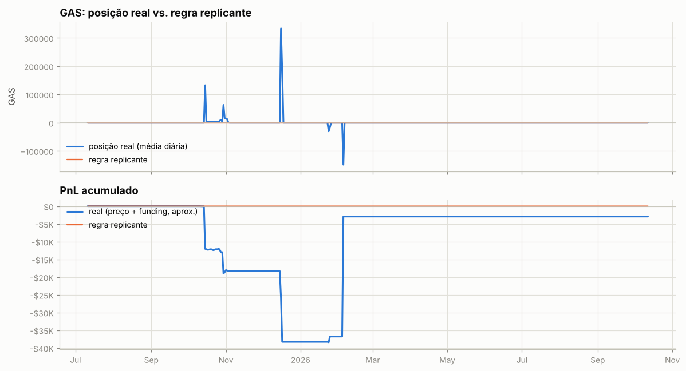

---

Metodologia e código: ver `README.md` na raiz do repositório.
