# Relatório automático — `0x95da8596c44dd09f4b8becce87ad3b7894fb2328`

Gerado em 2026-10-16 10:18 UTC a partir da API pública da Hyperliquid (`POST /info`). Valores em USD. Este arquivo é regenerado por `python -m hlre.report`; a interpretação da estratégia fica em `ANALISE.md`.

## 1. Visão geral

| métrica | valor |
|---|---|
| Valor da conta (perp + spot) | $2.34M |
| PnL all-time (portfolio, inclui spot/airdrops) | +$1.26M |
| PnL all-time só de perps | +$1.22M |
| Volume all-time | $113.97M |
| Primeira atividade | 2026-02-18 |
| Fills disponíveis na API | 33,924 (desde 2026-05-24) |
| Ordens (fills agrupados por oid) | 2,410 |
| Funding líquido (recebido > 0) | -$30.3K |
| Taxas pagas (período dos fills) | -$16.8K |
| Liquidações (ledger) | 0 |
| Fills de liquidação/ADL | 0 |
| Papel da conta | user |
| API wallets (agentes) | 1 |

**Posições abertas agora:**

| ativo | tamanho | nocional | entrada | alav. | PnL não realizado | liq. |
|---|---|---|---|---|---|---|
| XRP | 826844.0 | $1.10M | 1.392558 | 5x cross | -$48.5K | — |
| WLD | 604004.5 | $317.8K | 0.49668 | 5x cross | +$17.8K | — |
| UNI | 42673.5 | $315.8K | 7.58537 | 5x cross | -$7.9K | — |
| ZRO | 106841.5 | $235.8K | 1.85631 | 5x cross | +$37.5K | — |
| ONDO | 2321345.0 | $1.09M | 0.459357 | 7x cross | +$25.1K | — |
| STRK | 1298920.3 | $101.7K | 0.07698 | 5x cross | +$1.7K | — |
| ENA | 1031914.0 | $210.6K | 0.197054 | 5x cross | +$7.2K | — |
| HYPE | 2000.0 | $162.5K | 79.065 | 5x cross | +$4.4K | — |
| PUMP | 86697473.0 | $387.0K | 0.004613 | 4x cross | -$13.0K | — |
| XPL | 821602.0 | $69.9K | 0.085191 | 10x cross | -$51 | — |
| GRAM | 31499.0 | $43.6K | 1.429281 | 5x cross | -$1.4K | — |
| PONS | 293605.0 | $98.2K | 0.355303 | 1x isolated | -$6.1K | 0.0010768477 |

## 2. Curva de PnL

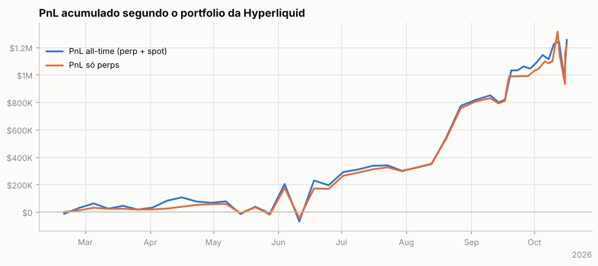

## 3. De onde veio o PnL

*Preço (aprox.)* usa a posição média diária de cada ativo, reconstruída a partir do histórico de funding (que traz o tamanho da posição a cada hora/dia desde o início da conta), vezes o movimento open→close do dia. Subestima o PnL de day trade, mas cobre o período sem fills. *Preço exato* marca cada fill no fechamento diário e só existe para o período coberto pelos fills.

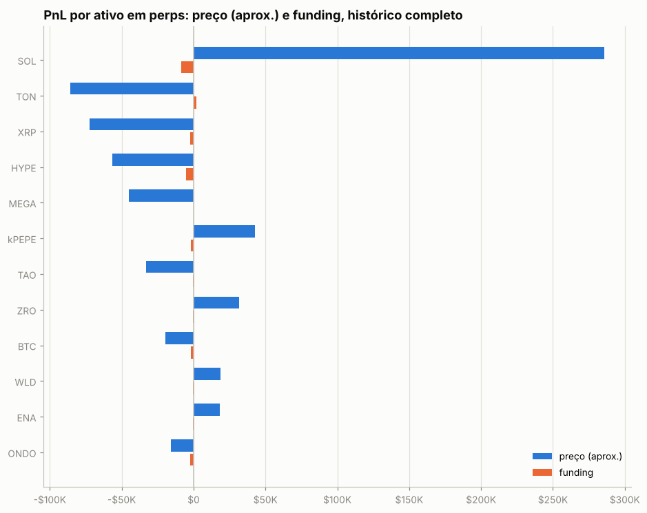

| ativo | preço (aprox.) | funding | total | preço exato (período dos fills) | taxas (período dos fills) |
|---|---|---|---|---|---|
| SOL | +$285.8K | -$8.8K | +$277.0K | +$398.4K | -$1.9K |
| TON | -$85.7K | +$2.0K | -$83.7K | +$97.8K | -$225 |
| XRP | -$72.2K | -$2.3K | -$74.5K | -$28.5K | -$2.0K |
| HYPE | -$56.3K | -$5.1K | -$61.4K | +$92.8K | -$2.7K |
| MEGA | -$45.3K | +$188 | -$45.1K | +$3.1K | -$17 |
| kPEPE | +$42.9K | -$1.9K | +$41.0K | +$606 | -$49 |
| TAO | -$32.9K | -$609 | -$33.5K | -$30.0K | -$229 |
| ZRO | +$31.4K | -$232 | +$31.2K | +$79.8K | -$227 |
| BTC | -$19.9K | -$2.1K | -$22.0K | +$18.7K | -$711 |
| WLD | +$18.6K | -$435 | +$18.2K | +$78.6K | -$449 |
| ENA | +$18.5K | -$356 | +$18.1K | +$37.7K | -$102 |
| ONDO | -$15.7K | -$2.2K | -$17.9K | +$44.0K | -$425 |
| GRASS | +$14.5K | -$102 | +$14.4K | +$22.9K | -$132 |
| ETH | +$14.5K | -$321 | +$14.2K | +$19.9K | -$249 |
| xyz:MRVL | -$13.1K | -$425 | -$13.5K | +$8.1K | -$126 |
| outros (57) | +$19.3K | -$7.5K | +$11.7K | +$440.1K | -$6.6K |

**Decomposição no período dos fills** (preço exato): quanto veio de *carregar* a posição (e, dentro disso, do viés médio vs. do *timing* de aumentar/reduzir), quanto de trades intradiários, funding e taxas.

| componente | SOL | PUMP | TON |
|---|---|---|---|
| carregar posição (carry) | +$370.8K | +$96.8K | +$59.2K |
|   ↳ viés (posição média × movimento) | +$195.7K | +$59.1K | -$1.2K |
|   ↳ timing (variação do tamanho) | +$175.1K | +$37.7K | +$60.3K |
| trades intradiários | +$27.6K | +$63.0K | +$38.6K |
| funding | -$8.9K | -$2.7K | +$2.4K |
| taxas | -$1.9K | -$1.6K | -$225 |
| posição média | 5,290.63 | 19,694,580.43 | 13,821.70 |
| movimento do preço no período | 36.99 | 0.00 | -0.09 |

## 4. Posições ao longo do tempo

Área clara: posição média diária (funding). Linha: posição exata (fills). Azul = long, vermelho = short.

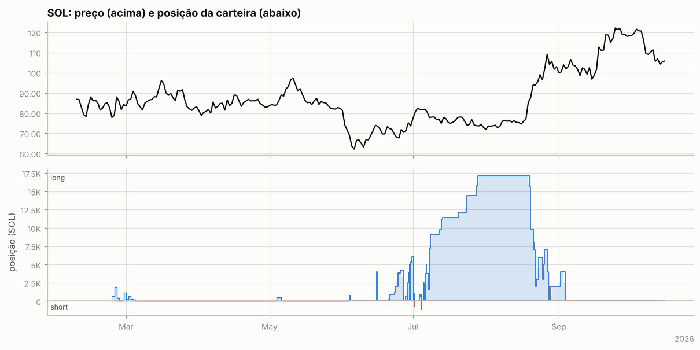

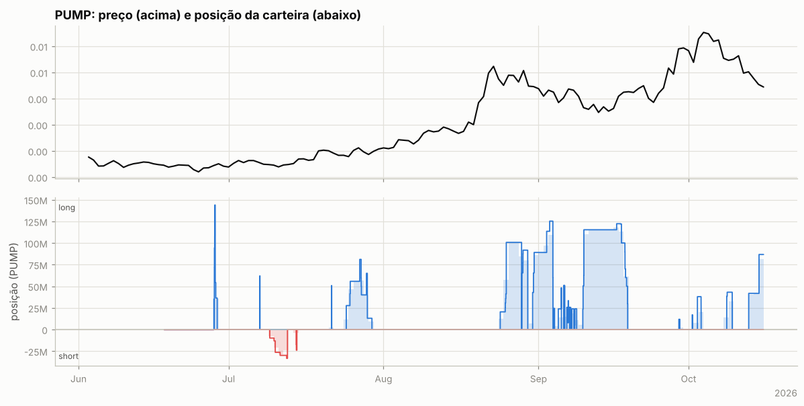

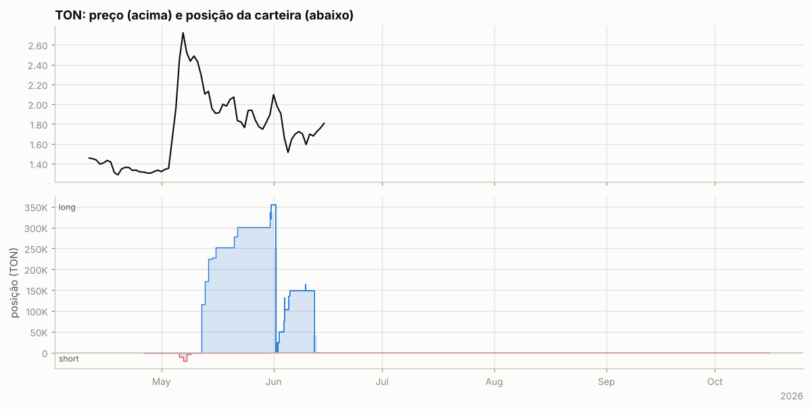

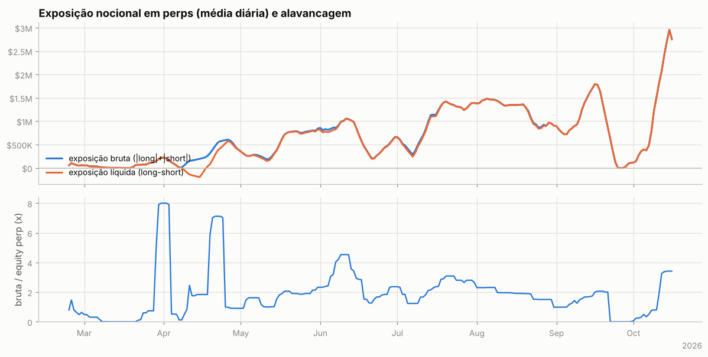

Tabela mensal de exposição e alavancagem

| mês | exposição bruta | exposição líquida | equity perp | alavancagem (mediana) |
|---|---|---|---|---|
| 2026-02 | $58.3K | $58.3K | $73.2K | 0.6x |
| 2026-03 | $71.4K | $71.4K | $64.8K | 0.2x |
| 2026-04 | $287.7K | $151.5K | $192.5K | 1.2x |
| 2026-05 | $577.5K | $560.9K | $302.9K | 1.9x |
| 2026-06 | $657.6K | $644.5K | $249.7K | 2.7x |
| 2026-07 | $1.05M | $1.04M | $444.5K | 2.3x |
| 2026-08 | $1.18M | $1.17M | $685.7K | 1.9x |
| 2026-09 | $804.0K | $803.1K | $695.6K | 1.2x |
| 2026-10 | $1.75M | $1.75M | $863.7K | 1.8x |

## 5. Execução

**Tipos de ordem** (últimas 1,012 ordens que a API guarda, 2026-08-22 → 2026-10-15):

| orderType | tif | reduceOnly | isTrigger | ordens |
|---|---|---|---|---|
| Limit | Gtc | False | False | 629 |
| Limit | Gtc | True | False | 255 |
| Market | FrontendMarket | False | False | 79 |
| Market | FrontendMarket | True | False | 48 |

`FrontendMarket` = ordem a mercado enviada pela interface web; `Gtc` = limite que fica no livro; gatilhos (`isTrigger`) seriam stop/take-profit.

**Perfil por ativo (top 10 por volume):**

| ativo | volume | ordens | % taker (nocional) | tamanho mediano |
|---|---|---|---|---|
| HYPE | $15.57M | 235 | 19% | 997.1 |
| SOL | $10.34M | 118 | 20% | 741.6 |
| PUMP | $9.40M | 143 | 18% | 1.389e+07 |
| XRP | $8.07M | 37 | 37% | 6.821e+04 |
| BTC | $4.47M | 51 | 12% | 1 |
| xyz:MU | $3.88M | 133 | 25% | 22.04 |
| xyz:MRVL | $3.05M | 121 | 31% | 63.39 |
| ONDO | $2.83M | 38 | 11% | 1.501e+05 |
| NEAR | $2.53M | 65 | 28% | 1.059e+04 |
| WLD | $2.41M | 64 | 24% | 6.394e+04 |

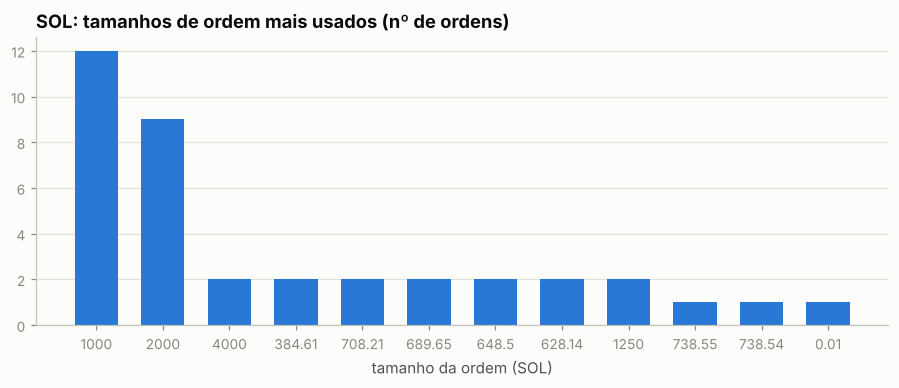

Os 5 tamanhos mais comuns respondem por 23% das ordens de SOL — lotes redondos e repetidos são assinatura de execução manual.

Sessões (ordens separadas por < 30 min): 764; mediana de 2 ordens e 0.5 min por sessão; dias com atividade: 126 de 144.

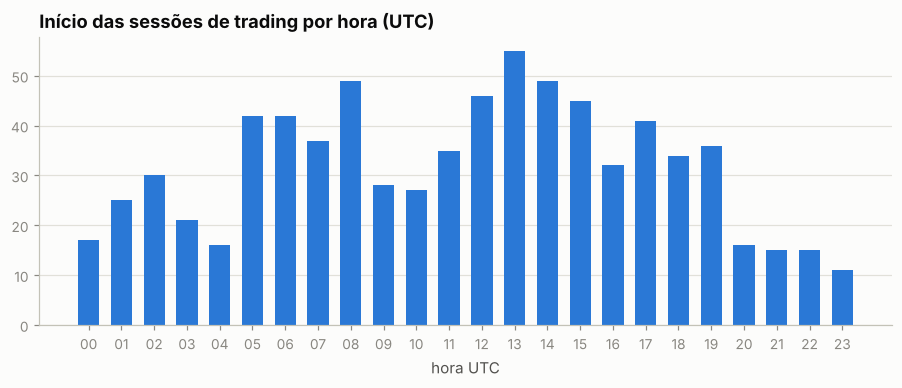

Por dia da semana: seg 16%, ter 16%, qua 19%, qui 16%, sex 13%, sáb 10%, dom 9%

## 6. Comportamento de entrada e saída

### SOL

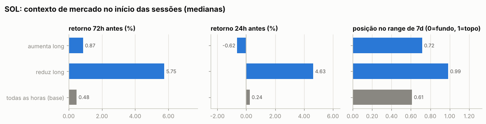

Por ordem (medianas):

| ação | ordens | retorno 24h antes | 72h antes | 7d antes | posição no range 7d | 24h depois | 7d depois |
|---|---|---|---|---|---|---|---|
| aumenta short | 3 | +0.83% | +8.35% | +13.38% | 0.87 | -1.50% | -4.42% |
| reduz short | 2 | +2.21% | +6.14% | +11.48% | 0.94 | +3.38% | -1.19% |
| aumenta long | 69 | -0.72% | +2.14% | +2.35% | 0.73 | -0.02% | +2.65% |
| reduz long | 44 | +3.25% | +5.70% | +10.50% | 0.88 | +0.20% | +7.24% |
| todas as horas (base) |  | +0.24% | +0.48% | +0.86% | 0.61 | +0.29% | +1.23% |

Por sessão (ordens a menos de 30 min uma da outra contam como uma decisão; p = teste de Mann-Whitney contra todas as horas do período):

| sessão | sessões | retorno 24h antes | 72h antes | 7d antes | range 7d | no topo (>0,7) | no fundo (<0,3) |
|---|---|---|---|---|---|---|---|
| aumenta long | 40 | -0.62% (p=0.034) | +0.87% (p=0.840) | +2.98% (p=0.396) | 0.72 (p=0.931) | 52% | 22% |
| reduz long | 28 | +4.63% (p=<1e-4) | +5.75% (p=<1e-4) | +12.03% (p=<1e-4) | 0.99 (p=<1e-4) | 93% | 4% |
| todas as horas (base) |  |  |  |  |  | 43% | 29% |

- Aumentos de posição feitos com a posição no prejuízo (preço pior que o preço médio): **63%** das ordens (53% do tamanho); distância mediana do preço médio: +0.47%.
- Reduções/fechamentos com lucro: **96%** de 46; ganho médio $9.1K vs. perda média -$339; realizado +$398.4K.

- Episódios (de zerado a zerado, ou até inverter): 13; fechados com lucro: 85%; duração mediana 0.6 dias; o melhor episódio sozinho = 89% da soma dos episódios lucrativos.

Maiores episódios por PnL realizado

| início | fim | dias | lado | tam_max | nocional_max | ordens | entrada | saída | realizado |
|---|---|---|---|---|---|---|---|---|---|
| 2026-07-05 | 2026-08-27 | 53.3 | long | 17,145 | $1.42M | 56 | 82.26 | 93.23 | +$355.3K |
| 2026-06-20 | 2026-06-27 | 6.6 | long | 4,244 | $308.5K | 16 | 68.44 | 72.78 | +$18.4K |
| 2026-06-28 | 2026-06-29 | 0.8 | long | 4,957 | $364.0K | 13 | 71.76 | 73.55 | +$10.6K |
| 2026-06-15 | 2026-06-15 | 0.0 | long | 4,000 | $299.2K | 3 | 73.81 | 74.80 | +$4.0K |
| 2026-06-29 | 2026-07-01 | 1.4 | long | 6,011 | $453.4K | 9 | 74.88 | 75.47 | +$3.6K |
| 2026-06-04 | 2026-06-04 | 0.1 | long | 738.55 | $52.7K | 3 | 67.70 | 71.30 | +$2.7K |
| 2026-08-28 | 2026-09-03 | 5.9 | long | 4,000 | $410.0K | 3 | 101.95 | 102.51 | +$2.2K |
| 2026-06-27 | 2026-06-28 | 0.7 | long | 708.21 | $51.0K | 2 | 70.60 | 72.00 | +$995 |
| 2026-07-01 | 2026-07-01 | 0.0 | long | 1,000 | $74.8K | 2 | 74.25 | 74.82 | +$568 |
| 2026-06-29 | 2026-06-29 | 0.0 | long | 689.65 | $50.6K | 3 | 72.50 | 73.30 | +$552 |

### PUMP

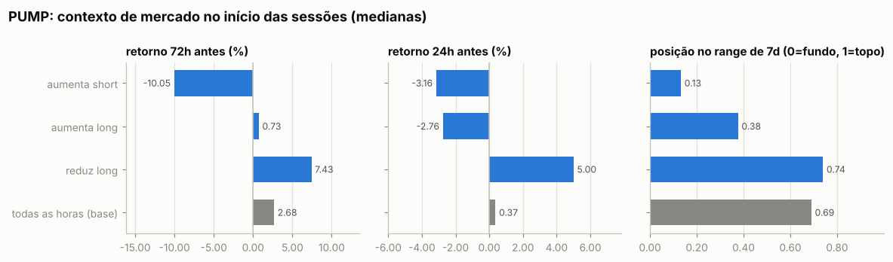

Por ordem (medianas):

| ação | ordens | retorno 24h antes | 72h antes | 7d antes | posição no range 7d | 24h depois | 7d depois |
|---|---|---|---|---|---|---|---|
| aumenta short | 8 | -2.35% | -6.80% | -10.03% | 0.16 | +3.01% | +16.06% |
| reduz short | 4 | -0.07% | -3.61% | -11.38% | 0.20 | +2.22% | +17.70% |
| aumenta long | 61 | -1.79% | +2.13% | +1.63% | 0.50 | +1.03% | -7.51% |
| reduz long | 70 | +1.24% | +4.10% | -0.00% | 0.76 | -1.81% | -7.51% |
| todas as horas (base) |  | +0.37% | +2.68% | +9.17% | 0.69 | +0.18% | +8.90% |

Por sessão (ordens a menos de 30 min uma da outra contam como uma decisão; p = teste de Mann-Whitney contra todas as horas do período):

| sessão | sessões | retorno 24h antes | 72h antes | 7d antes | range 7d | no topo (>0,7) | no fundo (<0,3) |
|---|---|---|---|---|---|---|---|
| aumenta short | 3 | -3.16% (p=0.133) | -10.05% (p=0.054) | -4.08% (p=0.100) | 0.13 (p=0.030) | 0% | 100% |
| aumenta long | 34 | -2.76% (p=0.000) | +0.73% (p=0.040) | -1.50% (p=0.006) | 0.38 (p=0.000) | 18% | 38% |
| reduz long | 26 | +5.00% (p=0.029) | +7.43% (p=0.125) | -1.22% (p=0.045) | 0.74 (p=0.218) | 54% | 23% |
| todas as horas (base) |  |  |  |  |  | 48% | 25% |

- Aumentos de posição feitos com a posição no prejuízo (preço pior que o preço médio): **62%** das ordens (66% do tamanho); distância mediana do preço médio: +1.02%.
- Reduções/fechamentos com lucro: **85%** de 74; ganho médio $2.8K vs. perda média -$335; realizado +$171.9K.

- Episódios (de zerado a zerado, ou até inverter): 22; fechados com lucro: 90%; duração mediana 0.6 dias; o melhor episódio sozinho = 17% da soma dos episódios lucrativos.

Maiores episódios por PnL realizado

| início | fim | dias | lado | tam_max | nocional_max | ordens | entrada | saída | realizado |
|---|---|---|---|---|---|---|---|---|---|
| 2026-09-09 | 2026-09-18 | 9.0 | long | 122,291,985 | $494.1K | 18 | 0.004049 | 0.004291 | +$29.8K |
| 2026-08-24 | 2026-08-28 | 4.3 | long | 100,689,146 | $493.4K | 10 | 0.004661 | 0.004918 | +$25.9K |
| 2026-08-28 | 2026-08-29 | 1.2 | long | 91,753,108 | $445.0K | 6 | 0.00458 | 0.00485 | +$24.9K |
| 2026-10-02 | 2026-10-03 | 0.7 | long | 37,943,343 | $216.3K | 6 | 0.005238 | 0.005763 | +$19.9K |
| 2026-06-28 | 2026-06-28 | 0.6 | long | 143,929,652 | $215.9K | 12 | 0.00139 | 0.001498 | +$15.5K |
| 2026-07-24 | 2026-07-29 | 5.1 | long | 81,051,822 | $173.5K | 19 | 0.00189 | 0.002025 | +$14.4K |
| 2026-09-06 | 2026-09-07 | 0.8 | long | 33,360,017 | $129.8K | 7 | 0.003974 | 0.004185 | +$13.7K |
| 2026-09-07 | 2026-09-08 | 0.4 | long | 23,877,745 | $108.1K | 4 | 0.004188 | 0.004528 | +$8.1K |
| 2026-09-04 | 2026-09-04 | 0.1 | long | 24,509,803 | $106.4K | 3 | 0.00408 | 0.00434 | +$6.4K |
| 2026-09-06 | 2026-09-06 | 0.1 | long | 50,955,414 | $206.4K | 3 | 0.003949 | 0.004051 | +$5.2K |

### TON

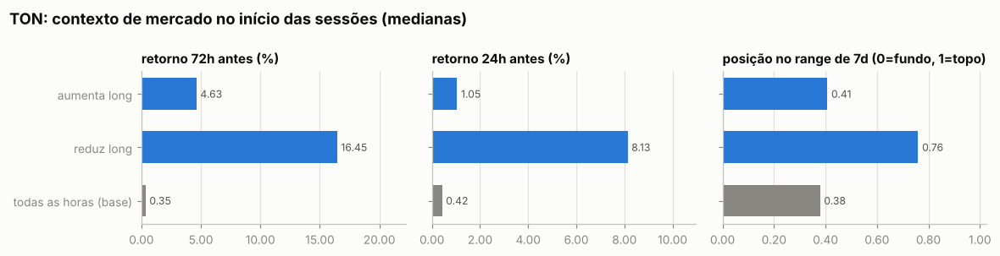

Por ordem (medianas):

| ação | ordens | retorno 24h antes | 72h antes | 7d antes | posição no range 7d | 24h depois | 7d depois |
|---|---|---|---|---|---|---|---|
| aumenta long | 11 | -3.90% | +4.41% | +2.35% | 0.39 | -3.66% | -8.61% |
| reduz long | 8 | +6.66% | +11.36% | +5.23% | 0.79 | -4.42% | -12.08% |
| todas as horas (base) |  | +0.42% | +0.35% | -7.47% | 0.38 | -0.29% | -2.01% |

Por sessão (ordens a menos de 30 min uma da outra contam como uma decisão; p = teste de Mann-Whitney contra todas as horas do período):

| sessão | sessões | retorno 24h antes | 72h antes | 7d antes | range 7d | no topo (>0,7) | no fundo (<0,3) |
|---|---|---|---|---|---|---|---|
| aumenta long | 8 | +1.05% (p=0.906) | +4.63% (p=0.576) | +3.07% (p=0.078) | 0.41 (p=0.951) | 12% | 38% |
| reduz long | 3 | +8.13% (p=0.047) | +16.45% (p=0.114) | +5.23% (p=0.083) | 0.76 (p=0.008) | 67% | 0% |
| todas as horas (base) |  |  |  |  |  | 8% | 29% |

- Aumentos de posição feitos com a posição no prejuízo (preço pior que o preço médio): **80%** das ordens (68% do tamanho); distância mediana do preço médio: +6.52%.
- Reduções/fechamentos com lucro: **50%** de 8; ganho médio $2.8K vs. perda média -$3.0K; realizado -$672.

- Episódios (de zerado a zerado, ou até inverter): 2; fechados com lucro: 50%; duração mediana 5.8 dias; o melhor episódio sozinho = 100% da soma dos episódios lucrativos.

Maiores episódios por PnL realizado

| início | fim | dias | lado | tam_max | nocional_max | ordens | entrada | saída | realizado |
|---|---|---|---|---|---|---|---|---|---|
| 2026-06-02 | 2026-06-12 | 10.2 | long | 162,706 | $278.6K | 15 | 1.84 | 1.79 | -$11.3K |
| 2026-05-31 | 2026-06-01 | 1.4 | long | 355,035 | $770.4K | 4 | 1.85 | 2.20 | +$10.7K |

### Todos os episódios relevantes (todas as moedas)

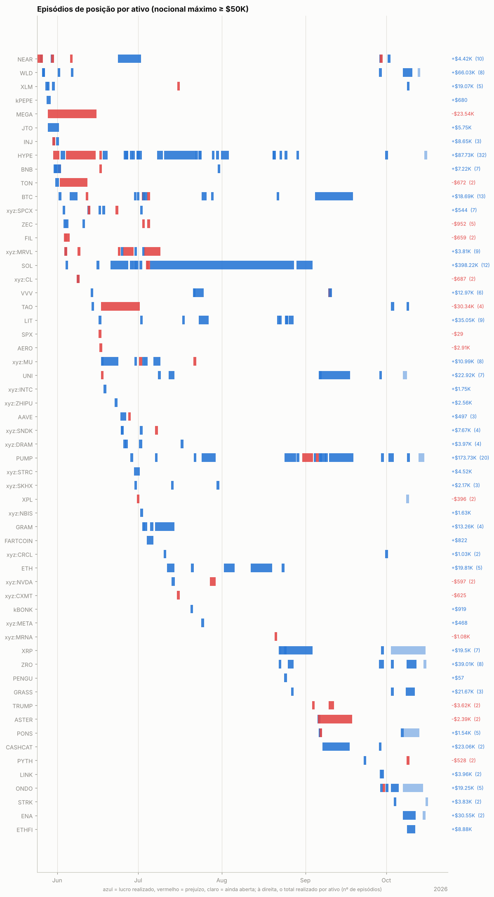

Episódios com nocional máximo ≥ $50K: 258; fechados com lucro: 79%. Abaixo, os 25 maiores por PnL realizado, em ordem de data. *7d/30d antes* e *vs. máx. 30d*: o que o preço tinha feito até a primeira ordem; *funding a.a.*: taxa anualizada nas 24h anteriores (positiva = longs pagam shorts); *entrada média vs. 1ª ordem*: positivo = foi aumentando a posição com o preço indo contra; *contra (máx.)*: quanto o preço andou contra a primeira ordem durante o episódio; *capturado*: movimento entre o preço médio de entrada e o de saída.

| ativo | lado | início | dias | nocional máx. | 7d antes | 30d antes | vs. máx. 30d | funding a.a. na entrada | entrada média vs. 1ª ordem | contra (máx.) | pior PnL aberto | capturado | realizado | funding |
|---|---|---|---|---|---|---|---|---|---|---|---|---|---|---|
| XLM | long | 2026-05-28 | 0 | $136.9K | +20% | +7% | +0% | +12% | +1% | +4% | -$3.8K | +11% | +$13.9K | -$14 |
| MEGA | long | 2026-05-28 | 18 | $59.0K | -27% | -64% | -69% | -53% | -0% | +32% | -$17.9K | +7% | -$23.5K | +$21 |
| TON | long | 2026-06-02 | 10 | $278.6K | +8% | +56% | -27% | +11% | +11% | +30% | -$51.2K | -3% | -$11.3K | +$896 |
| HYPE | long | 2026-06-02 | 2 | $748.0K | +23% | +80% | -1% | +24% | +1% | +6% | -$39.5K | +4% | +$25.9K | -$906 |
| xyz:MRVL | long | 2026-06-03 | 0 | $308.4K | +46% | — | -4% | +76% | +1% | +1% | +$331 | +4% | +$11.2K | -$61 |
| HYPE | long | 2026-06-04 | 11 | $892.8K | +28% | +72% | -2% | +26% | +11% | +26% | -$161.8K | -3% | -$34.5K | -$2.7K |
| WLD | short | 2026-06-06 | 0 | $124.8K | +84% | +106% | -15% | +4% | +1% | +1% | -$366 | +14% | +$17.4K | -$22 |
| TAO | long | 2026-06-17 | 14 | $221.0K | +25% | -1% | -12% | +3% | +7% | +24% | -$39.2K | -15% | -$38.7K | -$589 |
| SOL | long | 2026-06-20 | 7 | $308.5K | +5% | -17% | -18% | +9% | +4% | +10% | -$17.9K | +6% | +$18.4K | +$182 |
| HYPE | long | 2026-06-25 | 0 | $596.4K | -12% | +2% | -18% | +11% | -3% | +0% | -$46 | +3% | +$18.6K | -$61 |
| PUMP | long | 2026-06-28 | 1 | $215.9K | -5% | -19% | -27% | +11% | -1% | -2% | $0 | +8% | +$15.5K | -$19 |
| SOL | long | 2026-07-05 | 53 | $1.42M | +12% | +23% | -4% | +11% | -3% | +11% | -$103.8K | +13% | +$355.3K | -$8.6K |
| PUMP | long | 2026-07-24 | 5 | $173.5K | +12% | +31% | -13% | +11% | -4% | +2% | -$1.7K | +7% | +$14.4K | -$111 |
| HYPE | long | 2026-08-24 | 1 | $481.8K | +34% | +39% | -4% | +20% | -0% | +0% | -$2.0K | +3% | +$14.6K | -$231 |
| PUMP | long | 2026-08-24 | 4 | $493.4K | +68% | +174% | -7% | +39% | +5% | +10% | -$23.1K | +6% | +$25.9K | -$858 |
| PUMP | long | 2026-08-28 | 1 | $445.0K | +16% | +155% | -10% | +12% | +3% | +4% | -$6.2K | +6% | +$24.9K | -$242 |
| BTC | long | 2026-09-04 | 14 | $805.0K | +2% | +27% | -1% | +9% | +1% | +6% | -$41.7K | +1% | +$11.3K | -$2.1K |
| UNI | long | 2026-09-06 | 11 | $305.7K | +46% | +77% | -4% | +19% | +6% | +17% | -$35.4K | +4% | +$13.1K | -$740 |
| PUMP | long | 2026-09-06 | 1 | $129.8K | -19% | +70% | -26% | +43% | -2% | +2% | -$1.8K | +5% | +$13.7K | -$147 |
| CASHCAT | long | 2026-09-07 | 10 | $229.6K | +7% | +129% | -28% | +26% | +15% | +31% | -$39.5K | +9% | +$20.4K | -$756 |
| PUMP | long | 2026-09-09 | 9 | $494.1K | +7% | +53% | -19% | +12% | +5% | +20% | -$77.6K | +6% | +$29.8K | -$729 |
| PUMP | long | 2026-10-02 | 1 | $216.3K | +41% | +42% | -4% | +15% | +2% | +2% | +$377 | +10% | +$19.9K | -$47 |
| ENA | long | 2026-10-07 | 5 | $282.0K | -6% | +35% | -20% | +12% | +3% | +10% | -$19.4K | +12% | +$30.6K | -$282 |
| WLD | long | 2026-10-07 | 4 | $348.1K | +10% | +32% | -11% | +11% | +4% | +10% | -$16.9K | +15% | +$44.5K | -$182 |
| GRASS | long | 2026-10-08 | 3 | $76.9K | -12% | +82% | -21% | +11% | +3% | +8% | -$3.3K | +21% | +$13.4K | -$65 |

## 7. Funding

Funding líquido total: **-$30.3K** (recebido $10.7K, pago -$41.0K). Na Hyperliquid o funding é pago de hora em hora; quando positivo, longs pagam shorts.

| ativo | lado | funding | rendimento anualizado s/ nocional |
|---|---|---|---|
| SOL | long | -$8.8K | -5.7% |
| PUMP | short | +$30 | 8.9% |
| PUMP | long | -$2.8K | -10.5% |
| TON | short | +$146 | 58.4% |
| TON | long | +$1.9K | 5.3% |
| (outros) | short | +$131 | 1.8% |
| (outros) | long | -$20.9K | -8.6% |

## 8. Fluxos, eventos e carteiras relacionadas

| tipo | eventos | USD (+ entra / − sai) |
|---|---|---|
| withdraw | 10 | -$127.4K |
| spotTransfer | 2 | +$54.6K |
| send | 19 | +$1.16M |

**Gestão de margem.** Dias com depósito: 5; em 80% deles o PnL dos 3 dias anteriores era negativo (mediana -$35.3K). Dias com saque: 15; em 60% deles o PnL dos 3 dias anteriores era positivo (mediana +$3.3K). Base: 50% de todos os dias vêm depois de 3 dias negativos. Correlação entre o fluxo do dia e a variação da exposição bruta: 0.19 (positiva = deposita para abrir posição e saca ao reduzir).

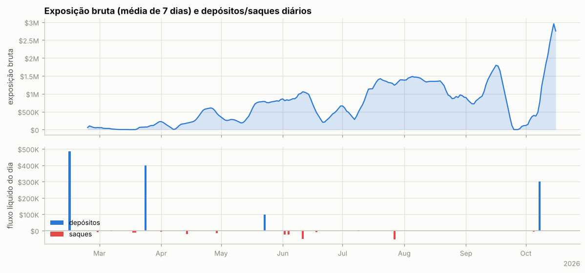

Ponte HyperCore↔HyperEVM (endereços de sistema `0x2000…`/`0x2222…`): 4 transferências, entrada $54.6K, saída $62.0K — uso de DeFi na HyperEVM.

**Carteiras relacionadas** (conta vinculada de staking para desconto de taxa + maiores contrapartes de transferências; o saldo de staking e o PnL ajudam a ver se posições aqui são hedge de algo mantido lá):

| carteira | relação | transferências | volume transferido | valor da conta hoje | PnL all-time | HYPE em staking | maiores saldos spot |
|---|---|---|---|---|---|---|---|
| `0x6b9e773128f453f5c2c60935ee2de2cbc5390a24` | hot wallet de serviço (recebe USDC da HyperEVM e repassa a centenas de usuários: exchange/ponte) | 3 | $798.5K | $7.8K | +$0 | 0 | USDC 7,687 |
| `0xf531ff6ee0030e780282a228adbe8dd0a9eb2466` | transfers | 2 | $351.0K | $0 | -$394.0K | 0 | USDC 0, HYPE 0 |
| `0x4acb90e786d897ecffb614dc822eb231b4ffb9f4` | transfers | 4 | $133.8K | $1 | -$394.0K | 0 | HYPE 0, USDC 0 |
| `0x4ee9acbac31d1513428b9cc61aa07bf8f51eea64` | transfers | 2 | $50.0K | $196.3K | +$96.3K | 0 | USDC 196,259 |
| `0x5251666f1066f018d2e802c0c34c5f11d2edf048` | transfers | 1 | $10.0K | $8.9K | +$6.2K | 0 | USDC 8,924 |
| `0x2b36505baab9b4b65f901b2a9397620cbbbf6360` | transfers | 1 | $1.0K | $352 | -$648 | 0 | USDC 352 |

## 9. Dá para copiar?

### Teste de copiabilidade

Antes de simular, o relatório confere se um copiador conseguiria seguir a carteira. O tempo em posição casa cada redução com o aumento mais recente (LIFO), então um market maker que compra e revende em minutos aparece com minutos, mesmo carregando estoque antigo.

| critério | valor | não copiável se |
|---|---|---|
| execuções de perps e HIP-3 (2026-05-24 → 2026-10-15) | 2,365 | < 20 |
| volume fechado que ficou aberto menos de 30 min | 19% | ≥ 50% |
| tempo mediano em posição (ponderado pelo volume) | 7.2 h |  |
| execuções por dia ativo; parte maker do nocional | 19; 76% | ≥ 300 e ≥ 80% (bot de market making) |

**Copiável:** nenhum critério bloqueia. A simulação abaixo mede quanto do resultado sobra com atraso.

### Copiar cada execução com 30 min, 1h, 2h e 4h de atraso

O copiador começa zerado em 2026-05-24 e repete cada fill de perps e HIP-3 da carteira no mesmo tamanho, com o atraso indicado, a mercado e pagando taxa *taker* de 0.045%. Posições já abertas antes não são copiadas: em cada moeda, a cópia começa quando a carteira zera ou inverte a posição. O preço da cópia é a abertura do candle que começa mais perto de *fill + atraso*: candles de 15m da Hyperliquid nos últimos ~52 dias, de 1h da Hyperliquid ou da Binance antes disso. O atraso real varia meio candle para cada lado, e o candle do próprio fill (muitas vezes o pavio que ele mesmo fez) nunca é usado. Carteira e cópia são marcadas no mesmo preço final (último fechamento diário). O funding fica de fora porque, com horas de atraso, é quase igual para as duas.

Entram na comparação 99% do volume de perps dos fills, em operações de 2026-05-24 a 2026-10-15 (posições herdadas: 1%; sem preço intradiário: 0%). Fonte do preço com 30 min de atraso: HL 1h 69%, HL 15m 31%.

| atraso | atraso médio real | carteira | cópia | fica com | efeito do preço | efeito da taxa | custo (bp do volume, IC 95%) | maior drawdown |
|---|---|---|---|---|---|---|---|---|
| 30 min | 31 min | +$1.12M | +$1.02M | 91% | -$77.0K | -$26.9K | 10.9 (1.2 a 20.7) | -$241.9K |
| 1h | 60 min | +$1.12M | +$881.0K | 79% | -$211.8K | -$26.9K | 25.1 (12.5 a 37.7) | -$236.6K |
| 2h | 120 min | +$1.12M | +$797.0K | 71% | -$295.8K | -$26.9K | 33.9 (16.0 a 51.9) | -$238.4K |
| 4h | 240 min | +$1.12M | +$606.9K | 54% | -$485.9K | -$26.9K | 53.9 (30.0 a 77.8) | -$238.1K |

Maior drawdown da carteira nas mesmas operações: -$228.8K. *Efeito do preço* e *efeito da taxa*: quanto o preço da cópia e a taxa *taker* mudam o resultado em relação à carteira (negativo = a cópia perde). O custo é carteira − cópia sobre o volume copiado; o IC vem da variação de um dia para outro. Os valores somam só as operações copiadas, não o PnL total da carteira.

Com 30 min de atraso a cópia fica com **91%** do resultado; com 4h, **54%**. O custo do atraso é maior que zero com 95% de confiança com 30 min, 1h, 2h e 4h de atraso.

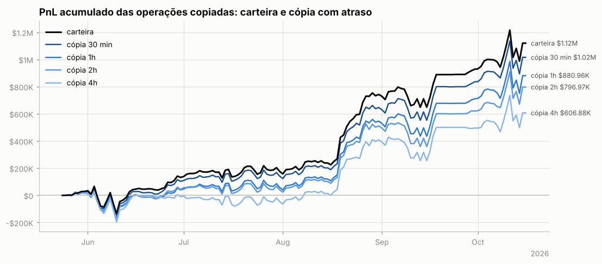

**Por ativo** (12 maiores pelo resultado da carteira):

| ativo | volume | carteira | 30 min | 1h | 2h | 4h | fica com (30 min) |
|---|---|---|---|---|---|---|---|
| SOL | $10.34M | +$396.5K | +$392.1K | +$353.6K | +$345.2K | +$331.2K | 99% |
| PUMP | $9.40M | +$158.2K | +$113.1K | +$94.6K | +$48.8K | +$55.1K | 71% |
| HYPE | $15.57M | +$90.1K | +$71.3K | +$67.2K | +$72.5K | +$49.6K | 79% |
| ZRO | $1.30M | +$79.6K | +$70.8K | +$69.2K | +$72.5K | +$67.2K | 89% |
| WLD | $2.41M | +$78.1K | +$69.9K | +$71.7K | +$55.1K | +$40.8K | 89% |
| ONDO | $2.83M | +$43.5K | +$56.1K | +$44.7K | +$34.4K | -$14.7K | 129% |
| ENA | $736.9K | +$37.6K | +$29.8K | +$30.0K | +$36.4K | +$35.0K | 79% |
| LIT | $1.97M | +$35.5K | +$22.9K | +$23.0K | +$27.3K | +$19.7K | 64% |
| XRP | $8.07M | -$30.5K | -$39.0K | -$40.9K | -$47.4K | -$50.0K | — |
| CASHCAT | $934.2K | +$30.3K | +$24.9K | +$22.0K | +$16.4K | +$14.9K | 82% |
| TAO | $1.38M | -$30.2K | -$32.2K | -$33.5K | -$26.6K | -$22.9K | — |
| GRASS | $602.5K | +$22.8K | +$24.9K | +$23.9K | +$21.1K | +$16.9K | 109% |

**Por tipo de execução da carteira.** Numa ordem limite a carteira compra abaixo e vende acima do preço corrente; a cópia a mercado perde essa vantagem. Numa ordem a mercado as duas pagam o *spread*:

| execução da carteira | fills | volume | carteira | 30 min | 1h | 2h | 4h |
|---|---|---|---|---|---|---|---|
| limite (maker) | 22,178 | $72.11M | +$325.8K | +$213.5K | +$120.0K | +$68.8K | -$5.0K |
| a mercado (taker) | 11,270 | $23.03M | +$793.8K | +$802.2K | +$760.9K | +$728.1K | +$611.9K |

### Espelhar a posição com atraso longo (moedas principais)

PnL de quem replicasse exatamente a posição da carteira, mas com N horas de atraso (marcação horária, sem custos). Se o PnL se mantém com atraso, a vantagem está em horizontes longos e é copiável; se desaba, depende de timing fino.

| atraso | SOL | PUMP | TON |
|---|---|---|---|
| 0h | +$393.4K | +$115.6K | +$125.1K |
| 1h | +$351.6K | +$89.4K | +$98.0K |
| 4h | +$353.4K | +$49.2K | +$83.6K |
| 12h | +$374.8K | +$45.3K | +$71.4K |
| 24h | +$340.3K | +$4.9K | -$3.8K |
| 72h | +$441.7K | -$50.3K | -$76.7K |
| 168h | +$433.0K | -$29.0K | -$248 |

## 10. Teste de replicação por regras (SOL)

Regra testada: *short-bias com filtro de tendência e fade* — short de até 1.44e+04 SOL (o percentil 90 do tamanho real), cheio abaixo da média móvel e reduzido acima; dentro do regime, mais short perto do topo do range e menos perto do fundo. Parâmetros escolhidos no treino (2026-02-23 → 2026-06-20) e avaliados no teste (2026-06-21 → 2026-10-15).

|  | parâmetros | PnL treino | PnL teste | correlação c/ posição real (teste) |
|---|---|---|---|---|
| melhor regra no treino | MA50, range 7d, fração em alta 1.0, fade 0.0 | +$127.7K | -$434.8K | nan |
| carteira real (aprox.) | — | +$9.2K | +$267.8K | 1.00 |

Clone comportamental (regressão linear da posição real em médias móveis, ranges e retornos): R² treino 0.47, R² teste -0.97, correlação no teste 0.39.

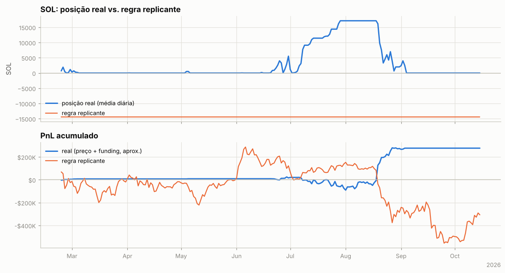

---

Metodologia e código: ver `README.md` na raiz do repositório.
