# Relatório automático — `0xa5fd942d4badbab4fe84a9e10f565dd40d5f15ff`

Gerado em 2026-10-15 22:49 UTC a partir da API pública da Hyperliquid (`POST /info`). Valores em USD. Este arquivo é regenerado por `python -m hlre.report`; a interpretação da estratégia fica em `ANALISE.md`.

## 1. Visão geral

| métrica | valor |
|---|---|
| Valor da conta (perp + spot) | $2.52M |
| PnL all-time (portfolio, inclui spot/airdrops) | +$2.28M |
| PnL all-time só de perps | +$2.21M |
| Volume all-time | $352.75M |
| Primeira atividade | 2024-03-13 |
| Fills disponíveis na API | 27,758 (desde 2024-12-21) |
| Ordens (fills agrupados por oid) | 3,572 |
| Funding líquido (recebido > 0) | -$236.3K |
| Taxas pagas (período dos fills) | -$19.1K |
| Liquidações (ledger) | 0 |
| Fills de liquidação/ADL | 276 |
| Papel da conta | user |
| API wallets (agentes) | 0 |

**Posições abertas agora:**

| ativo | tamanho | nocional | entrada | alav. | PnL não realizado | liq. |
|---|---|---|---|---|---|---|
| BTC | 7.16336 | $590.8K | 77555.0 | 40x cross | +$35.2K | — |
| ETH | 205.3788 | $505.1K | 2705.0 | 20x cross | -$50.5K | — |
| ARB | 597453.9 | $117.0K | 0.19996 | 10x cross | -$2.4K | — |
| XRP | 286737.0 | $384.6K | 1.481294 | 20x cross | -$40.1K | — |
| BCH | 621.2 | $173.3K | 357.73 | 10x cross | -$48.9K | — |
| APT | -157624.13 | $131.5K | 0.6258 | 5x cross | -$32.9K | 9.8863681608 |
| WLD | 764405.5 | $385.2K | 0.52117 | 10x cross | -$13.2K | — |
| ZRO | 7102.2 | $14.9K | 1.8919 | 5x cross | +$1.5K | — |
| DOT | -30286.4 | $35.2K | 1.35863 | 10x cross | +$6.0K | 48.2720382656 |
| BLUR | -2818381.0 | $30.9K | 0.011827 | 3x cross | +$2.4K | 0.4665940298 |
| PENDLE | 33681.0 | $70.3K | 2.578198 | 5x cross | -$16.5K | — |
| IMX | -221450.1 | $36.9K | 0.3975 | 5x cross | +$51.1K | 6.316750553 |
| XAI | -3365292.2 | $29.2K | 0.00934 | 3x cross | +$2.3K | 0.3902498656 |
| ETHFI | 154958.2 | $103.9K | 0.72915 | 5x cross | -$9.1K | — |
| ENA | -204111.0 | $42.0K | 0.20797 | 5x cross | +$430 | 7.1962172578 |
| MNT | 76548.3 | $40.7K | 0.56515 | 5x cross | -$2.5K | — |
| MERL | 3571425.0 | $103.2K | 0.028 | 3x cross | +$3.2K | — |
| REZ | 45650307.0 | $172.5K | 0.002812 | 3x cross | +$44.1K | — |
| ALGO | -362315.0 | $42.6K | 0.092 | 5x cross | -$9.3K | 3.8766019735 |
| HYPE | 4124.54 | $340.0K | 81.919 | 3x cross | +$2.1K | — |
| BERA | -103569.1 | $23.1K | 0.19722 | 5x cross | -$2.7K | 13.3736431511 |
| KAITO | 75756.0 | $22.7K | 0.44 | 5x cross | -$10.6K | — |
| WLFI | -892155.0 | $51.1K | 0.075161 | 5x cross | +$16.0K | 1.5838166191 |
| LINEA | -6326871.0 | $18.8K | 0.003407 | 3x cross | +$2.8K | 0.2059321106 |
| 0G | -48295.0 | $12.5K | 0.520231 | 3x cross | +$12.7K | 26.8474782765 |
| 2Z | -198658.0 | $6.6K | 0.118904 | 3x cross | +$17.0K | 6.4974632498 |
| MET | 710521.0 | $269.8K | 0.323291 | 2x isolated | +$40.1K | 0.1533630666 |
| MEGA | -483201.0 | $22.3K | 0.036935 | 3x cross | -$4.5K | 2.7036896423 |
| LIT | 17720.0 | $54.8K | 3.3469 | 4x isolated | -$4.5K | 2.7881596038 |
| XMR | 495.855 | $272.1K | 414.844 | 5x cross | +$66.4K | — |
| CASHCAT | 1799261.0 | $224.3K | 0.117325 | 3x isolated | +$13.2K | 0.0942784095 |
| PONS | 253128.0 | $85.6K | 0.658425 | 3x cross | -$81.1K | — |

## 2. Curva de PnL

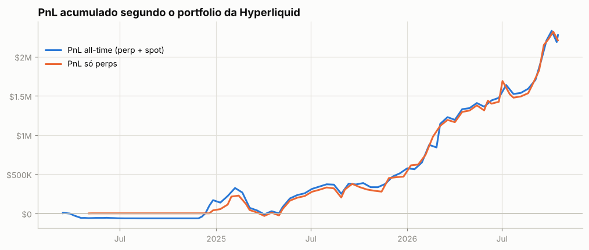

**Atenção: execuções que não aparecem nos fills.** A posição muda sem fill visível em 11 pontos (~$160.2K de nocional; maiores: HYPE $160.2K). O mais comum são fatias de TWAP: ficam fora de `userFills` e o endpoint de TWAP só guarda as 2.000 mais recentes. O *preço exato* e as tabelas por episódio dessas moedas não são exatos.

## 3. De onde veio o PnL

*Preço (aprox.)* usa a posição média diária de cada ativo, reconstruída a partir do histórico de funding (que traz o tamanho da posição a cada hora/dia desde o início da conta), vezes o movimento open→close do dia. Subestima o PnL de day trade, mas cobre o período sem fills. *Preço exato* marca cada fill no fechamento diário e só existe para o período coberto pelos fills.

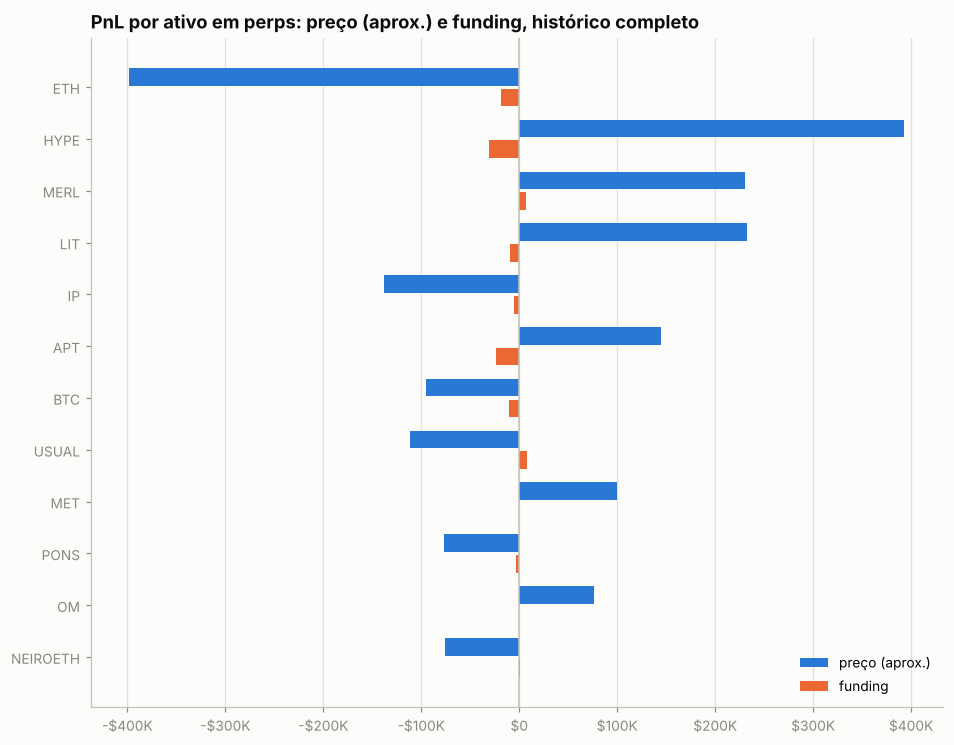

| ativo | preço (aprox.) | funding | total | preço exato (período dos fills) | taxas (período dos fills) |
|---|---|---|---|---|---|
| ETH | -$397.9K | -$18.4K | -$416.2K | -$20.6K | -$6.0K |
| HYPE | +$393.2K | -$30.5K | +$362.7K | +$186.6K | -$859 |
| MERL | +$230.8K | +$7.0K | +$237.8K | +$829 | -$25 |
| LIT | +$232.3K | -$9.6K | +$222.8K | +$266.0K | -$697 |
| IP | -$138.3K | -$5.4K | -$143.6K | +$69 | -$1 |
| APT | +$144.2K | -$23.7K | +$120.6K | -$36.2K | -$268 |
| BTC | -$95.1K | -$10.6K | -$105.7K | -$31.2K | -$6.2K |
| USUAL | -$112.0K | +$8.2K | -$103.8K | — | — |
| MET | +$99.8K | -$535 | +$99.3K | +$253.3K | -$75 |
| PONS | -$77.3K | -$3.5K | -$80.8K | -$75.1K | -$32 |
| OM | +$76.1K | -$135 | +$76.0K | — | — |
| NEIROETH | -$76.1K | +$790 | -$75.3K | — | — |
| ENA | -$67.2K | -$6.2K | -$73.4K | +$59.4K | -$163 |
| KAITO | -$79.3K | +$6.2K | -$73.2K | -$21.3K | -$45 |
| NEAR | +$76.6K | -$4.3K | +$72.3K | -$8.8K | -$391 |
| outros (115) | +$440.3K | -$145.8K | +$294.5K | +$465.7K | -$4.3K |

**Decomposição no período dos fills** (preço exato): quanto veio de *carregar* a posição (e, dentro disso, do viés médio vs. do *timing* de aumentar/reduzir), quanto de trades intradiários, funding e taxas.

| componente | ETH | HYPE | LIT |
|---|---|---|---|
| carregar posição (carry) | -$50.3K | +$161.5K | +$189.4K |
|   ↳ viés (posição média × movimento) | +$38.1K | +$42.7K | +$42.3K |
|   ↳ timing (variação do tamanho) | -$88.4K | +$118.8K | +$147.1K |
| trades intradiários | +$29.7K | +$25.1K | +$76.5K |
| funding | -$18.4K | -$30.2K | -$9.6K |
| taxas | -$6.0K | -$859 | -$697 |
| posição média | 87.17 | 848.89 | 24,709.76 |
| movimento do preço no período | 436.60 | 50.27 | 1.71 |

## 4. Posições ao longo do tempo

Área clara: posição média diária (funding). Linha: posição exata (fills). Azul = long, vermelho = short.

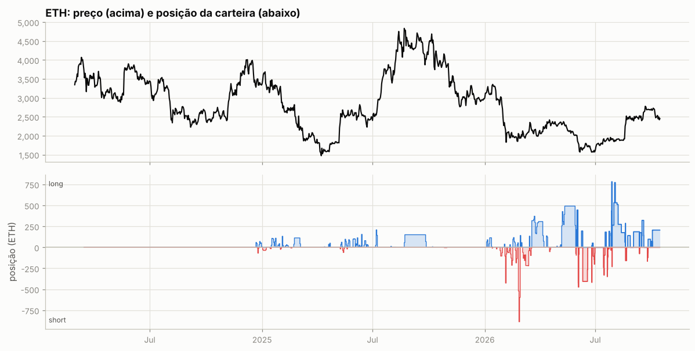

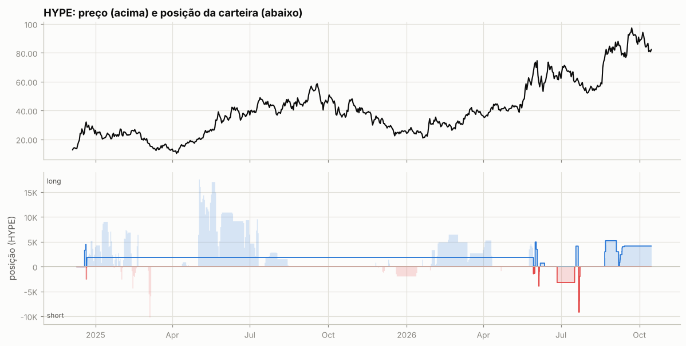

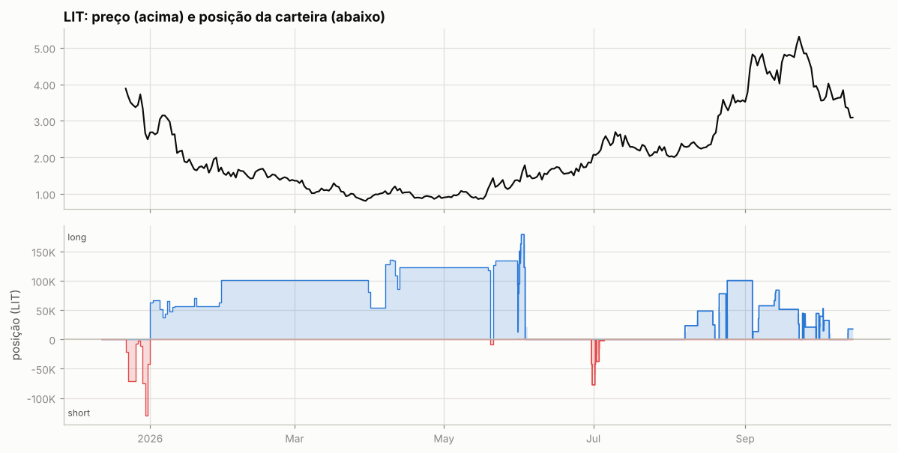

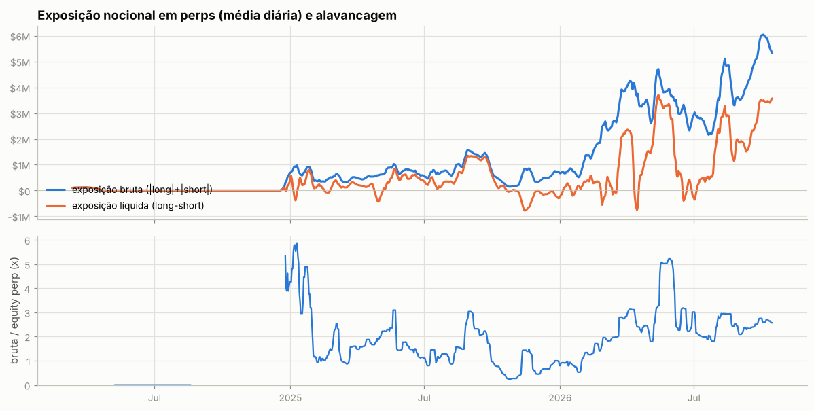

Tabela mensal de exposição e alavancagem

| mês | exposição bruta | exposição líquida | equity perp | alavancagem (mediana) |
|---|---|---|---|---|
| 2024-03 | $116.0K | $114.4K | — | — |
| 2024-04 | $43.1K | $43.0K | — | — |
| 2024-05 | $0 | $0 | $735 | 0.0x |
| 2024-06 | $0 | $0 | $949 | 0.0x |
| 2024-07 | $0 | $0 | $949 | 0.0x |
| 2024-08 | $0 | $0 | $398 | 0.0x |
| 2024-09 | $0 | $0 | $0 | — |
| 2024-10 | $0 | $0 | $0 | — |
| 2024-11 | $0 | $0 | $0 | — |
| 2024-12 | $193.6K | $100.5K | $35.5K | 4.3x |
| 2025-01 | $755.9K | $265.9K | $198.2K | 3.8x |
| 2025-02 | $424.6K | $118.7K | $329.2K | 1.2x |
| 2025-03 | $457.2K | $216.0K | $326.2K | 1.4x |
| 2025-04 | $523.4K | $27.6K | $300.2K | 1.7x |
| 2025-05 | $792.6K | $418.4K | $377.4K | 2.2x |
| 2025-06 | $704.3K | $497.9K | $502.1K | 1.4x |
| 2025-07 | $687.3K | $274.6K | $585.6K | 1.2x |
| 2025-08 | $1.06M | $761.7K | $601.3K | 1.5x |
| 2025-09 | $1.24M | $1.11M | $628.5K | 2.1x |
| 2025-10 | $286.0K | $87.6K | $614.0K | 0.4x |
| 2025-11 | $559.5K | -$362.8K | $607.2K | 0.8x |
| 2025-12 | $578.5K | -$151.5K | $745.5K | 0.8x |
| 2026-01 | $741.7K | $106.5K | $886.8K | 0.8x |
| 2026-02 | $1.79M | $173.4K | $1.11M | 1.5x |
| 2026-03 | $3.09M | $1.01M | $1.34M | 2.0x |
| 2026-04 | $3.62M | $946.1K | $1.42M | 2.5x |
| 2026-05 | $3.80M | $2.95M | $1.04M | 4.8x |
| 2026-06 | $3.01M | $319.1K | $1.09M | 2.6x |
| 2026-07 | $2.63M | $716.5K | $1.27M | 2.0x |
| 2026-08 | $4.11M | $2.26M | $1.52M | 2.8x |
| 2026-09 | $4.80M | $2.41M | $1.91M | 2.5x |
| 2026-10 | $5.62M | $3.50M | $2.15M | 2.6x |

## 5. Execução

**Tipos de ordem** (últimas 1,191 ordens que a API guarda, 2026-05-15 → 2026-10-15):

| orderType | tif | reduceOnly | isTrigger | ordens |
|---|---|---|---|---|
| Limit | Alo | False | False | 122 |
| Limit | Gtc | False | False | 812 |
| Limit | Gtc | True | False | 183 |
| Market | FrontendMarket | True | False | 2 |
| Market | LiquidationMarket | True | False | 1 |
| Stop Market | Gtc | True | False | 3 |
| Stop Market | Gtc | True | True | 6 |
| Take Profit Limit | Gtc | True | False | 1 |
| Take Profit Limit | Gtc | True | True | 2 |
| Take Profit Market | Gtc | True | False | 2 |
| Take Profit Market | Gtc | True | True | 10 |

`FrontendMarket` = ordem a mercado enviada pela interface web; `Gtc` = limite que fica no livro; gatilhos (`isTrigger`) seriam stop/take-profit.

**Perfil por ativo (top 10 por volume):**

| ativo | volume | ordens | % taker (nocional) | tamanho mediano |
|---|---|---|---|---|
| BTC | $35.78M | 198 | 26% | 0.3749 |
| ETH | $30.10M | 195 | 34% | 11.71 |
| LIT | $5.27M | 94 | 10% | 8,184 |
| HYPE | $4.91M | 869 | 22% | 0.49 |
| NEAR | $2.87M | 168 | 12% | 2,630 |
| SUI | $2.25M | 71 | 15% | 1.62e+04 |
| XRP | $1.88M | 41 | 38% | 8,689 |
| BNB | $1.85M | 70 | 26% | 9.96 |
| APT | $1.84M | 79 | 14% | 7,158 |
| xyz:BB | $1.82M | 43 | 13% | 91.8 |

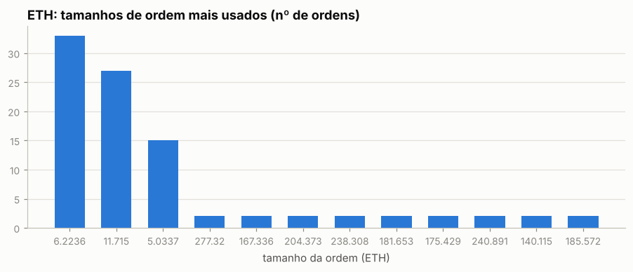

Os 5 tamanhos mais comuns respondem por 41% das ordens de ETH — lotes redondos e repetidos são assinatura de execução manual.

Sessões (ordens separadas por < 30 min): 637; mediana de 2 ordens e 0.0 min por sessão; dias com atividade: 129 de 663.

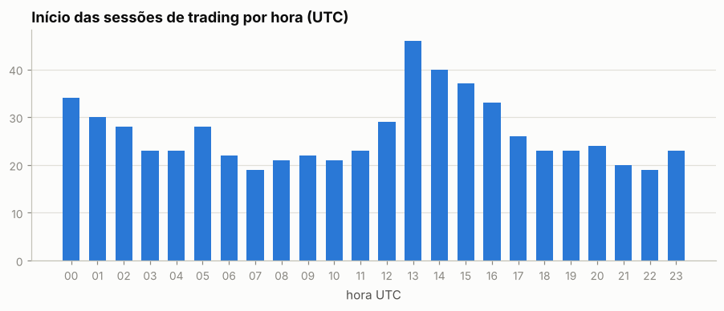

Por dia da semana: seg 16%, ter 15%, qua 17%, qui 15%, sex 15%, sáb 11%, dom 11%

## 6. Comportamento de entrada e saída

### ETH

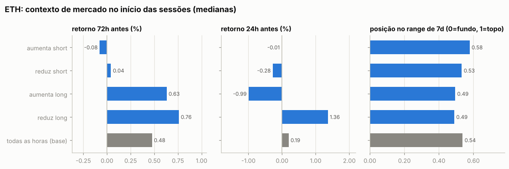

Por ordem (medianas):

| ação | ordens | retorno 24h antes | 72h antes | 7d antes | posição no range 7d | 24h depois | 7d depois |
|---|---|---|---|---|---|---|---|
| aumenta short | 52 | +3.14% | +4.66% | +4.41% | 1.00 | +0.98% | +2.39% |
| reduz short | 32 | +0.19% | +0.59% | +4.34% | 0.59 | -1.10% | +0.69% |
| aumenta long | 66 | +0.75% | +0.63% | +0.53% | 0.61 | -1.05% | -7.76% |
| reduz long | 39 | +1.73% | +1.05% | +0.41% | 0.65 | +0.34% | -0.35% |
| todas as horas (base) |  | +0.19% | +0.48% | +1.13% | 0.54 | +0.18% | +1.22% |

Por sessão (ordens a menos de 30 min uma da outra contam como uma decisão; p = teste de Mann-Whitney contra todas as horas do período):

| sessão | sessões | retorno 24h antes | 72h antes | 7d antes | range 7d | no topo (>0,7) | no fundo (<0,3) |
|---|---|---|---|---|---|---|---|
| aumenta short | 21 | -0.01% (p=0.519) | -0.08% (p=0.372) | -0.65% (p=0.130) | 0.58 (p=0.990) | 38% | 38% |
| reduz short | 20 | -0.28% (p=0.492) | +0.04% (p=0.468) | +3.30% (p=0.683) | 0.53 (p=0.995) | 25% | 15% |
| aumenta long | 21 | -0.99% (p=0.197) | +0.63% (p=0.959) | +0.45% (p=0.351) | 0.49 (p=0.362) | 38% | 38% |
| reduz long | 19 | +1.36% (p=0.028) | +0.76% (p=0.608) | +0.00% (p=0.274) | 0.49 (p=0.975) | 26% | 21% |
| todas as horas (base) |  |  |  |  |  | 38% | 26% |

- Aumentos de posição feitos com a posição no prejuízo (preço pior que o preço médio): **98%** das ordens (90% do tamanho); distância mediana do preço médio: +0.57%.
- Reduções/fechamentos com lucro: **73%** de 71; ganho médio $3.6K vs. perda média -$8.4K; realizado +$26.8K.

- Episódios (de zerado a zerado, ou até inverter): 31; fechados com lucro: 67%; duração mediana 1.6 dias; o melhor episódio sozinho = 17% da soma dos episódios lucrativos.

Maiores episódios por PnL realizado

| início | fim | dias | lado | tam_max | nocional_max | ordens | entrada | saída | realizado |
|---|---|---|---|---|---|---|---|---|---|
| 2026-08-19 | 2026-08-21 | 1.7 | short | 158.71 | $379.0K | 24 | 2,040 | 2,393 | -$56.0K |
| 2026-09-11 | 2026-09-18 | 7.1 | long | 321.39 | $807.6K | 7 | 2,484 | 2,549 | +$31.8K |
| 2026-09-01 | 2026-09-11 | 9.8 | long | 185.57 | $474.8K | 2 | 2,395 | 2,559 | +$30.4K |
| 2026-07-28 | 2026-08-19 | 21.8 | long | 772.27 | $1.46M | 8 | 1,870 | 1,909 | +$29.9K |
| 2026-05-31 | 2026-06-02 | 1.7 | long | 444.66 | $885.8K | 4 | 1,999 | 1,933 | -$29.5K |
| 2026-08-23 | 2026-08-27 | 4.2 | long | 140.11 | $358.2K | 2 | 2,379 | 2,556 | +$24.8K |
| 2026-06-10 | 2026-06-18 | 8.2 | short | 406.47 | $700.3K | 5 | 1,640 | 1,694 | -$21.9K |
| 2026-06-25 | 2026-06-25 | 0.4 | short | 418.57 | $682.7K | 5 | 1,633 | 1,591 | +$17.5K |
| 2026-08-19 | 2026-08-19 | 0.0 | long | 286.96 | $568.6K | 5 | 1,936 | 1,989 | +$15.2K |
| 2026-06-08 | 2026-06-10 | 2.0 | long | 194.51 | $329.1K | 4 | 1,692 | 1,622 | -$13.4K |

### HYPE

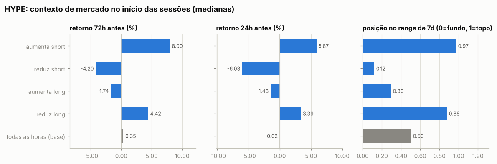

Por ordem (medianas):

| ação | ordens | retorno 24h antes | 72h antes | 7d antes | posição no range 7d | 24h depois | 7d depois |
|---|---|---|---|---|---|---|---|
| aumenta short | 13 | +6.03% | +8.95% | +16.33% | 0.99 | +2.18% | -12.40% |
| reduz short | 48 | +9.43% | +18.24% | +29.91% | 0.92 | +1.75% | -14.59% |
| aumenta long | 747 | +7.29% | +27.52% | +42.39% | 0.86 | -2.73% | -12.66% |
| reduz long | 59 | +7.29% | +27.52% | +42.39% | 0.86 | -2.73% | -12.66% |
| todas as horas (base) |  | -0.02% | +0.35% | +0.38% | 0.50 | -0.03% | +0.28% |

Por sessão (ordens a menos de 30 min uma da outra contam como uma decisão; p = teste de Mann-Whitney contra todas as horas do período):

| sessão | sessões | retorno 24h antes | 72h antes | 7d antes | range 7d | no topo (>0,7) | no fundo (<0,3) |
|---|---|---|---|---|---|---|---|
| aumenta short | 8 | +5.87% (p=0.092) | +8.00% (p=0.037) | +15.13% (p=0.061) | 0.97 (p=0.035) | 62% | 25% |
| reduz short | 15 | -6.03% (p=0.083) | -4.20% (p=0.261) | -1.96% (p=0.822) | 0.12 (p=0.027) | 33% | 67% |
| aumenta long | 16 | -1.48% (p=0.179) | -1.74% (p=0.535) | +0.16% (p=0.795) | 0.30 (p=0.069) | 25% | 50% |
| reduz long | 8 | +3.39% (p=0.159) | +4.42% (p=0.154) | +11.10% (p=0.125) | 0.88 (p=0.011) | 75% | 0% |
| todas as horas (base) |  |  |  |  |  | 34% | 32% |

- Aumentos de posição feitos com a posição no prejuízo (preço pior que o preço médio): **45%** das ordens (26% do tamanho); distância mediana do preço médio: -0.30%.
- Reduções/fechamentos com lucro: **33%** de 107; ganho médio $4.2K vs. perda média -$0; realizado +$145.4K.

- Episódios (de zerado a zerado, ou até inverter): 9; fechados com lucro: 88%; duração mediana 2.9 dias; o melhor episódio sozinho = 26% da soma dos episódios lucrativos.

Maiores episódios por PnL realizado

| início | fim | dias | lado | tam_max | nocional_max | ordens | entrada | saída | realizado |
|---|---|---|---|---|---|---|---|---|---|
| 2026-08-21 | 2026-09-13 | 23.0 | long | 5,198 | $458.0K | 37 | 78.86 | 88.31 | +$61.2K |
| 2026-07-21 | 2026-07-24 | 2.9 | short | 9,169 | $555.4K | 6 | 60.58 | 58.15 | +$22.2K |
| 2026-05-31 | 2026-06-03 | 3.0 | long | 4,933 | $370.1K | 8 | 68.90 | 72.95 | +$20.7K |
| 2026-07-18 | 2026-07-21 | 2.7 | long | 4,110 | $258.8K | 2 | 58.40 | 62.96 | +$18.8K |
| 2026-06-04 | 2026-06-05 | 0.7 | short | 3,928 | $250.0K | 12 | 63.64 | 60.09 | +$14.0K |
| 2026-06-26 | 2026-07-17 | 20.6 | short | 3,220 | $200.1K | 5 | 62.14 | 60.68 | +$4.7K |
| 2024-12-21 | 2026-05-31 | 525.6 | long | 1,844 | $100.0K | 771 | 66.04 | 65.78 | +$3.1K |
| 2026-06-06 | 2026-06-11 | 5.0 | long | 687.54 | $40.6K | 5 | 56.22 | 59.00 | +$1.9K |
| 2024-12-21 | 2024-12-21 | 0.0 | short | 99.12 | $3.2K | 25 | — | 32.36 | -$32 |

### LIT

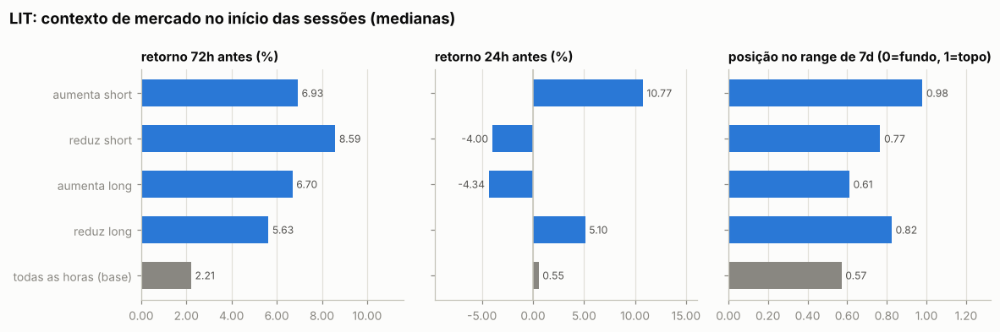

Por ordem (medianas):

| ação | ordens | retorno 24h antes | 72h antes | 7d antes | posição no range 7d | 24h depois | 7d depois |
|---|---|---|---|---|---|---|---|
| aumenta short | 3 | +10.77% | +6.93% | +21.37% | 0.98 | +0.58% | +36.52% |
| reduz short | 4 | +0.05% | +7.99% | +25.50% | 0.88 | +7.23% | +20.48% |
| aumenta long | 57 | -3.00% | -0.85% | -4.62% | 0.53 | -0.97% | +1.83% |
| reduz long | 30 | +7.13% | +9.04% | +14.92% | 0.89 | +0.99% | -0.76% |
| todas as horas (base) |  | +0.55% | +2.21% | +4.24% | 0.57 | +0.52% | +3.25% |

Por sessão (ordens a menos de 30 min uma da outra contam como uma decisão; p = teste de Mann-Whitney contra todas as horas do período):

| sessão | sessões | retorno 24h antes | 72h antes | 7d antes | range 7d | no topo (>0,7) | no fundo (<0,3) |
|---|---|---|---|---|---|---|---|
| aumenta short | 3 | +10.77% (p=0.014) | +6.93% (p=0.131) | +21.37% (p=0.074) | 0.98 (p=0.013) | 100% | 0% |
| reduz short | 3 | -4.00% (p=0.567) | +8.59% (p=0.197) | +23.62% (p=0.048) | 0.77 (p=0.113) | 67% | 0% |
| aumenta long | 34 | -4.34% (p=0.000) | +6.70% (p=0.181) | -0.45% (p=0.058) | 0.61 (p=0.229) | 38% | 38% |
| reduz long | 16 | +5.10% (p=0.002) | +5.63% (p=0.088) | +10.43% (p=0.411) | 0.82 (p=0.029) | 56% | 12% |
| todas as horas (base) |  |  |  |  |  | 36% | 30% |

- Aumentos de posição feitos com a posição no prejuízo (preço pior que o preço médio): **88%** das ordens (54% do tamanho); distância mediana do preço médio: +3.68%.
- Reduções/fechamentos com lucro: **85%** de 34; ganho médio $10.9K vs. perda média -$8.7K; realizado +$272.2K.

- Episódios (de zerado a zerado, ou até inverter): 10; fechados com lucro: 78%; duração mediana 4.5 dias; o melhor episódio sozinho = 59% da soma dos episódios lucrativos.

Maiores episódios por PnL realizado

| início | fim | dias | lado | tam_max | nocional_max | ordens | entrada | saída | realizado |
|---|---|---|---|---|---|---|---|---|---|
| 2026-08-21 | 2026-09-03 | 13.6 | long | 100,402 | $445.8K | 8 | 3.08 | 4.07 | +$176.0K |
| 2026-05-31 | 2026-06-03 | 3.0 | long | 178,934 | $276.3K | 27 | 1.33 | 1.51 | +$54.0K |
| 2026-09-04 | 2026-09-23 | 19.3 | long | 83,959 | $379.1K | 15 | 4.36 | 4.82 | +$38.4K |
| 2026-09-25 | 2026-09-29 | 4.5 | long | 43,740 | $215.3K | 2 | — | 4.59 | -$21.6K |
| 2026-09-24 | 2026-09-25 | 0.6 | long | 44,622 | $237.8K | 5 | 5.03 | 5.32 | +$15.3K |
| 2026-09-29 | 2026-10-05 | 5.4 | long | 52,708 | $187.1K | 22 | 3.76 | 3.83 | +$7.6K |
| 2026-08-07 | 2026-08-19 | 12.2 | long | 48,444 | $117.2K | 4 | 2.29 | 2.42 | +$6.1K |
| 2026-06-30 | 2026-07-01 | 1.6 | short | 77,574 | $146.7K | 4 | 1.89 | 1.97 | -$6.0K |
| 2026-07-02 | 2026-07-05 | 3.2 | short | 37,666 | $80.0K | 3 | 2.12 | 2.06 | +$2.4K |
| 2026-10-12 | 2026-10-13 | 0.0 | long | 17,720 | $58.5K | 4 | 3.35 | — | $0 |

### Todos os episódios relevantes (todas as moedas)

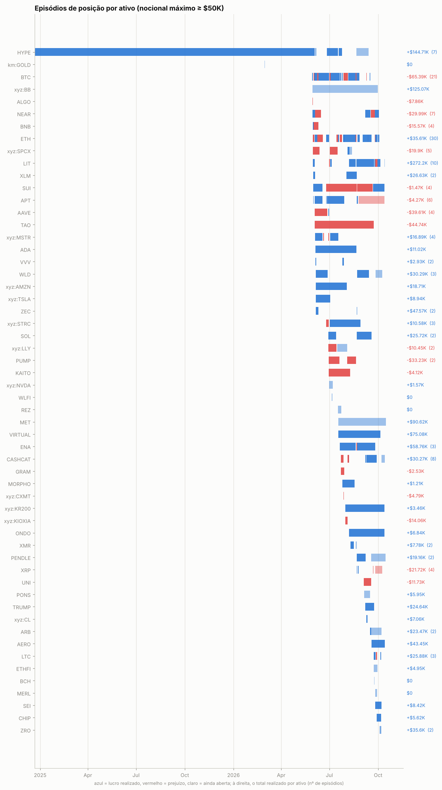

Episódios com nocional máximo ≥ $50K: 175; fechados com lucro: 66%. Abaixo, os 25 maiores por PnL realizado, em ordem de data. *7d/30d antes* e *vs. máx. 30d*: o que o preço tinha feito até a primeira ordem; *funding a.a.*: taxa anualizada nas 24h anteriores (positiva = longs pagam shorts); *entrada média vs. 1ª ordem*: positivo = foi aumentando a posição com o preço indo contra; *contra (máx.)*: quanto o preço andou contra a primeira ordem durante o episódio; *capturado*: movimento entre o preço médio de entrada e o de saída.

| ativo | lado | início | dias | nocional máx. | 7d antes | 30d antes | vs. máx. 30d | funding a.a. na entrada | entrada média vs. 1ª ordem | contra (máx.) | pior PnL aberto | capturado | realizado | funding |
|---|---|---|---|---|---|---|---|---|---|---|---|---|---|---|
| xyz:BB | long | 2026-05-29 | 124 | $1.02M | — | — | -3% | +125% | -11% | +15% | -$171.0K | +4% | +$125.1K | -$52.5K |
| NEAR | long | 2026-05-30 | 4 | $361.8K | +11% | +77% | -19% | +8% | -8% | +1% | -$1.0K | +10% | +$34.3K | -$129 |
| LIT | long | 2026-05-31 | 3 | $276.3K | +13% | +57% | -3% | +9% | +8% | +15% | -$19.5K | +14% | +$54.0K | -$105 |
| BNB | long | 2026-06-01 | 9 | $247.6K | +7% | +14% | -5% | +11% | +1% | +18% | -$30.0K | -12% | -$31.0K | -$129 |
| BTC | short | 2026-06-03 | 6 | $989.8K | -12% | -15% | -19% | +11% | -2% | +0% | -$20.9K | +4% | +$42.5K | +$562 |
| TAO | long | 2026-06-03 | 111 | $154.2K | -19% | -22% | -32% | +9% | — | +15% | -$3.2K | — | -$44.7K | -$686 |
| ZEC | long | 2026-06-05 | 5 | $96.4K | -39% | -44% | -52% | -18% | +3% | +5% | -$947 | +47% | +$30.9K | +$318 |
| BTC | long | 2026-06-08 | 2 | $1.44M | -12% | -21% | -23% | +9% | +0% | +3% | -$43.3K | -3% | -$39.0K | -$116 |
| BTC | short | 2026-07-01 | 2 | $817.7K | -7% | -19% | -18% | +6% | +0% | +6% | -$43.3K | -5% | -$38.7K | +$138 |
| MET | long | 2026-07-17 | 90 | $428.3K | -16% | +17% | -34% | -51% | -103% | +2% | -$1.6K | +46% | +$90.6K | +$4.7K |
| VIRTUAL | long | 2026-07-17 | 79 | $267.5K | +9% | +6% | -3% | -26% | -6% | +17% | -$23.2K | +20% | +$75.1K | -$3.4K |
| ETH | long | 2026-07-28 | 22 | $1.46M | -0% | +22% | -2% | +4% | +1% | +3% | -$26.6K | +2% | +$29.9K | -$2.4K |
| ETH | short | 2026-08-19 | 2 | $379.0K | +4% | +5% | +0% | +2% | +2% | +23% | -$52.9K | -17% | -$56.0K | +$182 |
| BTC | short | 2026-08-19 | 2 | $1.20M | +4% | +2% | -1% | +2% | +6% | +17% | -$60.8K | -7% | -$83.7K | +$304 |
| HYPE | long | 2026-08-21 | 23 | $458.0K | +31% | +26% | -1% | +21% | -6% | +1% | -$17.1K | +12% | +$61.2K | -$2.3K |
| LIT | long | 2026-08-21 | 14 | $445.8K | +24% | +22% | -6% | +54% | -11% | +3% | -$10.7K | +32% | +$176.0K | -$2.3K |
| ENA | long | 2026-08-22 | 34 | $197.9K | +83% | +72% | +0% | +85% | -12% | +17% | -$12.7K | +32% | +$47.9K | -$1.4K |
| APT | short | 2026-08-25 | 49 | $321.5K | +18% | +0% | -10% | +11% | +1% | +52% | -$63.2K | -20% | -$34.9K | +$2.0K |
| ETH | long | 2026-09-01 | 10 | $474.8K | -2% | +29% | -5% | +11% | -0% | +1% | -$4.2K | +7% | +$30.4K | -$1.3K |
| LIT | long | 2026-09-04 | 19 | $379.1K | +23% | +109% | -0% | +3% | -2% | +6% | -$24.7K | +10% | +$38.4K | -$1.9K |
| CASHCAT | long | 2026-09-08 | 20 | $238.0K | -18% | +66% | -40% | +11% | +12% | +13% | -$2.1K | +27% | +$51.0K | -$3.7K |
| ETH | long | 2026-09-11 | 7 | $807.6K | +7% | +38% | -1% | +10% | +3% | +6% | -$19.7K | +3% | +$31.8K | -$833 |
| NEAR | short | 2026-09-17 | 5 | $233.7K | +20% | +78% | -0% | +12% | +8% | +61% | -$66.0K | -38% | -$64.3K | +$552 |
| AERO | long | 2026-09-18 | 25 | $152.5K | +13% | +54% | -8% | +13% | -6% | +4% | -$3.9K | +28% | +$43.5K | -$2.3K |
| LTC | long | 2026-09-22 | 3 | $248.6K | +15% | +15% | -4% | +18% | -0% | +4% | -$9.4K | +15% | +$34.4K | -$402 |

## 7. Funding

Funding líquido total: **-$236.3K** (recebido $263.3K, pago -$499.6K). Na Hyperliquid o funding é pago de hora em hora; quando positivo, longs pagam shorts.

| ativo | lado | funding | rendimento anualizado s/ nocional |
|---|---|---|---|
| ETH | short | +$3.8K | 6.1% |
| ETH | long | -$22.2K | -7.4% |
| HYPE | short | +$2.4K | 12.1% |
| HYPE | long | -$32.9K | -19.2% |
| LIT | short | +$213 | 4.0% |
| LIT | long | -$9.8K | -11.6% |
| (outros) | short | -$134.9K | -15.8% |
| (outros) | long | -$43.0K | -2.5% |

## 8. Fluxos, eventos e carteiras relacionadas

| tipo | eventos | USD (+ entra / − sai) |
|---|---|---|
| withdraw | 2 | -$36.3K |
| send | 4 | -$30.0K |
| vaultDeposit | 1 | -$17.9K |
| accountClassTransfer | 6 | — (sem valor em USD) |
| vaultDistribution | 1 | — (sem valor em USD) |
| spotGenesis | 31 | — (sem valor em USD) |
| spotTransfer | 6 | +$4.8K |
| deposit | 7 | +$299.7K |

**Gestão de margem.** Dias com depósito: 5; em 0% deles o PnL dos 3 dias anteriores era negativo (mediana $0). Dias com saque: 3; em 67% deles o PnL dos 3 dias anteriores era positivo (mediana +$17.1K). Base: 36% de todos os dias vêm depois de 3 dias negativos. Correlação entre o fluxo do dia e a variação da exposição bruta: -0.00 (positiva = deposita para abrir posição e saca ao reduzir).

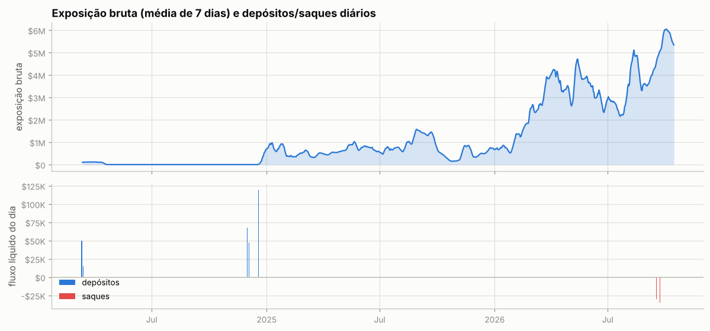

Ponte HyperCore↔HyperEVM (endereços de sistema `0x2000…`/`0x2222…`): 5 transferências, entrada $4.8K, saída $30.1K — uso de DeFi na HyperEVM.

**Liquidações e ADL (auto-deleveraging) nos fills:**

| quando (UTC) | ativo | tipo | lado | preço | tamanho | posição antes | PnL realizado |
|---|---|---|---|---|---|---|---|
| 2026-06-04 02:43:52 | xyz:MSTR | Close Short | B | 126.1 | 1.417 | -3.013 | -$8 |
| 2026-06-04 02:43:52 | xyz:MSTR | Close Short | B | 126.11 | 1.596 | -1.596 | -$9 |
| 2026-06-16 00:49:36 | xyz:SPCX | Close Short | B | 211.42 | 59.95 | -59.95 | -$1.6K |
| 2026-06-20 22:58:39 | xyz:MSTR | Close Short | B | 117.85 | 1.21 | -693.014 | -$7 |
| 2026-06-20 22:58:39 | xyz:MSTR | Close Short | B | 117.87 | 1.723 | -691.804 | -$10 |
| 2026-06-20 22:58:39 | xyz:MSTR | Close Short | B | 117.88 | 8.497 | -690.081 | -$47 |
| 2026-06-20 22:58:39 | xyz:MSTR | Close Short | B | 117.88 | 4.26 | -681.584 | -$24 |
| 2026-06-20 22:58:39 | xyz:MSTR | Close Short | B | 117.88 | 23.668 | -677.324 | -$131 |
| 2026-06-20 22:58:39 | xyz:MSTR | Close Short | B | 117.89 | 93.315 | -653.656 | -$518 |
| 2026-06-20 22:58:39 | xyz:MSTR | Close Short | B | 117.9 | 10.602 | -560.341 | -$59 |
| 2026-06-20 22:58:39 | xyz:MSTR | Close Short | B | 117.9 | 15.694 | -549.739 | -$87 |
| 2026-06-20 22:58:39 | xyz:MSTR | Close Short | B | 117.91 | 10.568 | -534.045 | -$59 |
| 2026-06-20 22:58:39 | xyz:MSTR | Close Short | B | 117.92 | 42.401 | -523.477 | -$237 |
| 2026-06-20 22:58:39 | xyz:MSTR | Close Short | B | 117.92 | 4.377 | -481.076 | -$24 |
| 2026-06-20 22:58:39 | xyz:MSTR | Close Short | B | 117.93 | 16.009 | -476.699 | -$89 |
| 2026-06-20 22:58:39 | xyz:MSTR | Close Short | B | 117.97 | 41.691 | -460.69 | -$235 |
| 2026-06-20 22:58:39 | xyz:MSTR | Close Short | B | 117.99 | 279.705 | -418.999 | -$1.6K |
| 2026-06-20 22:58:39 | xyz:MSTR | Close Short | B | 118.0 | 128.173 | -139.294 | -$725 |
| 2026-06-20 22:58:39 | xyz:MSTR | Close Short | B | 118.0 | 11.121 | -11.121 | -$63 |
| 2026-06-29 12:04:32 | xyz:MSTR | Close Short | B | 88.0 | 6.62 | -1789.89 | -$28 |
| 2026-06-29 12:04:32 | xyz:MSTR | Close Short | B | 88.0 | 0.25 | -1783.27 | -$1 |
| 2026-06-29 12:04:32 | xyz:MSTR | Close Short | B | 88.0 | 2.059 | -1783.02 | -$9 |
| 2026-06-29 12:04:32 | xyz:MSTR | Close Short | B | 88.002 | 0.282 | -1780.961 | -$1 |
| 2026-06-29 12:04:32 | xyz:MSTR | Close Short | B | 88.002 | 2.059 | -1780.679 | -$9 |
| 2026-06-29 12:04:32 | xyz:MSTR | Close Short | B | 88.011 | 2.059 | -1778.62 | -$9 |
| 2026-06-29 12:04:32 | xyz:MSTR | Close Short | B | 88.012 | 39.352 | -1776.561 | -$166 |
| 2026-06-29 12:04:32 | xyz:MSTR | Close Short | B | 88.012 | 305.297 | -1737.209 | -$1.3K |
| 2026-06-29 12:04:35 | xyz:MSTR | Close Short | B | 88.145 | 228.68 | -1431.912 | -$993 |
| 2026-06-29 12:04:35 | xyz:MSTR | Close Short | B | 88.151 | 178.852 | -1203.232 | -$777 |
| 2026-06-29 12:04:35 | xyz:MSTR | Close Short | B | 88.152 | 2.077 | -1024.38 | -$9 |
| 2026-06-29 12:04:35 | xyz:MSTR | Close Short | B | 88.161 | 0.245 | -1022.303 | -$1 |
| 2026-06-29 12:04:35 | xyz:MSTR | Close Short | B | 88.161 | 2.077 | -1022.058 | -$9 |
| 2026-06-29 12:04:35 | xyz:MSTR | Close Short | B | 88.164 | 35.638 | -1019.981 | -$155 |
| 2026-06-29 12:04:35 | xyz:MSTR | Close Short | B | 88.165 | 35.637 | -984.343 | -$155 |
| 2026-06-29 12:04:35 | xyz:MSTR | Close Short | B | 88.17 | 2.077 | -948.706 | -$9 |
| 2026-06-29 12:04:35 | xyz:MSTR | Close Short | B | 88.17 | 149.476 | -946.629 | -$653 |
| 2026-06-29 12:04:35 | xyz:MSTR | Close Short | B | 88.176 | 47.056 | -797.153 | -$206 |
| 2026-06-29 12:04:35 | xyz:MSTR | Close Short | B | 88.178 | 148.727 | -750.097 | -$651 |
| 2026-06-29 12:04:35 | xyz:MSTR | Close Short | B | 88.187 | 550.945 | -601.37 | -$2.4K |
| 2026-06-29 12:04:35 | xyz:MSTR | Close Short | B | 88.188 | 0.239 | -50.425 | -$1 |
| 2026-06-29 12:04:35 | xyz:MSTR | Close Short | B | 88.191 | 35.627 | -50.186 | -$156 |
| 2026-06-29 12:04:35 | xyz:MSTR | Close Short | B | 88.192 | 14.559 | -14.559 | -$64 |
| 2026-07-14 13:31:22 | xyz:LLY | Close Long | A | 1157.5 | 0.0863 | 154.5785 | -$6 |
| 2026-07-14 13:31:22 | xyz:LLY | Close Long | A | 1156.7 | 2.6962 | 154.4922 | -$176 |
| 2026-07-14 13:31:22 | xyz:LLY | Close Long | A | 1156.0 | 3.7975 | 151.796 | -$250 |
| 2026-07-14 13:31:22 | xyz:LLY | Close Long | A | 1156.0 | 2.7119 | 147.9985 | -$179 |
| 2026-07-14 13:31:22 | xyz:LLY | Close Long | A | 1155.9 | 13.3807 | 145.2866 | -$884 |
| 2026-07-14 13:31:22 | xyz:LLY | Close Long | A | 1155.8 | 0.8367 | 131.9059 | -$55 |
| 2026-07-14 13:31:22 | xyz:LLY | Close Long | A | 1155.7 | 4.3263 | 131.0692 | -$287 |
| 2026-07-14 13:31:22 | xyz:LLY | Close Long | A | 1155.1 | 3.0801 | 126.7429 | -$206 |
| 2026-07-14 13:31:25 | xyz:LLY | Close Long | A | 1155.6 | 4.0 | 123.6628 | -$265 |
| 2026-07-14 13:31:25 | xyz:LLY | Close Long | A | 1155.6 | 0.2623 | 119.6628 | -$17 |
| 2026-07-14 13:31:25 | xyz:LLY | Close Long | A | 1155.6 | 0.2623 | 119.4005 | -$17 |
| 2026-07-14 13:31:25 | xyz:LLY | Close Long | A | 1155.5 | 2.7131 | 119.1382 | -$180 |
| 2026-07-14 13:31:25 | xyz:LLY | Close Long | A | 1155.5 | 3.7992 | 116.4251 | -$252 |
| 2026-07-14 13:31:25 | xyz:LLY | Close Long | A | 1155.5 | 2.157 | 112.6259 | -$143 |
| 2026-07-14 13:31:25 | xyz:LLY | Close Long | A | 1155.4 | 4.0 | 110.4689 | -$266 |
| 2026-07-14 13:31:25 | xyz:LLY | Close Long | A | 1155.3 | 0.2623 | 106.4689 | -$17 |
| 2026-07-14 13:31:25 | xyz:LLY | Close Long | A | 1155.3 | 0.2623 | 106.2066 | -$17 |
| 2026-07-14 13:31:25 | xyz:LLY | Close Long | A | 1155.1 | 5.4289 | 105.9443 | -$363 |
| 2026-07-14 13:31:25 | xyz:LLY | Close Long | A | 1155.1 | 0.2623 | 100.5154 | -$18 |
| 2026-07-14 13:31:25 | xyz:LLY | Close Long | A | 1155.0 | 3.5 | 100.2531 | -$234 |
| 2026-07-14 13:31:25 | xyz:LLY | Close Long | A | 1154.7 | 3.3468 | 96.7531 | -$225 |
| 2026-07-14 13:31:25 | xyz:LLY | Close Long | A | 1154.7 | 7.6028 | 93.4063 | -$511 |
| 2026-07-14 13:31:25 | xyz:LLY | Close Long | A | 1154.6 | 13.3837 | 85.8035 | -$901 |
| 2026-07-14 13:31:25 | xyz:LLY | Close Long | A | 1154.5 | 12.6942 | 72.4198 | -$856 |
| 2026-07-14 13:31:25 | xyz:LLY | Close Long | A | 1154.5 | 0.8234 | 59.7256 | -$56 |
| 2026-07-14 13:31:25 | xyz:LLY | Close Long | A | 1153.4 | 10.8739 | 58.9022 | -$745 |
| 2026-07-14 13:31:25 | xyz:LLY | Close Long | A | 1153.3 | 0.104 | 48.0283 | -$7 |
| 2026-07-14 13:31:25 | xyz:LLY | Close Long | A | 1153.2 | 0.8671 | 47.9243 | -$60 |
| 2026-07-14 13:31:25 | xyz:LLY | Close Long | A | 1153.1 | 0.1203 | 47.0572 | -$8 |
| 2026-07-14 13:31:25 | xyz:LLY | Close Long | A | 1153.0 | 0.0099 | 46.9369 | -$1 |
| 2026-07-14 13:31:25 | xyz:LLY | Close Long | A | 1152.8 | 5.0 | 46.927 | -$346 |
| 2026-07-14 13:31:25 | xyz:LLY | Close Long | A | 1152.7 | 36.577 | 41.927 | -$2.5K |
| 2026-07-14 13:31:25 | xyz:LLY | Close Long | A | 1152.4 | 5.35 | 5.35 | -$372 |
| 2026-07-16 17:21:16 | xyz:SPCX | Close Long | A | 132.35 | 1.88 | 424.62 | -$53 |
| 2026-07-16 17:21:16 | xyz:SPCX | Close Long | A | 132.35 | 18.41 | 422.74 | -$523 |
| 2026-07-16 17:21:16 | xyz:SPCX | Close Long | A | 132.35 | 42.68 | 404.33 | -$1.2K |
| 2026-07-16 17:21:16 | xyz:SPCX | Close Long | A | 132.34 | 18.41 | 361.65 | -$524 |
| 2026-07-16 17:21:16 | xyz:SPCX | Close Long | A | 132.33 | 193.76 | 343.24 | -$5.5K |
| 2026-07-16 17:21:16 | xyz:SPCX | Close Long | A | 132.33 | 21.36 | 149.48 | -$608 |
| 2026-07-16 17:21:16 | xyz:SPCX | Close Long | A | 132.33 | 62.57 | 128.12 | -$1.8K |
| 2026-07-16 17:21:16 | xyz:SPCX | Close Long | A | 132.33 | 11.34 | 65.55 | -$323 |
| 2026-07-16 17:21:16 | xyz:SPCX | Close Long | A | 132.33 | 54.21 | 54.21 | -$1.5K |
| 2026-07-19 21:22:59 | PUMP | Close Short | B | 0.001923 | 4070169.0 | -29629333.0 | -$1.7K |
| 2026-07-19 21:22:59 | PUMP | Close Short | B | 0.001923 | 1625576.0 | -25559164.0 | -$688 |
| 2026-07-19 21:22:59 | PUMP | Close Short | B | 0.001923 | 1052631.0 | -23933588.0 | -$445 |
| 2026-07-19 21:22:59 | PUMP | Close Short | B | 0.001923 | 22880957.0 | -22880957.0 | -$9.7K |
| 2026-07-27 10:50:42 | CASHCAT | Close Long | A | 0.037818 | 2541.0 | 1405328.0 | -$24 |
| 2026-07-27 10:50:42 | CASHCAT | Close Long | A | 0.0378 | 754.0 | 1402787.0 | -$7 |
| 2026-07-27 10:50:42 | CASHCAT | Close Long | A | 0.03779 | 52924.0 | 1402033.0 | -$507 |
| 2026-07-27 10:50:42 | CASHCAT | Close Long | A | 0.037788 | 13698.0 | 1349109.0 | -$131 |
| 2026-07-27 10:50:42 | CASHCAT | Close Long | A | 0.037777 | 11087.0 | 1335411.0 | -$106 |
| 2026-07-27 10:50:42 | CASHCAT | Close Long | A | 0.037758 | 13698.0 | 1324324.0 | -$132 |
| 2026-07-27 10:50:42 | CASHCAT | Close Long | A | 0.037749 | 26488.0 | 1310626.0 | -$255 |
| 2026-07-27 10:50:42 | CASHCAT | Close Long | A | 0.037747 | 8163.0 | 1284138.0 | -$79 |
| 2026-07-27 10:50:42 | CASHCAT | Close Long | A | 0.037736 | 52999.0 | 1275975.0 | -$511 |
| 2026-07-27 10:50:42 | CASHCAT | Close Long | A | 0.037727 | 8853.0 | 1222976.0 | -$85 |
| 2026-07-27 10:50:42 | CASHCAT | Close Long | A | 0.037727 | 13698.0 | 1214123.0 | -$132 |
| 2026-07-27 10:50:42 | CASHCAT | Close Long | A | 0.037706 | 12599.0 | 1200425.0 | -$122 |
| 2026-07-27 10:50:42 | CASHCAT | Close Long | A | 0.0377 | 28840.0 | 1187826.0 | -$279 |
| 2026-07-27 10:50:42 | CASHCAT | Close Long | A | 0.037697 | 13698.0 | 1158986.0 | -$133 |
| 2026-07-27 10:50:42 | CASHCAT | Close Long | A | 0.037667 | 13698.0 | 1145288.0 | -$133 |
| 2026-07-27 10:50:42 | CASHCAT | Close Long | A | 0.037638 | 13283.0 | 1131590.0 | -$129 |
| 2026-07-27 10:50:42 | CASHCAT | Close Long | A | 0.037636 | 13698.0 | 1118307.0 | -$133 |
| 2026-07-27 10:50:42 | CASHCAT | Close Long | A | 0.037635 | 974.0 | 1104609.0 | -$9 |
| 2026-07-27 10:50:42 | CASHCAT | Close Long | A | 0.037617 | 150000.0 | 1103635.0 | -$1.5K |
| 2026-07-27 10:50:42 | CASHCAT | Close Long | A | 0.037606 | 13698.0 | 953635.0 | -$134 |
| 2026-07-27 10:50:42 | CASHCAT | Close Long | A | 0.037604 | 26590.0 | 939937.0 | -$260 |
| 2026-07-27 10:50:42 | CASHCAT | Close Long | A | 0.037604 | 3290.0 | 913347.0 | -$32 |
| 2026-07-27 10:50:42 | CASHCAT | Close Long | A | 0.037576 | 8951.0 | 910057.0 | -$88 |
| 2026-07-27 10:50:42 | CASHCAT | Close Long | A | 0.037576 | 13698.0 | 901106.0 | -$134 |
| 2026-07-27 10:50:42 | CASHCAT | Close Long | A | 0.037555 | 541.0 | 887408.0 | -$5 |
| 2026-07-27 10:50:42 | CASHCAT | Close Long | A | 0.037549 | 1681.0 | 886867.0 | -$17 |
| 2026-07-27 10:50:42 | CASHCAT | Close Long | A | 0.037545 | 13698.0 | 885186.0 | -$135 |
| 2026-07-27 10:50:42 | CASHCAT | Close Long | A | 0.03754 | 275.0 | 871488.0 | -$3 |
| 2026-07-27 10:50:42 | CASHCAT | Close Long | A | 0.037515 | 13698.0 | 871213.0 | -$135 |
| 2026-07-27 10:50:42 | CASHCAT | Close Long | A | 0.03751 | 13328.0 | 857515.0 | -$131 |
| 2026-07-27 10:50:42 | CASHCAT | Close Long | A | 0.037509 | 81207.0 | 844187.0 | -$801 |
| 2026-07-27 10:50:42 | CASHCAT | Close Long | A | 0.037507 | 13329.0 | 762980.0 | -$132 |
| 2026-07-27 10:50:42 | CASHCAT | Close Long | A | 0.037507 | 13329.0 | 749651.0 | -$132 |
| 2026-07-27 10:50:42 | CASHCAT | Close Long | A | 0.037507 | 26659.0 | 736322.0 | -$263 |
| 2026-07-27 10:50:42 | CASHCAT | Close Long | A | 0.037505 | 90915.0 | 709663.0 | -$897 |
| 2026-07-27 10:50:42 | CASHCAT | Close Long | A | 0.037493 | 13334.0 | 618748.0 | -$132 |
| 2026-07-27 10:50:42 | CASHCAT | Close Long | A | 0.037492 | 1650.0 | 605414.0 | -$16 |
| 2026-07-27 10:50:42 | CASHCAT | Close Long | A | 0.037485 | 13698.0 | 603764.0 | -$135 |
| 2026-07-27 10:50:42 | CASHCAT | Close Long | A | 0.037455 | 13698.0 | 590066.0 | -$136 |
| 2026-07-27 10:50:42 | CASHCAT | Close Long | A | 0.037447 | 3304.0 | 576368.0 | -$33 |
| 2026-07-27 10:50:42 | CASHCAT | Close Long | A | 0.037447 | 26701.0 | 573064.0 | -$265 |
| 2026-07-27 10:50:42 | CASHCAT | Close Long | A | 0.037447 | 1652.0 | 546363.0 | -$16 |
| 2026-07-27 10:50:42 | CASHCAT | Close Long | A | 0.037447 | 13350.0 | 544711.0 | -$133 |
| 2026-07-27 10:50:42 | CASHCAT | Close Long | A | 0.037447 | 13350.0 | 531361.0 | -$133 |
| 2026-07-27 10:50:42 | CASHCAT | Close Long | A | 0.037447 | 1201.0 | 518011.0 | -$12 |
| 2026-07-27 10:50:42 | CASHCAT | Close Long | A | 0.037424 | 9048.0 | 516810.0 | -$90 |
| 2026-07-27 10:50:42 | CASHCAT | Close Long | A | 0.037424 | 13698.0 | 507762.0 | -$136 |
| 2026-07-27 10:50:42 | CASHCAT | Close Long | A | 0.037419 | 6614.0 | 494064.0 | -$66 |
| 2026-07-27 10:50:42 | CASHCAT | Close Long | A | 0.037394 | 13698.0 | 487450.0 | -$137 |
| 2026-07-27 10:50:42 | CASHCAT | Close Long | A | 0.037364 | 13698.0 | 473752.0 | -$137 |
| 2026-07-27 10:50:42 | CASHCAT | Close Long | A | 0.037342 | 1205.0 | 460054.0 | -$12 |
| 2026-07-27 10:50:42 | CASHCAT | Close Long | A | 0.037342 | 13388.0 | 458849.0 | -$134 |
| 2026-07-27 10:50:42 | CASHCAT | Close Long | A | 0.037338 | 15908.0 | 445461.0 | -$160 |
| 2026-07-27 10:50:42 | CASHCAT | Close Long | A | 0.037336 | 6628.0 | 429553.0 | -$67 |
| 2026-07-27 10:50:42 | CASHCAT | Close Long | A | 0.037333 | 13698.0 | 422925.0 | -$138 |
| 2026-07-27 10:50:42 | CASHCAT | Close Long | A | 0.037319 | 187572.0 | 409227.0 | -$1.9K |
| 2026-07-27 10:50:42 | CASHCAT | Close Long | A | 0.037313 | 8163.0 | 221655.0 | -$82 |
| 2026-07-27 10:50:42 | CASHCAT | Close Long | A | 0.037303 | 13698.0 | 213492.0 | -$138 |
| 2026-07-27 10:50:42 | CASHCAT | Close Long | A | 0.03728 | 15119.0 | 199794.0 | -$153 |
| 2026-07-27 10:50:42 | CASHCAT | Close Long | A | 0.037273 | 9146.0 | 184675.0 | -$92 |
| 2026-07-27 10:50:42 | CASHCAT | Close Long | A | 0.037273 | 13698.0 | 175529.0 | -$138 |
| 2026-07-27 10:50:42 | CASHCAT | Close Long | A | 0.037272 | 3677.0 | 161831.0 | -$37 |
| 2026-07-27 10:50:42 | CASHCAT | Close Long | A | 0.037263 | 5265.0 | 158154.0 | -$53 |
| 2026-07-27 10:50:42 | CASHCAT | Close Long | A | 0.037242 | 13698.0 | 152889.0 | -$139 |
| 2026-07-27 10:50:42 | CASHCAT | Close Long | A | 0.037225 | 18616.0 | 139191.0 | -$189 |
| 2026-07-27 10:50:42 | CASHCAT | Close Long | A | 0.037212 | 13698.0 | 120575.0 | -$139 |
| 2026-07-27 10:50:42 | CASHCAT | Close Long | A | 0.037206 | 692.0 | 106877.0 | -$7 |
| 2026-07-27 10:50:42 | CASHCAT | Close Long | A | 0.037187 | 26622.0 | 106185.0 | -$271 |
| 2026-07-27 10:50:42 | CASHCAT | Close Long | A | 0.037182 | 13698.0 | 79563.0 | -$140 |
| 2026-07-27 10:50:42 | CASHCAT | Close Long | A | 0.03716 | 40365.0 | 65865.0 | -$412 |
| 2026-07-27 10:50:42 | CASHCAT | Close Long | A | 0.037152 | 13698.0 | 25500.0 | -$140 |
| 2026-07-27 10:50:42 | CASHCAT | Close Long | A | 0.037152 | 11802.0 | 11802.0 | -$121 |
| 2026-07-28 03:40:18 | xyz:CXMT | Close Short | B | 6.89 | 719.3 | -15264.8 | -$208 |
| 2026-07-28 03:40:18 | xyz:CXMT | Close Short | B | 6.8905 | 1028.9 | -14545.5 | -$298 |
| 2026-07-28 03:40:18 | xyz:CXMT | Close Short | B | 6.8943 | 362.5 | -13516.6 | -$106 |
| 2026-07-28 03:40:18 | xyz:CXMT | Close Short | B | 6.8946 | 942.2 | -13154.1 | -$277 |
| 2026-07-28 03:40:21 | xyz:CXMT | Close Short | B | 6.92 | 10345.5 | -12211.9 | -$3.3K |
| 2026-07-28 03:40:21 | xyz:CXMT | Close Short | B | 6.92 | 20.0 | -1866.4 | -$6 |
| 2026-07-28 03:40:21 | xyz:CXMT | Close Short | B | 6.92 | 400.0 | -1846.4 | -$128 |
| 2026-07-28 03:40:21 | xyz:CXMT | Close Short | B | 6.92 | 200.0 | -1446.4 | -$64 |
| 2026-07-28 03:40:21 | xyz:CXMT | Close Short | B | 6.9221 | 1028.9 | -1246.4 | -$331 |
| 2026-07-28 03:40:21 | xyz:CXMT | Close Short | B | 6.9236 | 217.5 | -217.5 | -$70 |
| 2026-07-29 21:25:11 | CASHCAT | Close Short | B | 0.052283 | 10620.0 | -52050.0 | -$102 |
| 2026-07-29 21:25:11 | CASHCAT | Close Short | B | 0.052287 | 5213.0 | -41430.0 | -$50 |
| 2026-07-29 21:25:11 | CASHCAT | Close Short | B | 0.052296 | 376.0 | -36217.0 | -$4 |
| 2026-07-29 21:25:11 | CASHCAT | Close Short | B | 0.0523 | 35841.0 | -35841.0 | -$344 |
| 2026-08-04 13:56:12 | xyz:KIOXIA | Close Short | B | 347.31 | 0.035 | -327.858 | -$1 |
| 2026-08-04 13:56:12 | xyz:KIOXIA | Close Short | B | 347.32 | 0.041 | -327.823 | -$2 |
| 2026-08-04 13:56:12 | xyz:KIOXIA | Close Short | B | 347.32 | 1.331 | -327.782 | -$56 |
| 2026-08-04 13:56:12 | xyz:KIOXIA | Close Short | B | 347.33 | 12.906 | -326.451 | -$546 |
| 2026-08-04 13:56:12 | xyz:KIOXIA | Close Short | B | 347.34 | 0.041 | -313.545 | -$2 |
| 2026-08-04 13:56:12 | xyz:KIOXIA | Close Short | B | 347.52 | 16.11 | -313.504 | -$685 |
| 2026-08-04 13:56:12 | xyz:KIOXIA | Close Short | B | 347.61 | 0.172 | -297.394 | -$7 |
| 2026-08-04 13:56:12 | xyz:KIOXIA | Close Short | B | 347.63 | 1.633 | -297.222 | -$70 |
| 2026-08-04 13:56:12 | xyz:KIOXIA | Close Short | B | 347.76 | 0.345 | -295.589 | -$15 |
| 2026-08-04 13:56:12 | xyz:KIOXIA | Close Short | B | 347.76 | 14.083 | -295.244 | -$602 |
| 2026-08-04 13:56:12 | xyz:KIOXIA | Close Short | B | 347.78 | 0.355 | -281.161 | -$15 |
| 2026-08-04 13:56:12 | xyz:KIOXIA | Close Short | B | 347.79 | 14.376 | -280.806 | -$615 |
| 2026-08-04 13:56:12 | xyz:KIOXIA | Close Short | B | 347.84 | 1.5 | -266.43 | -$64 |
| 2026-08-04 13:56:12 | xyz:KIOXIA | Close Short | B | 347.85 | 0.084 | -264.93 | -$4 |
| 2026-08-04 13:56:12 | xyz:KIOXIA | Close Short | B | 347.85 | 2.559 | -264.846 | -$110 |
| 2026-08-04 13:56:15 | xyz:KIOXIA | Close Short | B | 347.51 | 1.376 | -262.287 | -$58 |
| 2026-08-04 13:56:15 | xyz:KIOXIA | Close Short | B | 347.52 | 0.404 | -260.911 | -$17 |
| 2026-08-04 13:56:15 | xyz:KIOXIA | Close Short | B | 347.62 | 0.043 | -260.507 | -$2 |
| 2026-08-04 13:56:15 | xyz:KIOXIA | Close Short | B | 347.75 | 0.054 | -260.464 | -$2 |
| 2026-08-04 13:56:15 | xyz:KIOXIA | Close Short | B | 347.77 | 0.041 | -260.41 | -$2 |
| 2026-08-04 13:56:15 | xyz:KIOXIA | Close Short | B | 347.79 | 0.041 | -260.369 | -$2 |
| 2026-08-04 13:56:15 | xyz:KIOXIA | Close Short | B | 347.81 | 0.273 | -260.328 | -$12 |
| 2026-08-04 13:56:15 | xyz:KIOXIA | Close Short | B | 347.84 | 0.041 | -260.055 | -$2 |
| 2026-08-04 13:56:15 | xyz:KIOXIA | Close Short | B | 347.84 | 16.109 | -260.014 | -$690 |
| 2026-08-04 13:56:15 | xyz:KIOXIA | Close Short | B | 347.85 | 41.074 | -243.905 | -$1.8K |
| 2026-08-04 13:56:15 | xyz:KIOXIA | Close Short | B | 347.89 | 0.116 | -202.831 | -$5 |
| 2026-08-04 13:56:15 | xyz:KIOXIA | Close Short | B | 347.9 | 27.422 | -202.715 | -$1.2K |
| 2026-08-04 13:56:15 | xyz:KIOXIA | Close Short | B | 347.96 | 39.847 | -175.293 | -$1.7K |
| 2026-08-04 13:56:15 | xyz:KIOXIA | Close Short | B | 347.97 | 0.058 | -135.446 | -$2 |
| 2026-08-04 13:56:15 | xyz:KIOXIA | Close Short | B | 348.0 | 50.0 | -135.388 | -$2.1K |
| 2026-08-04 13:56:15 | xyz:KIOXIA | Close Short | B | 348.0 | 0.88 | -85.388 | -$38 |
| 2026-08-04 13:56:15 | xyz:KIOXIA | Close Short | B | 348.0 | 84.508 | -84.508 | -$3.6K |
| 2026-08-06 12:41:52 | CASHCAT | Close Short | B | 0.15 | 384604.0 | -384604.0 | -$7.7K |
| 2026-08-20 02:48:58 | PUMP | Close Short | B | 0.003285 | 463568.0 | -18467220.0 | -$519 |
| 2026-08-20 02:48:58 | PUMP | Close Short | B | 0.003285 | 793525.0 | -18003652.0 | -$888 |
| 2026-08-20 02:48:58 | PUMP | Close Short | B | 0.003285 | 693940.0 | -17210127.0 | -$777 |
| 2026-08-20 02:48:58 | PUMP | Close Short | B | 0.003285 | 30524.0 | -16516187.0 | -$34 |
| 2026-08-20 02:48:58 | PUMP | Close Short | B | 0.003285 | 508940.0 | -16485663.0 | -$570 |
| 2026-08-20 02:48:58 | PUMP | Close Short | B | 0.003285 | 15220.0 | -15976723.0 | -$17 |
| 2026-08-20 02:48:58 | PUMP | Close Short | B | 0.003286 | 1000000.0 | -15961503.0 | -$1.1K |
| 2026-08-20 02:48:58 | PUMP | Close Short | B | 0.003286 | 962413.0 | -14961503.0 | -$1.1K |
| 2026-08-20 02:48:58 | PUMP | Close Short | B | 0.003286 | 121729.0 | -13999090.0 | -$136 |
| 2026-08-20 02:48:58 | PUMP | Close Short | B | 0.003286 | 700000.0 | -13877361.0 | -$784 |
| 2026-08-20 02:48:58 | PUMP | Close Short | B | 0.003286 | 609477.0 | -13177361.0 | -$683 |
| 2026-08-20 02:48:58 | PUMP | Close Short | B | 0.003287 | 12567884.0 | -12567884.0 | -$14.1K |
| 2026-08-20 09:42:26 | xyz:MSTR | Close Short | B | 114.92 | 0.121 | -103.896 | -$1 |
| 2026-08-20 09:42:26 | xyz:MSTR | Close Short | B | 114.96 | 4.969 | -103.775 | -$26 |
| 2026-08-20 09:42:26 | xyz:MSTR | Close Short | B | 114.97 | 0.784 | -98.806 | -$4 |
| 2026-08-20 09:42:26 | xyz:MSTR | Close Short | B | 114.97 | 2.61 | -98.022 | -$14 |
| 2026-08-20 09:42:26 | xyz:MSTR | Close Short | B | 114.97 | 50.0 | -95.412 | -$264 |
| 2026-08-20 09:42:26 | xyz:MSTR | Close Short | B | 114.98 | 45.412 | -45.412 | -$240 |
| 2026-08-21 07:20:00 | VVV | Close Short | B | 16.293 | 0.45 | -0.45 | -$1 |
| 2026-09-29 23:18:36 | LIT | Close Long | A | 4.2246 | 1973.0 | 20918.0 | -$1.7K |
| 2026-09-29 23:18:36 | LIT | Close Long | A | 4.2245 | 459.0 | 18945.0 | -$393 |
| 2026-09-29 23:18:36 | LIT | Close Long | A | 4.2237 | 287.0 | 18486.0 | -$246 |
| 2026-09-29 23:18:36 | LIT | Close Long | A | 4.2237 | 8.0 | 18199.0 | -$7 |
| 2026-09-29 23:18:36 | LIT | Close Long | A | 4.2237 | 9.0 | 18191.0 | -$8 |
| 2026-09-29 23:18:36 | LIT | Close Long | A | 4.2235 | 11.0 | 18182.0 | -$9 |
| 2026-09-29 23:18:36 | LIT | Close Long | A | 4.2231 | 106.0 | 18171.0 | -$91 |
| 2026-09-29 23:18:36 | LIT | Close Long | A | 4.2229 | 119.0 | 18065.0 | -$102 |
| 2026-09-29 23:18:36 | LIT | Close Long | A | 4.2226 | 5.0 | 17946.0 | -$4 |
| 2026-09-29 23:18:36 | LIT | Close Long | A | 4.2223 | 59.0 | 17941.0 | -$51 |
| 2026-09-29 23:18:36 | LIT | Close Long | A | 4.2222 | 150.0 | 17882.0 | -$129 |
| 2026-09-29 23:18:36 | LIT | Close Long | A | 4.2222 | 150.0 | 17732.0 | -$129 |
| 2026-09-29 23:18:36 | LIT | Close Long | A | 4.2222 | 6000.0 | 17582.0 | -$5.1K |
| 2026-09-29 23:18:36 | LIT | Close Long | A | 4.222 | 53.0 | 11582.0 | -$45 |
| 2026-09-29 23:18:36 | LIT | Close Long | A | 4.2219 | 10.0 | 11529.0 | -$9 |
| 2026-09-29 23:18:36 | LIT | Close Long | A | 4.2215 | 5.0 | 11519.0 | -$4 |
| 2026-09-29 23:18:36 | LIT | Close Long | A | 4.2215 | 7.0 | 11514.0 | -$6 |
| 2026-09-29 23:18:36 | LIT | Close Long | A | 4.2213 | 73.0 | 11507.0 | -$63 |
| 2026-09-29 23:18:36 | LIT | Close Long | A | 4.2211 | 30.0 | 11434.0 | -$26 |
| 2026-09-29 23:18:36 | LIT | Close Long | A | 4.2206 | 80.0 | 11404.0 | -$69 |
| 2026-09-29 23:18:36 | LIT | Close Long | A | 4.2205 | 106.0 | 11324.0 | -$91 |
| 2026-09-29 23:18:36 | LIT | Close Long | A | 4.2204 | 59.0 | 11218.0 | -$51 |
| 2026-09-29 23:18:36 | LIT | Close Long | A | 4.2203 | 1429.0 | 11159.0 | -$1.2K |
| 2026-09-29 23:18:36 | LIT | Close Long | A | 4.22 | 59.0 | 9730.0 | -$51 |
| 2026-09-29 23:18:36 | LIT | Close Long | A | 4.22 | 4.0 | 9671.0 | -$3 |
| 2026-09-29 23:18:36 | LIT | Close Long | A | 4.22 | 5.0 | 9667.0 | -$4 |
| 2026-09-29 23:18:36 | LIT | Close Long | A | 4.2195 | 3.0 | 9662.0 | -$3 |
| 2026-09-29 23:18:36 | LIT | Close Long | A | 4.2194 | 459.0 | 9659.0 | -$395 |
| 2026-09-29 23:18:36 | LIT | Close Long | A | 4.2192 | 10.0 | 9200.0 | -$9 |
| 2026-09-29 23:18:36 | LIT | Close Long | A | 4.2191 | 12.0 | 9190.0 | -$10 |
| 2026-09-29 23:18:36 | LIT | Close Long | A | 4.2188 | 95.0 | 9178.0 | -$82 |
| 2026-09-29 23:18:36 | LIT | Close Long | A | 4.2188 | 2259.0 | 9083.0 | -$1.9K |
| 2026-09-29 23:18:36 | LIT | Close Long | A | 4.2185 | 106.0 | 6824.0 | -$91 |
| 2026-09-29 23:18:36 | LIT | Close Long | A | 4.2182 | 1466.0 | 6718.0 | -$1.3K |
| 2026-09-29 23:18:36 | LIT | Close Long | A | 4.2182 | 5.0 | 5252.0 | -$4 |
| 2026-09-29 23:18:36 | LIT | Close Long | A | 4.2179 | 59.0 | 5247.0 | -$51 |
| 2026-09-29 23:18:36 | LIT | Close Long | A | 4.2179 | 827.0 | 5188.0 | -$713 |
| 2026-09-29 23:18:36 | LIT | Close Long | A | 4.2175 | 1125.0 | 4361.0 | -$970 |
| 2026-09-29 23:18:36 | LIT | Close Long | A | 4.2174 | 5.0 | 3236.0 | -$4 |
| 2026-09-29 23:18:36 | LIT | Close Long | A | 4.2173 | 23.0 | 3231.0 | -$20 |
| 2026-09-29 23:18:36 | LIT | Close Long | A | 4.2172 | 250.0 | 3208.0 | -$216 |
| 2026-09-29 23:18:36 | LIT | Close Long | A | 4.2172 | 7.0 | 2958.0 | -$6 |
| 2026-09-29 23:18:36 | LIT | Close Long | A | 4.2172 | 521.0 | 2951.0 | -$450 |
| 2026-09-29 23:18:36 | LIT | Close Long | A | 4.2171 | 3.0 | 2430.0 | -$3 |
| 2026-09-29 23:18:36 | LIT | Close Long | A | 4.217 | 355.0 | 2427.0 | -$306 |
| 2026-09-29 23:18:36 | LIT | Close Long | A | 4.217 | 827.0 | 2072.0 | -$714 |
| 2026-09-29 23:18:36 | LIT | Close Long | A | 4.2165 | 10.0 | 1245.0 | -$9 |
| 2026-09-29 23:18:36 | LIT | Close Long | A | 4.2162 | 250.0 | 1235.0 | -$216 |
| 2026-09-29 23:18:36 | LIT | Close Long | A | 4.2162 | 827.0 | 985.0 | -$714 |
| 2026-09-29 23:18:36 | LIT | Close Long | A | 4.2162 | 158.0 | 158.0 | -$136 |

## 9. Dá para copiar? (espelhar a posição com atraso)

PnL de quem replicasse exatamente a posição da carteira, mas com N horas de atraso (marcação horária, sem custos). Se o PnL se mantém com atraso, a vantagem está em horizontes longos e é copiável; se desaba, depende de timing fino.

| atraso | ETH | HYPE | LIT |
|---|---|---|---|
| 0h | +$21.5K | +$205.2K | +$243.6K |
| 1h | -$26.6K | +$187.0K | +$243.3K |
| 4h | -$21.9K | +$177.6K | +$215.1K |
| 12h | -$2.2K | +$126.9K | +$204.6K |
| 24h | +$10.3K | +$106.3K | +$232.5K |
| 72h | -$36.2K | +$48.8K | +$52.0K |
| 168h | +$163.0K | +$72.0K | +$155.1K |

## 10. Teste de replicação por regras (ETH)

Regra testada: *short-bias com filtro de tendência e fade* — short de até 185.6 ETH (o percentil 90 do tamanho real), cheio abaixo da média móvel e reduzido acima; dentro do regime, mais short perto do topo do range e menos perto do fundo. Parâmetros escolhidos no treino (2024-03-12 → 2025-06-28) e avaliados no teste (2025-06-29 → 2026-10-14).

|  | parâmetros | PnL treino | PnL teste | correlação c/ posição real (teste) |
|---|---|---|---|---|
| melhor regra no treino | MA50, range 7d, fração em alta 1.0, fade 0.0 | +$415.2K | +$60.7K | 0.00 |
| carteira real (aprox.) | — | -$82.2K | -$341.6K | 1.00 |

Clone comportamental (regressão linear da posição real em médias móveis, ranges e retornos): R² treino 0.06, R² teste -0.08, correlação no teste 0.25.

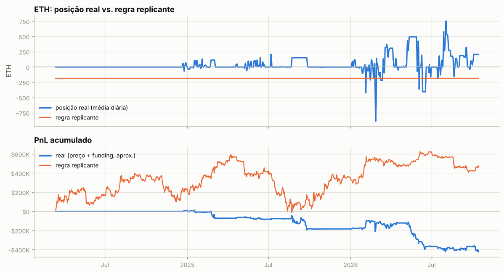

---

Metodologia e código: ver `README.md` na raiz do repositório.
