# Relatório automático — `0xa844d7ac9fa3424c4fd38a25baa23e460ec3e802`

Gerado em 2026-10-16 12:39 UTC a partir da API pública da Hyperliquid (`POST /info`). Valores em USD. Este arquivo é regenerado por `python -m hlre.report`; a interpretação da estratégia fica em `ANALISE.md`.

## 1. Visão geral

| métrica | valor |
|---|---|
| Valor da conta (perp + spot) | $373.9K |
| PnL all-time (portfolio, inclui spot/airdrops) | +$172.5K |
| PnL all-time só de perps | +$172.5K |
| Volume all-time | $125.27M |
| Primeira atividade | 2025-01-22 |
| Fills disponíveis na API | 26,779 (desde 2025-01-19) |
| Ordens (fills agrupados por oid) | 5,227 |
| Funding líquido (recebido > 0) | -$13.9K |
| Taxas pagas (período dos fills) | -$48.4K |
| Liquidações (ledger) | 0 |
| Fills de liquidação/ADL | 5 |
| Papel da conta | vault |
| API wallets (agentes) | 0 |

## 2. Curva de PnL

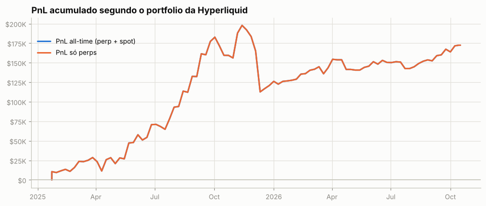

## 3. De onde veio o PnL

*Preço (aprox.)* usa a posição média diária de cada ativo, reconstruída a partir do histórico de funding (que traz o tamanho da posição a cada hora/dia desde o início da conta), vezes o movimento open→close do dia. Subestima o PnL de day trade, mas cobre o período sem fills. *Preço exato* marca cada fill no fechamento diário e só existe para o período coberto pelos fills.

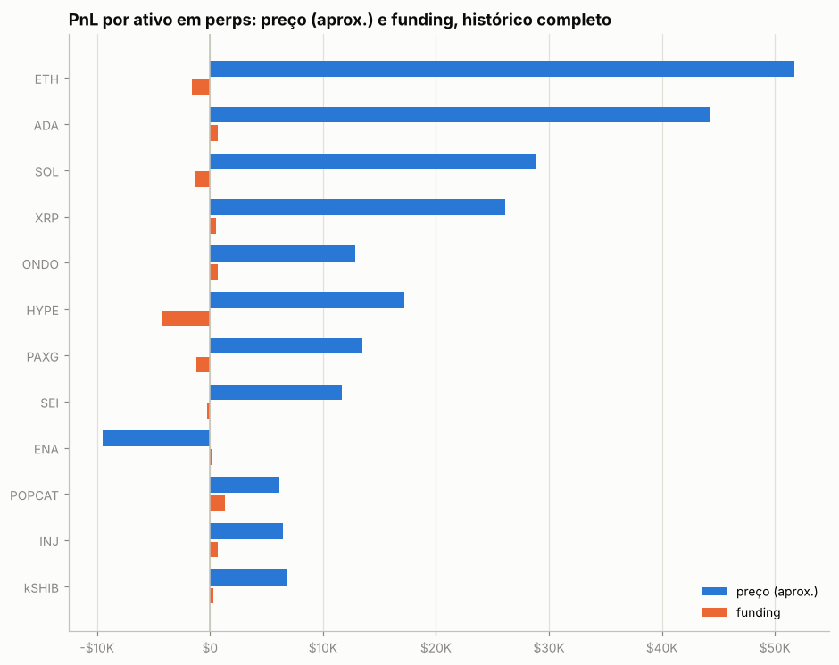

| ativo | preço (aprox.) | funding | total | preço exato (período dos fills) | taxas (período dos fills) |
|---|---|---|---|---|---|
| ETH | +$51.8K | -$1.6K | +$50.2K | +$14.7K | -$11.5K |
| ADA | +$44.3K | +$725 | +$45.0K | +$40.9K | -$551 |
| SOL | +$28.8K | -$1.3K | +$27.5K | +$27.7K | -$679 |
| XRP | +$26.1K | +$565 | +$26.7K | +$31.7K | -$509 |
| ONDO | +$12.8K | +$687 | +$13.5K | +$12.2K | -$48 |
| HYPE | +$17.2K | -$4.3K | +$12.9K | -$8.5K | -$3.4K |
| PAXG | +$13.4K | -$1.2K | +$12.2K | +$16.1K | -$774 |
| SEI | +$11.6K | -$295 | +$11.3K | +$10.8K | -$37 |
| ENA | -$9.5K | +$170 | -$9.3K | -$10.4K | -$50 |
| POPCAT | +$6.1K | +$1.3K | +$7.4K | +$5.7K | -$43 |
| INJ | +$6.5K | +$717 | +$7.2K | +$9.0K | -$170 |
| kSHIB | +$6.8K | +$263 | +$7.1K | +$6.0K | -$26 |
| GALA | +$6.4K | +$234 | +$6.7K | +$5.9K | -$21 |
| ZEC | +$6.4K | +$30 | +$6.5K | +$8.1K | -$103 |
| VIRTUAL | +$6.2K | +$120 | +$6.3K | +$5.4K | -$21 |
| outros (77) | +$80.7K | -$10.0K | +$70.7K | +$76.9K | -$30.5K |

**Decomposição no período dos fills** (preço exato): quanto veio de *carregar* a posição (e, dentro disso, do viés médio vs. do *timing* de aumentar/reduzir), quanto de trades intradiários, funding e taxas.

| componente | ETH | ADA | XRP |
|---|---|---|---|
| carregar posição (carry) | -$25.4K | +$40.1K | +$17.6K |
|   ↳ viés (posição média × movimento) | +$919 | +$13.8K | +$5.2K |
|   ↳ timing (variação do tamanho) | -$26.3K | +$26.2K | +$12.4K |
| trades intradiários | +$40.0K | +$818 | +$14.1K |
| funding | -$1.6K | +$725 | +$565 |
| taxas | -$11.5K | -$551 | -$509 |
| posição média | -1.24 | -18,308.61 | -2,811.27 |
| movimento do preço no período | -738.80 | -0.76 | -1.84 |

## 4. Posições ao longo do tempo

Área clara: posição média diária (funding). Linha: posição exata (fills). Azul = long, vermelho = short.

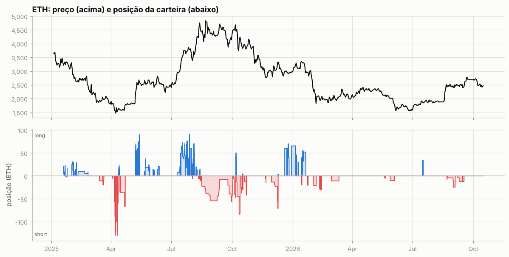

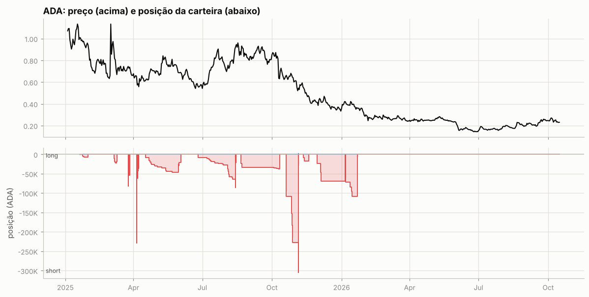

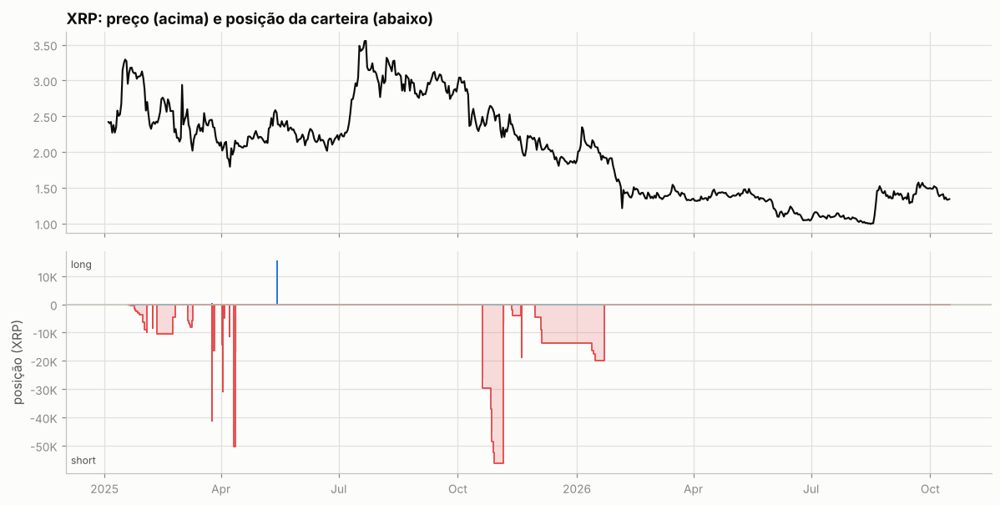

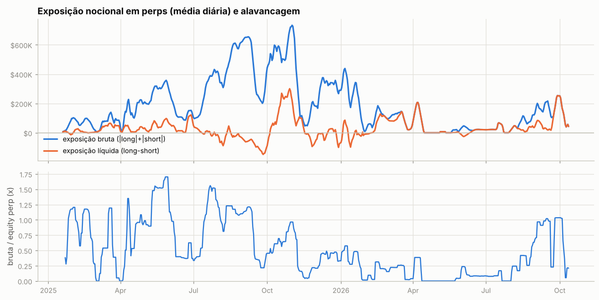

Tabela mensal de exposição e alavancagem

| mês | exposição bruta | exposição líquida | equity perp | alavancagem (mediana) |
|---|---|---|---|---|
| 2025-01 | $64.9K | -$1.5K | $79.7K | 1.2x |
| 2025-02 | $62.4K | $9.3K | $82.9K | 0.8x |
| 2025-03 | $72.0K | $38.0K | $146.9K | 0.4x |
| 2025-04 | $166.1K | $25.2K | $195.8K | 0.9x |
| 2025-05 | $288.4K | $53.4K | $204.1K | 1.5x |
| 2025-06 | $129.3K | $45.1K | $239.9K | 0.4x |
| 2025-07 | $298.3K | -$407 | $279.6K | 1.2x |
| 2025-08 | $514.6K | -$27.4K | $480.7K | 1.1x |
| 2025-09 | $417.3K | -$88.6K | $723.9K | 0.4x |
| 2025-10 | $578.4K | $172.3K | $879.9K | 0.7x |
| 2025-11 | $181.6K | $10.8K | $887.8K | 0.2x |
| 2025-12 | $327.0K | -$18.5K | $799.2K | 0.4x |
| 2026-01 | $221.7K | -$4.7K | $674.1K | 0.3x |
| 2026-02 | $106.8K | $66.4K | $606.7K | 0.2x |
| 2026-03 | $94.8K | $79.8K | $533.6K | 0.2x |
| 2026-04 | $51.7K | $51.7K | $477.6K | 0.0x |
| 2026-05 | $13.3K | -$530 | $221.7K | 0.0x |
| 2026-06 | $23.3K | $11.1K | $255.9K | 0.1x |
| 2026-07 | $25.2K | $25.2K | $248.4K | 0.1x |
| 2026-08 | $86.1K | $33.9K | $216.1K | 0.4x |
| 2026-09 | $187.0K | $106.6K | $225.3K | 1.0x |
| 2026-10 | $69.8K | $69.8K | $259.8K | 0.2x |

## 5. Execução

**Tipos de ordem** (últimas 954 ordens que a API guarda, 2025-11-19 → 2026-10-12):

| orderType | tif | reduceOnly | isTrigger | ordens |
|---|---|---|---|---|
| Limit | Gtc | False | False | 198 |
| Limit | Gtc | True | False | 83 |
| Market | FrontendMarket | False | False | 451 |
| Market | FrontendMarket | True | False | 177 |
| Stop Market | Gtc | False | True | 5 |
| Stop Market | Gtc | True | True | 1 |

`FrontendMarket` = ordem a mercado enviada pela interface web; `Gtc` = limite que fica no livro; gatilhos (`isTrigger`) seriam stop/take-profit.

**Perfil por ativo (top 10 por volume):**

| ativo | volume | ordens | % taker (nocional) | tamanho mediano |
|---|---|---|---|---|
| BTC | $72.65M | 904 | 96% | 1 |
| ETH | $28.87M | 2376 | 97% | 0.0194 |
| HYPE | $8.71M | 428 | 92% | 474.6 |
| PAXG | $3.67M | 148 | 22% | 2.029 |
| SOL | $1.76M | 79 | 87% | 113.4 |
| ADA | $1.50M | 136 | 97% | 1.248e+04 |
| XRP | $1.41M | 115 | 97% | 4,655 |
| XPL | $533.7K | 60 | 100% | 9,320 |
| FARTCOIN | $467.4K | 40 | 100% | 7,555 |
| INJ | $433.7K | 33 | 100% | 532.9 |

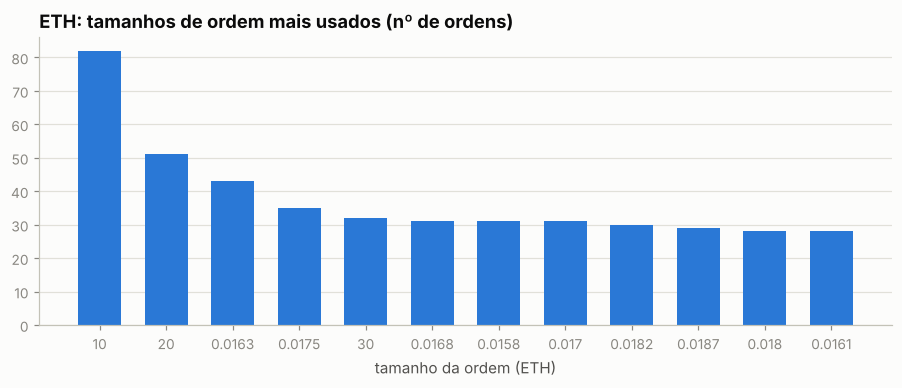

Os 5 tamanhos mais comuns respondem por 10% das ordens de ETH — lotes redondos e repetidos são assinatura de execução manual.

Sessões (ordens separadas por < 30 min): 1,064; mediana de 2 ordens e 0.2 min por sessão; dias com atividade: 349 de 630.

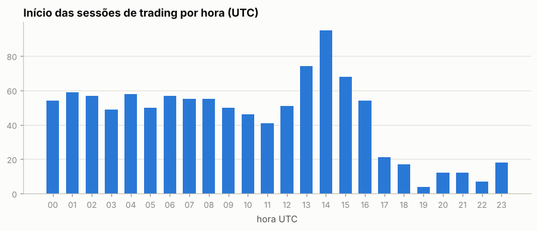

Por dia da semana: seg 16%, ter 16%, qua 16%, qui 17%, sex 19%, sáb 7%, dom 8%

## 6. Comportamento de entrada e saída

### ETH

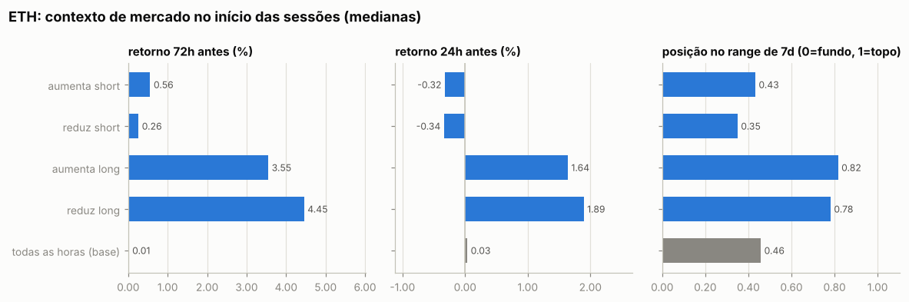

Por ordem (medianas):

| ação | ordens | retorno 24h antes | 72h antes | 7d antes | posição no range 7d | 24h depois | 7d depois |
|---|---|---|---|---|---|---|---|
| aumenta short | 199 | -2.05% | -1.93% | -7.68% | 0.33 | +0.44% | +1.57% |
| reduz short | 134 | -0.55% | -2.49% | -7.27% | 0.26 | +1.47% | +2.74% |
| aumenta long | 1760 | +4.95% | +0.13% | -7.94% | 0.58 | -2.92% | -1.94% |
| reduz long | 275 | +2.22% | +4.34% | +3.95% | 0.74 | -0.28% | -0.98% |
| todas as horas (base) |  | +0.03% | +0.01% | +0.06% | 0.46 | +0.04% | +0.12% |

Por sessão (ordens a menos de 30 min uma da outra contam como uma decisão; p = teste de Mann-Whitney contra todas as horas do período):

| sessão | sessões | retorno 24h antes | 72h antes | 7d antes | range 7d | no topo (>0,7) | no fundo (<0,3) |
|---|---|---|---|---|---|---|---|
| aumenta short | 81 | -0.32% (p=0.307) | +0.56% (p=0.844) | -1.66% (p=0.180) | 0.43 (p=0.834) | 32% | 31% |
| reduz short | 44 | -0.34% (p=0.522) | +0.26% (p=0.722) | -1.40% (p=0.162) | 0.35 (p=0.608) | 36% | 45% |
| aumenta long | 106 | +1.64% (p=<1e-4) | +3.55% (p=<1e-4) | +4.14% (p=<1e-4) | 0.82 (p=<1e-4) | 57% | 15% |
| reduz long | 97 | +1.89% (p=<1e-4) | +4.45% (p=<1e-4) | +4.69% (p=<1e-4) | 0.78 (p=<1e-4) | 58% | 10% |
| todas as horas (base) |  |  |  |  |  | 29% | 33% |

- Aumentos de posição feitos com a posição no prejuízo (preço pior que o preço médio): **53%** das ordens (42% do tamanho); distância mediana do preço médio: +0.02%.
- Reduções/fechamentos com lucro: **46%** de 409; ganho médio $843 vs. perda média -$630; realizado +$19.3K.

- Episódios (de zerado a zerado, ou até inverter): 127; fechados com lucro: 50%; duração mediana 0.2 dias; o melhor episódio sozinho = 26% da soma dos episódios lucrativos.

Maiores episódios por PnL realizado

| início | fim | dias | lado | tam_max | nocional_max | ordens | entrada | saída | realizado |
|---|---|---|---|---|---|---|---|---|---|
| 2025-07-15 | 2025-07-22 | 6.5 | long | 72.66 | $268.7K | 26 | 3,399 | 3,673 | +$38.6K |
| 2025-01-31 | 2025-02-03 | 2.5 | long | 30.59 | $101.1K | 28 | 3,274 | 2,807 | -$16.8K |
| 2025-11-29 | 2025-12-09 | 10.2 | short | 71.11 | $236.7K | 13 | 3,093 | 3,328 | -$16.7K |
| 2026-01-15 | 2026-01-20 | 5.2 | long | 55.00 | $184.2K | 18 | 3,342 | 3,147 | -$14.6K |
| 2025-12-29 | 2026-01-05 | 6.4 | long | 65.46 | $207.7K | 8 | 2,932 | 3,153 | +$14.5K |
| 2025-08-15 | 2025-10-02 | 47.5 | short | 56.02 | $244.5K | 42 | 4,255 | 4,358 | -$11.0K |
| 2025-05-13 | 2025-05-14 | 0.8 | long | 90.00 | $242.3K | 18 | 2,551 | 2,654 | +$9.3K |
| 2025-05-09 | 2025-05-09 | 0.3 | long | 55.00 | $130.6K | 9 | 2,238 | 2,391 | +$8.4K |
| 2025-10-03 | 2025-10-06 | 3.2 | short | 47.76 | $222.1K | 13 | 4,501 | 4,651 | -$7.1K |
| 2025-07-28 | 2025-07-28 | 0.6 | long | 91.46 | $354.8K | 12 | 3,880 | 3,821 | -$7.1K |

### ADA

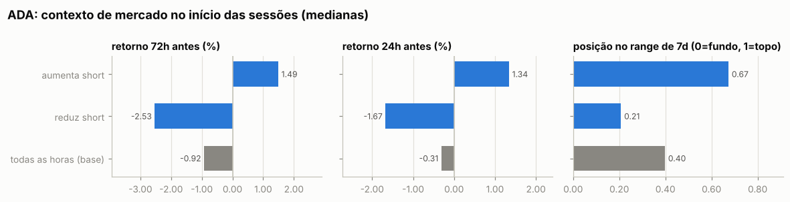

Por ordem (medianas):

| ação | ordens | retorno 24h antes | 72h antes | 7d antes | posição no range 7d | 24h depois | 7d depois |
|---|---|---|---|---|---|---|---|
| aumenta short | 88 | +1.67% | +1.12% | +2.78% | 0.67 | -0.16% | -1.63% |
| reduz short | 46 | -1.90% | -3.66% | -10.41% | 0.20 | -0.18% | -2.13% |
| reduz long | 1 | -8.36% | -15.91% | -20.50% | 0.01 | +5.63% | +9.26% |
| todas as horas (base) |  | -0.31% | -0.92% | -2.30% | 0.40 | -0.31% | -2.26% |

Por sessão (ordens a menos de 30 min uma da outra contam como uma decisão; p = teste de Mann-Whitney contra todas as horas do período):

| sessão | sessões | retorno 24h antes | 72h antes | 7d antes | range 7d | no topo (>0,7) | no fundo (<0,3) |
|---|---|---|---|---|---|---|---|
| aumenta short | 35 | +1.34% (p=0.094) | +1.49% (p=0.021) | +1.52% (p=0.137) | 0.67 (p=0.001) | 37% | 17% |
| reduz short | 19 | -1.67% (p=0.278) | -2.53% (p=0.224) | -10.05% (p=0.023) | 0.21 (p=0.106) | 16% | 58% |
| todas as horas (base) |  |  |  |  |  | 25% | 39% |

- Aumentos de posição feitos com a posição no prejuízo (preço pior que o preço médio): **64%** das ordens (50% do tamanho); distância mediana do preço médio: +1.57%.
- Reduções/fechamentos com lucro: **83%** de 47; ganho médio $1.3K vs. perda média -$1.8K; realizado +$37.2K.

- Episódios (de zerado a zerado, ou até inverter): 16; fechados com lucro: 81%; duração mediana 5.3 dias; o melhor episódio sozinho = 52% da soma dos episódios lucrativos.

Maiores episódios por PnL realizado

| início | fim | dias | lado | tam_max | nocional_max | ordens | entrada | saída | realizado |
|---|---|---|---|---|---|---|---|---|---|
| 2025-10-20 | 2025-11-05 | 16.0 | short | 304,123 | $159.3K | 25 | 0.6246 | 0.5239 | +$30.6K |
| 2025-06-25 | 2025-08-14 | 49.6 | short | 85,409 | $79.2K | 23 | 0.7725 | 0.9272 | -$13.2K |
| 2025-08-21 | 2025-10-11 | 50.8 | short | 37,755 | $31.7K | 11 | 0.8734 | 0.6481 | +$8.5K |
| 2026-01-06 | 2026-01-22 | 15.9 | short | 107,916 | $44.3K | 9 | 0.4169 | 0.3676 | +$5.3K |
| 2025-03-06 | 2025-03-09 | 3.5 | short | 22,412 | $18.3K | 7 | 0.9143 | 0.7249 | +$4.2K |
| 2025-11-05 | 2025-11-05 | 0.0 | long | 36,722 | $19.2K | 2 | 0.5241 | 0.5241 | +$3.7K |
| 2025-11-11 | 2025-11-18 | 7.3 | short | 17,386 | $10.0K | 3 | 0.5751 | 0.4804 | +$1.6K |
| 2025-04-05 | 2025-04-06 | 1.3 | short | 228,393 | $150.0K | 9 | 0.655 | 0.649 | +$1.5K |
| 2025-04-07 | 2025-04-07 | 0.0 | short | 43,159 | $23.4K | 3 | 0.5213 | 0.5426 | -$919 |
| 2025-03-25 | 2025-03-27 | 1.5 | short | 53,479 | $40.0K | 3 | 0.7479 | 0.7319 | +$858 |

### XRP

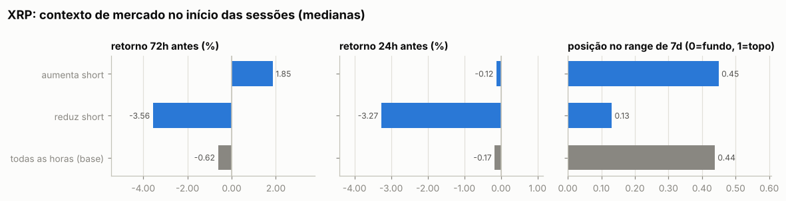

Por ordem (medianas):

| ação | ordens | retorno 24h antes | 72h antes | 7d antes | posição no range 7d | 24h depois | 7d depois |
|---|---|---|---|---|---|---|---|
| aumenta short | 70 | -0.10% | +1.94% | -2.26% | 0.52 | -0.25% | -5.78% |
| reduz short | 36 | -1.70% | -2.85% | -12.29% | 0.17 | +0.97% | +1.74% |
| aumenta long | 4 | +4.84% | +11.25% | +22.36% | 1.00 | -6.09% | -10.36% |
| reduz long | 4 | +4.84% | +11.25% | +22.36% | 1.00 | -6.09% | -10.36% |
| todas as horas (base) |  | -0.17% | -0.62% | -1.33% | 0.44 | -0.17% | -1.44% |

Por sessão (ordens a menos de 30 min uma da outra contam como uma decisão; p = teste de Mann-Whitney contra todas as horas do período):

| sessão | sessões | retorno 24h antes | 72h antes | 7d antes | range 7d | no topo (>0,7) | no fundo (<0,3) |
|---|---|---|---|---|---|---|---|
| aumenta short | 27 | -0.12% (p=0.830) | +1.85% (p=0.195) | -2.26% (p=0.531) | 0.45 (p=0.964) | 30% | 44% |
| reduz short | 14 | -3.27% (p=0.006) | -3.56% (p=0.006) | -13.09% (p=<1e-4) | 0.13 (p=0.000) | 7% | 79% |
| todas as horas (base) |  |  |  |  |  | 27% | 36% |

- Aumentos de posição feitos com a posição no prejuízo (preço pior que o preço médio): **43%** das ordens (40% do tamanho); distância mediana do preço médio: -0.01%.
- Reduções/fechamentos com lucro: **68%** de 40; ganho médio $1.3K vs. perda média -$370; realizado +$31.6K.

- Episódios (de zerado a zerado, ou até inverter): 17; fechados com lucro: 76%; duração mediana 0.8 dias; o melhor episódio sozinho = 43% da soma dos episódios lucrativos.

Maiores episódios por PnL realizado

| início | fim | dias | lado | tam_max | nocional_max | ordens | entrada | saída | realizado |
|---|---|---|---|---|---|---|---|---|---|
| 2025-10-20 | 2025-11-05 | 16.0 | short | 56,113 | $147.4K | 21 | 2.49 | 2.22 | +$15.7K |
| 2025-01-21 | 2025-02-03 | 12.8 | short | 9,737 | $27.2K | 15 | 3.08 | 2.10 | +$9.6K |
| 2025-11-29 | 2026-01-22 | 53.5 | short | 19,771 | $42.0K | 9 | 2.15 | 1.96 | +$3.7K |
| 2025-03-06 | 2025-03-09 | 3.5 | short | 7,951 | $18.6K | 7 | 2.58 | 2.15 | +$3.4K |
| 2025-04-11 | 2025-04-12 | 1.2 | short | 50,372 | $102.7K | 10 | 1.99 | 2.04 | -$2.8K |
| 2025-03-25 | 2025-03-27 | 1.5 | short | 16,456 | $40.0K | 3 | 2.43 | 2.36 | +$1.1K |
| 2025-11-11 | 2025-11-18 | 7.3 | short | 4,086 | $10.0K | 3 | 2.45 | 2.23 | +$868 |
| 2025-02-10 | 2025-02-25 | 14.7 | short | 10,437 | $27.0K | 5 | 2.39 | 2.46 | -$690 |
| 2025-03-25 | 2025-03-25 | 0.1 | short | 41,150 | $100.0K | 10 | 2.43 | 2.42 | +$614 |
| 2025-05-14 | 2025-05-14 | 0.0 | long | 15,174 | $40.0K | 7 | 2.63 | 2.60 | -$465 |

### Todos os episódios relevantes (todas as moedas)

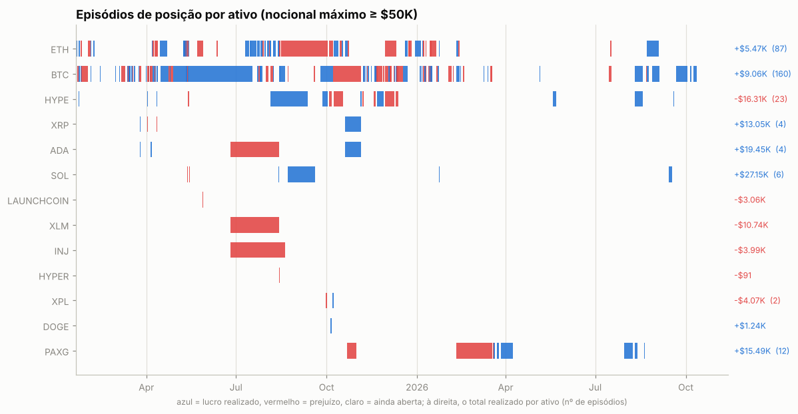

Episódios com nocional máximo ≥ $50K: 303; fechados com lucro: 56%. Abaixo, os 25 maiores por PnL realizado, em ordem de data. *7d/30d antes* e *vs. máx. 30d*: o que o preço tinha feito até a primeira ordem; *funding a.a.*: taxa anualizada nas 24h anteriores (positiva = longs pagam shorts); *entrada média vs. 1ª ordem*: positivo = foi aumentando a posição com o preço indo contra; *contra (máx.)*: quanto o preço andou contra a primeira ordem durante o episódio; *capturado*: movimento entre o preço médio de entrada e o de saída.

| ativo | lado | início | dias | nocional máx. | 7d antes | 30d antes | vs. máx. 30d | funding a.a. na entrada | entrada média vs. 1ª ordem | contra (máx.) | pior PnL aberto | capturado | realizado | funding |
|---|---|---|---|---|---|---|---|---|---|---|---|---|---|---|
| ETH | long | 2025-01-31 | 3 | $101.1K | -2% | +0% | -10% | +11% | +2% | +26% | -$9.0K | -14% | -$16.8K | -$44 |
| BTC | long | 2025-04-04 | 3 | $210.4K | -1% | -6% | -11% | +9% | -0% | +10% | -$22.0K | -9% | -$18.8K | -$154 |
| BTC | long | 2025-04-15 | 8 | $230.2K | +6% | +1% | -3% | +4% | -3% | +3% | -$2.0K | +3% | +$12.0K | -$77 |
| BTC | long | 2025-04-28 | 11 | $195.2K | +9% | +15% | -0% | +2% | -3% | +2% | -$2.3K | +2% | +$9.5K | -$449 |
| ETH | long | 2025-05-13 | 1 | $242.3K | +42% | +57% | -2% | +16% | -0% | +0% | -$355 | +4% | +$9.3K | -$52 |
| BTC | long | 2025-05-14 | 64 | $310.3K | +7% | +23% | -1% | +11% | -1% | +5% | -$8.0K | +2% | +$20.5K | -$2.4K |
| ADA | short | 2025-06-25 | 50 | $79.2K | -5% | -25% | -25% | +2% | +33% | +64% | -$11.8K | -20% | -$13.2K | +$390 |
| XLM | short | 2025-06-25 | 50 | $51.2K | -3% | -15% | -16% | -3% | +48% | +112% | -$11.5K | -27% | -$10.7K | +$178 |
| ETH | long | 2025-07-15 | 7 | $268.7K | +16% | +19% | -2% | +32% | -11% | +3% | -$1.5K | +8% | +$38.6K | -$1.5K |
| HYPE | long | 2025-08-07 | 35 | $330.4K | -9% | +5% | -21% | +6% | -13% | +1% | -$33.4K | +5% | +$42.9K | -$2.5K |
| ETH | short | 2025-08-15 | 48 | $244.5K | +12% | +37% | -7% | +15% | -3% | +12% | -$21.9K | -2% | -$11.0K | +$1.5K |
| SOL | long | 2025-08-22 | 28 | $212.2K | +2% | +0% | -8% | +4% | -5% | +4% | -$9.8K | +11% | +$24.1K | -$1.4K |
| BTC | long | 2025-09-24 | 12 | $355.4K | -2% | +1% | -4% | +11% | -4% | +4% | -$2.1K | +1% | +$12.2K | -$619 |
| HYPE | long | 2025-10-08 | 5 | $199.9K | +0% | -4% | -23% | +28% | +0% | +22% | -$43.6K | -15% | -$29.4K | +$262 |
| BTC | long | 2025-10-09 | 27 | $561.5K | +3% | +9% | -3% | +12% | +7% | +18% | -$39.4K | -3% | -$50.8K | -$2.3K |
| HYPE | long | 2025-10-13 | 4 | $100.5K | -21% | -31% | -35% | -5% | +1% | +19% | -$19.0K | -17% | -$17.8K | -$38 |
| XRP | short | 2025-10-20 | 16 | $147.4K | -7% | -21% | -23% | -6% | +5% | +14% | -$10.6K | +11% | +$15.7K | +$113 |
| ADA | short | 2025-10-20 | 16 | $159.3K | -9% | -28% | -29% | -3% | -3% | +7% | -$5.7K | +16% | +$30.6K | -$130 |
| BTC | short | 2025-11-21 | 6 | $378.9K | -15% | -23% | -29% | +11% | +2% | +10% | -$14.1K | -3% | -$13.9K | +$140 |
| HYPE | long | 2025-11-29 | 10 | $265.3K | +9% | -25% | -24% | +14% | +10% | +23% | -$44.3K | -14% | -$44.8K | -$446 |
| ETH | short | 2025-11-29 | 10 | $236.7K | +10% | -23% | -23% | +2% | +3% | +13% | -$10.8K | -8% | -$16.7K | +$163 |
| HYPE | long | 2025-12-10 | 1 | $190.3K | -15% | -32% | -31% | +14% | -0% | +7% | -$11.5K | -7% | -$12.9K | -$43 |
| ETH | long | 2025-12-29 | 6 | $207.7K | -3% | -3% | -14% | +7% | -0% | +0% | -$348 | +8% | +$14.5K | -$305 |
| ETH | long | 2026-01-15 | 5 | $184.2K | +6% | +14% | -2% | +11% | -0% | +9% | -$8.5K | -6% | -$14.6K | -$230 |
| PAXG | long | 2026-03-27 | 12 | $211.6K | -6% | -15% | -20% | +5% | -2% | +1% | -$543 | +5% | +$10.9K | -$561 |

## 7. Funding

Funding líquido total: **-$13.9K** (recebido $14.5K, pago -$28.4K). Na Hyperliquid o funding é pago de hora em hora; quando positivo, longs pagam shorts.

| ativo | lado | funding | rendimento anualizado s/ nocional |
|---|---|---|---|
| ETH | short | +$1.9K | 6.2% |
| ETH | long | -$3.5K | -16.4% |
| ADA | short | +$725 | 3.8% |
| XRP | short | +$565 | 5.1% |
| (outros) | short | +$4.4K | 5.7% |
| (outros) | long | -$17.9K | -10.7% |

## 8. Fluxos, eventos e carteiras relacionadas

| tipo | eventos | USD (+ entra / − sai) |
|---|---|---|
| vaultDeposit | 1913 | -$3.56M |
| vaultCreate | 1 | — (sem valor em USD) |
| vaultWithdraw | 1269 | +$3.43M |

**Liquidações e ADL (auto-deleveraging) nos fills:**

| quando (UTC) | ativo | tipo | lado | preço | tamanho | posição antes | PnL realizado |
|---|---|---|---|---|---|---|---|
| 2025-08-26 21:52:23 | XPL | Auto-Deleveraging | A | 0.7332 | 17973.0 | 17973.0 | +$5.6K |
| 2025-09-18 13:01:02 | XPL | Close Long | A | 0.66364 | 2950.0 | 6021.0 | -$501 |
| 2025-09-18 13:01:02 | XPL | Close Long | A | 0.66357 | 1439.0 | 3071.0 | -$244 |
| 2025-09-18 13:01:02 | XPL | Close Long | A | 0.6634 | 1632.0 | 1632.0 | -$277 |
| 2025-10-10 21:18:44 | INJ | Auto-Deleveraging | B | 6.4385 | 1666.3 | -1666.3 | +$12.3K |

## 9. Dá para copiar?

### Teste de copiabilidade

Antes de simular, o relatório confere se um copiador conseguiria seguir a carteira. O tempo em posição casa cada redução com o aumento mais recente (LIFO), então um market maker que compra e revende em minutos aparece com minutos, mesmo carregando estoque antigo.

| critério | valor | não copiável se |
|---|---|---|
| execuções de perps e HIP-3 (2025-01-19 → 2026-10-12) | 5,227 | < 20 |
| volume fechado que ficou aberto menos de 30 min | 19% | ≥ 50% |
| tempo mediano em posição (ponderado pelo volume) | 4.6 h |  |
| execuções por dia ativo; parte maker do nocional | 15; 6% | ≥ 300 e ≥ 80% (bot de market making) |

**Copiável:** nenhum critério bloqueia. A simulação abaixo mede quanto do resultado sobra com atraso.

### Copiar cada execução com 30 min, 1h, 2h e 4h de atraso

O copiador começa zerado em 2025-01-19 e repete cada fill de perps e HIP-3 da carteira no mesmo tamanho, com o atraso indicado, a mercado e pagando taxa *taker* de 0.045%. Posições já abertas antes não são copiadas: em cada moeda, a cópia começa quando a carteira zera ou inverte a posição. O preço da cópia é a abertura do candle que começa mais perto de *fill + atraso*: candles de 15m da Hyperliquid nos últimos ~52 dias, de 1h da Hyperliquid ou da Binance antes disso. O atraso real varia meio candle para cada lado, e o candle do próprio fill (muitas vezes o pavio que ele mesmo fez) nunca é usado. Carteira e cópia são marcadas no mesmo preço final (último fechamento diário). O funding fica de fora porque, com horas de atraso, é quase igual para as duas.

Entram na comparação 99% do volume de perps dos fills, em operações de 2025-01-19 a 2026-10-12 (posições herdadas: 0%; sem preço intradiário: 1% — HYPE 1%). Fonte do preço com 30 min de atraso: Binance 1h 94%, HL 1h 3%, HL 15m 2%.

| atraso | atraso médio real | carteira | cópia | fica com | efeito do preço | efeito da taxa | custo (bp do volume, IC 95%) | maior drawdown |
|---|---|---|---|---|---|---|---|---|
| 30 min | 30 min | +$180.8K | +$158.6K | 88% | -$14.4K | -$7.8K | 1.8 (-2.7 a 6.3) | -$101.3K |
| 1h | 61 min | +$180.8K | +$134.1K | 74% | -$38.9K | -$7.8K | 3.8 (-1.4 a 9.0) | -$117.0K |
| 2h | 121 min | +$180.8K | +$71.9K | 40% | -$101.0K | -$7.8K | 8.8 (2.3 a 15.3) | -$123.7K |
| 4h | 241 min | +$180.8K | +$68.3K | 38% | -$104.6K | -$7.9K | 9.1 (0.9 a 17.2) | -$120.4K |

Maior drawdown da carteira nas mesmas operações: -$96.8K. *Efeito do preço* e *efeito da taxa*: quanto o preço da cópia e a taxa *taker* mudam o resultado em relação à carteira (negativo = a cópia perde). O custo é carteira − cópia sobre o volume copiado; o IC vem da variação de um dia para outro. Os valores somam só as operações copiadas, não o PnL total da carteira.

Com 30 min de atraso a cópia fica com **88%** do resultado; com 4h, **38%**. O custo do atraso é maior que zero com 95% de confiança com 2h e 4h de atraso.

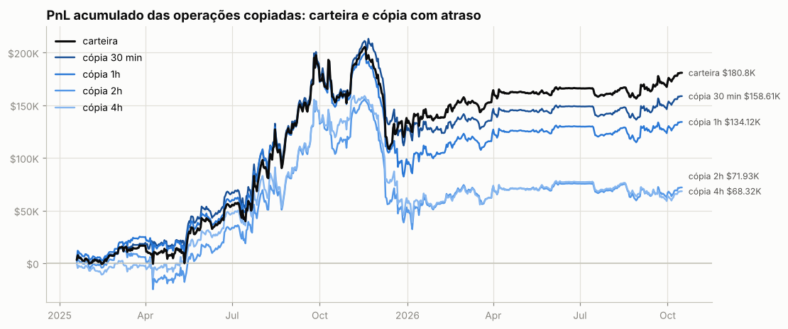

**Por ativo** (12 maiores pelo resultado da carteira):

| ativo | volume | carteira | 30 min | 1h | 2h | 4h | fica com (30 min) |
|---|---|---|---|---|---|---|---|
| HYPE | $7.59M | -$42.1K | -$28.7K | -$33.8K | -$37.7K | -$12.8K | — |
| ADA | $1.50M | +$40.4K | +$40.0K | +$38.6K | +$34.9K | +$35.9K | 99% |
| XRP | $1.41M | +$31.2K | +$29.6K | +$28.7K | +$28.8K | +$25.6K | 95% |
| SOL | $1.76M | +$27.1K | +$29.8K | +$28.5K | +$22.7K | +$23.5K | 110% |
| PAXG | $3.67M | +$15.3K | +$14.8K | +$15.0K | +$10.4K | +$12.7K | 97% |
| BTC | $72.65M | -$14.6K | -$34.2K | -$47.5K | -$58.8K | -$80.4K | — |
| XPL | $533.7K | +$12.8K | +$9.4K | +$6.1K | +$5.1K | +$3.9K | 73% |
| ONDO | $119.8K | +$12.1K | +$11.9K | +$12.2K | +$12.0K | +$12.6K | 99% |
| FARTCOIN | $467.4K | -$11.9K | -$10.6K | -$11.5K | -$11.3K | -$8.6K | — |
| SEI | $117.2K | +$10.7K | +$10.7K | +$10.4K | +$10.5K | +$10.2K | 100% |
| ENA | $126.5K | -$10.5K | -$10.4K | -$10.9K | -$10.0K | -$10.5K | — |
| INJ | $433.7K | +$8.8K | +$7.1K | +$6.9K | +$6.5K | +$5.8K | 81% |

**Por tipo de execução da carteira.** Numa ordem limite a carteira compra abaixo e vende acima do preço corrente; a cópia a mercado perde essa vantagem. Numa ordem a mercado as duas pagam o *spread*:

| execução da carteira | fills | volume | carteira | 30 min | 1h | 2h | 4h |
|---|---|---|---|---|---|---|---|
| limite (maker) | 3,117 | $7.64M | +$326.1K | +$324.8K | +$324.6K | +$317.3K | +$283.0K |
| a mercado (taker) | 22,584 | $116.35M | -$145.3K | -$166.2K | -$190.5K | -$245.3K | -$214.7K |

### Espelhar a posição com atraso longo (moedas principais)

PnL de quem replicasse exatamente a posição da carteira, mas com N horas de atraso (marcação horária, sem custos). Se o PnL se mantém com atraso, a vantagem está em horizontes longos e é copiável; se desaba, depende de timing fino.

| atraso | ETH | ADA | XRP |
|---|---|---|---|
| 0h | +$16.2K | +$40.7K | +$30.3K |
| 1h | -$11.5K | +$39.0K | +$30.9K |
| 4h | -$11.5K | +$37.7K | +$26.1K |
| 12h | -$1.3K | +$40.7K | +$27.3K |
| 24h | -$26.6K | +$39.9K | +$17.3K |
| 72h | -$56.6K | +$19.0K | +$20.2K |
| 168h | +$18.7K | +$28.0K | +$16.9K |

## 10. Teste de replicação por regras (ETH)

Regra testada: *short-bias com filtro de tendência e fade* — short de até 36.43 ETH (o percentil 90 do tamanho real), cheio abaixo da média móvel e reduzido acima; dentro do regime, mais short perto do topo do range e menos perto do fundo. Parâmetros escolhidos no treino (2025-01-19 → 2025-12-02) e avaliados no teste (2025-12-03 → 2026-10-15).

|  | parâmetros | PnL treino | PnL teste | correlação c/ posição real (teste) |
|---|---|---|---|---|
| melhor regra no treino | MA50, range 7d, fração em alta 0.0, fade 0.0 | +$86.5K | +$37.4K | 0.05 |
| carteira real (aprox.) | — | +$50.4K | -$153 | 1.00 |

Clone comportamental (regressão linear da posição real em médias móveis, ranges e retornos): R² treino 0.40, R² teste -0.81, correlação no teste 0.15.

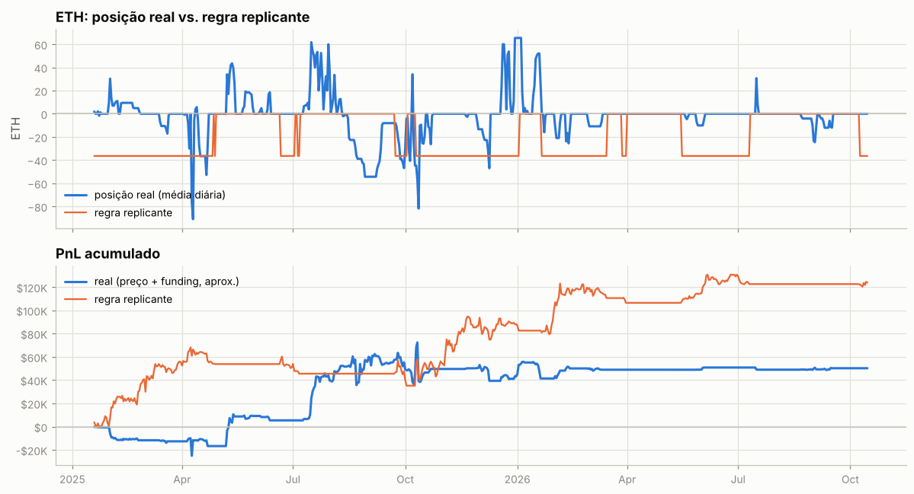

---

Metodologia e código: ver `README.md` na raiz do repositório.
