# Relatório automático — `0xb69eec8fea0081343c3b09e652ba1fa7dcf7033a`

Gerado em 2026-10-16 21:09 UTC a partir da API pública da Hyperliquid (`POST /info`). Valores em USD. Este arquivo é regenerado por `python -m hlre.report`; a interpretação da estratégia fica em `ANALISE.md`.

## 1. Visão geral

| métrica | valor |
|---|---|
| Valor da conta (perp + spot) | $1.50M |
| PnL all-time (portfolio, inclui spot/airdrops) | +$2.48M |
| PnL all-time só de perps | +$2.47M |
| Volume all-time | $166.52M |
| Primeira atividade | 2026-01-07 |
| Fills disponíveis na API | 29,114 (desde 2026-02-14) |
| Ordens (fills agrupados por oid) | 956 |
| Funding líquido (recebido > 0) | -$87.2K |
| Taxas pagas (período dos fills) | -$43.9K |
| Liquidações (ledger) | 0 |
| Fills de liquidação/ADL | 496 |
| Papel da conta | user |
| API wallets (agentes) | 0 |

**Posições abertas agora:**

| ativo | tamanho | nocional | entrada | alav. | PnL não realizado | liq. |
|---|---|---|---|---|---|---|
| BTC | 99.21115 | $8.09M | 80254.1 | 20x cross | +$132.2K | 77005.2307343237 |
| BNB | 1735.127 | $1.25M | 787.824 | 10x cross | -$117.7K | 447.6563193339 |
| NEAR | 103611.3 | $513.9K | 4.90163 | 10x cross | +$6.0K | 0.3990305236 |
| HYPE | 2480.81 | $197.7K | 80.6133 | 10x cross | -$2.3K | — |
| PONS | 917823.0 | $286.9K | 0.326611 | 3x cross | -$12.9K | — |

## 2. Curva de PnL

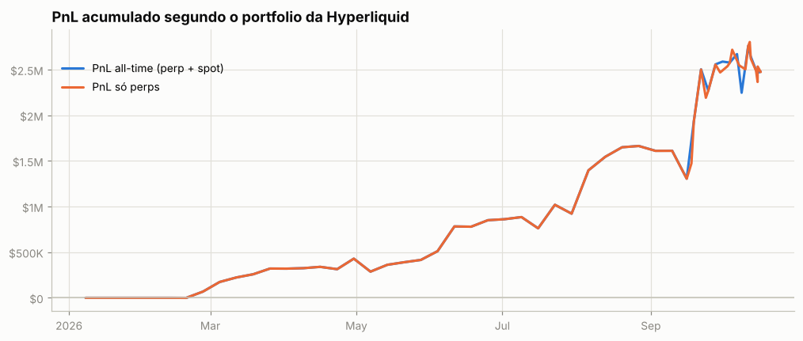

## 3. De onde veio o PnL

*Preço (aprox.)* usa a posição média diária de cada ativo, reconstruída a partir do histórico de funding (que traz o tamanho da posição a cada hora/dia desde o início da conta), vezes o movimento open→close do dia. Subestima o PnL de day trade, mas cobre o período sem fills. *Preço exato* marca cada fill no fechamento diário e só existe para o período coberto pelos fills.

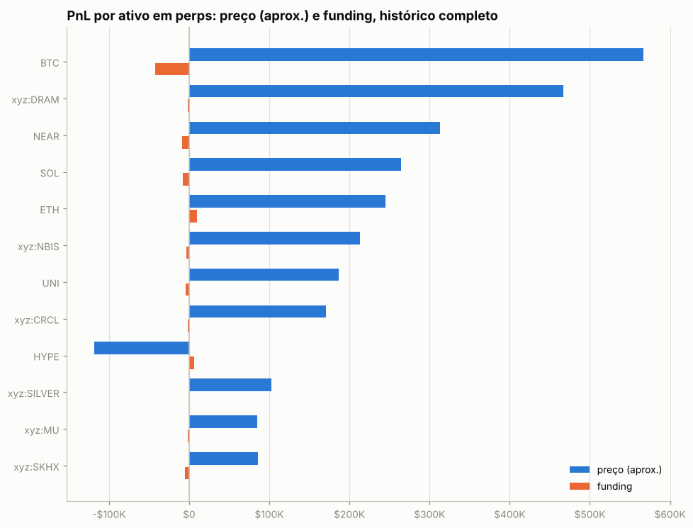

| ativo | preço (aprox.) | funding | total | preço exato (período dos fills) | taxas (período dos fills) |
|---|---|---|---|---|---|
| BTC | +$567.0K | -$42.2K | +$524.8K | +$465.1K | -$13.7K |
| xyz:DRAM | +$466.8K | -$1.7K | +$465.0K | +$477.6K | -$918 |
| NEAR | +$312.9K | -$8.8K | +$304.1K | +$483.8K | -$3.2K |
| SOL | +$264.0K | -$7.9K | +$256.1K | +$266.8K | -$3.0K |
| ETH | +$245.3K | +$9.8K | +$255.1K | +$191.2K | -$12.8K |
| xyz:NBIS | +$212.9K | -$3.5K | +$209.4K | +$252.7K | -$195 |
| UNI | +$186.6K | -$3.9K | +$182.7K | +$137.7K | -$856 |
| xyz:CRCL | +$170.3K | -$1.7K | +$168.6K | +$149.3K | -$149 |
| HYPE | -$118.2K | +$6.2K | -$112.0K | -$133.5K | -$1.9K |
| xyz:SILVER | +$102.3K | +$449 | +$102.7K | +$107.5K | -$199 |
| xyz:MU | +$85.3K | -$1.4K | +$83.9K | +$100.6K | -$182 |
| xyz:SKHX | +$85.9K | -$5.4K | +$80.5K | +$107.2K | -$256 |
| xyz:RKLB | +$67.3K | +$2.1K | +$69.5K | +$66.2K | -$20 |
| ZEC | +$60.3K | -$1.3K | +$59.0K | +$56.4K | -$175 |
| BNB | -$40.3K | -$9.7K | -$50.0K | -$74.1K | -$2.4K |
| outros (27) | +$96.6K | -$18.4K | +$78.1K | -$42.9K | -$4.0K |

**Decomposição no período dos fills** (preço exato): quanto veio de *carregar* a posição (e, dentro disso, do viés médio vs. do *timing* de aumentar/reduzir), quanto de trades intradiários, funding e taxas.

| componente | BTC | NEAR | xyz:DRAM |
|---|---|---|---|
| carregar posição (carry) | +$457.5K | +$82.4K | +$216.9K |
|   ↳ viés (posição média × movimento) | +$105.7K | +$128.6K | -$2.0K |
|   ↳ timing (variação do tamanho) | +$351.9K | -$46.2K | +$218.9K |
| trades intradiários | +$7.6K | +$401.4K | +$260.7K |
| funding | -$42.2K | -$8.8K | -$1.7K |
| taxas | -$13.7K | -$3.2K | -$918 |
| posição média | 9.81 | 202,200.40 | 575.63 |
| movimento do preço no período | 10,770.00 | 0.64 | -3.45 |

## 4. Posições ao longo do tempo

Área clara: posição média diária (funding). Linha: posição exata (fills). Azul = long, vermelho = short.

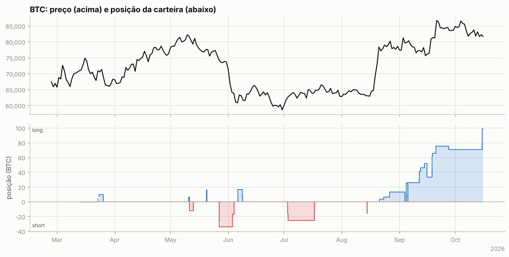

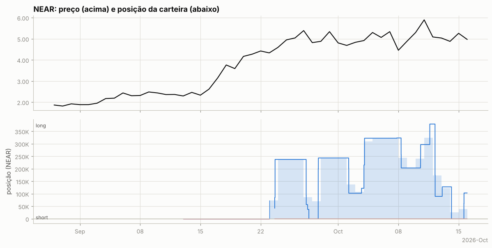

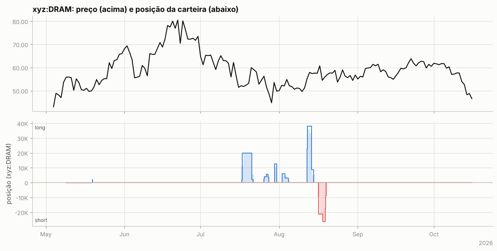

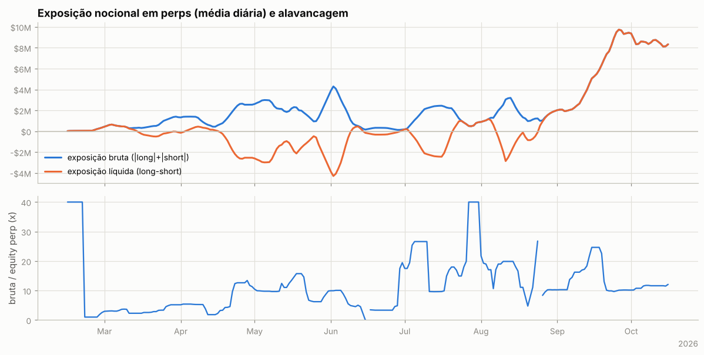

Tabela mensal de exposição e alavancagem

| mês | exposição bruta | exposição líquida | equity perp | alavancagem (mediana) |
|---|---|---|---|---|
| 2026-02 | $190.1K | $186.8K | $75.4K | 2.6x |
| 2026-03 | $710.4K | -$28.3K | $173.8K | 3.4x |
| 2026-04 | $1.59M | -$991.9K | $232.3K | 5.3x |
| 2026-05 | $2.33M | -$2.02M | $233.6K | 9.8x |
| 2026-06 | $684.1K | -$394.1K | $98.9K | 4.9x |
| 2026-07 | $1.54M | -$594.2K | $107.0K | 16.9x |
| 2026-08 | $1.77M | $6.2K | $112.6K | 10.9x |
| 2026-09 | $6.07M | $6.07M | $514.6K | 12.9x |
| 2026-10 | $8.40M | $8.40M | $738.4K | 11.7x |

## 5. Execução

**Tipos de ordem** (últimas 1,019 ordens que a API guarda, 2026-03-04 → 2026-10-15):

| orderType | tif | reduceOnly | isTrigger | ordens |
|---|---|---|---|---|
| Limit | Gtc | False | False | 335 |
| Limit | Gtc | True | False | 112 |
| Market | FrontendMarket | False | False | 226 |
| Market | FrontendMarket | True | False | 287 |
| Market | LiquidationMarket | True | False | 30 |
| Stop Market | Gtc | True | True | 1 |

`FrontendMarket` = ordem a mercado enviada pela interface web; `Gtc` = limite que fica no livro; gatilhos (`isTrigger`) seriam stop/take-profit.

**Perfil por ativo (top 10 por volume):**

| ativo | volume | ordens | % taker (nocional) | tamanho mediano |
|---|---|---|---|---|
| ETH | $46.48M | 77 | 55% | 217.6 |
| BTC | $36.53M | 62 | 89% | 6.904 |
| xyz:DRAM | $13.00M | 104 | 80% | 1,957 |
| NEAR | $9.98M | 61 | 72% | 2.84e+04 |
| SOL | $8.80M | 33 | 78% | 2,151 |
| HYPE | $6.63M | 67 | 56% | 1,478 |
| BNB | $6.53M | 42 | 85% | 178.7 |
| xyz:SKHX | $3.84M | 47 | 64% | 55.41 |
| xyz:MU | $3.34M | 39 | 57% | 136.2 |
| xyz:HOOD | $2.93M | 46 | 44% | 668.4 |

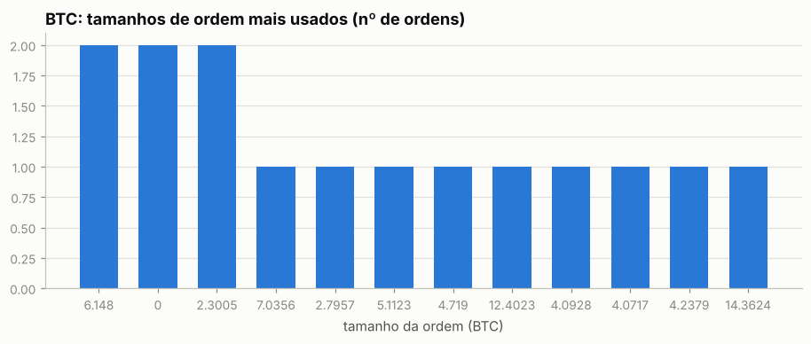

Os 5 tamanhos mais comuns respondem por 13% das ordens de BTC — lotes redondos e repetidos são assinatura de execução manual.

Sessões (ordens separadas por < 30 min): 266; mediana de 2 ordens e 0.3 min por sessão; dias com atividade: 132 de 242.

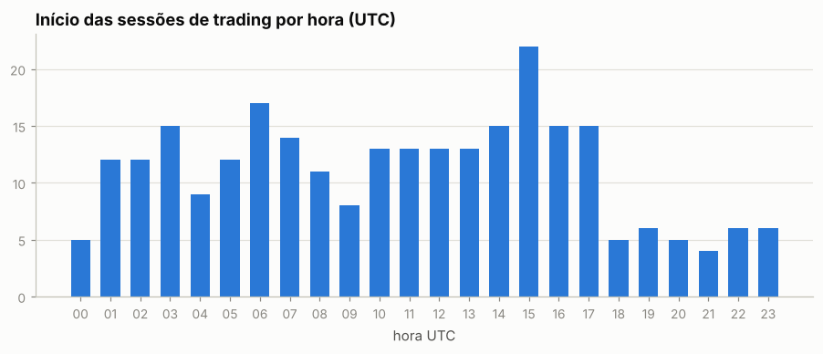

Por dia da semana: seg 14%, ter 18%, qua 17%, qui 14%, sex 14%, sáb 10%, dom 13%

## 6. Comportamento de entrada e saída

### BTC

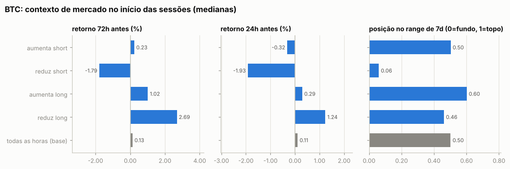

Por ordem (medianas):

| ação | ordens | retorno 24h antes | 72h antes | 7d antes | posição no range 7d | 24h depois | 7d depois |
|---|---|---|---|---|---|---|---|
| aumenta short | 6 | -0.32% | +0.23% | +0.02% | 0.50 | +0.28% | -1.25% |
| reduz short | 12 | -1.79% | -0.72% | -2.85% | 0.14 | +0.14% | -1.86% |
| aumenta long | 28 | +0.29% | +1.51% | -0.18% | 0.60 | +1.19% | +1.06% |
| reduz long | 16 | +1.24% | +2.69% | -1.11% | 0.46 | -1.64% | -1.10% |
| todas as horas (base) |  | +0.11% | +0.13% | +0.39% | 0.50 | +0.10% | +0.52% |

Por sessão (ordens a menos de 30 min uma da outra contam como uma decisão; p = teste de Mann-Whitney contra todas as horas do período):

| sessão | sessões | retorno 24h antes | 72h antes | 7d antes | range 7d | no topo (>0,7) | no fundo (<0,3) |
|---|---|---|---|---|---|---|---|
| aumenta short | 6 | -0.32% (p=0.896) | +0.23% (p=0.976) | +0.02% (p=0.962) | 0.50 (p=0.963) | 33% | 17% |
| reduz short | 5 | -1.93% (p=0.006) | -1.79% (p=0.067) | -3.57% (p=0.016) | 0.06 (p=0.016) | 0% | 60% |
| aumenta long | 15 | +0.29% (p=0.582) | +1.02% (p=0.548) | -0.18% (p=0.691) | 0.60 (p=0.980) | 40% | 33% |
| reduz long | 8 | +1.24% (p=0.114) | +2.69% (p=0.024) | -1.11% (p=0.264) | 0.46 (p=0.997) | 25% | 25% |
| todas as horas (base) |  |  |  |  |  | 35% | 32% |

- Aumentos de posição feitos com a posição no prejuízo (preço pior que o preço médio): **26%** das ordens (19% do tamanho); distância mediana do preço médio: -0.11%.
- Reduções/fechamentos com lucro: **43%** de 28; ganho médio $38.7K vs. perda média -$8.5K; realizado +$328.6K.

- Episódios (de zerado a zerado, ou até inverter): 11; fechados com lucro: 40%; duração mediana 2.2 dias; o melhor episódio sozinho = 82% da soma dos episódios lucrativos.

Maiores episódios por PnL realizado

| início | fim | dias | lado | tam_max | nocional_max | ordens | entrada | saída | realizado |
|---|---|---|---|---|---|---|---|---|---|
| 2026-05-27 | 2026-06-04 | 8.0 | short | 34.09 | $2.58M | 5 | 75,607 | 65,014 | +$361.1K |
| 2026-09-05 | 2026-10-15 | 40.1 | long | 99.21 | $8.09M | 19 | 80,065 | 77,093 | -$50.4K |
| 2026-08-21 | 2026-09-04 | 13.7 | long | 12.93 | $1.05M | 5 | 77,427 | 80,897 | +$44.9K |
| 2026-07-02 | 2026-07-27 | 24.8 | short | 25.63 | $1.62M | 5 | 61,470 | 63,142 | -$42.9K |
| 2026-06-06 | 2026-06-08 | 2.4 | long | 16.35 | $1.03M | 6 | 61,163 | 63,063 | +$31.1K |
| 2026-05-11 | 2026-05-13 | 2.0 | short | 12.40 | $1.01M | 4 | 80,633 | 81,160 | -$6.5K |
| 2026-03-23 | 2026-03-25 | 2.4 | long | 9.83 | $703.3K | 4 | 71,261 | 70,691 | -$5.6K |
| 2026-08-14 | 2026-08-14 | 0.1 | short | 15.96 | $1.01M | 4 | 62,670 | 62,976 | -$4.9K |
| 2026-09-04 | 2026-09-05 | 0.8 | long | 25.19 | $2.00M | 4 | 79,418 | 79,595 | +$4.4K |
| 2026-05-10 | 2026-05-11 | 0.5 | long | 6.15 | $500.0K | 3 | 81,327 | 80,988 | -$2.1K |

### NEAR

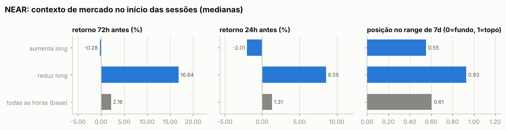

Por ordem (medianas):

| ação | ordens | retorno 24h antes | 72h antes | 7d antes | posição no range 7d | 24h depois | 7d depois |
|---|---|---|---|---|---|---|---|
| aumenta long | 29 | -5.62% | -3.83% | +20.40% | 0.60 | +1.29% | +2.38% |
| reduz long | 32 | +8.90% | +16.84% | +17.53% | 0.99 | -9.24% | -10.51% |
| todas as horas (base) |  | +1.31% | +2.16% | +8.01% | 0.61 | +2.35% | +1.35% |

Por sessão (ordens a menos de 30 min uma da outra contam como uma decisão; p = teste de Mann-Whitney contra todas as horas do período):

| sessão | sessões | retorno 24h antes | 72h antes | 7d antes | range 7d | no topo (>0,7) | no fundo (<0,3) |
|---|---|---|---|---|---|---|---|
| aumenta long | 10 | -2.01% (p=0.428) | -0.28% (p=0.359) | +3.54% (p=0.793) | 0.55 (p=0.466) | 40% | 40% |
| reduz long | 7 | +8.55% (p=0.076) | +16.84% (p=0.005) | +17.53% (p=0.072) | 0.93 (p=0.009) | 71% | 0% |
| todas as horas (base) |  |  |  |  |  | 43% | 17% |

- Aumentos de posição feitos com a posição no prejuízo (preço pior que o preço médio): **42%** das ordens (48% do tamanho); distância mediana do preço médio: -0.06%.
- Reduções/fechamentos com lucro: **78%** de 32; ganho médio $19.8K vs. perda média -$2.5K; realizado +$476.6K.

- Episódios (de zerado a zerado, ou até inverter): 3; fechados com lucro: 100%; duração mediana 9.7 dias; o melhor episódio sozinho = 55% da soma dos episódios lucrativos.

Maiores episódios por PnL realizado

| início | fim | dias | lado | tam_max | nocional_max | ordens | entrada | saída | realizado |
|---|---|---|---|---|---|---|---|---|---|
| 2026-09-28 | 2026-10-14 | 15.5 | long | 379,302 | $2.23M | 42 | 5.07 | 5.45 | +$262.6K |
| 2026-09-23 | 2026-09-27 | 4.0 | long | 237,794 | $1.29M | 14 | 4.47 | 5.37 | +$214.0K |
| 2026-10-15 | 2026-10-15 | 0.0 | long | 103,611 | $520.5K | 5 | 4.90 | — | $0 |

### xyz:DRAM

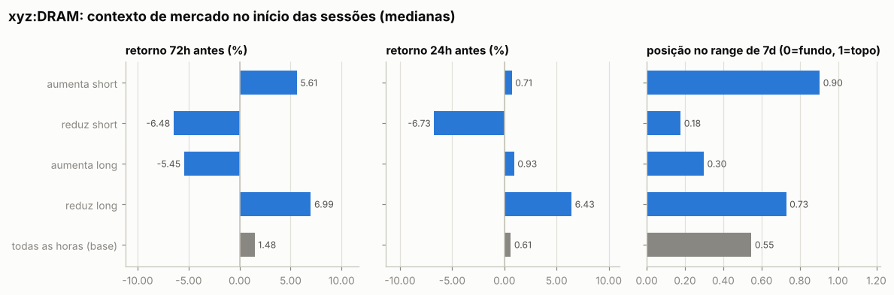

Por ordem (medianas):

| ação | ordens | retorno 24h antes | 72h antes | 7d antes | posição no range 7d | 24h depois | 7d depois |
|---|---|---|---|---|---|---|---|
| aumenta short | 23 | +0.71% | +6.30% | +13.40% | 0.94 | +3.55% | +0.11% |
| reduz short | 10 | -6.73% | -6.48% | +2.50% | 0.18 | +5.18% | +4.15% |
| aumenta long | 41 | +0.36% | -8.38% | -8.06% | 0.09 | +3.95% | +12.56% |
| reduz long | 30 | +5.68% | +8.25% | -0.31% | 0.79 | -0.97% | -2.08% |
| todas as horas (base) |  | +0.61% | +1.48% | +0.31% | 0.55 | +0.63% | +0.10% |

Por sessão (ordens a menos de 30 min uma da outra contam como uma decisão; p = teste de Mann-Whitney contra todas as horas do período):

| sessão | sessões | retorno 24h antes | 72h antes | 7d antes | range 7d | no topo (>0,7) | no fundo (<0,3) |
|---|---|---|---|---|---|---|---|
| aumenta short | 3 | +0.71% (p=0.723) | +5.61% (p=0.290) | +13.40% (p=0.081) | 0.90 (p=0.131) | 100% | 0% |
| reduz short | 3 | -6.73% (p=0.043) | -6.48% (p=0.107) | +2.50% (p=0.633) | 0.18 (p=0.047) | 0% | 100% |
| aumenta long | 10 | +0.93% (p=0.588) | -5.45% (p=0.014) | -6.86% (p=0.030) | 0.30 (p=0.002) | 0% | 60% |
| reduz long | 12 | +6.43% (p=0.027) | +6.99% (p=0.051) | -2.40% (p=0.934) | 0.73 (p=0.637) | 58% | 25% |
| todas as horas (base) |  |  |  |  |  | 39% | 27% |

- Aumentos de posição feitos com a posição no prejuízo (preço pior que o preço médio): **11%** das ordens (14% do tamanho); distância mediana do preço médio: -0.14%.
- Reduções/fechamentos com lucro: **85%** de 40; ganho médio $14.9K vs. perda média -$4.6K; realizado +$477.6K.

- Episódios (de zerado a zerado, ou até inverter): 7; fechados com lucro: 71%; duração mediana 2.5 dias; o melhor episódio sozinho = 42% da soma dos episódios lucrativos.

Maiores episódios por PnL realizado

| início | fim | dias | lado | tam_max | nocional_max | ordens | entrada | saída | realizado |
|---|---|---|---|---|---|---|---|---|---|
| 2026-08-12 | 2026-08-14 | 2.5 | long | 38,141 | $2.18M | 16 | 51.96 | 57.45 | +$209.6K |
| 2026-07-30 | 2026-07-31 | 0.9 | long | 12,594 | $681.0K | 11 | 44.57 | 54.01 | +$119.0K |
| 2026-07-17 | 2026-07-21 | 4.5 | long | 19,781 | $1.10M | 21 | 50.91 | 54.26 | +$101.9K |
| 2026-08-16 | 2026-08-19 | 3.0 | short | 26,258 | $1.54M | 33 | 57.84 | 55.32 | +$66.2K |
| 2026-07-25 | 2026-07-27 | 2.1 | long | 5,714 | $320.0K | 14 | 55.01 | 51.22 | -$21.6K |
| 2026-08-02 | 2026-08-04 | 2.8 | long | 5,896 | $301.6K | 6 | 51.11 | 52.04 | +$5.5K |
| 2026-05-19 | 2026-05-19 | 0.1 | long | 2,046 | $100.2K | 3 | 48.95 | 47.47 | -$3.0K |

### Todos os episódios relevantes (todas as moedas)

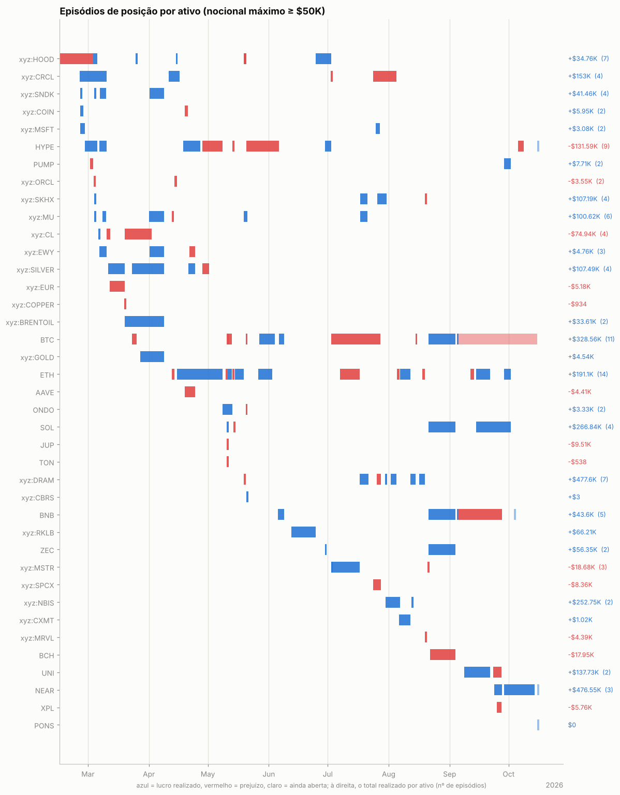

Episódios com nocional máximo ≥ $50K: 124; fechados com lucro: 59%. Abaixo, os 25 maiores por PnL realizado, em ordem de data. *7d/30d antes* e *vs. máx. 30d*: o que o preço tinha feito até a primeira ordem; *funding a.a.*: taxa anualizada nas 24h anteriores (positiva = longs pagam shorts); *entrada média vs. 1ª ordem*: positivo = foi aumentando a posição com o preço indo contra; *contra (máx.)*: quanto o preço andou contra a primeira ordem durante o episódio; *capturado*: movimento entre o preço médio de entrada e o de saída.

| ativo | lado | início | dias | nocional máx. | 7d antes | 30d antes | vs. máx. 30d | funding a.a. na entrada | entrada média vs. 1ª ordem | contra (máx.) | pior PnL aberto | capturado | realizado | funding |
|---|---|---|---|---|---|---|---|---|---|---|---|---|---|---|
| xyz:CRCL | long | 2026-02-24 | 14 | $306.9K | +4% | -13% | -17% | +14% | -15% | +1% | -$2.2K | +50% | +$113.0K | -$664 |
| xyz:SILVER | short | 2026-03-11 | 8 | $400.7K | +4% | +9% | -8% | +0% | -4% | +0% | -$560 | +15% | +$62.9K | +$553 |
| xyz:CL | short | 2026-03-19 | 14 | $430.0K | +5% | +58% | -14% | -17% | -2% | +18% | -$56.5K | -15% | -$57.6K | -$2.5K |
| xyz:SILVER | long | 2026-03-23 | 16 | $538.7K | -15% | -21% | -30% | +19% | -2% | +2% | -$11.8K | +9% | +$43.2K | -$402 |
| xyz:CRCL | long | 2026-04-11 | 6 | $469.5K | -3% | -21% | -35% | +13% | -4% | +3% | -$8.4K | +9% | +$46.7K | -$151 |
| ETH | short | 2026-05-14 | 5 | $2.53M | +1% | -1% | -5% | +10% | -1% | +0% | -$6.1K | +6% | +$152.9K | +$1.4K |
| HYPE | short | 2026-05-20 | 17 | $853.5K | +27% | +21% | +0% | +0% | -0% | +47% | -$329.8K | -21% | -$145.2K | +$5.2K |
| ETH | short | 2026-05-26 | 7 | $1.04M | -2% | -11% | -14% | +8% | -0% | +1% | -$9.8K | +7% | +$69.1K | +$1.7K |
| BTC | short | 2026-05-27 | 8 | $2.58M | -1% | -4% | -8% | -4% | -0% | +0% | -$10.9K | +14% | +$361.1K | +$3.7K |
| xyz:RKLB | short | 2026-06-12 | 12 | $315.2K | -2% | -5% | -24% | +11% | -0% | +2% | -$8.3K | +20% | +$66.2K | +$2.1K |
| xyz:DRAM | long | 2026-07-17 | 4 | $1.10M | -22% | -31% | -40% | +30% | -3% | +1% | -$15.5K | +7% | +$101.9K | -$822 |
| xyz:SKHX | long | 2026-07-17 | 4 | $753.0K | -21% | -29% | -40% | -57% | -1% | +2% | -$7.8K | +6% | +$45.8K | -$235 |
| xyz:SKHX | long | 2026-07-26 | 5 | $674.8K | +5% | -29% | -32% | +38% | +17% | +27% | -$44.8K | +9% | +$65.8K | -$4.7K |
| xyz:DRAM | long | 2026-07-30 | 1 | $681.0K | -24% | -38% | -40% | +32% | -0% | +2% | -$13.5K | +21% | +$119.0K | -$243 |
| xyz:NBIS | long | 2026-07-30 | 7 | $1.16M | -34% | -44% | -48% | +18% | -13% | -0% | -$1.3K | +27% | +$242.8K | -$3.5K |
| ETH | short | 2026-08-06 | 5 | $5.09M | -0% | +6% | -3% | +11% | -1% | +1% | -$34.1K | +1% | +$44.4K | +$3.5K |
| xyz:DRAM | long | 2026-08-12 | 3 | $2.18M | -7% | -17% | -18% | +13% | -0% | +1% | -$12.5K | +11% | +$209.6K | -$670 |
| xyz:DRAM | short | 2026-08-16 | 3 | $1.54M | +13% | +14% | -4% | +8% | +0% | +7% | -$84.6K | +4% | +$66.2K | +$781 |
| BTC | long | 2026-08-21 | 14 | $1.05M | +20% | +15% | +0% | +11% | -2% | -0% | -$10.7K | +4% | +$44.9K | -$3.8K |
| ZEC | long | 2026-08-21 | 14 | $154.5K | +24% | +17% | +0% | +53% | -0% | -5% | +$0 | +55% | +$54.6K | -$1.2K |
| BTC | long | 2026-09-05 | 40 | $8.09M | +3% | +24% | -2% | +8% | -0% | +5% | -$166.0K | -4% | -$50.4K | -$48.4K |
| UNI | long | 2026-09-08 | 13 | $908.5K | +22% | +77% | -5% | +13% | +0% | +17% | -$95.3K | +14% | +$145.8K | -$3.7K |
| SOL | long | 2026-09-14 | 18 | $2.14M | -3% | +35% | -7% | +3% | -5% | +5% | -$40.4K | +11% | +$242.3K | -$6.3K |
| NEAR | long | 2026-09-23 | 4 | $1.29M | +92% | +135% | -2% | +25% | +5% | +11% | -$64.5K | +20% | +$214.0K | -$2.0K |
| NEAR | long | 2026-09-28 | 15 | $2.23M | +20% | +167% | -12% | +16% | -2% | +11% | -$98.4K | +8% | +$262.6K | -$6.7K |

## 7. Funding

Funding líquido total: **-$87.2K** (recebido $49.8K, pago -$137.0K). Na Hyperliquid o funding é pago de hora em hora; quando positivo, longs pagam shorts.

| ativo | lado | funding | rendimento anualizado s/ nocional |
|---|---|---|---|
| BTC | short | +$11.1K | 9.3% |
| BTC | long | -$53.3K | -8.7% |
| NEAR | long | -$8.8K | -13.6% |
| xyz:DRAM | short | +$781 | 7.7% |
| xyz:DRAM | long | -$2.5K | -9.3% |
| (outros) | short | +$6.3K | 1.6% |
| (outros) | long | -$40.9K | -11.2% |

## 8. Fluxos, eventos e carteiras relacionadas

| tipo | eventos | USD (+ entra / − sai) |
|---|---|---|
| withdraw | 13 | -$1.71M |
| send | 28 | -$47.5K |
| borrowLend | 30 | — (sem valor em USD) |
| deposit | 11 | +$777.5K |

**Gestão de margem.** Dias com depósito: 18; em 50% deles o PnL dos 3 dias anteriores era negativo (mediana -$1.3K). Dias com saque: 17; em 100% deles o PnL dos 3 dias anteriores era positivo (mediana +$122.8K). Base: 38% de todos os dias vêm depois de 3 dias negativos. Correlação entre o fluxo do dia e a variação da exposição bruta: 0.22 (positiva = deposita para abrir posição e saca ao reduzir).

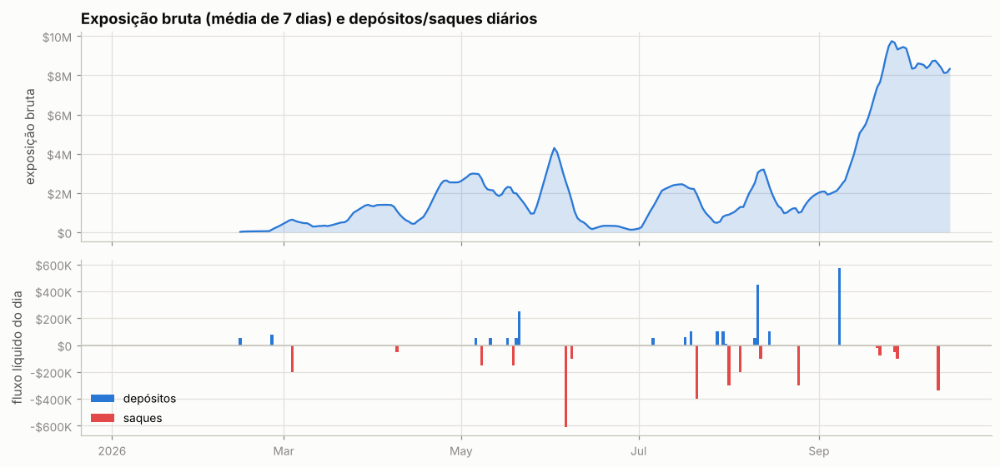

Ponte HyperCore↔HyperEVM (endereços de sistema `0x2000…`/`0x2222…`): 6 transferências, entrada $0, saída $1.39M — uso de DeFi na HyperEVM.

**Carteiras relacionadas** (conta vinculada de staking para desconto de taxa + maiores contrapartes de transferências; o saldo de staking e o PnL ajudam a ver se posições aqui são hedge de algo mantido lá):

| carteira | relação | transferências | volume transferido | valor da conta hoje | PnL all-time | HYPE em staking | maiores saldos spot |
|---|---|---|---|---|---|---|---|
| `0xded3baff89cc9c9b766e775233ff27142275f7d8` | transfers | 5 | $1.07M | $0 | +$274.0K | 0 | — |
| `0x6b9e773128f453f5c2c60935ee2de2cbc5390a24` | hot wallet de serviço (recebe USDC da HyperEVM e repassa a centenas de usuários: exchange/ponte) | 9 | $1.06M | $7.8K | +$0 | 0 | USDC 7,687 |
| `0x6aea4d17166ab9b42253b8ef435aaa64498f4f40` | transfers | 7 | $410.5K | $0 | -$5.1K | 0 | USDC 0 |
| `0x901c7e3cf6075386478db980694def8bbe5588eb` | transfers | 1 | $10.0K | $10.6K | $0 | 0 | USDC 10,595 |

**Liquidações e ADL (auto-deleveraging) nos fills:**

| quando (UTC) | ativo | tipo | lado | preço | tamanho | posição antes | PnL realizado |
|---|---|---|---|---|---|---|---|
| 2026-02-26 15:16:32 | xyz:SNDK | Close Long | A | 618.95 | 0.219 | 76.11 | -$8 |
| 2026-02-26 15:16:32 | xyz:SNDK | Close Long | A | 618.84 | 9.388 | 75.891 | -$341 |
| 2026-02-26 15:16:32 | xyz:SNDK | Close Long | A | 618.84 | 9.388 | 66.503 | -$341 |
| 2026-02-26 15:16:32 | xyz:SNDK | Close Long | A | 618.8 | 57.115 | 57.115 | -$2.1K |
| 2026-03-23 11:07:27 | xyz:BRENTOIL | Auto-Deleveraging | B | 96.218 | 2916.16 | -2916.16 | +$19.3K |
| 2026-04-02 06:51:24 | xyz:EWJ | Close Long | A | 83.0 | 4.217 | 583.818 | -$11 |
| 2026-04-02 06:51:24 | xyz:EWJ | Close Long | A | 82.983 | 2.591 | 579.601 | -$7 |
| 2026-04-02 06:51:24 | xyz:EWJ | Close Long | A | 82.963 | 1.047 | 577.01 | -$3 |
| 2026-04-02 06:51:24 | xyz:EWJ | Close Long | A | 82.948 | 298.009 | 575.963 | -$803 |
| 2026-04-02 06:51:24 | xyz:EWJ | Close Long | A | 82.947 | 59.616 | 277.954 | -$161 |
| 2026-04-02 06:51:24 | xyz:EWJ | Close Long | A | 82.907 | 178.0 | 218.338 | -$487 |
| 2026-04-02 06:51:24 | xyz:EWJ | Close Long | A | 82.893 | 1.308 | 40.338 | -$4 |
| 2026-04-02 06:51:24 | xyz:EWJ | Close Long | A | 82.835 | 2.596 | 39.03 | -$7 |
| 2026-04-02 06:51:24 | xyz:EWJ | Close Long | A | 82.812 | 1.635 | 36.434 | -$5 |
| 2026-04-02 06:51:24 | xyz:EWJ | Close Long | A | 82.741 | 34.799 | 34.799 | -$101 |
| 2026-04-02 11:06:45 | xyz:CL | Close Short | B | 108.44 | 60.877 | -3964.342 | -$884 |
| 2026-04-02 11:06:45 | xyz:CL | Close Short | B | 108.44 | 9.222 | -3903.465 | -$134 |
| 2026-04-02 11:06:45 | xyz:CL | Close Short | B | 108.45 | 184.442 | -3894.243 | -$2.7K |
| 2026-04-02 11:06:45 | xyz:CL | Close Short | B | 108.46 | 11.673 | -3709.801 | -$170 |
| 2026-04-02 11:06:45 | xyz:CL | Close Short | B | 108.46 | 115.0 | -3698.128 | -$1.7K |
| 2026-04-02 11:06:45 | xyz:CL | Close Short | B | 108.46 | 11.525 | -3583.128 | -$167 |
| 2026-04-02 11:06:45 | xyz:CL | Close Short | B | 108.46 | 302.044 | -3571.603 | -$4.4K |
| 2026-04-02 11:06:45 | xyz:CL | Close Short | B | 108.46 | 41.835 | -3269.559 | -$608 |
| 2026-04-02 11:06:45 | xyz:CL | Close Short | B | 108.47 | 56.25 | -3227.724 | -$818 |
| 2026-04-02 11:06:48 | xyz:CL | Close Short | B | 108.44 | 41.311 | -3171.474 | -$600 |
| 2026-04-02 11:06:48 | xyz:CL | Close Short | B | 108.44 | 9.222 | -3130.163 | -$134 |
| 2026-04-02 11:06:48 | xyz:CL | Close Short | B | 108.45 | 25.192 | -3120.941 | -$366 |
| 2026-04-02 11:06:48 | xyz:CL | Close Short | B | 108.45 | 11.673 | -3095.749 | -$170 |
| 2026-04-02 11:06:48 | xyz:CL | Close Short | B | 108.45 | 184.438 | -3084.076 | -$2.7K |
| 2026-04-02 11:06:48 | xyz:CL | Close Short | B | 108.46 | 302.044 | -2899.638 | -$4.4K |
| 2026-04-02 11:06:48 | xyz:CL | Close Short | B | 108.46 | 41.282 | -2597.594 | -$600 |
| 2026-04-02 11:06:48 | xyz:CL | Close Short | B | 108.47 | 94.919 | -2556.312 | -$1.4K |
| 2026-04-02 11:06:48 | xyz:CL | Close Short | B | 108.47 | 184.485 | -2461.393 | -$2.7K |
| 2026-04-02 11:06:48 | xyz:CL | Close Short | B | 108.47 | 1040.126 | -2276.908 | -$15.1K |
| 2026-04-02 11:06:48 | xyz:CL | Close Short | B | 108.47 | 11.673 | -1236.782 | -$170 |
| 2026-04-02 11:06:48 | xyz:CL | Close Short | B | 108.47 | 230.536 | -1225.109 | -$3.4K |
| 2026-04-02 11:06:48 | xyz:CL | Close Short | B | 108.48 | 23.529 | -994.573 | -$342 |
| 2026-04-02 11:06:48 | xyz:CL | Close Short | B | 108.48 | 0.102 | -971.044 | -$1 |
| 2026-04-02 11:06:48 | xyz:CL | Close Short | B | 108.48 | 4.632 | -970.942 | -$67 |
| 2026-04-02 11:06:48 | xyz:CL | Close Short | B | 108.48 | 878.451 | -966.31 | -$12.8K |
| 2026-04-02 11:06:48 | xyz:CL | Close Short | B | 108.48 | 4.62 | -87.859 | -$67 |
| 2026-04-02 11:06:48 | xyz:CL | Close Short | B | 108.48 | 83.239 | -83.239 | -$1.2K |
| 2026-04-20 18:19:07 | xyz:COIN | Close Short | B | 209.61 | 9.866 | -617.328 | -$95 |
| 2026-04-20 18:19:07 | xyz:COIN | Close Short | B | 209.62 | 0.895 | -607.462 | -$9 |
| 2026-04-20 18:19:07 | xyz:COIN | Close Short | B | 209.65 | 23.951 | -606.567 | -$231 |
| 2026-04-20 18:19:07 | xyz:COIN | Close Short | B | 209.67 | 9.866 | -582.616 | -$95 |
| 2026-04-20 18:19:07 | xyz:COIN | Close Short | B | 209.7 | 5.737 | -572.75 | -$56 |
| 2026-04-20 18:19:07 | xyz:COIN | Close Short | B | 209.71 | 5.008 | -567.013 | -$49 |
| 2026-04-20 18:19:07 | xyz:COIN | Close Short | B | 209.71 | 6.0 | -562.005 | -$58 |
| 2026-04-20 18:19:07 | xyz:COIN | Close Short | B | 209.71 | 62.142 | -556.005 | -$603 |
| 2026-04-20 18:19:10 | xyz:COIN | Close Short | B | 209.66 | 9.87 | -493.863 | -$95 |
| 2026-04-20 18:19:10 | xyz:COIN | Close Short | B | 209.68 | 30.5 | -483.993 | -$295 |
| 2026-04-20 18:19:10 | xyz:COIN | Close Short | B | 209.69 | 69.2 | -453.493 | -$670 |
| 2026-04-20 18:19:10 | xyz:COIN | Close Short | B | 209.7 | 9.866 | -384.293 | -$96 |
| 2026-04-20 18:19:10 | xyz:COIN | Close Short | B | 209.7 | 0.895 | -374.427 | -$9 |
| 2026-04-20 18:19:10 | xyz:COIN | Close Short | B | 209.7 | 0.239 | -373.532 | -$2 |
| 2026-04-20 18:19:10 | xyz:COIN | Close Short | B | 209.72 | 0.263 | -373.293 | -$3 |
| 2026-04-20 18:19:10 | xyz:COIN | Close Short | B | 209.74 | 4.494 | -373.03 | -$44 |
| 2026-04-20 18:19:10 | xyz:COIN | Close Short | B | 209.76 | 0.053 | -368.536 | -$1 |
| 2026-04-20 18:19:10 | xyz:COIN | Close Short | B | 209.76 | 9.866 | -368.483 | -$96 |
| 2026-04-20 18:19:10 | xyz:COIN | Close Short | B | 209.76 | 47.688 | -358.617 | -$465 |
| 2026-04-20 18:19:10 | xyz:COIN | Close Short | B | 209.78 | 310.929 | -310.929 | -$3.0K |
| 2026-06-30 15:11:45 | xyz:CRCL | Close Long | A | 64.9 | 14.761 | 406.173 | -$132 |
| 2026-06-30 15:11:45 | xyz:CRCL | Close Long | A | 64.863 | 2.926 | 391.412 | -$26 |
| 2026-06-30 15:11:45 | xyz:CRCL | Close Long | A | 64.857 | 2.926 | 388.486 | -$26 |
| 2026-06-30 15:11:45 | xyz:CRCL | Close Long | A | 64.856 | 385.56 | 385.56 | -$3.5K |
| 2026-07-26 05:33:16 | CASHCAT | Close Long | A | 0.042117 | 1920.0 | 552946.0 | -$21 |
| 2026-07-26 05:33:16 | CASHCAT | Close Long | A | 0.042097 | 2856.0 | 551026.0 | -$31 |
| 2026-07-26 05:33:16 | CASHCAT | Close Long | A | 0.042087 | 1044.0 | 548170.0 | -$11 |
| 2026-07-26 05:33:16 | CASHCAT | Close Long | A | 0.042085 | 1000.0 | 547126.0 | -$11 |
| 2026-07-26 05:33:16 | CASHCAT | Close Long | A | 0.042084 | 2866.0 | 546126.0 | -$31 |
| 2026-07-26 05:33:16 | CASHCAT | Close Long | A | 0.042052 | 2866.0 | 543260.0 | -$31 |
| 2026-07-26 05:33:16 | CASHCAT | Close Long | A | 0.042049 | 8495.0 | 540394.0 | -$92 |
| 2026-07-26 05:33:16 | CASHCAT | Close Long | A | 0.042023 | 1044.0 | 531899.0 | -$11 |
| 2026-07-26 05:33:16 | CASHCAT | Close Long | A | 0.042021 | 2847.0 | 530855.0 | -$31 |
| 2026-07-26 05:33:16 | CASHCAT | Close Long | A | 0.04201 | 2937.0 | 528008.0 | -$32 |
| 2026-07-26 05:33:16 | CASHCAT | Close Long | A | 0.042007 | 11752.0 | 525071.0 | -$127 |
| 2026-07-26 05:33:16 | CASHCAT | Close Long | A | 0.042005 | 23768.0 | 513319.0 | -$257 |
| 2026-07-26 05:33:16 | CASHCAT | Close Long | A | 0.042 | 35714.0 | 489551.0 | -$387 |
| 2026-07-26 05:33:16 | CASHCAT | Close Long | A | 0.04199 | 11907.0 | 453837.0 | -$129 |
| 2026-07-26 05:33:16 | CASHCAT | Close Long | A | 0.041946 | 5466.0 | 441930.0 | -$59 |
| 2026-07-26 05:33:16 | CASHCAT | Close Long | A | 0.04194 | 52813.0 | 436464.0 | -$575 |
| 2026-07-26 05:33:16 | CASHCAT | Close Long | A | 0.04193 | 257.0 | 383651.0 | -$3 |
| 2026-07-26 05:33:16 | CASHCAT | Close Long | A | 0.04193 | 23849.0 | 383394.0 | -$260 |
| 2026-07-26 05:33:16 | CASHCAT | Close Long | A | 0.041928 | 23812.0 | 359545.0 | -$259 |
| 2026-07-26 05:33:16 | CASHCAT | Close Long | A | 0.041928 | 23812.0 | 335733.0 | -$259 |
| 2026-07-26 05:33:16 | CASHCAT | Close Long | A | 0.041918 | 9717.0 | 311921.0 | -$106 |
| 2026-07-26 05:33:16 | CASHCAT | Close Long | A | 0.041912 | 11929.0 | 302204.0 | -$130 |
| 2026-07-26 05:33:16 | CASHCAT | Close Long | A | 0.0419 | 2386.0 | 290275.0 | -$26 |
| 2026-07-26 05:33:16 | CASHCAT | Close Long | A | 0.041888 | 7106.0 | 287889.0 | -$78 |
| 2026-07-26 05:33:16 | CASHCAT | Close Long | A | 0.04188 | 1193.0 | 280783.0 | -$13 |
| 2026-07-26 05:33:16 | CASHCAT | Close Long | A | 0.041879 | 16760.0 | 279590.0 | -$183 |
| 2026-07-26 05:33:16 | CASHCAT | Close Long | A | 0.041874 | 2388.0 | 262830.0 | -$26 |
| 2026-07-26 05:33:16 | CASHCAT | Close Long | A | 0.041846 | 815.0 | 260442.0 | -$9 |
| 2026-07-26 05:33:16 | CASHCAT | Close Long | A | 0.041844 | 907.0 | 259627.0 | -$10 |
| 2026-07-26 05:33:16 | CASHCAT | Close Long | A | 0.04183 | 264.0 | 258720.0 | -$3 |
| 2026-07-26 05:33:16 | CASHCAT | Close Long | A | 0.041827 | 907.0 | 258456.0 | -$10 |
| 2026-07-26 05:33:16 | CASHCAT | Close Long | A | 0.041819 | 23874.0 | 257549.0 | -$263 |
| 2026-07-26 05:33:16 | CASHCAT | Close Long | A | 0.041808 | 11959.0 | 233675.0 | -$132 |
| 2026-07-26 05:33:16 | CASHCAT | Close Long | A | 0.0418 | 2392.0 | 221716.0 | -$26 |
| 2026-07-26 05:33:16 | CASHCAT | Close Long | A | 0.04179 | 4307.0 | 219324.0 | -$48 |
| 2026-07-26 05:33:16 | CASHCAT | Close Long | A | 0.041776 | 47797.0 | 215017.0 | -$528 |
| 2026-07-26 05:33:16 | CASHCAT | Close Long | A | 0.041769 | 1177.0 | 167220.0 | -$13 |
| 2026-07-26 05:33:16 | CASHCAT | Close Long | A | 0.041769 | 825.0 | 166043.0 | -$9 |
| 2026-07-26 05:33:16 | CASHCAT | Close Long | A | 0.041768 | 95620.0 | 165218.0 | -$1.1K |
| 2026-07-26 05:33:16 | CASHCAT | Close Long | A | 0.041759 | 15201.0 | 69598.0 | -$168 |
| 2026-07-26 05:33:16 | CASHCAT | Close Long | A | 0.041758 | 16975.0 | 54397.0 | -$188 |
| 2026-07-26 05:33:16 | CASHCAT | Close Long | A | 0.041748 | 2395.0 | 37422.0 | -$27 |
| 2026-07-26 05:33:16 | CASHCAT | Close Long | A | 0.04171 | 23936.0 | 35027.0 | -$266 |
| 2026-07-26 05:33:16 | CASHCAT | Close Long | A | 0.041702 | 11091.0 | 11091.0 | -$123 |
| 2026-07-27 14:27:51 | xyz:MSFT | Close Long | A | 391.08 | 3.399 | 194.01 | +$35 |
| 2026-07-27 14:27:51 | xyz:MSFT | Close Long | A | 391.07 | 5.1 | 190.611 | +$52 |
| 2026-07-27 14:27:51 | xyz:MSFT | Close Long | A | 391.07 | 114.004 | 185.511 | +$1.2K |
| 2026-07-27 14:27:51 | xyz:MSFT | Close Long | A | 391.07 | 0.04 | 71.507 | +$0 |
| 2026-07-27 14:27:51 | xyz:MSFT | Close Long | A | 391.07 | 2.557 | 71.467 | +$26 |
| 2026-07-27 14:27:51 | xyz:MSFT | Close Long | A | 391.06 | 68.91 | 68.91 | +$708 |
| 2026-07-27 14:27:51 | xyz:SKHX | Close Long | A | 1139.2 | 1.316 | 154.383 | -$120 |
| 2026-07-27 14:27:51 | xyz:SKHX | Close Long | A | 1139.2 | 0.264 | 153.067 | -$24 |
| 2026-07-27 14:27:51 | xyz:SKHX | Close Long | A | 1139.1 | 0.272 | 152.803 | -$25 |
| 2026-07-27 14:27:51 | xyz:SKHX | Close Long | A | 1139.0 | 0.264 | 152.531 | -$24 |
| 2026-07-27 14:27:51 | xyz:SKHX | Close Long | A | 1139.0 | 0.041 | 152.267 | -$4 |
| 2026-07-27 14:27:51 | xyz:SKHX | Close Long | A | 1138.9 | 0.272 | 152.226 | -$25 |
| 2026-07-27 14:27:51 | xyz:SKHX | Close Long | A | 1138.9 | 0.549 | 151.954 | -$50 |
| 2026-07-27 14:27:51 | xyz:SKHX | Close Long | A | 1138.9 | 5.04 | 151.405 | -$461 |
| 2026-07-27 14:27:51 | xyz:SKHX | Close Long | A | 1138.9 | 22.858 | 146.365 | -$2.1K |
| 2026-07-27 14:27:51 | xyz:DRAM | Close Long | A | 51.564 | 123.8 | 5713.7 | -$426 |
| 2026-07-27 14:27:51 | xyz:DRAM | Close Long | A | 51.564 | 125.0 | 5589.9 | -$431 |
| 2026-07-27 14:27:51 | xyz:DRAM | Close Long | A | 51.563 | 125.0 | 5464.9 | -$431 |
| 2026-07-27 14:27:51 | xyz:DRAM | Close Long | A | 51.563 | 125.0 | 5339.9 | -$431 |
| 2026-07-27 14:27:51 | xyz:DRAM | Close Long | A | 51.562 | 125.0 | 5214.9 | -$431 |
| 2026-07-27 14:27:51 | xyz:DRAM | Close Long | A | 51.562 | 125.0 | 5089.9 | -$431 |
| 2026-07-27 14:27:51 | xyz:DRAM | Close Long | A | 51.561 | 125.0 | 4964.9 | -$431 |
| 2026-07-27 14:27:51 | xyz:DRAM | Close Long | A | 51.561 | 125.0 | 4839.9 | -$431 |
| 2026-07-27 14:27:51 | xyz:DRAM | Close Long | A | 51.561 | 125.0 | 4714.9 | -$431 |
| 2026-07-27 14:27:51 | xyz:DRAM | Close Long | A | 51.56 | 18.9 | 4589.9 | -$65 |
| 2026-07-27 14:27:51 | xyz:SPCX | Close Long | A | 110.24 | 40.67 | 2293.86 | -$189 |
| 2026-07-27 14:27:51 | xyz:SPCX | Close Long | A | 110.24 | 1.69 | 2253.19 | -$8 |
| 2026-07-27 14:27:51 | xyz:SPCX | Close Long | A | 110.23 | 5.37 | 2251.5 | -$25 |
| 2026-07-27 14:27:51 | xyz:SPCX | Close Long | A | 110.23 | 175.74 | 2246.13 | -$818 |
| 2026-07-27 14:27:51 | xyz:SPCX | Close Long | A | 110.23 | 13.61 | 2070.39 | -$63 |
| 2026-07-27 14:27:51 | xyz:SPCX | Close Long | A | 110.23 | 9.07 | 2056.78 | -$42 |
| 2026-07-27 14:27:51 | xyz:SPCX | Close Long | A | 110.23 | 104.31 | 2047.71 | -$486 |
| 2026-07-27 14:27:51 | xyz:SPCX | Close Long | A | 110.22 | 10.64 | 1943.4 | -$50 |
| 2026-07-27 14:27:51 | xyz:SPCX | Close Long | A | 110.22 | 52.54 | 1932.76 | -$245 |
| 2026-07-27 14:27:51 | xyz:SPCX | Close Long | A | 110.22 | 45.13 | 1880.22 | -$211 |
| 2026-07-27 14:34:12 | xyz:SKHX | Close Long | A | 1129.8 | 5.119 | 123.507 | -$515 |
| 2026-07-27 14:34:12 | xyz:SKHX | Close Long | A | 1129.7 | 5.119 | 118.388 | -$515 |
| 2026-07-27 14:34:12 | xyz:SKHX | Close Long | A | 1129.6 | 5.119 | 113.269 | -$516 |
| 2026-07-27 14:34:12 | xyz:SKHX | Close Long | A | 1129.5 | 5.119 | 108.15 | -$516 |
| 2026-07-27 14:34:12 | xyz:SKHX | Close Long | A | 1129.4 | 4.225 | 103.031 | -$427 |
| 2026-07-27 14:34:12 | xyz:DRAM | Close Long | A | 50.897 | 28.5 | 4571.0 | -$117 |
| 2026-07-27 14:34:12 | xyz:DRAM | Close Long | A | 50.897 | 215.8 | 4542.5 | -$887 |
| 2026-07-27 14:34:12 | xyz:DRAM | Close Long | A | 50.896 | 4.0 | 4326.7 | -$16 |
| 2026-07-27 14:34:12 | xyz:DRAM | Close Long | A | 50.894 | 1.1 | 4322.7 | -$5 |
| 2026-07-27 14:34:12 | xyz:DRAM | Close Long | A | 50.894 | 196.4 | 4321.6 | -$808 |
| 2026-07-27 14:34:12 | xyz:DRAM | Close Long | A | 50.892 | 197.0 | 4125.2 | -$811 |
| 2026-07-27 14:34:12 | xyz:DRAM | Close Long | A | 50.891 | 2.0 | 3928.2 | -$8 |
| 2026-07-27 14:34:12 | xyz:DRAM | Close Long | A | 50.89 | 119.3 | 3926.2 | -$491 |
| 2026-07-27 14:34:12 | xyz:DRAM | Close Long | A | 50.89 | 23.5 | 3806.9 | -$97 |
| 2026-07-27 14:34:12 | xyz:DRAM | Close Long | A | 50.89 | 126.6 | 3783.4 | -$521 |
| 2026-07-27 14:34:12 | xyz:SPCX | Close Long | A | 109.37 | 106.69 | 1835.09 | -$588 |
| 2026-07-27 14:34:12 | xyz:SPCX | Close Long | A | 109.37 | 109.82 | 1728.4 | -$606 |
| 2026-07-27 14:34:12 | xyz:SPCX | Close Long | A | 109.36 | 150.5 | 1618.58 | -$831 |
| 2026-07-27 23:00:27 | xyz:SKHX | Close Long | A | 954.92 | 0.704 | 98.806 | -$194 |
| 2026-07-27 23:00:27 | xyz:SKHX | Close Long | A | 954.92 | 3.134 | 98.102 | -$863 |
| 2026-07-27 23:00:27 | xyz:SKHX | Close Long | A | 954.92 | 3.134 | 94.968 | -$863 |
| 2026-07-27 23:00:27 | xyz:SKHX | Close Long | A | 954.82 | 0.017 | 91.834 | -$5 |
| 2026-07-27 23:00:27 | xyz:SKHX | Close Long | A | 954.62 | 0.1 | 91.817 | -$28 |
| 2026-07-27 23:00:27 | xyz:SKHX | Close Long | A | 954.6 | 0.164 | 91.717 | -$45 |
| 2026-07-27 23:00:27 | xyz:SKHX | Close Long | A | 954.5 | 0.017 | 91.553 | -$5 |
| 2026-07-27 23:00:27 | xyz:SKHX | Close Long | A | 954.2 | 0.164 | 91.536 | -$45 |
| 2026-07-27 23:00:27 | xyz:SKHX | Close Long | A | 953.8 | 0.164 | 91.372 | -$45 |
| 2026-07-27 23:00:27 | xyz:SKHX | Close Long | A | 953.4 | 0.164 | 91.208 | -$45 |
| 2026-07-27 23:00:27 | xyz:SKHX | Close Long | A | 953.24 | 0.017 | 91.044 | -$5 |
| 2026-07-27 23:00:27 | xyz:SKHX | Close Long | A | 953.0 | 0.164 | 91.027 | -$45 |
| 2026-07-27 23:00:27 | xyz:SKHX | Close Long | A | 952.82 | 0.017 | 90.863 | -$5 |
| 2026-07-27 23:00:27 | xyz:SKHX | Close Long | A | 952.68 | 0.017 | 90.846 | -$5 |
| 2026-07-27 23:00:27 | xyz:SKHX | Close Long | A | 952.6 | 0.164 | 90.829 | -$46 |
| 2026-07-27 23:00:27 | xyz:SKHX | Close Long | A | 952.56 | 2.092 | 90.665 | -$581 |
| 2026-07-27 23:00:27 | xyz:SKHX | Close Long | A | 952.54 | 0.017 | 88.573 | -$5 |
| 2026-07-27 23:00:27 | xyz:SKHX | Close Long | A | 952.2 | 0.164 | 88.556 | -$46 |
| 2026-07-27 23:00:27 | xyz:SKHX | Close Long | A | 951.8 | 0.164 | 88.392 | -$46 |
| 2026-07-27 23:00:27 | xyz:SKHX | Close Long | A | 951.7 | 6.304 | 88.228 | -$1.8K |
| 2026-07-27 23:00:27 | xyz:SKHX | Close Long | A | 951.69 | 2.879 | 81.924 | -$802 |
| 2026-07-27 23:00:27 | xyz:DRAM | Close Long | A | 51.315 | 133.0 | 3656.8 | -$491 |
| 2026-07-27 23:00:27 | xyz:DRAM | Close Long | A | 51.305 | 19.5 | 3523.8 | -$72 |
| 2026-07-27 23:00:27 | xyz:DRAM | Close Long | A | 51.303 | 19.5 | 3504.3 | -$72 |
| 2026-07-27 23:00:27 | xyz:DRAM | Close Long | A | 51.301 | 3.9 | 3484.8 | -$14 |
| 2026-07-27 23:00:27 | xyz:DRAM | Close Long | A | 51.3 | 19.5 | 3480.9 | -$72 |
| 2026-07-27 23:00:27 | xyz:DRAM | Close Long | A | 51.299 | 535.9 | 3461.4 | -$2.0K |
| 2026-07-27 23:00:27 | xyz:SPCX | Close Long | A | 112.03 | 127.85 | 1468.08 | -$365 |
| 2026-07-27 23:00:27 | xyz:SPCX | Close Long | A | 112.03 | 23.48 | 1340.23 | -$67 |
| 2026-07-27 23:00:27 | xyz:SPCX | Close Long | A | 112.03 | 16.15 | 1316.75 | -$46 |
| 2026-07-27 23:00:27 | xyz:SPCX | Close Long | A | 112.03 | 22.46 | 1300.6 | -$64 |
| 2026-07-27 23:00:27 | xyz:SPCX | Close Long | A | 112.03 | 9.29 | 1278.14 | -$27 |
| 2026-07-27 23:00:27 | xyz:SPCX | Close Long | A | 112.02 | 87.44 | 1268.85 | -$250 |
| 2026-07-27 23:00:27 | xyz:SPCX | Close Long | A | 112.02 | 6.94 | 1181.41 | -$20 |
| 2026-07-27 23:00:33 | xyz:SKHX | Close Long | A | 927.0 | 7.539 | 79.045 | -$2.3K |
| 2026-07-27 23:00:33 | xyz:SKHX | Close Long | A | 926.1 | 4.988 | 71.506 | -$1.5K |
| 2026-07-27 23:00:33 | xyz:SKHX | Close Long | A | 926.01 | 2.7 | 66.518 | -$822 |
| 2026-07-27 23:00:33 | xyz:SKHX | Close Long | A | 926.0 | 26.997 | 63.818 | -$8.2K |
| 2026-07-27 23:00:33 | xyz:SKHX | Close Long | A | 925.07 | 5.396 | 36.821 | -$1.6K |
| 2026-07-27 23:00:33 | xyz:SKHX | Close Long | A | 925.0 | 7.786 | 31.425 | -$2.4K |
| 2026-07-27 23:00:33 | xyz:DRAM | Close Long | A | 51.2 | 222.6 | 2925.5 | -$848 |
| 2026-07-27 23:00:33 | xyz:DRAM | Close Long | A | 51.184 | 17.0 | 2702.9 | -$65 |
| 2026-07-27 23:00:33 | xyz:DRAM | Close Long | A | 51.181 | 235.3 | 2685.9 | -$901 |
| 2026-07-27 23:00:33 | xyz:DRAM | Close Long | A | 51.18 | 235.3 | 2450.6 | -$901 |
| 2026-07-27 23:00:33 | xyz:DRAM | Close Long | A | 51.175 | 1.9 | 2215.3 | -$7 |
| 2026-07-27 23:00:33 | xyz:DRAM | Close Long | A | 51.175 | 19.5 | 2213.4 | -$75 |
| 2026-07-27 23:00:33 | xyz:DRAM | Close Long | A | 51.172 | 19.6 | 2193.9 | -$75 |
| 2026-07-27 23:00:33 | xyz:DRAM | Close Long | A | 51.172 | 19.5 | 2174.3 | -$75 |
| 2026-07-27 23:00:33 | xyz:DRAM | Close Long | A | 51.171 | 968.2 | 2154.8 | -$3.7K |
| 2026-07-27 23:00:33 | xyz:DRAM | Close Long | A | 51.171 | 160.2 | 1186.6 | -$615 |
| 2026-07-27 23:00:33 | xyz:DRAM | Close Long | A | 51.166 | 655.2 | 1026.4 | -$2.5K |
| 2026-07-27 23:00:33 | xyz:DRAM | Close Long | A | 51.165 | 1.9 | 371.2 | -$7 |
| 2026-07-27 23:00:33 | xyz:DRAM | Close Long | A | 51.163 | 4.0 | 369.3 | -$15 |
| 2026-07-27 23:00:33 | xyz:DRAM | Close Long | A | 51.163 | 104.3 | 365.3 | -$401 |
| 2026-07-27 23:00:33 | xyz:DRAM | Close Long | A | 51.161 | 20.0 | 261.0 | -$77 |
| 2026-07-27 23:00:33 | xyz:DRAM | Close Long | A | 51.161 | 160.2 | 241.0 | -$616 |
| 2026-07-27 23:00:33 | xyz:DRAM | Close Long | A | 51.159 | 4.0 | 80.8 | -$15 |
| 2026-07-27 23:00:33 | xyz:DRAM | Close Long | A | 51.156 | 3.9 | 76.8 | -$15 |
| 2026-07-27 23:00:33 | xyz:DRAM | Close Long | A | 51.155 | 2.0 | 72.9 | -$8 |
| 2026-07-27 23:00:33 | xyz:DRAM | Close Long | A | 51.153 | 4.0 | 70.9 | -$15 |
| 2026-07-27 23:00:33 | xyz:DRAM | Close Long | A | 51.15 | 19.9 | 66.9 | -$77 |
| 2026-07-27 23:00:33 | xyz:DRAM | Close Long | A | 51.147 | 4.0 | 47.0 | -$15 |
| 2026-07-27 23:00:33 | xyz:DRAM | Close Long | A | 51.146 | 43.0 | 43.0 | -$166 |
| 2026-07-27 23:00:33 | xyz:SPCX | Close Long | A | 112.04 | 39.55 | 1174.47 | -$113 |
| 2026-07-27 23:00:33 | xyz:SPCX | Close Long | A | 112.04 | 13.39 | 1134.92 | -$38 |
| 2026-07-27 23:00:33 | xyz:SPCX | Close Long | A | 112.03 | 52.54 | 1121.53 | -$150 |
| 2026-07-27 23:00:33 | xyz:SPCX | Close Long | A | 112.03 | 16.15 | 1068.99 | -$46 |
| 2026-07-27 23:00:33 | xyz:SPCX | Close Long | A | 112.03 | 27.27 | 1052.84 | -$78 |
| 2026-07-27 23:00:33 | xyz:SPCX | Close Long | A | 112.03 | 37.48 | 1025.57 | -$107 |
| 2026-07-27 23:00:33 | xyz:SPCX | Close Long | A | 112.03 | 9.29 | 988.09 | -$27 |
| 2026-07-27 23:00:33 | xyz:SPCX | Close Long | A | 112.03 | 8.93 | 978.8 | -$25 |
| 2026-07-27 23:00:33 | xyz:SPCX | Close Long | A | 112.03 | 19.4 | 969.87 | -$55 |
| 2026-07-27 23:00:33 | xyz:SPCX | Close Long | A | 112.02 | 87.45 | 950.47 | -$251 |
| 2026-07-27 23:00:33 | xyz:SPCX | Close Long | A | 112.02 | 107.07 | 863.02 | -$307 |
| 2026-07-27 23:00:33 | xyz:SPCX | Close Long | A | 112.02 | 2.33 | 755.95 | -$7 |
| 2026-07-27 23:00:33 | xyz:SPCX | Close Long | A | 112.02 | 100.0 | 753.62 | -$286 |
| 2026-07-27 23:00:33 | xyz:SPCX | Close Long | A | 112.02 | 16.15 | 653.62 | -$46 |
| 2026-07-27 23:00:33 | xyz:SPCX | Close Long | A | 112.02 | 240.13 | 637.47 | -$688 |
| 2026-07-27 23:00:33 | xyz:SPCX | Close Long | A | 112.02 | 56.95 | 397.34 | -$163 |
| 2026-07-27 23:00:33 | xyz:SPCX | Close Long | A | 112.02 | 27.28 | 340.39 | -$78 |
| 2026-07-27 23:00:33 | xyz:SPCX | Close Long | A | 112.02 | 109.82 | 313.11 | -$315 |
| 2026-07-27 23:00:33 | xyz:SPCX | Close Long | A | 112.02 | 13.4 | 203.29 | -$38 |
| 2026-07-27 23:00:33 | xyz:SPCX | Close Long | A | 112.01 | 14.76 | 189.89 | -$42 |
| 2026-07-27 23:00:33 | xyz:SPCX | Close Long | A | 112.01 | 52.54 | 175.13 | -$151 |
| 2026-07-27 23:00:33 | xyz:SPCX | Close Long | A | 112.01 | 5.53 | 122.59 | -$16 |
| 2026-07-27 23:00:33 | xyz:SPCX | Close Long | A | 112.01 | 109.82 | 117.06 | -$316 |
| 2026-07-27 23:00:33 | xyz:SPCX | Close Long | A | 112.01 | 4.57 | 7.24 | -$13 |
| 2026-07-27 23:00:33 | xyz:SPCX | Close Long | A | 112.01 | 2.67 | 2.67 | -$8 |
| 2026-09-15 18:46:59 | BTC | Close Long | A | 75272.0 | 0.00394 | 51.74144 | -$15 |
| 2026-09-15 18:46:59 | BTC | Close Long | A | 75270.0 | 1.0 | 51.7375 | -$3.8K |
| 2026-09-15 18:46:59 | BTC | Close Long | A | 75268.0 | 1.0 | 50.7375 | -$3.8K |
| 2026-09-15 18:46:59 | BTC | Close Long | A | 75266.0 | 1.0 | 49.7375 | -$3.8K |
| 2026-09-15 18:46:59 | BTC | Close Long | A | 75266.0 | 0.10628 | 48.7375 | -$408 |
| 2026-09-15 18:46:59 | BTC | Close Long | A | 75265.0 | 0.10629 | 48.63122 | -$408 |
| 2026-09-15 18:46:59 | BTC | Close Long | A | 75265.0 | 0.00394 | 48.52493 | -$15 |
| 2026-09-15 18:46:59 | BTC | Close Long | A | 75264.0 | 1.0 | 48.52099 | -$3.8K |
| 2026-09-15 18:46:59 | BTC | Close Long | A | 75264.0 | 0.10629 | 47.52099 | -$409 |
| 2026-09-15 18:46:59 | BTC | Close Long | A | 75263.0 | 0.10629 | 47.4147 | -$409 |
| 2026-09-15 18:46:59 | BTC | Close Long | A | 75262.0 | 1.0 | 47.30841 | -$3.8K |
| 2026-09-15 18:46:59 | BTC | Close Long | A | 75262.0 | 0.10629 | 46.30841 | -$409 |
| 2026-09-15 18:46:59 | BTC | Close Long | A | 75262.0 | 2.59068 | 46.20212 | -$10.0K |
| 2026-09-15 18:46:59 | BTC | Close Long | A | 75261.0 | 0.10629 | 43.61144 | -$409 |
| 2026-09-15 18:46:59 | BTC | Close Long | A | 75260.0 | 0.00122 | 43.50515 | -$5 |
| 2026-09-15 18:46:59 | BTC | Close Long | A | 75260.0 | 1.0 | 43.50393 | -$3.8K |
| 2026-09-15 18:46:59 | BTC | Close Long | A | 75260.0 | 0.10629 | 42.50393 | -$409 |
| 2026-09-15 18:46:59 | BTC | Close Long | A | 75259.0 | 0.10629 | 42.39764 | -$409 |
| 2026-09-15 18:46:59 | BTC | Close Long | A | 75259.0 | 0.79775 | 42.29135 | -$3.1K |
| 2026-09-15 18:46:59 | BTC | Close Long | A | 75258.0 | 0.10044 | 41.4936 | -$387 |
| 2026-09-15 18:46:59 | ETH | Close Long | A | 2369.7 | 30.0215 | 317.1737 | -$4.6K |
| 2026-09-15 18:46:59 | ETH | Close Long | A | 2369.6 | 1.688 | 287.1522 | -$259 |
| 2026-09-15 18:46:59 | ETH | Close Long | A | 2369.6 | 0.6321 | 285.4642 | -$97 |
| 2026-09-15 18:46:59 | ETH | Close Long | A | 2369.6 | 0.0351 | 284.8321 | -$5 |
| 2026-09-15 18:46:59 | ETH | Close Long | A | 2369.6 | 0.3516 | 284.797 | -$54 |
| 2026-09-15 18:46:59 | ETH | Close Long | A | 2369.6 | 5.7888 | 284.4454 | -$887 |
| 2026-09-15 18:46:59 | ETH | Close Long | A | 2369.5 | 0.021 | 278.6566 | -$3 |
| 2026-09-15 18:46:59 | ETH | Close Long | A | 2369.5 | 0.17 | 278.6356 | -$26 |
| 2026-09-15 18:46:59 | ETH | Close Long | A | 2369.5 | 1.6881 | 278.4656 | -$259 |
| 2026-09-15 18:46:59 | ETH | Close Long | A | 2369.5 | 6.3 | 276.7775 | -$966 |
| 2026-09-15 18:46:59 | ETH | Close Long | A | 2369.5 | 16.7385 | 270.4775 | -$2.6K |
| 2026-09-15 18:46:59 | SOL | Close Long | A | 96.707 | 769.04 | 10753.42 | -$4.3K |
| 2026-09-15 18:46:59 | SOL | Close Long | A | 96.702 | 15.77 | 9984.38 | -$88 |
| 2026-09-15 18:46:59 | SOL | Close Long | A | 96.7 | 0.11 | 9968.61 | -$1 |
| 2026-09-15 18:46:59 | SOL | Close Long | A | 96.7 | 10.34 | 9968.5 | -$58 |
| 2026-09-15 18:46:59 | SOL | Close Long | A | 96.7 | 1.8 | 9958.16 | -$10 |
| 2026-09-15 18:46:59 | SOL | Close Long | A | 96.7 | 6.2 | 9956.36 | -$35 |
| 2026-09-15 18:46:59 | SOL | Close Long | A | 96.7 | 15.51 | 9950.16 | -$87 |
| 2026-09-15 18:46:59 | SOL | Close Long | A | 96.699 | 1.73 | 9934.65 | -$10 |
| 2026-09-15 18:46:59 | SOL | Close Long | A | 96.694 | 0.77 | 9932.92 | -$4 |
| 2026-09-15 18:46:59 | SOL | Close Long | A | 96.693 | 0.3 | 9932.15 | -$2 |
| 2026-09-15 18:46:59 | SOL | Close Long | A | 96.693 | 0.78 | 9931.85 | -$4 |
| 2026-09-15 18:46:59 | SOL | Close Long | A | 96.693 | 0.74 | 9931.07 | -$4 |
| 2026-09-15 18:46:59 | SOL | Close Long | A | 96.691 | 67.09 | 9930.33 | -$377 |
| 2026-09-15 18:46:59 | SOL | Close Long | A | 96.69 | 0.67 | 9863.24 | -$4 |
| 2026-09-15 18:46:59 | SOL | Close Long | A | 96.69 | 0.11 | 9862.57 | -$1 |
| 2026-09-15 18:46:59 | SOL | Close Long | A | 96.69 | 0.11 | 9862.46 | -$1 |
| 2026-09-15 18:46:59 | SOL | Close Long | A | 96.69 | 0.14 | 9862.35 | -$1 |
| 2026-09-15 18:46:59 | SOL | Close Long | A | 96.69 | 6.2 | 9862.21 | -$35 |
| 2026-09-15 18:46:59 | SOL | Close Long | A | 96.689 | 325.9 | 9856.01 | -$1.8K |
| 2026-09-15 18:46:59 | SOL | Close Long | A | 96.686 | 927.37 | 9530.11 | -$5.2K |
| 2026-09-15 18:46:59 | BNB | Close Long | A | 710.45 | 69.833 | 1368.785 | -$3.3K |
| 2026-09-15 18:46:59 | BNB | Close Long | A | 710.41 | 41.577 | 1298.952 | -$2.0K |
| 2026-09-15 18:46:59 | BNB | Close Long | A | 710.37 | 5.256 | 1257.375 | -$247 |
| 2026-09-15 18:46:59 | BNB | Close Long | A | 710.36 | 1.665 | 1252.119 | -$78 |
| 2026-09-15 18:46:59 | BNB | Close Long | A | 710.35 | 0.141 | 1250.454 | -$7 |
| 2026-09-15 18:46:59 | BNB | Close Long | A | 710.35 | 0.146 | 1250.313 | -$7 |
| 2026-09-15 18:46:59 | BNB | Close Long | A | 710.33 | 1.68 | 1250.167 | -$79 |
| 2026-09-15 18:46:59 | BNB | Close Long | A | 710.31 | 55.642 | 1248.487 | -$2.6K |
| 2026-09-15 18:46:59 | BNB | Close Long | A | 710.29 | 5.257 | 1192.845 | -$248 |
| 2026-09-15 18:46:59 | BNB | Close Long | A | 710.28 | 0.319 | 1187.588 | -$15 |
| 2026-09-15 18:46:59 | BNB | Close Long | A | 710.27 | 0.149 | 1187.269 | -$7 |
| 2026-09-15 18:46:59 | BNB | Close Long | A | 710.24 | 8.785 | 1187.12 | -$415 |
| 2026-09-15 18:46:59 | BNB | Close Long | A | 710.22 | 0.641 | 1178.335 | -$30 |
| 2026-09-15 18:46:59 | BNB | Close Long | A | 710.2 | 41.577 | 1177.694 | -$2.0K |
| 2026-09-15 18:46:59 | BNB | Close Long | A | 710.18 | 13.089 | 1136.117 | -$619 |
| 2026-09-15 18:46:59 | BNB | Close Long | A | 710.16 | 8.974 | 1123.028 | -$424 |
| 2026-09-15 18:46:59 | BNB | Close Long | A | 710.15 | 5.258 | 1114.054 | -$249 |
| 2026-09-15 18:46:59 | BNB | Close Long | A | 710.14 | 13.768 | 1108.796 | -$651 |
| 2026-09-15 18:46:59 | UNI | Close Long | A | 6.2661 | 237.5 | 131193.3 | -$139 |
| 2026-09-15 18:46:59 | UNI | Close Long | A | 6.2661 | 32.0 | 130955.8 | -$19 |
| 2026-09-15 18:46:59 | UNI | Close Long | A | 6.2652 | 5.0 | 130923.8 | -$3 |
| 2026-09-15 18:46:59 | UNI | Close Long | A | 6.2649 | 615.7 | 130918.8 | -$361 |
| 2026-09-15 18:46:59 | UNI | Close Long | A | 6.2648 | 7.9 | 130303.1 | -$5 |
| 2026-09-15 18:46:59 | UNI | Close Long | A | 6.2634 | 631.5 | 130295.2 | -$371 |
| 2026-09-15 18:46:59 | UNI | Close Long | A | 6.2634 | 271.6 | 129663.7 | -$160 |
| 2026-09-15 18:46:59 | UNI | Close Long | A | 6.2633 | 10.0 | 129392.1 | -$6 |
| 2026-09-15 18:46:59 | UNI | Close Long | A | 6.2627 | 552.4 | 129382.1 | -$325 |
| 2026-09-15 18:46:59 | UNI | Close Long | A | 6.2626 | 14.0 | 128829.7 | -$8 |
| 2026-09-15 18:46:59 | UNI | Close Long | A | 6.2621 | 615.7 | 128815.7 | -$362 |
| 2026-09-15 18:46:59 | UNI | Close Long | A | 6.2617 | 16.6 | 128200.0 | -$10 |
| 2026-09-15 18:46:59 | UNI | Close Long | A | 6.261 | 16.6 | 128183.4 | -$10 |
| 2026-09-15 18:46:59 | UNI | Close Long | A | 6.2604 | 3340.8 | 128166.8 | -$2.0K |
| 2026-09-15 18:46:59 | UNI | Close Long | A | 6.2598 | 631.5 | 124826.0 | -$373 |
| 2026-09-15 18:46:59 | UNI | Close Long | A | 6.259 | 319.5 | 124194.5 | -$189 |
| 2026-09-15 18:46:59 | UNI | Close Long | A | 6.2589 | 251.1 | 123875.0 | -$149 |
| 2026-09-15 18:46:59 | UNI | Close Long | A | 6.2582 | 251.1 | 123623.9 | -$149 |
| 2026-09-15 18:46:59 | UNI | Close Long | A | 6.2576 | 1599.0 | 123372.8 | -$949 |
| 2026-09-15 18:46:59 | UNI | Close Long | A | 6.2576 | 251.2 | 121773.8 | -$149 |
| 2026-09-15 18:46:59 | UNI | Close Long | A | 6.2574 | 696.1 | 121522.6 | -$413 |
| 2026-09-15 18:46:59 | UNI | Close Long | A | 6.2569 | 251.2 | 120826.5 | -$149 |
| 2026-09-15 18:46:59 | UNI | Close Long | A | 6.2567 | 382.0 | 120575.3 | -$227 |
| 2026-09-15 18:46:59 | UNI | Close Long | A | 6.2566 | 376.9 | 120193.3 | -$224 |
| 2026-09-15 18:46:59 | UNI | Close Long | A | 6.2562 | 251.2 | 119816.4 | -$149 |
| 2026-09-15 18:46:59 | UNI | Close Long | A | 6.2559 | 251.2 | 119565.2 | -$149 |
| 2026-09-15 18:46:59 | UNI | Close Long | A | 6.2559 | 55.6 | 119314.0 | -$33 |
| 2026-09-15 18:46:59 | UNI | Close Long | A | 6.2555 | 7.9 | 119258.4 | -$5 |
| 2026-09-15 18:46:59 | UNI | Close Long | A | 6.2552 | 251.2 | 119250.5 | -$150 |
| 2026-09-15 18:46:59 | UNI | Close Long | A | 6.2546 | 95.9 | 118999.3 | -$57 |
| 2026-09-15 18:46:59 | UNI | Close Long | A | 6.2546 | 2399.5 | 118903.4 | -$1.4K |
| 2026-09-15 18:46:59 | UNI | Close Long | A | 6.2542 | 251.3 | 116503.9 | -$150 |
| 2026-09-15 18:46:59 | UNI | Close Long | A | 6.2538 | 251.3 | 116252.6 | -$150 |
| 2026-09-15 18:46:59 | UNI | Close Long | A | 6.2531 | 251.4 | 116001.3 | -$150 |
| 2026-09-15 18:46:59 | UNI | Close Long | A | 6.2525 | 2399.0 | 115749.9 | -$1.4K |
| 2026-09-15 18:46:59 | UNI | Close Long | A | 6.2524 | 251.4 | 113350.9 | -$150 |
| 2026-09-15 18:46:59 | UNI | Close Long | A | 6.2523 | 18.5 | 113099.5 | -$11 |
| 2026-09-15 18:46:59 | UNI | Close Long | A | 6.2522 | 631.5 | 113081.0 | -$378 |
| 2026-09-15 18:46:59 | UNI | Close Long | A | 6.2514 | 87.4 | 112449.5 | -$52 |
| 2026-09-15 18:46:59 | UNI | Close Long | A | 6.2511 | 7407.4 | 112362.1 | -$4.4K |
| 2026-09-15 18:49:45 | BTC | Close Long | A | 75024.0 | 0.1079 | 41.39316 | -$441 |
| 2026-09-15 18:49:45 | BTC | Close Long | A | 75024.0 | 0.04577 | 41.28526 | -$187 |
| 2026-09-15 18:49:45 | BTC | Close Long | A | 75024.0 | 0.04568 | 41.23949 | -$187 |
| 2026-09-15 18:49:45 | BTC | Close Long | A | 75024.0 | 0.20269 | 41.19381 | -$828 |
| 2026-09-15 18:49:45 | BTC | Close Long | A | 75024.0 | 0.21604 | 40.99112 | -$882 |
| 2026-09-15 18:49:45 | BTC | Close Long | A | 75024.0 | 0.13877 | 40.77508 | -$567 |
| 2026-09-15 18:49:45 | BTC | Close Long | A | 75024.0 | 0.53316 | 40.63631 | -$2.2K |
| 2026-09-15 18:49:45 | BTC | Close Long | A | 75024.0 | 0.09 | 40.10315 | -$368 |
| 2026-09-15 18:49:45 | BTC | Close Long | A | 75024.0 | 0.13239 | 40.01315 | -$541 |
| 2026-09-15 18:49:45 | BTC | Close Long | A | 75024.0 | 0.04528 | 39.88076 | -$185 |
| 2026-09-15 18:49:45 | BTC | Close Long | A | 75024.0 | 0.04528 | 39.83548 | -$185 |
| 2026-09-15 18:49:45 | BTC | Close Long | A | 75024.0 | 0.13357 | 39.7902 | -$546 |
| 2026-09-15 18:49:45 | BTC | Close Long | A | 75024.0 | 0.20429 | 39.65663 | -$834 |
| 2026-09-15 18:49:45 | BTC | Close Long | A | 75024.0 | 0.09048 | 39.45234 | -$370 |
| 2026-09-15 18:49:45 | BTC | Close Long | A | 75024.0 | 0.08919 | 39.36186 | -$364 |
| 2026-09-15 18:49:45 | BTC | Close Long | A | 75024.0 | 0.04565 | 39.27267 | -$186 |
| 2026-09-15 18:49:45 | BTC | Close Long | A | 75024.0 | 0.04565 | 39.22702 | -$186 |
| 2026-09-15 18:49:45 | BTC | Close Long | A | 75024.0 | 0.04565 | 39.18137 | -$186 |
| 2026-09-15 18:49:45 | BTC | Close Long | A | 75024.0 | 0.09131 | 39.13572 | -$373 |
| 2026-09-15 18:49:45 | BTC | Close Long | A | 75024.0 | 0.09131 | 39.04441 | -$373 |
| 2026-09-15 18:49:45 | BTC | Close Long | A | 75024.0 | 0.0452 | 38.9531 | -$185 |
| 2026-09-15 18:49:45 | BTC | Close Long | A | 75024.0 | 0.24186 | 38.9079 | -$988 |
| 2026-09-15 18:49:45 | BTC | Close Long | A | 75024.0 | 0.24882 | 38.66604 | -$1.0K |
| 2026-09-15 18:49:45 | BTC | Close Long | A | 75024.0 | 0.26366 | 38.41722 | -$1.1K |
| 2026-09-15 18:49:45 | BTC | Close Long | A | 75024.0 | 0.25827 | 38.15356 | -$1.1K |
| 2026-09-15 18:49:45 | BTC | Close Long | A | 75024.0 | 0.20463 | 37.89529 | -$836 |
| 2026-09-15 18:49:45 | BTC | Close Long | A | 75024.0 | 0.20463 | 37.69066 | -$836 |
| 2026-09-15 18:49:45 | BTC | Close Long | A | 75024.0 | 0.13403 | 37.48603 | -$547 |
| 2026-09-15 18:49:45 | BTC | Close Long | A | 75024.0 | 0.13403 | 37.352 | -$547 |
| 2026-09-15 18:49:45 | BTC | Close Long | A | 75024.0 | 0.13403 | 37.21797 | -$547 |
| 2026-09-15 18:49:45 | BTC | Close Long | A | 75024.0 | 0.092 | 37.08394 | -$376 |
| 2026-09-15 18:49:45 | BTC | Close Long | A | 75024.0 | 0.04506 | 36.99194 | -$184 |
| 2026-09-15 18:49:45 | BTC | Close Long | A | 75024.0 | 0.04506 | 36.94688 | -$184 |
| 2026-09-15 18:49:45 | BTC | Close Long | A | 75024.0 | 0.04617 | 36.90182 | -$189 |
| 2026-09-15 18:49:45 | BTC | Close Long | A | 75024.0 | 0.13888 | 36.85565 | -$567 |
| 2026-09-15 18:49:45 | BTC | Close Long | A | 75024.0 | 0.25608 | 36.71677 | -$1.0K |
| 2026-09-15 18:49:45 | BTC | Close Long | A | 75024.0 | 0.25 | 36.46069 | -$1.0K |
| 2026-09-15 18:49:45 | BTC | Close Long | A | 75024.0 | 0.25 | 36.21069 | -$1.0K |
| 2026-09-15 18:49:45 | BTC | Close Long | A | 75024.0 | 0.25 | 35.96069 | -$1.0K |
| 2026-09-15 18:49:45 | BTC | Close Long | A | 75024.0 | 0.25 | 35.71069 | -$1.0K |
| 2026-09-15 18:49:45 | BTC | Close Long | A | 75024.0 | 0.25 | 35.46069 | -$1.0K |
| 2026-09-15 18:49:45 | BTC | Close Long | A | 75024.0 | 0.09013 | 35.21069 | -$368 |
| 2026-09-15 18:49:45 | BTC | Close Long | A | 75024.0 | 0.25 | 35.12056 | -$1.0K |
| 2026-09-15 18:49:45 | BTC | Close Long | A | 75024.0 | 0.01029 | 34.87056 | -$42 |
| 2026-09-15 18:49:45 | BTC | Close Long | A | 75023.0 | 0.31759 | 34.86027 | -$1.3K |
| 2026-09-15 18:49:45 | BTC | Close Long | A | 75023.0 | 0.099 | 34.54268 | -$404 |
| 2026-09-15 18:49:45 | BTC | Close Long | A | 75023.0 | 0.39348 | 34.44368 | -$1.6K |
| 2026-09-15 18:49:45 | BTC | Close Long | A | 75023.0 | 0.00033 | 34.0502 | -$1 |
| 2026-09-15 18:49:45 | BTC | Close Long | A | 75021.0 | 0.00044 | 34.04987 | -$2 |
| 2026-09-15 18:49:45 | BTC | Close Long | A | 75021.0 | 0.1 | 34.04943 | -$409 |
| 2026-09-15 18:49:45 | BTC | Close Long | A | 75021.0 | 0.00882 | 33.94943 | -$36 |
| 2026-09-15 18:49:45 | BTC | Close Long | A | 75021.0 | 0.02356 | 33.94061 | -$96 |
| 2026-09-15 18:49:45 | BTC | Close Long | A | 75021.0 | 0.53318 | 33.91705 | -$2.2K |
| 2026-09-15 18:49:45 | BTC | Close Long | A | 75020.0 | 0.26934 | 33.38387 | -$1.1K |
| 2026-09-15 18:49:45 | ETH | Close Long | A | 2357.4 | 50.7478 | 253.739 | -$8.4K |
| 2026-09-15 18:49:45 | SOL | Close Long | A | 95.879 | 47.14 | 8602.74 | -$303 |
| 2026-09-15 18:49:45 | SOL | Close Long | A | 95.878 | 41.71 | 8555.6 | -$268 |
| 2026-09-15 18:49:45 | SOL | Close Long | A | 95.877 | 324.48 | 8513.89 | -$2.1K |
| 2026-09-15 18:49:45 | SOL | Close Long | A | 95.877 | 41.72 | 8189.41 | -$268 |
| 2026-09-15 18:49:45 | SOL | Close Long | A | 95.877 | 1252.39 | 8147.69 | -$8.1K |
| 2026-09-15 18:49:45 | SOL | Close Long | A | 95.876 | 13.1 | 6895.3 | -$84 |
| 2026-09-15 18:49:45 | BNB | Close Long | A | 707.58 | 7.702 | 1095.028 | -$384 |
| 2026-09-15 18:49:45 | BNB | Close Long | A | 707.51 | 2.376 | 1087.326 | -$119 |
| 2026-09-15 18:49:45 | BNB | Close Long | A | 707.48 | 2.693 | 1084.95 | -$135 |
| 2026-09-15 18:49:45 | BNB | Close Long | A | 707.43 | 2.693 | 1082.257 | -$135 |
| 2026-09-15 18:49:45 | BNB | Close Long | A | 707.41 | 2.693 | 1079.564 | -$135 |
| 2026-09-15 18:49:45 | BNB | Close Long | A | 707.38 | 2.693 | 1076.871 | -$135 |
| 2026-09-15 18:49:45 | BNB | Close Long | A | 707.35 | 2.693 | 1074.178 | -$135 |
| 2026-09-15 18:49:45 | BNB | Close Long | A | 707.34 | 4.603 | 1071.485 | -$231 |
| 2026-09-15 18:49:45 | BNB | Close Long | A | 707.34 | 0.565 | 1066.882 | -$28 |
| 2026-09-15 18:49:45 | BNB | Close Long | A | 707.33 | 8.832 | 1066.317 | -$443 |
| 2026-09-15 18:49:45 | BNB | Close Long | A | 707.32 | 7.068 | 1057.485 | -$354 |
| 2026-09-15 18:49:45 | BNB | Close Long | A | 707.32 | 1.414 | 1050.417 | -$71 |
| 2026-09-15 18:49:45 | BNB | Close Long | A | 707.3 | 2.693 | 1049.003 | -$135 |
| 2026-09-15 18:49:45 | BNB | Close Long | A | 707.29 | 39.424 | 1046.31 | -$2.0K |
| 2026-09-15 18:49:45 | BNB | Close Long | A | 707.27 | 0.042 | 1006.886 | -$2 |
| 2026-09-15 18:49:45 | BNB | Close Long | A | 707.23 | 2.693 | 1006.844 | -$135 |
| 2026-09-15 18:49:45 | BNB | Close Long | A | 707.21 | 2.693 | 1004.151 | -$135 |
| 2026-09-15 18:49:45 | BNB | Close Long | A | 707.2 | 4.604 | 1001.458 | -$231 |
| 2026-09-15 18:49:45 | BNB | Close Long | A | 707.16 | 1.67 | 996.854 | -$84 |
| 2026-09-15 18:49:45 | BNB | Close Long | A | 707.16 | 2.693 | 995.184 | -$135 |
| 2026-09-15 18:49:45 | BNB | Close Long | A | 707.15 | 25.47 | 992.491 | -$1.3K |
| 2026-09-15 18:49:45 | BNB | Close Long | A | 707.14 | 0.319 | 967.021 | -$16 |
| 2026-09-15 18:49:45 | BNB | Close Long | A | 707.14 | 0.153 | 966.702 | -$8 |
| 2026-09-15 18:49:45 | BNB | Close Long | A | 707.12 | 1.642 | 966.549 | -$83 |
| 2026-09-15 18:49:45 | BNB | Close Long | A | 707.1 | 2.279 | 964.907 | -$115 |
| 2026-09-15 18:49:45 | BNB | Close Long | A | 707.09 | 8.821 | 962.628 | -$444 |
| 2026-09-15 18:49:45 | BNB | Close Long | A | 707.09 | 0.152 | 953.807 | -$8 |
| 2026-09-15 18:49:45 | BNB | Close Long | A | 707.08 | 25.472 | 953.655 | -$1.3K |
| 2026-09-15 18:49:45 | BNB | Close Long | A | 707.06 | 4.604 | 928.183 | -$232 |
| 2026-09-15 18:49:45 | BNB | Close Long | A | 707.05 | 25.473 | 923.579 | -$1.3K |
| 2026-09-15 18:49:45 | BNB | Close Long | A | 706.98 | 0.641 | 898.106 | -$32 |
| 2026-09-15 18:49:45 | BNB | Close Long | A | 706.98 | 2.693 | 897.465 | -$136 |
| 2026-09-15 18:49:45 | BNB | Close Long | A | 706.98 | 8.485 | 894.772 | -$428 |
| 2026-09-15 18:49:45 | BNB | Close Long | A | 706.97 | 10.264 | 886.287 | -$518 |
| 2026-09-15 18:49:45 | UNI | Close Long | A | 6.1949 | 466.1 | 104954.7 | -$306 |
| 2026-09-15 18:49:45 | UNI | Close Long | A | 6.1948 | 80.7 | 104488.6 | -$53 |
| 2026-09-15 18:49:45 | UNI | Close Long | A | 6.1928 | 28.5 | 104407.9 | -$19 |
| 2026-09-15 18:49:45 | UNI | Close Long | A | 6.1927 | 28.5 | 104379.4 | -$19 |
| 2026-09-15 18:49:45 | UNI | Close Long | A | 6.1919 | 64.6 | 104350.9 | -$43 |
| 2026-09-15 18:49:45 | UNI | Close Long | A | 6.1918 | 481.9 | 104286.3 | -$318 |
| 2026-09-15 18:49:45 | UNI | Close Long | A | 6.1914 | 50.0 | 103804.4 | -$33 |
| 2026-09-15 18:49:45 | UNI | Close Long | A | 6.1914 | 64.6 | 103754.4 | -$43 |
| 2026-09-15 18:49:45 | UNI | Close Long | A | 6.1913 | 322.9 | 103689.8 | -$213 |
| 2026-09-15 18:49:45 | UNI | Close Long | A | 6.191 | 28.5 | 103366.9 | -$19 |
| 2026-09-15 18:49:45 | UNI | Close Long | A | 6.1909 | 64.6 | 103338.4 | -$43 |
| 2026-09-15 18:49:45 | UNI | Close Long | A | 6.1909 | 28.3 | 103273.8 | -$19 |
| 2026-09-15 18:49:45 | UNI | Close Long | A | 6.1908 | 480.6 | 103245.5 | -$317 |
| 2026-09-15 18:49:45 | UNI | Close Long | A | 6.1907 | 50.0 | 102764.9 | -$33 |
| 2026-09-15 18:49:45 | UNI | Close Long | A | 6.1907 | 64.6 | 102714.9 | -$43 |
| 2026-09-15 18:49:45 | UNI | Close Long | A | 6.1906 | 484.9 | 102650.3 | -$320 |
| 2026-09-15 18:49:45 | UNI | Close Long | A | 6.1905 | 3382.0 | 102165.4 | -$2.2K |
| 2026-09-15 18:49:45 | UNI | Close Long | A | 6.1902 | 366.6 | 98783.4 | -$242 |
| 2026-09-15 18:49:45 | UNI | Close Long | A | 6.1901 | 55.6 | 98416.8 | -$37 |
| 2026-09-15 18:49:45 | UNI | Close Long | A | 6.1899 | 760.7 | 98361.2 | -$503 |
| 2026-09-15 18:49:45 | UNI | Close Long | A | 6.1898 | 8.0 | 97600.5 | -$5 |
| 2026-09-15 18:49:45 | UNI | Close Long | A | 6.1897 | 256.8 | 97592.5 | -$170 |
| 2026-09-15 18:49:45 | UNI | Close Long | A | 6.1893 | 14.8 | 97335.7 | -$10 |
| 2026-09-15 18:49:45 | UNI | Close Long | A | 6.1891 | 485.0 | 97320.9 | -$321 |
| 2026-09-15 18:49:45 | UNI | Close Long | A | 6.189 | 256.8 | 96835.9 | -$170 |
| 2026-09-15 18:49:45 | UNI | Close Long | A | 6.1887 | 256.8 | 96579.1 | -$170 |
| 2026-09-15 18:49:45 | UNI | Close Long | A | 6.1884 | 11.4 | 96322.3 | -$8 |
| 2026-09-15 18:49:45 | UNI | Close Long | A | 6.188 | 3.9 | 96310.9 | -$3 |
| 2026-09-15 18:49:45 | UNI | Close Long | A | 6.188 | 17.0 | 96307.0 | -$11 |
| 2026-09-15 18:49:45 | UNI | Close Long | A | 6.1877 | 256.8 | 96290.0 | -$170 |
| 2026-09-15 18:49:45 | UNI | Close Long | A | 6.1876 | 382.0 | 96033.2 | -$253 |
| 2026-09-15 18:49:45 | UNI | Close Long | A | 6.1876 | 1290.7 | 95651.2 | -$856 |
| 2026-09-15 18:49:45 | UNI | Close Long | A | 6.1872 | 704.0 | 94360.5 | -$467 |
| 2026-09-15 18:49:45 | UNI | Close Long | A | 6.1872 | 376.9 | 93656.5 | -$250 |
| 2026-09-15 18:49:45 | UNI | Close Long | A | 6.187 | 671.2 | 93279.6 | -$446 |
| 2026-09-15 18:49:45 | UNI | Close Long | A | 6.1869 | 760.7 | 92608.4 | -$505 |
| 2026-09-15 18:49:45 | UNI | Close Long | A | 6.1868 | 485.2 | 91847.7 | -$322 |
| 2026-09-15 18:49:45 | UNI | Close Long | A | 6.1867 | 121.3 | 91362.5 | -$81 |
| 2026-09-15 18:49:45 | UNI | Close Long | A | 6.1867 | 256.8 | 91241.2 | -$171 |
| 2026-09-15 18:49:45 | UNI | Close Long | A | 6.1861 | 256.9 | 90984.4 | -$171 |
| 2026-09-15 18:49:45 | UNI | Close Long | A | 6.1861 | 6763.7 | 90727.5 | -$4.5K |

## 9. Dá para copiar?

### Teste de copiabilidade

Antes de simular, o relatório confere se um copiador conseguiria seguir a carteira. O tempo em posição casa cada redução com o aumento mais recente (LIFO), então um market maker que compra e revende em minutos aparece com minutos, mesmo carregando estoque antigo.

| critério | valor | não copiável se |
|---|---|---|
| execuções de perps e HIP-3 (2026-02-14 → 2026-10-15) | 956 | < 20 |
| volume fechado que ficou aberto menos de 30 min | 1% | ≥ 50% |
| tempo mediano em posição (ponderado pelo volume) | 2.6 dias |  |
| execuções por dia ativo; parte maker do nocional | 7; 30% | ≥ 300 e ≥ 80% (bot de market making) |

**Copiável:** nenhum critério bloqueia. A simulação abaixo mede quanto do resultado sobra com atraso.

### Copiar cada execução com 30 min, 1h, 2h e 4h de atraso

O copiador começa zerado em 2026-02-27 e repete cada fill de perps e HIP-3 da carteira no mesmo tamanho, com o atraso indicado, a mercado e pagando taxa *taker* de 0.045%. Posições já abertas antes não são copiadas: em cada moeda, a cópia começa quando a carteira zera ou inverte a posição. O preço da cópia é a abertura do candle que começa mais perto de *fill + atraso*: candles de 15m da Hyperliquid nos últimos ~52 dias, de 1h da Hyperliquid ou da Binance antes disso. O atraso real varia meio candle para cada lado, e o candle do próprio fill (muitas vezes o pavio que ele mesmo fez) nunca é usado. Carteira e cópia são marcadas no mesmo preço final (último fechamento diário). O funding fica de fora porque, com horas de atraso, é quase igual para as duas.

Entram na comparação 95% do volume de perps dos fills, em operações de 2026-02-27 a 2026-10-15 (posições herdadas: 0%; sem preço intradiário: 5% — xyz:HOOD 1%, xyz:CL 1%, xyz:EUR 1%). Fonte do preço com 30 min de atraso: HL 1h 69%, HL 15m 30%, Binance 1h 1%.

| atraso | atraso médio real | carteira | cópia | fica com | efeito do preço | efeito da taxa | custo (bp do volume, IC 95%) | maior drawdown |
|---|---|---|---|---|---|---|---|---|
| 30 min | 31 min | +$2.30M | +$2.39M | 104% | +$123.8K | -$27.9K | -6.1 (-17.9 a 5.8) | -$545.4K |
| 1h | 58 min | +$2.30M | +$2.39M | 104% | +$121.8K | -$27.9K | -5.9 (-20.7 a 8.8) | -$548.4K |
| 2h | 118 min | +$2.30M | +$2.09M | 91% | -$180.7K | -$27.9K | 13.2 (-6.8 a 33.2) | -$560.9K |
| 4h | 238 min | +$2.30M | +$2.10M | 92% | -$162.2K | -$28.0K | 12.0 (-14.1 a 38.1) | -$575.8K |

Maior drawdown da carteira nas mesmas operações: -$532.7K. *Efeito do preço* e *efeito da taxa*: quanto o preço da cópia e a taxa *taker* mudam o resultado em relação à carteira (negativo = a cópia perde). O custo é carteira − cópia sobre o volume copiado; o IC vem da variação de um dia para outro. Os valores somam só as operações copiadas, não o PnL total da carteira.

Com 30 min de atraso a cópia fica com **104%** do resultado; com 4h, **92%**. Em nenhum atraso o custo é estatisticamente diferente de zero (o IC de 95% cruza o zero): com esta amostra, a diferença entre os atrasos pode ser ruído.

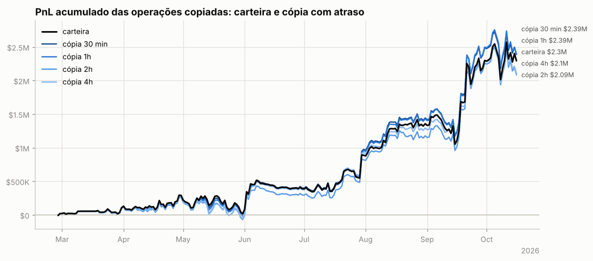

**Por ativo** (12 maiores pelo resultado da carteira):

| ativo | volume | carteira | 30 min | 1h | 2h | 4h | fica com (30 min) |
|---|---|---|---|---|---|---|---|
| NEAR | $9.98M | +$480.7K | +$474.7K | +$475.1K | +$413.9K | +$371.5K | 99% |
| xyz:DRAM | $13.00M | +$476.7K | +$491.9K | +$469.7K | +$438.6K | +$454.5K | 103% |
| BTC | $36.53M | +$451.4K | +$491.2K | +$451.1K | +$443.0K | +$427.2K | 109% |
| SOL | $8.80M | +$263.8K | +$258.0K | +$238.4K | +$212.2K | +$214.4K | 98% |
| xyz:NBIS | $2.48M | +$252.6K | +$252.1K | +$246.7K | +$243.7K | +$189.1K | 100% |
| ETH | $46.48M | +$178.3K | +$199.9K | +$208.1K | +$196.9K | +$217.9K | 112% |
| UNI | $2.46M | +$136.9K | +$148.7K | +$164.1K | +$155.3K | +$161.5K | 109% |
| HYPE | $6.63M | -$135.3K | -$136.4K | -$136.0K | -$128.6K | -$104.7K | — |
| xyz:SKHX | $3.51M | +$100.2K | +$148.9K | +$156.9K | +$117.6K | +$149.6K | 149% |
| xyz:MU | $2.81M | +$83.0K | +$89.5K | +$101.0K | +$100.4K | +$87.9K | 108% |
| BNB | $6.53M | -$76.5K | -$69.1K | -$63.3K | -$69.1K | -$56.2K | — |
| xyz:RKLB | $593.8K | +$66.2K | +$58.4K | +$61.3K | +$45.1K | +$58.8K | 88% |

**Por tipo de execução da carteira.** Numa ordem limite a carteira compra abaixo e vende acima do preço corrente; a cópia a mercado perde essa vantagem. Numa ordem a mercado as duas pagam o *spread*:

| execução da carteira | fills | volume | carteira | 30 min | 1h | 2h | 4h |
|---|---|---|---|---|---|---|---|
| limite (maker) | 8,819 | $48.15M | +$15.6K | +$23.2K | +$19.8K | -$53.9K | -$20.3K |
| a mercado (taker) | 18,474 | $109.89M | +$2.28M | +$2.37M | +$2.37M | +$2.14M | +$2.13M |

### Espelhar a posição com atraso longo (moedas principais)

PnL de quem replicasse exatamente a posição da carteira, mas com N horas de atraso (marcação horária, sem custos). Se o PnL se mantém com atraso, a vantagem está em horizontes longos e é copiável; se desaba, depende de timing fino.

| atraso | BTC | NEAR | xyz:DRAM |
|---|---|---|---|
| 0h | +$499.7K | +$491.8K | +$496.9K |
| 1h | +$468.3K | +$422.9K | +$438.0K |
| 4h | +$455.8K | +$377.7K | +$462.0K |
| 12h | +$445.0K | +$240.1K | +$298.0K |
| 24h | +$309.0K | +$26.1K | +$163.6K |
| 72h | +$404.9K | -$18.1K | +$99.9K |
| 168h | +$251.2K | -$260.0K | +$6.2K |

## 10. Teste de replicação por regras (BTC)

Regra testada: *short-bias com filtro de tendência e fade* — short de até 70.04 BTC (o percentil 90 do tamanho real), cheio abaixo da média móvel e reduzido acima; dentro do regime, mais short perto do topo do range e menos perto do fundo. Parâmetros escolhidos no treino (2026-02-14 → 2026-06-15) e avaliados no teste (2026-06-16 → 2026-10-15).

|  | parâmetros | PnL treino | PnL teste | correlação c/ posição real (teste) |
|---|---|---|---|---|
| melhor regra no treino | MA200, range 90d, fração em alta 0.0, fade 0.9 | +$319.2K | -$53.5K | 0.73 |
| carteira real (aprox.) | — | +$443.9K | +$136.1K | 1.00 |

Clone comportamental (regressão linear da posição real em médias móveis, ranges e retornos): R² treino 0.43, R² teste -1.31, correlação no teste -0.36.

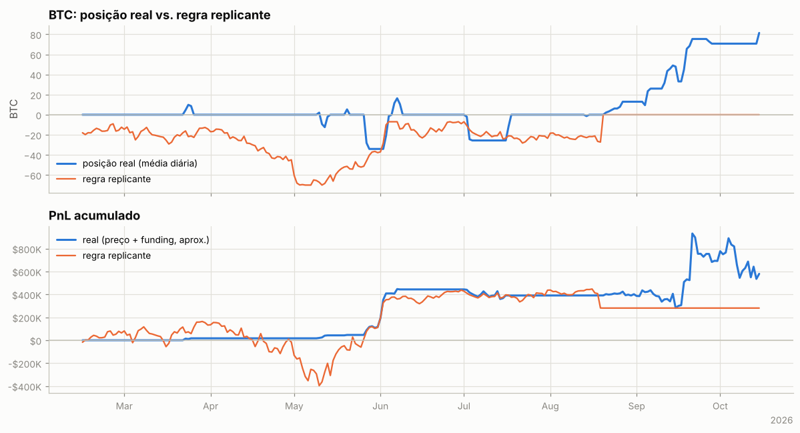

---

Metodologia e código: ver `README.md` na raiz do repositório.
