# Relatório automático — `0xc7c37b0c7af5af560bf31b0bcbfec04b97361275`

Gerado em 2026-10-14 12:43 UTC a partir da API pública da Hyperliquid (`POST /info`). Valores em USD. Este arquivo é regenerado por `python -m hlre.report`; a interpretação da estratégia fica em `ANALISE.md`.

## 1. Visão geral

| métrica | valor |
|---|---|
| Valor da conta (perp + spot) | $19.6K |
| PnL all-time (portfolio, inclui spot/airdrops) | +$22.2K |
| PnL all-time só de perps | +$22.2K |
| Volume all-time | $2.25M |
| Primeira atividade | 2026-07-15 |
| Fills disponíveis na API | 621 (desde 2026-07-15) |
| Ordens (fills agrupados por oid) | 243 |
| Funding líquido (recebido > 0) | -$187 |
| Taxas pagas (período dos fills) | -$1.2K |
| Liquidações (ledger) | 0 |
| Fills de liquidação/ADL | 0 |
| Papel da conta | user |
| API wallets (agentes) | 0 |

**Posições abertas agora:**

| ativo | tamanho | nocional | entrada | alav. | PnL não realizado | liq. |
|---|---|---|---|---|---|---|
| BTC | -2.99492 | $247.7K | 83441.5 | 40x cross | +$2.2K | 86519.7998546675 |
| ETH | 99.7964 | $247.4K | 2505.22 | 20x cross | -$2.6K | 2360.6960462727 |

## 2. Curva de PnL

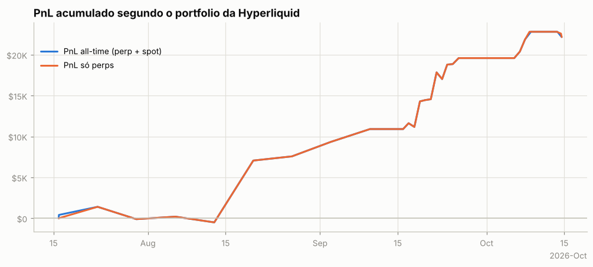

Os fills cobrem todo o histórico: o PnL diário exato de perps (preço + funding − taxas) soma +$22.0K, contra +$22.2K do portfolio. Maior drawdown: **-$2.5K** (pico em 2026-07-21, fundo em 2026-08-01); dias positivos: 56%.

PnL de perps por trimestre

| trimestre | preço | funding | taxas | total |
|---|---|---|---|---|
| 2026Q3 | +$20.6K | -$209 | -$764 | +$19.6K |
| 2026Q4 | +$2.9K | +$22 | -$473 | +$2.4K |

## 3. De onde veio o PnL

*Preço (aprox.)* usa a posição média diária de cada ativo, reconstruída a partir do histórico de funding (que traz o tamanho da posição a cada hora/dia desde o início da conta), vezes o movimento open→close do dia. Subestima o PnL de day trade, mas cobre o período sem fills. *Preço exato* marca cada fill no fechamento diário e só existe para o período coberto pelos fills.

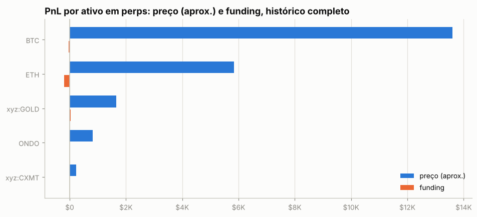

| ativo | preço (aprox.) | funding | total | preço exato (período dos fills) | taxas (período dos fills) |
|---|---|---|---|---|---|
| BTC | +$13.6K | -$27 | +$13.6K | +$16.2K | -$472 |
| ETH | +$5.8K | -$198 | +$5.6K | +$2.7K | -$187 |
| xyz:GOLD | +$1.7K | +$41 | +$1.7K | +$3.2K | -$542 |
| ONDO | +$827 | -$2 | +$825 | +$1.4K | -$34 |
| xyz:CXMT | +$237 | -$0 | +$237 | +$2 | -$1 |
| outros (0) | $0 | $0 | $0 | $0 | $0 |

**Decomposição no período dos fills** (preço exato): quanto veio de *carregar* a posição (e, dentro disso, do viés médio vs. do *timing* de aumentar/reduzir), quanto de trades intradiários, funding e taxas.

| componente | BTC | ETH | xyz:GOLD |
|---|---|---|---|
| carregar posição (carry) | +$12.6K | +$7.7K | +$2.2K |
|   ↳ viés (posição média × movimento) | +$188 | +$3.7K | +$773 |
|   ↳ timing (variação do tamanho) | +$12.4K | +$4.0K | +$1.4K |
| trades intradiários | +$3.6K | -$5.0K | +$969 |
| funding | -$27 | -$198 | +$41 |
| taxas | -$472 | -$187 | -$542 |
| posição média | 0.05 | 6.25 | -1.79 |
| movimento do preço no período | 3,780.00 | 588.00 | -431.30 |

## 4. Posições ao longo do tempo

Área clara: posição média diária (funding). Linha: posição exata (fills). Azul = long, vermelho = short.

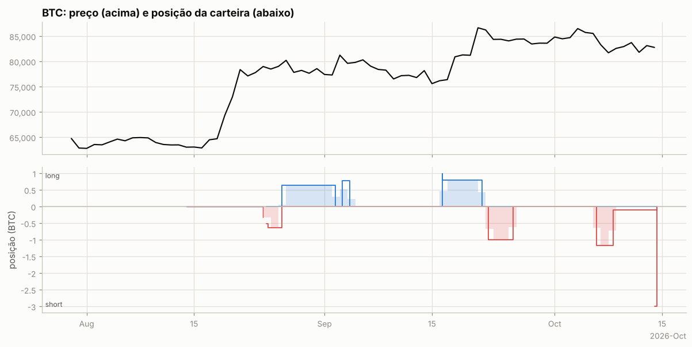

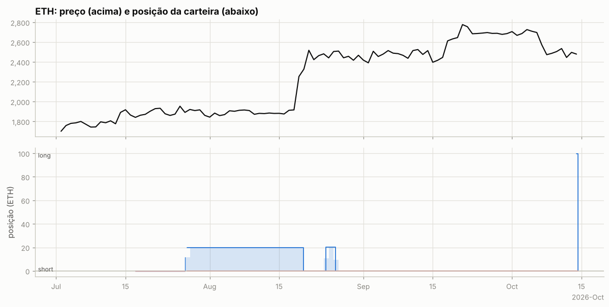

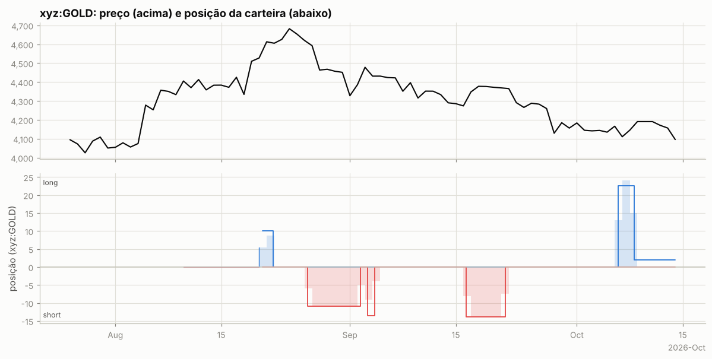

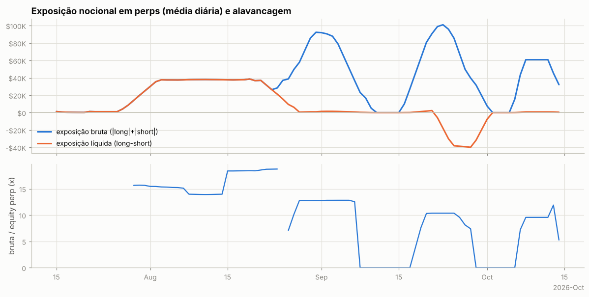

Tabela mensal de exposição e alavancagem

| mês | exposição bruta | exposição líquida | equity perp | alavancagem (mediana) |
|---|---|---|---|---|
| 2026-07 | $10.8K | $10.8K | $431 | 15.7x |
| 2026-08 | $48.0K | $25.7K | $2.9K | 14.0x |
| 2026-09 | $39.1K | -$8.6K | $4.7K | 7.4x |
| 2026-10 | $37.8K | $401 | $3.8K | 6.3x |

## 5. Execução

**Tipos de ordem** (últimas 38 ordens que a API guarda, 2026-07-15 → 2026-10-14):

| orderType | tif | reduceOnly | isTrigger | ordens |
|---|---|---|---|---|
| Limit | Gtc | False | False | 6 |
| Limit | Gtc | True | False | 2 |
| Market | FrontendMarket | False | False | 13 |
| Market | FrontendMarket | True | False | 13 |
| Stop Market | Gtc | True | True | 1 |
| Take Profit Market | Gtc | True | True | 2 |

`FrontendMarket` = ordem a mercado enviada pela interface web; `Gtc` = limite que fica no livro; gatilhos (`isTrigger`) seriam stop/take-profit.

**Perfil por ativo (top 10 por volume):**

| ativo | volume | ordens | % taker (nocional) | tamanho mediano |
|---|---|---|---|---|
| BTC | $1.09M | 119 | 100% | 0.04713 |
| xyz:GOLD | $627.7K | 52 | 100% | 1.853 |
| ETH | $433.9K | 66 | 100% | 1.636 |
| ONDO | $78.4K | 4 | 100% | 5.25e+04 |
| xyz:CXMT | $15.5K | 2 | 100% | 1,000 |

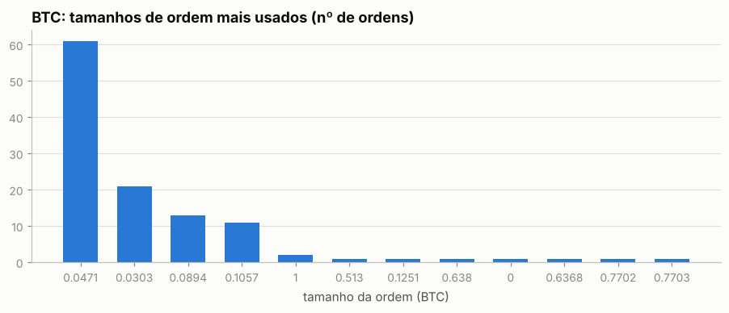

Os 5 tamanhos mais comuns respondem por 91% das ordens de BTC — lotes redondos e repetidos são assinatura de execução manual.

Sessões (ordens separadas por < 30 min): 23; mediana de 1 ordens e 0.0 min por sessão; dias com atividade: 18 de 90.

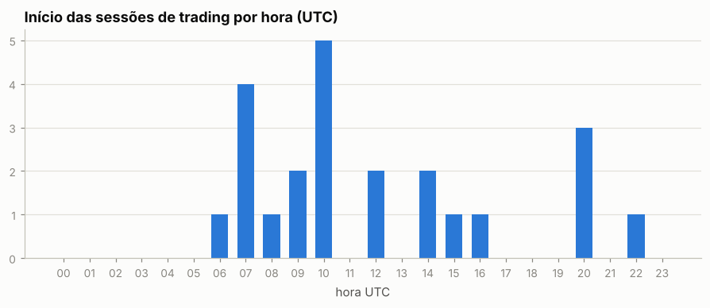

Por dia da semana: seg 17%, ter 17%, qua 39%, qui 13%, sex 13%, sáb 0%, dom 0%

## 6. Comportamento de entrada e saída

### BTC

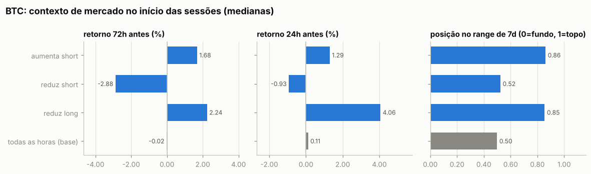

Por ordem (medianas):

| ação | ordens | retorno 24h antes | 72h antes | 7d antes | posição no range 7d | 24h depois | 7d depois |
|---|---|---|---|---|---|---|---|
| aumenta short | 56 | -0.39% | +0.34% | -0.95% | 0.78 | -2.55% | -2.77% |
| reduz short | 36 | -0.39% | +0.34% | -0.95% | 0.78 | +0.52% | -2.77% |
| aumenta long | 19 | -0.93% | +2.40% | +21.79% | 0.86 | +1.99% | -2.16% |
| reduz long | 8 | -0.93% | +2.40% | +15.51% | 0.86 | +1.66% | -2.16% |
| todas as horas (base) |  | +0.11% | -0.02% | +0.73% | 0.50 | +0.07% | +0.34% |

Por sessão (ordens a menos de 30 min uma da outra contam como uma decisão; p = teste de Mann-Whitney contra todas as horas do período):

| sessão | sessões | retorno 24h antes | 72h antes | 7d antes | range 7d | no topo (>0,7) | no fundo (<0,3) |
|---|---|---|---|---|---|---|---|
| aumenta short | 5 | +1.29% (p=0.102) | +1.68% (p=0.139) | +10.61% (p=0.036) | 0.86 (p=0.007) | 100% | 0% |
| reduz short | 3 | -0.93% (p=0.170) | -2.88% (p=0.202) | +4.81% (p=0.317) | 0.52 (p=0.796) | 33% | 33% |
| reduz long | 3 | +4.06% (p=0.246) | +2.24% (p=0.313) | +1.64% (p=0.700) | 0.85 (p=0.515) | 67% | 33% |
| todas as horas (base) |  |  |  |  |  | 29% | 27% |

- Aumentos de posição feitos com a posição no prejuízo (preço pior que o preço médio): **31%** das ordens (45% do tamanho); distância mediana do preço médio: -0.01%.
- Reduções/fechamentos com lucro: **27%** de 44; ganho médio $1.2K vs. perda média -$39; realizado +$13.1K.

- Episódios (de zerado a zerado, ou até inverter): 5; fechados com lucro: 75%; duração mediana 4.2 dias; o melhor episódio sozinho = 73% da soma dos episódios lucrativos.

Maiores episódios por PnL realizado

| início | fim | dias | lado | tam_max | nocional_max | ordens | entrada | saída | realizado |
|---|---|---|---|---|---|---|---|---|---|
| 2026-09-16 | 2026-09-21 | 5.1 | long | 0.9902 | $75.0K | 3 | 75,738 | 83,243 | +$7.4K |
| 2026-10-06 | 2026-10-14 | 7.9 | short | 2.99 | $249.8K | 86 | 83,900 | 83,740 | +$4.1K |
| 2026-09-22 | 2026-09-25 | 3.3 | short | 1.00 | $85.4K | 2 | 85,383 | 83,643 | +$1.7K |
| 2026-08-26 | 2026-09-04 | 8.9 | long | 0.7703 | $62.2K | 24 | 78,174 | 78,853 | +$946 |
| 2026-08-24 | 2026-08-26 | 2.0 | short | 0.6381 | $51.0K | 4 | 78,374 | 78,381 | -$4 |

### ETH

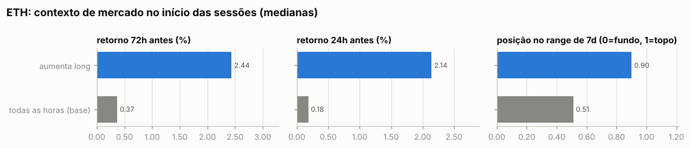

Por ordem (medianas):

| ação | ordens | retorno 24h antes | 72h antes | 7d antes | posição no range 7d | 24h depois | 7d depois |
|---|---|---|---|---|---|---|---|
| aumenta long | 36 | -1.16% | -0.02% | -4.35% | 0.44 | -1.87% | -3.52% |
| reduz long | 30 | -1.16% | -0.02% | -4.35% | 0.44 | +3.55% | -2.89% |
| todas as horas (base) |  | +0.18% | +0.37% | +0.56% | 0.51 | +0.17% | +0.71% |

Por sessão (ordens a menos de 30 min uma da outra contam como uma decisão; p = teste de Mann-Whitney contra todas as horas do período):

| sessão | sessões | retorno 24h antes | 72h antes | 7d antes | range 7d | no topo (>0,7) | no fundo (<0,3) |
|---|---|---|---|---|---|---|---|
| aumenta long | 3 | +2.14% (p=0.288) | +2.44% (p=0.233) | +5.63% (p=0.418) | 0.90 (p=0.140) | 67% | 0% |
| todas as horas (base) |  |  |  |  |  | 35% | 24% |

- Aumentos de posição feitos com a posição no prejuízo (preço pior que o preço médio): **64%** das ordens (64% do tamanho); distância mediana do preço médio: +0.01%.
- Reduções/fechamentos com lucro: **3%** de 30; ganho médio $5.9K vs. perda média -$22; realizado +$5.2K.

- Episódios (de zerado a zerado, ou até inverter): 3; fechados com lucro: 50%; duração mediana 12.8 dias; o melhor episódio sozinho = 100% da soma dos episódios lucrativos.

Maiores episódios por PnL realizado

| início | fim | dias | lado | tam_max | nocional_max | ordens | entrada | saída | realizado |
|---|---|---|---|---|---|---|---|---|---|
| 2026-07-27 | 2026-08-19 | 23.5 | long | 20.00 | $45.2K | 2 | 1,966 | 2,258 | +$5.9K |
| 2026-08-24 | 2026-08-26 | 2.0 | long | 20.18 | $50.0K | 3 | 2,478 | 2,447 | -$632 |
| 2026-10-14 | 2026-10-14 | 0.0 | long | 99.80 | $250.0K | 61 | 2,505 | 2,505 | $0 |

### xyz:GOLD

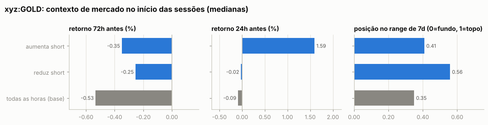

Por ordem (medianas):

| ação | ordens | retorno 24h antes | 72h antes | 7d antes | posição no range 7d | 24h depois | 7d depois |
|---|---|---|---|---|---|---|---|
| aumenta short | 16 | -0.34% | +0.36% | +5.94% | 0.80 | -0.98% | -6.78% |
| reduz short | 10 | -0.34% | +0.36% | +5.94% | 0.80 | -0.98% | -6.78% |
| aumenta long | 6 | +0.77% | +0.10% | -0.36% | 0.33 | +1.41% | +0.86% |
| reduz long | 20 | -0.17% | +0.31% | +0.09% | 0.32 | -0.74% | +0.86% |
| todas as horas (base) |  | -0.09% | -0.53% | -1.40% | 0.35 | -0.08% | -1.49% |

Por sessão (ordens a menos de 30 min uma da outra contam como uma decisão; p = teste de Mann-Whitney contra todas as horas do período):

| sessão | sessões | retorno 24h antes | 72h antes | 7d antes | range 7d | no topo (>0,7) | no fundo (<0,3) |
|---|---|---|---|---|---|---|---|
| aumenta short | 3 | +1.59% (p=0.120) | -0.35% (p=0.573) | -1.56% (p=0.890) | 0.41 (p=0.363) | 33% | 0% |
| reduz short | 3 | -0.02% (p=0.918) | -0.25% (p=0.805) | -2.16% (p=0.569) | 0.56 (p=0.844) | 33% | 33% |
| todas as horas (base) |  |  |  |  |  | 21% | 45% |

- Aumentos de posição feitos com a posição no prejuízo (preço pior que o preço médio): **35%** das ordens (28% do tamanho); distância mediana do preço médio: -0.01%.
- Reduções/fechamentos com lucro: **7%** de 30; ganho médio $2.3K vs. perda média -$42; realizado +$3.3K.

- Episódios (de zerado a zerado, ou até inverter): 4; fechados com lucro: 67%; duração mediana 5.1 dias; o melhor episódio sozinho = 71% da soma dos episódios lucrativos.

Maiores episódios por PnL realizado

| início | fim | dias | lado | tam_max | nocional_max | ordens | entrada | saída | realizado |
|---|---|---|---|---|---|---|---|---|---|
| 2026-08-26 | 2026-09-04 | 8.9 | short | 13.55 | $60.5K | 24 | 4,495 | 4,422 | +$2.9K |
| 2026-08-20 | 2026-08-21 | 1.4 | long | 10.00 | $46.0K | 2 | 4,488 | 4,605 | +$1.2K |
| 2026-10-06 | 2026-10-08 | 2.2 | long | 24.09 | $99.5K | 24 | 4,136 | 4,140 | -$609 |
| 2026-09-16 | 2026-09-21 | 5.1 | short | 13.85 | $60.3K | 2 | 4,333 | 4,354 | -$288 |

### Todos os episódios relevantes (todas as moedas)

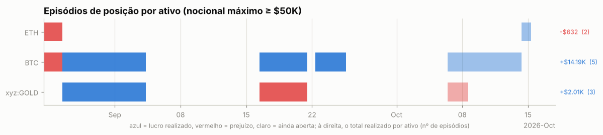

Episódios com nocional máximo ≥ $50K: 10; fechados com lucro: 57%. Abaixo, os 25 maiores por PnL realizado, em ordem de data. *7d/30d antes* e *vs. máx. 30d*: o que o preço tinha feito até a primeira ordem; *funding a.a.*: taxa anualizada nas 24h anteriores (positiva = longs pagam shorts); *entrada média vs. 1ª ordem*: positivo = foi aumentando a posição com o preço indo contra; *contra (máx.)*: quanto o preço andou contra a primeira ordem durante o episódio; *capturado*: movimento entre o preço médio de entrada e o de saída.

| ativo | lado | início | dias | nocional máx. | 7d antes | 30d antes | vs. máx. 30d | funding a.a. na entrada | entrada média vs. 1ª ordem | contra (máx.) | pior PnL aberto | capturado | realizado | funding |
|---|---|---|---|---|---|---|---|---|---|---|---|---|---|---|
| ETH | long | 2026-08-24 | 2 | $50.0K | +30% | +33% | -3% | +11% | -0% | +2% | -$872 | -1% | -$632 | -$24 |
| BTC | short | 2026-08-24 | 2 | $51.0K | +23% | +21% | -2% | +15% | +1% | +4% | -$1.5K | -0% | -$4 | +$9 |
| BTC | long | 2026-08-26 | 9 | $62.2K | +22% | +20% | -3% | +11% | +0% | +2% | -$1.2K | +1% | +$946 | -$110 |
| xyz:GOLD | short | 2026-08-26 | 9 | $60.5K | +6% | +13% | -1% | +5% | -3% | +0% | -$810 | +2% | +$2.9K | +$37 |
| BTC | long | 2026-09-16 | 5 | $75.0K | -5% | +20% | -7% | +10% | -0% | +0% | -$109 | +10% | +$7.4K | -$79 |
| xyz:GOLD | short | 2026-09-16 | 5 | $60.3K | -2% | -1% | -8% | +15% | +0% | +1% | -$860 | -0% | -$288 | +$62 |
| BTC | short | 2026-09-22 | 3 | $85.4K | +11% | +12% | -2% | +18% | +0% | +2% | -$1.8K | +2% | +$1.7K | +$78 |
| xyz:GOLD | long | 2026-10-06 | 2 | $99.5K | +0% | -6% | -6% | +6% | +0% | +1% | -$1.5K | +0% | -$609 | -$46 |
| BTC | short | 2026-10-06 | 8 | $249.8K | +2% | +8% | -1% | +11% | -2% | +1% | -$609 | +0% | +$4.1K | +$78 |
| ETH | long | 2026-10-14 | 0 | $250.0K | -4% | -0% | -10% | +8% | +0% | +0% | -$22 | +0% | $0 | -$10 |

## 7. Funding

Funding líquido total: **-$187** (recebido $301, pago -$488). Na Hyperliquid o funding é pago de hora em hora; quando positivo, longs pagam shorts.

| ativo | lado | funding | rendimento anualizado s/ nocional |
|---|---|---|---|
| BTC | short | +$182 | 10.8% |
| BTC | long | -$209 | -10.7% |
| ETH | long | -$198 | -6.9% |
| xyz:GOLD | short | +$99 | 5.1% |
| xyz:GOLD | long | -$57 | -7.5% |
| (outros) | long | -$2 | -9.9% |

## 8. Fluxos, eventos e carteiras relacionadas

| tipo | eventos | USD (+ entra / − sai) |
|---|---|---|
| withdraw | 1 | -$1.7K |
| send | 2 | -$910 |

**Gestão de margem.** Dias com depósito: 1; em 0% deles o PnL dos 3 dias anteriores era negativo (mediana —). Dias com saque: 2; em 100% deles o PnL dos 3 dias anteriores era positivo (mediana +$1.6K). Base: 32% de todos os dias vêm depois de 3 dias negativos. Correlação entre o fluxo do dia e a variação da exposição bruta: 0.19 (positiva = deposita para abrir posição e saca ao reduzir).

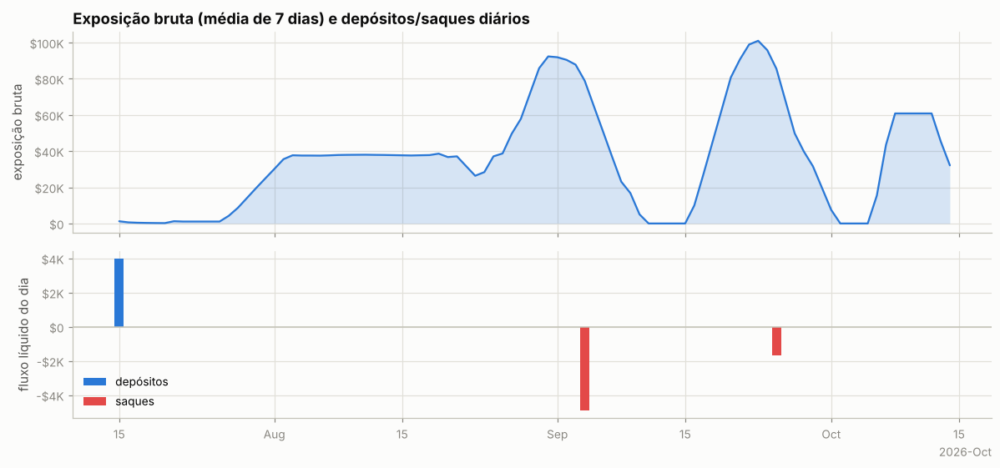

Ponte HyperCore↔HyperEVM (endereços de sistema `0x2000…`/`0x2222…`): 1 transferências, entrada $0, saída $4.9K — uso de DeFi na HyperEVM.

**Carteiras relacionadas** (conta vinculada de staking para desconto de taxa + maiores contrapartes de transferências; o saldo de staking e o PnL ajudam a ver se posições aqui são hedge de algo mantido lá):

| carteira | relação | transferências | volume transferido | valor da conta hoje | PnL all-time | HYPE em staking | maiores saldos spot |
|---|---|---|---|---|---|---|---|
| `0x6b9e773128f453f5c2c60935ee2de2cbc5390a24` | hot wallet de serviço (recebe USDC da HyperEVM e repassa a centenas de usuários: exchange/ponte) | 1 | $4.0K | $7.8K | +$0 | 0 | USDC 7,687 |

## 9. Dá para copiar? (espelhar a posição com atraso)

PnL de quem replicasse exatamente a posição da carteira, mas com N horas de atraso (marcação horária, sem custos). Se o PnL se mantém com atraso, a vantagem está em horizontes longos e é copiável; se desaba, depende de timing fino.

| atraso | BTC | ETH | xyz:GOLD |
|---|---|---|---|
| 0h | +$15.9K | +$2.4K | +$3.0K |
| 1h | +$19.2K | +$2.3K | +$2.6K |
| 4h | +$21.2K | +$1.6K | +$2.3K |
| 12h | +$11.6K | +$7.3K | +$2.9K |
| 24h | +$8.5K | +$9.2K | +$3.4K |
| 72h | +$4.6K | +$8.6K | +$2.6K |
| 168h | -$870 | +$11.1K | -$1.2K |

## 10. Teste de replicação por regras (BTC)

Regra testada: *short-bias com filtro de tendência e fade* — short de até 0.6381 BTC (o percentil 90 do tamanho real), cheio abaixo da média móvel e reduzido acima; dentro do regime, mais short perto do topo do range e menos perto do fundo. Parâmetros escolhidos no treino (2026-07-15 → 2026-08-29) e avaliados no teste (2026-08-30 → 2026-10-13).

|  | parâmetros | PnL treino | PnL teste | correlação c/ posição real (teste) |
|---|---|---|---|---|
| melhor regra no treino | MA50, range 7d, fração em alta 0.0, fade 0.9 | -$191 | $0 | nan |
| carteira real (aprox.) | — | -$559 | +$13.9K | 1.00 |

Clone comportamental (regressão linear da posição real em médias móveis, ranges e retornos): R² treino 0.62, R² teste -21.30, correlação no teste -0.32.

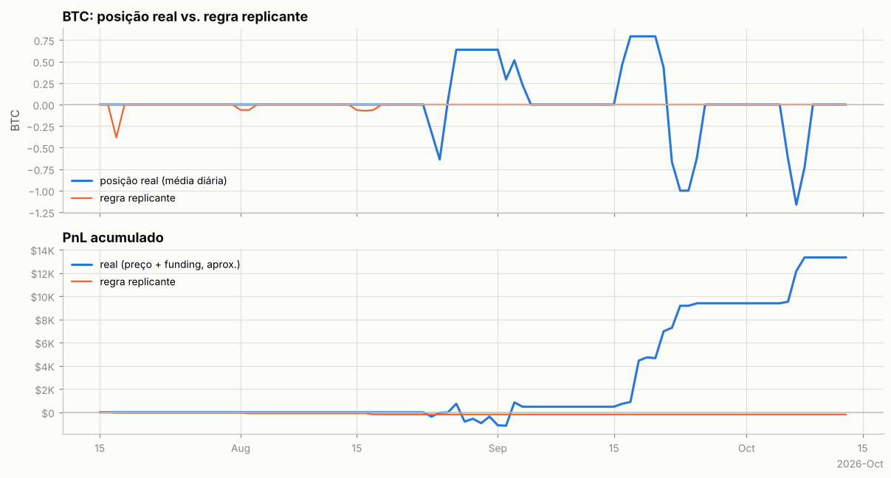

---

Metodologia e código: ver `README.md` na raiz do repositório.
