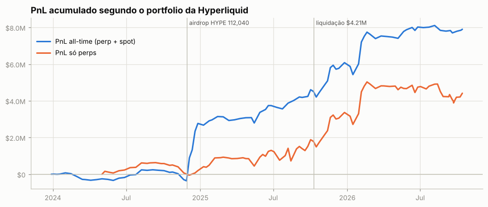
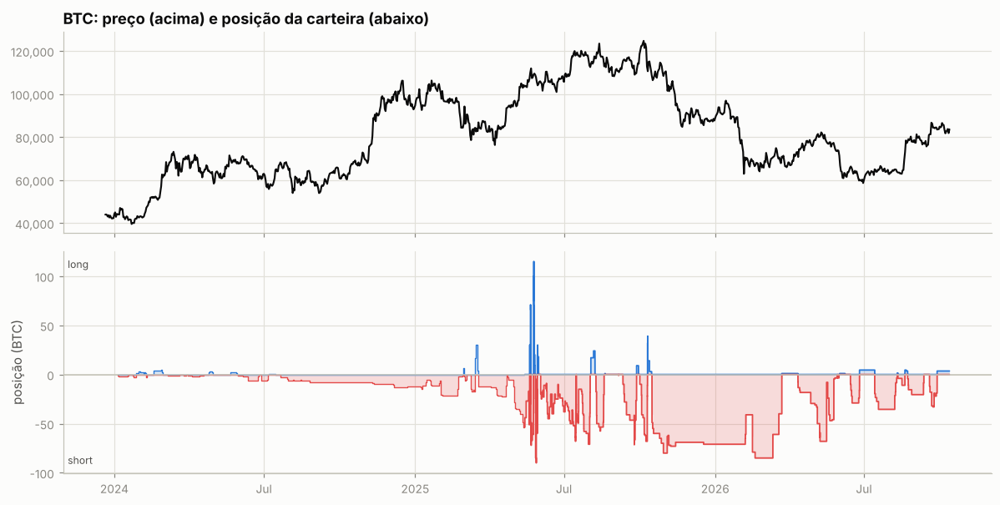
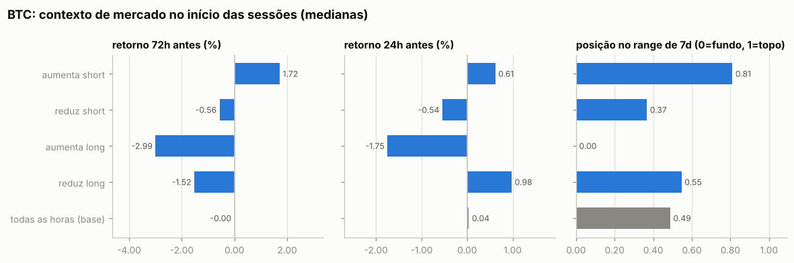
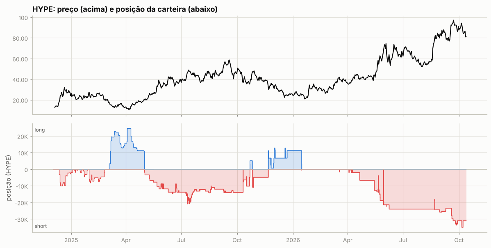
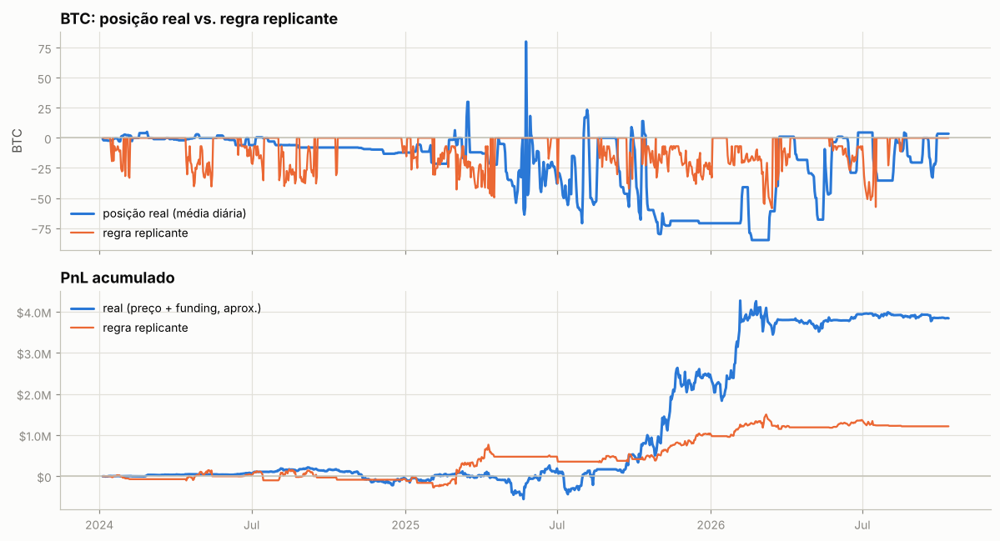

# Engenharia reversa: carteira `0xcac1…bdae8`

`0xcac1f1c3e4599e044dc2a9d38a9b6ef1af1bdae8` · [CoinGlass](https://www.coinglass.com/hyperliquid/0xcac1f1c3e4599e044dc2a9d38a9b6ef1af1bdae8) · dados até 13/out/2026

Fonte: API pública da Hyperliquid. São 43.378 fills (mai/2025 → out/2026), 8.451 registros de funding (jan/2024 → hoje, com o tamanho da posição em cada registro), 1.281 eventos de ledger e as últimas 1.002 ordens. Para contexto de mercado usei candles da Hyperliquid e da Binance. Os números detalhados, as tabelas e todos os gráficos estão em [`relatorio_auto.md`](relatorio_auto.md). Este documento interpreta esses números.

---

## Resumo

- **Quem opera:** uma pessoa (ou mesa) operando **manualmente pela interface web**. O sinal mais forte disso: 92% das ordens recentes são `FrontendMarket`, ou seja, ordens a mercado enviadas pelo site. Não há API wallets nem stops, e os lotes são redondos (1 / 0,5 / 2 / 5 BTC). A carteira faz parte de um **cluster de baleia**: duas carteiras ligadas a ela somam ~90,8 mil HYPE em staking (~US$ 7,4M).
- **O que faz:** trading **macro/swing direcional com viés vendido**, concentrado em **BTC perp** (82% do volume de perps). Por cima disso há um short em HYPE que funciona como hedge parcial do HYPE em staking. Em 2024 a carteira mantinha uma cesta de alts vendidas para coletar funding, na época de farm de pontos que terminou num airdrop de 112.040 HYPE.
- **Como ganhou dinheiro:**
  1. **Um trade macro:** short de até 85 BTC (US$ 8,8M), montado a ~US$ 111k logo depois do crash de 10/out/2025 e mantido por 158 dias até ~US$ 68–70k. Rendeu **+US$ 3,07M** realizados, 62% de tudo o que os episódios lucrativos de BTC renderam.
  2. **Funding:** **+US$ 1,03M** líquidos desde 2024. Como a carteira está quase sempre vendida, ela recebe funding: ~10% a.a. sobre o nocional em BTC e ~55% a.a. na cesta de alts de 2024.
  3. **Execução tática:** **aumenta o short depois de altas**, perto do topo do range de 7 dias (é estatisticamente significativo), e reduz depois de quedas.
- **Riscos:** alavancagem mediana de **5–17x** sobre o equity de perps, **sem stop-loss**, aumentos de posição **contra o preço** (62% dos aumentos acontecem com a posição no prejuízo) e **uma liquidação de US$ 4,2M** em 10/out/2025. O resultado depende muito de um único regime (o bear market de out/2025 a fev/2026).
- **Dá para replicar?** **Com regras mecânicas, não.** A melhor regra simples tem correlação de 0,23 com a posição real e rende ~1/5 do PnL. **Copiar a posição com atraso, sim:** espelhar o BTC com 1 hora a 7 dias de atraso daria entre US$ 3,6M e 4,5M, contra US$ 4,0M sem atraso. O sinal útil é lento. O que ele carrega é a convicção macro do trader, e ela pode estar errada.

---

## 1. Quem é essa carteira

**Opera manualmente.** Quatro sinais apontam para isso:

- **Tipo de ordem.** Das últimas 1.002 ordens, 919 são `Market/FrontendMarket` (enviadas pelo site) e 83 são limites `Gtc`. Nenhuma é stop ou take-profit.
- **Sem bot.** `extraAgents` está vazio, então não há API wallet.
- **Lotes.** 93% das ordens de BTC usam um destes cinco tamanhos: 1; 0,5; 2; 5; 3 BTC. São cliques repetidos de tamanho fixo. Em HYPE os lotes são 200 / 100 / 1.000 / 500.
- **Sessões.** São curtas: mediana de 5 ordens em 3,7 minutos, com 249 dias ativos em 511.

As sessões começam em qualquer hora do dia, sem uma janela de sono visível. Isso sugere uma operação guiada por alertas ou mais de uma pessoa operando a conta.

**É parte de um cluster de baleia.** Três evidências ligam esta carteira a outras duas:

- O desconto de taxa por staking está ligado à carteira `0x9136…632e` (`stakingLink`). Ela tem **47.126 HYPE** delegados e valor de conta de US$ 3,8M.
- A carteira `0xd152…31ce` tem **43.639 HYPE** delegados e US$ 3,5M de valor de conta. As três carteiras receberam exatamente o mesmo airdrop de NEKO (3.504,42 tokens), o que é uma impressão digital de mesmo dono.
- Do airdrop de 112.040 HYPE recebido aqui em 29/nov/2024, ~98,5 mil foram transferidos para essas duas carteiras entre dez/2024 e mar/2025 e de lá foram para staking. O resto foi para a HyperEVM.

**Usa a Hyperliquid também para vender spot grande.** Entre 20 e 31/ago/2025, a carteira:

- recebeu ~9.390 ETH pela ponte Unit (UETH);
- vendeu **9.162 UETH a um preço médio de US$ 4.642** (US$ 42,5M, 86% como maker, ou seja, com ordens limite);
- sacou US$ 43,5M em USDC.

Foi praticamente no topo do ETH: depois disso o ETH chegou a US$ 1.567 em jun/2026. Não é trading de perps, mas mostra o mesmo viés: realizar ou vender perto de topos.

## 2. Linha do tempo

| fase | período | o que a carteira fez | PnL de perps | PnL all-time |
|---|---|---|---|---|
| 1. Farm de pontos | dez/2023 → nov/2024 | 10 a 30 alts ao mesmo tempo, majoritariamente vendidas, coletando funding; pequenos depósitos no HLP | ~0 | −US$ 0,1M |
| 2. Airdrop | nov/2024 → mai/2025 | recebe 112.040 HYPE e manda para staking em outras carteiras; fica comprado em até ~25k HYPE perp em mar–abr/2025, perto do fundo; short de BTC crescente | +US$ 0,44M | **+US$ 3,15M** |
| 3. BTC tático + venda de ETH | mai/2025 → out/2025 | BTC de −90 a +115 em dias (mai/2025); "vende força" no rali de jul–set/2025; vende 9,2k ETH; **liquidado** em 10/out | +US$ 1,05M | +US$ 1,42M |
| 4. **O grande short** | out/2025 → fev/2026 | short de 54 a 85 BTC, de US$ 111k até US$ 68k | **+US$ 3,54M** | +US$ 3,54M |
| 5. Lateralização | fev/2026 → hoje | BTC menor (até 68 BTC); short de HYPE crescendo até 31–35k contra o rali de HYPE | −US$ 0,63M (drawdown máximo de −US$ 1,14M) | +US$ 0,15M |

## 3. O playbook: regras inferidas a partir do comportamento

### 3.1 Universo e viés

- **Concentração.** BTC tem 82% do volume de perps e responde por mais do que todo o lucro líquido em perps desde mai/2025: +US$ 4,0M em preço e +US$ 0,4M em funding, contra +US$ 3,95M do total de perps no período. HYPE e ETH ficam no zero a zero ou no prejuízo, e o resto é ruído: mais de 100 alts em 2024; petróleo (`xyz:CL`, `xyz:BRENTOIL`), índice (`xyz:XYZ100`), ASTER e memecoins em 2025–26.
- **Viés vendido estrutural.** A exposição líquida em perps é negativa em todos os meses desde jan/2024. Desde meados de 2024 a exposição bruta é quase igual à líquida: não há perna comprada compensando. O short de BTC foi crescendo com o tempo. Em média ele foi de −1 BTC (2T24) a −10 (4T24), −22 (2T25) e −61/−63 (4T25/1T26). Depois voltou para −15/−20 em 2026.
- **O tamanho segue o regime.** A posição média de BTC foi −33,9 BTC com o preço abaixo da MM200 e −12,6 BTC acima dela. É o mesmo viés, com mais tamanho quando a tendência é de baixa.

### 3.2 Gatilho de entrada: vender força

Agrupei as ordens de BTC em sessões (ordens com menos de 30 min de intervalo) e comparei cada sessão com todas as horas do período:

| sessões de BTC | n | retorno 72h antes (mediana) | retorno 7d antes | posição no range de 7d (0 = fundo, 1 = topo) |
|---|---|---|---|---|
| **aumenta short** | 142 | **+1,72%** (p < 10⁻⁹) | **+3,61%** (p < 10⁻¹⁶) | **0,81** (p < 10⁻¹⁴) |
| reduz short | 87 | −0,56% (p = 0,03) | −0,34% (n.s.) | 0,37 (p = 0,009) |
| aumenta long | 7 | −2,99% | −5,48% | 0,00 (na mínima de 7d) |
| todas as horas (base) | — | 0,00% | +0,07% | 0,49 |

*p é o p-valor do teste de Mann-Whitney contra a base; n.s. = não significativo.*

Em termos práticos:

- **61%** das sessões que aumentam o short acontecem com o preço nos **30% superiores do range de 7 dias**. Na base, isso acontece 32% do tempo.
- **79%** dessas sessões vêm depois de uma semana de alta (base: 51%).
- O padrão aparece nos dois regimes. A posição mediana no range é 0,84 na fase de alta (mai a out/2025) e 0,76 na fase de baixa (out/2025 em diante).

**Regra inferida:** *"Com viés vendido, adiciono short quando o preço sobe e chega perto da máxima da semana. Não persigo queda."* Compras de BTC são raras e acontecem em capitulações, com o preço na mínima de 7 dias.

### 3.3 Tamanho: escada de lotes fixos

- Cada sessão de aumento adiciona em mediana **5 BTC**, em lotes de 0,5 a 2 BTC clicados em sequência. Média: 8 BTC por sessão.
- Não é uma grade de preço fixa. A distância mediana entre sessões de aumento é ~0,1% de preço, e o tempo mediano entre elas é 0,8 dia. A posição vai sendo empilhada em vários dias de força.
- O teto observado é 85–90 BTC no short e 115 BTC no long, este numa inversão intradiária em mai/2025.
- **62% dos aumentos são feitos com a posição no prejuízo**, ou seja, com o preço acima do preço médio do short. O trader faz preço médio contra o movimento em vez de piramidar a favor. Em HYPE isso chega a 80% do tamanho.

### 3.4 Saída: realizar na fraqueza, segurar a tendência

- Reduções acontecem depois de quedas: −0,5% em 24h, com o preço na parte de baixo do range (mediana 0,37). O sinal é mais fraco do que o das entradas: as saídas são mais discricionárias.
- **66% das reduções de BTC fecham com lucro**, com ganho médio de US$ 7,4k contra perda média de US$ 4,4k.
- **Assimetria importante:** no trade principal, o trader **praticamente não reduziu** o short durante a queda de US$ 111k para US$ 86k. Houve só realizações pequenas em nov/2025 (~22 BTC, logo recompostas), e ele chegou a vender mais 2 BTC a US$ 86k em dez/2025. As realizações grandes vieram em blocos, depois de quedas grandes:
  - 6–7/fev/2026: 30 BTC a ~US$ 68,5k (+US$ 1,22M);
  - 12, 19 e 23/mar/2026: ~85 BTC a US$ 67,9k–70,1k (+US$ 1,71M).

  Ou seja: **entra contra o movimento curto, mas deixa a tendência maior trabalhar.**
- Depois de realizar, ele **reabre no repique**. Em 15–18/fev/2026, voltou a vender 44 BTC a US$ 70,5k e US$ 67,2k.

### 3.5 Inversões táticas em mercado violento

Em mai/2025 (BTC rompendo a máxima histórica) e em 10/out/2025 (crash), o trader passou a **virar a mão em grande tamanho dentro do mesmo dia**: de −54 para +71, depois −72, +115 e −90 BTC em duas semanas. Em mai/2025 isso deu certo (+US$ 0,55M em BTC no mês). Em out/2025 terminou em liquidação.

### 3.6 Gestão de risco (ou a falta dela)

- **Sem stops.** Nenhuma ordem de gatilho nas ordens disponíveis (mar–out/2026). As saídas no prejuízo são capitulações manuais. Em 15/jul/2025, por exemplo, ele zerou 64 BTC com −US$ 227k e reabriu 45 BTC de short no dia seguinte.
- **Alavancagem alta.** A mediana mensal fica entre 5x e 17x do equity de perps, com picos diários perto de 30x. Hoje: BTC long a 40x cross e HYPE short a 10x cross, com portfolio margin ligado.
- **10/out/2025, a lição:**
  1. Durante o dia, o trader fechou os 68 BTC de short (com lucro).
  2. Abriu 250 ETH long e depois virou BTC para long de 32 BTC.
  3. No crash, aumentou o long (BTC a US$ 115k → 113k, ETH a US$ 3,9k) e ainda abriu 55k FARTCOIN.
  4. Às 21:16, o **ADL** (auto-deleveraging da corretora) fechou à força os shorts de HYPE e PURR, que estavam lucrando e ajudavam a sustentar a margem.
  5. Às 21:17 vieram as **liquidações**: BTC (−US$ 357k), ETH (−US$ 173k) e FARTCOIN (−US$ 10k).
  6. Minutos depois ele já estava operando de novo: short de HYPE, long de SOL e long de 14 BTC a US$ 113k.

  No dia foram −US$ 443k realizados: BTC −379k, ETH −221k e FARTCOIN −10k, compensados em parte pelo ADL de HYPE (+164k). Mesmo assim, a carteira montou o grande short seis dias depois.

### 3.7 Funding a favor

Na Hyperliquid o funding costuma ser positivo: longs pagam shorts a cada hora. Ficar vendido rendeu:

| livro | funding recebido | rendimento anualizado sobre o nocional |
|---|---|---|
| BTC short | +US$ 540k | 10,1% a.a. |
| HYPE short | +US$ 143k | 14,1% a.a. |
| alts short (sobretudo 2024) | +US$ 344k | 54,8% a.a. |
| **total líquido** | **+US$ 1,03M** | ≈ 23% do PnL de perps |

Com 10x de alavancagem, 10% a.a. sobre o nocional vira ~100% a.a. sobre a margem. Isso **paga o custo de esperar** com um short que ainda não andou, e ajuda a explicar como o viés vendido sobreviveu ao bull market de 2024 e 2025.

### 3.8 HYPE: hedge do estoque em staking, com overlay contrarian

O short de HYPE nesta carteira (−31.000 HYPE agora) **não é uma aposta isolada**:

| posição em HYPE do cluster | quantidade |
|---|---|
| staking em `0x9136…` | +47.126 |
| staking em `0xd152…` | +43.639 |
| spot nesta carteira (colateral do portfolio margin) | +15.044 |
| perp nesta carteira | −31.000 |
| **posição líquida** | **≈ +75 mil HYPE comprado** |

Assim, a "perda" de −US$ 535k no perp de HYPE (mai/2025 → hoje) é compensada com folga pela valorização do HYPE mantido nas carteiras ligadas: +US$ 3,0M e +US$ 2,6M de PnL all-time.

A forma de gerir o hedge segue o mesmo playbook:

- vende mais quando o HYPE sobe: as sessões de aumento do short vêm depois de +6,1% em 72h e +12,4% em 7 dias (medianas), com o preço no topo do range (0,85);
- deixa ordens limite de venda acima do mercado: 62,98 em mai/2026, a +6–11% do preço; **93,999** agora, a +7%;
- recompra no prejuízo: só **19% das reduções de HYPE fecham com lucro**. Contando por ordem, a maior parte do volume recomprado sai logo depois de altas fortes, perto da máxima de 7 dias: é capitulação parcial.

Em HYPE, que teve tendência de alta forte, o "vender força" perdeu dinheiro. O mesmo padrão que funcionou em BTC num mercado lateral ou de baixa falha num ativo em tendência de alta.

### 3.9 2024: cesta vendida de alts (funding + pontos)

No 1º semestre de 2024 a carteira operou um livro long/short com 20 a 30 alts ao mesmo tempo. No 4º trimestre virou uma **cesta só vendida** de ~13 alts: kPEPE, SOL, POPCAT, LDO, kBONK, WIF, DOGE, PURR e outras. Ela coletava funding de ~55% a.a. no bull market. O resultado das alts ficou perto de zero: −US$ 437k em preço contra +US$ 329k em funding. O ganho real dessa fase foi o volume, que gerou pontos e terminou no airdrop de HYPE.

## 4. De onde vem o lucro

**BTC, mai/2025 → out/2026** (preço marcado no fechamento diário):

| componente | US$ |
|---|---|
| carregar a posição | **+4,34M** |
| ↳ viés (posição média de −34,6 BTC × queda de US$ 19,8k) | +0,69M |
| ↳ **timing do tamanho** (mais short antes das quedas) | **+3,65M** |
| trades intradiários (inclui o dia da liquidação) | −0,33M |
| funding | +0,40M |
| taxas | −0,09M |

O dinheiro **não** veio do day trade: esse componente foi negativo. Também não veio do viés médio, que explica só ~US$ 0,7M. Veio de **ter tamanho máximo no lugar certo**: 70 a 85 BTC vendidos entre out/2025 e mar/2026. Em regimes de alta o livro de BTC também ganhou (+US$ 1,0–1,4M em preço com o preço acima da MM50 ou MM200), vendendo repiques e recomprando quedas, mas com risco muito maior.

## 5. O que esta carteira **não** é

| hipótese | descartada porque |
|---|---|
| market maker | 74% do volume de BTC é taker (cruza o livro), há ordens a mercado e nenhuma cotação dos dois lados |
| bot / HFT | as ordens saem pela interface web (`FrontendMarket`), não há API wallet, os lotes são redondos e a cadência é humana |
| arbitragem de funding delta-neutra | a exposição líquida é ≈ à bruta, não existe perna spot em BTC, e as posições vão de −90 a +115 BTC |
| seguidor de tendência mecânico | a correlação com regras de média móvel e range é ≤ 0,23 (seção 6) |
| hedge puro de BTC mantido fora | há inversões intradiárias, longs de 115 BTC, realizações táticas e nenhum sinal de BTC spot relevante no cluster |

## 6. Dá para replicar? Dá para copiar?

**Replicar com regras simples: não.** Testei uma família de regras "short-bias + filtro de tendência + fade do range":

- regime por MM50, MM100 ou MM200;
- range de 7, 30 ou 90 dias;
- fração da posição mantida em alta: 0 a 1;
- intensidade do fade: 0 a 0,9;
- tamanho máximo igual ao percentil 90 do real (69 BTC).

Escolhi os parâmetros no treino (jan/2024 → mai/2025) e avaliei no teste (mai/2025 → out/2026). Os parâmetros vencedores foram MM50, range de 30d, posição zerada em alta e fade de 0,9:

| | PnL no treino | PnL no teste | correlação com a posição real (teste) |
|---|---|---|---|
| melhor regra do treino | +US$ 0,48M | +US$ 0,74M | 0,23 |
| carteira real (aprox.) | −US$ 0,28M | **+US$ 4,01M** | 1 |

Um clone comportamental, ou seja, uma regressão da posição real em médias móveis, ranges e retornos, explica 25% da variância no treino e **nada fora da amostra** (R² = −0,59). Conclusão: **a parte que gera dinheiro é discricionária.** É a leitura macro de que "o topo foi em out/2025", e ela não é uma função estável do preço.

**Copiar com atraso: sim, historicamente.** PnL de espelhar a posição de BTC desta carteira com atraso (marcação horária, sem custos):

| atraso | 0h | 1h | 4h | 12h | 24h | 72h | 7 dias |
|---|---|---|---|---|---|---|---|
| BTC | +3,96M | +4,01M | +4,15M | +4,52M | +3,99M | +3,56M | +3,92M |
| HYPE | −0,62M | −0,60M | −0,57M | −0,58M | −0,52M | −0,59M | −0,63M |

O lucro **sobrevive a dias de atraso**. Em alguns atrasos ele até melhora, porque os aumentos chegam cedo demais: o trader vende força que continua subindo por algumas horas. Quem segue o BTC desta carteira não precisa de velocidade. Precisa de disciplina de tamanho, porque o trader não tem stop. O livro de HYPE **não** deve ser copiado isoladamente: ele é um hedge.

## 7. Riscos para quem quiser seguir

1. **Um trade fez o resultado.** Sem o short de out/2025 a mar/2026 (+US$ 3,07M), o PnL de perps desde mai/2025 cairia de ~US$ 3,95M para ~US$ 0,9M. O período de fev a set/2026 teve drawdown de −US$ 1,14M.
2. **Martingale disfarçado.** Aumentar contra o preço e sem stop funciona até o rompimento que não volta: veja o HYPE em 2026 e a liquidação de out/2025.
3. **Alavancagem.** Com 10–17x de alavancagem e margem de manutenção de ~1,25% em BTC, uma alta de ~5–9% contra um short cheio já ameaça a liquidação. O trader sobrevive porque repõe colateral: são 327 transferências spot↔perp no histórico e, hoje, portfolio margin com HYPE em spot. Um copiador sem esse colchão tem muito menos margem de erro.
4. **ADL.** Em eventos extremos a Hyperliquid fecha à força posições lucrativas. Foi o que tirou o "hedge" do trader em 10/out e acelerou a liquidação.
5. **Assimetria de informação.** Parte das posições pode ser hedge de algo fora da Hyperliquid (como o HYPE em staking). Copiar só a perna visível muda o risco.

## 8. Como monitorar esta carteira

- **Posição de BTC:** um movimento de **≥10 BTC numa sessão** é o sinal relevante. Montagens como a de 16/out/2025 (+52 BTC num dia) marcaram as viradas grandes.
- **Onde ele quer vender:** ordens limite de venda acima do mercado mostram o nível onde ele pretende aumentar o short. Hoje há 4.000 HYPE a 93,999 e, do lado do BTC, uma compra de 1 BTC a 74.112.
- **Funding:** o funding de BTC/HYPE se aproximar de zero ou ficar negativo tira o "vento a favor" do short.
- **Atualizar os dados:** `python -m hlre.run 0xcac1f1c3e4599e044dc2a9d38a9b6ef1af1bdae8`. A API só guarda os fills mais recentes, então rodar periodicamente preserva o histórico.

## 9. Limitações

- **Fills só desde 14/mai/2025** (o que a API serve). Antes disso, o PnL por ativo é aproximado pela posição média diária que vem do funding, que perde o day trade. No período com fills, a correlação diária entre a aproximação e o valor exato é 0,95.
- **Ordens só desde mar/2026** (as últimas 2.000). A afirmação "sem stops" vale para essa janela; os fills anteriores não mostram nada diferente.
- **Visão parcial do cluster.** Não dá para ver CEXs nem outras chains, então intenção (hedge ou aposta) é sempre inferência.
- O preço por hora vem da Binance antes de mar/2026, porque a Hyperliquid só serve 5.000 candles. Para retornos de 1h a 7 dias a diferença entre as bolsas é desprezível.
