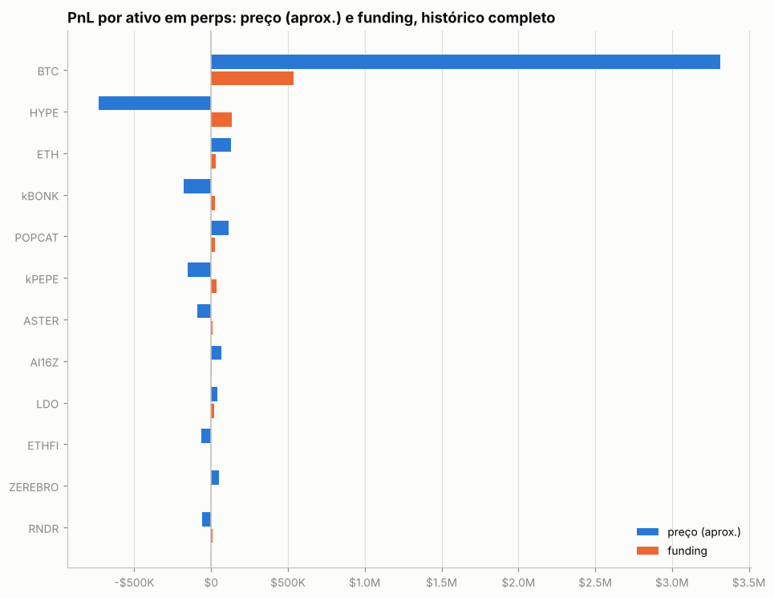
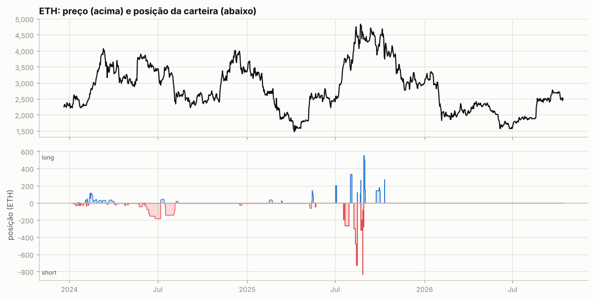
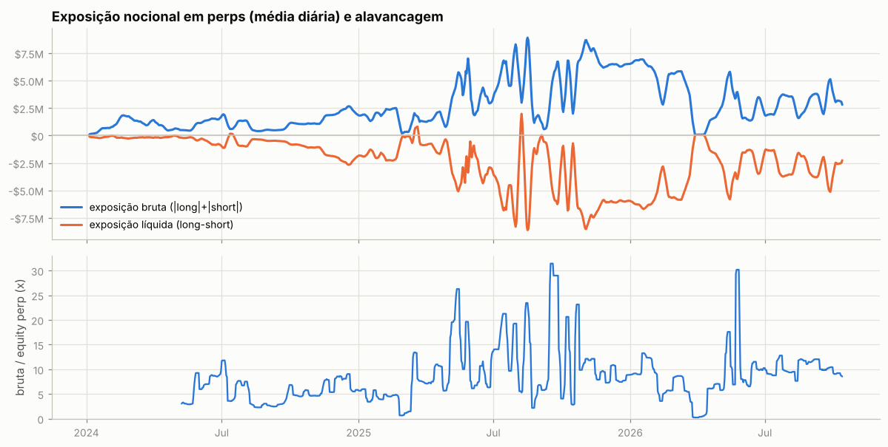
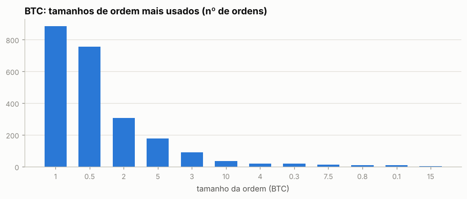
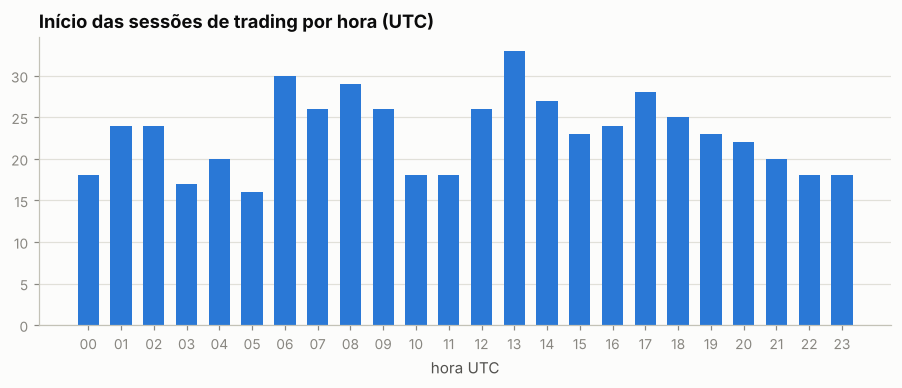
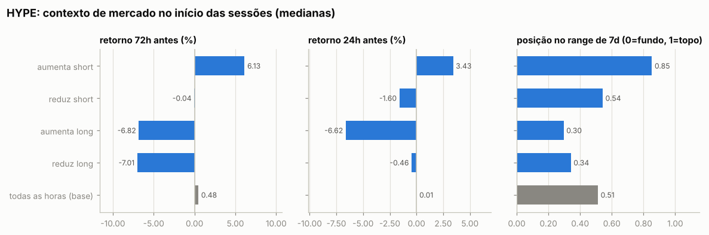
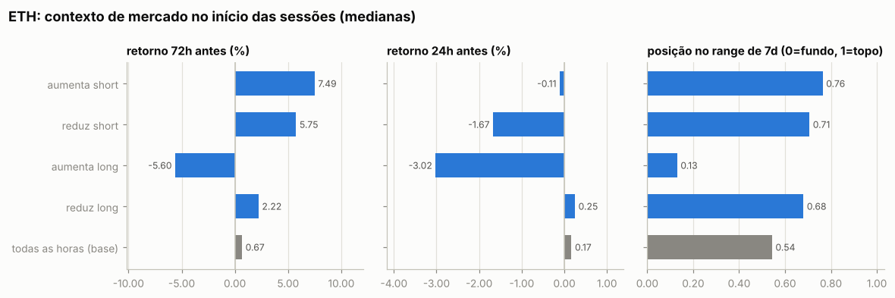

# Relatório automático — `0xcac1f1c3e4599e044dc2a9d38a9b6ef1af1bdae8`

Gerado em 2026-10-13 15:12 UTC a partir da API pública da Hyperliquid (`POST /info`). Valores em USD. Este arquivo é regenerado por `python -m hlre.report`; a interpretação da estratégia fica em `ANALISE.md`.

## 1. Visão geral

| métrica | valor |
|---|---|
| Valor da conta (perp + spot) | $1.59M |
| PnL all-time (portfolio, inclui spot/airdrops) | +$7.90M |
| PnL all-time só de perps | +$4.42M |
| Volume all-time | $656.69M |
| Primeira atividade | 2023-12-27 |
| Fills disponíveis na API | 43,378 (desde 2025-05-14) |
| Ordens (fills agrupados por oid) | 7,182 |
| Funding líquido (recebido > 0) | +$1.03M |
| Taxas pagas (período dos fills) | -$120.2K |
| Liquidações (ledger) | 2 |
| Fills de liquidação/ADL | 5 |
| Papel da conta | user |
| API wallets (agentes) | 0 |

**Posições abertas agora:**

| ativo | tamanho | nocional | entrada | alav. | PnL não realizado | liq. |
|---|---|---|---|---|---|---|
| BTC | 3.5 | $292.6K | 84122.1 | 40x cross | -$1.8K | — |
| HYPE | -31000.0 | $2.52M | 78.8362 | 10x cross | -$74.9K | 119.6987423013 |

## 2. Curva de PnL

## 3. De onde veio o PnL

*Preço (aprox.)* usa a posição média diária de cada ativo, reconstruída a partir do histórico de funding (que traz o tamanho da posição a cada hora/dia desde o início da conta), vezes o movimento open→close do dia. Subestima o PnL de day trade, mas cobre o período sem fills. *Preço exato* marca cada fill no fechamento diário e só existe para o período coberto pelos fills.

| ativo | preço (aprox.) | funding | total | preço exato (período dos fills) | taxas (período dos fills) |
|---|---|---|---|---|---|
| BTC | +$3.31M | +$535.2K | +$3.85M | +$4.01M | -$92.8K |
| HYPE | -$733.0K | +$132.5K | -$600.5K | -$516.8K | -$4.4K |
| ETH | +$127.8K | +$29.7K | +$157.5K | -$128.4K | -$10.9K |
| kBONK | -$177.5K | +$23.4K | -$154.1K | -$41.7K | -$481 |
| POPCAT | +$114.4K | +$23.5K | +$137.9K | +$11.3K | -$28 |
| kPEPE | -$155.0K | +$35.8K | -$119.2K | +$88.4K | -$354 |
| ASTER | -$87.8K | +$9.6K | -$78.2K | -$73.3K | -$605 |
| AI16Z | +$67.6K | +$2.0K | +$69.7K | — | — |
| LDO | +$40.0K | +$22.2K | +$62.2K | — | — |
| ETHFI | -$62.8K | +$685 | -$62.2K | — | — |
| ZEREBRO | +$52.8K | +$1.1K | +$53.9K | — | — |
| RNDR | -$57.8K | +$9.5K | -$48.2K | — | — |
| PURR | +$31.7K | +$16.4K | +$48.1K | +$10.0K | -$11 |
| MANTA | -$43.7K | -$3.5K | -$47.2K | — | — |
| ONDO | -$51.6K | +$9.7K | -$41.8K | +$10.7K | -$41 |
| outros (105) | -$107.2K | +$178.3K | +$71.2K | +$114.0K | -$2.6K |

**Decomposição no período dos fills** (preço exato): quanto veio de *carregar* a posição (e, dentro disso, do viés médio vs. do *timing* de aumentar/reduzir), quanto de trades intradiários, funding e taxas.

| componente | BTC | HYPE | ETH |
|---|---|---|---|
| carregar posição (carry) | +$4.34M | -$576.5K | +$113.4K |
|   ↳ viés (posição média × movimento) | +$690.6K | -$580.9K | +$231 |
|   ↳ timing (variação do tamanho) | +$3.65M | +$4.5K | +$113.2K |
| trades intradiários | -$327.3K | +$59.7K | -$241.8K |
| funding | +$396.0K | +$123.0K | +$20.8K |
| taxas | -$92.8K | -$4.4K | -$10.9K |
| posição média | -34.64 | -10,698.64 | -7.74 |
| movimento do preço no período | -19,938.00 | 54.30 | -29.90 |

## 4. Posições ao longo do tempo

Área clara: posição média diária (funding). Linha: posição exata (fills). Azul = long, vermelho = short.

Tabela mensal de exposição e alavancagem

| mês | exposição bruta | exposição líquida | equity perp | alavancagem (mediana) |
|---|---|---|---|---|
| 2024-01 | $479.9K | -$158.7K | — | — |
| 2024-02 | $1.46M | -$184.5K | — | — |
| 2024-03 | $1.23M | -$184.4K | — | — |
| 2024-04 | $707.8K | -$125.5K | — | — |
| 2024-05 | $684.0K | -$254.8K | $116.9K | 3.3x |
| 2024-06 | $1.49M | -$699.5K | $181.7K | 8.5x |
| 2024-07 | $1.14M | -$576.0K | $171.5K | 6.9x |
| 2024-08 | $564.5K | -$459.2K | $176.9K | 2.7x |
| 2024-09 | $654.9K | -$565.2K | $180.0K | 3.0x |
| 2024-10 | $1.08M | -$960.3K | $220.7K | 4.7x |
| 2024-11 | $1.60M | -$1.58M | $261.2K | 5.4x |
| 2024-12 | $2.27M | -$2.26M | $321.7K | 7.4x |
| 2025-01 | $1.77M | -$1.70M | $402.1K | 4.2x |
| 2025-02 | $1.86M | -$1.69M | $466.3K | 4.6x |
| 2025-03 | $1.17M | -$255.9K | $179.4K | 7.4x |
| 2025-04 | $1.51M | -$1.00M | $180.0K | 7.7x |
| 2025-05 | $4.68M | -$3.38M | $310.8K | 17.2x |
| 2025-06 | $3.12M | -$3.05M | $371.3K | 7.7x |
| 2025-07 | $6.03M | -$5.97M | $383.3K | 16.6x |
| 2025-08 | $3.99M | -$2.49M | $422.4K | 7.1x |
| 2025-09 | $3.43M | -$3.01M | $253.0K | 11.7x |
| 2025-10 | $5.70M | -$5.33M | $508.0K | 11.3x |
| 2025-11 | $7.10M | -$6.82M | $746.3K | 9.5x |
| 2025-12 | $6.46M | -$5.99M | $759.1K | 7.8x |
| 2026-01 | $6.59M | -$6.33M | $622.9K | 10.1x |
| 2026-02 | $4.69M | -$4.69M | $783.0K | 5.6x |
| 2026-03 | $3.50M | -$3.45M | $649.1K | 5.4x |
| 2026-04 | $1.12M | -$1.07M | $223.5K | 6.1x |
| 2026-05 | $3.68M | -$3.68M | $341.4K | 10.2x |
| 2026-06 | $2.18M | -$2.06M | $217.4K | 9.9x |
| 2026-07 | $2.84M | -$2.60M | $279.8K | 9.5x |
| 2026-08 | $2.66M | -$2.60M | $253.2K | 11.5x |
| 2026-09 | $3.57M | -$3.52M | $338.9K | 10.4x |
| 2026-10 | $2.98M | -$2.41M | $340.5K | 8.9x |

## 5. Execução

**Tipos de ordem** (últimas 1,002 ordens que a API guarda, 2026-03-10 → 2026-10-07):

| orderType | tif | reduceOnly | isTrigger | ordens |
|---|---|---|---|---|
| Limit | Gtc | False | False | 83 |
| Market | FrontendMarket | False | False | 919 |

`FrontendMarket` = ordem a mercado enviada pela interface web; `Gtc` = limite que fica no livro; gatilhos (`isTrigger`) seriam stop/take-profit.

**Perfil por ativo (top 10 por volume):**

| ativo | volume | ordens | % taker (nocional) | tamanho mediano |
|---|---|---|---|---|
| BTC | $392.60M | 2380 | 74% | 1 |
| ETH | $40.93M | 351 | 91% | 20 |
| HYPE | $21.41M | 772 | 52% | 200 |
| SOL | $3.99M | 103 | 97% | 200 |
| xyz:XYZ100 | $2.47M | 95 | 96% | 1 |
| xyz:BRENTOIL | $2.36M | 352 | 89% | 50 |
| xyz:CL | $2.28M | 358 | 94% | 50 |
| ASTER | $2.07M | 369 | 80% | 5,000 |
| XRP | $1.76M | 58 | 100% | 1e+04 |
| kPEPE | $1.70M | 162 | 74% | 1e+06 |

Os 5 tamanhos mais comuns respondem por 93% das ordens de BTC — lotes redondos e repetidos são assinatura de execução manual.

Sessões (ordens separadas por < 30 min): 553; mediana de 5 ordens e 3.7 min por sessão; dias com atividade: 249 de 511.

Por dia da semana: seg 15%, ter 15%, qua 15%, qui 15%, sex 18%, sáb 10%, dom 11%

## 6. Comportamento de entrada e saída

### BTC

Por ordem (medianas):

| ação | ordens | retorno 24h antes | 72h antes | 7d antes | posição no range 7d | 24h depois | 7d depois |
|---|---|---|---|---|---|---|---|
| aumenta short | 1130 | +0.17% | +1.31% | +3.31% | 0.74 | +0.31% | +0.41% |
| reduz short | 803 | -0.94% | -0.59% | -0.34% | 0.25 | -0.09% | +0.01% |
| aumenta long | 175 | -0.87% | -0.59% | +2.83% | 0.49 | +0.99% | -2.54% |
| reduz long | 264 | +0.97% | -0.59% | +2.39% | 0.64 | +0.96% | -2.00% |
| todas as horas (base) |  | +0.04% | -0.00% | +0.07% | 0.49 | +0.03% | +0.05% |

Por sessão (ordens a menos de 30 min uma da outra contam como uma decisão; p = teste de Mann-Whitney contra todas as horas do período):

| sessão | sessões | retorno 24h antes | 72h antes | 7d antes | range 7d | no topo (>0,7) | no fundo (<0,3) |
|---|---|---|---|---|---|---|---|
| aumenta short | 142 | +0.61% (p=<1e-4) | +1.72% (p=<1e-4) | +3.61% (p=<1e-4) | 0.81 (p=<1e-4) | 61% | 15% |
| reduz short | 87 | -0.54% (p=0.002) | -0.56% (p=0.027) | -0.34% (p=0.666) | 0.37 (p=0.008) | 25% | 49% |
| aumenta long | 7 | -1.75% (p=0.006) | -2.99% (p=0.014) | -5.48% (p=0.002) | 0.00 (p=<1e-4) | 0% | 100% |
| reduz long | 19 | +0.98% (p=0.297) | -1.52% (p=0.155) | +0.87% (p=0.819) | 0.55 (p=0.903) | 37% | 32% |
| todas as horas (base) |  |  |  |  |  | 32% | 34% |

- Aumentos de posição feitos com a posição no prejuízo (preço pior que o preço médio): **62%** das ordens (63% do tamanho); distância mediana do preço médio: +0.12%.
- Reduções/fechamentos com lucro: **66%** de 1067; ganho médio $7.4K vs. perda média -$4.4K; realizado +$3.65M.

- Episódios (de zerado a zerado, ou até inverter): 35; fechados com lucro: 62%; duração mediana 4.9 dias; o melhor episódio sozinho = 62% da soma dos episódios lucrativos.

Maiores episódios por PnL realizado

| início | fim | dias | lado | tam_max | nocional_max | ordens | entrada | saída | realizado |
|---|---|---|---|---|---|---|---|---|---|
| 2025-10-16 | 2026-03-23 | 158.0 | short | 85.00 | $8.84M | 163 | 96,922 | 74,463 | +$3.07M |
| 2025-05-14 | 2025-05-20 | 5.9 | short | 54.00 | $5.58M | 75 | 102,446 | 104,618 | -$456.7K |
| 2025-10-10 | 2025-10-10 | 0.2 | long | 39.00 | $4.46M | 25 | 117,588 | 107,398 | -$414.8K |
| 2025-09-10 | 2025-09-27 | 16.6 | short | 71.50 | $8.14M | 123 | 114,595 | 110,149 | +$336.0K |
| 2025-05-27 | 2025-05-29 | 2.5 | short | 90.00 | $9.83M | 77 | 109,444 | 107,684 | +$271.0K |
| 2025-07-16 | 2025-08-01 | 16.9 | short | 71.00 | $8.26M | 233 | 117,718 | 115,272 | +$258.1K |
| 2025-05-21 | 2025-05-21 | 0.3 | long | 71.00 | $7.54M | 38 | 106,420 | 108,939 | +$199.0K |
| 2025-06-02 | 2025-07-15 | 43.2 | short | 68.00 | $8.01M | 459 | 109,737 | 110,523 | -$153.4K |
| 2026-06-14 | 2026-06-25 | 11.0 | short | 29.00 | $1.91M | 48 | 65,338 | 60,359 | +$144.4K |
| 2025-05-24 | 2025-05-26 | 1.9 | long | 115.00 | $12.30M | 172 | 107,214 | 107,514 | +$126.5K |

### HYPE

Por ordem (medianas):

| ação | ordens | retorno 24h antes | 72h antes | 7d antes | posição no range 7d | 24h depois | 7d depois |
|---|---|---|---|---|---|---|---|
| aumenta short | 390 | +6.42% | +9.68% | +15.75% | 0.89 | +1.17% | -0.26% |
| reduz short | 306 | +8.42% | +9.00% | +19.08% | 0.95 | +1.15% | -4.41% |
| aumenta long | 14 | +3.84% | +6.43% | -14.47% | 0.36 | -2.16% | +4.66% |
| reduz long | 59 | -2.71% | +0.04% | -5.42% | 0.45 | -0.86% | -12.37% |
| todas as horas (base) |  | +0.01% | +0.48% | +0.45% | 0.51 | -0.01% | +0.12% |

Por sessão (ordens a menos de 30 min uma da outra contam como uma decisão; p = teste de Mann-Whitney contra todas as horas do período):

| sessão | sessões | retorno 24h antes | 72h antes | 7d antes | range 7d | no topo (>0,7) | no fundo (<0,3) |
|---|---|---|---|---|---|---|---|
| aumenta short | 61 | +3.43% (p=<1e-4) | +6.13% (p=<1e-4) | +12.37% (p=<1e-4) | 0.85 (p=<1e-4) | 72% | 10% |
| reduz short | 56 | -1.60% (p=0.072) | -0.04% (p=0.792) | +3.29% (p=0.016) | 0.54 (p=0.740) | 39% | 29% |
| aumenta long | 6 | -6.62% (p=0.016) | -6.82% (p=0.029) | -2.27% (p=0.359) | 0.30 (p=0.072) | 0% | 50% |
| reduz long | 7 | -0.46% (p=0.803) | -7.01% (p=0.300) | -5.42% (p=0.114) | 0.34 (p=0.446) | 14% | 43% |
| todas as horas (base) |  |  |  |  |  | 34% | 32% |

- Aumentos de posição feitos com a posição no prejuízo (preço pior que o preço médio): **66%** das ordens (80% do tamanho); distância mediana do preço médio: +8.79%.
- Reduções/fechamentos com lucro: **19%** de 365; ganho médio $4.3K vs. perda média -$2.8K; realizado -$547.5K.

- Episódios (de zerado a zerado, ou até inverter): 16; fechados com lucro: 80%; duração mediana 0.6 dias; o melhor episódio sozinho = 39% da soma dos episódios lucrativos.

Maiores episódios por PnL realizado

| início | fim | dias | lado | tam_max | nocional_max | ordens | entrada | saída | realizado |
|---|---|---|---|---|---|---|---|---|---|
| 2026-04-09 | 2026-05-29 | 50.5 | short | 18,864 | $1.24M | 179 | 53.34 | 62.58 | -$301.9K |
| 2026-05-29 | 2026-10-07 | 130.8 | short | 35,000 | $3.29M | 271 | 75.66 | 82.48 | -$236.5K |
| 2025-10-26 | 2025-11-21 | 25.8 | short | 10,867 | $520.5K | 3 | 47.90 | 38.28 | +$77.7K |
| 2025-05-16 | 2025-10-10 | 147.9 | short | 20,877 | $1.03M | 178 | 43.21 | 42.22 | -$60.4K |
| 2025-10-22 | 2025-10-25 | 3.8 | long | 5,133 | $226.4K | 2 | 35.08 | 44.10 | +$49.2K |
| 2025-10-10 | 2025-10-22 | 11.3 | short | 10,109 | $381.4K | 36 | 38.69 | 35.77 | +$35.4K |
| 2025-11-21 | 2026-01-15 | 55.0 | long | 12,732 | $405.5K | 74 | 30.76 | 29.38 | +$32.2K |
| 2026-04-08 | 2026-04-08 | 0.6 | short | 2,000 | $78.3K | 4 | 39.15 | 37.91 | +$2.5K |
| 2026-04-06 | 2026-04-07 | 0.8 | short | 2,000 | $75.2K | 7 | 37.46 | 36.38 | +$2.2K |
| 2026-04-08 | 2026-04-09 | 0.3 | short | 2,000 | $78.3K | 3 | 39.15 | 38.37 | +$1.6K |

### ETH

Por ordem (medianas):

| ação | ordens | retorno 24h antes | 72h antes | 7d antes | posição no range 7d | 24h depois | 7d depois |
|---|---|---|---|---|---|---|---|
| aumenta short | 114 | +0.67% | -0.06% | +4.34% | 0.52 | +3.51% | -0.80% |
| reduz short | 90 | -1.44% | -0.06% | +5.19% | 0.52 | +2.44% | -3.70% |
| aumenta long | 99 | -5.17% | -1.94% | -6.76% | 0.13 | +1.40% | +1.23% |
| reduz long | 46 | +1.02% | +1.72% | -5.59% | 0.45 | +0.10% | +0.11% |
| todas as horas (base) |  | +0.17% | +0.67% | +2.00% | 0.54 | +0.16% | +1.59% |

Por sessão (ordens a menos de 30 min uma da outra contam como uma decisão; p = teste de Mann-Whitney contra todas as horas do período):

| sessão | sessões | retorno 24h antes | 72h antes | 7d antes | range 7d | no topo (>0,7) | no fundo (<0,3) |
|---|---|---|---|---|---|---|---|
| aumenta short | 15 | -0.11% (p=0.601) | +7.49% (p=0.117) | +7.63% (p=0.005) | 0.76 (p=0.028) | 60% | 0% |
| reduz short | 10 | -1.67% (p=0.394) | +5.75% (p=0.064) | +6.48% (p=0.033) | 0.71 (p=0.089) | 50% | 0% |
| aumenta long | 8 | -3.02% (p=0.019) | -5.60% (p=0.012) | -2.17% (p=0.023) | 0.13 (p=0.004) | 12% | 75% |
| reduz long | 11 | +0.25% (p=0.451) | +2.22% (p=0.717) | +0.03% (p=0.775) | 0.68 (p=0.902) | 36% | 18% |
| todas as horas (base) |  |  |  |  |  | 38% | 28% |

- Aumentos de posição feitos com a posição no prejuízo (preço pior que o preço médio): **62%** das ordens (58% do tamanho); distância mediana do preço médio: +0.03%.
- Reduções/fechamentos com lucro: **43%** de 136; ganho médio $4.4K vs. perda média -$5.1K; realizado -$140.0K.

- Episódios (de zerado a zerado, ou até inverter): 14; fechados com lucro: 29%; duração mediana 1.5 dias; o melhor episódio sozinho = 37% da soma dos episódios lucrativos.

Maiores episódios por PnL realizado

| início | fim | dias | lado | tam_max | nocional_max | ordens | entrada | saída | realizado |
|---|---|---|---|---|---|---|---|---|---|
| 2025-10-10 | 2025-10-10 | 0.3 | long | 270.00 | $1.08M | 9 | 4,296 | 3,478 | -$221.0K |
| 2025-08-08 | 2025-08-15 | 6.7 | short | 730.00 | $3.45M | 18 | 4,341 | 4,483 | -$103.0K |
| 2025-08-29 | 2025-08-31 | 2.2 | long | 550.00 | $2.43M | 22 | 4,326 | 4,470 | +$79.1K |
| 2025-08-22 | 2025-08-29 | 6.7 | short | 830.00 | $3.78M | 149 | 4,584 | 4,551 | +$54.4K |
| 2025-08-01 | 2025-08-04 | 3.0 | long | 330.00 | $1.23M | 19 | 3,556 | 3,713 | +$51.8K |
| 2025-07-02 | 2025-07-03 | 1.6 | long | 200.00 | $518.7K | 14 | 2,449 | 2,593 | +$28.7K |
| 2025-05-15 | 2025-05-16 | 1.4 | long | 150.00 | $381.3K | 5 | — | 2,565 | -$21.0K |
| 2025-08-15 | 2025-08-15 | 0.0 | long | 120.00 | $538.8K | 4 | 4,490 | 4,489 | -$12.0K |
| 2025-07-20 | 2025-07-29 | 8.4 | short | 270.00 | $1.02M | 19 | 3,762 | 3,793 | -$8.6K |
| 2025-08-22 | 2025-08-22 | 0.0 | long | 260.27 | $1.13M | 43 | 4,348 | 4,324 | -$6.3K |

## 7. Funding

Funding líquido total: **+$1.03M** (recebido $1.12M, pago -$91.5K). Na Hyperliquid o funding é pago de hora em hora; quando positivo, longs pagam shorts.

| ativo | lado | funding | rendimento anualizado s/ nocional |
|---|---|---|---|
| BTC | short | +$540.0K | 10.1% |
| BTC | long | -$4.8K | -3.2% |
| HYPE | short | +$142.8K | 14.1% |
| HYPE | long | -$10.3K | -13.9% |
| ETH | short | +$36.6K | 22.7% |
| ETH | long | -$6.9K | -11.5% |
| (outros) | short | +$343.8K | 54.8% |
| (outros) | long | -$15.0K | -6.3% |

## 8. Fluxos, eventos e carteiras relacionadas

| tipo | eventos | USD (+ entra / − sai) |
|---|---|---|
| withdraw | 266 | -$60.92M |
| send | 62 | -$3.72M |
| vaultDeposit | 11 | -$185.1K |
| internalTransfer | 4 | -$44.0K |
| liquidation | 2 | — (sem valor em USD) |
| cStakingTransfer | 12 | — (sem valor em USD) |
| accountClassTransfer | 327 | — (sem valor em USD) |
| borrowLend | 2 | — (sem valor em USD) |
| spotGenesis | 47 | — (sem valor em USD) |
| vaultWithdraw | 8 | +$186.7K |
| deposit | 275 | +$17.71M |
| spotTransfer | 265 | +$41.43M |

Ponte HyperCore↔HyperEVM (endereços de sistema `0x2000…`/`0x2222…`): 116 transferências, entrada $7.95M, saída $8.89M — uso de DeFi na HyperEVM.

**Carteiras relacionadas** (conta vinculada de staking para desconto de taxa + maiores contrapartes de transferências; o saldo de staking e o PnL ajudam a ver se posições aqui são hedge de algo mantido lá):

| carteira | relação | transferências | volume transferido | valor da conta hoje | PnL all-time | HYPE em staking | maiores saldos spot |
|---|---|---|---|---|---|---|---|
| `0x8dafbe89302656a7df43c470e9ebcb4c540835c0` | Unit: emissor/ponte do UETH (depósitos de ETH nativo) | 97 | $41.83M | $1.4K | +$129.14M | 0 | UETH 99,945,906, USDC 1, HYPE 0 |
| `0x91360a06664eea3291fe8599dd4d2ec2170f632e` | staking link + transfers | 50 | $3.18M | $3.83M | +$3.01M | 47,126 | NEKO 3,504, LICKO 1,261, HYPE 0 |
| `0xd152d22db7bdd33b410bfb1f99ecbd3acacd31ce` | transfers | 15 | $2.87M | $3.54M | +$2.62M | 43,639 | NEKO 3,504, LICKO 786, USDC 0 |
| `0xc168fad8177076cf19ca32aaad782baf9bd2c477` | transfers | 12 | $2.63M | $0 | -$883 | 0 | — |
| `0x6b9e773128f453f5c2c60935ee2de2cbc5390a24` | transfers | 6 | $1.22M | $7.8K | +$0 | 0 | USDC 7,687 |
| `0x97d683922bc21017e4912496e4d4c792f048cbc6` | transfers | 5 | $198.7K | $0 | -$72 | 0 | — |

**Liquidações e ADL (auto-deleveraging) nos fills:**

| quando (UTC) | ativo | tipo | lado | preço | tamanho | posição antes | PnL realizado |
|---|---|---|---|---|---|---|---|
| 2025-10-10 21:16:04 | HYPE | Auto-Deleveraging | B | 36.2 | 13867.36 | -13867.36 | +$163.7K |
| 2025-10-10 21:16:56 | PURR | Auto-Deleveraging | B | 0.11482 | 108225.0 | -108225.0 | +$6.9K |
| 2025-10-10 21:17:40 | FARTCOIN | Liquidated Cross Long | A | 0.32097 | 55000.0 | 55000.0 | -$10.3K |
| 2025-10-10 21:17:40 | BTC | Liquidated Cross Long | A | 106385.4 | 32.0 | 32.0 | -$356.9K |
| 2025-10-10 21:17:40 | ETH | Liquidated Cross Long | A | 3493.39 | 216.0 | 216.0 | -$173.4K |

## 9. Dá para copiar? (espelhar a posição com atraso)

PnL de quem replicasse exatamente a posição da carteira, mas com N horas de atraso (marcação horária, sem custos). Se o PnL se mantém com atraso, a vantagem está em horizontes longos e é copiável; se desaba, depende de timing fino.

| atraso | BTC | HYPE | ETH |
|---|---|---|---|
| 0h | +$3.96M | -$621.8K | +$3.6K |
| 1h | +$4.01M | -$604.0K | +$47.0K |
| 4h | +$4.15M | -$571.0K | +$138.1K |
| 12h | +$4.52M | -$575.6K | +$156.0K |
| 24h | +$3.99M | -$522.6K | +$95.3K |
| 72h | +$3.56M | -$591.5K | +$219.0K |
| 168h | +$3.92M | -$634.1K | -$6.7K |

## 10. Teste de replicação por regras (BTC)

Regra testada: *short-bias com filtro de tendência e fade* — short de até 69 BTC (o percentil 90 do tamanho real), cheio abaixo da média móvel e reduzido acima; dentro do regime, mais short perto do topo do range e menos perto do fundo. Parâmetros escolhidos no treino (2024-01-05 → 2025-05-24) e avaliados no teste (2025-05-25 → 2026-10-12).

|  | parâmetros | PnL treino | PnL teste | correlação c/ posição real (teste) |
|---|---|---|---|---|
| melhor regra no treino | MA50, range 30d, fração em alta 0.0, fade 0.9 | +$475.6K | +$738.3K | 0.23 |
| carteira real (aprox.) | — | -$275.1K | +$4.01M | 1.00 |

Clone comportamental (regressão linear da posição real em médias móveis, ranges e retornos): R² treino 0.25, R² teste -0.59, correlação no teste -0.08.

---

Metodologia e código: ver `README.md` na raiz do repositório.
