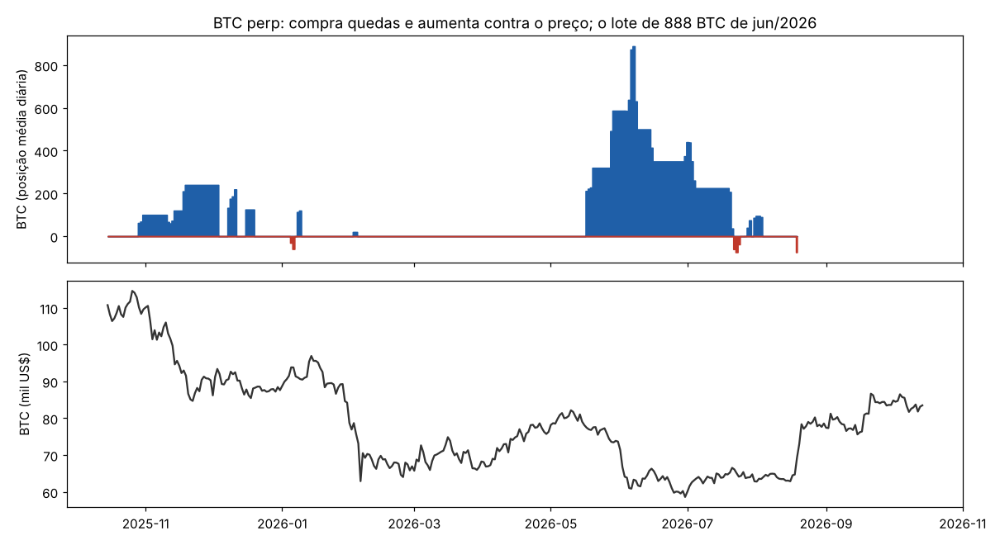
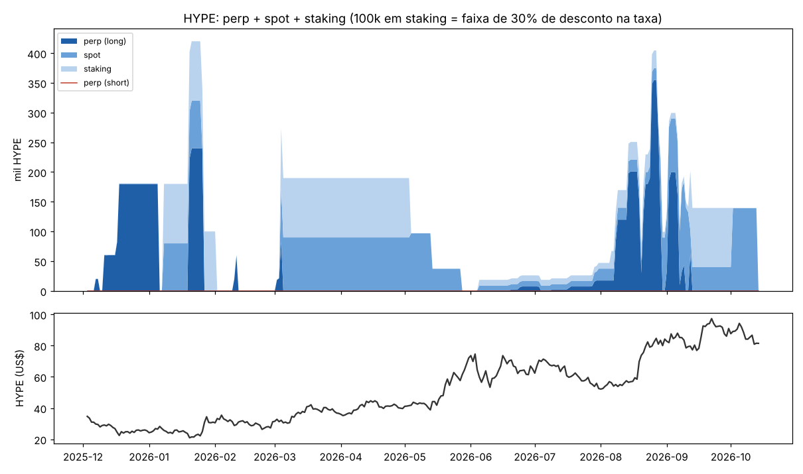

# Engenharia reversa: carteira `0xd260…8321`

`0xd260b2216b735277da6771564a01c04856e78321` · [CoinGlass](https://www.coinglass.com/hyperliquid/0xd260b2216b735277da6771564a01c04856e78321) · dados até 14/out/2026

Fonte: API pública da Hyperliquid. A conta existe desde 1/fev/2025, mas a API só entrega os fills a partir de **11/dez/2025** (68.453, mais 2.049 fatias de TWAP). Antes disso, a posição vem do histórico de funding, que traz o tamanho médio diário desde a abertura. Também estão completos o ledger (274 eventos) e as últimas 2.000 ordens (de 23/mar/2026 em diante). Há dois buracos que importam:

- **32 saltos de posição sem fill** (US$ 111M de nocional), quase todos **saídas por TWAP** de BTC, HYPE, ETH e TAO. O `analise_extra.py` marca cada salto nos dias em que o funding mostra a mudança de tamanho. Por isso o PnL por moeda abaixo tem erro de ~US$ 1M: soma +US$ 3,4M contra +US$ 2,4M do `portfolio` no mesmo período.
- **Os fills de 2 a 4/out/2026 não vêm na API** (o `userFees` registra US$ 18M de volume nesses dias). Pelo saldo de spot, foram vendas de ~139k HYPE.

Os números deste texto que não estão no [`relatorio_auto.md`](relatorio_auto.md) são recalculados por [`analise_extra.py`](analise_extra.py), que também gera `img/hype_book.png` e `img/btc_2026.png`.

---

## Resumo

- **O que faz:** é um **trader discricionário de grande porte, manual e quase sempre comprado** em BTC, HYPE, SOL e ETH. Opera em tamanhos de US$ 5–56M de nocional e **compra quedas**: 88% das sessões em que aumenta o long de BTC acontecem no fundo do range de 7 dias, depois de −2,7% em 24h (p < 0,0001). Realiza nos repiques e segura de horas a poucos dias (episódio mediano de 1 dia). Não usa stop. **Aumenta contra o preço** quando erra: em BTC, 84% dos aumentos foram feitos com a posição no prejuízo.
- **Quanto rendeu:** **+US$ 8,55M** em 20 meses (perps +US$ 4,68M; fora dos perps +US$ 3,87M, quase tudo do HYPE em spot e staking). O caminho foi muito irregular. A conta chegou a +US$ 7,39M em 20/mai/2026, **devolveu tudo em três semanas** (−US$ 7,54M, até −US$ 0,15M em 10/jun) com um long de 888 BTC, e recuperou com HYPE em ago–set/2026.
- **De onde veio o lucro: HYPE.** No período dos fills, o perp de HYPE dá +US$ 5,4M e o HYPE em spot e staking mais ~US$ 3,6–5,3M. O resto: SOL +US$ 1,5M, ETH ~+US$ 1,3M e, antes dos fills, SOL +US$ 1,3M e HYPE +US$ 0,7M em 2025. **BTC é o livro perdedor**: −US$ 4,9M desde dez/2025, mais ~−US$ 1,6M antes dos fills (o long de nov/2025). O HYPE subiu de US$ 25 para US$ 90 no período. A decomposição mostra que **o grosso é viés comprado** (+US$ 3,7M) e não *timing* (+US$ 2,0M), e que o day trade de HYPE perdeu (−US$ 1,2M).
- **Staking para desconto de taxa:** coloca exatamente 1.000, 10.000 e 100.000 HYPE em staking, que são os limites das faixas de 15%, 20% e 30% de desconto. Tira tudo de uma vez quando quer vender.
- **Muito dinheiro entrando e saindo:** US$ 61M depositados pela ponte, US$ 22,6M recebidos de uma hot wallet de exchange (`0x6b9e…0a24`), US$ 66,6M sacados e US$ 11,4M mandados para a HyperEVM. A carteira é a mesa de operação de alguém que guarda o dinheiro fora e traz margem quando precisa: trouxe US$ 11,7M no meio da queda do BTC de jun/2026.
- **Agora:** short de 47k SOL (US$ 5,1M, 20x isolada, +US$ 0,42M) e **~US$ 12M de USDC emprestados** no *lending* nativo da HyperCore. Vendeu todo o HYPE em 2–4/out/2026.
- **Dá para copiar?** Só a parte de HYPE, e por ser beta: espelhar a posição de HYPE com 24h de atraso rende +US$ 7,5M, mais que com atraso zero. Em BTC, a cópia perde com qualquer atraso (−US$ 3,3M a −US$ 7,4M). A regra "comprar depois de −3% em 24h no fundo do range" não tem vantagem estável em BTC e HYPE (o IC de 95% encosta no zero). **Não vale a pena copiar**: o resultado líquido depende de uma alta forte de HYPE e de aguentar drawdowns de US$ 7–10M.

---

## 1. Quem é essa carteira

**Uma pessoa operando à mão pela interface, com muito capital.**

- **3.142 ordens** para US$ 944M de volume. Sem `cloid` e com uma única API wallet (`Outcome-99fbf44f`), que a interface cria para os mercados de outcome (HIP-4). Nas últimas 1.003 ordens: 900 limites GTC, 102 `FrontendMarket` e **nenhuma ordem de gatilho (stop ou take-profit)**. As saídas grandes saem por **TWAP** nativo.
- **Lotes redondos e repetidos:** 5 BTC, 5.000 HYPE, 100 ETH. Os 5 tamanhos mais comuns são 83% das ordens de BTC. Quando entra forte, varre o livro: ordens de US$ 5–22M de uma vez a mercado. Paga como taker 75% do nocional em BTC e 71% em HYPE.
- **Ritmo:** 170 sessões em 84 dos 306 dias com fills. Opera a qualquer hora (pausa entre 9h e 12h UTC) e menos aos domingos. Não dá para cravar o fuso.
- **Outros sinais:** foi indicado pelo código `TOMRIDDLE` e tem o próprio (`TOMRIDDLE5`, sem indicados). Tem uma subconta vazia (`inshallah`) e 100M do token MAX recebidos num *genesis* (sem valor relevante). Fez duas apostas pequenas em mercados de outcome (compra a 0,36–0,63, liquidadas a 1,00, +US$ 10k).

**O dinheiro.**

| | eventos | US$ |
|---|---|---|
| depósitos pela ponte | 57 | +61,07M |
| USDC recebido da hot wallet de exchange `0x6b9e…0a24` | 20 | +22,59M |
| saques pela ponte | 78 | −66,57M |
| USDC enviado para a HyperEVM | 20 | −11,44M |
| HLP (vault do protocolo): entra e sai como caixa | 21 | +0,07M de resultado |
| *lending* de USDC (set–out/2026) | 21 | ~12,0M emprestados hoje |

O padrão é depositar US$ 1–5M, operar dias ou semanas e sacar em valores redondos (US$ 4.999.999, US$ 999.999…). O primeiro movimento da conta, em 1/fev/2025, foi depositar US$ 5,0M e pôr tudo no HLP. Nos meses calmos o HLP serve de caixa (até US$ 5M por vez). Desde set/2026, o caixa vai para o *lending* de USDC.

## 2. Como opera

**Compra queda, vende repique.** Medianas por sessão, contra todas as horas do período (Mann-Whitney):

| | sessões | 24h antes | 7d antes | posição no range de 7d | no fundo (< 0,3) |
|---|---|---|---|---|---|
| BTC: aumenta long | 17 | −2,7% (p < 1e-4) | −6,0% (p < 1e-4) | 0,09 | 88% |
| HYPE: aumenta long | 31 | −2,3% (p < 0,001) | +3,9% | 0,49 | 29% |
| HYPE: reduz long | 19 | +2,2% (p = 0,006) | +4,0% | 0,77 | 26% |
| SOL: aumenta short | 9 | +3,3% (p = 0,002) | −0,1% | 0,57 | 0% |
| SOL: aumenta long | 8 | −2,8% (p = 0,004) | +4,5% | 0,50 | 38% |

É reversão de curto prazo: compra no dia vermelho e vende no verde. Em HYPE, isso funciona por cima de uma tendência de alta. Em BTC, o sinal "comprar no fundo do range" pegou uma tendência de baixa (US$ 110k → 60k entre out/2025 e jul/2026).

**Gestão de risco: quase nenhuma.**

- **Sem stop.** Em BTC, 84% dos aumentos foram feitos com a posição no prejuízo, em média 4,4% abaixo do preço médio. Em HYPE e SOL foram 38%.
- **Ganha pouco e muitas vezes, perde muito poucas vezes.** Em BTC, 93% das reduções deram lucro, mas o ganho médio é de US$ 13,7k contra uma perda média de US$ 129,7k. Em HYPE, 98% das reduções deram lucro (média de US$ 36,7k).
- **Alavancagem:** a mediana mensal vai de 1x a 8,7x (mai/2026). No pico de jun/2026, a conta tinha US$ 56M de BTC sobre ~US$ 6M de equity no perp. A liquidação de out/2025 aconteceu a **42x** (seção 6).

## 3. De onde veio o dinheiro

| livro | período | resultado | como |
|---|---|---|---|
| **HYPE perp** | dez/25 → set/26 | **+US$ 5,37M** | longs de dias a semanas; os dois maiores: jul–ago/26 (+1,46M) e ago–set/26 (até 355k HYPE, US$ 28,5M, +1,05M) |
| **HYPE spot + staking** | dez/25 → out/26 | **~+US$ 3,6–5,3M** | 100–220k HYPE carregados (seção 4); o intervalo vai do `portfolio` (fora dos perps) à marcação diária |
| SOL perp | dez/25 → hoje | +US$ 1,45M | shorts e longs curtos; inclui o short aberto (+0,42M) |
| ETH perp | dez/25 → ago/26 | ~+US$ 1,25M | inclui ~3.600 ETH recomprados por TWAP sem fill (incerto) |
| outros perps (SUI, TAO, XRP…) | dez/25 → hoje | +US$ 0,15M | |
| **BTC perp** | dez/25 → ago/26 | **−US$ 4,85M** | o long de mai–ago/26 sozinho: **−US$ 5,77M** (seção 5) |
| antes dos fills (perps) | fev → dez/25 | +US$ 2,27M | aproximado: SOL +1,34M, HYPE +0,73M, TAO +0,45M, SUI, RUNE; BTC −1,59M (long em nov/25) |
| HLP, *lending*, outcome | | +US$ 0,08M | |
| **total (`portfolio`)** | | **+US$ 8,55M** | perps +4,68M, fora dos perps +3,87M |

**Por mês (PnL total, US$ M):** 2025: +0,04 (fev), +0,19, +0,46, +0,14, +0,09, +0,19, +0,11, +0,07, **+1,35 (out)**, −0,76 (nov), +1,26 (dez). 2026: +1,57 (jan), −0,04, +1,78, +0,40, −0,45, **−5,84 (jun)**, +1,33, **+4,02 (ago)**, +2,29 (set), +0,35 (out, até o dia 14).

**O HYPE é beta, não timing.** Na decomposição do período dos fills (`relatorio_auto.md`, seção 3), o perp de HYPE fez +US$ 3,67M de **viés** (posição média de 70k HYPE × alta de US$ 52), +US$ 2,00M de **timing** do tamanho e −US$ 1,24M nos trades intradiários. Em BTC, o timing do tamanho rende no papel, mas a conta só fecha com os saltos de TWAP: o resultado real de BTC é negativo.

## 4. O livro de HYPE

- **Três formas de estar comprado:** perp (até 355k HYPE), spot (até 170k) e staking. No total, carregou de 100k a 220k HYPE na maior parte de 2026, ou US$ 3–20M.
- **O staking segue as faixas de desconto de taxa.** As faixas valem 1.000 HYPE (15%), 10.000 (20%) e 100.000 (30%), e as transferências desta conta são de exatamente +1.000, +99.000 (fechando 100k), +10.000, +90.000, +9.000 e +90.001. Quando quer vender, tira tudo do staking de uma vez: −100.113 em 2/fev/2026 (vendeu os 100k no spot 3 minutos depois, a US$ 32,5), −100.284 em 4/mai e −99.133 em 2/out/2026.
- **A saída de out/2026:** depois do *unstake* de 2/out, o spot tinha ~139k HYPE e hoje tem 26. Os fills de 2–4/out não estão na API, mas o volume do usuário nesses dias (US$ 18,3M) e os **US$ 8,8M de USDC emprestados em 3–4/out** batem com uma venda de ~139k HYPE a ~US$ 89 (~US$ 12,4M).
- **Carregar o HYPE de spot e staking** rendeu ~US$ 5,3M na marcação diária (dez/2025 → 2/out/2026). Os melhores meses foram mai/2026 (+1,28M) e ago/2026 (+1,45M).

## 5. O long de BTC de mai–ago/2026

| | |
|---|---|
| 1ª compra | 17/mai/2026, a US$ 78,3k |
| aumentos | 212 → 320 BTC (20/mai) → 587 (28–29/mai) → **888 BTC** (6–7/jun, a ~US$ 61k), US$ 56M de nocional |
| preço médio de compra | US$ 68,6k (1.092 BTC comprados no total) |
| pior PnL aberto | **−US$ 10,1M** |
| margem trazida | **US$ 12,7M** entre 20/mai e 7/jun, sendo US$ 11,7M da hot wallet de exchange |
| saída | ~390 BTC vendidos por TWAP em 7–9/jun (a ~US$ 63k), 150 em 14–16/jun, 215 em 1–5/jul e o resto em 19–22/jul, a ~US$ 64–66k |
| preço médio de venda | US$ 63,6k |
| funding pago | −US$ 0,30M |
| **resultado** | **−US$ 5,77M** |

É o padrão da carteira em escala máxima: comprar a queda, dobrar quando cai mais e trazer dinheiro de fora para não ser liquidado. Desta vez o BTC caiu de 78k para 59k e não voltou a tempo. A carteira vendeu a maior parte a ~US$ 63k, logo antes da alta de ago/2026 para US$ 80k+.

## 6. A liquidação de 10/out/2025

No crash de 10/out/2025, a carteira **comprou durante a queda com 42x** e foi liquidada às 21:17 UTC, perto do fundo:

| ativo | posição liquidada | nocional | margem |
|---|---|---|---|
| HYPE | 170.614 HYPE | US$ 5,88M | US$ 141,5k |
| SOL | 39.183 SOL | US$ 6,57M | US$ 157,9k |

A posição média do dia era bem menor (60k HYPE e 5k SOL), então quase tudo foi comprado no próprio dia. A perda foi pequena (~US$ 0,3M de margem). **17 minutos depois** começou a depositar: US$ 4,95M em 5 depósitos nas 24h seguintes. Recomprou 60k SOL e até 200k HYPE e fechou outubro com **+US$ 1,35M**, o melhor mês de 2025. É a mesma aposta, com a mesma reação: aumentar e trazer dinheiro de fora.

## 7. Agora

- **Short de 47.320 SOL** (US$ 5,07M) desde 24/set/2026, a US$ 116,0, em **20x isolada**, com +US$ 0,42M de lucro aberto e liquidação a US$ 138,6. Tem uma ordem de recompra a US$ 98 para a posição toda, e a reduz em fatias de TWAP desde 13/out.
- **~US$ 12M de USDC emprestados** no *lending* nativo e US$ 2,1M de USDC no spot (US$ 1,66M presos como margem do SOL).
- **Nada de HYPE** (26 no spot, 1.001 em staking), depois de vender ~139k em 2–4/out.

## 8. Dá para replicar ou copiar?

**Cópia com atraso** (`relatorio_auto.md`, seção 9):

| atraso | BTC | HYPE | SOL |
|---|---|---|---|
| 0h | −US$ 3,28M | +US$ 5,13M | +US$ 1,18M |
| 24h | −US$ 4,56M | +US$ 7,48M | +US$ 0,77M |
| 72h | −US$ 7,43M | +US$ 7,08M | +US$ 1,02M |

Copiar HYPE dá mais lucro com atraso do que sem: a vantagem é estar comprado num ativo que triplicou, não o *timing*. Copiar BTC perde em qualquer atraso. E os tamanhos não cabem numa conta comum: a cópia exige aguentar US$ 10M de prejuízo aberto e trazer margem nova no meio da queda.

**Regra mecânica.** "Comprar quando o retorno de 24h < −3% e o preço está no terço inferior do range de 7 dias", com retorno médio por semana com sinal (dez/2025 → out/2026):

| | 24h depois | 72h depois | base (72h) |
|---|---|---|---|
| BTC | +0,8% (IC −0,0% a +1,6%) | +1,4% (IC −0,0% a +2,8%) | +0,3% |
| HYPE | +0,8% (IC −0,1% a +1,9%) | +2,1% (IC −0,4% a +4,9%) | +1,4% |
| SOL | +1,1% (IC +0,3% a +1,9%) | +2,4% (IC +0,7% a +4,2%) | +0,4% |

Em BTC e HYPE o intervalo encosta no zero (e em BTC, contando hora a hora em vez de semana a semana, a média fica negativa). Só SOL tem algum sinal, com 22 semanas. A regra de "comprar queda" não explica o resultado. O que explica é o tamanho no HYPE durante a alta.

## 9. Conclusão

É um **trader de grande porte, discricionário e manual, que compra quedas com tamanho e sem stop**. Traz dinheiro de fora para defender as posições e saca quando ganha. O lucro de US$ 8,55M é quase todo **HYPE** (perp + spot + staking, ~US$ 10M somados), num período em que o HYPE foi de US$ 25 a US$ 90. O BTC, operado do mesmo jeito numa tendência de baixa, custou ~US$ 6,5M, com um único episódio de −US$ 5,8M que zerou o lucro acumulado da conta. O staking de HYPE é calibrado para as faixas de desconto de taxa, e o caixa parado vai para o HLP ou para o *lending* de USDC.

Não há sinal de bot, de market making nem de informação privilegiada: é convicção, capital e tolerância a drawdowns de US$ 7–10M. **Não é uma estratégia replicável por regra.** A cópia só teria funcionado em HYPE, e porque o HYPE subiu.

*Nada aqui é recomendação de investimento.*
