# Relatório automático — `0xd260b2216b735277da6771564a01c04856e78321`

Gerado em 2026-10-14 08:54 UTC a partir da API pública da Hyperliquid (`POST /info`). Valores em USD. Este arquivo é regenerado por `python -m hlre.report`; a interpretação da estratégia fica em `ANALISE.md`.

## 1. Visão geral

| métrica | valor |
|---|---|
| Valor da conta (perp + spot) | $14.19M |
| PnL all-time (portfolio, inclui spot/airdrops) | +$8.55M |
| PnL all-time só de perps | +$4.68M |
| Volume all-time | $944.02M |
| Primeira atividade | 2025-02-05 |
| Fills disponíveis na API | 70,502 (desde 2025-12-11) |
| Ordens (fills agrupados por oid) | 3,142 |
| Funding líquido (recebido > 0) | -$478.4K |
| Taxas pagas (período dos fills) | -$111.1K |
| Liquidações (ledger) | 2 |
| Fills de liquidação/ADL | 24 |
| Papel da conta | user |
| API wallets (agentes) | 1 |

**Posições abertas agora:**

| ativo | tamanho | nocional | entrada | alav. | PnL não realizado | liq. |
|---|---|---|---|---|---|---|
| SOL | -47319.88 | $5.07M | 115.9981 | 20x isolated | +$418.7K | 138.6492018597 |

## 2. Curva de PnL

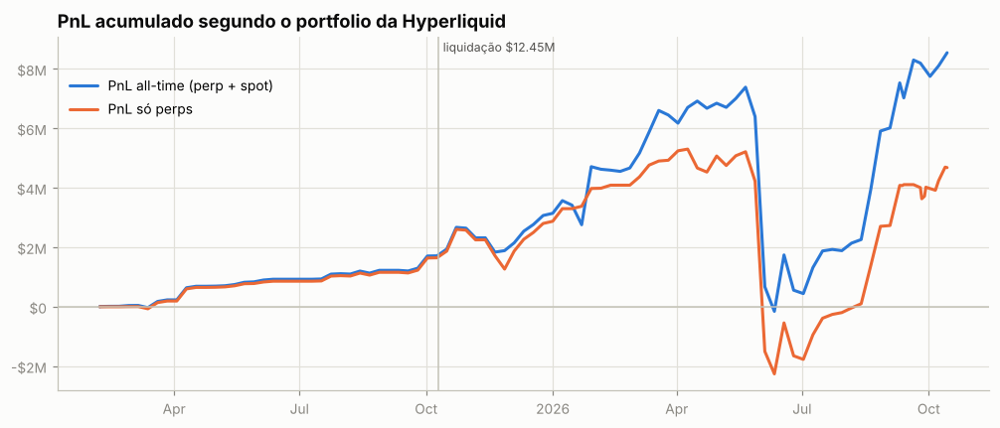

**Atenção: execuções que não aparecem nos fills.** A posição muda sem fill visível em 32 pontos (~$111.39M de nocional; maiores: BTC $83.19M, ETH $13.84M, HYPE $12.46M, TAO $1.33M, SOL $564.2K). O mais comum são fatias de TWAP: ficam fora de `userFills` e o endpoint de TWAP só guarda as 2.000 mais recentes. O *preço exato* e as tabelas por episódio dessas moedas não são exatos.

## 3. De onde veio o PnL

*Preço (aprox.)* usa a posição média diária de cada ativo, reconstruída a partir do histórico de funding (que traz o tamanho da posição a cada hora/dia desde o início da conta), vezes o movimento open→close do dia. Subestima o PnL de day trade, mas cobre o período sem fills. *Preço exato* marca cada fill no fechamento diário e só existe para o período coberto pelos fills.

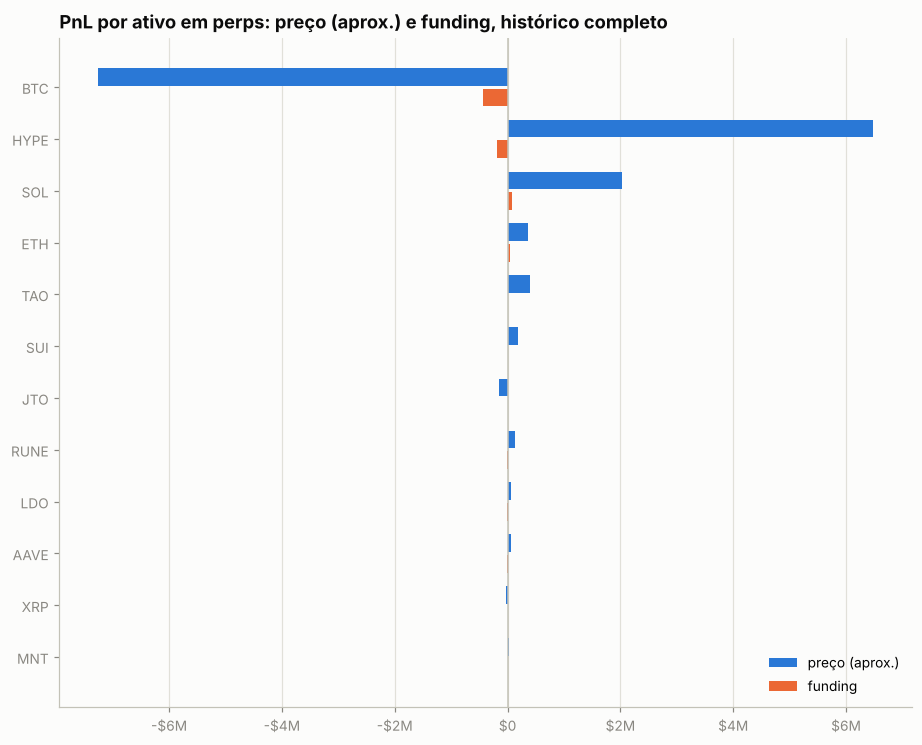

| ativo | preço (aprox.) | funding | total | preço exato (período dos fills) | taxas (período dos fills) |
|---|---|---|---|---|---|
| BTC | -$7.26M | -$429.0K | -$7.69M | +$13.29M | -$46.4K |
| HYPE | +$6.48M | -$178.7K | +$6.30M | +$4.43M | -$30.1K |
| SOL | +$2.03M | +$71.1K | +$2.10M | +$1.47M | -$9.2K |
| ETH | +$369.9K | +$50.9K | +$420.7K | -$555.3K | -$11.3K |
| TAO | +$391.2K | +$7.6K | +$398.8K | -$34.9K | -$1.6K |
| SUI | +$181.6K | +$6.1K | +$187.7K | +$131.5K | -$1.3K |
| JTO | -$146.2K | -$390 | -$146.6K | — | — |
| RUNE | +$130.1K | -$5.6K | +$124.5K | — | — |
| LDO | +$69.1K | -$4.2K | +$64.9K | — | — |
| AAVE | +$54.5K | -$1.6K | +$52.9K | — | — |
| XRP | -$24.8K | +$3.0K | -$21.8K | -$25.3K | -$4.2K |
| MNT | +$21.1K | +$87 | +$21.2K | — | — |
| IMX | +$13.9K | +$1.0K | +$14.9K | — | — |
| NEAR | +$11.5K | +$126 | +$11.7K | — | — |
| ZEC | +$6.0K | +$879 | +$6.9K | -$6.3K | -$409 |
| outros (6) | +$137 | +$234 | +$371 | -$9.9K | -$158 |

**Decomposição no período dos fills** (preço exato): quanto veio de *carregar* a posição (e, dentro disso, do viés médio vs. do *timing* de aumentar/reduzir), quanto de trades intradiários, funding e taxas.

| componente | BTC | HYPE | SOL |
|---|---|---|---|
| carregar posição (carry) | +$12.54M | +$5.67M | +$797.3K |
|   ↳ viés (posição média × movimento) | -$3.74M | +$3.67M | +$91.8K |
|   ↳ timing (variação do tamanho) | +$16.27M | +$2.00M | +$705.5K |
| trades intradiários | +$755.3K | -$1.24M | +$673.9K |
| funding | -$309.7K | -$161.1K | +$19.8K |
| taxas | -$46.4K | -$30.1K | -$9.2K |
| posição média | 416.23 | 70,226.54 | -4,205.39 |
| movimento do preço no período | -8,974.00 | 52.28 | -21.83 |

## 4. Posições ao longo do tempo

Área clara: posição média diária (funding). Linha: posição exata (fills). Azul = long, vermelho = short.

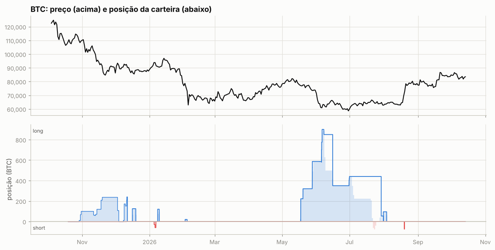

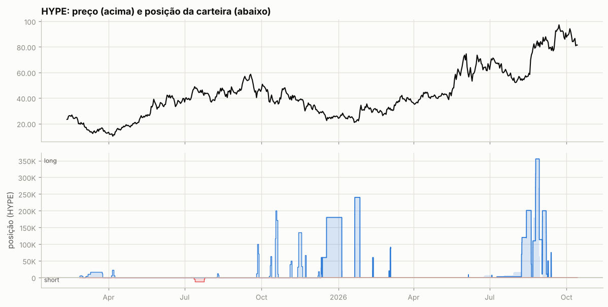

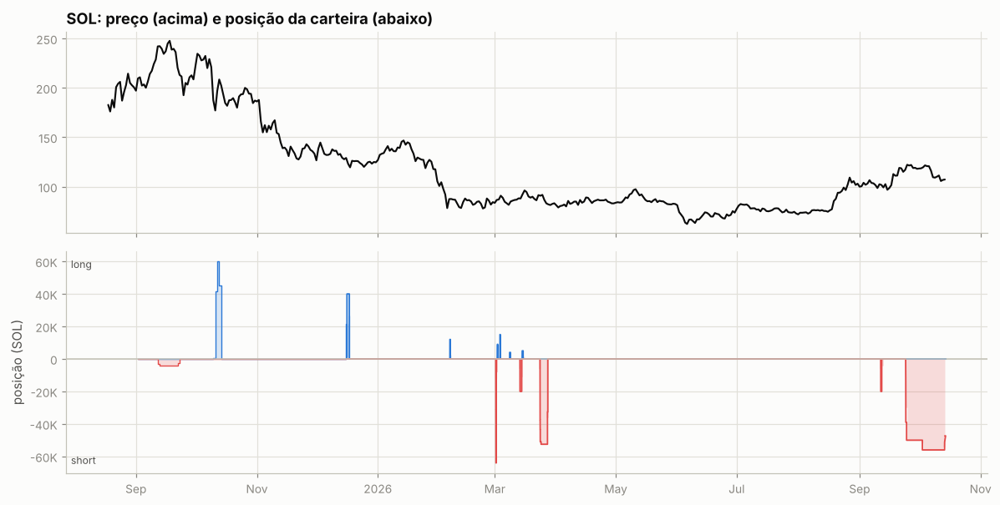

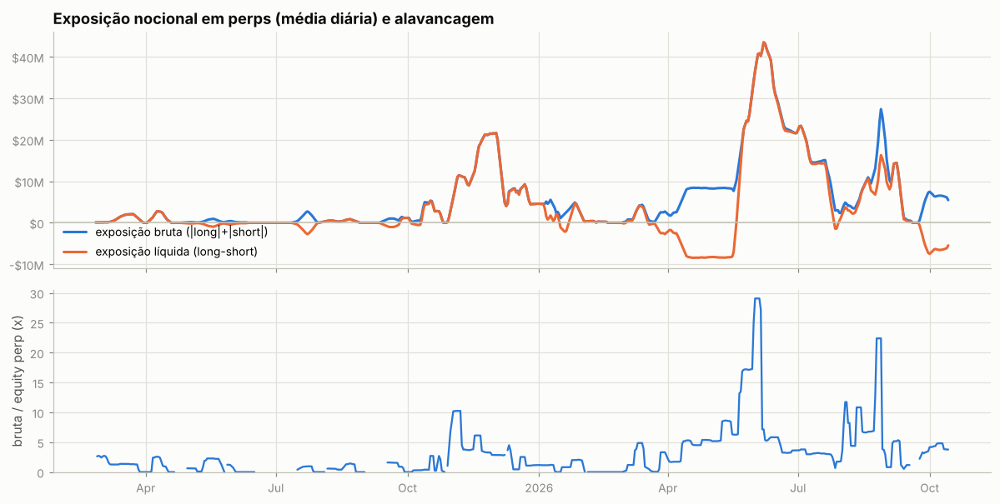

Tabela mensal de exposição e alavancagem

| mês | exposição bruta | exposição líquida | equity perp | alavancagem (mediana) |
|---|---|---|---|---|
| 2025-02 | $100.2K | $100.2K | $30.6K | 2.6x |
| 2025-03 | $984.8K | $984.8K | $1.06M | 1.3x |
| 2025-04 | $866.4K | $802.7K | $682.7K | 1.0x |
| 2025-05 | $404.3K | -$404.3K | $256.0K | 1.2x |
| 2025-06 | $22.0K | -$22.0K | $147.6K | 0.0x |
| 2025-07 | $734.5K | -$727.3K | $1.29M | 0.5x |
| 2025-08 | $394.8K | $393.8K | $479.6K | 0.6x |
| 2025-09 | $626.4K | -$77.7K | $326.1K | 1.2x |
| 2025-10 | $2.49M | $2.16M | $1.24M | 0.3x |
| 2025-11 | $15.88M | $15.88M | $4.17M | 3.6x |
| 2025-12 | $7.04M | $7.01M | $3.32M | 1.2x |
| 2026-01 | $3.13M | $1.25M | $3.03M | 1.1x |
| 2026-02 | $169.8K | $157.1K | $226.7K | 0.0x |
| 2026-03 | $1.93M | $229.7K | $901.3K | 0.9x |
| 2026-04 | $6.92M | -$6.92M | $1.60M | 4.9x |
| 2026-05 | $17.22M | $8.48M | $1.33M | 8.7x |
| 2026-06 | $29.87M | $29.65M | $6.12M | 4.2x |
| 2026-07 | $11.75M | $10.30M | $3.90M | 3.1x |
| 2026-08 | $11.07M | $7.66M | $2.56M | 6.8x |
| 2026-09 | $5.27M | $1.82M | $1.61M | 3.8x |
| 2026-10 | $5.99M | -$5.99M | $1.55M | 4.0x |

## 5. Execução

**Tipos de ordem** (últimas 1,003 ordens que a API guarda, 2026-03-23 → 2026-10-08):

| orderType | tif | reduceOnly | isTrigger | ordens |
|---|---|---|---|---|
| Limit | Gtc | False | False | 741 |
| Limit | Gtc | True | False | 159 |
| Limit | Ioc | False | False | 1 |
| Market | FrontendMarket | False | False | 96 |
| Market | FrontendMarket | True | False | 6 |

`FrontendMarket` = ordem a mercado enviada pela interface web; `Gtc` = limite que fica no livro; gatilhos (`isTrigger`) seriam stop/take-profit.

**Perfil por ativo (top 10 por volume):**

| ativo | volume | ordens | % taker (nocional) | tamanho mediano |
|---|---|---|---|---|
| BTC | $179.68M | 321 | 75% | 5 |
| HYPE | $136.33M | 439 | 71% | 5,000 |
| ETH | $59.44M | 187 | 59% | 100 |
| SOL | $53.78M | 1722 | 39% | 2.78 |
| XRP | $23.27M | 63 | 43% | 6.5e+04 |
| TAO | $8.12M | 52 | 50% | 250 |
| SUI | $6.30M | 27 | 40% | 1e+05 |
| ZEC | $1.56M | 6 | 68% | 125 |
| PUMP | $925.6K | 22 | 14% | 2.077e+06 |
| XMR | $308.5K | 13 | 73% | 4 |

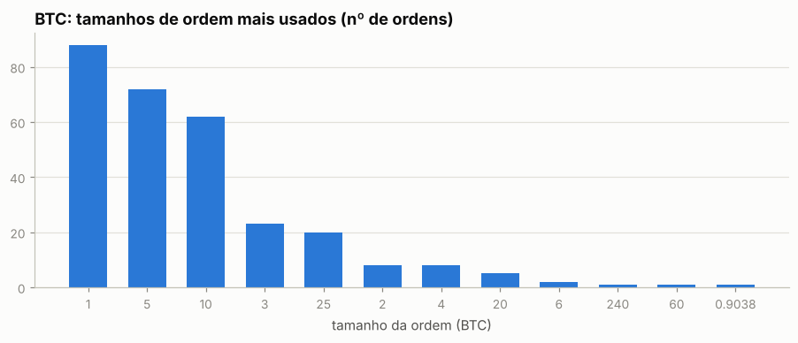

Os 5 tamanhos mais comuns respondem por 83% das ordens de BTC — lotes redondos e repetidos são assinatura de execução manual.

Sessões (ordens separadas por < 30 min): 170; mediana de 3 ordens e 8.7 min por sessão; dias com atividade: 84 de 306.

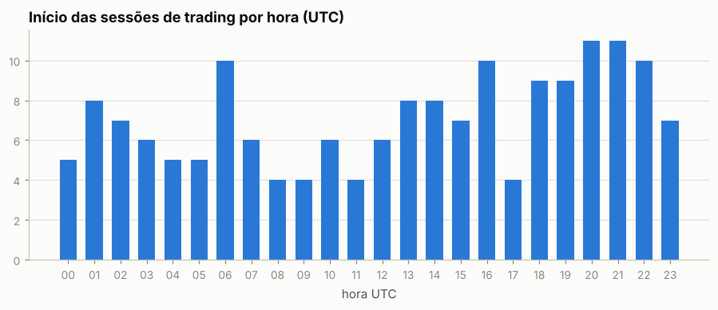

Por dia da semana: seg 14%, ter 19%, qua 18%, qui 14%, sex 15%, sáb 13%, dom 8%

## 6. Comportamento de entrada e saída

### BTC

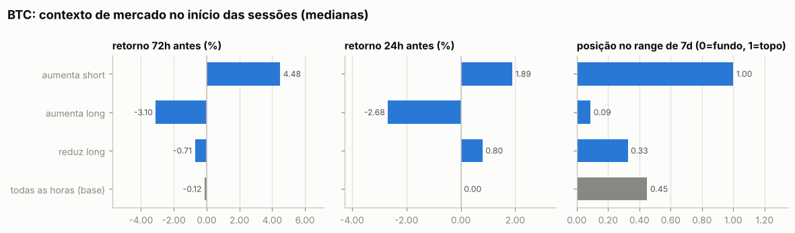

Por ordem (medianas):

| ação | ordens | retorno 24h antes | 72h antes | 7d antes | posição no range 7d | 24h depois | 7d depois |
|---|---|---|---|---|---|---|---|
| aumenta short | 22 | +1.87% | +4.46% | +4.03% | 1.00 | +8.97% | +18.03% |
| reduz short | 3 | +5.59% | +8.22% | +7.81% | 0.98 | +6.44% | +13.94% |
| aumenta long | 240 | -3.25% | -5.05% | -5.69% | 0.04 | +0.79% | -2.71% |
| reduz long | 56 | +1.31% | +1.62% | -1.12% | 0.52 | +0.25% | +1.04% |
| todas as horas (base) |  | +0.00% | -0.12% | -0.21% | 0.45 | +0.01% | +0.01% |

Por sessão (ordens a menos de 30 min uma da outra contam como uma decisão; p = teste de Mann-Whitney contra todas as horas do período):

| sessão | sessões | retorno 24h antes | 72h antes | 7d antes | range 7d | no topo (>0,7) | no fundo (<0,3) |
|---|---|---|---|---|---|---|---|
| aumenta short | 3 | +1.89% (p=0.018) | +4.48% (p=0.008) | +5.09% (p=0.018) | 1.00 (p=0.005) | 100% | 0% |
| aumenta long | 17 | -2.68% (p=<1e-4) | -3.10% (p=<1e-4) | -5.98% (p=<1e-4) | 0.09 (p=<1e-4) | 0% | 88% |
| reduz long | 8 | +0.80% (p=0.235) | -0.71% (p=0.585) | -3.85% (p=0.027) | 0.33 (p=0.327) | 12% | 50% |
| todas as horas (base) |  |  |  |  |  | 29% | 36% |

- Aumentos de posição feitos com a posição no prejuízo (preço pior que o preço médio): **84%** das ordens (81% do tamanho); distância mediana do preço médio: +4.42%.
- Reduções/fechamentos com lucro: **93%** de 59; ganho médio $13.7K vs. perda média -$129.7K; realizado +$233.4K.

- Episódios (de zerado a zerado, ou até inverter): 7; fechados com lucro: 86%; duração mediana 1.6 dias; o melhor episódio sozinho = 50% da soma dos episódios lucrativos.

Maiores episódios por PnL realizado

| início | fim | dias | lado | tam_max | nocional_max | ordens | entrada | saída | realizado |
|---|---|---|---|---|---|---|---|---|---|
| 2026-05-17 | 2026-08-03 | 77.8 | long | 900.00 | $55.97M | 231 | 68,570 | 63,103 | -$402.7K |
| 2025-12-11 | 2025-12-11 | 0.4 | long | 240.00 | $22.30M | 5 | 90,256 | 92,900 | +$317.8K |
| 2025-12-16 | 2025-12-19 | 3.1 | long | 125.00 | $11.00M | 15 | 86,714 | 87,990 | +$159.5K |
| 2026-01-05 | 2026-01-06 | 1.6 | short | 60.00 | $5.64M | 7 | 93,574 | 91,907 | +$100.0K |
| 2026-08-19 | 2026-08-19 | 0.1 | short | 75.00 | $5.15M | 18 | 68,340 | 67,959 | +$28.5K |
| 2026-01-08 | 2026-01-09 | 1.4 | long | 120.00 | $10.91M | 24 | 90,539 | 90,714 | +$21.0K |
| 2026-02-02 | 2026-02-03 | 1.8 | long | 20.00 | $1.52M | 21 | 75,359 | 75,813 | +$9.1K |

### HYPE

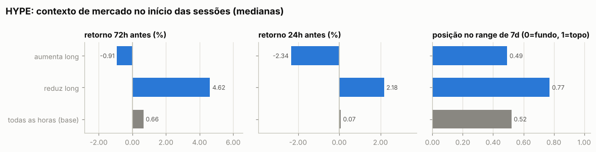

Por ordem (medianas):

| ação | ordens | retorno 24h antes | 72h antes | 7d antes | posição no range 7d | 24h depois | 7d depois |
|---|---|---|---|---|---|---|---|
| aumenta long | 336 | -4.02% | -2.02% | +2.24% | 0.42 | -0.52% | +6.53% |
| reduz long | 103 | +3.42% | +3.50% | +6.28% | 0.87 | -2.00% | -8.85% |
| todas as horas (base) |  | +0.07% | +0.66% | +1.20% | 0.52 | +0.06% | +1.41% |

Por sessão (ordens a menos de 30 min uma da outra contam como uma decisão; p = teste de Mann-Whitney contra todas as horas do período):

| sessão | sessões | retorno 24h antes | 72h antes | 7d antes | range 7d | no topo (>0,7) | no fundo (<0,3) |
|---|---|---|---|---|---|---|---|
| aumenta long | 31 | -2.34% (p=0.000) | -0.91% (p=0.057) | +3.87% (p=0.396) | 0.49 (p=0.292) | 26% | 29% |
| reduz long | 19 | +2.18% (p=0.006) | +4.62% (p=0.329) | +3.96% (p=0.679) | 0.77 (p=0.059) | 58% | 26% |
| todas as horas (base) |  |  |  |  |  | 34% | 29% |

- Aumentos de posição feitos com a posição no prejuízo (preço pior que o preço médio): **38%** das ordens (35% do tamanho); distância mediana do preço médio: -0.18%.
- Reduções/fechamentos com lucro: **98%** de 103; ganho médio $36.7K vs. perda média -$4.3K; realizado +$3.70M.

- Episódios (de zerado a zerado, ou até inverter): 12; fechados com lucro: 92%; duração mediana 1.1 dias; o melhor episódio sozinho = 39% da soma dos episódios lucrativos.

Maiores episódios por PnL realizado

| início | fim | dias | lado | tam_max | nocional_max | ordens | entrada | saída | realizado |
|---|---|---|---|---|---|---|---|---|---|
| 2026-07-09 | 2026-08-20 | 41.5 | long | 201,000 | $12.31M | 86 | 55.95 | 63.33 | +$1.46M |
| 2026-08-21 | 2026-09-08 | 17.6 | long | 355,000 | $28.54M | 129 | 79.55 | 87.84 | +$1.05M |
| 2026-01-20 | 2026-01-26 | 6.2 | long | 240,000 | $5.81M | 76 | 22.01 | 24.21 | +$528.3K |
| 2025-12-11 | 2025-12-12 | 1.3 | long | 60,000 | $1.79M | 8 | 27.28 | 30.01 | +$163.6K |
| 2026-09-08 | 2026-09-09 | 0.7 | long | 50,000 | $4.32M | 21 | 83.48 | 86.68 | +$159.9K |
| 2025-12-12 | 2026-01-05 | 23.2 | long | 180,000 | $4.85M | 49 | 26.12 | 26.71 | +$107.5K |
| 2026-03-03 | 2026-03-04 | 0.6 | long | 91,162 | $3.00M | 23 | 31.48 | 32.59 | +$101.2K |
| 2026-02-10 | 2026-02-11 | 1.0 | long | 60,000 | $1.81M | 9 | 29.26 | 30.15 | +$53.5K |
| 2026-07-03 | 2026-07-03 | 0.0 | short | 7,500 | $530.5K | 1 | — | 70.73 | +$48.2K |
| 2026-09-12 | 2026-09-12 | 0.6 | long | 75,000 | $6.03M | 27 | 79.42 | 79.76 | +$25.0K |

### SOL

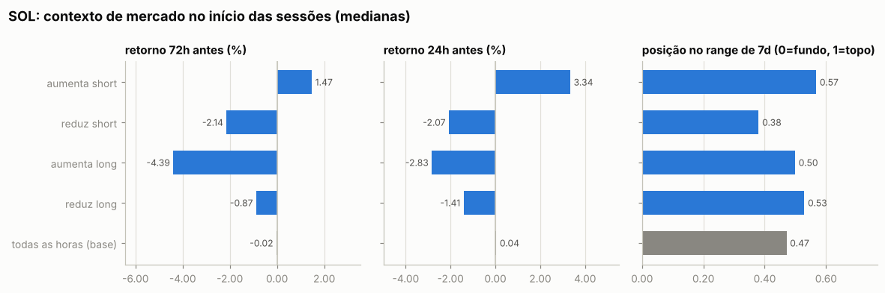

Por ordem (medianas):

| ação | ordens | retorno 24h antes | 72h antes | 7d antes | posição no range 7d | 24h depois | 7d depois |
|---|---|---|---|---|---|---|---|
| aumenta short | 240 | +3.27% | -1.88% | -4.03% | 0.53 | -1.50% | -3.05% |
| reduz short | 1423 | -0.05% | -2.38% | -9.83% | 0.27 | +1.36% | +3.55% |
| aumenta long | 50 | -4.12% | -5.45% | -1.87% | 0.15 | +3.13% | -0.13% |
| reduz long | 9 | -1.60% | +1.35% | +3.98% | 0.53 | +5.36% | +3.24% |
| todas as horas (base) |  | +0.04% | -0.02% | -0.31% | 0.47 | +0.03% | -0.14% |

Por sessão (ordens a menos de 30 min uma da outra contam como uma decisão; p = teste de Mann-Whitney contra todas as horas do período):

| sessão | sessões | retorno 24h antes | 72h antes | 7d antes | range 7d | no topo (>0,7) | no fundo (<0,3) |
|---|---|---|---|---|---|---|---|
| aumenta short | 9 | +3.34% (p=0.002) | +1.47% (p=0.382) | -0.08% (p=0.481) | 0.57 (p=0.206) | 33% | 0% |
| reduz short | 6 | -2.07% (p=0.361) | -2.14% (p=0.149) | -0.75% (p=0.436) | 0.38 (p=0.302) | 0% | 33% |
| aumenta long | 8 | -2.83% (p=0.004) | -4.39% (p=0.026) | +4.45% (p=0.416) | 0.50 (p=0.286) | 0% | 38% |
| reduz long | 6 | -1.41% (p=0.254) | -0.87% (p=0.542) | +1.57% (p=0.763) | 0.53 (p=0.628) | 0% | 33% |
| todas as horas (base) |  |  |  |  |  | 29% | 32% |

- Aumentos de posição feitos com a posição no prejuízo (preço pior que o preço médio): **38%** das ordens (56% do tamanho); distância mediana do preço médio: -0.11%.
- Reduções/fechamentos com lucro: **100%** de 1432; ganho médio $716 vs. perda média -$4.6K; realizado +$1.01M.

- Episódios (de zerado a zerado, ou até inverter): 12; fechados com lucro: 91%; duração mediana 0.4 dias; o melhor episódio sozinho = 49% da soma dos episódios lucrativos.

Maiores episódios por PnL realizado

| início | fim | dias | lado | tam_max | nocional_max | ordens | entrada | saída | realizado |
|---|---|---|---|---|---|---|---|---|---|
| 2026-03-23 | 2026-03-27 | 3.7 | short | 52,500 | $4.81M | 36 | 91.62 | 82.46 | +$481.0K |
| 2025-12-16 | 2025-12-17 | 1.2 | long | 40,000 | $5.32M | 12 | 126.84 | 133.10 | +$250.5K |
| 2026-03-01 | 2026-03-01 | 0.2 | short | 64,000 | $5.49M | 66 | 85.41 | 84.06 | +$86.1K |
| 2026-03-13 | 2026-03-14 | 0.9 | short | 19,998 | $1.80M | 14 | 89.72 | 87.08 | +$52.7K |
| 2026-02-06 | 2026-02-06 | 0.2 | long | 12,000 | $1.00M | 13 | 79.17 | 83.34 | +$50.1K |
| 2026-09-24 | 2026-10-14 | 20.1 | short | 56,000 | $6.71M | 1538 | 115.95 | 107.34 | +$36.5K |
| 2026-03-03 | 2026-03-03 | 0.2 | long | 15,000 | $1.28M | 5 | 83.31 | 85.36 | +$30.7K |
| 2026-03-01 | 2026-03-01 | 0.1 | short | 8,000 | $676.8K | 2 | 84.60 | 82.23 | +$19.0K |
| 2026-03-08 | 2026-03-08 | 0.4 | long | 4,000 | $331.5K | 6 | 82.93 | 80.64 | -$9.1K |
| 2026-03-02 | 2026-03-02 | 0.2 | long | 9,000 | $753.2K | 19 | 82.75 | 83.69 | +$8.4K |

### Todos os episódios relevantes (todas as moedas)

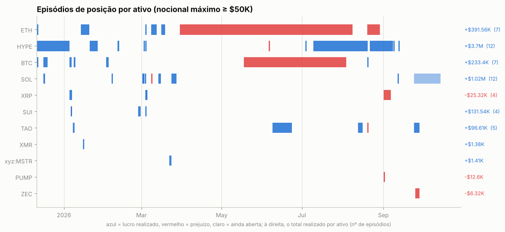

Episódios com nocional máximo ≥ $50K: 55; fechados com lucro: 81%. Abaixo, os 25 maiores por PnL realizado, em ordem de data. *7d/30d antes* e *vs. máx. 30d*: o que o preço tinha feito até a primeira ordem; *funding a.a.*: taxa anualizada nas 24h anteriores (positiva = longs pagam shorts); *entrada média vs. 1ª ordem*: positivo = foi aumentando a posição com o preço indo contra; *contra (máx.)*: quanto o preço andou contra a primeira ordem durante o episódio; *capturado*: movimento entre o preço médio de entrada e o de saída.

| ativo | lado | início | dias | nocional máx. | 7d antes | 30d antes | vs. máx. 30d | funding a.a. na entrada | entrada média vs. 1ª ordem | contra (máx.) | pior PnL aberto | capturado | realizado | funding |
|---|---|---|---|---|---|---|---|---|---|---|---|---|---|---|
| HYPE | long | 2025-12-11 | 1 | $1.79M | -21% | -32% | -33% | +11% | +0% | +1% | -$12.7K | +10% | +$163.6K | -$1.3K |
| BTC | long | 2025-12-11 | 0 | $22.30M | -3% | -14% | -14% | +9% | +0% | +1% | -$181.0K | +3% | +$317.8K | -$4.7K |
| HYPE | long | 2025-12-12 | 23 | $4.85M | -9% | -26% | -31% | +12% | +8% | +21% | -$677.2K | +2% | +$107.5K | -$28.9K |
| SOL | long | 2025-12-16 | 1 | $5.32M | -5% | -11% | -13% | +8% | -0% | +1% | -$79.9K | +5% | +$250.5K | -$1.5K |
| BTC | long | 2025-12-16 | 3 | $11.00M | -4% | -11% | -10% | +7% | -0% | +2% | -$283.4K | +1% | +$159.5K | -$4.7K |
| BTC | short | 2026-01-05 | 2 | $5.64M | +5% | +4% | -1% | +7% | +1% | +1% | -$40.6K | +2% | +$100.0K | +$1.7K |
| SUI | short | 2026-01-06 | 0 | $1.98M | +35% | +22% | +0% | +9% | -0% | +0% | -$4.8K | +6% | +$120.7K | -$320 |
| ETH | short | 2026-01-13 | 6 | $5.82M | +2% | +8% | +0% | +10% | -0% | +1% | -$41.3K | +3% | +$146.6K | +$4.6K |
| HYPE | long | 2026-01-20 | 6 | $5.81M | -8% | -7% | -20% | +14% | +0% | +7% | -$336.9K | +10% | +$528.3K | -$13.6K |
| SOL | long | 2026-02-06 | 0 | $1.00M | -31% | -43% | -46% | -46% | +1% | +1% | -$2.2K | +5% | +$50.1K | +$369 |
| HYPE | long | 2026-02-10 | 1 | $1.81M | -12% | +22% | -21% | +11% | +1% | +4% | -$44.2K | +3% | +$53.5K | -$561 |
| SOL | short | 2026-03-01 | 0 | $5.49M | -0% | -27% | -28% | -9% | +0% | +1% | -$40.3K | +2% | +$86.1K | -$414 |
| HYPE | long | 2026-03-03 | 1 | $3.00M | +14% | +2% | -19% | +6% | -1% | +1% | -$39.0K | +4% | +$101.2K | -$179 |
| ETH | long | 2026-03-08 | 4 | $7.23M | -1% | +2% | -10% | -9% | +1% | +2% | -$58.6K | +6% | +$432.4K | -$365 |
| SOL | short | 2026-03-13 | 1 | $1.80M | +6% | +12% | -4% | +5% | +0% | -0% | +$2.6K | +3% | +$52.7K | -$763 |
| ETH | short | 2026-03-16 | 3 | $887.4K | +13% | +9% | +0% | +7% | +3% | +5% | -$13.2K | +6% | +$54.6K | +$106 |
| SOL | short | 2026-03-23 | 4 | $4.81M | -3% | +6% | -5% | -8% | +0% | +1% | -$70.8K | +10% | +$481.0K | -$6.1K |
| BTC | long | 2026-05-17 | 78 | $55.97M | -4% | +1% | -5% | +0% | +12% | +26% | -$10.13M | -8% | -$402.7K | -$302.5K |
| HYPE | short | 2026-07-03 | 0 | $530.5K | +10% | -3% | -9% | +11% | — | -1% | -$6.7K | — | +$48.2K | -$124 |
| HYPE | long | 2026-07-09 | 41 | $12.31M | +4% | +13% | -12% | +11% | +18% | +25% | -$95.7K | +13% | +$1.46M | -$34.7K |
| ETH | short | 2026-08-19 | 10 | $5.48M | +11% | +10% | +0% | +3% | +11% | +22% | -$414.3K | -6% | -$239.9K | +$13.5K |
| HYPE | long | 2026-08-21 | 18 | $28.54M | +38% | +32% | -1% | +25% | -4% | +2% | -$83.0K | +10% | +$1.05M | -$86.1K |
| XRP | long | 2026-09-01 | 5 | $5.77M | -8% | +29% | -11% | +11% | -3% | +4% | -$122.4K | -1% | -$46.5K | -$5.4K |
| HYPE | long | 2026-09-08 | 1 | $4.32M | -1% | +52% | -8% | +11% | -0% | -0% | +$0 | +4% | +$159.9K | -$181 |
| TAO | short | 2026-09-24 | 4 | $3.09M | +27% | +19% | -11% | +18% | +4% | +18% | -$255.6K | -2% | +$55.7K | +$5.6K |

## 7. Funding

Funding líquido total: **-$478.4K** (recebido $224.6K, pago -$703.1K). Na Hyperliquid o funding é pago de hora em hora; quando positivo, longs pagam shorts.

| ativo | lado | funding | rendimento anualizado s/ nocional |
|---|---|---|---|
| BTC | short | +$4.5K | 8.8% |
| BTC | long | -$433.5K | -7.0% |
| HYPE | short | +$5.8K | 34.5% |
| HYPE | long | -$184.5K | -11.7% |
| SOL | short | +$24.8K | 5.8% |
| SOL | long | +$46.3K | 47.5% |
| (outros) | short | +$79.7K | 6.0% |
| (outros) | long | -$21.5K | -6.9% |

## 8. Fluxos, eventos e carteiras relacionadas

| tipo | eventos | USD (+ entra / − sai) |
|---|---|---|
| withdraw | 78 | -$66.57M |
| vaultDeposit | 7 | -$18.68M |
| accountClassTransfer | 6 | — (sem valor em USD) |
| borrowLend | 21 | — (sem valor em USD) |
| spotGenesis | 1 | — (sem valor em USD) |
| liquidation | 2 | — (sem valor em USD) |
| cStakingTransfer | 13 | — (sem valor em USD) |
| spotTransfer | 3 | +$225 |
| send | 72 | +$11.15M |
| vaultWithdraw | 14 | +$18.75M |
| deposit | 57 | +$61.07M |

**Gestão de margem.** Dias com depósito: 49; em 43% deles o PnL dos 3 dias anteriores era negativo (mediana $0). Dias com saque: 74; em 45% deles o PnL dos 3 dias anteriores era positivo (mediana $0). Base: 35% de todos os dias vêm depois de 3 dias negativos. Correlação entre o fluxo do dia e a variação da exposição bruta: 0.18 (positiva = deposita para abrir posição e saca ao reduzir).

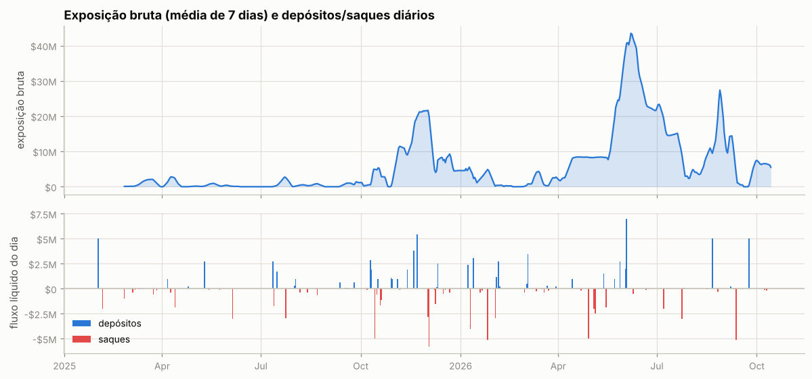

Ponte HyperCore↔HyperEVM (endereços de sistema `0x2000…`/`0x2222…`): 21 transferências, entrada $66, saída $11.44M — uso de DeFi na HyperEVM.

**Carteiras relacionadas** (conta vinculada de staking para desconto de taxa + maiores contrapartes de transferências; o saldo de staking e o PnL ajudam a ver se posições aqui são hedge de algo mantido lá):

| carteira | relação | transferências | volume transferido | valor da conta hoje | PnL all-time | HYPE em staking | maiores saldos spot |
|---|---|---|---|---|---|---|---|
| `0x6b9e773128f453f5c2c60935ee2de2cbc5390a24` | hot wallet de serviço (recebe USDC da HyperEVM e repassa a centenas de usuários: exchange/ponte) | 20 | $22.59M | $7.8K | +$0 | 0 | USDC 7,687 |
| `0xa822a9ceb6d6cb5b565bd10098abcfa9cf18d748` | transfers | 1 | $159 | $16,234.57M | -$6,220.88M | 0 | UBONK 88,765,611,412,586, UPUMP 990,742,584,755, UDZ 9,998,515,037 |
| `0xf79ea59b856b0aadfc2948fa1a700e762dcbd3cd` | transfers | 2 | $38 | $1.9K | -$645 | 0 | USDC 1,853 |
| `0x97634ac52d5bf7620aff17be184d87a2e8659104` | transfers | 1 | $0 | $0 | +$10.2K | 0 | LAUNCH 1 |

**Liquidações e ADL (auto-deleveraging) nos fills:**

| quando (UTC) | ativo | tipo | lado | preço | tamanho | posição antes | PnL realizado |
|---|---|---|---|---|---|---|---|
| 2026-03-08 22:04:02 | SOL | Close Long | A | 80.715 | 800.0 | 4000.0 | -$1.8K |
| 2026-03-08 22:04:05 | SOL | Close Long | A | 80.635 | 223.4 | 3200.0 | -$513 |
| 2026-03-08 22:04:05 | SOL | Close Long | A | 80.634 | 61.72 | 2976.6 | -$142 |
| 2026-03-08 22:04:05 | SOL | Close Long | A | 80.634 | 185.84 | 2914.88 | -$427 |
| 2026-03-08 22:04:05 | SOL | Close Long | A | 80.634 | 356.91 | 2729.04 | -$820 |
| 2026-03-08 22:04:05 | SOL | Close Long | A | 80.633 | 0.14 | 2372.13 | -$0 |
| 2026-03-08 22:04:05 | SOL | Close Long | A | 80.632 | 13.42 | 2371.99 | -$31 |
| 2026-03-08 22:04:05 | SOL | Close Long | A | 80.631 | 19.04 | 2358.57 | -$44 |
| 2026-03-08 22:04:05 | SOL | Close Long | A | 80.631 | 0.4 | 2339.53 | -$1 |
| 2026-03-08 22:04:05 | SOL | Close Long | A | 80.631 | 0.14 | 2339.13 | -$0 |
| 2026-03-08 22:04:05 | SOL | Close Long | A | 80.631 | 0.25 | 2338.99 | -$1 |
| 2026-03-08 22:04:05 | SOL | Close Long | A | 80.63 | 3.28 | 2338.74 | -$8 |
| 2026-03-08 22:04:05 | SOL | Close Long | A | 80.63 | 9.67 | 2335.46 | -$22 |
| 2026-03-08 22:04:05 | SOL | Close Long | A | 80.629 | 0.24 | 2325.79 | -$1 |
| 2026-03-08 22:04:05 | SOL | Close Long | A | 80.628 | 0.22 | 2325.55 | -$1 |
| 2026-03-08 22:04:05 | SOL | Close Long | A | 80.627 | 4.39 | 2325.33 | -$10 |
| 2026-03-08 22:04:05 | SOL | Close Long | A | 80.626 | 403.09 | 2320.94 | -$929 |
| 2026-03-08 22:04:05 | SOL | Close Long | A | 80.626 | 744.2 | 1917.85 | -$1.7K |
| 2026-03-08 22:04:05 | SOL | Close Long | A | 80.626 | 0.25 | 1173.65 | -$1 |
| 2026-03-08 22:04:05 | SOL | Close Long | A | 80.626 | 13.42 | 1173.4 | -$31 |
| 2026-03-08 22:04:05 | SOL | Close Long | A | 80.625 | 12.13 | 1159.98 | -$28 |
| 2026-03-08 22:04:05 | SOL | Close Long | A | 80.624 | 0.66 | 1147.85 | -$2 |
| 2026-03-08 22:04:05 | SOL | Close Long | A | 80.623 | 612.06 | 1147.19 | -$1.4K |
| 2026-03-08 22:04:05 | SOL | Close Long | A | 80.623 | 535.13 | 535.13 | -$1.2K |

## 9. Dá para copiar? (espelhar a posição com atraso)

PnL de quem replicasse exatamente a posição da carteira, mas com N horas de atraso (marcação horária, sem custos). Se o PnL se mantém com atraso, a vantagem está em horizontes longos e é copiável; se desaba, depende de timing fino.

| atraso | BTC | HYPE | SOL |
|---|---|---|---|
| 0h | -$3.28M | +$5.13M | +$1.18M |
| 1h | -$3.44M | +$5.00M | +$997.6K |
| 4h | -$3.69M | +$6.18M | +$789.4K |
| 12h | -$4.12M | +$6.19M | +$847.2K |
| 24h | -$4.56M | +$7.48M | +$768.8K |
| 72h | -$7.43M | +$7.08M | +$1.02M |
| 168h | -$3.86M | +$4.04M | +$589.7K |

## 10. Teste de replicação por regras (BTC)

Regra testada: *short-bias com filtro de tendência e fade* — short de até 233.8 BTC (o percentil 90 do tamanho real), cheio abaixo da média móvel e reduzido acima; dentro do regime, mais short perto do topo do range e menos perto do fundo. Parâmetros escolhidos no treino (2025-02-25 → 2025-12-19) e avaliados no teste (2025-12-20 → 2026-10-13).

|  | parâmetros | PnL treino | PnL teste | correlação c/ posição real (teste) |
|---|---|---|---|---|
| melhor regra no treino | MA50, range 7d, fração em alta 0.0, fade 0.9 | +$4.95M | +$2.36M | -0.17 |
| carteira real (aprox.) | — | -$1.51M | -$6.17M | 1.00 |

Clone comportamental (regressão linear da posição real em médias móveis, ranges e retornos): R² treino 0.60, R² teste -0.03, correlação no teste 0.21.

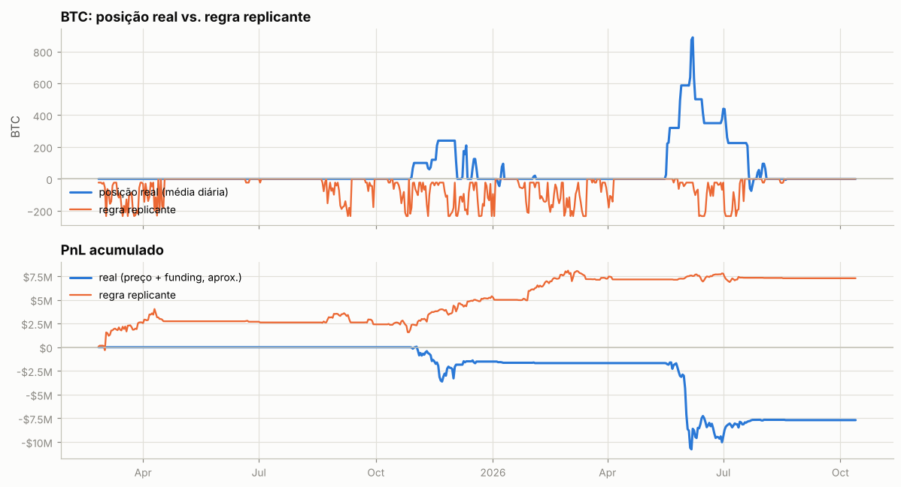

---

Metodologia e código: ver `README.md` na raiz do repositório.
