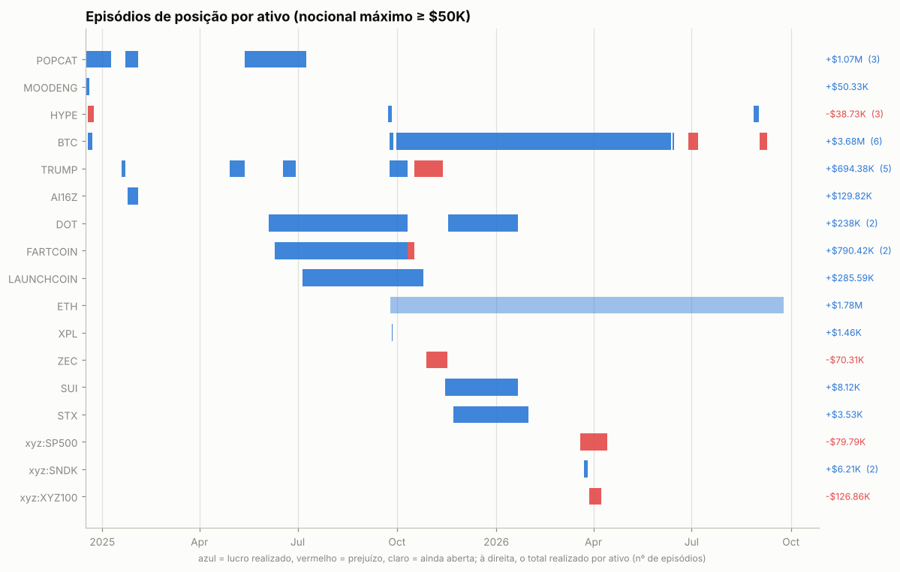
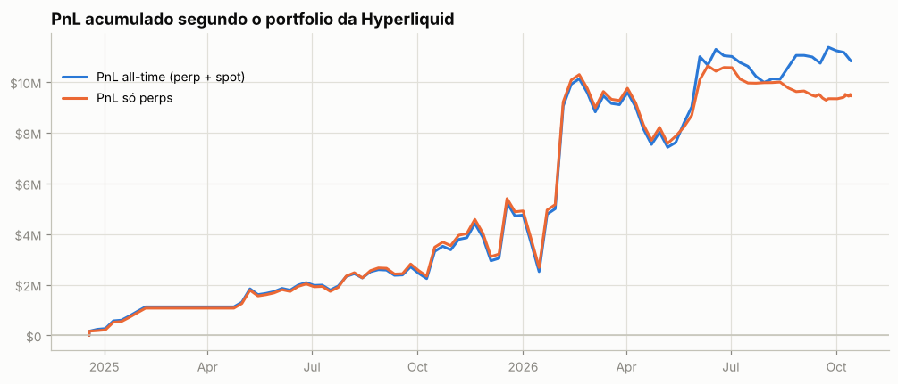
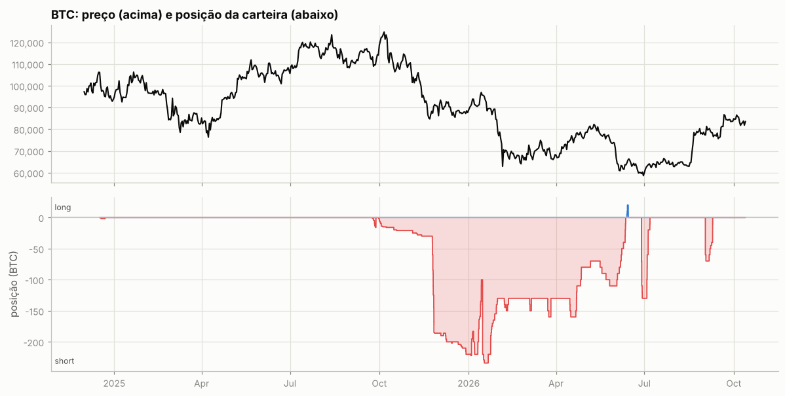
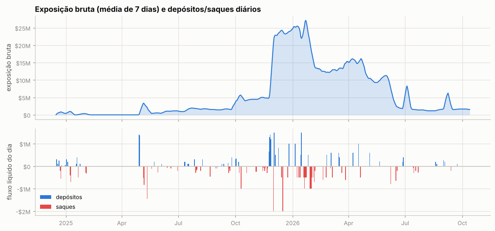

# Engenharia reversa: carteira `0xfce0…f4c0`

`0xfce053a5e461683454bf37ad66d20344c0e3f4c0` · [CoinGlass](https://www.coinglass.com/hyperliquid/0xfce053a5e461683454bf37ad66d20344c0e3f4c0) · dados até 13/out/2026

Fonte: API pública da Hyperliquid. Desta vez a API entrega **o histórico completo**: 25.305 fills desde o primeiro trade (16/dez/2024 → 24/set/2026), 2.491 registros de funding, 220 eventos de ledger e as últimas 803 ordens. O PnL diário reconstruído a partir dos fills soma US$ 9.451.838 em perps, contra US$ 9.452.705 no `portfolio` da própria Hyperliquid, então os números por ativo, por episódio e por fase abaixo são exatos, não estimativas. Para contexto de mercado usei candles e funding da Hyperliquid (inclusive os 232 perps do universo, para os testes da seção 6) e fechamentos diários da Binance desde 2020. Tabelas e gráficos completos: [`relatorio_auto.md`](relatorio_auto.md); testes de regras: [`../estudos/regras_short.md`](../estudos/regras_short.md).

---

## Resumo

- **Quem opera:** uma pessoa operando **manualmente pelo app de celular e pelo site**. A única API wallet é o agente `Mobile QR` (login do app da Hyperliquid). Não há nenhuma ordem de stop ou take-profit, os lotes são redondos (2/5/10 BTC, 20 ETH, 2.000 TRUMP, 10.000 POPCAT) e a atividade se concentra entre 0h e 11h UTC, o que aponta para alguém na Ásia. A pessoa traz e leva dinheiro da exchange em valores redondos: depositou US$ 26,9M e sacou US$ 33,2M.
- **O que faz:** é um **vendedor**. Dos 33 episódios com mais de US$ 50 mil de nocional, 30 são short. São dois livros:
  1. **Short de memecoins e alts em que os compradores estão lotados** (dez/2024 → out/2025): POPCAT, FARTCOIN, TRUMP, LAUNCHCOIN, DOT, AI16Z, MOODENG. Entra quando o funding está alto (mediana de 33% a.a. na entrada, contra ~11% de repouso) e a moeda já caiu do topo (mediana de 24% abaixo da máxima de 30 dias), segura por semanas ou meses recebendo funding e cobre nas quedas. Resultado: **+US$ 3,38M**, com 17 de 21 episódios lucrativos.
  2. **Short macro de BTC e ETH a partir do topo do ciclo** (set/2025 → jun/2026): começou pequeno no fim de set/2025, perto da máxima histórica, e **multiplicou o short de BTC por seis (de 30 para 186 BTC) em 24–28/nov/2025**, depois da quebra. A exposição chegou a US$ 27M com US$ 3,5–4,5M de margem na exchange. Resultado: **+US$ 6,32M** em BTC/ETH.
- **Quanto ganhou:** US$ 9,45M em perps (preço US$ 8,84M + funding US$ 0,65M − taxas US$ 0,04M) e mais ~US$ 1,4M em spot, quase tudo valorização de 49,9 mil HYPE comprados entre abr e jun/2026 e colocados em staking. **Total: US$ 10,83M em 22 meses.**
- **Como gere risco:** sem stop. Usa **margem sob demanda**: deposita quando abre posição grande ou quando o preço vai contra (67% dos dias com depósito vêm depois de 3 dias de prejuízo, contra 39% na base) e saca o lucro quando o trade paga (76% dos saques vêm depois de 3 dias de lucro). A alavancagem sobre o que fica na exchange foi de 5–10x, com picos de 14–17x. O maior drawdown foi de **−US$ 3,42M** (fev → mai/2026). Em 10/out/2025 o crash fez o sistema de **ADL** fechar à força quatro shorts em lucro: +US$ 1,04M naquele dia.
- **Dá para replicar?** **Em parte.** O livro de alts tem um equivalente mecânico com vantagem estatística no universo inteiro da Hyperliquid: shortar alts que caíram 30% ou mais em 30 dias, no dia de um repique de 15% em 3 dias, rendeu **+8,2% em 7 dias, com 79% de acerto**, contra +0,9% e 58% de shortar qualquer alt em qualquer dia. Com 95% de confiança, a diferença fica entre +1,0 e +11,5 pontos percentuais. Funding acima do normal também antecipa queda, inclusive em moedas que ele nunca operou. O livro macro **não** vira regra: "short abaixo da média de 200 dias" perdeu 55% em BTC entre 2020 e 2024. Ali o que pagou foi a leitura do ciclo e o *timing* do tamanho.
- **Dá para copiar?** BTC/ETH sim, mesmo com atraso. Espelhar o BTC com 7 dias de atraso renderia US$ 4,40M, contra US$ 3,75M sem atraso. As memecoins exigem velocidade: em TRUMP, 24h de atraso derrubam o resultado de US$ 669k para US$ 61k.
- **Agora:** parado desde 24/set/2026. Mantém **622 ETH vendidos** (entrada média de US$ 3.131, lucro aberto de US$ 380k) e **50.347 HYPE em staking**. **Nos últimos 4 meses perdeu US$ 1,06M em perps**, com dois shorts de BTC cortados no prejuízo depois que o mercado voltou a subir.

---

## 1. Quem é essa carteira

**Opera manualmente, pelo celular e pelo site.** Cinco sinais apontam para isso:

- **Agente.** O único agente (`extraAgents`) se chama `Mobile QR`. É o que o app da Hyperliquid cria quando você faz login lendo o QR code do site. Não há bot nem API própria.
- **Poucas requisições.** O `userRateLimit` mostra **4.257 requisições em US$ 162M de volume**. Um bot faria ordens de magnitude a mais.
- **Tipos de ordem.** Das 803 ordens que a API ainda guarda (nov/2025 → set/2026), 619 são limites `Gtc` e 184 são `FrontendMarket` (a mercado, pela interface). **Zero ordens de gatilho:** nenhum stop, nenhum take-profit. Os limites não ficam esperando no livro: em mediana, a ordem é executada ou cancelada em menos de 2 minutos, com preço próximo do mercado (mediana a ±0,2% do último fechamento horário). É execução "no toque", para pagar taxa de maker em lotes grandes.
- **Lotes redondos.** 87% das ordens de BTC usam um destes tamanhos: 2, 10, 5 ou 1 BTC. Em ETH, 123 das 167 ordens são de 20 ETH. Nas memecoins o padrão é disparar dezenas de ordens a mercado iguais: 98 ordens em 29/abr/2025 para montar 190 mil TRUMP, 116 fills para fechar 1,4 milhão de POPCAT de uma vez em 9/jan/2025.
- **Ritmo.** São 495 sessões, com mediana de 2 ordens cada, em 238 dos 646 dias. As ordens se concentram entre **0h e 11h UTC** e quase somem entre 19h e 23h UTC. Isso bate com alguém em UTC+7 a UTC+9 que dorme das 3h às 7h no horário local. Opera também nos fins de semana (26% das sessões).

**Execução diferente por mercado.** Em BTC/ETH, 53% do nocional dos aumentos e 69% das reduções saem como maker (limite). Nas alts, 93% saem como taker (a mercado), em lotes pequenos de mediana US$ 5,5 mil. A taxa média paga é de 2,4 bps sobre US$ 168M de volume. Em 2026 caiu para 1,6–1,9 bps, com o volume maior (a taxa cai por faixa de volume) e, a partir de abr/2026, o desconto de 20% por staking.

**Dinheiro entra e sai o tempo todo, em valores redondos.** Foram 82 depósitos (US$ 24,9M) e 88 saques (US$ 31,3M) pela ponte da Arbitrum, quase sempre de US$ 100k, 200k, 500k ou 1M. A conta nunca teve mais de US$ 4,55M em perps (10/dez/2025), mesmo carregando US$ 27M de exposição. O capital fica fora da exchange e entra quando é preciso. Em 2026 surgiram duas rotas novas:

- **Entrada de US$ 2,06M** pela carteira `0x6b9e…0a24`. É uma *hot wallet* de serviço: em 25 dias ela recebeu USDC da HyperEVM e repassou a **583 usuários diferentes**. É uma exchange ou uma ponte, não uma carteira pessoal do trader.
- **Saída de US$ 1,88M** para a HyperEVM, pelo endereço de sistema `0x2000…`.

O token MAX que aparece no ledger (460 milhões de unidades enviadas por `0x2077…`) é airdrop de spam. Foi vendido por US$ 1.141.

**Não há outras carteiras ligadas.** Não há `stakingLink`, subcontas, vaults nem indicação. Os 50.347 HYPE em staking estão nesta própria conta e dão o desconto de taxa.

## 2. Linha do tempo

| fase | período | o que fez | PnL perps (exato) |
|---|---|---|---|
| 1 | dez/2024 → fev/2025 | Shorts em memecoins depois do pico de nov–dez/2024 (POPCAT, MOODENG, AI16Z) e no lançamento do TRUMP. *Cash-and-carry* de HYPE: 14,5 mil HYPE comprados no spot e o mesmo tanto vendido no perp | **+US$ 1,08M** |
| pausa | fev → abr/2025 | Zerado. Sacou quase tudo | 0 |
| 2 | 29/abr → 10/out/2025 | Short de US$ 4M em TRUMP depois da alta de 69% (anúncio do jantar). Shorts longos, de 4 meses, em DOT, FARTCOIN, LAUNCHCOIN e POPCAT, recebendo funding. A fase termina no crash de 10/out, com ADL | **+US$ 2,46M** (alts +US$ 2,25M) |
| 3 | 11/out/2025 → 11/jun/2026 | Short macro de BTC (até 234 BTC, US$ 22M) e ETH (até 1.900 ETH, US$ 6M). Cesta de alts. Perdas em ZEC, TRUMP e em índices de ações (HIP-3). A partir de abr/2026 compra HYPE spot (49,9 mil até jun) e põe em staking | **+US$ 6,98M** (BTC/ETH +US$ 7,16M) |
| 4 | 12/jun/2026 → hoje | Dois shorts de BTC que deram errado e foram cortados. Reduz o ETH até 622 | **−US$ 1,06M** |

## 3. O playbook

### 3.1 Universo e viés

É **vendido por natureza**. Os longs em perps somam 7 episódios, todos curtos (de horas a poucos dias), e nenhum relevante para o resultado. As únicas posições compradas que importam ficam no spot: o HYPE de 2026 e duas pernas de hedge (seção 3.6). Ao todo operou 36 perps, mas o dinheiro veio de BTC e ETH (US$ 6,32M) e de memecoins e alts (US$ 3,38M), quase tudo em sete moedas: POPCAT, FARTCOIN, TRUMP, LAUNCHCOIN, DOT, AI16Z e MOODENG.

### 3.2 Livro 1: short em memecoins com compradores lotados

| episódio | antes da 1ª ordem | funding a.a. na entrada | como montou | resultado |
|---|---|---|---|---|
| POPCAT, 16/dez/2024 → 9/jan/2025 | −41% em 30d, −47% da máxima de 30d | +62% | 540 mil a US$ 1,09; aumentou nos repiques até 1,4 milhão (US$ 0,84–0,93 em jan) | cobriu tudo a US$ 0,58 num dia: **+US$ 514k** |
| TRUMP, 19 → 22/jan/2025 | dia seguinte à listagem na Hyperliquid | **+797%** | vendeu de US$ 38 a US$ 60 enquanto o preço ia a US$ 88,8; a média ficou 49% acima da 1ª ordem | cobriu a US$ 34–39: **+US$ 162k** |
| TRUMP, 29/abr → 12/mai/2025 | +69% em 7d | −4% | **300 mil TRUMP (US$ 4M)** em 2 dias, a US$ 13–14 | cobriu em degraus a US$ 10,9–12,7: **+US$ 469k** |
| POPCAT, 12/mai → 9/jul/2025 | +55% em 7d, +105% em 30d | +70% | 1,2 milhão a ~US$ 0,57 | **+US$ 330k** |
| DOT, 4/jun → 10/out/2025 | −8% em 7d | +11% | 140 mil DOT a US$ 4,18 numa sessão de 70 ordens; segurou 129 dias | ADL a US$ 1,49–2,98 no crash: **+US$ 237k** |
| FARTCOIN, 10/jun → 10/out/2025 | +18% em 24h, −26% da máxima | +36% | 80 mil em jun; aumentou nos repiques de jul até 958 mil (US$ 1,3M) | ADL a US$ 0,426: **+US$ 794k** e mais US$ 67k de funding |
| LAUNCHCOIN, 5/jul → 25/out/2025 | −57% da máxima de 30d | +31% | 2,57 milhões a US$ 0,11–0,18 | ADL parcial, depois liquidação na deslistagem a US$ 0,06: **+US$ 286k** e US$ 62k de funding |

Padrão dos 21 shorts de alts com mais de US$ 50k:

- **Seleção.** Moedas de narrativa (memes, lançamentos) com **funding positivo e alto**: mediana de 33% a.a. na entrada, 37% nos vencedores. Em 10 episódios o funding passava de 30% a.a., e 9 deram lucro. O único que perdeu (HYPE, dez/2024) estava protegido pelo spot. Dois dos quatro perdedores tinham **funding negativo** na entrada (FARTCOIN em 10/out/2025 e TRUMP em out/2025), ou seja, os shorts já estavam lotados. Na maioria das vezes a moeda **já tinha caído do topo**: mediana de 24% abaixo da máxima de 30 dias. Outra opção é entrar **no auge de uma mania**: TRUMP no lançamento, TRUMP depois do jantar, POPCAT +55% em 7 dias.
- **Construção.** Vende a mercado em lotes iguais e **aumenta nos repiques**. A excursão contra a primeira ordem teve mediana de 10% e chegou a 91% (TRUMP, jan/2025) e 120% (ZEC). O pior prejuízo aberto foi de −US$ 341k (FARTCOIN, jul/2025).
- **Carregamento.** Mediana de 17 dias, mas os maiores ganhos vieram de shorts de **3 a 4 meses** (DOT, FARTCOIN, LAUNCHCOIN), que renderam também US$ 147k de funding.
- **Saída.** Cobre **de uma vez, no dia da queda forte**: POPCAT em 9/jan/2025, TRUMP em 7 e 12/mai/2025. Às vezes a saída veio de fora: ADL no crash ou liquidação na deslistagem. Sai cedo. Depois da saída, POPCAT caiu mais 70% e TRUMP mais 59% em 30 dias.

O contexto por sessão confirma o padrão em POPCAT (p = teste de Mann-Whitney contra todas as horas):

| | retorno 24h antes | 72h antes | 7d antes | posição no range de 7d |
|---|---|---|---|---|
| sessões que aumentam o short | +6,6% (p=0,001) | +9,2% (p<0,001) | +4,9% (p=0,019) | 0,57 (p=0,002) |
| sessões que reduzem o short | −6,5% (p=0,037) | −5,2% (p=0,040) | −26,5% (p=0,024) | 0,17 (p=0,029) |
| todas as horas | −0,7% | −2,3% | −4,8% | 0,35 |

Em resumo: vende os repiques e cobre nos tombos.

### 3.3 Livro 2: o short macro de BTC e ETH

**Como começou.** Depois de um teste de três dias (14 BTC, +US$ 15k), vendeu 16 BTC entre 30/set e 8/out/2025, enquanto o BTC subia de US$ 113,8k para US$ 121,8k (a máxima foi US$ 126,3k em 6/out). Também vendeu 460 ETH a US$ 4.030–4.210, com o ETH já 14% abaixo da máxima de 30 dias e ~19% abaixo do topo de agosto. Foi uma aposta pequena e precoce no topo.

**A aposta grande.** Entre 24 e 28/nov/2025, com o BTC 30% abaixo da máxima e 21% abaixo da média de 200 dias, vendeu **+156 BTC a ~US$ 87,5k** (US$ 13,6M) e **+1.220 ETH a ~US$ 2.950** (US$ 3,6M). A exposição bruta foi de US$ 5,8M para US$ 22,5M em quatro dias, financiada por **US$ 4,55M depositados na mesma semana**.

**Gestão.**
- **BTC:** gestão ativa. Cortou parte nas altas de janeiro, com −US$ 141k em 14/jan/2026, e **revendeu 120 BTC no dia seguinte a US$ 96,7k**, perto da máxima local, chegando ao pico de 234 BTC. Depois cobriu em degraus nos tombos: 104 BTC a US$ 83–90k (21–30/jan, +US$ 590k), parcelas em fev–abr e os últimos 110 BTC a US$ 61–68k em 2–11/jun/2026 (+US$ 1,92M).
- **ETH:** ficou **parado com ~1.850 ETH de dez/2025 a mai/2026**, sem mexer, mesmo com o repique de janeiro a US$ 3.300. Reduziu em seis degraus de mai a jul/2026, entre US$ 2.376 e 1.574, até ficar com 622 ETH.

**Pirâmide a favor, não preço médio contra.** Em ETH, 93% dos aumentos foram feitos com a posição já no lucro, em mediana 12,5% abaixo do preço médio. Em BTC foram 73%, 4,6% abaixo. Os aumentos de ETH acontecem depois de quedas: −8,3% em 7 dias (p=0,001), perto do fundo do range de 7 dias (0,13, p=0,03). As reduções vêm depois de repiques (+4,4% em 7 dias, p=0,03). É **seguir a tendência**, ao contrário do livro de memecoins.

**O lucro veio do tamanho na hora certa.** No BTC, carregar a posição rendeu US$ 3,72M. Disso, só US$ 0,78M se explica pela posição média vezes a queda do preço. Os outros **US$ 2,95M vêm de estar grande quando o preço caiu e pequeno quando subiu**.

| episódio | tamanho máximo | entrada → saída média | dias | realizado | funding |
|---|---|---|---|---|---|
| BTC, 30/set/2025 → 11/jun/2026 | 234 BTC (US$ 22,3M) | US$ 87.876 → 80.166 | 254 | **+US$ 4,19M** | +US$ 298k |
| ETH, 25/set/2025 → aberto | 1.900 ETH (US$ 6,0M) | US$ 3.201 → 1.970 | 383 (aberto) | **+US$ 1,78M** e US$ 380k em aberto | +US$ 184k |
| BTC, 27/jun → 6/jul/2026 | 130 BTC (US$ 8,1M) | US$ 59.903 → 62.717 | 9 | −US$ 366k | +US$ 11k |
| BTC, 1 → 9/set/2026 | 70 BTC (US$ 5,6M) | US$ 76.642 → 79.293 | 8 | −US$ 186k | +US$ 8k |

Os dois últimos mostram o **stop mental**. O trader cortou com 3,5–4,7% de prejuízo, em 8–9 dias, depois de o preço ir 6–7% contra. Em jun/2026 vendeu no fundo, depois de uma queda de 18% em 30 dias. Em set/2026 vendeu com o BTC já acima das médias de 50, 100 e 200 dias. No livro macro principal ele tinha aguentado 11% contra e US$ 619k de prejuízo aberto.

### 3.4 Gestão de risco: margem sob demanda, sem stop

- **Alavancagem.** A margem fica pequena em relação à exposição. A mediana mensal da exposição bruta sobre o equity de perps foi de 6,4x em dez/2025, 10,7x em abr/2026 e 9,5x em set/2026, com picos diários de 14–17x.
- **Depósitos e saques seguem o PnL e a exposição.**
  - 67% dos dias com depósito vêm depois de 3 dias de prejuízo (base: 39%), com mediana de −US$ 32k.
  - 76% dos dias com saque vêm depois de 3 dias de lucro, com mediana de +US$ 196k.
  - O fluxo do dia tem correlação de 0,44 com a variação da exposição.
  - O operador trata a exchange como um caixa de margem: põe dinheiro para abrir ou defender e tira assim que sobra. Em jan–fev/2026 sacou US$ 11M enquanto os shorts pagavam.
- **Sem stop no livro principal.** Os piores prejuízos abertos foram −US$ 619k em BTC (14/jan/2026), −US$ 341k em FARTCOIN (23/jul/2025), −US$ 324k em ETH (7/out/2025) e −US$ 190k em TRUMP (10/mai/2025). Nenhuma liquidação.
- **Drawdown.** O PnL de perps caiu **US$ 3,42M** do pico de 5/fev/2026 até 10/mai/2026. Em abril/2026 o BTC subiu de US$ 68k para US$ 78k com 150–160 BTC vendidos e os shorts de índices perderam: −US$ 1,67M no mês.
- **ADL em 10/out/2025.** No crash, o sistema fechou à força nove fills de shorts lucrativos: FARTCOIN 958 mil a US$ 0,426, DOT em cinco pedaços entre US$ 2,98 e 1,49, TRUMP 38 mil a US$ 4,68 e LAUNCHCOIN 757 mil a US$ 0,057. O dia rendeu +US$ 1,04M. O ADL também **desmontou o hedge de UFART** (seção 3.6), e o spot acabou vendido no fundo.
- **Onde perde.** Perde quando vende **tendência de alta de verdade**:
  - ZEC: +514% em 30 dias antes da entrada; o preço subiu mais 120% contra a primeira ordem; −US$ 70k.
  - TRUMP em out–nov/2025, com funding negativo: −US$ 61k.
  - Índices de ações na HIP-3 em mar–abr/2026: S&P 500 −US$ 80k e Nasdaq-100 −US$ 127k.
  - BTC em jun e set/2026: −US$ 552k.

  As perdas foram cortadas em 1–4 semanas, e o tamanho delas ficou bem abaixo dos ganhos.

### 3.5 Funding: o vento a favor do short

Funding líquido: **+US$ 649k**. Os shorts receberam US$ 649,5k e os longs pagaram US$ 760. Por ativo, o rendimento anualizado sobre o nocional foi de 4,7% em BTC, 6,0% em ETH, 26% em POPCAT e 13,5% no resto. Nas alts o funding é parte da tese: ele mede quem está lotado, e a carteira recebe para esperar. O caso contrário é o TRUMP de abr/2025, que **pagou** US$ 30k de funding porque o mercado já estava vendido.

### 3.6 Spot: carry, hedge e o HYPE

- **Dez/2024, *cash-and-carry* de HYPE.** Comprou 14,5 mil HYPE no spot e vendeu o mesmo tanto no perp, com funding de 173% a.a. O spot rendeu +US$ 52,6k, o perp −US$ 52,9k e o funding +US$ 5,3k. Desmontou em 24/dez.
- **Jul/2025, hedge parcial de FARTCOIN.** Comprou 223 mil UFART (FARTCOIN spot via Unit) a ~US$ 1,34, com o short de perp perto do maior prejuízo aberto. Em 10/out o perp foi fechado pelo ADL, o spot ficou descoberto e foi vendido às 21h53 a ~US$ 0,37: **−US$ 216k**.
- **Abr–jun/2026, HYPE de longo prazo.** Com o short macro sendo desmontado, comprou **49,9 mil HYPE por US$ 2,53M** (US$ 42 em abril, 50 em maio, 64 em junho) e pôs tudo em staking: hoje são 50.347 HYPE. A ~US$ 81, o ganho não realizado é de **~US$ 1,5M**. É quase toda a diferença entre o PnL total (US$ 10,83M) e o de perps (US$ 9,45M). É a primeira aposta comprada relevante da carteira.

## 4. De onde vem o lucro

| componente | US$ |
|---|---|
| BTC/ETH: preço | +5,84M |
| BTC/ETH: funding | +0,51M |
| Alts e memecoins: preço | +3,24M |
| Alts e memecoins: funding | +0,15M |
| HYPE perp | −0,03M |
| Índices e ações (HIP-3) | −0,21M |
| Taxas | −0,04M |
| **Perps (bate com o portfolio)** | **+9,45M** |
| Spot: HYPE em staking (não realizado, estimado a ~US$ 81), carry de HYPE, UFART, MAX | ~+1,38M |
| **Total (portfolio all-time)** | **+10,83M** |

Por trimestre, o PnL de perps foi de US$ 0,23M, 0,85M, 0,91M, 0,77M, **2,18M** (4T25), **4,92M** (1T26), 0,95M, **−1,45M** (3T26) e +0,11M no 4T26 até agora. Metade do lucro de perps saiu de um único trimestre, o 1T26, com o colapso de BTC/ETH em jan–fev/2026. Os melhores dias foram 5/fev/2026 (+US$ 1,93M), 20/jan/2026 (+US$ 1,46M) e 31/jan/2026 (+US$ 1,19M).

## 5. O que esta carteira **não** é

- **Não é bot nem market maker.** As ordens são manuais e poucas: 4.257 requisições no total.
- **Não é arbitragem de funding.** O carry aparece duas vezes, pequeno, e no UFART deu errado. Funding é bônus de uma posição direcional.
- **Não é hedge de outra carteira.** Não há carteiras ligadas, e o short não protege o HYPE que ela mesma compra.
- **Não é seguidor de tendência sistemático.** O short macro coincide com o BTC abaixo da média de 200 dias (correlação de 0,63 com a regra), mas a regra perdeu dinheiro de 2020 a 2024 (seção 6). O que decide é o julgamento do trader.

## 6. Hipótese e validação

**Hipótese.** O trader tem duas teses e uma forma de executar:

- **(a)** memecoins com compradores alavancados lotados (funding alto) caem, principalmente depois que já perderam o topo;
- **(b)** em fim de ciclo, BTC e ETH caem por meses depois de quebrar, e vale aumentar o short a favor da queda;
- a execução é posição grande, sem stop, com margem trazida de fora quando precisa.

**Teste A: o padrão de entrada das alts funciona no universo todo?** Rodei regras fixas, definidas a partir do comportamento da carteira e sem busca de parâmetros, em todos os 232 perps da Hyperliquid (inclusive deslistados), de 16/dez/2024 a 12/out/2026. Short na abertura do dia seguinte ao sinal, sem taxas nem funding. Os intervalos de confiança vêm de bootstrap por semanas. A última coluna compara cada regra com a base sorteando as mesmas semanas para as duas, para descontar o fato de o período ter sido ruim para as alts em geral.

| regra | sinais | retorno médio em 7d | IC 95% | mediana | acerto | diferença para a base (IC 95%) |
|---|---|---|---|---|---|---|
| shortar qualquer alt, qualquer dia (base) | 115.452 | +0,9% | −0,7% a +2,4% | +2,2% | 58% | — |
| depois de subir ≥30% em 7d | 1.066 | +3,1% | +0,2% a +5,8% | +7,9% | 67% | −0,8 a +4,8 p.p. |
| depois de subir ≥100% em 7d | 78 | +10,8% | −0,3% a +20,5% | +18,4% | 79% | −2,1 a +19,7 p.p. |
| depois de cair ≥20% em 7d | 2.574 | −0,2% | −2,5% a +2,2% | +1,4% | 56% | −3,0 a +0,9 p.p. |
| **repique em queda: −30% em 30d e +15% em 3d** | 384 | **+8,2%** | **+1,0% a +12,5%** | +12,2% | **79%** | **+1,0 a +11,5 p.p.** |

Em 14 dias o "repique em queda" rende +11,5% (82% de acerto), de +3,6 a +14,9 p.p. acima da base. Shortar qualquer pump rende mais que a base na média, mas a diferença não é estatisticamente clara e a cauda é gorda: no pior décimo perde 20% ou mais, que é o tipo de perda que o ZEC deu. Shortar o repique de uma moeda que já está caindo é o que mais se parece com o que a carteira faz, e é a única variante com vantagem clara sobre a base. Ressalva: o período inteiro foi de baixa para as alts e é um regime só.

**Teste B: funding alto antecipa queda?** Nas 9 memecoins que a carteira operou, short de 7 dias por faixa do funding médio do dia:

| funding a.a. | dias-moeda | retorno médio em 7d | IC 95% | acerto |
|---|---|---|---|---|
| < 0 | 1.062 | −2,7% | −8,4% a +1,3% | 56% |
| 0–11% | 2.276 | −0,7% | −3,0% a +1,8% | 56% |
| 11–30% | 890 | +0,4% | −2,8% a +3,8% | 56% |
| 30–60% | 340 | +3,5% | −0,4% a +7,2% | 66% |
| **> 60%** | 177 | **+9,7%** | **+2,6% a +16,1%** | **72%** |

A relação é monotônica, mas essas moedas foram escolhidas pelo próprio trader e quase todas derreteram, então há viés de seleção. Para controlar isso, repeti o teste numa amostra aleatória de 40 moedas que ele nunca operou (detalhes no [estudo de regras](../estudos/regras_short.md)):

| funding a.a. | dias-moeda | retorno médio em 7d | IC 95% | acerto |
|---|---|---|---|---|
| < 0 | 6.743 | +0,7% | −1,0% a +2,3% | 57% |
| 0–11% | 13.932 | +0,8% | −0,9% a +2,4% | 58% |
| 11–30% | 1.531 | **+4,7%** | +2,3% a +7,0% | 69% |
| 30–60% | 410 | **+4,5%** | +0,8% a +8,1% | 68% |
| > 60% | 98 | +4,2% | −0,1% a +10,1% | 61% |

O efeito existe fora da seleção do trader. Com funding acima do patamar de repouso (~11% a.a.), o short de 7 dias rendeu **4–5% em média, contra menos de 1%** com funding normal ou negativo, e isso sem contar o próprio funding recebido. Nas moedas comuns, porém, o efeito não cresce acima de 30% a.a., e esse nível é raro: 2% dos dias-moeda, contra 11% nas memecoins que ele operou. O ganho extra nos extremos (+9,7% acima de 60% a.a.) aparece só nas memecoins escolhidas e pode ser, em parte, seleção. **Conclusão: funding acima do normal é um sinal geral de compradores lotados, de tamanho moderado. É mais forte em memecoins de mania, que é onde o trader atua.**

**Teste C: o short macro é uma regra?** "Ficar vendido quando o fechamento está abaixo da média de N dias", com fechamentos diários da Binance:

| regra | 2020–2024 | 2022 (baixa) | 2023–24 (alta) | período da carteira |
|---|---|---|---|---|
| BTC: short abaixo da MA200 | −55% | +85% | −42% | −6% |
| BTC: short abaixo da MA50 | −33% | +2% | −34% | +17% |
| ETH: short abaixo da MA200 | −31% | +30% | −31% | −20% |
| ETH: short abaixo da MA50 | −77% | +22% | −42% | +88% |

Não é. A regra só ganha em mercado de baixa e perde bastante no resto. No período da carteira, ficar simplesmente vendido de 24/set/2025 a 11/jun/2026 renderia +50% em BTC e +79% em ETH. O trader acertou **quando** entrar e sair do regime e **quando** ficar grande. A regra de tendência + fade do relatório automático também falha: correlação de −0,24 com a posição real e US$ 36k de PnL no teste, contra US$ 3,64M da carteira.

**Teste D: dá para copiar com atraso?** É o PnL de espelhar a posição com N horas de atraso, com marcação horária e sem custos:

| atraso | BTC | ETH | POPCAT | FARTCOIN | TRUMP | LAUNCHCOIN |
|---|---|---|---|---|---|---|
| 0h | +3,75M | +2,17M | +1,08M | +0,81M | +0,67M | +0,28M |
| 4h | +3,85M | +2,15M | +1,05M | +0,87M | +0,57M | +0,26M |
| 24h | +3,76M | +2,22M | +0,89M | +0,88M | +0,06M | +0,19M |
| 7 dias | +4,40M | +2,37M | +0,23M | +0,84M | −0,59M | +0,12M |

O sinal macro é lento e sobrevive ao atraso. Nas memecoins, os shorts longos (FARTCOIN) também sobrevivem, mas os rápidos (TRUMP, POPCAT) dependem de copiar em horas.

## 7. Como replicar a estratégia (versão em regras)

O que dá para escrever como regra, a partir do comportamento e dos testes:

1. **Universo:** perps de memecoins e alts de narrativa com liquidez suficiente para US$ 0,1–1M.
2. **Entrada:** short quando a moeda já caiu 30% ou mais em 30 dias e repica 15% ou mais em 3 dias, de preferência com funding acima do repouso (>11% a.a.; nas memecoins da carteira, acima de 30–60% a.a.). **Evitar** funding negativo (shorts lotados) e moedas em tendência de alta forte, como ZEC com +500% em 30 dias.
3. **Construção:** em parcelas, aumentando nos repiques seguintes, com tamanho total pequeno em relação ao capital. Uma excursão contra de 10% é normal, e de 40–90% já aconteceu.
4. **Saída:** cobrir no dia de queda forte, ou depois de 7–14 dias. Receber funding enquanto espera.
5. **Risco:** manter fora da exchange uma reserva para depositar margem, porque a estratégia não tem stop. Aceitar o risco de ADL nos crashes (pode fechar o short no melhor momento ou desmontar hedges) e o de deslistagem.
6. **Macro (BTC/ETH):** não tem regra. Se for imitar, o que dá para copiar é o *processo*: posição inicial pequena perto do topo, aumento grande depois da quebra (BTC 20% ou mais abaixo da MA200), aumentos só com a posição no lucro e redução em degraus nos tombos.

## 8. Riscos para quem quiser seguir

- **Regime.** Os dois livros ganharam num mercado de baixa: alts de dez/2024 a out/2025 e BTC/ETH de out/2025 a jun/2026. Desde jun/2026, com o mercado subindo, a carteira perdeu US$ 1,06M em perps.
- **Sem stop e alavancagem alta sobre a margem.** Copiar sem a reserva externa que o trader usa pode ser liquidado onde ele apenas deposita mais.
- **Cauda das memecoins.** ZEC e o TRUMP de janeiro (+91% contra a primeira ordem) mostram o tamanho da excursão possível.
- **ADL e deslistagem** fecham posições fora do controle do trader.
- **Concentração.** Metade do lucro de perps veio de um trimestre.
- **O short de ETH aberto.** 622 ETH com entrada média de US$ 3.131 e preço de US$ 2.522. O ETH está acima das médias de 100 e 200 dias. O histórico recente mostra que o trader corta shorts que vão contra na alta.

## 9. Como monitorar esta carteira

- **Depósitos grandes** (US$ 0,5–1,5M por dia) acompanharam, no mesmo dia, as maiores posições (TRUMP em abr/2025, BTC/ETH em nov/2025). Um depósito grande é um alerta de posição nova.
- **Novos shorts em memecoins** com funding alto: é o livro 1 voltando.
- **O short de ETH:** se for zerado, o livro macro terminou. Se for aumentado, é o trader apostando numa nova perna de baixa.
- **O HYPE em staking:** o *unstaking* leva 7 dias e aparece no `delegatorSummary` como `totalPendingWithdrawal`. Seria um sinal de venda.
- Rodar `python -m hlre.run 0xfce053a5e461683454bf37ad66d20344c0e3f4c0` atualiza tudo, e o histórico local cresce a cada execução.

## 10. Limitações

- **Intenção é inferência.** Não se vê o que o trader faz em CEX nem em outras chains. A hot wallet `0x6b9e…` indica que ele usa pelo menos um serviço externo.
- **Testes de universo.** O período é um só e foi de baixa para alts. Os retornos ignoram taxas, funding e slippage (o funding favorece o short justamente nos casos de funding alto). As janelas de 7 e 14 dias se sobrepõem.
- **Fuso horário.** É uma estimativa pelo ritmo das ordens.
- **O ganho em HYPE** é marcado a ~US$ 81 e muda com o preço.
- **Nada aqui é recomendação de investimento.**
