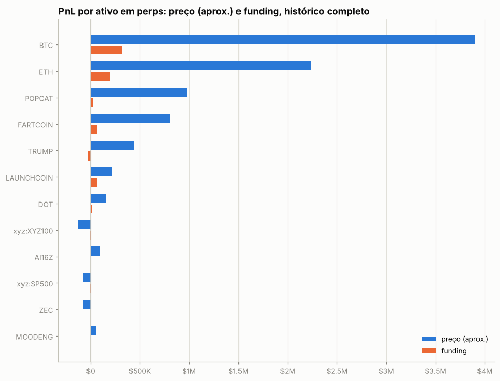
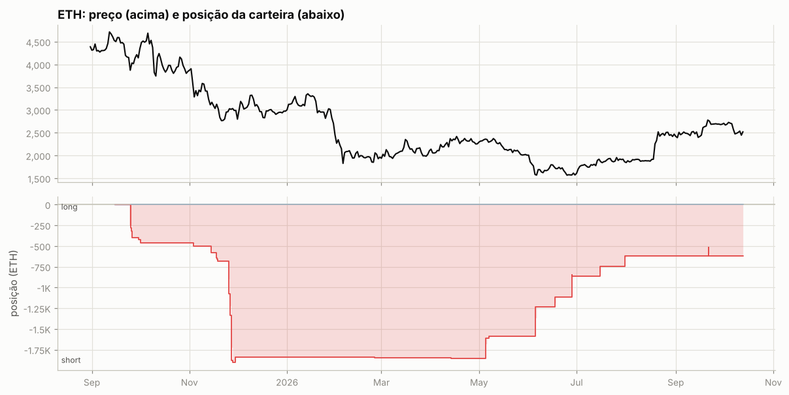
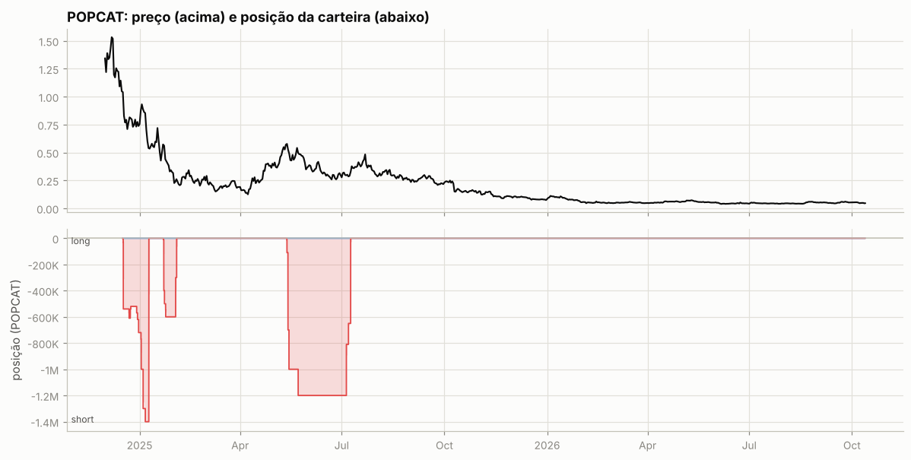
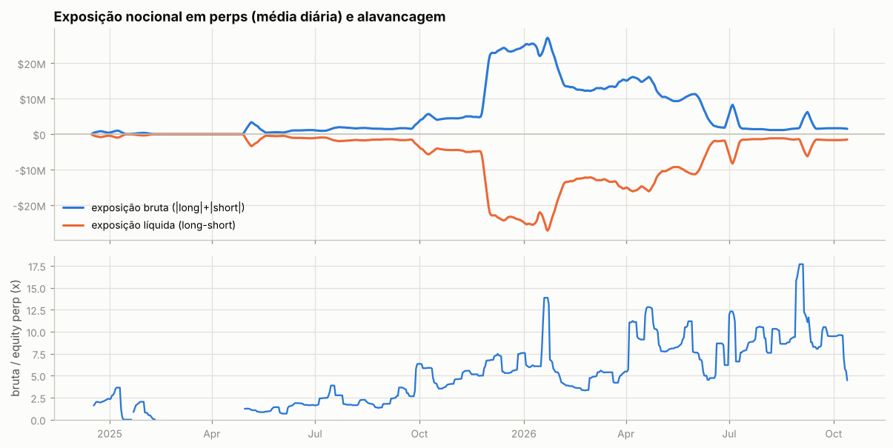
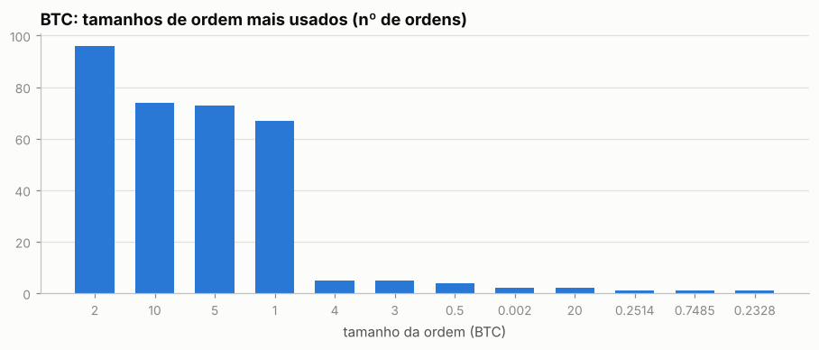
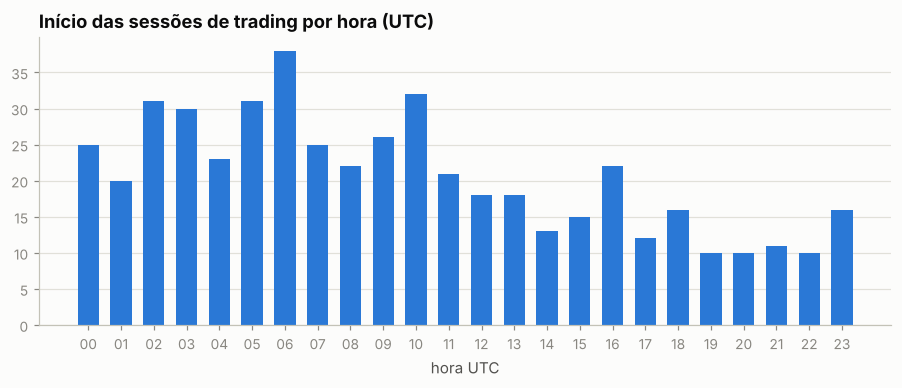
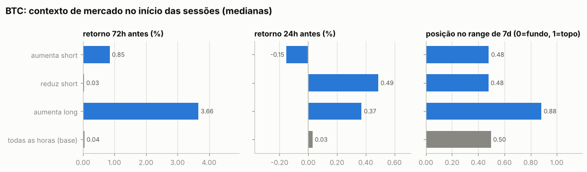
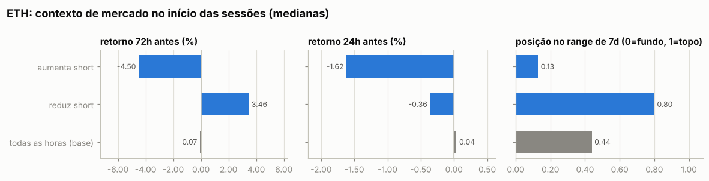
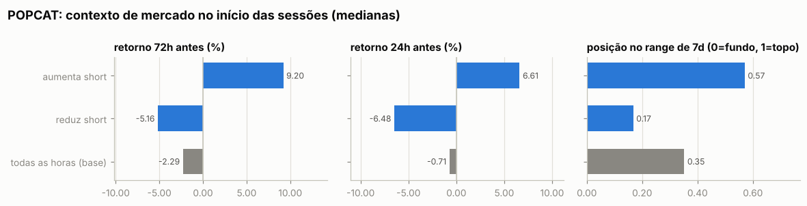
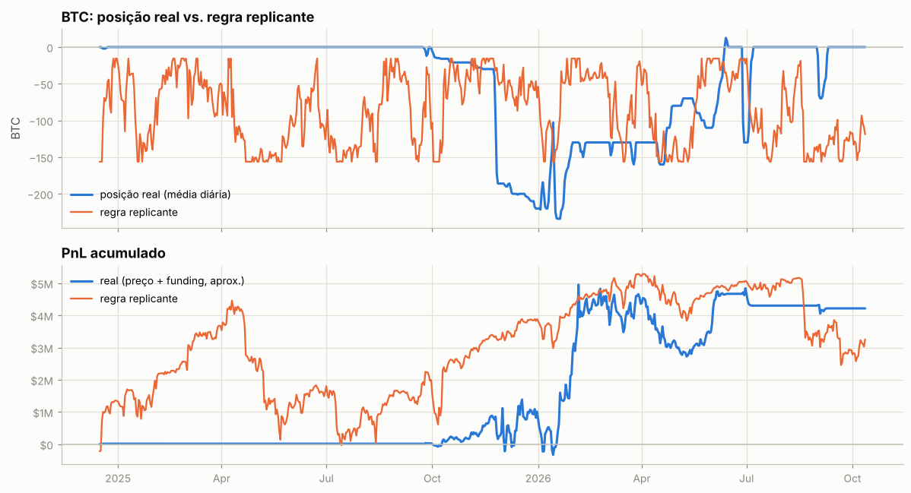

# Relatório automático — `0xfce053a5e461683454bf37ad66d20344c0e3f4c0`

Gerado em 2026-10-13 16:48 UTC a partir da API pública da Hyperliquid (`POST /info`). Valores em USD. Este arquivo é regenerado por `python -m hlre.report`; a interpretação da estratégia fica em `ANALISE.md`.

## 1. Visão geral

| métrica | valor |
|---|---|
| Valor da conta (perp + spot) | $4.57M |
| PnL all-time (portfolio, inclui spot/airdrops) | +$10.83M |
| PnL all-time só de perps | +$9.45M |
| Volume all-time | $168.36M |
| Primeira atividade | 2024-12-18 |
| Fills disponíveis na API | 25,305 (desde 2024-12-16) |
| Ordens (fills agrupados por oid) | 3,559 |
| Funding líquido (recebido > 0) | +$648.8K |
| Taxas pagas (período dos fills) | -$39.7K |
| Liquidações (ledger) | 0 |
| Fills de liquidação/ADL | 9 |
| Papel da conta | user |
| API wallets (agentes) | 1 |

**Posições abertas agora:**

| ativo | tamanho | nocional | entrada | alav. | PnL não realizado | liq. |
|---|---|---|---|---|---|---|
| ETH | -622.4 | $1.57M | 3131.17 | 20x cross | +$380.1K | 3254.1409951232 |

## 2. Curva de PnL

Os fills cobrem todo o histórico: o PnL diário exato de perps (preço + funding − taxas) soma +$9.45M, contra +$9.45M do portfolio. Maior drawdown: **-$3.42M** (pico em 2026-02-05, fundo em 2026-05-10); dias positivos: 53%.

PnL de perps por trimestre

| trimestre | preço | funding | taxas | total |
|---|---|---|---|---|
| 2024Q4 | +$213.9K | +$15.4K | -$805 | +$228.5K |
| 2025Q1 | +$835.6K | +$13.0K | -$1.0K | +$847.6K |
| 2025Q2 | +$928.8K | -$19.5K | -$3.9K | +$905.4K |
| 2025Q3 | +$672.4K | +$102.2K | -$3.1K | +$771.5K |
| 2025Q4 | +$1.93M | +$259.9K | -$10.6K | +$2.18M |
| 2026Q1 | +$4.74M | +$181.6K | -$10.3K | +$4.92M |
| 2026Q2 | +$910.0K | +$41.1K | -$6.0K | +$945.1K |
| 2026Q3 | -$1.49M | +$50.8K | -$3.6K | -$1.45M |
| 2026Q4 | +$102.5K | +$4.3K | $0 | +$106.9K |

## 3. De onde veio o PnL

*Preço (aprox.)* usa a posição média diária de cada ativo, reconstruída a partir do histórico de funding (que traz o tamanho da posição a cada hora/dia desde o início da conta), vezes o movimento open→close do dia. Subestima o PnL de day trade, mas cobre o período sem fills. *Preço exato* marca cada fill no fechamento diário e só existe para o período coberto pelos fills.

| ativo | preço (aprox.) | funding | total | preço exato (período dos fills) | taxas (período dos fills) |
|---|---|---|---|---|---|
| BTC | +$3.90M | +$317.0K | +$4.22M | +$3.68M | -$27.7K |
| ETH | +$2.24M | +$190.7K | +$2.43M | +$2.16M | -$3.0K |
| POPCAT | +$982.9K | +$28.2K | +$1.01M | +$1.07M | -$1.4K |
| FARTCOIN | +$810.1K | +$67.5K | +$877.6K | +$790.4K | -$598 |
| TRUMP | +$440.9K | -$28.1K | +$412.8K | +$693.1K | -$3.9K |
| LAUNCHCOIN | +$214.3K | +$61.6K | +$275.9K | +$285.6K | -$411 |
| DOT | +$155.7K | +$17.7K | +$173.4K | +$238.0K | -$310 |
| xyz:XYZ100 | -$125.3K | -$3.0K | -$128.3K | -$126.9K | -$195 |
| AI16Z | +$100.6K | +$678 | +$101.3K | +$129.8K | -$101 |
| xyz:SP500 | -$73.1K | -$8.6K | -$81.8K | -$79.8K | -$117 |
| ZEC | -$72.6K | -$2.1K | -$74.6K | -$70.3K | -$247 |
| MOODENG | +$52.5K | +$307 | +$52.8K | +$50.3K | -$111 |
| HYPE | -$28.5K | +$5.5K | -$22.9K | -$38.7K | -$502 |
| ICP | +$18.8K | +$61 | +$18.8K | +$18.3K | -$27 |
| MEGA | -$14.2K | -$257 | -$14.5K | -$14.7K | -$11 |
| outros (21) | +$59.7K | +$1.6K | +$61.2K | +$50.7K | -$601 |

**Decomposição no período dos fills** (preço exato): quanto veio de *carregar* a posição (e, dentro disso, do viés médio vs. do *timing* de aumentar/reduzir), quanto de trades intradiários, funding e taxas.

| componente | BTC | ETH | POPCAT |
|---|---|---|---|
| carregar posição (carry) | +$3.72M | +$2.21M | +$998.9K |
|   ↳ viés (posição média × movimento) | +$773.1K | +$1.67M | +$133.5K |
|   ↳ timing (variação do tamanho) | +$2.95M | +$536.6K | +$865.4K |
| trades intradiários | -$41.4K | -$44.9K | +$74.6K |
| funding | +$317.0K | +$190.7K | +$28.2K |
| taxas | -$27.7K | -$3.0K | -$1.4K |
| posição média | -46.24 | -1,235.73 | -133,149.93 |
| movimento do preço no período | -16,720.00 | -1,350.50 | -1.00 |

## 4. Posições ao longo do tempo

Área clara: posição média diária (funding). Linha: posição exata (fills). Azul = long, vermelho = short.

Tabela mensal de exposição e alavancagem

| mês | exposição bruta | exposição líquida | equity perp | alavancagem (mediana) |
|---|---|---|---|---|
| 2024-12 | $580.9K | -$580.9K | $312.0K | 2.1x |
| 2025-01 | $372.4K | -$372.4K | $295.3K | 1.7x |
| 2025-02 | $17.2K | -$17.2K | $63.9K | 0.3x |
| 2025-03 | $0 | $0 | $0 | — |
| 2025-04 | $167.1K | -$167.1K | $98.5K | 1.2x |
| 2025-05 | $1.30M | -$1.30M | $1.34M | 1.0x |
| 2025-06 | $1.01M | -$1.01M | $641.6K | 1.7x |
| 2025-07 | $1.52M | -$1.52M | $661.4K | 2.5x |
| 2025-08 | $1.60M | -$1.60M | $934.3K | 1.8x |
| 2025-09 | $1.97M | -$1.97M | $555.5K | 3.0x |
| 2025-10 | $4.65M | -$4.65M | $1.05M | 4.1x |
| 2025-11 | $7.95M | -$7.95M | $1.34M | 5.3x |
| 2025-12 | $23.78M | -$23.78M | $3.77M | 6.4x |
| 2026-01 | $23.35M | -$23.35M | $3.51M | 6.1x |
| 2026-02 | $12.82M | -$12.82M | $3.42M | 3.7x |
| 2026-03 | $13.72M | -$13.70M | $2.65M | 5.3x |
| 2026-04 | $14.54M | -$14.50M | $1.39M | 10.7x |
| 2026-05 | $10.27M | -$10.24M | $1.19M | 8.2x |
| 2026-06 | $4.47M | -$4.38M | $651.5K | 6.4x |
| 2026-07 | $2.38M | -$2.38M | $299.1K | 8.9x |
| 2026-08 | $1.34M | -$1.28M | $132.1K | 9.3x |
| 2026-09 | $2.75M | -$2.75M | $270.3K | 9.5x |
| 2026-10 | $1.58M | -$1.58M | $242.9K | 7.0x |

## 5. Execução

**Tipos de ordem** (últimas 803 ordens que a API guarda, 2025-11-25 → 2026-09-24):

| orderType | tif | reduceOnly | isTrigger | ordens |
|---|---|---|---|---|
| Limit | Gtc | False | False | 472 |
| Limit | Gtc | True | False | 147 |
| Market | FrontendMarket | False | False | 166 |
| Market | FrontendMarket | True | False | 18 |

`FrontendMarket` = ordem a mercado enviada pela interface web; `Gtc` = limite que fica no livro; gatilhos (`isTrigger`) seriam stop/take-profit.

**Perfil por ativo (top 10 por volume):**

| ativo | volume | ordens | % taker (nocional) | tamanho mediano |
|---|---|---|---|---|
| BTC | $124.75M | 363 | 37% | 2 |
| TRUMP | $10.75M | 535 | 95% | 2,000 |
| ETH | $9.29M | 167 | 70% | 20 |
| POPCAT | $3.80M | 722 | 100% | 1e+04 |
| xyz:XYZ100 | $3.37M | 39 | 47% | 3 |
| xyz:SP500 | $3.33M | 38 | 13% | 10 |
| FARTCOIN | $1.80M | 204 | 95% | 5,000 |
| HYPE | $1.64M | 248 | 74% | 100 |
| LAUNCHCOIN | $1.43M | 284 | 100% | 2e+04 |
| DOT | $1.06M | 94 | 94% | 2,000 |

Os 5 tamanhos mais comuns respondem por 87% das ordens de BTC — lotes redondos e repetidos são assinatura de execução manual.

Sessões (ordens separadas por < 30 min): 495; mediana de 2 ordens e 0.1 min por sessão; dias com atividade: 238 de 646.

Por dia da semana: seg 14%, ter 17%, qua 17%, qui 13%, sex 14%, sáb 14%, dom 12%

## 6. Comportamento de entrada e saída

### BTC

Por ordem (medianas):

| ação | ordens | retorno 24h antes | 72h antes | 7d antes | posição no range 7d | 24h depois | 7d depois |
|---|---|---|---|---|---|---|---|
| aumenta short | 232 | +0.17% | +2.38% | -3.41% | 0.47 | -0.12% | -0.20% |
| reduz short | 125 | +0.48% | -0.02% | -0.54% | 0.41 | +0.02% | -0.14% |
| aumenta long | 4 | +0.73% | +3.93% | +4.72% | 0.94 | +0.74% | -0.54% |
| reduz long | 2 | +1.02% | +2.42% | +2.54% | 0.97 | +1.88% | -0.70% |
| todas as horas (base) |  | +0.03% | +0.04% | +0.02% | 0.50 | +0.03% | +0.02% |

Por sessão (ordens a menos de 30 min uma da outra contam como uma decisão; p = teste de Mann-Whitney contra todas as horas do período):

| sessão | sessões | retorno 24h antes | 72h antes | 7d antes | range 7d | no topo (>0,7) | no fundo (<0,3) |
|---|---|---|---|---|---|---|---|
| aumenta short | 72 | -0.15% (p=0.363) | +0.85% (p=0.022) | -2.49% (p=0.023) | 0.48 (p=0.740) | 29% | 28% |
| reduz short | 81 | +0.49% (p=0.118) | +0.03% (p=0.326) | -0.50% (p=0.373) | 0.48 (p=0.460) | 31% | 32% |
| aumenta long | 3 | +0.37% (p=0.496) | +3.66% (p=0.027) | +4.33% (p=0.063) | 0.88 (p=0.021) | 100% | 0% |
| todas as horas (base) |  |  |  |  |  | 33% | 32% |

- Aumentos de posição feitos com a posição no prejuízo (preço pior que o preço médio): **27%** das ordens (34% do tamanho); distância mediana do preço médio: -4.61%.
- Reduções/fechamentos com lucro: **65%** de 127; ganho médio $53.8K vs. perda média -$16.2K; realizado +$3.68M.

- Episódios (de zerado a zerado, ou até inverter): 6; fechados com lucro: 67%; duração mediana 5.8 dias; o melhor episódio sozinho = 99% da soma dos episódios lucrativos.

Maiores episódios por PnL realizado

| início | fim | dias | lado | tam_max | nocional_max | ordens | entrada | saída | realizado |
|---|---|---|---|---|---|---|---|---|---|
| 2025-09-30 | 2026-06-11 | 254.4 | short | 234.00 | $22.31M | 287 | 87,876 | 80,166 | +$4.19M |
| 2026-06-27 | 2026-07-06 | 8.8 | short | 130.00 | $8.08M | 28 | 59,903 | 62,717 | -$365.9K |
| 2026-09-01 | 2026-09-09 | 7.5 | short | 70.00 | $5.58M | 17 | 76,642 | 79,293 | -$185.6K |
| 2024-12-18 | 2024-12-22 | 4.0 | short | 2.00 | $210.0K | 5 | 104,880 | 97,146 | +$15.5K |
| 2025-09-24 | 2025-09-27 | 3.5 | short | 16.00 | $1.75M | 20 | 110,267 | 109,317 | +$15.2K |
| 2026-06-12 | 2026-06-14 | 1.4 | long | 20.00 | $1.29M | 6 | 63,874 | 64,310 | +$8.7K |

### ETH

Por ordem (medianas):

| ação | ordens | retorno 24h antes | 72h antes | 7d antes | posição no range 7d | 24h depois | 7d depois |
|---|---|---|---|---|---|---|---|
| aumenta short | 110 | +1.54% | +4.99% | -5.52% | 0.49 | +0.03% | +5.27% |
| reduz short | 57 | +0.08% | +3.46% | +4.02% | 0.63 | -1.39% | -1.03% |
| todas as horas (base) |  | +0.04% | -0.07% | -0.11% | 0.44 | +0.04% | -0.01% |

Por sessão (ordens a menos de 30 min uma da outra contam como uma decisão; p = teste de Mann-Whitney contra todas as horas do período):

| sessão | sessões | retorno 24h antes | 72h antes | 7d antes | range 7d | no topo (>0,7) | no fundo (<0,3) |
|---|---|---|---|---|---|---|---|
| aumenta short | 18 | -1.62% (p=0.027) | -4.50% (p=0.174) | -8.32% (p=0.001) | 0.13 (p=0.032) | 28% | 61% |
| reduz short | 11 | -0.36% (p=0.955) | +3.46% (p=0.031) | +4.38% (p=0.031) | 0.80 (p=0.021) | 55% | 18% |
| todas as horas (base) |  |  |  |  |  | 29% | 34% |

- Aumentos de posição feitos com a posição no prejuízo (preço pior que o preço médio): **7%** das ordens (7% do tamanho); distância mediana do preço médio: -12.51%.
- Reduções/fechamentos com lucro: **100%** de 57; ganho médio $31.3K vs. perda média —; realizado +$1.78M.

- Episódios (de zerado a zerado, ou até inverter): 1; fechados com lucro: —; duração mediana nan dias; o melhor episódio sozinho = — da soma dos episódios lucrativos.

Maiores episódios por PnL realizado

| início | fim | dias | lado | tam_max | nocional_max | ordens | entrada | saída | realizado |
|---|---|---|---|---|---|---|---|---|---|
| 2025-09-25 | 2026-09-24 | 364.2 | short | 1,900 | $6.04M | 167 | 3,201 | 1,970 | +$1.78M |

### POPCAT

Por ordem (medianas):

| ação | ordens | retorno 24h antes | 72h antes | 7d antes | posição no range 7d | 24h depois | 7d depois |
|---|---|---|---|---|---|---|---|
| aumenta short | 454 | +7.94% | +11.10% | +7.29% | 0.59 | -6.36% | -28.08% |
| reduz short | 268 | -12.81% | -32.34% | -26.47% | 0.02 | -0.36% | +22.79% |
| todas as horas (base) |  | -0.71% | -2.29% | -4.82% | 0.35 | -0.64% | -3.15% |

Por sessão (ordens a menos de 30 min uma da outra contam como uma decisão; p = teste de Mann-Whitney contra todas as horas do período):

| sessão | sessões | retorno 24h antes | 72h antes | 7d antes | range 7d | no topo (>0,7) | no fundo (<0,3) |
|---|---|---|---|---|---|---|---|
| aumenta short | 24 | +6.61% (p=0.001) | +9.20% (p=0.000) | +4.93% (p=0.019) | 0.57 (p=0.002) | 38% | 21% |
| reduz short | 9 | -6.48% (p=0.037) | -5.16% (p=0.040) | -26.47% (p=0.024) | 0.17 (p=0.029) | 0% | 78% |
| todas as horas (base) |  |  |  |  |  | 26% | 45% |

- Aumentos de posição feitos com a posição no prejuízo (preço pior que o preço médio): **51%** das ordens (41% do tamanho); distância mediana do preço médio: +0.03%.
- Reduções/fechamentos com lucro: **100%** de 268; ganho médio $4.0K vs. perda média —; realizado +$1.07M.

- Episódios (de zerado a zerado, ou até inverter): 4; fechados com lucro: 100%; duração mediana 17.8 dias; o melhor episódio sozinho = 48% da soma dos episódios lucrativos.

Maiores episódios por PnL realizado

| início | fim | dias | lado | tam_max | nocional_max | ordens | entrada | saída | realizado |
|---|---|---|---|---|---|---|---|---|---|
| 2024-12-16 | 2025-01-09 | 23.7 | short | 1,400,000 | $1.21M | 335 | 0.9378 | 0.5928 | +$514.0K |
| 2025-05-12 | 2025-07-09 | 57.1 | short | 1,200,000 | $645.1K | 178 | 0.5682 | 0.2933 | +$329.8K |
| 2025-01-22 | 2025-02-03 | 11.9 | short | 600,000 | $335.7K | 207 | 0.5942 | 0.2114 | +$229.7K |
| 2025-01-19 | 2025-01-19 | 0.6 | short | 20.00 | $12 | 2 | 0.612 | 0.6063 | +$0 |

### Todos os episódios relevantes (todas as moedas)

Episódios com nocional máximo ≥ $50K: 33; fechados com lucro: 75%. Abaixo, os 25 maiores por PnL realizado, em ordem de data. *7d/30d antes* e *vs. máx. 30d*: o que o preço tinha feito até a primeira ordem; *funding a.a.*: taxa anualizada nas 24h anteriores (positiva = longs pagam shorts); *entrada média vs. 1ª ordem*: positivo = foi aumentando a posição com o preço indo contra; *contra (máx.)*: quanto o preço andou contra a primeira ordem durante o episódio; *capturado*: movimento entre o preço médio de entrada e o de saída.

| ativo | lado | início | dias | nocional máx. | 7d antes | 30d antes | vs. máx. 30d | funding a.a. na entrada | entrada média vs. 1ª ordem | contra (máx.) | pior PnL aberto | capturado | realizado | funding |
|---|---|---|---|---|---|---|---|---|---|---|---|---|---|---|
| POPCAT | short | 2024-12-16 | 24 | $1.21M | -21% | -41% | -47% | +62% | -13% | +3% | -$10.5K | +37% | +$514.0K | +$16.8K |
| MOODENG | short | 2024-12-17 | 3 | $183.4K | -6% | -40% | -48% | +43% | +3% | +3% | -$1.0K | +27% | +$50.3K | +$307 |
| HYPE | short | 2024-12-18 | 6 | $429.1K | +85% | — | -13% | +173% | -7% | +29% | -$127.8K | -15% | -$52.9K | +$5.3K |
| BTC | short | 2024-12-18 | 4 | $210.0K | +6% | +14% | -3% | +22% | +0% | +0% | -$197 | +7% | +$15.5K | +$364 |
| TRUMP | short | 2025-01-19 | 3 | $451.3K | — | — | +0% | +797% | +49% | +91% | -$91.7K | +38% | +$161.8K | +$3.6K |
| POPCAT | short | 2025-01-22 | 12 | $335.7K | -3% | -33% | -46% | +83% | +14% | +19% | -$6.0K | +64% | +$229.7K | +$1.2K |
| AI16Z | short | 2025-01-24 | 10 | $200.3K | -34% | — | -64% | +37% | -2% | +5% | -$3.2K | +62% | +$129.8K | +$677 |
| TRUMP | short | 2025-04-29 | 14 | $4.00M | +69% | +36% | -12% | -4% | -4% | +6% | -$189.5K | +11% | +$469.2K | -$30.3K |
| POPCAT | short | 2025-05-12 | 57 | $645.1K | +55% | +105% | -8% | +70% | -0% | +6% | -$27.4K | +48% | +$329.8K | +$10.2K |
| DOT | short | 2025-06-04 | 129 | $582.0K | -8% | +5% | -22% | +11% | -0% | +14% | -$86.4K | +40% | +$236.8K | +$18.0K |
| FARTCOIN | short | 2025-06-10 | 123 | $1.32M | +7% | -14% | -25% | +36% | +3% | +39% | -$340.9K | +66% | +$794.4K | +$67.4K |
| TRUMP | short | 2025-06-17 | 12 | $288.0K | -9% | -25% | -39% | +11% | -2% | +0% | -$36 | +5% | +$14.7K | -$495 |
| LAUNCHCOIN | short | 2025-07-05 | 112 | $609.2K | +12% | -30% | -57% | +30% | -17% | +69% | -$47.9K | +33% | +$285.6K | +$61.6K |
| HYPE | short | 2025-09-22 | 4 | $133.0K | -8% | +13% | -16% | +59% | -4% | +1% | -$1.8K | +9% | +$13.2K | +$411 |
| TRUMP | short | 2025-09-23 | 17 | $274.3K | -11% | -12% | -19% | -19% | -1% | +5% | -$15.1K | +38% | +$109.6K | +$656 |
| BTC | short | 2025-09-24 | 3 | $1.75M | -4% | -0% | -5% | +11% | -2% | +1% | -$2.6K | +1% | +$15.2K | +$678 |
| ETH | short | 2025-09-25 | 364 | $6.04M | -11% | -7% | -14% | +5% | -22% | +16% | -$323.8K | +38% | +$1.78M | +$183.8K |
| BTC | short | 2025-09-30 | 254 | $22.31M | +1% | +5% | -3% | +7% | -23% | +11% | -$618.6K | +9% | +$4.19M | +$297.6K |
| TRUMP | short | 2025-10-16 | 27 | $405.5K | -20% | -30% | -32% | -40% | +12% | +60% | -$147.0K | -18% | -$61.0K | -$1.7K |
| ZEC | short | 2025-10-28 | 19 | $244.8K | +24% | +514% | -10% | +17% | +57% | +120% | -$83.9K | -28% | -$70.3K | -$2.1K |
| xyz:SP500 | short | 2026-03-19 | 25 | $1.70M | — | — | -1% | -17% | -1% | +5% | -$77.9K | -5% | -$79.8K | -$8.6K |
| xyz:XYZ100 | short | 2026-03-28 | 11 | $1.73M | -4% | -9% | -9% | -4% | +0% | +9% | -$91.7K | -8% | -$126.9K | -$3.0K |
| BTC | long | 2026-06-12 | 1 | $1.29M | +3% | -20% | -22% | +7% | -1% | +0% | -$370 | +1% | +$8.7K | -$397 |
| BTC | short | 2026-06-27 | 9 | $8.08M | -6% | -18% | -19% | +2% | -0% | +6% | -$278.6K | -5% | -$365.9K | +$10.6K |
| BTC | short | 2026-09-01 | 8 | $5.58M | -2% | +22% | -4% | +11% | +0% | +7% | -$353.9K | -3% | -$185.6K | +$8.2K |

## 7. Funding

Funding líquido total: **+$648.8K** (recebido $810.7K, pago -$161.9K). Na Hyperliquid o funding é pago de hora em hora; quando positivo, longs pagam shorts.

| ativo | lado | funding | rendimento anualizado s/ nocional |
|---|---|---|---|
| BTC | short | +$317.4K | 4.7% |
| BTC | long | -$397 | -10.7% |
| ETH | short | +$190.7K | 6.0% |
| POPCAT | short | +$28.2K | 26.2% |
| (outros) | short | +$113.2K | 13.5% |
| (outros) | long | -$363 | -5.7% |

## 8. Fluxos, eventos e carteiras relacionadas

| tipo | eventos | USD (+ entra / − sai) |
|---|---|---|
| withdraw | 88 | -$31.30M |
| accountClassTransfer | 23 | — (sem valor em USD) |
| spotGenesis | 1 | — (sem valor em USD) |
| cStakingTransfer | 9 | — (sem valor em USD) |
| spotTransfer | 1 | — (sem valor em USD) |
| send | 16 | +$182.5K |
| deposit | 82 | +$24.86M |

**Gestão de margem.** Dias com depósito: 57; em 67% deles o PnL dos 3 dias anteriores era negativo (mediana -$31.9K). Dias com saque: 75; em 76% deles o PnL dos 3 dias anteriores era positivo (mediana +$195.8K). Base: 39% de todos os dias vêm depois de 3 dias negativos. Correlação entre o fluxo do dia e a variação da exposição bruta: 0.44 (positiva = deposita para abrir posição e saca ao reduzir).

Ponte HyperCore↔HyperEVM (endereços de sistema `0x2000…`/`0x2222…`): 7 transferências, entrada $0, saída $1.88M — uso de DeFi na HyperEVM.

**Carteiras relacionadas** (conta vinculada de staking para desconto de taxa + maiores contrapartes de transferências; o saldo de staking e o PnL ajudam a ver se posições aqui são hedge de algo mantido lá):

| carteira | relação | transferências | volume transferido | valor da conta hoje | PnL all-time | HYPE em staking | maiores saldos spot |
|---|---|---|---|---|---|---|---|
| `0x6b9e773128f453f5c2c60935ee2de2cbc5390a24` | hot wallet de serviço (recebe USDC da HyperEVM e repassa a centenas de usuários: exchange/ponte) | 9 | $2.06M | $7.8K | +$0 | 0 | USDC 9,187 |

**Liquidações e ADL (auto-deleveraging) nos fills:**

| quando (UTC) | ativo | tipo | lado | preço | tamanho | posição antes | PnL realizado |
|---|---|---|---|---|---|---|---|
| 2025-10-10 21:16:04 | FARTCOIN | Auto-Deleveraging | B | 0.42574 | 958000.0 | -958000.0 | +$794.4K |
| 2025-10-10 21:17:14 | DOT | Auto-Deleveraging | B | 2.9757 | 45184.7 | -140000.0 | +$54.6K |
| 2025-10-10 21:17:14 | TRUMP | Auto-Deleveraging | B | 4.678 | 38000.0 | -38000.0 | +$109.6K |
| 2025-10-10 21:18:44 | DOT | Auto-Deleveraging | B | 2.5065 | 58111.6 | -94815.3 | +$97.4K |
| 2025-10-10 21:19:37 | DOT | Auto-Deleveraging | B | 1.8765 | 497.5 | -36703.7 | +$1.1K |
| 2025-10-10 21:19:40 | DOT | Auto-Deleveraging | B | 1.7235 | 244.1 | -36206.2 | +$600 |
| 2025-10-10 21:19:40 | DOT | Auto-Deleveraging | B | 1.7235 | 5715.5 | -35962.1 | +$14.1K |
| 2025-10-10 21:20:04 | DOT | Auto-Deleveraging | B | 1.487 | 16930.6 | -30246.6 | +$45.6K |
| 2025-10-10 21:20:04 | LAUNCHCOIN | Auto-Deleveraging | B | 0.056947 | 756904.0 | -2565000.0 | +$69.5K |

## 9. Dá para copiar? (espelhar a posição com atraso)

PnL de quem replicasse exatamente a posição da carteira, mas com N horas de atraso (marcação horária, sem custos). Se o PnL se mantém com atraso, a vantagem está em horizontes longos e é copiável; se desaba, depende de timing fino.

| atraso | BTC | ETH | POPCAT |
|---|---|---|---|
| 0h | +$3.75M | +$2.17M | +$1.08M |
| 1h | +$3.75M | +$2.16M | +$1.06M |
| 4h | +$3.85M | +$2.15M | +$1.05M |
| 12h | +$3.77M | +$2.24M | +$1.01M |
| 24h | +$3.76M | +$2.22M | +$886.0K |
| 72h | +$4.01M | +$2.27M | +$586.9K |
| 168h | +$4.40M | +$2.37M | +$231.3K |

## 10. Teste de replicação por regras (BTC)

Regra testada: *short-bias com filtro de tendência e fade* — short de até 156.2 BTC (o percentil 90 do tamanho real), cheio abaixo da média móvel e reduzido acima; dentro do regime, mais short perto do topo do range e menos perto do fundo. Parâmetros escolhidos no treino (2024-12-16 → 2025-11-13) e avaliados no teste (2025-11-14 → 2026-10-12).

|  | parâmetros | PnL treino | PnL teste | correlação c/ posição real (teste) |
|---|---|---|---|---|
| melhor regra no treino | MA100, range 30d, fração em alta 1.0, fade 0.9 | +$3.14M | +$36.2K | -0.24 |
| carteira real (aprox.) | — | +$424.5K | +$3.64M | 1.00 |

Clone comportamental (regressão linear da posição real em médias móveis, ranges e retornos): R² treino 0.29, R² teste -1.07, correlação no teste 0.48.

---

Metodologia e código: ver `README.md` na raiz do repositório.
